# 从零构建一个 AI Agent 应用

## ——以 OpenMinis 为样本的移动端 Agent 工程手册

> 本文档由对 [OpenMinis](https://github.com/OpenMinis/OpenMinis) 源码的逆向工程研究整理而成。
> 研究对象：iOS (Swift/SwiftUI, ~187k 行) + Android (Kotlin/Compose, ~154k 行) 双端原生实现。
> 仓库快照日期：2026-07-26。
>
> 每一条技术论断均标注真实文件路径与行号区间。未直接观察到而由代码推导的结论标注 `[推断]`。
> 本文档不修改被研究仓库的任何源码。

---

## 目录

| 章 | 标题 | 主题 |
|---|---|---|
| 0 | [序章：这本手册怎么用](#0-序章这本手册怎么用) | 规模、追踪码、阅读路径 |
| 1 | [整体架构与分层设计](#1-整体架构与分层设计) | 启动链路、分层、端到端数据流 |
| 2 | [Agent 核心循环](#2-agent-核心循环从一条消息到多轮工具调用) | 状态机、SSE、工具编排、取消 |
| 3 | [上下文工程](#3-上下文工程压缩预算与记忆) | token、压缩、memory、system prompt |
| 4 | [多模型 Provider 抽象层与认证](#4-多模型-provider-抽象层与认证) | 协议、wire 转换、OAuth |
| 5 | [工具系统](#5-工具系统定义分发权限与结果回灌) | schema、文件工具、权限门 |
| 6 | [iOS 沙箱：iSH](#6-ios-沙箱把-linux-塞进-app-进程ish) | 指令模拟、fakefs、rootfs |
| 7 | [Android 沙箱：PRoot](#7-android-沙箱proot-用户态-chroot) | ptrace、PTY 桥、挂载 |
| 8 | [Native Offload](#8-native-offload让沙箱里的-agent-调用设备能力) | IPC、能力清单、权限 |
| 9 | [Skills、Soul、Memory 与 MCP](#9-skillssoulmemory-与-mcp可扩展的-agent-能力面) | 渐进式加载、MCP 集成 |
| 10 | [浏览器自动化](#10-浏览器自动化让-agent-用你的登录态上网) | 动作集、页面表示、Cookie |
| 11 | [持久化与多端同步](#11-持久化与多端同步) | 存储模型、冲突解决、传输 |
| 12 | [UI 层与流式渲染](#12-ui-层与流式渲染让-8000-行的对话不掉帧) | 虚拟化、增量 markdown、数学 |
| 13 | [系统集成](#13-系统集成让-agent-长在操作系统里) | URL scheme、后台执行、Intents |
| 14 | [语音与多媒体管线](#14-语音与多媒体管线) | VAD/ASR、纠错、TTS、FFmpeg |
| 15 | [工程化：构建、调试、可观测](#15-工程化构建调试可观测与质量保障) | 依赖流水线、Debug RPC、测试 |
| 16 | [跨平台移植](#16-跨平台移植从-iosandroid-抽到-macoswindowslinux) | L1/L2/L3 分层、共享策略 |
| 17 | [从零开始的实施路线图](#17-从零开始的实施路线图) | 七阶段、验收动作、错误路线 |

---

## 0. 序章：这本手册怎么用

### 0.1 这份文档是什么

这是对 **OpenMinis** 这一个真实、已上架、开源的移动端 AI Agent 应用的**逆向工程教学文档**。它不是 API 参考，也不是产品说明书；它回答的是一个工程问题：

> 如果我要从零写一个"能在手机上跑、能真正干活"的 AI Agent 应用，需要造哪些零件、每个零件的最小可用版本长什么样、哪些坑是平台强加的、哪些是设计者主动选择的？

素材全部来自仓库 `/Users/shenxt/Dev/PI/OpenMinis` 的源码本身。每一条技术论断都标注了文件路径与行号区间；凡是从代码推导而非直接观察到的结论，都显式标注 `[推断]`。

### 0.2 被研究的对象有多大

按 2026-07-26 仓库快照统计（`find` + `wc -l` 实测）：

| 平台 | 语言 | 文件数 | 行数 |
|---|---|---|---|
| iOS | Swift | 362 个唯一文件名 | 186,750 |
| iOS | Objective-C (`.m`/`.h`，几乎全在 `NativeOffloads/`) | 64 | 24,259（含头文件） |
| Android | Kotlin | 453 个唯一文件名 | 154,146 |
| Android | C/C++ (`src/main/cpp/`) | 3 个自研 + vendored cppjieba | — |
| 共享资产 | JSON + 校验脚本 | 3 | 298 |

分层规模（iOS，`src/ios/<dir>` 下 `.swift`+`.m`+`.h` 合计）：

| 目录 | 文件 | 行数 | 层 |
|---|---|---|---|
| `Agent/` | 103 | 65,966 | Agent 核心 |
| `Views/` | 79 | 55,947 | UI |
| `Providers/` | 63 | 27,378 | 模型接入 |
| `NativeOffloads/` | 64 | 24,259 | 设备能力桥 |
| `Debug/` | 27 | 13,478 | 调试基建 |
| `Shared/` | 53 | 8,188 | 跨模块工具 |
| `iSH/` | 14 | 6,586 | 沙箱内核集成 |
| `MinisTests/` + `MinisUITests/` | 16 | 3,009 | 测试 |

分层规模（Android，`com/openminis/app/<pkg>`）：

| 包 | 文件 | 行数 | 层 |
|---|---|---|---|
| `ui/` | 146 | 74,379 | UI |
| `sandbox/` | 36 | 14,900 | 沙箱 + offload handler |
| `data/` | 54 | 11,136 | 持久化 |
| `provider/` | 23 | 8,133 | 模型接入 |
| `debug/` | 12 | 5,310 | 调试基建 |
| `speech/` | 22 | 4,893 | 语音 |
| `config/` | 19 | 4,545 | 配置即工具 |
| `browser/` | 8 | 3,900 | 浏览器自动化 |
| `auth/` | 11 | 2,968 | 认证 |
| `service/` | 8 | 2,702 | 前台服务/后台执行 |
| `offload/` | 13 | 2,207 | offload 客户端侧 |
| `agent/` | 5 | 1,317 | 循环辅助（bashism、loop detector、soul） |
| `tools/` | 8 | 881 | 工具实现 |

值得注意的两个比例：

1. **UI 占比接近一半**（iOS 55,947 / Android 74,379）。Agent 应用的"难"不在调模型，在把流式、可中断、带富媒体与工具卡片的对话渲染得不掉帧。第 12 章专门讲这件事。
2. **`tools/` 只有 881 行，`sandbox/` 有 14,900 行**。这不是笔误：这个产品的工具能力主要不是靠一个个手写工具函数堆出来的，而是靠**给模型一个真实 Linux shell**，再用 native offload 把设备能力挂进去。这是全书最重要的架构判断，第 5–8 章围绕它展开。

### 0.3 代码里的设计追踪码：`[T-xxx]`

仓库里散落着 **662 个不同的 `[T-xxx]` 标签，共 2,566 处引用**（`grep -rhoE "\[T-[a-z0-9-]+\]"` 实测）。它们看起来像这样：

来源 `src/android/app/src/main/java/com/openminis/app/provider/LLMProvider.kt:28-42`：

```kotlin
/**
 * [T-android-tool-splits-reply-fix] True when the streamed assistant text
 * is one monolithic `content` string per response (OpenAI Chat
 * Completions): text deltas carry NO positional relationship to
 * tool_calls deltas … Some endpoints (qwen) flush trailing content chunks
 * after tool_calls deltas purely as a chunking artifact; reconstructing
 * those chronologically fabricates an order the wire format cannot express.
 */
val streamTextIsMonolithic: Boolean get() = false
```

这是一条**从线上 bug 反推出的协议语义结论**，被固化成了一个 provider 能力位。类似的还有：

| 标签 | 出现次数 | 讲的是什么 |
|---|---|---|
| `[T-android-thinking-level-arch]` | 41 | 思考等级的结构化钳制，见 §0.5 的例子 |
| `[T-android-provider-voice]` | 40 | 语音 provider 抽象 |
| `[T-android-voice-correction]` | 34 | 语音识别后处理纠错 |
| `[T-oauth-refresh-race]` | 20 | OAuth token 刷新竞态 |
| `[T-icloud-provider-sync-consistency]` | 21 | iCloud 同步一致性 |
| `[T-bash-on-demand]` | 跨双端 | Alpine 默认 ash 不是 bash，按需引导 |
| `[T-android-empty-stream-retry]` | — | 上游静默断流的检测（`LLMProvider.kt:120-162`） |

其中 **35 个标签同时出现在 iOS 与 Android 两侧**，372 个仅 iOS，255 个仅 Android。同时出现的那 35 个，就是"两端必须保持行为一致"的契约清单——第 16 章会用它来论证哪些逻辑值得抽成平台无关核心。

**读这份文档时，遇到 `[T-xxx]` 请当成"此处有一个非显然的、被真实用户报告驱动的设计决策"。** 它们是这个仓库最有价值的部分，因为教科书不会告诉你 qwen 端点会在 tool_calls 之后补发 content chunk。

### 0.4 章节地图与阅读路径

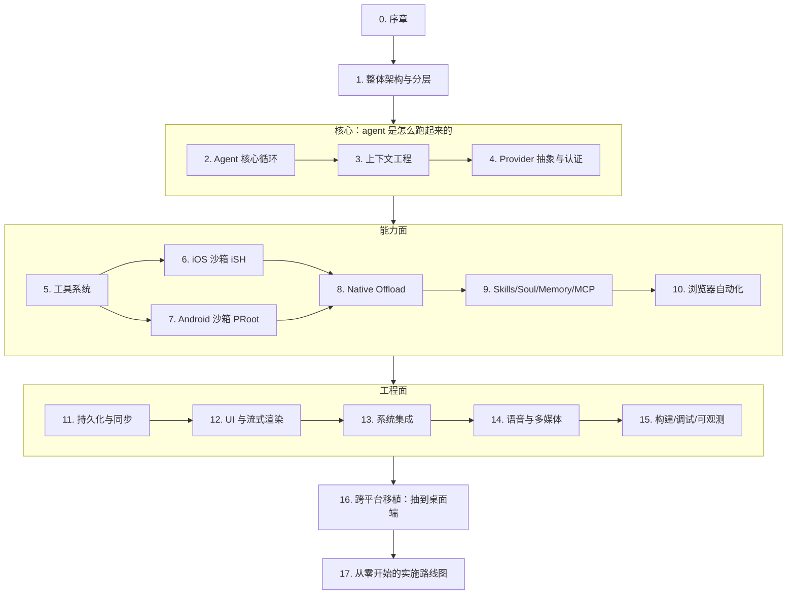

三条推荐路径：

- **想尽快跑通一个能用的 agent** → 0 → 1 → 2 → 4 → 5 → 17。跳过沙箱，工具先用纯原生实现。
- **想理解"给模型一台真电脑"这件事** → 0 → 1 → 6/7 → 8 → 5 → 9。
- **想把它移植到桌面** → 0 → 1 → 16 → 17，再按 16 章点名的章节回查。

### 0.5 一个贯穿全书的设计范式：结构化约束优于纪律约束

读代码时会反复看到同一种手法：**把"每个实现都必须记得做的事"变成类型系统或默认实现层面的强制**，而不是靠注释和 code review。

来源 `src/android/app/src/main/java/com/openminis/app/provider/LLMProvider.kt:44-106`：

```kotlin
/**
 * [T-android-thinking-level-arch] PUBLIC entry — this is what every caller
 * invokes. It is NOT overridden by providers: the default implementation
 * clamps the requested thinking level to the current [model]'s ceiling ONCE,
 * then delegates to [sendMessageClamped]. Making the clamp structural
 * (rather than a call each impl must remember) means no code path can send
 * an over-range level — a fallback that swapped [model] mid-flight clamps to
 * the NEW model's limit automatically. Mirrors iOS
 * AgentProvider.streamAgentMessage → …Clamped.
 */
suspend fun sendMessage(…): LLMResponse = sendMessageClamped(
    messages, systemPrompt, maxTokens, temperature, imageParts, tools,
    clampThinkingLevel(thinkingLevel),
)

/** Provider implementations override THIS (not [sendMessage]). The
 *  `thinkingLevel` received here has already been clamped … implementations
 *  must NOT re-clamp. */
fun streamMessageClamped(…): Flow<LLMStreamChunk>
```

模式是：**公开入口 = final + 做校验 → 委派给受保护的、由实现覆写的 `…Clamped` 变体**。注释里点名了它防住的具体事故：模型 fallback 中途换了 `model`，如果钳制写在调用点，换模型后就会用旧上限。

同样的范式在本书其它地方出现：

- 工具执行前的 preflight 门（第 5 章）——权限与参数校验不在每个工具里写，而在分发层拦一次。
- offload 的 `OffloadGate`（第 8 章）——沙箱进程发来的请求先过一道统一闸门。
- bashism 规则表（第 6/7 章）——iOS 与 Android 加载**同一份 JSON** (`src/shared/bashism/bashism_rules.json`)，两端只写匹配引擎，规则不可能漂移。

来源 `src/ios/Agent/Shell/BashismDetector.swift:7-9`：

```swift
/// (T-bash-on-demand). Rules and their fix hints live in the shared JSON
/// (`bashism_rules.json`, also loaded by Android) — this type is only the
/// matching engine.
```

来源 `src/android/app/src/main/java/com/openminis/app/agent/shell/BashismDetector.kt:10-13`：

```kotlin
 * switch to bash only when needed (T-bash-on-demand). The rule table and its
 * fix hints are the SHARED JSON (assets/bashism/bashism_rules.json, generated
 * from src/shared/bashism — the same file iOS loads), so the two platforms can
 * never drift.
```

Gradle 侧的搬运（`src/android/app/build.gradle.kts:124-128`）：

```kotlin
from(rootProject.file("../shared/bashism")) {
    include("bashism_rules.json", "bashism_test_vectors.json")
}
into(layout.projectDirectory.dir("src/main/assets/bashism"))
```

Xcode 侧则直接以 `path = ../shared/bashism/bashism_rules.json` 引用同一物理文件（`src/ios/Minis.xcodeproj/project.pbxproj:716-717`）。

这就是整个仓库在"共享代码"这件事上的实际立场：**不共享代码，共享数据与测试向量**。第 16 章会详细论证这个选择的得失。

### 0.6 需要先摆正的三个期待

1. **这不是一个 Kotlin Multiplatform / Flutter 项目。** 两端各写一遍，共享的只有 3 个文件、298 行。这是刻意的，理由见第 16 章。
2. **没有 CI。** `.github/` 下只有 `pull_request_template.md` 和 `ISSUE_TEMPLATE/bug_report.md`，**没有任何 workflow**。README 也说明这是私有开发树的镜像，不接受 PR。质量门禁靠 `src/shared/bashism/validate_detector.swift` 这类独立回归脚本、Android 单测与 instrumented 测试承担。第 15 章会指出这块的空白与读者应当补什么。
3. **首次构建重。** 原生依赖（iSH、PRoot、FFmpeg、LAME）与 Alpine rootfs 都从源码构建，`BUILDING.md` 给的预算是 30–60 分钟。第 15 章拆解这条流水线。

### 0.7 术语约定

| 本文用词 | 英文 / 代码中的名字 | 含义 |
|---|---|---|
| 沙箱 | sandbox | 跑在 App 进程内的 Linux 环境（iSH 或 PRoot + Alpine） |
| 原生卸载 | native offload | 沙箱内进程调用宿主 App 原生能力的机制 |
| 提供方 | provider | 一个模型服务接入点（Anthropic / OpenAI / Gemini / …） |
| 技能 | skill | 含 `SKILL.md` 的文件夹，按需加载的能力包 |
| 灵魂 | soul | 用户可编辑的人格/长期指令预设（`[T-soul-md]`） |
| 压缩 | compaction | 上下文超限时对历史做摘要与裁剪 |
| 工具循环 | agent loop | 「请求 → 工具调用 → 结果回灌 → 再请求」的多轮编排 |
| 会话 | session | 一个独立对话及其附属文件、工作区、锁 |
| 工作区 | workspace | 会话绑定的可读写目录，`minis://workspace/` 寻址 |


## 1. 整体架构与分层设计

### 1.1 这一章解决什么问题

OpenMinis 不是“聊天页面直接调用一个 HTTP 接口”，而是把 UI、Agent loop、模型 Provider、工具分发、Linux 用户态环境、原生能力和持久化拼成一个可恢复的请求系统；iOS 的主入口是 `MinisApp`，Agent 入口是 `AIChatViewModel`，Android 的主入口是 `MinisApp`/`MainActivity`，Agent 入口是 `ChatViewModel`（`src/ios/MinisApp.swift:75-151`、`src/ios/Agent/Chat/AIChatViewModel.swift:14-15`、`src/android/app/src/main/java/com/openminis/app/MinisApp.kt:60-94`、`src/android/app/src/main/java/com/openminis/app/ui/chat/ChatViewModel.kt:85-93`）。

这一章要解决的是“从哪里启动、状态放在哪里、请求经过哪些边界、每个目录为什么存在”，而不是解释某一个 Provider 的 JSON 字段或某个工具的参数；启动阶段可见的依赖关系分别集中在 iOS `MinisApp.body` 和 Android `MinisApp.onCreate`（`src/ios/MinisApp.swift:148-326`、`src/android/app/src/main/java/com/openminis/app/MinisApp.kt:153-482`）。

读者应当能用本章的目录地图定位后续专题：比如“模型配置”落在 `Providers/` 或 `provider/`，“消息循环”落在 `Agent/Chat/` 或 `ui/chat/`，“真实 Linux”落在 `iSH/` 或 `sandbox/`（`src/ios/Agent/Chat/AIChatViewModel.swift:4207-4267`、`src/android/app/src/main/java/com/openminis/app/ui/chat/ChatViewModel.kt:5779-6030`、`src/ios/iSH/ISHKernel.m:334-450`、`src/android/app/src/main/java/com/openminis/app/sandbox/PRootKernel.kt:53-179`）。

同一个抽象在两端并不总是同一个技术实现：iOS 以 SwiftUI `@MainActor`/`ObservableObject` 和 actor 为主，Android 以 Compose、`ViewModel`、`StateFlow`、Room 和 Application 作用域对象为主（`src/ios/Agent/Chat/AIChatViewModel.swift:14-15`、`src/ios/Agent/Chat/ChatStore.swift:352-357`、`src/android/app/src/main/java/com/openminis/app/ui/chat/ChatViewModel.kt:85-93`、`src/android/app/src/main/java/com/openminis/app/data/db/AppDatabase.kt:20-26`）。

### 1.2 先建立一张架构地图

可以把仓库先压缩成七层。下面的箭头表达数据依赖，不表示每一层只有一个目录：Agent 核心会同时依赖 Provider、工具和持久化，工具又可能进入沙箱或系统集成边界（`src/ios/Agent/Chat/AIChatViewModel+ToolDefinitions.swift:9-20`、`src/android/app/src/main/java/com/openminis/app/tools/AgentTools.kt:7-36`）。

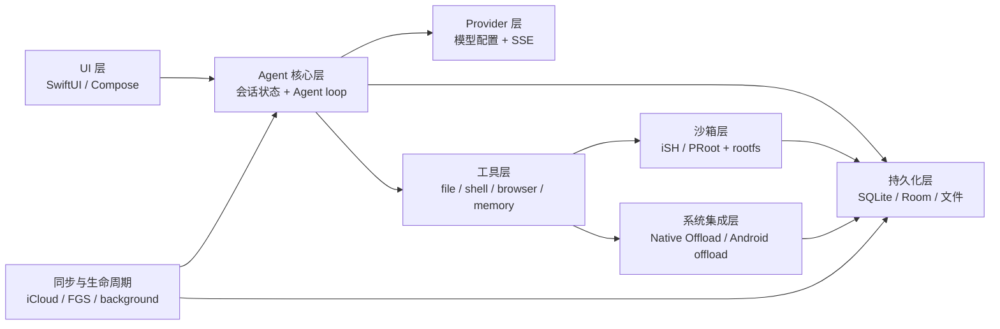

这张图有三个容易被忽略的事实。

1. UI 只负责把会话和输入交给 ViewModel，并观察渲染状态；Android `ChatScreen` 通过 `viewModel(...)` 获取会话 VM，iOS `AIChatView` 通过 `CachedViewModel` 包住缓存 VM（`src/android/app/src/main/java/com/openminis/app/ui/chat/ChatScreen.kt:380-429`、`src/ios/Views/Chat/AIChatView.swift:15-65`）。
2. Provider 不是 Agent loop。Provider 只提供统一的流式接口；工具循环、重试、fallback、tool result 回灌仍在 VM 内（`src/ios/Providers/AgentProvider.swift:174-208`、`src/android/app/src/main/java/com/openminis/app/provider/LLMProvider.kt:13-118`、`src/ios/Agent/Chat/AIChatViewModel.swift:4701-4788`、`src/android/app/src/main/java/com/openminis/app/ui/chat/ChatViewModel.kt:6006-6030`）。
3. “本地能力”不是直接塞进 Provider。工具层先决定语义，再由 iSH/PRoot 的 guest 命令或 native-offload IPC 进入系统边界（`src/ios/iSH/ISHKernel.m:413-445`、`src/android/app/src/main/java/com/openminis/app/sandbox/NativeOffload.kt:15-26`）。

目录关系可以先记成如下两组平行树：

| 抽象层 | iOS 主要目录 | Android 主要目录 | 关键边界 |
|---|---|---|---|
| UI | `src/ios/Views/ContentView.swift:322-399`、`src/ios/MinisApp.swift:148-214` | `src/android/app/src/main/java/com/openminis/app/ui/navigation/AppNavigation.kt:488-532`、`src/android/app/src/main/java/com/openminis/app/MainActivity.kt:346-443` | UI 观察 VM，不直接持有网络流 |
| Agent 核心 | `src/ios/Agent/Chat/AIChatViewModel.swift:4207-4267`、`src/ios/Agent/ToolLoopDetector.swift:61-83` | `src/android/app/src/main/java/com/openminis/app/ui/chat/ChatViewModel.kt:5779-6030`、`src/android/app/src/main/java/com/openminis/app/agent/ToolLoopDetector.kt:62-88` | 一个用户 turn 可能包含多轮模型→工具→模型 |
| Provider | `src/ios/Providers/AgentProvider.swift:176-208`、`src/ios/Providers/ProviderConfigStore.swift:132-159` | `src/android/app/src/main/java/com/openminis/app/provider/LLMProvider.kt:13-118`、`src/android/app/src/main/java/com/openminis/app/data/repository/ProviderRepository.kt:148-210` | provider-specific wire format 收敛到统一事件 |
| 工具 | `src/ios/Agent/Chat/AIChatViewModel+ToolDefinitions.swift:9-20`、`src/ios/Agent/Chat/AIChatViewModel.swift:5209-5294` | `src/android/app/src/main/java/com/openminis/app/tools/AgentTools.kt:14-36`、`src/android/app/src/main/java/com/openminis/app/ui/chat/ChatViewModel.kt:7101-7152` | 定义与执行分离；执行结果要变成 tool result |
| 沙箱 | `src/ios/iSH/ISHKernel.h:18-49`、`src/ios/Agent/ISH/ISHExecutionCoordinator.swift:87-134` | `src/android/app/src/main/java/com/openminis/app/sandbox/PRootKernel.kt:53-179`、`src/android/app/src/main/java/com/openminis/app/sandbox/ExecutionCoordinator.kt:72-115` | guest 路径与 host 路径隔离 |
| 持久化 | `src/ios/Agent/Chat/ChatStore.swift:352-397`、`src/ios/Providers/ProviderConfigStore.swift:153-159` | `src/android/app/src/main/java/com/openminis/app/data/db/AppDatabase.kt:20-22`、`src/android/app/src/main/java/com/openminis/app/data/repository/ChatRepository.kt:222-255` | UI 内存状态可重建，SQLite/Room 是恢复依据 |
| 系统集成 | `src/ios/NativeOffloads/CalendarOffload.m:1171-1178`、`src/ios/Agent/Offload/OffloadPermissionManager.swift:6-23`、`src/ios/Agent/Intents/SendPromptIntent.swift:30-51` | `src/android/app/src/main/java/com/openminis/app/sandbox/NativeOffload.kt:72-103`、`src/android/app/src/main/java/com/openminis/app/offload/OffloadPermissionManager.kt:13-43`、`src/android/app/src/main/java/com/openminis/app/service/SessionActivityTracker.kt:24-45` | 权限、后台、通知、Health/Calendar 等越过平台边界 |

### 1.3 iOS：从进程启动到首个聊天页面

#### 1.3.1 启动入口的四个阶段

iOS 同时使用 SwiftUI App 生命周期和一个很小的 UIKit Delegate 适配器。`AppDelegate` 的存在不是为了接管整个应用，而是为了接收 Home Screen Quick Action；其余 URL、scenePhase 和根视图仍由 SwiftUI `App` 管理（`src/ios/AppDelegate.swift:5-15`、`src/ios/MinisApp.swift:83-92`）。

| 阶段 | 入口 | 主要动作 | 依赖关系 |
|---|---|---|---|
| A. App 实例化 | `MinisApp.init` | 锁定进程启动时间；DEBUG 启动 DebugServer；安装 TextKit 防护；设置语言；预热 SOUL、KaTeX、生物识别、Live Activity 和屏幕常亮 | 不依赖 `ContentView` 已渲染；这些动作必须早于首个 UIKit/SwiftUI 子树 |
| B. UIKit 冷启动 | `AppDelegate.application(_:didFinishLaunchingWithOptions:)` | 失效旧的 `CLBackgroundActivitySession`；注册通知 delegate；刷新快捷操作 | 冷启动通知必须在 `didFinishLaunching` 返回前注册 |
| C. Scene 连接 | `SceneDelegate.scene(_:willConnectTo:options:)` | 消费冷启动快捷操作和冷启动 URL；暖启动快捷操作走 `windowScene` | 自定义 SceneDelegate 后，URL 必须显式转发到共享导入管线 |
| D. SwiftUI 根场景 | `MinisApp.body` | 挂载 `ContentView`、全局语音控制、锁屏层、环境对象、URL 路由和根级确认 sheet | `ContentView` 共享同一 `ShareCoordinator` |
| E. 根视图出现 | `MinisApp.body.onAppear` | 配置注册、日志、Provider 迁移/模型刷新、分享缓冲、后台管理、网络监控、iSH 目录监视、同步引擎 | 这些大多是幂等或后台 Task；不能假定只调用一次 |
| F. 聊天页出现 | `AIChatView.onAppear` | 获取/加载指定 session VM，并触发 `ensureKernelBooted` | Linux kernel 延迟到聊天页或发送路径，而不是 App 冷启动 |

表中 A→F 是根据 SwiftUI `App`、`UIApplicationDelegate`、`UIWindowSceneDelegate` 和 SwiftUI `onAppear` 的入口关系整理出的启动顺序，属于 `[推断]`；每个动作本身和依赖关系都由右侧代表符号与行号直接验证，不能把 `[推断]` 误读为一个单一函数调用栈。

阶段 A 的真实初始化代码如下。这里的“单例”多数通过 `shared` 访问；`debugServer` 只有 DEBUG 构建存在（`src/ios/MinisApp.swift:99-145`）。

```swift
@main
struct MinisApp: App {
    @UIApplicationDelegateAdaptor(AppDelegate.self) private var appDelegate
    @StateObject private var shareCoordinator = ShareCoordinator.shared

    init() {
        _ = Self.processLaunchedAt
        #if DEBUG
        try? debugServer.start(port: 8321)
        #endif
        NSTextContainerSetSizeGuard.install()
        AttributeQueryRecorder.install()
        Bundle.enableLanguageOverride()
        let lang = UserDefaults.standard.string(forKey: "appLanguage") ?? ""
        Bundle.setLanguage(lang.isEmpty ? nil : lang)
        SoulStore.refreshCache()
        KaTeXRenderer.shared.warmUp()
        BiometricAuth.prewarm()
        AgentLiveActivityManager.shared.cleanupStaleActivities(source: "MinisApp.init")
        Task { @MainActor in KeepScreenAwakeController.shared.start() }
    }
}
```

代码位置：`src/ios/MinisApp.swift:75-145`。

这里有一个启动顺序约束：`Bundle.enableLanguageOverride()` 必须先于 `Bundle.setLanguage`，而 `SoulStore.refreshCache()` 必须早于 `ContentView` 读取自己的 `@State soulName`；后者是从初始化代码和注释直接可见的依赖（`src/ios/MinisApp.swift:122-132`）。

#### 1.3.2 AppDelegate 只补 UIKit 缺口

`AppDelegate.application(_:didFinishLaunchingWithOptions:)` 在 iOS 17 可用时清理背景活动，随后调用 `ShortcutNotificationDelegate.shared.register()`，并异步刷新快捷操作（`src/ios/AppDelegate.swift:23-56`）。它还返回一个配置了 `SceneDelegate` 的 `UISceneConfiguration`，因此冷启动和暖启动快捷操作都能落到 SceneDelegate（`src/ios/AppDelegate.swift:59-71`）。

```swift
func application(
    _ application: UIApplication,
    didFinishLaunchingWithOptions launchOptions: [UIApplication.LaunchOptionsKey: Any]? = nil
) -> Bool {
    if #available(iOS 17.0, *) {
        CLBackgroundActivitySession().invalidate()
    }
    ShortcutNotificationDelegate.shared.register()
    Task { @MainActor in
        QuickActionRouter.registerShortcutItems()
    }
    return true
}

func application(
    _ application: UIApplication,
    configurationForConnecting connectingSceneSession: UISceneSession,
    options: UIScene.ConnectionOptions
) -> UISceneConfiguration {
    let config = UISceneConfiguration(name: nil, sessionRole: connectingSceneSession.role)
    config.delegateClass = SceneDelegate.self
    return config
}
```

代码位置：`src/ios/AppDelegate.swift:25-71`。

SceneDelegate 有两条快捷操作路径：冷启动从 `connectionOptions.shortcutItem` 消费，暖启动从 `windowScene(_:performActionFor:completionHandler:)` 消费；两者都转发给 `QuickActionRouter.shared.handle`（`src/ios/AppDelegate.swift:74-133`）。自定义 scene delegate 还会截住 URL，因此冷启动 `connectionOptions.urlContexts` 和暖启动 `scene(_:openURLContexts:)` 都必须调用 `handleURLContexts`（`src/ios/AppDelegate.swift:109-161`）。

#### 1.3.3 根 WindowGroup 如何注入全局对象

根场景把 `ContentView` 和三个全局覆盖层放进同一个 `ZStack`：后台中断横幅、语音播放器控制、应用锁层（`src/ios/MinisApp.swift:148-162`）。`shareCoordinator` 作为 `EnvironmentObject` 注入，因此 `ContentView`、`AIChatView` 和 scene URL 处理共享同一个实例（`src/ios/MinisApp.swift:196-214`、`src/ios/Views/ContentView.swift:112-114`、`src/ios/Views/Chat/AIChatView.swift:169-184`）。

```swift
WindowGroup {
    ZStack {
        ContentView()
            .overlay(alignment: .top) {
                BackgroundInterruptionBanner()
            }
        AudioPiPCapsule()
        SpeechPlayerControl()
        AppLockOverlay()
    }
    .environmentObject(shareCoordinator)
    .preferredColorScheme(
        appearanceMode == 1 ? .light : appearanceMode == 2 ? .dark : nil
    )
    .environment(\.locale, appLanguage.isEmpty ? .current : Locale(identifier: appLanguage))
    .onOpenURL { url in
        guard !SessionLockStore.shared.appIsLocked else {
            pendingURLWhileLocked = url
            return
        }
        if ExternalFileImporter.canIngest(url) {
            ExternalFileImporter.ingest(url, into: shareCoordinator)
            return
        }
        DeepLinkRouter.handle(url: url, shareCoordinator: shareCoordinator)
    }
}
```

代码位置：`src/ios/MinisApp.swift:148-214`。

根 `onAppear` 再进行一次应用级 bootstrap：配置字段注册、通知 delegate、日志、Provider 配置迁移和模型刷新、分享缓冲、后台管理、网络监控、FileProvider、外部目录 security scope、挂载目录和 iCloud sync（`src/ios/MinisApp.swift:247-312`）。它的顺序很重要：网络监控在 iSH DNS 同步之前启动，外部目录激活在 `AIChatViewModel.refreshMountedFolderSymlinks()` 之前，Sync v2 先启动并决定是否暂停 v1（`src/ios/MinisApp.swift:280-312`）。

#### 1.3.4 ContentView 负责“选中哪个 session”，不负责 Agent loop

`ContentView.body` 根据设备宽度选择 `NavigationSplitView` 或 `NavigationStack`，再监听快捷操作、分享和 session 更新（`src/ios/Views/ContentView.swift:322-399`）。进入窄屏导航时，草稿 ID 以 `__new__` 前缀标记；真正的 `AIChatView` 接收 `nil` sessionId，让 VM 在第一次发送时创建数据库 session（`src/ios/Views/ContentView.swift:917-955`）。

```swift
private var stackLayout: some View {
    NavigationStack(path: $navigationPath) {
        sessionList(useNavigationLinks: true)
            .navigationDestination(for: String.self) { id in
                AIChatView(
                    sessionId: Self.isNewSessionId(id) ? nil : id,
                    draftId: Self.isNewSessionId(id) ? id : nil,
                    initialGroupId: Self.extractGroupId(from: id)
                )
                .id(id)
            }
    }
}
```

代码位置：`src/ios/Views/ContentView.swift:915-955`。

`AIChatView` 的 `CachedViewModel` 从 `ViewModelCache` 获取按 session ID 缓存的 VM，并转发 `objectWillChange`；因此返回列表再进入同一 session 不会必然取消仍在运行的 Agent loop（`src/ios/Views/Chat/AIChatView.swift:15-65`、`src/ios/Agent/Chat/ChatLifecycleSupport.swift:334-405`）。聊天页再把 `vm.sessionId` 注入自定义环境键，并把 VM 注入 `EnvironmentObject`，深层工具面板无需逐层传递 VM（`src/ios/Views/Chat/AIChatView.swift:601-603`、`src/ios/Views/Chat/AIChatView.swift:1360-1364`）。

#### 1.3.5 iOS 首个请求之前，Linux 仍然可能没有启动

`AIChatView.onAppear` 会调用 `vm.ensureKernelBooted()`；该方法先安装 rootfs，再调用 `ISHKernel.shared.boot(withRootPath:)`，启动成功后安装 fakefs 变更追踪器和 per-session path-translate hook（`src/ios/Views/Chat/AIChatView.swift:1079-1116`、`src/ios/Agent/Chat/AIChatViewModel+Misc.swift:12-50`）。因此“应用已打开”不等于“Linux 已经可执行”。

### 1.4 Android：Application 先建骨架，Activity 再挂 UI

#### 1.4.1 `MinisApp` 的初始化顺序

Android 把跨 Activity 的依赖放在 `Application`。`MinisApp` 持有 `AppDatabase`、Chat/Provider/EnvVar/Skill/MCP/Memory 等 repository，以及后台设置、通知器和挂载目录 store（`src/android/app/src/main/java/com/openminis/app/MinisApp.kt:60-82`）。它还提供进程级网络监控和浏览器池（`src/android/app/src/main/java/com/openminis/app/MinisApp.kt:110-124`）。

| 阶段 | `MinisApp` 动作 | 为什么必须在这个位置 |
|---|---|---|
| A. `attachBaseContext` | ACRA 初始化 | 在任何 app-level singleton 前捕获后续崩溃（`src/android/app/src/main/java/com/openminis/app/MinisApp.kt:126-150`） |
| B. `onCreate` 前置保护 | ACRA reporter process 直接返回；prime Fast Mode；安装 native crash handler、FGS exception handler、crash frequency detector | `:acra` 进程不能重复打开 DB、socket 和 offload；safe mode 要阻断重型子系统（`src/android/app/src/main/java/com/openminis/app/MinisApp.kt:153-255`） |
| C. 诊断与数据库 | AppLogger、LaunchCycleBeacon、HangDetector；构造 `AppDatabase` 和 repositories | 后续启动日志、冷启动熔断和 UI 依赖这些对象（`src/android/app/src/main/java/com/openminis/app/MinisApp.kt:257-294`） |
| D. 配置与模型 | SOUL、配置权限/审计、ConfigRegistry、ModelsDevApi | Agent 和设置 UI 需要统一的配置读写面（`src/android/app/src/main/java/com/openminis/app/MinisApp.kt:295-315`） |
| E. 沙箱准备 | RootfsManager、ExecutionCoordinator、EnvVar redactor、network monitor、全局 bind mount、MountedFoldersStore | shell 工具必须能读到 `/var/minis` 的全局目录，执行器必须能拿到 env repository（`src/android/app/src/main/java/com/openminis/app/MinisApp.kt:316-365`） |
| F. Native offload | 注册每个 handler，启动 `NativeOffloadServer` | Handler 注册必须先于 server start；PRoot 后续会为 handler 安装 guest stub（`src/android/app/src/main/java/com/openminis/app/MinisApp.kt:367-429`） |
| G. 生命周期与服务 | SessionActivityTracker、SessionBadgeStore、后台 notifier、ActivityLifecycleCallbacks、权限 manager、speech manager、模型刷新 | Activity 创建前后都可能触发后台任务或权限请求（`src/android/app/src/main/java/com/openminis/app/MinisApp.kt:431-601`） |

数据库和 repository 的依赖顺序是源码中的连续赋值：先拿 singleton `AppDatabase`，再把 DAO 交给 `ChatRepository`，之后才构造其它 repository（`src/android/app/src/main/java/com/openminis/app/MinisApp.kt:286-294`）。沙箱依赖关系同样显式：`ExecutionCoordinator.init(this)` 之后把 `envVarRepository` 写入 coordinator；`NativeOffloadServer.start` 使用 `RootfsManager.getInstance(this).rootfsDir`（`src/android/app/src/main/java/com/openminis/app/MinisApp.kt:316-319`、`src/android/app/src/main/java/com/openminis/app/MinisApp.kt:429-430`）。

```kotlin
database = AppDatabase.getInstance(this)
chatRepository = ChatRepository(database.chatDao())
providerRepository = ProviderRepository(this)
envVarRepository = EnvVarRepository(this)
skillRepository = SkillRepository(this)
mcpRepository = MCPRepository(this)
memoryRepository = MemoryRepository(File(filesDir, "minis-global/memory"))

RootfsManager.getInstance(this)
ExecutionCoordinator.init(this)
ExecutionCoordinator.envVarRepository = envVarRepository
EnvVarPrivacyStore.init(this)
EnvVarRedactor.envVarRepository = envVarRepository
networkMonitor.start(this)
PRootKernel.registerGlobalBindMounts(this)
```

代码位置：`src/android/app/src/main/java/com/openminis/app/MinisApp.kt:286-335`。

Provider 配置在 Android 构造时不进行大块同步读盘，而是先以空 `ProviderConfig` 初始化 `MutableStateFlow`，再在 `Dispatchers.IO` 读取并发出真实配置（`src/android/app/src/main/java/com/openminis/app/data/repository/ProviderRepository.kt:148-210`）。这使 Application 的启动依赖图不会被大 JSON 的首次反序列化阻塞，但也意味着第一帧 UI 必须区分“尚未加载”和“确实没有 provider”（`src/android/app/src/main/java/com/openminis/app/data/repository/ProviderRepository.kt:158-170`）。

#### 1.4.2 Native offload 的注册顺序

`MinisApp.onCreate` 注册 alarm、calendar、clipboard、contacts、device、location、notification、photos、speech、browser、sessions、scheduled、Shizuku 等 handler，然后再调用 `NativeOffloadServer.start`（`src/android/app/src/main/java/com/openminis/app/MinisApp.kt:367-429`）。Server 的协议注释说明 guest 通过 `execve(handler-name)` 进入抽象 Unix socket，host handler 把结果写入 guest `/tmp` 并返回退出码和路径（`src/android/app/src/main/java/com/openminis/app/sandbox/NativeOffload.kt:15-26`）。

```kotlin
fun register(name: String, handler: NativeOffloadHandler) {
    require(name.isNotEmpty())
    handlers[name] = handler
}

@Synchronized
fun start(rootfsDir: File) {
    rootfsTmpDir = File(rootfsDir, "tmp")
    if (serverSocket != null) return
    val s = bindWithRetry() ?: throw IOException("failed to bind abstract socket")
    serverSocket = s
    acceptThread = thread(name = "native-offload-accept", isDaemon = true) {
        runAcceptLoop(s)
    }
}
```

代码位置：`src/android/app/src/main/java/com/openminis/app/sandbox/NativeOffload.kt:72-103`。

#### 1.4.3 MainActivity 把系统桥和 Compose 根挂上去

`MainActivity.onCreate` 先注册 Activity Result launcher，再处理 safe mode；safe mode 下不调用 `setContent`，避免引用 Application 中未初始化的重型依赖（`src/android/app/src/main/java/com/openminis/app/MainActivity.kt:120-201`）。随后恢复 session ID、启动权限流和 settings gate 流，把分享缓冲处理在首个 `ChatScreen` compose 之前（`src/android/app/src/main/java/com/openminis/app/MainActivity.kt:203-309`）。

```kotlin
val app = application as MinisApp
val explicitDeepLink = DeepLinkHandler.parse(intent?.data)
val launchDeepLink = if (explicitDeepLink !is DeepLinkAction.Unknown) {
    explicitDeepLink
} else {
    restoredChatSessionId?.let { DeepLinkAction.OpenSession(it) }
        ?: DeepLinkAction.Unknown
}

setContent {
    MinisTheme(darkTheme = darkTheme, fontScale = fontScale) {
        val navController = rememberNavController().also { this.navController = it }
        AppNavigation(
            chatRepository = app.chatRepository,
            providerRepository = app.providerRepository,
            envVarRepository = app.envVarRepository,
            skillRepository = app.skillRepository,
            mcpRepository = app.mcpRepository,
            memoryRepository = app.memoryRepository,
            navController = navController,
            initialDeepLink = launchDeepLink,
        )
        ConfigConfirmDialogHost()
    }
}
```

代码位置：`src/android/app/src/main/java/com/openminis/app/MainActivity.kt:329-443`。

`AppNavigation` 接收 Application 作用域 repository，并从 `MinisApp` 取同一个 `mountedFoldersStore`；注释明确指出重新 `remember` 一个 store 会使 UI 和 PRootKernel 看到不同实例（`src/android/app/src/main/java/com/openminis/app/ui/navigation/AppNavigation.kt:210-231`）。

#### 1.4.4 启动目标、深链和 NavHost

导航先处理 initial deep link，再解析 Launch Session 偏好和 crash/hang 熔断，最后决定 `SESSION_LIST`、旧 session 或草稿 chat。启动过程使用 `navController.navigate`，而不是等待普通点击安全门，因为第一次 composition 时 start destination 还未进入 RESUMED（`src/android/app/src/main/java/com/openminis/app/ui/navigation/AppNavigation.kt:233-371`）。

HTML shortcut 或 quick action 会在 NavHost 挂载前把 pending 状态写入 coordinator，然后直接把 `startDestination` 设为目标 chat，从而不出现 session list 闪烁（`src/android/app/src/main/java/com/openminis/app/ui/navigation/AppNavigation.kt:391-434`）。`NavHost` 的 session list route 把 repository 和点击回调注入 `SessionListScreen`，chat route 再把多个 repository 注入 `ChatScreen`（`src/android/app/src/main/java/com/openminis/app/ui/navigation/AppNavigation.kt:488-532`）。

### 1.5 分层机制与目录职责

下面的映射不是按“文件名像什么”推断，而是按实际调用点划分：入口负责组装，ViewModel 负责 turn 状态，Provider 负责流，工具负责动作，沙箱负责 Linux 进程和路径，持久化负责恢复，系统集成负责权限/后台/设备 API（`src/ios/MinisApp.swift:247-312`、`src/android/app/src/main/java/com/openminis/app/MinisApp.kt:286-429`）。

#### 1.5.1 UI 层

| 平台 | 目录与代表符号 | 责任边界 |
|---|---|---|
| iOS 根 UI | `src/ios/Views/ContentView.swift:322-399` `ContentView.body` | 选择宽屏/窄屏导航，接收 quick action 和 session 更新 |
| iOS 聊天 UI | `src/ios/Views/Chat/AIChatView.swift:169-232` `AIChatView` | 创建稳定的 `CachedViewModel`，绑定输入和全局观察对象 |
| iOS 消息渲染 | `src/ios/Agent/MessageList/CollectionViewMessageListV3.swift:14-48` `CollectionViewMessageListV3` | SwiftUI/UICollectionView 桥、块级消息、滚动和高度缓存 |
| iOS 设置/Provider | `src/ios/Views/Settings/StorageManagementView.swift:3-48`、`src/ios/Views/Providers/ProviderInstancesView.swift:4-15` | 通过 `@Published` store 展示配置和存储，不执行 Agent loop |
| iOS Linux 页面 | `src/ios/Views/Rootfs/ISHTerminalView.swift:308-378` `startShell` | 终端 UI 只负责启动/挂载/输入输出呈现 |
| Android 根导航 | `src/android/app/src/main/java/com/openminis/app/ui/navigation/AppNavigation.kt:210-231` `AppNavigation` | 把 Application repository 注入导航图，消费 deep link |
| Android 聊天 UI | `src/android/app/src/main/java/com/openminis/app/ui/chat/ChatScreen.kt:378-429` `ChatScreen` | 获取 session-scoped VM，`collectAsState` 订阅 UI 状态 |
| Android 会话列表 | `src/android/app/src/main/java/com/openminis/app/ui/sessions/SessionListScreen.kt:1-58` `SessionListScreen` | LazyColumn 列表和用户导航动作 |
| Android 设置/终端/浏览器 | `src/android/app/src/main/java/com/openminis/app/ui/settings/SettingsScreen.kt:1-58`、`ui/terminal/TerminalScreen.kt:1-48`、`ui/browser/BrowserSheet.kt:1-48` | Compose 页面与页面级状态，调用 VM/manager |
| Android rootfs 页面 | `src/android/app/src/main/java/com/openminis/app/ui/sandbox/RootfsManagementViewModel.kt:28-48` `RootfsManagementViewModel` | 以 StateFlow 呈现 rootfs 安装进度，不直接构造 PRoot 命令 |

UI 层的关键原则是“状态订阅而不是跨层查询”。Android `ChatScreen` 通过多个 `collectAsState` 获取 messages、isStreaming、modelName、attachments 等；iOS `AIChatView` 通过 `@StateObject` 包装 cache 并把 VM 的 `objectWillChange` 转发给 SwiftUI（`src/android/app/src/main/java/com/openminis/app/ui/chat/ChatScreen.kt:413-452`、`src/ios/Views/Chat/AIChatView.swift:19-65`）。

#### 1.5.2 Agent 核心层

| 平台 | 目录与代表符号 | 责任 |
|---|---|---|
| iOS | `src/ios/Agent/Chat/AIChatViewModel.swift:14-18` `AIChatViewModel` | `@MainActor` UI 状态、session history、send、Agent loop |
| iOS | `src/ios/Agent/Chat/AIChatViewModel+SSEStream.swift:214-327` `processStreamEvents` | 把统一 stream event 转成 assistant blocks 和 UI 更新 |
| iOS | `src/ios/Agent/Chat/AIChatViewModel+ToolDefinitions.swift:9-20` `makeAgentTools` | 生成 provider-agnostic 工具 schema |
| iOS | `src/ios/Agent/ToolLoopDetector.swift:61-83` `ToolLoopDetector.check` | 识别重复/危险工具循环；调用点见 `src/ios/Agent/Chat/AIChatViewModel.swift:5260-5294` |
| Android | `src/android/app/src/main/java/com/openminis/app/ui/chat/ChatViewModel.kt:85-93` `ChatViewModel` | ViewModel 作用域、StateFlow、history、stream job |
| Android | `src/android/app/src/main/java/com/openminis/app/ui/chat/ChatViewModel.kt:5779-5891` `runAgentLoop` | 轮次上限、assistant 占位、上下文卸载和循环控制 |
| Android | `src/android/app/src/main/java/com/openminis/app/ui/chat/ChatViewModel.kt:6006-6030` | 调 Provider stream，并收集 chunk |
| Android | `src/android/app/src/main/java/com/openminis/app/agent/ToolLoopDetector.kt:62-88` `ToolLoopDetector` | 工具执行前检查和执行后记录 |

两端 Agent 核心都把“一个用户输入”视为可重复的 turn：无工具调用时结束，有工具调用时持久化 assistant tool_use、执行工具、持久化 tool_result，再次请求模型（`src/ios/Agent/Chat/AIChatViewModel.swift:5054-5185`、`src/ios/Agent/Chat/AIChatViewModel.swift:5209-5456`、`src/android/app/src/main/java/com/openminis/app/ui/chat/ChatViewModel.kt:6615-6693`、`src/android/app/src/main/java/com/openminis/app/ui/chat/ChatViewModel.kt:6716-7029`）。

#### 1.5.3 Provider 层

| 平台 | 目录与代表符号 | 责任 |
|---|---|---|
| iOS Provider 协议 | `src/ios/Providers/AgentProvider.swift:174-208` `AgentProvider` | 统一 `AsyncThrowingStream<AgentStreamEvent, Error>` 接口和思考级别 clamp |
| iOS Provider 工厂 | `src/ios/Agent/Chat/AIChatViewModel+ProviderFactory.swift:11-46` `makeAgentProvider` | 从 `ModelEntry` 找 instance、凭证和具体 provider |
| iOS Provider 状态 | `src/ios/Providers/ProviderConfigStore.swift:132-159` `ProviderConfigStore` | `@MainActor` 单一配置源、实例/模型/group/binding |
| iOS 具体实现 | `src/ios/Providers/Anthropic/AnthropicAgentProvider.swift:8-15`、`:47-60` | 把 canonical message/tool 转成 SDK 请求，产生 stream |
| Android Provider 协议 | `src/android/app/src/main/java/com/openminis/app/provider/LLMProvider.kt:13-118` `LLMProvider` | 统一 `Flow<LLMStreamChunk>`，提供 max token 和 thinking clamp |
| Android Provider 工厂 | `src/android/app/src/main/java/com/openminis/app/provider/ProviderFactory.kt:13-41` `ProviderFactory.create` | 从 instance/credential/model 构造 Anthropic/Gemini/OpenAI provider |
| Android Provider 状态 | `src/android/app/src/main/java/com/openminis/app/data/repository/ProviderRepository.kt:57-86`、`:148-210` | Room/SharedPreferences 配置、异步 StateFlow 加载和模型刷新 |
| Android 具体实现 | `src/android/app/src/main/java/com/openminis/app/provider/openai/OpenAIProvider.kt:23-58` | OkHttp/callbackFlow 方向的 OpenAI-compatible Provider |

Provider 层的稳定契约不是某一种 API 的 JSON，而是“输入 messages + system + tools，输出文本/思考/工具/usage/finished 事件”。iOS 的事件枚举在 `AgentProvider.swift` 中统一，Android 的 `LLMStreamChunk` 在 `LLMProvider` 中统一使用（`src/ios/Providers/AgentProvider.swift:124-153`、`src/android/app/src/main/java/com/openminis/app/provider/LLMProvider.kt:3-11`）。

#### 1.5.4 工具层

iOS 的 canonical 工具定义集中在 `AIChatViewModel+ToolDefinitions.swift`；`shell_execute`、`file_read`、`file_write` 和 `browser_use` 都以 `AgentToolDefinition` 进入模型请求（`src/ios/Agent/Chat/AIChatViewModel+ToolDefinitions.swift:9-77`）。Android 用 `AgentTools.makeAgentTools()` 返回 provider-agnostic 列表，并按 memory 开关裁剪 `memory_write`/`memory_get`（`src/android/app/src/main/java/com/openminis/app/tools/AgentTools.kt:7-36`）。

执行层仍在 VM 中，因为 VM 需要把 tool block 状态和结果对齐到本次 assistant turn。iOS 的 `executeSingleToolUse` 由 loop 的 TaskGroup 调用，Android 的 `executeTool` 按工具名路由到 file/browser/memory/shell（`src/ios/Agent/Chat/AIChatViewModel.swift:5260-5294`、`src/android/app/src/main/java/com/openminis/app/ui/chat/ChatViewModel.kt:7101-7152`）。

#### 1.5.5 沙箱层

| 平台 | 路径 | 关键抽象 |
|---|---|---|
| iOS | `src/ios/iSH/ISHKernel.h:18-49` | `ISHKernel.shared`、rootfs boot、命令执行和 stdin |
| iOS | `src/ios/iSH/ISHKernel.m:334-450` | mount root、PID 1、proc/devpts、DNS、native binding 注册 |
| iOS | `src/ios/Agent/ISH/ISHExecutionCoordinator.swift:26-40`、`:87-134` | 按 session 生成 fs context，fork 独立 `/bin/sh` |
| iOS | `src/ios/Agent/ISH/MinisFsRouter.swift:16-76` | 将 `/var/minis/{offloads,attachments,workspace,browser}` 映射到 session host 目录 |
| Android | `src/android/app/src/main/java/com/openminis/app/sandbox/PRootKernel.kt:23-53`、`:59-78` | rootfs/proot 配置 holder，按需 boot |
| Android | `src/android/app/src/main/java/com/openminis/app/sandbox/PRootKernel.kt:150-178` | 启动 native offload server、安装 handler stub、应用 bind mounts |
| Android | `src/android/app/src/main/java/com/openminis/app/sandbox/ExecutionCoordinator.kt:63-115` | 按 session 管理 PersistentShell、注入 env、执行与 sanitize |
| Android | `src/android/app/src/main/java/com/openminis/app/sandbox/PersistentShell.kt:16-23` | 长驻 PRoot shell，跨命令保留 cwd/env/已安装包 |

iOS 的当前命令执行是每次 fork 新进程并使用 `fs_context` 路由，Android 的 `PersistentShell` 则显式保存长驻 shell；这不是 API 命名差异，而是两端底层实现的真正差异（`src/ios/Agent/ISH/ISHExecutionCoordinator.swift:26-38`、`src/android/app/src/main/java/com/openminis/app/sandbox/PersistentShell.kt:16-23`）。

#### 1.5.6 持久化层

| 平台 | 路径与符号 | 责任 |
|---|---|---|
| iOS | `src/ios/Agent/Chat/ChatStore.swift:352-397` `ChatStore` | actor 保护的 SQLite chat/session/media 根目录 |
| iOS | `src/ios/Agent/Chat/ChatStore.swift:1909-2020` `appendMessages` | 单事务写入多条 message、dirty mark 和 session 通知 |
| iOS | `src/ios/Agent/Chat/AIChatViewModel+Persistence.swift:1676-1691` | 将 AgentMessage 编码成 RawMessage 再交给 ChatStore |
| iOS | `src/ios/Providers/ProviderConfigStore.swift:153-159` | provider-config SQLite/JSON mirror |
| Android | `src/android/app/src/main/java/com/openminis/app/data/db/AppDatabase.kt:10-22` | Room database 与 DAO 接口 |
| Android | `src/android/app/src/main/java/com/openminis/app/data/db/AppDatabase.kt:196-207` | Application-scoped singleton 和 migrations |
| Android | `src/android/app/src/main/java/com/openminis/app/data/db/ChatDao.kt:56-109` | session/message 查询、观察和写入 |
| Android | `src/android/app/src/main/java/com/openminis/app/data/repository/ChatRepository.kt:10-37`、`:222-255` | DAO 上的 session/message 语义封装 |

持久化层是恢复边界：iOS Agent loop 在 assistant/tool result 之后调用 `ChatStore.appendMessages`，Android 在 turn 边界调用 `persistAssistantTurn`/`persistToolResultMessage`，UI 内存状态只用于即时渲染（`src/ios/Agent/Chat/AIChatViewModel.swift:5333-5366`、`src/android/app/src/main/java/com/openminis/app/ui/chat/ChatViewModel.kt:6941-6963`）。

#### 1.5.7 系统集成层

| 平台 | 目录 | 责任与代表符号 |
|---|---|---|
| iOS | `src/ios/NativeOffloads/` | C/ObjC handler 注册到 iSH 的 `native_offload`；例如 `calendar_offload_register`（`src/ios/NativeOffloads/CalendarOffload.m:1171-1178`） |
| iOS | `src/ios/Agent/Offload/` | Agent-facing permission state；`OffloadPermissionLevel` 三态定义（`src/ios/Agent/Offload/OffloadPermissionManager.swift:6-23`） |
| iOS | `src/ios/Agent/Intents/` | App Intents/Shortcuts 后台入口；`SendPromptIntent.perform` 先 setup keep-alive（`src/ios/Agent/Intents/SendPromptIntent.swift:6-18`、`:30-51`） |
| iOS | `src/ios/Agent/Background/` | `BackgroundKeepAliveManager`、Live Activity、TTS 等后台存活策略（`src/ios/Agent/Background/BackgroundKeepAliveManager.swift:14-46`） |
| iOS | `src/ios/Shared/` | NetworkMonitor、URL/deep link、share、日志、跨端同步公共状态；`LLMSessionRegistry` 维护长连接（`src/ios/Shared/LLMSessionRegistry.swift:23-57`） |
| Android | `src/android/app/src/main/java/com/openminis/app/sandbox/offload/` | PRoot guest stub 对应的 handler，由 `NativeOffloadServer.handleClient` 接收并分发（`src/android/app/src/main/java/com/openminis/app/sandbox/NativeOffload.kt:148-217`） |
| Android | `src/android/app/src/main/java/com/openminis/app/offload/` | 权限 manager、Health/Calendar/Alarm/Media/Shizuku 等平台管理器；权限三态见 `OffloadPermissionManager`（`src/android/app/src/main/java/com/openminis/app/offload/OffloadPermissionManager.kt:13-43`） |
| Android | `src/android/app/src/main/java/com/openminis/app/service/` | Foreground service 相关生命周期；`SessionActivityTracker` 区分 streaming 和 present session（`src/android/app/src/main/java/com/openminis/app/service/SessionActivityTracker.kt:9-22`） |
| Android | `src/android/app/src/main/java/com/openminis/app/deeplink/` | `minis://` URI 到 navigation action 的解析（`src/android/app/src/main/java/com/openminis/app/deeplink/DeepLinkHandler.kt:6-45`） |
| Android | `src/android/app/src/main/java/com/openminis/app/network/`、`notification/`、`share/` | 网络变化、完成通知、分享接收和跨 Activity 缓冲；启动桥见 `MainActivity.onCreate`（`src/android/app/src/main/java/com/openminis/app/MainActivity.kt:300-309`） |

Native offload 的共同原则是“guest 只看到命令，host 才拥有敏感 API”。iOS 在 `ISHKernel.bootWithRootPath` 中集中注册 native binding，Android 在 Application 中注册 Kotlin handler、由 PRoot server 通过 socket 回答（`src/ios/iSH/ISHKernel.m:413-445`、`src/android/app/src/main/java/com/openminis/app/MinisApp.kt:367-429`）。

#### 1.5.8 横向目录补全

下表把前面七层没有展开的目录也列出来，便于把“功能名”反查到代码位置。表中每一行都给出一个已核对的代表符号；同一目录下的其它文件遵循同一职责边界。

| 平台 | 目录 | 代表符号与行号 | 地图职责 |
|---|---|---|---|
| iOS | `src/ios/Agent/Session/` | `SkillStore`（`src/ios/Agent/Session/SkillStore.swift:5-9`） | Skills、SOUL、MCP、session lock/fork 等会话级能力 |
| iOS | `src/ios/Agent/Sync/` | `CloudSyncEngine`（`src/ios/Agent/Sync/CloudSyncEngine.swift:223-250`、`:453-470`） | iCloud/LAN 同步 engine、dirty record 和恢复 |
| iOS | `src/ios/Agent/Speech/` | `SpeechRecognitionManager`（`src/ios/Agent/Speech/SpeechRecognitionManager.swift:5-43`） | 系统语音识别、录音状态和输入模式 |
| iOS | `src/ios/Agent/Shell/` | `OnDemandBash`（`src/ios/Agent/Shell/OnDemandBash.swift:5-18`、`:46-58`） | bash 按需检测/安装和失败退避 |
| iOS | `src/ios/Agent/Markdown/` | `BlockNode`（`src/ios/Agent/Markdown/MinisMarkdownParser.swift:5-19`） | Markdown、代码块、表格、数学块解析 |
| iOS | `src/ios/Agent/BrowserUse/` | `BrowserUseManager`（`src/ios/Agent/BrowserUse/BrowserUseManager.swift:8-26`、`:71-90`） | WKWebView、tab、浏览器状态和下载 |
| iOS | `src/ios/Views/Sync/` | `CloudSyncSettingsV2View`（`src/ios/Views/Sync/CloudSyncSettingsV2View.swift:3-18`、`:31-48`） | 同步开关、设备与上传类别设置 |
| iOS | `src/ios/Views/Skills/` | `SkillsManagementView`（`src/ios/Views/Skills/SkillsManagementView.swift:28-48`） | Skills 列表、导入、搜索和排序 |
| iOS | `src/ios/Views/MCP/` | `MCPIntegrationsView`（`src/ios/Views/MCP/MCPIntegrationsView.swift:12-28`、`:40-48`） | MCP server 列表和工具刷新入口 |
| iOS | `src/ios/Views/Alarms/` | `AlarmItem`（`src/ios/Views/Alarms/AlarmListView.swift:3-38`） | 闹钟/定时器结果的原生展示 |
| iOS | `src/ios/Views/Backup/` | `ICloudBackupView`（`src/ios/Views/Backup/ICloudBackupView.swift:4-12`、`:38-48`） | DEBUG iCloud 备份/恢复界面 |
| Android | `src/android/app/src/main/java/com/openminis/app/ui/scheduled/` | `ScheduledTasksViewModel`（`src/android/app/src/main/java/com/openminis/app/ui/scheduled/ScheduledTasksViewModel.kt:18-33`） | 定时 Agent task 的编辑、列表和 Provider 选择 |
| Android | `src/android/app/src/main/java/com/openminis/app/ui/onboarding/` | `OnboardingScreen`（`src/android/app/src/main/java/com/openminis/app/ui/onboarding/OnboardingScreen.kt:31-48`） | 首次 provider/model 选择 |
| Android | `src/android/app/src/main/java/com/openminis/app/ui/preview/` | `WebPreviewShortcut`（`src/android/app/src/main/java/com/openminis/app/ui/preview/WebPreviewShortcut.kt:14-22`） | HTML 预览快捷方式与 deep link |
| Android | `src/android/app/src/main/java/com/openminis/app/ui/markdown/` | `MarkdownParser.Block`（`src/android/app/src/main/java/com/openminis/app/ui/markdown/MarkdownParser.kt:3-18`） | Compose Markdown block AST 和媒体/math 节点 |
| Android | `src/android/app/src/main/java/com/openminis/app/data/model/` | `AgentStreamEvent`（`src/android/app/src/main/java/com/openminis/app/data/model/AgentTypes.kt:5-35`） | Provider/Agent loop 共用的消息、工具、停止原因模型 |
| Android | `src/android/app/src/main/java/com/openminis/app/data/repository/` | `ProviderRepository.config`（`src/android/app/src/main/java/com/openminis/app/data/repository/ProviderRepository.kt:148-170`） | 配置、记忆、Skills、MCP 和 session repository |
| Android | `src/android/app/src/main/java/com/openminis/app/data/db/` | `AppDatabase.chatDao`（`src/android/app/src/main/java/com/openminis/app/data/db/AppDatabase.kt:10-22`） | Room entity、DAO、migration |
| Android | `src/android/app/src/main/java/com/openminis/app/share/` | `ShareCoordinator`（`src/android/app/src/main/java/com/openminis/app/share/ShareCoordinator.kt:9-33`、`:35-57`） | 跨 Activity 分享缓冲和 StateFlow 版本号 |
| Android | `src/android/app/src/main/java/com/openminis/app/webapp/` | `WebAppPathResolver`（`src/android/app/src/main/java/com/openminis/app/webapp/WebAppPathResolver.kt:9-32`） | minis HTML shortcut 到 host 文件的解析 |
| Android | `src/android/app/src/main/java/com/openminis/app/config/` | `ConfigRegistry`（`src/android/app/src/main/java/com/openminis/app/config/ConfigRegistry.kt:9-26`、`:36-48`） | minis-config 字段、集合、审计/确认的统一注册表 |
| Android | `src/android/app/src/main/java/com/openminis/app/speech/` | `SpeechRecognitionManager`（由 `MinisApp` 初始化，`src/android/app/src/main/java/com/openminis/app/MinisApp.kt:557-567`） | 系统/Provider 语音识别适配 |
| Android | `src/android/app/src/main/java/com/openminis/app/auth/` | `OAuthManager.forInstance`（工厂使用点，`src/android/app/src/main/java/com/openminis/app/provider/ProviderFactory.kt:55-68`） | token refresh、OAuth 登录和凭证选择 |


### 1.6 一次完整用户请求的端到端数据流

#### 1.6.1 时序图

下面的参与者同时表示两端的同一抽象。iOS 路径使用 `AsyncThrowingStream`，Android 路径使用 Kotlin `Flow`；工具和持久化的阶段相同，但沙箱实现不同（`src/ios/Providers/AgentProvider.swift:176-192`、`src/android/app/src/main/java/com/openminis/app/provider/LLMProvider.kt:68-106`）。

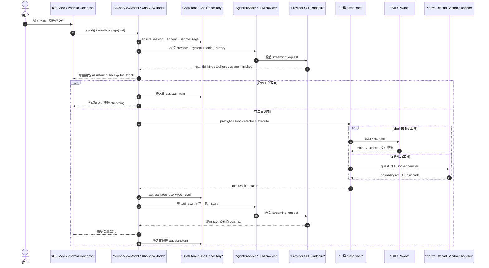

图中各跳的真实入口如下：用户发送入口是 iOS `send` 和 Android `sendMessage`，Provider 流入口是 `streamAgentMessage`/`streamMessage`，工具执行入口是 `executeSingleToolUse`/`executeTool`（`src/ios/Agent/Chat/AIChatViewModel.swift:2050-2070`、`src/android/app/src/main/java/com/openminis/app/ui/chat/ChatViewModel.kt:4794-4844`、`src/ios/Providers/AgentProvider.swift:195-208`、`src/android/app/src/main/java/com/openminis/app/provider/LLMProvider.kt:68-106`、`src/ios/Agent/Chat/AIChatViewModel.swift:5291-5294`、`src/android/app/src/main/java/com/openminis/app/ui/chat/ChatViewModel.kt:7101-7152`）。

#### 1.6.2 第一步：UI 到 ViewModel，并建立 session

iOS `send()` 先清理非 ready attachment、裁剪空输入、检查是否正在 processing，然后把 user message 放入内存；随后在 `Task` 中 `ensureSession`、复制附件并写入 agent history（`src/ios/Agent/Chat/AIChatViewModel.swift:2050-2070`、`src/ios/Agent/Chat/AIChatViewModel.swift:2226-2262`、`src/ios/Agent/Chat/AIChatViewModel.swift:2421-2432`）。

Android `sendMessage` 在 `_isStreaming` 时把输入进入 prompt queue；否则同步设置 `_isStreaming=true`，在 `viewModelScope` 中 `ensureSession`、准备附件、通过 `ChatRepository.appendMessage` 写 user row，再构造 `LLMMessage`（`src/android/app/src/main/java/com/openminis/app/ui/chat/ChatViewModel.kt:4794-4844`、`src/android/app/src/main/java/com/openminis/app/ui/chat/ChatViewModel.kt:4869-4921`）。

```kotlin
fun sendMessage(text: String) {
    val trimmed = text.trim()
    if (_isStreaming.value) {
        enqueuePrompt(text)
        return
    }
    if (trimmed.isBlank() && _attachments.value.isEmpty()) return
    val initialProvider = currentProvider ?: return
    _isStreaming.value = true
    viewModelScope.launch {
        val activeSessionId = ensureSession()
        val prepared = prepareUserAttachments(currentAttachments, activeSessionId)
        val persistedUser = chatRepository.appendMessage(
            activeSessionId, "user", userPartsJson
        )
        _messages.value = _messages.value + userMsg
        agentHistory.add(LLMMessage(role = LLMMessage.Role.USER, ...))
    }
}
```

代码位置：`src/android/app/src/main/java/com/openminis/app/ui/chat/ChatViewModel.kt:4794-4921`；上片段只保留真实控制流骨架，省略了附件字段展开。

#### 1.6.3 第二步：解析当前模型并构造 Provider

iOS Agent loop 从 `ProviderConfigStore` 解析当前 `ModelEntry`，调用 `makeAgentProvider`，再把 capability、behavior、skills、MCP 和 memory 片段拼入 system prompt，工具列表由 `makeAgentTools()` 生成（`src/ios/Agent/Chat/AIChatViewModel.swift:4223-4267`、`src/ios/Agent/Chat/AIChatViewModel.swift:4269-4310`）。工厂依据 provider type 构造 Anthropic/Gemini/OpenAI 等 AgentProvider（`src/ios/Agent/Chat/AIChatViewModel+ProviderFactory.swift:20-46`）。

Android 在 `sendMessage` 中读取当前 Provider，构造 system prompt，刷新 OAuth token（需要时），然后创建 fallback provider 列表并调用 `runAgentLoop`（`src/android/app/src/main/java/com/openminis/app/ui/chat/ChatViewModel.kt:4923-4986`）。`ProviderFactory.create` 根据 `ProviderType` 和 credential 分派到具体实现（`src/android/app/src/main/java/com/openminis/app/provider/ProviderFactory.kt:18-41`、`:46-92`）。

#### 1.6.4 第三步：SSE 流进入统一事件模型

iOS `AgentProvider` 的协议扩展在真正调用实现前把 thinking level clamp 到模型上限；Anthropic 实现把 canonical messages/tools 转成 SDK 参数并调用 `provider.service.streamMessage`，最后包装为 `AsyncThrowingStream`（`src/ios/Providers/AgentProvider.swift:195-207`、`src/ios/Providers/Anthropic/AnthropicAgentProvider.swift:47-60`、`src/ios/Providers/Anthropic/AnthropicAgentProvider.swift:172-243`）。

Android `LLMProvider.streamMessage` 返回 `Flow<LLMStreamChunk>`，默认实现同样先 clamp；OpenAI provider 依赖 OkHttp 和 `callbackFlow`（`src/android/app/src/main/java/com/openminis/app/provider/LLMProvider.kt:68-106`、`src/android/app/src/main/java/com/openminis/app/provider/openai/OpenAIProvider.kt:17-50`）。

`processStreamEvents` 在 iOS 的非 MainActor 上解析流，只在需要更新 UI 时 `MainActor.run`；Android `runAgentLoop` 收集 Flow，文本 delta 按时间阈值批量回到 Main，工具事件则更新 `allToolBlocks`（`src/ios/Agent/Chat/AIChatViewModel+SSEStream.swift:214-287`、`src/android/app/src/main/java/com/openminis/app/ui/chat/ChatViewModel.kt:5808-5849`、`src/android/app/src/main/java/com/openminis/app/ui/chat/ChatViewModel.kt:6024-6030`）。

#### 1.6.5 第四步：工具调用、沙箱和 offload

模型发出 tool-use 时，iOS 先 flush 前置文本，再追加 tool block；工具输入 JSON 的增量事件只更新预览，完成事件才把状态置为 running 并记录最终参数（`src/ios/Agent/Chat/AIChatViewModel+SSEStream.swift:327-415`、`src/ios/Agent/Chat/AIChatViewModel+SSEStream.swift:516-631`）。Android 也将 `ToolUseStart`、`ToolInputDelta`、`ToolCallComplete` 映射到 PENDING/RUNNING 状态（`src/android/app/src/main/java/com/openminis/app/ui/chat/ChatViewModel.kt:6151-6217`、`:6218-6301`）。

执行前要经过 JSON repair、loop detector 和 preflight；执行函数再根据名字选择 file、image、shell、browser 或 memory（`src/android/app/src/main/java/com/openminis/app/ui/chat/ChatViewModel.kt:6728-6846`、`src/android/app/src/main/java/com/openminis/app/ui/chat/ChatViewModel.kt:7101-7152`）。iOS 同样在 TaskGroup 中执行工具，并按原始 tool-use 顺序重新拼接结果（`src/ios/Agent/Chat/AIChatViewModel.swift:5260-5310`）。

`shell_execute` 的路径在 iOS 进入 `ISHExecutionCoordinator.execute`，拿到 session-specific `fsContext` 再运行 guest `/bin/sh`；Android 进入 `ExecutionCoordinator.execute`，必要时自动 boot PRoot 并获取 session 的 `PersistentShell`（`src/ios/Agent/ISH/ISHExecutionCoordinator.swift:87-134`、`src/android/app/src/main/java/com/openminis/app/sandbox/ExecutionCoordinator.kt:63-115`）。

设备能力工具不是从 VM 直接调用 HealthKit/Calendar，而是通过 guest command/native offload。iOS 在 kernel boot 时注册 `native_offload` binding，Android 的 PRoot extension 通过 `NativeOffloadServer` 的 abstract socket 找到 handler（`src/ios/iSH/ISHKernel.m:413-445`、`src/android/app/src/main/java/com/openminis/app/sandbox/NativeOffload.kt:148-217`）。

#### 1.6.6 第五步：结果回灌并发起下一轮

工具结果先更新 UI tool block 的成功/失败/超时状态，再变成 `AgentContentPart.toolResult` 或 Android `AgentContentPart.ToolResult` 写入 history；随后 loop 带着 assistant tool-use 和 user/tool-result 进入下一次 Provider 请求（`src/ios/Agent/Chat/AIChatViewModel.swift:5305-5378`、`src/android/app/src/main/java/com/openminis/app/ui/chat/ChatViewModel.kt:6845-6959`）。

当下一轮没有 tool call 时，两端都把 assistant message 标成非 streaming、持久化并结束本次 turn；如果仍有 tool call，就继续循环，直到自然结束或达到 max turns（`src/ios/Agent/Chat/AIChatViewModel.swift:5054-5185`、`src/android/app/src/main/java/com/openminis/app/ui/chat/ChatViewModel.kt:6615-6691`、`src/android/app/src/main/java/com/openminis/app/ui/chat/ChatViewModel.kt:7030-7049`）。

### 1.7 全局状态管理与生命周期

#### 1.7.1 iOS：MainActor ObservableObject、Environment 和 cache

iOS 的 UI 可观察状态分三类。

1. `@MainActor` 的 per-session VM：`AIChatViewModel` 遵守 `ObservableObject`，所有 UI-facing 变更在 MainActor 上发生（`src/ios/Agent/Chat/AIChatViewModel.swift:14-15`）。
2. `shared` 的全局 ObservableObject：例如 `ProviderConfigStore`、`BackgroundKeepAliveManager`、`SpeechRecognitionManager`，通过 `@ObservedObject`/`@StateObject` 订阅（`src/ios/Providers/ProviderConfigStore.swift:132-144`、`src/ios/Agent/Background/BackgroundKeepAliveManager.swift:14-20`、`src/ios/Agent/Speech/SpeechRecognitionManager.swift:5-8`）。
3. Environment：根 `MinisApp` 注入 `ShareCoordinator`，`AIChatView` 继续注入 VM 和 `chatSessionId`；Environment key 只传递 session 上下文，不负责存储消息（`src/ios/MinisApp.swift:196-201`、`src/ios/Views/Chat/AIChatView.swift:601-603`、`src/ios/Views/Chat/AIChatView.swift:1360-1364`、`src/ios/Shared/Environment/ChatSessionIdEnvironment.swift:12-20`）。

`ViewModelCache` 是 iOS 侧“离开页面但不取消任务”的关键：按 session ID 缓存 VM，软上限为 6，内存警告只驱逐非 processing VM（`src/ios/Agent/Chat/ChatLifecycleSupport.swift:334-368`、`:380-405`）。这让 session list 可以显示仍在运行的任务，同时在内存压力下允许重建并从 SQLite reload。

`LLMSessionRegistry` 不属于 SwiftUI UI 状态。它是一个线程安全的长连接注册表，用 `NSLock` 维护 `URLSession`，网络接口变化时调用 `URLSession.reset` 清空连接池而不销毁 session（`src/ios/Shared/LLMSessionRegistry.swift:23-57`）。因此不要把它当作 `@EnvironmentObject`；它服务于 Provider 网络连接复用。

#### 1.7.2 Android：ViewModel、StateFlow 和 Application 作用域

Android 的 `ChatViewModel` 是普通 `ViewModel`，通过 `MutableStateFlow` 持有 `_messages`、`_streamingById`、`_inputText` 等私有状态，再暴露只读 `StateFlow`（`src/android/app/src/main/java/com/openminis/app/ui/chat/ChatViewModel.kt:318-321`、`:436-437`、`:497-503`）。`uiMessages` 是由 `_messages` 和可见窗口 cap 派生的 `stateIn(viewModelScope)`，Compose 只收集派生流（`src/android/app/src/main/java/com/openminis/app/ui/chat/ChatViewModel.kt:360-385`）。

`ChatViewModelStore` 是进程级的 session VM store：每个 canonical session ID 对应一个 `ViewModelStore`，离开 chat route 不会自动清除 stream job，只有显式 `release` 才 clear（`src/android/app/src/main/java/com/openminis/app/ui/chat/ChatViewModelStore.kt:7-26`、`:39-64`）。`ChatScreen` 用 `ChatViewModelStore.ownerFor(sessionId)` 作为 ViewModelStoreOwner（`src/android/app/src/main/java/com/openminis/app/ui/chat/ChatScreen.kt:413-429`）。

`MinisApp` 持有 Room/repository/store，Activity 通过 `application as MinisApp` 读取；`AppDatabase.INSTANCE` 只在 `getInstance` 中同步创建一次（`src/android/app/src/main/java/com/openminis/app/MinisApp.kt:60-82`、`src/android/app/src/main/java/com/openminis/app/data/db/AppDatabase.kt:196-207`）。ProviderRepository 的配置则以 StateFlow 异步加载，避免 Application 构造时阻塞（`src/android/app/src/main/java/com/openminis/app/data/repository/ProviderRepository.kt:148-185`）。

#### 1.7.3 状态所有权对照

| 状态 | iOS 所有者 | Android 所有者 | 页面离开后是否保留 |
|---|---|---|---|
| 当前 session 消息 | `ViewModelCache` → `AIChatViewModel.messages` | `ChatViewModelStore` → `ChatViewModel.messages` | 保留到 cache/store 被驱逐或 release |
| Provider 配置 | `ProviderConfigStore.shared` 的 `@Published config` | Application 注入的 `ProviderRepository.config` StateFlow | 进程内保留，磁盘配置可重建 |
| session/message DB | `ChatStore.shared` actor | `AppDatabase` singleton + `ChatRepository` | 持久保留 |
| 当前 session 上下文 | `EnvironmentValues.chatSessionId` | `ChatViewModelStore.activeSessionId` | 只在当前页面有效 |
| LLM 连接池 | `LLMSessionRegistry.shared` | Provider/OkHttp 网络层，网络变化由 app monitor 处理 | 连接可被 reset/evict |
| 运行/在场状态 | `SessionActivityTracker.shared`、Background manager | `SessionActivityTracker.activeSessions/presentSessions` | 任务和页面分别统计 |
| 系统权限请求 | `OffloadPermissionManager` + SwiftUI continuation | `OffloadPermissionManager` StateFlow + ActivityResult launcher | 请求完成即清理，策略持久化 |

### 1.8 平台对照

这张表是从零实现时的“同一抽象两种落地”清单。每一行都对应前文实际调用点，而不是把 SwiftUI 和 Compose 当成可互换语法。

| 抽象 | iOS 落地 | Android 落地 | 差异原因 |
|---|---|---|---|
| 应用入口 | `@main MinisApp` + `@UIApplicationDelegateAdaptor`（`src/ios/MinisApp.swift:75-92`） | `Application MinisApp` + `MainActivity`（`src/android/app/src/main/java/com/openminis/app/MinisApp.kt:60-94`、`src/android/app/src/main/java/com/openminis/app/MainActivity.kt:54-72`） | iOS SwiftUI 需要 UIKit delegate 补 Quick Action；Android Application/Activity 是平台固有生命周期 |
| 根导航 | `ContentView` 的 `NavigationSplitView`/`NavigationStack`（`src/ios/Views/ContentView.swift:906-955`） | `AppNavigation` 的 Compose `NavHost`（`src/android/app/src/main/java/com/openminis/app/ui/navigation/AppNavigation.kt:418-434`） | iPad/窄屏列布局与 Android back stack API 不同 |
| 聊天 VM | `@MainActor ObservableObject` + `ViewModelCache`（`src/ios/Agent/Chat/AIChatViewModel.swift:14-15`、`src/ios/Agent/Chat/ChatLifecycleSupport.swift:334-405`） | `ViewModel` + `ChatViewModelStore`（`src/android/app/src/main/java/com/openminis/app/ui/chat/ChatViewModel.kt:85-93`、`src/android/app/src/main/java/com/openminis/app/ui/chat/ChatViewModelStore.kt:16-49`） | SwiftUI 的状态发布和 Android Lifecycle/ViewModelStore 机制不同 |
| UI 状态流 | Combine `objectWillChange`、`@Published`（`src/ios/Views/Chat/AIChatView.swift:19-65`） | `StateFlow`、`collectAsState`（`src/android/app/src/main/java/com/openminis/app/ui/chat/ChatViewModel.kt:320-321`、`src/android/app/src/main/java/com/openminis/app/ui/chat/ChatScreen.kt:437-452`） | Compose 直接消费 Kotlin Flow；SwiftUI 通过 ObservableObject 触发 body 重算 |
| Provider 流 | `AsyncThrowingStream<AgentStreamEvent, Error>`（`src/ios/Providers/AgentProvider.swift:176-192`） | `Flow<LLMStreamChunk>`（`src/android/app/src/main/java/com/openminis/app/provider/LLMProvider.kt:68-106`） | 两端并发/取消模型不同，但都以统一 chunk/event 屏蔽 provider JSON |
| Provider 配置 | `ProviderConfigStore.shared`，SQLite/JSON mirror（`src/ios/Providers/ProviderConfigStore.swift:132-159`） | `ProviderRepository`，Room + SharedPreferences mirror + IO StateFlow（`src/android/app/src/main/java/com/openminis/app/data/repository/ProviderRepository.kt:78-86`、`:148-210`） | Android 冷启动需规避同步 JSON 解析，iOS 首帧先 JSON seed 再异步 DB authoritative load |
| Agent loop 并发 | Swift concurrency + `withTaskGroup` 工具 fan-out（`src/ios/Agent/Chat/AIChatViewModel.swift:5260-5303`） | coroutine `streamJob` + sequential tool loop（`src/android/app/src/main/java/com/openminis/app/ui/chat/ChatViewModel.kt:4961-5013`、`:6716-6928`） | 当前代码在工具批处理并发策略上不同，结果都必须按 tool-use 顺序回灌 |
| Linux 用户态 | iSH fakefs + C kernel（`src/ios/iSH/ISHKernel.m:349-411`） | PRoot + Alpine rootfs（`src/android/app/src/main/java/com/openminis/app/sandbox/PRootKernel.kt:59-78`） | iOS 嵌入 iSH 用户态模拟；Android 使用 PRoot loader 和 rootfs |
| session 文件路由 | `MinisFsRouter` 的 `fs_context` hook（`src/ios/Agent/ISH/MinisFsRouter.swift:42-76`） | PRoot bindMount + `PersistentShell` session map（`src/android/app/src/main/java/com/openminis/app/sandbox/PRootKernel.kt:47-48`、`src/android/app/src/main/java/com/openminis/app/sandbox/PersistentShell.kt:25-29`） | iSH fakefs 能在 C path hook 上带 context，PRoot 以 bind mount 和启动参数实现 |
| Native offload | C handler 直接 `native_offload_add_handler`（`src/ios/NativeOffloads/CalendarOffload.m:1171-1178`） | Kotlin handler + abstract socket server（`src/android/app/src/main/java/com/openminis/app/sandbox/NativeOffload.kt:72-103`、`:148-217`） | iOS handler 与嵌入式 C 扩展同进程；Android 需要 host/server 与 PRoot extension 协议 |
| 持久化 | actor + SQLite 手写 schema/事务（`src/ios/Agent/Chat/ChatStore.swift:356-397`、`:1913-2010`） | Room DAO + Repository（`src/android/app/src/main/java/com/openminis/app/data/db/AppDatabase.kt:20-22`、`src/android/app/src/main/java/com/openminis/app/data/repository/ChatRepository.kt:222-255`） | 平台数据库生态不同，恢复边界相同 |
| 后台存活 | Location/audio/Live Activity manager（`src/ios/Agent/Background/BackgroundKeepAliveManager.swift:14-46`） | Foreground service + `SessionActivityTracker`（`src/android/app/src/main/java/com/openminis/app/service/SessionActivityTracker.kt:9-22`） | iOS 后台执行受系统 capability/审核约束，Android 需要 FGS 与通知 |
| deep link | `SceneDelegate` 转发 URL + `DeepLinkRouter`（`src/ios/AppDelegate.swift:109-161`、`src/ios/MinisApp.swift:202-214`） | Intent → `DeepLinkHandler` → `AppNavigation`（`src/android/app/src/main/java/com/openminis/app/MainActivity.kt:331-344`、`src/android/app/src/main/java/com/openminis/app/ui/navigation/AppNavigation.kt:233-291`） | URL 进入点和导航恢复 API 不同 |
| 权限桥 | `CheckedContinuation` + SwiftUI sheet（`src/ios/Agent/Offload/OffloadPermissionManager.swift:20-33`） | StateFlow 请求 + ActivityResult launcher（`src/android/app/src/main/java/com/openminis/app/offload/OffloadPermissionManager.kt:19-32`、`src/android/app/src/main/java/com/openminis/app/MainActivity.kt:222-257`） | Android 系统权限只能由 ActivityResult 触发；iOS 用主线程 continuation 等待 sheet 决策 |

### 1.9 模块规模统计

统计口径是仓库当前工作树上的 `wc -l`：iOS `Agent/Providers/Views` 统计 Swift，`Shared/NativeOffloads/iSH` 统计 Swift/Objective-C 头实现文件；Android 统计目录下递归的 Kotlin 文件。Android `sandbox/` 行包含其 `sandbox/offload/` handlers，另列的 `offload/` 是顶层 package，不能把两者误认为同一目录。统计命令使用 `wc -l`，不是估算或 IDE 行数。

| 平台 | 子系统目录 | 文件数 | 行数 | 统计范围说明 |
|---|---|---:|---:|---|
| iOS | `src/ios/Agent/` | 103 | 65,966 | `**/*.swift` |
| iOS | `src/ios/Providers/` | 63 | 27,378 | `**/*.swift` |
| iOS | `src/ios/Views/` | 79 | 55,947 | `**/*.swift` |
| iOS | `src/ios/Shared/` | 53 | 8,188 | `**/*.(swift|h|m)` |
| iOS | `src/ios/NativeOffloads/` | 64 | 24,259 | `**/*.(swift|h|m)` |
| iOS | `src/ios/iSH/` | 14 | 6,586 | `**/*.(swift|h|m)` |
| Android | `.../app/ui/` | 146 | 74,379 | `**/*.kt` |
| Android | `.../app/provider/` | 23 | 8,133 | `**/*.kt` |
| Android | `.../app/tools/` | 8 | 881 | `**/*.kt` |
| Android | `.../app/sandbox/` | 36 | 14,900 | 含 `sandbox/offload/` |
| Android | `.../app/offload/` | 13 | 2,207 | 顶层 offload manager |
| Android | `.../app/data/` | 54 | 11,136 | `**/*.kt` |

启动链路文件本身另外是：iOS `MinisApp.swift` 951 行、`AppDelegate.swift` 174 行、`ContentView.swift` 5,413 行；Android `MinisApp.kt` 726 行、`MainActivity.kt` 624 行、`AppNavigation.kt` 1,252 行（`wc -l` 直接统计这些真实文件）。`ContentView.swift` 和 Android `AppNavigation.kt` 的大行数不意味着它们应当承载 Agent 业务；实际 Agent loop 仍在 VM 文件中（`src/ios/Views/ContentView.swift:322-399`、`src/android/app/src/main/java/com/openminis/app/ui/navigation/AppNavigation.kt:488-532`、`src/ios/Agent/Chat/AIChatViewModel.swift:4207-4216`、`src/android/app/src/main/java/com/openminis/app/ui/chat/ChatViewModel.kt:5779-5785`）。

### 1.10 设计取舍与踩坑

#### 1.10.1 不要把所有初始化塞进冷启动

iOS 只在 App 初始化预热必要对象，Linux rootfs 延迟到聊天/发送路径；Android 虽然在 Application 中启动 offload server，但 PRoot 的实际 rootfs 安装和 boot 仍由 `PRootKernel.boot` 在首次执行时完成（`src/ios/Agent/Chat/AIChatViewModel+Misc.swift:12-50`、`src/android/app/src/main/java/com/openminis/app/sandbox/ExecutionCoordinator.kt:84-95`、`src/android/app/src/main/java/com/openminis/app/sandbox/PRootKernel.kt:53-66`）。

**坑：** 如果冷启动同步读取大 Provider 配置，Android 注释记录过构造期间的长时间停顿；正确做法是 placeholder StateFlow + IO load，而不是把所有 `loadConfig()` 放回 Application 主线程（`src/android/app/src/main/java/com/openminis/app/data/repository/ProviderRepository.kt:148-158`）。

#### 1.10.2 单例必须有唯一所有者

Android 的 `MountedFoldersStore` 必须由 `MinisApp` 持有，再由 `AppNavigation` 取 Application 实例；UI 自己 `remember` 第二个对象会导致 UI 列表和 PRootKernel 状态分裂（`src/android/app/src/main/java/com/openminis/app/ui/navigation/AppNavigation.kt:223-231`）。iOS 的 `ShareCoordinator` 也必须从根注入同一实例，AppDelegate URL 处理明确取 `ShareCoordinator.shared`（`src/ios/MinisApp.swift:196-214`、`src/ios/AppDelegate.swift:144-160`）。

#### 1.10.3 “流式 UI”不能每个 token 触发整棵树

iOS 把 SSE 解析放在非 MainActor，并按 block 更新；Android 为文本 delta 设 throttle，并用 `_streamingById` side channel 限制 Compose 重组范围（`src/ios/Agent/Chat/AIChatViewModel+SSEStream.swift:214-225`、`src/android/app/src/main/java/com/openminis/app/ui/chat/ChatViewModel.kt:418-437`、`src/android/app/src/main/java/com/openminis/app/ui/chat/ChatViewModel.kt:6122-6148`）。

**坑：** 如果只更新内存文本而不在 stream end flush，最后一小段文本可能不进 UI 或 DB；两端都在流结束处显式 flush，再构造持久化 parts（`src/ios/Agent/Chat/AIChatViewModel.swift:4937-4967`、`src/android/app/src/main/java/com/openminis/app/ui/chat/ChatViewModel.kt:6347-6369`）。

#### 1.10.4 工具结果必须保持 tool-use 配对

模型下一轮看到的 history 必须包含对应的 assistant tool-use 和 user/tool-result；iOS 会按原始索引拼接并批量写入，Android 在 `persistAssistantTurn` 后写 `persistToolResultMessage`，然后才继续 loop（`src/ios/Agent/Chat/AIChatViewModel.swift:5305-5366`、`src/android/app/src/main/java/com/openminis/app/ui/chat/ChatViewModel.kt:6941-6963`）。

**坑：** 取消发生在工具执行中间时，不能只取消 coroutine 而留下半个 tool-use；iOS 会写取消结果并停止，Android 的 tool loop detector/preflight 会为阻断调用合成 error tool result（`src/ios/Agent/Chat/AIChatViewModel.swift:5373-5385`、`src/android/app/src/main/java/com/openminis/app/ui/chat/ChatViewModel.kt:6762-6842`）。

#### 1.10.5 沙箱路径必须带 session 语义

iOS 将 per-session bucket 通过 `fs_context` 路由到 `Library/MinisChat/minis/<sid>/...`，而 memory/skills/shared 保持 global；Android 用 bind mount 和 `sessionBindMounts` 初始化 PersistentShell（`src/ios/Agent/ISH/MinisFsRouter.swift:19-28`、`:81-110`、`src/android/app/src/main/java/com/openminis/app/sandbox/PersistentShell.kt:25-29`）。

**坑：** 直接使用全局 `/var/minis` host path 会把一个 session 的 attachment/browser/offload 暴露给另一个 session；Android `ReadImageTool` 的执行调用显式传入 `activeSessionId`，iOS 同样在 coordinator 中取得 session context（`src/android/app/src/main/java/com/openminis/app/ui/chat/ChatViewModel.kt:7141-7146`、`src/ios/Agent/ISH/ISHExecutionCoordinator.swift:112-134`）。

#### 1.10.6 系统 API 要隔离在 offload 边界

iOS native handler 注册发生在 iSH kernel boot 的集中阶段，Android handler 在 Application 注册后由 socket server 统一分发；这样 Agent loop 不必知道 HealthKit、Calendar、权限弹窗或 binder 的具体 API（`src/ios/iSH/ISHKernel.m:413-445`、`src/android/app/src/main/java/com/openminis/app/sandbox/NativeOffload.kt:179-200`）。

**坑：** Android 权限请求不能从后台 handler 直接弹系统对话框，`MainActivity` 通过 `pendingAndroidPermission` 收到请求、调用 launcher，再把结果回复给 manager（`src/android/app/src/main/java/com/openminis/app/MainActivity.kt:222-257`）。

#### 1.10.7 后台存活是“任务状态”和“页面在场”两个维度

Android `SessionActivityTracker` 分离 `activeSessions`（正在 LLM/tool）和 `presentSessions`（用户仍在 chat 页面），Foreground Service 在任一非空时保持运行（`src/android/app/src/main/java/com/openminis/app/service/SessionActivityTracker.kt:9-22`）。iOS `BackgroundKeepAliveManager` 用 capability tier 表示 location/audio 是否足以延长后台执行（`src/ios/Agent/Background/BackgroundKeepAliveManager.swift:22-46`）。

**坑：** 只在 stream 运行时保活会导致用户离开/返回页面时 session VM 或进程被回收；Android Activity 的 nav back stack observer 因此在 chat route 时调用 `setPresent`（`src/android/app/src/main/java/com/openminis/app/MainActivity.kt:395-420`）。

#### 1.10.8 启动熔断比“自动重试所有初始化”更安全

Android safe mode 在 crash frequency detector 触发后跳过 DB、repository、offload server 和 PRoot bind mounts，MainActivity 只显示 crash share dialog；这是为了避免启动环再次触发同一 native crash（`src/android/app/src/main/java/com/openminis/app/MinisApp.kt:244-255`、`src/android/app/src/main/java/com/openminis/app/MainActivity.kt:166-200`）。iOS 的启动逻辑也把 DebugServer、TextKit guard、缓存预热等拆成可独立失败的动作，而不是把所有失败升级为无法显示首页（`src/ios/MinisApp.swift:106-145`）。

### 1.11 从零实现清单

下面是从零写一个可扩展到 iOS/Android/macOS/Windows/Linux 的最小实现顺序。每一步都给出可验收结果；不需要第一版就复制 OpenMinis 的所有工具。

1. **定义平台无关的会话模型。**
   - 最少字段：`sessionId`、`role`、`parts`、`createdAt`、`sortOrder`。
   - 验收：关闭并重新打开进程后，能从 SQLite/Room 重建同一对话。
   - 对照 `RawMessage` 和 `MessageEntity` 的持久化形状（`src/ios/Agent/Chat/ChatStore.swift:286-349`、`src/android/app/src/main/java/com/openminis/app/data/db/ChatDao.kt:101-109`）。
   - 可砍掉：分类、pin、usage、sync dirty mark；不能砍掉 role 和顺序。

2. **建立一条 UI→VM 的单向数据流。**
   - iOS 用 `ObservableObject`，Android 用 `ViewModel + StateFlow`。
   - 验收：输入框只写 VM，消息列表只读 VM，返回列表再进入不会丢草稿。
   - 参考 `AIChatView` 的 stable wrapper 和 `ChatScreen` 的 factory（`src/ios/Views/Chat/AIChatView.swift:15-65`、`src/android/app/src/main/java/com/openminis/app/ui/chat/ChatScreen.kt:413-429`）。
   - 可砍掉：iPad split view；保留一个 stack/navigation host。

3. **实现 Provider 抽象。**
   - 统一方法接收 history/system/tools，返回文本 delta、tool-use、finished。
   - 验收：替换一个 mock Provider 不改 VM 的 turn 状态机。
   - 参考 `AgentProvider.streamAgentMessage` 和 `LLMProvider.streamMessage`（`src/ios/Providers/AgentProvider.swift:176-208`、`src/android/app/src/main/java/com/openminis/app/provider/LLMProvider.kt:68-106`）。
   - 可砍掉：OAuth、thinking、model groups；保留 API key 和一个模型。

4. **让一个 Provider 真正产生可取消的 SSE 流。**
   - 先只支持 `textDelta` 和 `done`，再加 tool events。
   - 验收：网络断开能结束 stream job，不阻塞 UI；完成时一定有终止事件或明确错误。
   - iOS 可从 `AnthropicAgentProvider` 的 `AsyncThrowingStream` 开始，Android 从 `OpenAIProvider` 的 callbackFlow 方向开始（`src/ios/Providers/Anthropic/AnthropicAgentProvider.swift:203-243`、`src/android/app/src/main/java/com/openminis/app/provider/openai/OpenAIProvider.kt:17-50`）。

5. **实现最小 Agent loop。**
   - 流结束且无 tool call：保存 assistant，结束。
   - 有 tool call：执行工具，把 result 加入 history，重新请求模型。
   - 验收：一个“列目录”请求能产生 user→assistant(tool_use)→tool_result→assistant(text) 四段历史。
   - 参考两端的 no-tool break 和 tool-result append（`src/ios/Agent/Chat/AIChatViewModel.swift:5054-5185`、`src/android/app/src/main/java/com/openminis/app/ui/chat/ChatViewModel.kt:6615-6691`、`:6941-6963`）。
   - 可砍掉：fallback、自动 compact、并行工具；保留 max-turns 防死循环。

6. **把工具定义和工具执行分离。**
   - schema 只描述能力；dispatcher 根据 name 调 helper。
   - 验收：模型看得到工具，非法参数在执行前得到 tool error，不会启动 shell。
   - 参考 `AgentTools.makeAgentTools` 和 Android `executeTool`（`src/android/app/src/main/java/com/openminis/app/tools/AgentTools.kt:14-36`、`src/android/app/src/main/java/com/openminis/app/ui/chat/ChatViewModel.kt:6793-6842`）。
   - 可砍掉：browser/memory；至少保留 `shell_execute` 或 `file_read` 一个。

7. **先实现 host 文件工具，再接 Linux 沙箱。**
   - 文件读写必须有 session root，不能任意访问 App container。
   - 验收：两个 session 的同名 attachment 不互相覆盖。
   - iOS 参考 `MinisFsRouter`，Android 参考 bind mount/PersistentShell（`src/ios/Agent/ISH/MinisFsRouter.swift:19-28`、`src/android/app/src/main/java/com/openminis/app/sandbox/PersistentShell.kt:25-29`）。

8. **增加真实 Linux 用户态。**
   - iOS：rootfs install→ISH boot→mount→`/bin/sh`；Android：rootfs install→PRoot boot→PersistentShell。
   - 验收：同一个 session 内 `cd`/环境变量/包安装的行为符合目标平台策略。
   - 参考 `ensureKernelBooted` 和 `PRootKernel.boot`（`src/ios/Agent/Chat/AIChatViewModel+Misc.swift:19-48`、`src/android/app/src/main/java/com/openminis/app/sandbox/PRootKernel.kt:53-179`）。
   - 可砍掉：交互式终端 UI；不能砍掉 agent command executor。

9. **建立 native offload 适配器。**
   - guest 只执行稳定 CLI 名称，host handler 负责系统 API 和权限。
   - 验收：一次 calendar/device 查询能返回文本和退出码；权限拒绝能变成可见 tool error。
   - 参考 iOS `*_offload_register` 和 Android `NativeOffloadServer`（`src/ios/NativeOffloads/CalendarOffload.m:1171-1178`、`src/android/app/src/main/java/com/openminis/app/sandbox/NativeOffload.kt:49-103`）。
   - 可砍掉：所有具体系统能力，只保留一个 fake `device-info` handler 验证协议。

10. **把权限请求桥接到前台 UI。**
    - 后台工具只能发 request，不能自己操作系统 dialog。
    - 验收：app 在前台时出现一次 dialog，结果回到原 tool；app 在后台时请求有超时/通知策略。
    - 参考 Android ActivityResult 和 iOS continuation 类型（`src/android/app/src/main/java/com/openminis/app/MainActivity.kt:222-298`、`src/ios/Agent/Offload/OffloadPermissionManager.swift:20-33`）。

11. **补 deep link 和 process-death 恢复。**
    - 保存当前 session ID；启动时显式 deep link 优先于恢复链接。
    - 验收：点击 `minis://session/<id>` 直达目标 chat；系统杀进程后回到上次 chat。
    - 参考 `DeepLinkHandler`、`MainActivity` 的 `launchDeepLink` 和 `AppNavigation` 的初始处理（`src/android/app/src/main/java/com/openminis/app/deeplink/DeepLinkHandler.kt:6-45`、`src/android/app/src/main/java/com/openminis/app/MainActivity.kt:331-344`、`src/android/app/src/main/java/com/openminis/app/ui/navigation/AppNavigation.kt:233-256`）。
    - 可砍掉：所有快捷操作，只保留一个 URL scheme。

12. **最后接后台、同步和模型 fallback。**
    - 这些都是在基本 turn 可用后扩展的横切能力。
    - 验收：后台任务能继续或被明确标记 interrupted；回前台能从 DB 恢复；网络切换不会永久复用坏连接。
    - 参考 iOS `BackgroundKeepAliveManager`/`LLMSessionRegistry` 和 Android `SessionActivityTracker`（`src/ios/Agent/Background/BackgroundKeepAliveManager.swift:14-46`、`src/ios/Shared/LLMSessionRegistry.swift:44-57`、`src/android/app/src/main/java/com/openminis/app/service/SessionActivityTracker.kt:24-45`）。
    - 可砍掉：iCloud/LAN 同步、Live Activity、多个 Provider；保留本地持久化和明确的取消状态。

13. **为桌面端保留替换点。**
    - UI、Provider、Agent loop、tool schema 和 persistence 之间必须通过接口/协议交互，不能把 UIKit/Android Context 传入 Provider。
    - 验收：同一份 tool/agent history 能在 macOS/Windows/Linux 使用另一套 shell executor；系统 offload 缺失时返回 capability unavailable，而不是编译期耦合。
    - 现有证据是 Provider 协议、iOS `ISHExecutionCoordinator` 和 Android `ExecutionCoordinator` 已将这三层分开（`src/ios/Providers/AgentProvider.swift:176-192`、`src/ios/Agent/ISH/ISHExecutionCoordinator.swift:87-134`、`src/android/app/src/main/java/com/openminis/app/sandbox/ExecutionCoordinator.kt:72-115`）。

### 1.12 关键文件索引

行数由 `wc -l` 取得；职责栏只描述本章所需的骨架，不替代后续专题章节。

| 路径 | 行数 | 职责 |
|---|---:|---|
| `src/ios/MinisApp.swift` | 951 | SwiftUI App 入口、根 WindowGroup、全局 bootstrap |
| `src/ios/AppDelegate.swift` | 174 | UIKit delegate、SceneDelegate、快捷操作和 URL 转发 |
| `src/ios/Views/ContentView.swift` | 5,413 | session list、split/stack 导航和根页面状态 |
| `src/ios/Views/Chat/AIChatView.swift` | 5,818 | 聊天页面、CachedViewModel、环境注入 |
| `src/ios/Agent/Chat/AIChatViewModel.swift` | 5,830 | iOS Agent VM、send、runAgentLoop、tool 结果回灌 |
| `src/ios/Agent/Chat/AIChatViewModel+SSEStream.swift` | 1,243 | SSE 事件处理、assistant block 增量更新 |
| `src/ios/Agent/Chat/AIChatViewModel+ProviderFactory.swift` | 459 | ModelEntry 到 AgentProvider 的工厂 |
| `src/ios/Agent/Chat/ChatStore.swift` | 6,211 | SQLite chat/session/message/media store |
| `src/ios/Agent/Chat/ChatLifecycleSupport.swift` | 562 | ViewModelCache、并发/生命周期辅助 |
| `src/ios/Agent/ISH/ISHExecutionCoordinator.swift` | 852 | iSH 命令执行、session fs context |
| `src/ios/Agent/ISH/MinisFsRouter.swift` | 147 | per-session guest→host 路径路由 |
| `src/ios/iSH/ISHKernel.h` | 176 | iSH kernel 公共 API |
| `src/ios/iSH/ISHKernel.m` | 1,305 | rootfs boot、fakefs、native binding 注册 |
| `src/ios/Providers/AgentProvider.swift` | 220 | iOS provider-agnostic agent stream 协议 |
| `src/ios/Providers/Anthropic/AnthropicAgentProvider.swift` | 971 | Anthropic 请求转换和 SSE 适配 |
| `src/ios/Providers/ProviderConfigStore.swift` | 2,926 | provider/model/group/binding 配置源 |
| `src/ios/Shared/LLMSessionRegistry.swift` | 59 | 长连接 URLSession 注册与网络切换 reset |
| `src/ios/Shared/Environment/ChatSessionIdEnvironment.swift` | 21 | SwiftUI `chatSessionId` EnvironmentKey |
| `src/ios/NativeOffloads/CalendarOffload.m` | 1,179 | 代表性系统能力 native handler 注册 |
| `src/android/app/src/main/java/com/openminis/app/MinisApp.kt` | 726 | Application 依赖组装、repositories、sandbox、offload |
| `src/android/app/src/main/java/com/openminis/app/MainActivity.kt` | 624 | Activity 权限桥、deep link、Compose 根 |
| `src/android/app/src/main/java/com/openminis/app/ui/navigation/AppNavigation.kt` | 1,252 | routes、start destination、NavHost、页面依赖注入 |
| `src/android/app/src/main/java/com/openminis/app/ui/chat/ChatScreen.kt` | 5,867 | Compose chat 页面、VM 创建和 StateFlow 收集 |
| `src/android/app/src/main/java/com/openminis/app/ui/chat/ChatViewModel.kt` | 9,844 | Android Agent VM、send、runAgentLoop、工具执行 |
| `src/android/app/src/main/java/com/openminis/app/ui/chat/ChatViewModelStore.kt` | 130 | 进程级 session ViewModelStore |
| `src/android/app/src/main/java/com/openminis/app/provider/LLMProvider.kt` | 162 | Android provider stream/response 抽象 |
| `src/android/app/src/main/java/com/openminis/app/provider/ProviderFactory.kt` | 176 | instance/credential 到具体 Provider |
| `src/android/app/src/main/java/com/openminis/app/provider/openai/OpenAIProvider.kt` | 3,037 | OpenAI-compatible OkHttp/SSE Provider |
| `src/android/app/src/main/java/com/openminis/app/tools/AgentTools.kt` | 132 | canonical 工具清单和 memory gate |
| `src/android/app/src/main/java/com/openminis/app/sandbox/PRootKernel.kt` | 920 | Alpine rootfs/PRoot boot、环境和 bind mounts |
| `src/android/app/src/main/java/com/openminis/app/sandbox/ExecutionCoordinator.kt` | 301 | session shell 执行、环境注入、输出清理 |
| `src/android/app/src/main/java/com/openminis/app/sandbox/PersistentShell.kt` | 372 | session 长驻 shell 和命令 marker |
| `src/android/app/src/main/java/com/openminis/app/sandbox/NativeOffload.kt` | 246 | PRoot native-offload socket server |
| `src/android/app/src/main/java/com/openminis/app/offload/OffloadPermissionManager.kt` | 415 | native tool 权限策略与请求流 |
| `src/android/app/src/main/java/com/openminis/app/service/SessionActivityTracker.kt` | 572 | streaming/present session 和后台服务状态 |
| `src/android/app/src/main/java/com/openminis/app/data/db/AppDatabase.kt` | 209 | Room singleton、实体和 migrations |
| `src/android/app/src/main/java/com/openminis/app/data/db/ChatDao.kt` | 301 | sessions/messages DAO 查询和 Flow |
| `src/android/app/src/main/java/com/openminis/app/data/repository/ChatRepository.kt` | 754 | Chat DAO 语义封装和消息写入 |
| `src/android/app/src/main/java/com/openminis/app/data/repository/ProviderRepository.kt` | 2,161 | provider config、异步 StateFlow 和模型缓存 |
| `src/android/app/src/main/java/com/openminis/app/deeplink/DeepLinkHandler.kt` | 227 | `minis://` 导航 action 解析 |

读者从索引开始阅读时，推荐顺序是：先看两端入口和导航，再看两端聊天 VM 的 send/loop，再看 Provider 协议，最后看持久化、沙箱和 offload。这个顺序与真实依赖方向一致：入口组装对象，UI 选择 session，VM 驱动 turn，Provider/工具执行，结果回到 history 和 DB（`src/android/app/src/main/java/com/openminis/app/MainActivity.kt:423-443`、`src/android/app/src/main/java/com/openminis/app/ui/chat/ChatViewModel.kt:4959-5013`、`src/ios/Agent/Chat/AIChatViewModel.swift:2243-2461`）。


## 2. Agent 核心循环：从一条消息到多轮工具调用

### 2.1 这一章解决什么问题

一个 Agent（智能体）应用不是“请求模型一次并显示文本”，而是要把模型输出解释为文本、思考片段或工具调用，再把工具结果作为下一轮输入，直到模型给出终止回答。OpenMinis 把这条链路拆成 provider-neutral 的消息/事件模型、平台侧的流式状态与工具调度、以及持久化和恢复三个层面；iOS 主要由 `AIChatViewModel` 及其 extensions 承担，Android 主要由 `ChatViewModel` 承担。`send()`/`sendMessage()` 入口还要处理上下文压力、会话并发、附件、取消、模型回退和后台生命周期；如果只实现“发请求—收字符串”，就会在并发工具、断流恢复、重试和 tool_use/tool_result 配对处产生不可恢复的协议错误。本章以真实代码为依据，给出一套可以从零实现、再逐步扩展到桌面端的循环设计。

---

### 2.2 先建立正确的状态模型

#### 2.2.1 代码里没有一个名为 `AgentState` 的总枚举

iOS 的主状态不是单一 enum，而是由 `AIChatViewModel.isProcessing`、`ChatMessage.isAwaitingModelResponse`、每个 `AssistantBlock.toolStatus` 和 `canResume` 组合出来的状态；`ToolBlockStatus` 的真实 case 是 `.streaming(bytes:)`、`.running`、`.success`、`.failed(message:)`、`.cancelled`，见 `src/ios/Agent/Chat/ChatModels.swift:152-168`。Android 也没有总状态 enum，`ChatMessage.isStreaming`、`isAwaitingModelResponse` 和 `ToolBlockStatus` 共同表达循环状态；Android 额外有 `PENDING` 与 `TIMEOUT`，见 `src/android/app/src/main/java/com/openminis/app/ui/chat/ChatModels.kt:104-150` 与 `223-225`。

| 教学状态 | iOS 的真实证据 | Android 的真实证据 | 进入条件 |
|---|---|---|---|
| `idle` | `isProcessing == false`；send 的入口拒绝处理中重复发送，`src/ios/Agent/Chat/AIChatViewModel.swift:2050-2069` | `_isStreaming == false`；中途发送转入队列，`src/android/app/src/main/java/com/openminis/app/ui/chat/ChatViewModel.kt:4794-4804` | 没有当前 stream job |
| `streaming` | `isProcessing = true`，之后 `AgentStreamEvent.textDelta`/thinking/tool start 写入 assistant block，`src/ios/Agent/Chat/AIChatViewModel.swift:2235-2243`、`src/ios/Agent/Chat/AIChatViewModel+SSEStream.swift:289-417` | `_isStreaming = true`，`LLMStreamChunk.Text`/`ThinkingDelta` 更新 Compose 状态，`src/android/app/src/main/java/com/openminis/app/ui/chat/ChatViewModel.kt:4841-4844`、`5779-5874`、`6031-6057` | 发送首个模型请求并收到流事件 |
| `toolPending` | iOS 没有 `pending` case；`contentBlockStart(.toolUse)` 先创建 `.streaming(bytes: 0)` block，`toolCallComplete` 时改为 `.running`，`src/ios/Agent/Chat/AIChatViewModel+SSEStream.swift:327-415`、`631-680` | `ToolUseStart` 创建 `STREAMING`，`ToolCallComplete` 改 `PENDING`，`src/android/app/src/main/java/com/openminis/app/ui/chat/ChatViewModel.kt:6151-6216`、`6278-6301` | 工具 JSON 已开始/完成，但执行器尚未实际运行 |
| `toolRunning` | `.running` 表示工具调用已解析并进入执行；`executeSingleToolUse` 在检查和 repair 后执行，`src/ios/Agent/Chat/AIChatViewModel+SSEStream.swift:631-680`、`src/ios/Agent/Chat/AIChatViewModel+ConcurrentTools.swift:84-206` | `PENDING → RUNNING` 在 `executeTool` 调度前发生，`src/android/app/src/main/java/com/openminis/app/ui/chat/ChatViewModel.kt:6750-6759` | preflight 通过，执行器开始工作 |
| `resume` | 工具结果作为 user-role `AgentMessage` 追加，并将 `isAwaitingModelResponse = true`，`src/ios/Agent/Chat/AIChatViewModel.swift:5333-5379` | `resultParts` 持久化为 tool-result 消息、追加到 `agentHistory`，并在下一次 for-loop 请求，`src/android/app/src/main/java/com/openminis/app/ui/chat/ChatViewModel.kt:6930-6963` | 当前批次工具全部有结果 |
| `done` | 无 tool call 时持久化 assistant message、清除 `canResume`，`src/ios/Agent/Chat/AIChatViewModel.swift:5054-5185` | 无 tool call 时 `updateAssistantMessage(..., false, ...)`，持久化并 break，`src/android/app/src/main/java/com/openminis/app/ui/chat/ChatViewModel.kt:6615-6691` | stop reason 是正常结束或正常空响应已处理 |
| `error` | 非取消异常附着到最后 assistant message；取消走另外的 cleanup，`src/ios/Agent/Chat/AIChatViewModel.swift:2460-2498` | `setInlineError` 同时清除 `isStreaming` 与 `isAwaitingModelResponse`，`src/android/app/src/main/java/com/openminis/app/ui/chat/ChatViewModel.kt:5038-5067` | stream、provider、工具或上下文不可恢复 |
| `cancelled` | `cancel()` 先取消 task、shell/browser，再由 cleanup 把未完成 block 变成可恢复状态，`src/ios/Agent/Chat/AIChatViewModel.swift:3434-3503` | `cancelStream()` 取消 `streamJob`、停止 shell、清理 tracker，`src/android/app/src/main/java/com/openminis/app/ui/chat/ChatViewModel.kt:8872-8905` | 用户 Stop、任务/进程取消或后台终止 |

#### 2.2.2 状态迁移图

下面是把上述多个字段投影成教学状态机后的图；箭头条件都对应后面的真实代码。图中的 `resume` 不是一个仓库 enum，而是“工具结果已经写入 history、等待下一次模型请求”的派生状态。

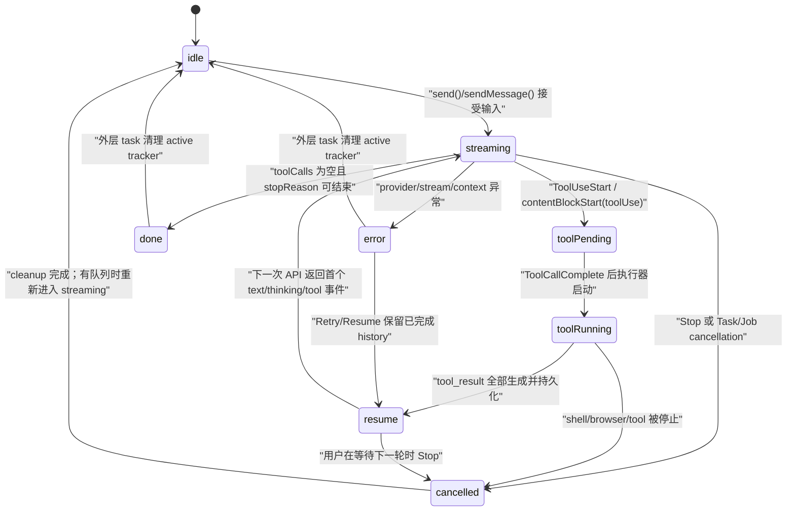

#### 2.2.3 一次 send 的真实入口

iOS 入口先拒绝只读会话、清理未 ready 附件、检查空输入和已有处理状态，再根据上下文策略决定发送、先压缩或展示提示；真正把 `isProcessing` 置为 `true` 后才创建异步 task，见 `src/ios/Agent/Chat/AIChatViewModel.swift:2050-2158`。任务会确保 session、持久化 user message、等待 kernel、获取 session concurrency slot，最后调用 `runAgentLoop()`，见 `src/ios/Agent/Chat/AIChatViewModel.swift:2243-2458`。

```swift
// 来源：src/ios/Agent/Chat/AIChatViewModel.swift:2060-2069, 2235-2243
let text = inputText.trimmingCharacters(in: .whitespacesAndNewlines)
let pendingAttachments = attachments
 guard !text.isEmpty || !pendingAttachments.isEmpty, !isProcessing else {
    return
}
// …上下文检查、编辑截断、用户消息准备…
messages.append(userMsg)
isProcessing = true
ensureKernelBooted()
beginBackgroundProcessing()
currentTask = Task { [weak self] in
    guard let self else { return }
    await self.ensureSession()
    // …持久化 AgentMessage、取得并发槽位…
    try await self.runAgentLoop()
}
```

Android 入口的同步部分有意先把 `_isStreaming` 置为 `true`，再把 DB、OAuth 和 system prompt 准备放到 coroutine；这避免快速双击在 setup 阶段创建两个 stream job，见 `src/android/app/src/main/java/com/openminis/app/ui/chat/ChatViewModel.kt:4794-4844`。`streamJob` 的 finally 还用 job identity 检查，旧 job 的晚到 finally 不能把新 job 的 `_isStreaming` 错误清零，见 `src/android/app/src/main/java/com/openminis/app/ui/chat/ChatViewModel.kt:5019-5027`。

#### 2.2.4 “后台仍在跑”不是 UI 页面是否可见

iOS 的 `SessionActivityTracker` 用 `activeSessions` 保存正在 streaming/running tools 的 session；它允许用户离开聊天页面后，首页仍显示运行标记，且用 draft alias 将临时会话映射到真实 session，见 `src/ios/Agent/Chat/ChatLifecycleSupport.swift:7-26`、`134-169`。`isProcessing` 变为 true 时还会延迟 iCloud sync，变为 false 时进入 post-stop hold，防止刚完成的候选被同步 reload 覆盖，见 `src/ios/Agent/Chat/AIChatViewModel.swift:559-589`。Android 的 tracker 同样独立于 Compose 页面，首次 `setActive` 启动 foreground service，`setInactive` 在没有活跃 session 时停服务，见 `src/android/app/src/main/java/com/openminis/app/service/SessionActivityTracker.kt:255-318`。

---

### 2.3 主循环：把一个模型 turn 变成多轮交互

#### 2.3.1 循环边界与启动前修复

iOS `runAgentLoop` 每次由 send、retry 或 resume 调用；开始时重置“一次 run 只注入一次空响应提醒”的 guard，解析 provider、拼接能力/行为/skill/MCP/memory prompt，并为新回复创建 assistant message，见 `src/ios/Agent/Chat/AIChatViewModel.swift:4207-4340`。在第一轮 API 前，它扫描 assistant 的 tool_use 与 user 的 tool_result，删除 orphan result、为未完成 tool_use 注入错误 placeholder；但标记为 `isInterrupted` 的最后 assistant 会直接丢弃，避免给半截 JSON 伪造 tool_result，见 `src/ios/Agent/Chat/AIChatViewModel.swift:4345-4459`。

```swift
// 来源：src/ios/Agent/Chat/AIChatViewModel.swift:4462-4481
var turnCount = 0
var hitTurnLimit = true
var compactionsThisLoop = 0
loopLabel: while turnCount < Self.maxAgentTurns {
    defer { turnCount += 1 }
    try Task.checkCancellation()
    if let sid = self.sessionId {
        SessionActivityTracker.shared.updateLoopIteration(sid, iteration: turnCount + 1)
    }
    // trimOldImages、offloadContext、上下文检查
    // …
}
```

Android 在每个 turn 的 API call 前调用 `sanitizeAgentHistory()`，然后按实时 context window 执行 tool-output offload；`for (turn in 0 until MAX_AGENT_TURNS)` 是硬上限，见 `src/android/app/src/main/java/com/openminis/app/ui/chat/ChatViewModel.kt:5891-5911`。这说明“轮数”是保护循环的上限，而不是 provider 的 `max_tokens`：一轮仍然可能包含一次流式 assistant 输出和多个工具。

#### 2.3.2 请求、提交和继续

iOS 每轮先拿 `effectiveAgentHistory()`，再通过 `streamWithGroupFallback` 获取当前 provider 的 stream；它把最新 `turnUsage.latestContextTokens` 传入动态 token 计算，见 `src/ios/Agent/Chat/AIChatViewModel.swift:4610-4627`。解析完成后，循环把本轮新 text block 和 tool entries 转为一个 assistant `AgentMessage`，记录 reasoning echo；没有 tool entries 就结束，否则把所有 tool result 组成 user-role message，持久化 assistant + results，再回到下一轮，见 `src/ios/Agent/Chat/AIChatViewModel.swift:5003-5055`、`5188-5375`。

Android 的相同边界更直观：本轮 `turnTextSb` 和 `toolCalls` 在 stream 结束时一次性物化，追加 `LLMMessage.Role.ASSISTANT`；无 tool call 时 break，有 tool call 时先执行、持久化 assistant/tool result，再追加 `LLMMessage.Role.USER` 的 result parts，见 `src/android/app/src/main/java/com/openminis/app/ui/chat/ChatViewModel.kt:6567-6600`、`6615-6691`、`6941-6963`。

```kotlin
// 来源：src/android/app/src/main/java/com/openminis/app/ui/chat/ChatViewModel.kt:6571-6600
val turnText = turnTextSb.toString()
accumulatedText += turnText
val assistantParts = mutableListOf<AgentContentPart>()
if (turnText.isNotEmpty()) assistantParts.add(AgentContentPart.Text(turnText))
for ((id, name, args) in toolCalls) {
    assistantParts.add(AgentContentPart.ToolUse(id, name, args))
}
agentHistory.add(LLMMessage(
    role = LLMMessage.Role.ASSISTANT,
    content = turnText,
    contentParts = assistantParts,
    reasoningContent = turnReasoningContent,
))
```

#### 2.3.3 为什么必须持久化“assistant tool_use → user tool_result”配对

工具调用不是 UI 卡片，而是下一次 provider 请求必须能复现的协议历史。iOS 会在工具批次完成后把 assistant 原始消息和 user tool-result 消息一起写入 SQLite transaction，见 `src/ios/Agent/Chat/AIChatViewModel.swift:5333-5369`；Android 也先 `persistAssistantTurn`，再 `persistToolResultMessage` 并把结果追加到 `agentHistory`，见 `src/android/app/src/main/java/com/openminis/app/ui/chat/ChatViewModel.kt:6941-6963`。任何只更新 UI、不更新 history 的实现，下一轮会缺 tool_result，或在恢复时留下永久 spinner。

#### 2.3.4 循环之外的几个 extension 边界

主循环不应把所有副作用实现塞进一个 ViewModel 方法。iOS 的 `executeCommand` 是 ISH 执行器适配层：它接收 timeout/lineCallback，按 session 调用 `ISHExecutionCoordinator`，并在检测到 bashism 时按需安装或切换 bash，见 `src/ios/Agent/Chat/AIChatViewModel+ISHCommand.swift:17-55`。这样主循环只关心 `CommandResult`，不需要知道 shell 输出清洗、bash wrapper 或 PID callback。

上下文 offload 也被拆成独立 extension：`estimateContextTokens` 对真正发给模型的 `effectiveAgentHistory()` 做字符、tool JSON 和图片 token 估算，`offloadContextIfNeeded` 从旧消息中挑选大型 tool result，并保护最近四条消息，见 `src/ios/Agent/Chat/AIChatViewModel+Offloading.swift:295-367`、`399-468`。主循环只在每轮前调用它，见 `src/ios/Agent/Chat/AIChatViewModel.swift:4492-4501`。

Slash command/Skill/MCP 入口是“提示词准备”，不是第二条 Agent loop。技能行点击只把 `/<name>` 填入 composer，真正的 SKILL.md 读取和调用由发送后的 `skillPromptFragment`/模型工具完成，见 `src/ios/Agent/Chat/AIChatViewModel+SlashCommands.swift:7-23`、`335-351`。这避免 UI 菜单直接绕过 canonical history。

标题生成则是 loop 的旁路任务：主循环在收到本轮 text/tool 后调用 `generateSessionTitleIfNeeded`，该函数最多允许三次尝试，失败时从首条 user message 生成 fallback title，见 `src/ios/Agent/Chat/AIChatViewModel.swift:4988-4989`、`src/ios/Agent/Chat/AIChatViewModel+TitleGeneration.swift:38-53`、`93-169`。它不应阻塞 tool result 的下一轮请求，也不应把标题请求计入主 Agent turn。

---

### 2.4 SSE/Flow 流式解析：delta 不是完整消息

#### 2.4.1 先定义平台无关事件

iOS 的 `AgentStreamEvent` 将 provider 差异压成 `contentBlockStart`、`textDelta`、`toolInputDelta(accumulated:)`、`toolCallComplete`、usage、thinking/reasoning、done 等事件，见 `src/ios/Providers/AgentProvider.swift:124-170`。Android 的 `LLMStreamChunk` 对应 `Text`、`ThinkingDelta`、`ReasoningContent`、`ToolUseStart`、`ToolInputDelta`、`ToolCallComplete`、`Usage`、`Finished`，见 `src/android/app/src/main/java/com/openminis/app/data/model/LLMStreamChunk.kt:5-31`。

| 语义 | iOS 事件 | Android chunk | 累积位置 |
|---|---|---|---|
| 可见文字 | `.textDelta(String)` | `Text(text)` | iOS `StreamResult.assistantText`；Android `turnTextSb` |
| 可见思考 | `.thinkingDelta(String)` | `ThinkingDelta(text)` | iOS `thinkingText` + thinking block；Android `turnThinking` + block |
| 需要回传的 opaque reasoning | `.reasoningContent(String)` / `.reasoningEcho` | `ReasoningContent(content)` | `AgentMessage.reasoningContent` / `LLMMessage.reasoningContent` |
| 工具开始 | `.contentBlockStart(.toolUse(id,name))` | `ToolUseStart(id,name)` | UI block + 当前 tool id |
| 工具参数增量 | `.toolInputDelta(name, accumulated)` | `ToolInputDelta(id, accumulated)` | 每个 tool id 的 JSON snapshot ring |
| 工具完成 | `.toolCallComplete(id,name,args,metadata)` | `ToolCallComplete(id,name,args)` | `ToolEntry` / `toolCalls` |
| 终止与用量 | `.done(stopReason)`、`.usage` | `Finished(stopReason)`、`Usage` | `StreamResult.stopReason` / `lastUsage` |

#### 2.4.2 provider 侧如何把 SSE partial JSON 变成 accumulated

以 iOS Anthropic 为例，provider 按 `contentBlockStart` 保存当前 tool id/name 和 JSON chunk 数组，遇到 `input_json_delta` 就 append `partialJson`；只有在 yield 时才 join，避免每个 delta 都做全量字符串复制，见 `src/ios/Providers/Anthropic/AnthropicAgentProvider.swift:243-329`。`contentBlockStop` 时才对完整 joined JSON 做 parse，并发出 `toolCallComplete`；parse 失败会得到空 dict，交给下游 repair/preflight，见 `src/ios/Providers/Anthropic/AnthropicAgentProvider.swift:334-379`。

```swift
// 来源：src/ios/Providers/Anthropic/AnthropicAgentProvider.swift:308-329, 334-352
if isThinkingBlock {
    let thinkText = delta.thinking ?? delta.text ?? ""
    if !thinkText.isEmpty { continuation.yield(.thinkingDelta(thinkText)) }
} else if let partialJson = delta.partialJson {
    currentToolJsonChunks.append(partialJson)
    if let name = currentToolName {
        continuation.yield(.toolInputDelta(
            name: name,
            accumulated: currentToolJsonJoined()
        ))
    }
}
// contentBlockStop
let finalJson = currentToolJsonJoined()
let args = Self.parseJsonToDict(finalJson)
continuation.yield(.toolCallComplete(
    id: toolId, name: toolName, args: args, metadata: nil
))
```

Android Anthropic 的 `callbackFlow` 直接读取 `data:` 行；`input_json_delta` 追加到 `StringBuilder` 并发出 accumulated，`content_block_stop` 用 `JSONObject` 解析，异常时使用 `{}`，见 `src/android/app/src/main/java/com/openminis/app/provider/anthropic/AnthropicProvider.kt:189-260`。因此空对象不代表“模型明确想传空参数”，也可能代表流截断、JSON 不完整或上游发送了 literal `{}`；这一点必须留给 repair/preflight 判断。

#### 2.4.3 iOS 在后台解析、主线程批量更新

`processStreamEvents` 是 `nonisolated`，用 120 秒 stall timeout 竞争 `iterator.next()`；解析和 Markdown 准备不占 MainActor，只有 block mutation 通过 `MainActor.run`，见 `src/ios/Agent/Chat/AIChatViewModel+SSEStream.swift:214-287`。收到 text delta 后，先把文字追加到 `StreamResult.assistantText`，再按长度/时间分级节流，最后将 prepared Markdown 一次写入 UI，见 `src/ios/Agent/Chat/AIChatViewModel+SSEStream.swift:417-513`。

```swift
// 来源：src/ios/Agent/Chat/AIChatViewModel+SSEStream.swift:465-513
let len = result.assistantText.count
let throttle: TimeInterval = len < 500 ? 0.20
    : len < 2000 ? 0.30
    : len < 32_000 ? 0.50
    : len < 64_000 ? 1.00
    : len < 128_000 ? 1.50 : 2.00
if elapsed >= throttle || newlineFlush {
    let snapshot = result.assistantText
    let parsed = MarkdownContent(prepareMarkdownForRender(snapshot))
    await MainActor.run {
        self.setStreamingTextBlockContent(
            msgIdx: msgIdx, blockIdx: blockIdx,
            text: snapshot, parsedMarkdown: parsed,
            cacheAttributedString: false, requestScroll: true
        )
    }
}
```

Android 用 `StringBuilder` 避免每个 delta 的 `String +=` 造成 O(n²) 分配；短文本约 150 ms、长文本逐级到 2 s 才发 Compose 更新，并在流结束强制 flush，见 `src/android/app/src/main/java/com/openminis/app/ui/chat/ChatViewModel.kt:5808-5849`、`6122-6148`、`6347-6369`。Android OpenAI Chat Completions 还标记 `streamTextIsMonolithic`：wire 上 content 与 tool_calls 没有可依赖的时间顺序，后到的 content delta 仍合并进本轮唯一 text block，见 `src/android/app/src/main/java/com/openminis/app/provider/LLMProvider.kt:29-42`、`src/android/app/src/main/java/com/openminis/app/ui/chat/ChatViewModel.kt:6064-6119`。

#### 2.4.4 thinking 与 reasoning 必须分两条线

UI thinking 是可见的增量块；opaque reasoning 是为下一轮协议回放而保留的字符串/原生 payload。iOS 在收到 thinking delta 时追加非 published buffer，按 adaptive interval flush；在 `.reasoningContent` 时仅更新 `StreamResult.reasoningContent`，在 `.reasoningEcho` 时保存原生 payload，见 `src/ios/Agent/Chat/AIChatViewModel+SSEStream.swift:784-858`。Android 同样把 `ThinkingDelta` 追加到 `turnThinking`，把 `ReasoningContent` 单独存入 `turnReasoningBlob`，并优先回放 blob（即使它是合法空字符串），见 `src/android/app/src/main/java/com/openminis/app/ui/chat/ChatViewModel.kt:6031-6047`、`6324-6331`、`6587-6599`。

#### 2.4.5 partial JSON 的 UI 预览与真实参数要分离

iOS 的 `toolInputDelta` 只在 200 ms（普通工具）或 1 s（`file_write`/`file_edit`）窗口开放时扫描 accumulated；如果只有 `tool_title` 而主参数还没到，`toolInputPreview` 返回 nil，UI 保留旧 preview，不把 `{"tool_title":...}` 原样显示出来，见 `src/ios/Agent/Chat/AIChatViewModel+SSEStream.swift:516-565`、`987-1057`。字符串提取器支持未闭合引号、转义和 Unicode，见 `src/ios/Agent/Chat/AIChatViewModel+SSEStream.swift:1060-1168`。

Android 在每个 `ToolInputDelta` 中保留原始 `toolArgs`，只早取 `tool_title`，并用同样的 200 ms/1 s gate 更新 UI，见 `src/android/app/src/main/java/com/openminis/app/ui/chat/ChatViewModel.kt:6218-6275`。完成事件将 block 从 `PENDING` 改为等待执行，清空 UI 中的 JSON 文本，见 `src/android/app/src/main/java/com/openminis/app/ui/chat/ChatViewModel.kt:6278-6301`。

#### 2.4.6 tool id 去重是协议修复，不是展示优化

部分 OpenAI-compatible relay 可能给并行调用返回相同 id。iOS 在 start 与 complete 两类事件分别计数，第二个 id 改成 `raw-2`，并把重写值持久化到 block，见 `src/ios/Agent/Chat/AIChatViewModel+SSEStream.swift:243-269`、`327-332`、`631-636`。Android 同样维护 start/complete/in-flight 三张 map，见 `src/android/app/src/main/java/com/openminis/app/ui/chat/ChatViewModel.kt:5965-6004`。如果不在 stream 时修复，下一次请求的 tool_calls 可能被 provider 以 duplicate id 拒绝。

---

### 2.5 工具调用编排：并发执行，顺序提交

#### 2.5.1 iOS：TaskGroup + 10 个 in-flight 上限

iOS 的并发上限是 `AIChatViewModel.maxConcurrentTools = 10`，代码注释明确指出 iSH 可以继续 fork，但超过 10 个会争用模拟器调度，见 `src/ios/Agent/Chat/AIChatViewModel+ConcurrentTools.swift:19-25`。主循环为每个 `toolEntry` 建 child task；当 `added - harvested` 达到 10 时先等待一个完成，所有 child 最终都 drain，见 `src/ios/Agent/Chat/AIChatViewModel.swift:5260-5303`。

```swift
// 来源：src/ios/Agent/Chat/AIChatViewModel.swift:5260-5303
var outcomesByIndex: [Int: ToolExecOutcome] = [:]
await withTaskGroup(of: (Int, ToolExecOutcome).self) { group in
    var added = 0
    var harvested = 0
    for (idx, tu) in toolEntries.enumerated() {
        while added - harvested >= Self.maxConcurrentTools {
            if let pair = await group.next() {
                outcomesByIndex[pair.0] = pair.1
                harvested += 1
            }
        }
        group.addTask {
            let outcome = await self.executeSingleToolUse(
                tu: tu, msgIdx: msgIdx,
                tools: toolsSnapshot, batchBudget: imageBudgetActor
            )
            return (idx, outcome)
        }
        added += 1
    }
    for await pair in group {
        outcomesByIndex[pair.0] = pair.1
        harvested += 1
    }
}
```

执行完成后不能按完成时间追加 tool_result。Anthropic 要求同一 assistant message 的结果顺序对应原始 tool_use，代码用 `for idx in 0..<toolEntries.count` 重新拼接；并发图片通过 actor 竞争一个 batch budget，见 `src/ios/Agent/Chat/AIChatViewModel.swift:5305-5329`、`src/ios/Agent/Chat/AIChatViewModel+ConcurrentTools.swift:43-65`。

#### 2.5.2 Android：当前工具批次是串行 for-loop

Android 的会话级并发槽位限制的是多个 chat session，不是一个 session 内的 tool calls；send job 在进入 loop 前调用 `SessionConcurrencyManager.acquireSlot`，见 `src/android/app/src/main/java/com/openminis/app/ui/chat/ChatViewModel.kt:4961-4967`。本轮工具实际使用 `for ((id, name, args) in toolCalls)`，一个 `executeTool` 返回后才处理下一个，见 `src/android/app/src/main/java/com/openminis/app/ui/chat/ChatViewModel.kt:6716-6928`。因此 Android 的 `PENDING` 主要表达“已收到完整参数、等待串行 dispatcher”，不能被误读为已经并行。

| 维度 | iOS | Android |
|---|---|---|
| 工具并发 | 每批最多 10 个 `TaskGroup` child | 单 session 内按 `toolCalls` 顺序串行 |
| session 并发 | `SessionConcurrencyManager.acquireSlot(sessionId)` | `SessionConcurrencyManager.acquireSlot(activeSessionId)` |
| 结果顺序 | `outcomesByIndex` 按原始 index stitch | for-loop 天然保持顺序 |
| cancel 信号 | `userDidCancel` + `Task.isCancelled` | coroutine cancellation + `ExecutionCoordinator.stopCurrentCommand` |
| 图片预算 | `BatchImageBudget` actor | `ImageBudget` 请求级规划 + provider boundary |
| tool 状态 | 无 `PENDING`，start=`streaming`、complete=`running` | `STREAMING → PENDING → RUNNING` |

#### 2.5.3 单工具结果必须自洽

iOS `ToolExecOutcome` 同时携带 `resultPart`、snapshot、`cancelled`，使 child task 不必依赖完成时的全局数组；取消任务也要返回 synthetic tool_result，见 `src/ios/Agent/Chat/AIChatViewModel+ConcurrentTools.swift:67-112`。Android `ToolExecutionResult` 除 output/success 外还携带图片 bytes、mime、页面 URL、截图路径和 `timedOut`，见 `src/android/app/src/main/java/com/openminis/app/tools/ToolExecutionResult.kt:3-29`；主循环据此将状态区分为 SUCCESS、TIMEOUT 或 FAILED，见 `src/android/app/src/main/java/com/openminis/app/ui/chat/ChatViewModel.kt:6888-6927`。

#### 2.5.4 工具完成后的下一轮边界

工具全部完成后，iOS 设置 `messages[msgIdx].isAwaitingModelResponse = true`，并在用户取消时仍先提交已生成的结果，见 `src/ios/Agent/Chat/AIChatViewModel.swift:5372-5385`。Android 同样在结果写入后把 `isAwaitingModelResponse = true`，见 `src/android/app/src/main/java/com/openminis/app/ui/chat/ChatViewModel.kt:6930-6939`。这一区分很重要：`isStreaming = true` 表示整个 agent run 还没有结束，而 `isAwaitingModelResponse = true` 表示此刻不是工具在跑，而是在等下一次模型首 chunk。

---

### 2.6 Tool preflight：在副作用前修复、校验、拦截

#### 2.6.1 三层顺序

一条工具调用通常经历三层：先修复模型生成的 JSON，再检查 loop detector，再做必填参数 preflight，最后才进入 shell、文件、浏览器或 native offload。iOS `executeSingleToolUse` 的顺序是 cancel pre-check → loop detector → JSON repair → preflight → tool switch，见 `src/ios/Agent/Chat/AIChatViewModel+ConcurrentTools.swift:92-206`。Android 主循环先做 `ToolJsonRepair.repair`，随后将 block 置为 RUNNING，再做 loop check 和 preflight，见 `src/android/app/src/main/java/com/openminis/app/ui/chat/ChatViewModel.kt:6734-6800`；因此 Android 注释中“preflight 前不翻转 RUNNING”的文字与当前执行顺序不一致，实际状态以 6752-6759 为准。

#### 2.6.2 JSON repair 的真实策略

iOS `repairToolArgs` 只对已知 tool definition 工作，按顺序执行：空 dict + raw tail 尝试补 `"`、`}`、`]}` 等闭合符；必填标量做安全字符串 coercion；缺失字段再寻找 Levenshtein 距离不超过 1 的 typo key，例如 `comand → command`，见 `src/ios/Agent/Chat/AIChatViewModel+ToolPreflight.swift:32-163`。数组和字典不会被粗暴 stringify，因为可能把结构参数误当成路径/命令；`tool_title` 虽在 schema required 中，但在 preflight 中列为 non-blocking，见 `src/ios/Agent/Chat/AIChatViewModel+ToolPreflight.swift:203-223`。

```swift
// 来源：src/ios/Agent/Chat/AIChatViewModel+ToolPreflight.swift:63-82, 137-163
if working.isEmpty, let tail = rawTail?.trimmingCharacters(in: .whitespacesAndNewlines), !tail.isEmpty {
    let suffixes = ["", "\"", "\"}", "\"]}", "}", "}}", "]}", "]}}", "]", "]]" ]
    for suffix in suffixes {
        if let data = (tail + suffix).data(using: .utf8),
           let parsed = try? JSONSerialization.jsonObject(with: data) as? [String: Any] {
            working = parsed
            repairs.append("truncation+\(suffix.isEmpty ? "noop" : suffix)")
            break
        }
    }
}
// …type coercion…
// …fuzzy field-name match…
return ToolArgsRepairOutcome(args: working, repairs: repairs)
```

#### 2.6.3 required 字段校验不是完整 JSON Schema 校验

iOS `preflightValidateToolCall` 对未知 tool 返回 nil，让既有 dispatch 分支产生 Unknown tool；对已知 tool 过滤 `tool_title` 后，空 args 会被拒绝；缺 key、JSON null 和真正空字符串会被拒绝，但 `file_edit.new_string == ""` 是合法的删除语义，见 `src/ios/Agent/Chat/AIChatViewModel+ToolPreflight.swift:229-281`。代码明确把 enum、regex、整数范围等更丰富的 schema 约束留给各工具 helper，不应在通用 preflight 中擅自增加规则。

Android companion 中的 `preflightValidateToolCallImpl` 具有同样的语义：`JSONObject.NULL` 视为缺失，空白字符串不再被 trim 后拒绝，`file_edit.new_string` 的空串放行，见 `src/android/app/src/main/java/com/openminis/app/ui/chat/ChatViewModel.kt:129-199`。失败后两端都生成 error `tool_result`，这样 assistant tool_use 与结果仍然配对，模型下一轮可以自我修正；Android 具体组装与 `record` 发生在 `src/android/app/src/main/java/com/openminis/app/ui/chat/ChatViewModel.kt:6793-6843`。

```swift
// 来源：src/ios/Agent/Chat/AIChatViewModel+ToolPreflight.swift:238-281
let enforced = toolDef.required.filter {
    !Self.preflightNonBlockingFields.contains($0)
}
if args.isEmpty && !enforced.isEmpty {
    return "Tool '\(name)' was called with empty arguments {} but requires: \(enforced.joined(separator: ", "))."
}
for field in enforced {
    guard let raw = args[field], !(raw is NSNull) else {
        missing.append(field)
        continue
    }
    if let s = raw as? String, s.isEmpty,
       !Self.preflightEmptyStringAllowed(tool: name, field: field) {
        missing.append(field)
    }
}
```

这里的 `file_edit.new_string == ""` 例外不是“放宽所有空字符串”，而是由 `(tool, field)` 白名单精确表达；其他工具仍按 required 字段返回错误，见 `src/ios/Agent/Chat/AIChatViewModel+ToolPreflight.swift:212-227`。

#### 2.6.4 权限与危险操作不属于“字段校验”

iOS 对 shell 命令提取 offload tool 后调用 `OffloadPermissionManager.checkPermission`；拒绝则不启动命令，直接把拒绝文字写入 tool output，见 `src/ios/Agent/Chat/AIChatViewModel+ConcurrentTools.swift:216-248`。Android 的 native offload CLI 在统一入口 `OffloadGate` 通过 `BYPASS / ASK_ONCE / NOT_ALLOWED` 策略；ASK_ONCE 以 `runBlocking` 桥接到用户授权结果，并按 session id 隔离 grant，见 `src/android/app/src/main/java/com/openminis/app/sandbox/offload/OffloadGate.kt:9-45`。因此从零实现时应把“参数合法”与“用户是否允许副作用”设计成两个独立 gate，不能用一个 `isValid` 布尔值覆盖权限流程。

---

### 2.7 取消、中断与进程清理

#### 2.7.1 iOS Stop 是多资源取消漏斗

iOS `cancel()` 不只调用 `currentTask?.cancel()`：它先取消 session concurrency 等待、调用 `stopCurrentCommand()`、唤醒 foreground/browser takeover continuation、设置 `userDidCancel`、清零 retry UI，然后把 `isProcessing` 立即置 false；若有队列，再启动新的 drain task，见 `src/ios/Agent/Chat/AIChatViewModel.swift:3434-3511`。

```swift
// 来源：src/ios/Agent/Chat/AIChatViewModel.swift:3447-3509
if let sid = sessionId {
    SessionConcurrencyManager.shared.cancelWait(sessionId: sid)
}
stopCurrentCommand()
backgroundSuspended = false
foregroundContinuation?.resume()
browserTakeoverActive = false
takeoverContinuation?.resume()
midActionTakeoverContinuation?.resume()
userDidCancel = true
currentTask?.cancel()
currentTask = nil
autoRetryAttempt = 0
autoRetryCountdown = 0
isProcessing = false
endBackgroundProcessing()
if !promptQueue.isEmpty && !isCompacting {
    resumeQueueAfterCancel()
}
```

`stopCurrentCommand()` 将三个真实可取消对象合并：运行中的 iSH PID、尚未启动 shell 的 delay countdown、正在导航的 browser tab；browser 通过 `stopAllLoading()` 解开 navigation continuation，shell 通过 `ISHExecutionCoordinator.stopCurrentCommand()` kill process group，见 `src/ios/Agent/Chat/AIChatViewModel+BackgroundTask.swift:475-507` 与 `src/ios/Agent/ISH/ISHExecutionCoordinator.swift:208-227`。并发工具目前仍受单一 `runningCommandPid` 兼容字段限制，`runningCommandPids` 是它的 Set view，见 `src/ios/Agent/Chat/AIChatViewModel+ConcurrentTools.swift:27-40`；这正是扩展真正 per-task PID tracking 时必须优先修复的边界。

工具 child 在开始前检查 `Task.isCancelled || userDidCancel`，若已停止则写入统一 `<system-reminder>` cancellation result；delay 期间每 100 ms 同时检查 flag 和 task cancellation，见 `src/ios/Agent/Chat/AIChatViewModel+ConcurrentTools.swift:92-112`、`252-291`。流处理在取消时还会先 flush 尚未推送的 text，再抛出 CancellationError，保证 cleanup 看到完整候选，见 `src/ios/Agent/Chat/AIChatViewModel+SSEStream.swift:861-881`。

#### 2.7.2 Android Stop 的对应路径

Android `cancelStream()` 取消 `streamJob` 并立即 `_isStreaming = false`，先 flush streaming side-channel，再清除 foreground activity、标记取消 outcome，最后按“当前是 draft 还是已迁移 real session”停止对应 `ExecutionCoordinator` command，见 `src/android/app/src/main/java/com/openminis/app/ui/chat/ChatViewModel.kt:8872-8905`。如果用户在运行中排队消息，取消后等待 200 ms，再启动独立 drain，见 `src/android/app/src/main/java/com/openminis/app/ui/chat/ChatViewModel.kt:8907-8938`。

Android tool 结果的取消/超时可以保留结构化状态：`ToolExecutionResult.timedOut` 不等于 `!success`，主循环据此将 UI status 设为 TIMEOUT 或 FAILED，见 `src/android/app/src/main/java/com/openminis/app/tools/ToolExecutionResult.kt:23-29`、`src/android/app/src/main/java/com/openminis/app/ui/chat/ChatViewModel.kt:6888-6916`。

#### 2.7.3 取消后为什么不能简单删除半截 assistant

如果 assistant 已经产生 tool_use，直接删除 UI block 会让 history 只剩 tool_use 或只剩 tool_result，下一次 Anthropic/OpenAI 请求会因 unmatched id 报 400。iOS 在工具执行取消时先提交所有已形成的 tool_result，再停止 loop，见 `src/ios/Agent/Chat/AIChatViewModel.swift:5372-5385`；Android 也把每个结果加入 `resultParts` 并持久化，见 `src/android/app/src/main/java/com/openminis/app/ui/chat/ChatViewModel.kt:6919-6963`。恢复时只应清理“没有对应结果的 in-flight tail”，而不是抹掉已经配对的工具历史。

---

### 2.8 错误处理、重试与模型回退

#### 2.8.1 iOS 的两级策略

iOS `streamWithAutoRetry` 的 schedule 是 `[3, 5, 10, 15, 30]` 秒；仅对 `LLMError.isRetryable` 在同一 provider 上等待并重试，倒计时期间把错误附着到 message，且会重新读取当前 model binding，见 `src/ios/Agent/Chat/AIChatViewModel+Fallback.swift:9-78`。`streamWithGroupFallback` 先直接请求当前 entry，以区分 provider-level fallbackable error 与网络错误；rate limit、invalid key、provider rejection 立即切换 group 下一个 entry，网络/5xx 则先走 auto-retry，见 `src/ios/Agent/Chat/AIChatViewModel+Fallback.swift:81-143`、`172-222`。

```swift
// 来源：src/ios/Agent/Chat/AIChatViewModel+Fallback.swift:21-40, 68-77
for attempt in 0...Self.retryDelays.count {
    if attempt > 0 {
        let delay = Self.retryDelays[attempt - 1]
        self.autoRetryAttempt = attempt
        for remaining in stride(from: delay, through: 1, by: -1) {
            self.autoRetryCountdown = remaining
            try await Task.sleep(nanoseconds: 1_000_000_000)
            try Task.checkCancellation()
        }
        self.autoRetryCountdown = 0
    }
    do {
        let stream = try await currentProvider.streamAgentMessage(/* … */)
        self.autoRetryAttempt = 0
        return stream
    } catch let error as LLMError where error.isRetryable {
        lastError = error
        continue
    }
}
throw lastError!
```

fallback 切换后会重建 provider 和 system prompt，并更新 session binding；如果是同一 model 的另一个 endpoint，则只视为透明恢复，不应误闪 model capsule，见 `src/ios/Agent/Chat/AIChatViewModel+Fallback.swift:144-171` 与 `src/ios/Agent/Chat/AIChatViewModel.swift:4629-4698`。所有 fallback 耗尽时，代码保留 tried/skipped trail，再抛出 provider error，而不是悄悄使用一个未配置的模型，见 `src/ios/Agent/Chat/AIChatViewModel+Fallback.swift:195-204`。

#### 2.8.2 Android 的对应策略

Android 同 provider 自动 retry 的 schedule 是 `[1, 2, 4]` 秒，网络错误、transient error 和 5xx 进入 retry；rate limit 不在同 provider 重试，而是直接尝试 fallback provider，见 `src/android/app/src/main/java/com/openminis/app/ui/chat/ChatViewModel.kt:6375-6451`。fallback list 从 primary 后一个 group member 开始循环，跳过 disabled、无 credential 或创建失败的 entry，见 `src/android/app/src/main/java/com/openminis/app/ui/chat/ChatViewModel.kt:3680-3709`；切换时将原因写入 info block，并且只有真实 model id 变化才递增 fallback trigger，见 `src/android/app/src/main/java/com/openminis/app/ui/chat/ChatViewModel.kt:6466-6547`。

#### 2.8.3 空响应不能一律重试

iOS 把“无 text、无 tool、无 reasoning 且没有 maxTokens/refusal”认定为 empty response；如果紧接在 tool result 后，只注入一次 `<system-reminder>` 并重试，第二次仍空就抛明确错误，见 `src/ios/Agent/Chat/AIChatViewModel.swift:4701-4775`。`stopReason == .refusal` 被视为确定性拒答，不走 transient retry，见 `src/ios/Agent/Chat/AIChatViewModel.swift:5096-5107`。Android 对 tool result 后的空 turn 使用 `didInjectEmptyToolReminder` one-shot guard，见 `src/android/app/src/main/java/com/openminis/app/ui/chat/ChatViewModel.kt:6635-6686`；provider 层还会把“无内容且无 finish reason”的 silent completion 转为 `LLMError.TransientError`，见 `src/android/app/src/main/java/com/openminis/app/provider/LLMProvider.kt:120-161`。

---

### 2.9 请求预算：token、轮数、图像和时间

#### 2.9.1 token budget 是“剩余上下文”而不是简单常量

iOS `dynamicMaxTokens` 的上限是 `min(globalMaxTokensCeiling, model.maxOutputTokens 或 provider.defaultMaxTokens)`；当前全局 ceiling 为 128,000，再按实时 context window 减去上一次 API 的 input tokens，最后至少保留 1024（但不会超过用户刻意设置的小上限），见 `src/ios/Agent/Chat/AIChatViewModel+Misc.swift:263-324`。Android 完全对应：`GLOBAL_MAX_TOKENS_CEILING = 128_000`、`MIN_MAX_TOKENS = 1024`，按 `contextWindowTokens - lastContextTokens` 计算，见 `src/android/app/src/main/java/com/openminis/app/ui/chat/ChatViewModel.kt:230-255`、`5465-5494`。

```kotlin
// 来源：src/android/app/src/main/java/com/openminis/app/ui/chat/ChatViewModel.kt:5473-5493
val maxOutputCeiling = minOf(
    GLOBAL_MAX_TOKENS_CEILING,
    provider.effectiveMaxOutputTokens(model)
)
val contextWindow = model.contextWindowTokens
val inputTokens = if (lastContextTokens > 0) lastContextTokens else 0
val remaining = contextWindow - inputTokens
val clamped = maxOf(remaining, MIN_MAX_TOKENS)
return minOf(maxOutputCeiling, clamped)
```

#### 2.9.2 context offload 是 lossless budget

当历史中大型 tool output 逼近窗口时，两端都把旧 tool 内容写到 session 文件并在 history 里留下可 `file_read` 的 path stub，而不是静默删除。Android 每轮 API 前调用 `offloadContextIfNeeded`，代码注释明确说明原内容仍在 `filesDir/minis-sessions/<sid>/offloads/tools/`，见 `src/android/app/src/main/java/com/openminis/app/ui/chat/ChatViewModel.kt:5496-5513`、`5895-5911`；iOS 则在每个 loop iteration 先 `offloadContextIfNeeded`，见 `src/ios/Agent/Chat/AIChatViewModel.swift:4492-4501`。

#### 2.9.3 图像预算保护最近内容

iOS 请求级 image budget 上限为 `kRequestImageMaxBytes = 25 * 1024 * 1024`；规划器从最新图片向最旧图片倒走，超出的旧图替换为带 Linux path 的 `[image elided… read_image]` 文本，见 `src/ios/Agent/Chat/AIChatViewModel+RequestBudget.swift:36-70`、`113-186`。Android `ImageBudget.MAX_REQUEST_BYTES` 同为 25 MB，`planRequestBudget` 反向遍历并在超出后记录 dropped identity，由各 provider 发 placeholder，见 `src/android/app/src/main/java/com/openminis/app/provider/ImageBudget.kt:194-307`。

#### 2.9.4 轮数预算与时间预算

两端都以 200 个 agent turns 作为循环硬上限；iOS 是 `maxAgentTurns = 200`，在 while 条件失败时设置错误并 `canResume = true`，见 `src/ios/Agent/Chat/AIChatViewModel.swift:66-77`、`5460-5475`；Android 是 `MAX_AGENT_TURNS = 200`，for-loop 耗尽时 `finalizeAtTurnLimit`，见 `src/android/app/src/main/java/com/openminis/app/ui/chat/ChatViewModel.kt:230-239`、`7030-7088`。

仓库没有一个“单次会话总墙钟时长”字段；时间约束分散为 stream stall timeout、工具自身 timeout、shell delay 和移动端后台生命周期。[推断] 从代码可验证的最明确网络时间预算是 iOS `processStreamEvents` 的 120 秒无事件 stall timeout，见 `src/ios/Agent/Chat/AIChatViewModel+SSEStream.swift:271-287`；Android 的每个工具结果显式携带 `timedOut`，但全局 agent elapsed deadline 并不存在于这些循环符号中，见 `src/android/app/src/main/java/com/openminis/app/tools/ToolExecutionResult.kt:23-29`。从零实现时应分别设计“单请求 stall”“单工具 timeout”“整轮/整会话 deadline”，不要误把 200 轮当作时间限制。

---

### 2.10 ToolLoopDetector：识别“重复但没有进展”

#### 2.10.1 四种策略和优先级

iOS `ToolLoopDetector` 的 `check` 在执行前运行，策略顺序是 unknown-tool repeat、global circuit breaker、known polling no-progress、generic repeat；`record` 在工具结束后写入滑动窗口并返回 warning，见 `src/ios/Agent/ToolLoopDetector.swift:61-184`。默认阈值是 history 30、warning 10、unknown 10、critical 20、global circuit breaker 30；iOS 构造器会自动纠正阈值排序并扩展 history，见 `src/ios/Agent/ToolLoopDetector.swift:31-56`。

Android 的策略顺序和默认阈值相同，但 `ToolLoopConfig.init` 使用 `require` 拒绝错误配置，而不是自动修正，见 `src/android/app/src/main/java/com/openminis/app/agent/ToolLoopDetector.kt:35-59`。两端都把 `command_status`、以及 `process` 的 `poll`/`log` 识别为 poll tool，见 `src/ios/Agent/ToolLoopDetector.swift:322-330`、`src/android/app/src/main/java/com/openminis/app/agent/ToolLoopDetector.kt:260-267`。

| 策略 | 判定 | 结果 |
|---|---|---|
| unknown_tool_repeat | 从 history 尾部倒数，同一个 hallucinated tool 的 unknown error 连续达到 10 | `CRITICAL`，不执行本次调用 |
| global_circuit_breaker | 同 `(toolName,argsHash)` 且同 `resultHash` 的 no-progress 达到 30 | `CRITICAL` |
| known_poll_no_progress | poll tool 的同参数、同结果 streak 达到 10 warning 或 20 critical | warning 文字提示停止 poll；20 次阻断 |
| generic_repeat | 非 poll tool 在窗口中同参数总次数达到 10 | warning，不立即阻断 |

#### 2.10.2 参数和结果如何 hash

iOS 对参数做 stable JSON（递归排序 keys），剔除 UI-only `tool_title`，再 SHA-256；结果 hash 会去掉时间戳、duration、request/call/trace id 和空白差异，见 `src/ios/Agent/ToolLoopDetector.swift:218-300`、`254-275`。Android 同样递归排序 Map/JSONObject/JSONArray 并剔除 `tool_title`，见 `src/android/app/src/main/java/com/openminis/app/agent/ToolLoopDetector.kt:284-355`；Android 的 result hash 把 `err=` 与 `out=` 的完整字符串合并，代码注释说明当前工具层没有 volatile 字段需要清洗，见 `src/android/app/src/main/java/com/openminis/app/agent/ToolLoopDetector.kt:357-373`。

`getNoProgressStreak` 从最新往旧扫描，跳过其他工具；目标 tool 的结果 hash 变化即认为观察到进展并停止 streak，见 `src/ios/Agent/ToolLoopDetector.swift:333-355`、`src/android/app/src/main/java/com/openminis/app/agent/ToolLoopDetector.kt:236-257`。warning 用 bucket 节流，因此 30 次重复通常只在 10、20、30 桶发 warning，不会每次都把相同告警塞进模型上下文，见 `src/ios/Agent/ToolLoopDetector.swift:209-216`、`src/android/app/src/main/java/com/openminis/app/agent/ToolLoopDetector.kt:269-280`。

#### 2.10.3 调用时序和一个容易漏掉的点

两端都必须在执行前 `check`，critical 时跳过副作用但仍合成 error tool_result；正常执行后再 `record`，warning 追加到 tool result 让模型看到。iOS critical 分支位于单工具执行器，见 `src/ios/Agent/Chat/AIChatViewModel+ConcurrentTools.swift:123-148`；Android 主循环 critical 分支记录并 `continue`，见 `src/android/app/src/main/java/com/openminis/app/ui/chat/ChatViewModel.kt:6762-6790`。正常 Android 结果则在 `executeTool` 后 `record`，并把 warning 拼到 output，见 `src/android/app/src/main/java/com/openminis/app/ui/chat/ChatViewModel.kt:6845-6866`。

从零实现时不要只按“连续相同 tool name”计数：generic repeat 是非连续窗口计数，poll 是同参数/同结果 streak，unknown 是同名错误尾部 streak；三者必须保留不同语义。

---

### 2.11 消息数据模型与 provider wire 格式

#### 2.11.1 iOS 的 canonical model

iOS `AgentContentPart` 有 `.text`、`.toolUse(id,name,input)`、`.toolResult(id,name,content,isError,image...)` 和 `.imageData`；`AgentMessage` 记录 role、parts、`isInterrupted`、`reasoningContent`、`reasoningEcho` 与 DB id，见 `src/ios/Providers/AgentProvider.swift:53-122`。UI 层 `ChatMessage` 把一个 assistant turn 映射为有序 `AssistantBlock` 数组，并将 tool 状态和 awaiting flag 作为 UI 事实源，见 `src/ios/Agent/Chat/ChatModels.swift:38-68`、`161-175`。

```swift
// 来源：src/ios/Providers/AgentProvider.swift:55-70, 100-122
case text(String)
case toolUse(id: String, name: String, input: [String: Any])
case toolResult(id: String, name: String, content: String,
                isError: Bool, imageData: Data? = nil,
                imageMimeType: String? = nil, pageURL: String? = nil,
                imageLinuxPath: String? = nil)
case imageData(data: Data, mimeType: String, linuxPath: String? = nil)

struct AgentMessage {
    enum Role: String { case user, assistant }
    let role: Role
    var parts: [AgentContentPart]
    var isInterrupted: Bool = false
    var reasoningContent: String?
    var reasoningEcho: ReasoningEcho?
    var dbMessageId: String? = nil
}
```

`TokenUsage.add` 用 max 而不是 sum，因为 provider 可能在每个 SSE chunk 发送 cumulative usage；context size取最新 API call，见 `src/ios/Agent/Chat/ChatModels.swift:120-149`。这一点决定了 agent loop 统计不能直接对每个 usage event `+=`。

#### 2.11.2 Android 的 canonical model

Android `AgentContentPart` 是 sealed class：`Text`、`ToolUse(JSONObject)`、`ToolResult(content,isError,image...)`、`ImageData`，见 `src/android/app/src/main/java/com/openminis/app/data/model/AgentContentPart.kt:10-75`。`LLMMessage` 同时保留 plain `content`、legacy image/audio parts、structured contentParts、reasoningContent 和 DB id，见 `src/android/app/src/main/java/com/openminis/app/data/model/LLMMessage.kt:3-61`。工具定义是 provider-agnostic，字段是 name/description/parameters/required/propertyOrdering，见 `src/android/app/src/main/java/com/openminis/app/data/model/AgentToolDefinition.kt:6-17`。

#### 2.11.3 wire 转换不是把 JSON 原样发给所有 provider

| provider 协议 | assistant tool call | tool result | thinking/reasoning | 代码位置 |
|---|---|---|---|---|
| Anthropic | `content[].type=tool_use`、`id/name/input` | user content `type=tool_result`、`tool_use_id/content` | thinking block 必须位于 assistant 开头；compat proxy 需要 echo | iOS `src/ios/Providers/Anthropic/AnthropicAgentProvider.swift:100-169`；Android `src/android/app/src/main/java/com/openminis/app/provider/anthropic/AnthropicProvider.kt:534-599` |
| OpenAI Chat Completions | assistant `tool_calls[]`，arguments 是 JSON string | 独立 `role=tool` + `tool_call_id` | `reasoning_content` 按模型能力回传 | iOS `src/ios/Providers/OpenAI/OpenAIAgentProvider.swift:1081-1168`；Android `src/android/app/src/main/java/com/openminis/app/provider/openai/OpenAIProvider.kt:1511-1569` |
| Gemini | `functionCall(name,args)` | `functionResponse(name,response)` | thought/reasoning metadata按 Gemini provider 保存 | iOS `src/ios/Providers/Gemini/GeminiAgentProvider.swift:1-223`；Android `src/android/app/src/main/java/com/openminis/app/provider/gemini/GeminiProvider.kt:198-231` |

OpenAI Chat Completions 的 iOS 转换先找 tool_result，生成 `role=tool`；tool_use 则把 `[String: Any]` 序列化为 function arguments 字符串并将 text parts 放到 assistant content，见 `src/ios/Providers/OpenAI/OpenAIAgentProvider.swift:1086-1136`。Android structured branch 与之对应：assistant tool use 变成 `tool_calls`，user tool results 变成多个 `role=tool` message，见 `src/android/app/src/main/java/com/openminis/app/provider/openai/OpenAIProvider.kt:1511-1569`。

```kotlin
// 来源：src/android/app/src/main/java/com/openminis/app/provider/openai/OpenAIProvider.kt:1541-1569
for (tu in toolUseParts) {
    toolCallsArr.put(JSONObject().apply {
        put("id", capChatToolCallId(tu.id))
        put("type", "function")
        put("function", JSONObject().apply {
            put("name", tu.name)
            put("arguments", tu.input.toString())
        })
    })
}
obj.put("tool_calls", toolCallsArr)
// user ToolResult
put("role", "tool")
put("tool_call_id", capChatToolCallId(tr.id))
put("content", tr.content)
```

Anthropic 还要求 message role 交替、assistant 的 text/image 在 tool_use 前；Android `mergeConsecutiveSameRole` 负责合并连续同 role 并整理 block，见 `src/android/app/src/main/java/com/openminis/app/provider/anthropic/AnthropicProvider.kt:675-725`。这也是 queued prompt 不能直接插到 tool-result user message 后的原因：代码会插入 bridge，使 wire 顺序合法，见 `src/android/app/src/main/java/com/openminis/app/ui/chat/ChatViewModel.kt:6970-7024`。

Gemini 的 function response 不是 OpenAI 的 role=tool；Android 将 result 包装为 `functionResponse.response.result`，空内容补一个空格避免 oneof 错误，见 `src/android/app/src/main/java/com/openminis/app/provider/gemini/GeminiProvider.kt:198-231`。工具定义同样按 provider 转换：Anthropic 用 `input_schema`、Gemini 用大写 `OBJECT` + propertyOrdering、OpenAI 用 `type=function`，见 `src/android/app/src/main/java/com/openminis/app/data/model/AgentToolDefinition.kt:18-73`。

#### 2.11.4 reasoning echo 的跨模型隔离

iOS 的 `ReasoningEcho` 绑定 provider family 和 model id，Responses API encrypted reasoning item 只能在同 family、同 model 回放，见 `src/ios/Providers/AgentProvider.swift:72-98`。OpenAI converter 对 assistant history 会在 thinking 开启或 model always reasons 时补/回传 `reasoning_content`，见 `src/ios/Providers/OpenAI/OpenAIAgentProvider.swift:1449-1510`；Android OpenAI converter 也对缺失值发送空字符串，防止 DeepSeek/Kimi 类 endpoint 在多轮 tool history 上 400，见 `src/android/app/src/main/java/com/openminis/app/provider/openai/OpenAIProvider.kt:1485-1535`。

---

### 2.12 平台对照

| 抽象层 | iOS | Android | 为什么不同 |
|---|---|---|---|
| 主循环协程 | Swift `async` + `Task`，`AIChatViewModel` 为 `@MainActor`，SSE parser `nonisolated` | Kotlin coroutine，stream job 在 `Dispatchers.IO`，UI 用 `withContext(Dispatchers.Main)` | SwiftUI 对引用对象的主线程约束与 Compose StateFlow 的更新模型不同 |
| 输入状态 | `send()`，`isProcessing` 同步防重入，`promptQueue` 支持排队 | `sendMessage()`，`_isStreaming` 同步防重入，`enqueuePrompt` 支持排队 | 两端都把“新输入”从“当前 turn”隔离为队列 |
| stream 事件 | `AgentStreamEvent`，provider 产出 AsyncThrowingStream | `LLMStreamChunk`，provider 产出 Flow | 事件语义相同，底层异步原语不同 |
| text buffer | `StreamResult.assistantText`，按 tier throttle + Markdown cache | `StringBuilder`，按 tier throttle + streaming side-channel | Android 避免 Pixel heap 的 O(n²)；iOS 避免 MainActor Markdown parse |
| thinking | AssistantBlock 的非 published buffer，adaptive flush | `turnThinking` 与 thinking block 在 Compose snapshot 更新 | UI 性能瓶颈不同，协议 reasoning 单独存储 |
| tool 并发 | 每批最多 10 个 TaskGroup child，完成后按 index 排序 | 单 session 内 serial for-loop | iOS 先实现并发 shell fan-out；Android 保持执行顺序更简单 |
| tool 状态 | `.streaming/.running/.success/.failed/.cancelled` | `STREAMING/PENDING/RUNNING/SUCCESS/FAILED/CANCELLED/TIMEOUT` | Android 用 PENDING/TIMEOUT 表达 dispatcher 与工具超时细节 |
| preflight | repair → detector → required 字段校验 → 权限/工具 helper | repair → block RUNNING → detector → required 字段校验 → execute | Android 当前 UI 状态切换早于 preflight，应在重构时保持测试覆盖 |
| cancellation | Task + continuation + iSH process group + browser loading | Job + ExecutionCoordinator + foreground service tracker | 移动 OS 后台执行模型与 shell 集成不同 |
| fallback | 5 档 3/5/10/15/30 秒，group router 动态解析 | 3 档 1/2/4 秒，预构造 fallback provider list | Android provider list 需在 send setup 阶段创建，iOS 每次路由动态 resolve |
| context/token | `dynamicMaxTokens`、image 25 MB、in-loop compact/offload | 同 128K/1024 ceiling、ImageBudget、offload | 算法刻意保持跨平台一致 |
| loop detector | `NSLock` 保护，配置错误自动纠正 | loop 主线程串行使用，配置错误 `require` 失败 | 并发/配置风格不同，阈值契约相同 |
| wire 模型 | `[String: Any]` + enum，provider 自己做 JSON | `JSONObject` sealed parts，provider 自己做 JSON | Swift 与 Kotlin JSON 类型系统不同，但都保持 canonical history |

---

### 2.13 设计取舍与踩坑

1. **不要寻找不存在的总状态 enum。** 真正的状态是 `isProcessing/isStreaming`、`isAwaitingModelResponse`、tool status 和 `canResume` 的组合；教学代码可以定义自己的 `AgentState`，但必须由这些字段驱动，而不是另造一个可能漂移的真相源，见 `src/ios/Agent/Chat/ChatModels.swift:152-168`、`src/android/app/src/main/java/com/openminis/app/ui/chat/ChatModels.kt:104-150`。

2. **不要以“收到 tool call”作为循环终点。** iOS 只有 `toolEntries.isEmpty` 才结束当前 run，见 `src/ios/Agent/Chat/AIChatViewModel.swift:5054-5056`；Android 只有 `toolCalls.isEmpty()` 才 break，见 `src/android/app/src/main/java/com/openminis/app/ui/chat/ChatViewModel.kt:6615-6623`。

3. **结果顺序必须独立于完成顺序。** iOS 并发 child 可能先完成后发起的工具，但结果仍按 `toolEntries` index stitch，见 `src/ios/Agent/Chat/AIChatViewModel.swift:5305-5320`。桌面端如果也并行工具，必须复用这一原则。

4. **半截 JSON 不能直接执行。** provider 在 parse 失败时可产生 `{}`；repair 只尝试有限闭合和有限字段纠错，最终仍由 preflight 拒绝，见 `src/ios/Providers/Anthropic/AnthropicAgentProvider.swift:334-352`、`src/ios/Agent/Chat/AIChatViewModel+ToolPreflight.swift:63-163`。

5. **UI preview 不是 tool args。** partial JSON 可以展示友好摘要，但真实执行必须使用完整 parsed args；iOS 明确在主参数未到时保留旧 preview，见 `src/ios/Agent/Chat/AIChatViewModel+SSEStream.swift:987-1057`。

6. **`tool_title` 不应阻断工具。** 它是 UI label，缺失不影响执行；两端都在 required schema 保留它，但 preflight 跳过它，见 `src/ios/Agent/Chat/AIChatViewModel+ToolPreflight.swift:203-210`、`src/android/app/src/main/java/com/openminis/app/ui/chat/ChatViewModel.kt:159-166`。

7. **安全确认不是 schema validation。** offload/native permission 可能需要系统授权、设置页或 ASK_ONCE dialog；应在真正有副作用的 helper 或 native handler 处再 gate，见 `src/ios/Agent/Chat/AIChatViewModel+ConcurrentTools.swift:231-248`、`src/android/app/src/main/java/com/openminis/app/sandbox/offload/OffloadGate.kt:9-45`。

8. **取消要先配对再退出。** 不要把正在运行的 tool block 直接删掉；返回 synthetic error tool_result，使下次请求仍是合法 assistant/tool-result pair，见 `src/ios/Agent/Chat/AIChatViewModel+ConcurrentTools.swift:92-112`、`src/android/app/src/main/java/com/openminis/app/ui/chat/ChatViewModel.kt:6781-6789`。

9. **`isStreaming=false` 不等于所有清理完成。** Android 仍需 flush side-channel、停止 ExecutionCoordinator、更新 tracker；iOS 仍需结束 background task、恢复 continuation、kill PID，见 `src/android/app/src/main/java/com/openminis/app/ui/chat/ChatViewModel.kt:8872-8905`、`src/ios/Agent/Chat/AIChatViewModel.swift:3434-3503`。

10. **空响应要区分“上游断流”和“模型拒答”。** 无 finish reason 的静默流可 retry；`refusal` 是确定性结果，不应盲目重试，见 `src/android/app/src/main/java/com/openminis/app/provider/LLMProvider.kt:120-161`、`src/ios/Agent/Chat/AIChatViewModel.swift:5096-5107`。

11. **请求 token 上限要随上下文变化。** 固定 `max_tokens` 会在多轮 tool history 中撞 context window；动态计算必须使用上一次 API usage 和实时 group limit，见 `src/ios/Agent/Chat/AIChatViewModel+Misc.swift:245-324`、`src/android/app/src/main/java/com/openminis/app/ui/chat/ChatViewModel.kt:1138-1164`。

12. **最近图像优先，旧图可重取。** 25 MB request cap 的实现反向遍历并用 Linux path placeholder，避免新截图被历史大图挤掉，见 `src/ios/Agent/Chat/AIChatViewModel+RequestBudget.swift:47-70`、`src/android/app/src/main/java/com/openminis/app/provider/ImageBudget.kt:244-307`。

13. **不要把 reasoning 当普通 text。** reasoning 可能需要原样回放，且 encrypted payload 绑定 model id；跨模型 fallback 必须隔离，见 `src/ios/Providers/AgentProvider.swift:72-98`。

14. **Android 当前 serial 工具执行并不意味着不能扩展并发。** 若改成 coroutine `async`，必须增加与 iOS 相同的 in-flight cap、按原始 index stitch、每任务 PID/取消映射和 batch image budget；否则当前 `PENDING` 状态与 tool-result 顺序都会失真。[推断] 这是从现有 Android for-loop 与 iOS TaskGroup 合同得出的扩展约束，代码证据分别为 `src/android/app/src/main/java/com/openminis/app/ui/chat/ChatViewModel.kt:6716-6928` 与 `src/ios/Agent/Chat/AIChatViewModel.swift:5260-5320`。

---

### 2.14 从零实现清单

1. **定义 canonical message parts。**
   - 实现 `Text`、`ToolUse(id,name,args)`、`ToolResult(id,name,content,isError)`、可选 `ImageData` 和 `reasoningContent`。
   - 验收：一条 assistant tool_use 后能构造一条 user tool_result；序列化前后 id/name/args 不变。
   - 可以砍掉：图片、音频、native reasoning echo；不能砍掉 tool id 和 isError。
   - 对照实现：`src/ios/Providers/AgentProvider.swift:53-122`、`src/android/app/src/main/java/com/openminis/app/data/model/AgentContentPart.kt:10-75`。

2. **实现 provider-neutral stream event。**
   - 定义 text delta、thinking delta、tool start、tool input accumulated、tool complete、usage、done。
   - 验收：fake provider 能发送“text → tool start → 3 个 input delta → complete → done”。
   - 可以砍掉：TTS 和 reasoning echo；不能砍掉 accumulated 与 complete 的区分。
   - 对照实现：`src/ios/Providers/AgentProvider.swift:124-170`、`src/android/app/src/main/java/com/openminis/app/data/model/LLMStreamChunk.kt:5-31`。

3. **做一个最小 UI 状态容器。**
   - 至少保存 `isStreaming`、assistant text、tool blocks、`isAwaitingModelResponse`、error。
   - 验收：首 chunk 清除 awaiting；tool result 后下一 API 前显示 awaiting；结束后清除 streaming。
   - 可以砍掉：Markdown cache、Live Activity/foreground service；不能把 stream delta 直接写到不可变 UI snapshot 而不 flush。
   - 对照实现：`src/ios/Agent/Chat/ChatModels.swift:38-68`、`src/android/app/src/main/java/com/openminis/app/ui/chat/ChatModels.kt:98-150`。

4. **实现单轮流式累积。**
   - 文本用 StringBuilder/累积字符串；partial tool JSON 按 tool id 保存；完成时 parse。
   - 验收：分片 `{"command":"ec`、`ho hi"}` 能得到完整 command；断流时不把半截 tool 当成功调用。
   - 可以砍掉：实时 partial preview；不能每个 delta 都全量 Markdown parse。
   - 对照实现：`src/ios/Providers/Anthropic/AnthropicAgentProvider.swift:243-379`、`src/android/app/src/main/java/com/openminis/app/provider/anthropic/AnthropicProvider.kt:219-260`。

5. **加入 preflight 和 JSON repair。**
   - 先有限 repair，再检查 unknown tool、空 args、null、必填空字符串；为拒绝生成 error tool_result。
   - 验收：`{}` 不启动 shell；`comand` 能按约束修复或明确返回错误；`file_edit.new_string=""` 仍可删除。
   - 可以砍掉：Levenshtein repair；不能砍掉 required 字段与 synthetic result 配对。
   - 对照实现：`src/ios/Agent/Chat/AIChatViewModel+ToolPreflight.swift:32-163`、`229-281`。

6. **实现一个串行工具 dispatcher。**
   - 逐个执行 tool，返回结构化 output/success/error/image；执行前更新 RUNNING，执行后写 SUCCESS/FAILED。
   - 验收：两个工具都得到 result，第二个工具不会覆盖第一个 tool id。
   - 可以砍掉：截图、页面 URL、timeout 分类；不能砍掉结果顺序。
   - 对照实现：`src/android/app/src/main/java/com/openminis/app/ui/chat/ChatViewModel.kt:6716-6928`。

7. **把工具结果作为下一轮 user message。**
   - 完成所有工具后 append `ToolResult` parts，持久化 assistant/tool result，再调用 provider。
   - 验收：fake provider 第二轮能读到第一轮每个 tool result，且 API payload 没有 orphan id。
   - 可以砍掉：SQLite transaction；不能砍掉 history 中的 assistant/tool-result pairing。
   - 对照实现：`src/ios/Agent/Chat/AIChatViewModel.swift:5333-5379`、`src/android/app/src/main/java/com/openminis/app/ui/chat/ChatViewModel.kt:6941-6963`。

8. **添加循环上限与 loop detector。**
   - 至少实现 200 轮上限、同参数 repeat warning、同参数同结果 circuit breaker。
   - 验收：模型持续重复工具时得到 warning，达到 critical 后不再启动副作用，并可 Resume。
   - 可以砍掉：unknown tool 专门阈值；不能砍掉 global hard cap。
   - 对照实现：`src/ios/Agent/ToolLoopDetector.swift:72-184`、`src/android/app/src/main/java/com/openminis/app/agent/ToolLoopDetector.kt:91-217`。

9. **实现同 provider retry 与 group fallback。**
   - transient/network/5xx 采用有限 backoff；rate-limit/credential/provider rejection 跳到下一个 provider；记录原因。
   - 验收：fake provider 第一次抛 network 时同 provider 重试；抛 rate limit 时不重复打同一 endpoint；全部耗尽显示 trail。
   - 可以砍掉：模型切换 UI 动画；不能让 fallback 无限循环。
   - 对照实现：`src/ios/Agent/Chat/AIChatViewModel+Fallback.swift:9-204`、`src/android/app/src/main/java/com/openminis/app/ui/chat/ChatViewModel.kt:6375-6563`。

10. **实现取消漏斗。**
    - cancel stream job/task、取消等待中的 concurrency slot、停止 shell/browser、清理 awaiting/streaming UI、保留合法 tool_result。
    - 验收：在 text streaming、tool delay、shell running、browser navigation 四个时点 Stop，均不留下运行进程或永久 spinner。
    - 可以砍掉：后台通知；不能砍掉进程组 kill 和 cancellation result。
    - 对照实现：`src/ios/Agent/Chat/AIChatViewModel+BackgroundTask.swift:475-507`、`src/android/app/src/main/java/com/openminis/app/ui/chat/ChatViewModel.kt:8872-8905`。

11. **实现 token/context/image budget。**
    - 动态算 max output；按 request image cap 保护最新图；旧 tool output 写文件并留下可检索路径。
    - 验收：输入逼近 context 时 max output 不超过剩余窗口；多图超过 cap 时模型收到 read_image placeholder；offload 后原文仍可取回。
    - 可以砍掉：图像压缩梯；不能砍掉总 request cap 和 context guard。
    - 对照实现：`src/ios/Agent/Chat/AIChatViewModel+Misc.swift:263-324`、`src/ios/Agent/Chat/AIChatViewModel+RequestBudget.swift:113-189`。

12. **最后接入平台生命周期。**
    - iOS 注册 SessionActivityTracker、background task、foreground/browser continuation；Android 注册 SessionActivityTracker foreground service。
    - 验收：离开页面/旋转/进入后台后仍能显示运行状态；回来时最终 assistant/tool blocks 能 reload。
    - 可以砍掉：Live Activity/Dynamic Island；不能让 UI 生命周期直接决定 agent task 是否存在。
    - 对照实现：`src/ios/Agent/Chat/ChatLifecycleSupport.swift:7-26`、`src/ios/Agent/Chat/AIChatViewModel.swift:559-666`、`src/android/app/src/main/java/com/openminis/app/service/SessionActivityTracker.kt:255-318`。

---

### 2.15 关键文件索引

| 路径 | 行数 | 职责 |
|---|---:|---|
| `src/ios/Agent/Chat/AIChatViewModel.swift` | 5830 | send、runAgentLoop、取消、持久化边界、200 轮上限 |
| `src/ios/Agent/Chat/AIChatViewModel+SSEStream.swift` | 1243 | SSE 事件消费、文本/thinking/tool delta 累积、stall timeout |
| `src/ios/Agent/Chat/AIChatViewModel+ConcurrentTools.swift` | 815 | 单工具执行、10 路 TaskGroup、权限、取消结果 |
| `src/ios/Agent/Chat/AIChatViewModel+ToolPreflight.swift` | 284 | JSON repair、必填字段与空值规则 |
| `src/ios/Agent/Chat/AIChatViewModel+Fallback.swift` | 489 | 同 provider retry、group fallback、模型切换 |
| `src/ios/Agent/Chat/AIChatViewModel+RequestBudget.swift` | 363 | 25 MB request image budget、placeholder、spillover |
| `src/ios/Agent/Chat/AIChatViewModel+Misc.swift` | 327 | context window 与 dynamicMaxTokens |
| `src/ios/Agent/Chat/AIChatViewModel+ISHCommand.swift` | 251 | ISH shell 命令适配、bash 按需安装、输出清洗 |
| `src/ios/Agent/Chat/AIChatViewModel+Offloading.swift` | 818 | context token 估算、tool/image offload |
| `src/ios/Agent/Chat/AIChatViewModel+SlashCommands.swift` | 416 | slash、Skill、MCP composer 入口 |
| `src/ios/Agent/Chat/AIChatViewModel+TitleGeneration.swift` | 437 | 首轮旁路标题生成与 fallback title |
| `src/ios/Agent/Chat/AIChatViewModel+BackgroundTask.swift` | 528 | browser takeover、后台暂停、shell/browser stop |
| `src/ios/Agent/Chat/ChatModels.swift` | 422 | ChatMessage、AssistantBlock、ToolBlockStatus、TokenUsage |
| `src/ios/Agent/Chat/ChatLifecycleSupport.swift` | 562 | SessionActivityTracker、处理状态、同步/后台生命周期 |
| `src/ios/Agent/ToolLoopDetector.swift` | 370 | loop hash、warning、critical circuit breaker |
| `src/ios/Providers/AgentProvider.swift` | 220 | canonical tools/messages/stream events/reasoning echo |
| `src/ios/Providers/Anthropic/AnthropicAgentProvider.swift` | 971 | Anthropic wire conversion 与 SSE partial JSON |
| `src/ios/Providers/OpenAI/OpenAIAgentProvider.swift` | 1938 | Chat Completions/Responses wire conversion |
| `src/ios/Providers/Gemini/GeminiAgentProvider.swift` | 266 | Gemini function call/result 映射 |
| `src/ios/Agent/ISH/ISHExecutionCoordinator.swift` | 852 | 按 session/全局停止 iSH process group |
| `src/android/app/src/main/java/com/openminis/app/ui/chat/ChatViewModel.kt` | 9844 | sendMessage、runAgentLoop、stream、tool dispatch、取消、fallback |
| `src/android/app/src/main/java/com/openminis/app/ui/chat/ChatModels.kt` | 269 | ChatMessage、AssistantBlock、ToolBlockStatus、StreamingDelta |
| `src/android/app/src/main/java/com/openminis/app/agent/ToolLoopDetector.kt` | 418 | Android loop detector 与滑动窗口 |
| `src/android/app/src/main/java/com/openminis/app/data/model/AgentContentPart.kt` | 75 | structured text/tool/image parts |
| `src/android/app/src/main/java/com/openminis/app/data/model/LLMMessage.kt` | 81 | provider 输入消息、图片/音频/reasoning |
| `src/android/app/src/main/java/com/openminis/app/data/model/AgentToolDefinition.kt` | 93 | 三种 provider tool schema |
| `src/android/app/src/main/java/com/openminis/app/data/model/LLMStreamChunk.kt` | 32 | Flow stream event 类型 |
| `src/android/app/src/main/java/com/openminis/app/provider/LLMProvider.kt` | 162 | provider 接口、thinking clamp、silent-empty 检测 |
| `src/android/app/src/main/java/com/openminis/app/provider/anthropic/AnthropicProvider.kt` | 1037 | Anthropic SSE 与 wire messages |
| `src/android/app/src/main/java/com/openminis/app/provider/openai/OpenAIProvider.kt` | 3036 | OpenAI Chat/Responses wire 与 streaming |
| `src/android/app/src/main/java/com/openminis/app/provider/gemini/GeminiProvider.kt` | 485 | Gemini contents/functionResponse |
| `src/android/app/src/main/java/com/openminis/app/provider/ImageBudget.kt` | 367 | 最新图优先的 25 MB request budget |
| `src/android/app/src/main/java/com/openminis/app/tools/ToolExecutionResult.kt` | 54 | 工具输出、图片、页面 URL、TIMEOUT 结果模型 |
| `src/android/app/src/main/java/com/openminis/app/service/SessionActivityTracker.kt` | 571 | foreground service 与跨页面活动状态 |
| `src/android/app/src/main/java/com/openminis/app/sandbox/offload/OffloadGate.kt` | 71 | native offload 权限 gate |
| `src/android/app/src/main/java/com/openminis/app/sandbox/ExecutionCoordinator.kt` | 300 | Android shell 进程停止与会话协调 |

这些路径构成了一个可移植的最小架构：将 `AgentMessage/ContentPart`、`AgentStreamEvent`、loop detector 和预算策略放入 shared/core；在 iOS/Android 分别替换异步流、UI snapshot、shell/browser/native permission 与后台生命周期；provider wire converter 保持在平台或网络层。这样扩展到 macOS/Windows/Linux 时，主循环的“请求—解析—预检—执行—配对—继续”合同不变，变化只集中在执行器、权限 UI、进程生命周期和 provider SDK 适配层。


## 3. 上下文工程：压缩、预算与记忆

### 3.1 这一章解决什么问题

AI Agent 的上下文不是“把聊天记录全部塞进 `messages`”这么简单，而是系统提示词、工具定义、模型历史、工具 I/O、图片字节和本轮用户输入的共同预算。OpenMinis 必须在真正发起网络请求前做一次本地判断，否则用户只能等 Provider 返回 `context length` 错误后再补救；同时，模型的输出又会在一个用户回合内触发多轮工具调用，使上下文在发送入口之后继续增长。压缩（compaction）负责把已经完成的旧回合变成可追溯的摘要，offload 负责把大块工具数据移到沙箱文件而不是丢掉，memory 和 mention 则负责把跨会话知识及文件引用以受控方式带回当前上下文。读完本章后，读者应能复现一次“计数 → 分层预算 → 工具结果外置 → 摘要 → marker → 推理时重建”的完整链路。

本章引用的“历史”有两个含义：

- **原始历史（raw history）**：iOS 的 `agentHistory`、Android 的 `agentHistory`，保留数据库可审计的完整消息。
- **有效历史（effective history）**：真正交给 Provider 的消息切片；压缩后它可能包含最近几轮原文、一个内联摘要以及锚点之后的新消息，而不是原始数组的简单前缀。

这个区分是关键：iOS 明确在压缩后不修改 `agentHistory`，而是每次推理由 `effectiveAgentHistory()` 合成上下文；Android 也把 `_compactSummary` 和 marker 留在内存中，在 `effectiveAgentHistory()` 中重建发送列表。见 `src/ios/Agent/Chat/AIChatViewModel+Persistence.swift:1406-1415`、`src/android/app/src/main/java/com/openminis/app/ui/chat/ChatViewModel.kt:2046-2050`。

---

### 3.2 先建立预算模型：上下文里到底有哪些字节

在这套实现里，消息内容不是单一字符串，而是文本、工具调用、工具结果和图片等 part。iOS 的估算循环逐个处理 `effectiveAgentHistory()` 的 part：文本按字符数累计，`toolUse` 把 JSON 序列化后的字节数计入，`toolResult` 把结果文本与图片 token 分开计入，`imageData` 只计图片 token；这说明“图片大小”和“图片 token”是两种不同的预算。见 `src/ios/Agent/Chat/AIChatViewModel+Offloading.swift:309-366`。

Android 使用同样的四种 `AgentContentPart`：文本、`ToolUse`、`ToolResult`、`ImageData`。Android 的 `estimateContextTokens()` 对前两类累加字符数，对后两类累加文本并调用图片 token 估算。见 `src/android/app/src/main/java/com/openminis/app/ui/chat/ChatViewModel.kt:5525-5544`。

一个实用的最小模型可以写成：

```text
总压力 ≈ systemPrompt + tool schemas + 有效历史文本/JSON
         + 图片 token + 本轮输入 + 预留输出空间
```

但代码中的快速估算函数只遍历有效历史，并没有把完整 system prompt 和工具 schema 重新编码进去；这是从 `estimateContextTokens()` 的循环范围和 `runAgentLoop` 分开构建 prompt、tools 的代码可以直接看出的。因此，在实现自己的客户端时，应把本地估算当作“触发提前保护”的信号，不应当把它当作 Provider 最终账单。此处“system prompt 未纳入该函数”是对代码结构的观察，结论属于**[推断]**；对应代码位置为 `src/ios/Agent/Chat/AIChatViewModel+Offloading.swift:309-366`、`src/ios/Agent/Chat/AIChatViewModel.swift:4267-4310`。

预算还有两个维度：

1. **token 窗口**：约束文本、JSON、工具 I/O 和模型输出。
2. **图片字节窗口**：约束图片在 HTTP body 中的原始/压缩字节，避免 Provider 的 413 或空 SSE。

iOS 把单图上限设为 5 MiB、单次请求内联图片总上限设为 25 MiB，并把图片上下文保留数设为 20；这些是 `AIChatViewModel` 的静态约束。见 `src/ios/Agent/Chat/AIChatViewModel.swift:21-64`。Android 的 `ImageBudget` 采用相同的 5 MiB 单图和 25 MiB 请求总量，并另外保留每条用户消息的 25 MiB 预算。见 `src/android/app/src/main/java/com/openminis/app/provider/ImageBudget.kt:32-55`。

---

### 3.3 token 计数：本地 BPE、图片网格与误差兜底

#### 3.3.1 iOS：bundle 内的 `cl100k_base` 与 BPE 合并

iOS 的 `BPETokenizer` 是进程级单例，使用 `NSLock` 保护懒加载的 `encoder` 字典；字典的 key 是 UTF-8 byte sequence，value 是 token rank。第一次调用 `countTokens` 时加载 bundle 中的 `cl100k_base.tiktoken`，每行解析为“Base64 字节 + rank”，并预留约 100,300 个条目。见 `src/ios/Shared/BPETokenizer.swift:5-21`、`src/ios/Shared/BPETokenizer.swift:75-110`。

“本地计数”不是简单的 `text.count / 4`：

1. `splitIntoPieces` 先用接近 `cl100k_base` 的正则把缩写、字母串、数字、标点和空白拆成 piece。
2. 每个 piece 先尝试整体查表；整体存在时直接加入一个 rank。
3. 整体不存在时，以 UTF-8 的每个 byte 为初始 segment，反复选择 rank 最小且存在于词表的相邻 pair 合并。
4. 合并完成后，按 segment 重新查表，得到 token rank 数组。

对应实现位于 `src/ios/Shared/BPETokenizer.swift:112-155` 和 `src/ios/Shared/BPETokenizer.swift:157-269`。下面片段保留了“整体命中，否则 BPE”的关键语义：

**来源：`src/ios/Shared/BPETokenizer.swift:114-135`**

```swift
private func encode(_ text: String) -> [Int] {
    guard !text.isEmpty else { return [] }
    let pieces = splitIntoPieces(text)
    var tokens = [Int]()

    for piece in pieces {
        let bytes = Array(piece.utf8)
        if let rank = encoder[bytes] {
            tokens.append(rank)
            continue
        }
        let merged = bytePairEncode(bytes)
        tokens.append(contentsOf: merged)
    }
    return tokens
}
```

BPE 的相邻 pair rank 会缓存到并行数组中；每次合并后只刷新合并点左右最多两个邻居，而不是重新分配全部 pair key。这是针对大工具输出的性能修补，避免 token 估算本身在后台拖慢 UI。见 `src/ios/Shared/BPETokenizer.swift:157-166`、`src/ios/Shared/BPETokenizer.swift:203-257`。

消息 part 的计数还显式加入结构开销：普通文本按 BPE 数，`toolUse` 计算工具名和 JSON input 后加 4，`toolResult` 计算工具名、文本和图片后加 4。见 `src/ios/Shared/BPETokenizer.swift:33-72`。

**来源：`src/ios/Shared/BPETokenizer.swift:52-72`**

```swift
func countPartTokens(_ part: AgentContentPart) -> Int {
    switch part {
    case .text(let text):
        return countTokens(text)
    case .toolUse(_, let name, let input):
        var total = countTokens(name)
        if let data = try? JSONSerialization.data(withJSONObject: input),
           let json = String(data: data, encoding: .utf8) {
            total += countTokens(json)
        }
        return total + 4
    case .toolResult(_, let name, let content, _, let imageData, _, _, _):
        var total = countTokens(name) + countTokens(content)
        if let imgData = imageData { total += countImageTokens(imgData) }
        return total + 4
    case .imageData(let data, _, _):
        return countImageTokens(data)
    }
}
```

图片不是把 Base64 字符串送进 BPE，而是按像素网格估算：解码出宽高，长边缩到 2048，使用 `ceil(width / 32) * ceil(height / 32)`，最低 85 token；无法解码时使用保守的 1,000 token。见 `src/ios/Shared/BPETokenizer.swift:33-50`。

#### 3.3.2 Android：默认轻量估算，可选真实词表

Android 的实现有意分成两条路径。默认不携带约 2 MiB 的完整词表，`countTokens` 对 Unicode code point 采用 `max(1, codepointCount / 3)`；如果调用者通过 `loadVocabularyFromAssets` 加载 `cl100k_base.tiktoken`，才走 byte-level BPE。代码注释明确把默认值定位为约 ±15% 的启发式，而不是 Provider 的精确计数。见 `src/android/app/src/main/java/com/openminis/app/data/BPETokenizer.kt:8-24`、`src/android/app/src/main/java/com/openminis/app/data/BPETokenizer.kt:36-45`、`src/android/app/src/main/java/com/openminis/app/data/BPETokenizer.kt:68-97`。

Android 的可选词表格式与 iOS 一致：每行 Base64 byte sequence 加 rank，加载成功后写入 `@Volatile encoder`。其 `bpeEncode` 同样以 byte segment 开始，选择最低 rank 的相邻 pair 合并。见 `src/android/app/src/main/java/com/openminis/app/data/BPETokenizer.kt:99-138`。

Android 图片 token 也按 32×32 网格、长边 2048 和最低 85 token 计算，解码失败返回 1,000。见 `src/android/app/src/main/java/com/openminis/app/data/BPETokenizer.kt:47-65`。

#### 3.3.3 为什么必须先在设备上算

本地计数有四个工程原因：

1. **发送前必须决定**：iOS `checkContextBeforeSend()` 在进入 Provider 前先读取模型窗口、本地 estimate 和 `ContextPolicy`；Android 同样在 `checkContextBeforeSend()` 中使用最近一次 API usage。见 `src/ios/Agent/Chat/AIChatViewModel+Compaction.swift:20-36`、`src/android/app/src/main/java/com/openminis/app/ui/chat/ChatViewModel.kt:2491-2521`。
2. **offload 需要定位具体 part**：只有客户端持有 `agentHistory` 的 part 和文件路径，才能按 token 数排序候选并把原内容写入本地沙箱；服务器只会返回“太长”，无法替客户端决定哪个旧工具结果可以外置。见 `src/ios/Agent/Chat/AIChatViewModel+Offloading.swift:430-490`、`src/android/app/src/main/java/com/openminis/app/ui/chat/ChatViewModel.kt:5561-5596`。
3. **Provider 口径不统一**：流式 usage 可能是累计值、fresh-only 值，也可能缺少 `latestContextTokens`；本地逻辑必须能够在没有 usage 的第一轮先保护。Android 在缺少 latest 值时把 `inputTokens + cacheRead + cacheCreation` 重新合成上下文大小。见 `src/android/app/src/main/java/com/openminis/app/ui/chat/ChatViewModel.kt:6303-6322`。
4. **图片和本地文件不属于服务端计数**：图片是否被压缩、是否已在 `/var/minis` 有可取路径、是否需要 spillover，都是设备状态。见 `src/ios/Agent/Chat/AIChatViewModel+RequestBudget.swift:119-189`、`src/android/app/src/main/java/com/openminis/app/ui/chat/ChatViewModel.kt:1943-2043`。

服务端 usage 仍然是校准基线，而不是可省略的细节。iOS 的 `TokenUsage.add` 使用 `max` 处理某些 SSE chunk 发送累计 usage 的 Provider，避免 `0+1+2+...+N` 被错误累加；同时记录最近一次 API 的输入和 cache token。见 `src/ios/Agent/Chat/ChatModels.swift:126-149`。

#### 3.3.4 估算误差如何兜底

OpenMinis 采用“便宜估算触发、精确计数排序、真实 usage 纠偏、失败后拆分”的四层防线：

- 没有 API baseline 时，iOS 按约 3.5 字符/token 估算文本，图片额外按像素网格计 token；Android 同样用 3.5 的混合文本估算。见 `src/ios/Agent/Chat/AIChatViewModel+Offloading.swift:295-366`、`src/android/app/src/main/java/com/openminis/app/ui/chat/ChatViewModel.kt:5515-5544`。
- 真正挑选 offload 候选时，iOS 逐 part 调用 `BPETokenizer.countPartTokens`，Android 调用本地 `BPETokenizer`，因此候选排序比整段字符估算更精细。见 `src/ios/Agent/Chat/AIChatViewModel+Offloading.swift:448-481`、`src/android/app/src/main/java/com/openminis/app/ui/chat/ChatViewModel.kt:5546-5559`。
- 第一轮请求之后优先使用 API 报告的 `latestContextTokens`；Android 缺失该字段时把 cache token 加回，避免 cache 命中导致压力被低报。见 `src/android/app/src/main/java/com/openminis/app/ui/chat/ChatViewModel.kt:6303-6322`。
- 摘要输入的输出预算还会使用 `conversationText.count / 4 + 600`（iOS）或 `userMessage.length / 4`（Android），并把 summary 输出限制在 1,024 到 8,192 token；这不是精确计数，而是给摘要请求留下余量。见 `src/ios/Agent/Chat/AIChatViewModel+Compaction.swift:987-993`、`src/android/app/src/main/java/com/openminis/app/ui/chat/ChatViewModel.kt:2447-2467`。
- 如果 Provider 明确返回 context-too-large，摘要函数把消息按数量二分，递归摘要后再合并，深度上限为 3；如果仍失败，错误向上交给 compaction 的失败路径。见 `src/ios/Agent/Chat/AIChatViewModel+Compaction.swift:872-943`、`src/android/app/src/main/java/com/openminis/app/ui/chat/ChatViewModel.kt:2363-2420`。

因此，不能用“本地数字恰好等于服务端数字”作为正确性标准。正确性标准是：本地判断不要晚于服务端拒绝，offload 后保留可检索路径，压缩失败时不破坏原历史，并在 API usage 到达后修正下一轮的预算。

---

### 3.4 上下文窗口策略：四档阈值与触发时机

#### 3.4.1 `ContextPolicy` 只判断状态，不实现摘要

iOS 的 `ContextPolicy` 是纯值对象，构造时只根据 `contextWindow` 设置四个阈值和两个开关；它不读数据库、不生成摘要。Android 的注释同样强调“策略只回答现在处于什么状态，实际 compact/offload 在 agent loop”。见 `src/ios/Agent/Chat/ContextPolicy.swift:3-21`、`src/android/app/src/main/java/com/openminis/app/data/ContextPolicy.kt:3-15`。

四档配置如下：

| 模型上下文窗口 | offload 触发 | offload 目标 | 自动 compact | exhausted 行为 | 手动 compact |
|---|---:|---:|---:|---|---|
| `< 32K` | 关闭 | 0 | 关闭 | 达到 90% 即 exhausted | 关闭 |
| `32K–64K` | `window - 10K` | `window - 15K` | 关闭 | 达到 offload 线即 exhausted | 允许 |
| `64K–128K` | `window - 20K` | `window - 30K` | `window - 10K` | 不走 exhausted-only | 允许 |
| `≥ 128K` | `window - 40K` | `window - 60K` | `window - 20K` | 不走 exhausted-only | 允许 |

表中数值直接来自 iOS `ContextPolicy.init(contextWindow:)` 的四个分支（`src/ios/Agent/Chat/ContextPolicy.swift:23-52`）以及 Android `ContextPolicy.forContextWindow`（`src/android/app/src/main/java/com/openminis/app/data/ContextPolicy.kt:52-90`）。两端阈值相同，但 API 形式不同：iOS 由 `init` 构造，Android 用 companion factory 返回 data class。

检查顺序很重要：先检查 `compactThreshold`，再检查小窗口的 exhausted 线；所以支持自动压缩的 64K+ 模型不会因为同一 token 数先被判 exhausted。见 `src/ios/Agent/Chat/ContextPolicy.swift:55-90`、`src/android/app/src/main/java/com/openminis/app/data/ContextPolicy.kt:28-50`。

**来源：`src/ios/Agent/Chat/ContextPolicy.swift:67-90`**

```swift
func check(estimatedTokens: Int, contextWindow: Int) -> CheckResult {
    if compactThreshold > 0, estimatedTokens >= compactThreshold {
        return .needsCompact
    }
    if exhaustedOnly {
        let exhaustedThreshold = offloadThreshold > 0
            ? offloadThreshold
            : Int(Double(contextWindow) * 0.90)
        if estimatedTokens >= exhaustedThreshold { return .exhausted }
    }
    return .ok
}
```

#### 3.4.2 窗口大小从哪里来

iOS 的 effective window 优先读取当前 session 绑定的 model group limit；如果 group 使用“Unlimited”哨兵 `Int.max`，则回退到模型声明的 `contextWindowTokens`。见 `src/ios/Agent/Chat/AIChatViewModel+Misc.swift:231-260`。Android 每次判断都从当前配置重新解析活动 model，再把 group `contextLimitTokens` 与模型窗口取较小值，避免配置修改后必须重新选择模型。见 `src/android/app/src/main/java/com/openminis/app/ui/chat/ChatViewModel.kt:1138-1164`。

输出预算不能等到窗口完全用满才处理。iOS 的 `dynamicMaxTokens` 取模型或 Provider 的上限、全局 128K 上限和 `contextWindow - inputTokens` 的最小值，并保留至少 1,024 token（但不会超过用户刻意设置的小上限）。见 `src/ios/Agent/Chat/AIChatViewModel+Misc.swift:263-324`。Android 采用同样的全局 128K ceiling，使用 `max(remaining, 1024)` 后再与 Provider 上限取最小值。见 `src/android/app/src/main/java/com/openminis/app/ui/chat/ChatViewModel.kt:5465-5494`。

#### 3.4.3 发送入口与 agent loop 内的触发差异

iOS 的普通 `send()` 在真正追加用户消息前执行 `checkContextBeforeSend()`：

- `.ok`：继续发送。
- `.needsCompact`：普通会话显示“压缩后发送”的 UI；shortcut 或开启 `autoCompactEnabled` 时，保存待发文本和附件，先 `compactAndSend()`。
- `.exhausted`：普通会话显示“新建会话/清空”提示；shortcut 无法弹窗时直接追加错误。

见 `src/ios/Agent/Chat/AIChatViewModel.swift:2106-2148`。

单个用户回合可能连续触发很多工具迭代，所以 iOS 在 `runAgentLoop` 的每轮开始又做一次检查。它先 trim 图片、再 offload 工具结果；若仍是 `.needsCompact`，且本轮 compact 次数未超过上限，则允许处理中的 `compactBefore` 并 `continue`；本轮压缩次数达到上限仍接近窗口时，转为 exhausted 停止。压缩步骤不消耗 agent turn，但不重置总体 `maxAgentTurns`。见 `src/ios/Agent/Chat/AIChatViewModel.swift:4462-4545`。

Android 当前入口只警告而不阻塞发送：`checkContextBeforeSend()` 在 `.NEEDS_COMPACT` 或 `.EXHAUSTED` 时追加 system-info，仍返回 `true`，让用户主动执行 `/compact`。见 `src/android/app/src/main/java/com/openminis/app/ui/chat/ChatViewModel.kt:2491-2521`；它在发送入口被调用的位置为 `src/android/app/src/main/java/com/openminis/app/ui/chat/ChatViewModel.kt:4812-4815`。Android agent loop 每轮会自动 offload，但从本章所查代码看，自动 compact 仍由 `/compact`/debug entrypoint 发起，而不是像 iOS 一样在 loop 中调用 `compactBefore`；这是两端当前行为差异的代码事实。

---

### 3.5 压缩算法：从锚点到推理时摘要

这是本章的核心。下面步骤可以作为一个可复现的实现协议，先描述公共语义，再列出 iOS/Android 的落点。

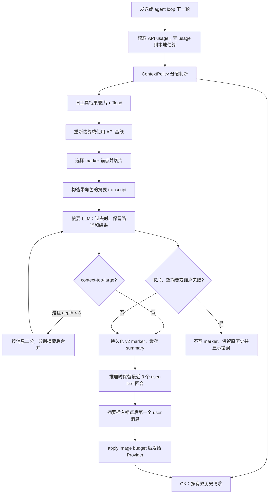

图中 `summary` 的循环来自 iOS `generateCompactSummaryWithSplitting`（`src/ios/Agent/Chat/AIChatViewModel+Compaction.swift:872-929`）和 Android 同名 helper（`src/android/app/src/main/java/com/openminis/app/ui/chat/ChatViewModel.kt:2374-2420`）；“最近 3 回合 + 内联摘要”来自 iOS `effectiveAgentHistoryUncounted`（`src/ios/Agent/Chat/AIChatViewModel+Persistence.swift:1417-1488`）和 Android `effectiveAgentHistory`（`src/android/app/src/main/java/com/openminis/app/ui/chat/ChatViewModel.kt:2058-2202`）。

#### 3.5.1 步骤 0：触发与并发门

iOS 的 `/compact` 通过 `compactAll()` 选取最后一个 active UI message 作为 anchor，过滤 compact divider、system info 和已经标灰的历史；消息不足或正在处理时直接显示提示。见 `src/ios/Agent/Chat/AIChatViewModel+Compaction.swift:200-223`。`compactBefore` 还允许长按某条消息压缩到该点，并在 agent loop 中以 `allowDuringProcessing` 调用。见 `src/ios/Agent/Chat/AIChatViewModel+Compaction.swift:446-465`。

Android 的 `compactBefore(dbMessageId)` 把给定 DB id 映射到 `agentHistory`，找不到时退回 `compactAll()`；`compactAll` 在 streaming 或已有 compact 时拒绝重入。见 `src/android/app/src/main/java/com/openminis/app/ui/chat/ChatViewModel.kt:1490-1522`、`src/android/app/src/main/java/com/openminis/app/ui/chat/ChatViewModel.kt:1524-1545`。

#### 3.5.2 步骤 1：确定范围和持久化锚点

v2 marker 的语义不是“第一条保留消息”，而是“最后一条已折叠消息”：

- 本次 anchor 是用户指定边界，或 `compactAll` 的最后 active 消息。
- 没有旧 marker 时，范围是 `[0, anchorIdx]`。
- v2 有旧 marker 时，范围从 `prevAnchorIdx + 1` 开始，避免新摘要重复把同一增量当作新历史；v1 兼容路径从 `firstKeptMessageId` 开始。
- 写 marker 前必须找到已持久化的 `dbMessageId`；iOS 还确认该 id 存在于当前 raw DB。找不到就不写 marker。

iOS 的范围计算与 v1/v2 起点见 `src/ios/Agent/Chat/AIChatViewModel+Compaction.swift:601-645`，anchor 和 `endExclusive` 见 `src/ios/Agent/Chat/AIChatViewModel+Compaction.swift:529-555`。iOS 从 `allRaw` 向前寻找已持久化 id，避免 marker 指向尚未落库的 transient row，见 `src/ios/Agent/Chat/AIChatViewModel+Compaction.swift:682-705`。

Android 的 v2 起点和 DB id 验证见 `src/android/app/src/main/java/com/openminis/app/ui/chat/ChatViewModel.kt:1595-1623`、`src/android/app/src/main/java/com/openminis/app/ui/chat/ChatViewModel.kt:1656-1687`。它在 IO coroutine 中读取 raw DB id 集合，并从原 anchor 向前走到最近的已落库 entry。

**来源：`src/ios/Agent/Chat/AIChatViewModel+Compaction.swift:717-738`**

```swift
let marker = CompactMarker(
    id: UUID().uuidString,
    sessionId: sessionId,
    summary: summary,
    firstKeptSortOrder: legacyPastEndSortOrder,
    compactedCount: historyCount,
    createdAt: Date(),
    uiBoundarySortOrder: legacyPastEndSortOrder,
    boundaryMessageId: nil,
    firstKeptMessageId: nil,
    lastCompactedMessageId: lastCompactedMessageId,
    version: 2
)
await ChatStore.shared.insertCompactMarker(marker)
self.cachedLatestMarker = marker
// agentHistory 不修改；下一次推理由 effectiveAgentHistory 合成
```

写 marker 成功后，iOS 删除旧 divider、插入新 divider，并把 anchor 之前的 UI 行标为 `isCompactedHistory`；Android 做同样的 cutoff graying，再追加带 summary payload 的 system info。见 `src/ios/Agent/Chat/AIChatViewModel+Compaction.swift:740-800`、`src/android/app/src/main/java/com/openminis/app/ui/chat/ChatViewModel.kt:1725-1783`。

#### 3.5.3 步骤 2：把原消息变成摘要输入

iOS `buildConversationTextForSummary` 保持角色前缀：普通 text 原样加入；`toolUse` 只挑 `path/file_path`、`command`、`directory` 或 content 前 200 字符；`toolResult` 只取前 500 字符；图片变成 `[Image attached]`。见 `src/ios/Agent/Chat/AIChatViewModel+Compaction.swift:833-870`。

Android 的 transcript 更激进：消息 `content` 前 500 字符，文本 part 前 500，tool input 前 200，tool result 前 500，图片只写 MIME 标记。见 `src/android/app/src/main/java/com/openminis/app/ui/chat/ChatViewModel.kt:2328-2361`。

这一步有两个不显然的保护：

- 摘要模型无需看到每个 shell 输出的全部原文，原文仍在 DB 或 offload 文件。
- 路径、命令、工具名、错误结果必须留在摘要输入，否则摘要即使语言流畅，也不能指导下一轮 `file_read` 或继续修复。

#### 3.5.4 步骤 3：摘要 prompt 的约束

摘要请求本身使用当前会话的 Provider，但不带工具列表；iOS 使用单条 user message 调 `streamMessage`，Android 使用非流式 `sendMessage`，两端都将 temperature 交给模型默认值。见 `src/ios/Agent/Chat/AIChatViewModel+Compaction.swift:945-1014`、`src/android/app/src/main/java/com/openminis/app/ui/chat/ChatViewModel.kt:2428-2469`。

摘要 system prompt 的约束是实现的一部分，而不是普通文案：

- 先用用户语言写一句过去时概述。
- 保留路径、目录、URL、UUID、identifier 原文。
- 保留执行过的命令及成功/失败/输出。
- 保留请求、已完成动作、决定及理由、错误和修复、约束与偏好、影响状态的工具调用。
- 结尾写 `What had been done so far`，禁止写会重新激活旧任务的 todo/pending 列表。
- 用户的下一条消息优先于摘要。

**来源：`src/ios/Agent/Chat/AIChatViewModel+Compaction.swift:957-985`**

```swift
let systemPrompt = """
You are a context compaction engine. Your summary will REPLACE the original messages in the conversation context window. The agent will read your summary as past context, then proceed based on the user's NEXT message — your summary is background, not a standing work order. Write the summary in the same language the user used in the conversation.

MUST PRESERVE (never omit or shorten):
- All file paths, directory names, URLs, UUIDs, and identifiers — copy verbatim
- Commands executed and their outcomes (success/failure/output)
- What was requested and what was done (record as past events, not as ongoing goals)
- Key decisions made and their rationale
- Errors encountered and how they were resolved
- Important constraints, rules, or user preferences mentioned
- Any tool calls and their results that affect current state
"""
```

Android 的 `compactSummarySystemPrompt` 与 iOS 对齐，源码位于 `src/android/app/src/main/java/com/openminis/app/ui/chat/ChatViewModel.kt:2523-2547`。发送给摘要模型的 user message 还包裹 `BEGIN/END`，明确“不要继续对话，只总结”，防止模型把 transcript 的最后一条用户请求当成新问题回答。见 `src/ios/Agent/Chat/AIChatViewModel+Compaction.swift:996-1014`、`src/android/app/src/main/java/com/openminis/app/ui/chat/ChatViewModel.kt:2428-2446`。

#### 3.5.5 步骤 4：context-too-large 时二分摘要

如果摘要请求失败且错误字符串匹配 `too many tokens`、`context length`、`max_tokens`、`request too large`、`prompt is too long`、`token limit` 等，且消息数不少于 2、递归深度小于 3，则按消息数量一分为二。两半分别摘要，再调用一次 merge prompt 合并；Part 2（较新）在空间不足时优先。见 `src/ios/Agent/Chat/AIChatViewModel+Compaction.swift:889-943`。

Android 的实现完全复刻这条协议：先递归摘要两半，再用“过去事件、保留路径/identifier/URL/决定/约束、不要 pending/todo、较新 Part 2 优先”的 merge input；递归深度同样上限 3。见 `src/android/app/src/main/java/com/openminis/app/ui/chat/ChatViewModel.kt:2386-2420`。

注意 previous summary 的合并：首层会把旧 marker summary 放在 `Previous context summary` 中，再放本次新增 transcript；发生二分时，子调用摘要各自的消息，最终由 merge prompt 合并。iOS 的拼接在 `src/ios/Agent/Chat/AIChatViewModel+Compaction.swift:879-884`，Android 的拼接在 `src/android/app/src/main/java/com/openminis/app/ui/chat/ChatViewModel.kt:2379-2385`。

#### 3.5.6 步骤 5：压缩后的“保留哪些消息”

v2 有效历史不是“summary + 全量 history”，而是以下布局：

1. 从 anchor 向前走，保留最近 `compactKeepRecentUserTurns = 3` 个有可见文本的 user 回合；每个 user 回合后面的 assistant、tool_use、tool_result 都属于同一回合。
2. 走回最多 100 条 message；只在 user 边界决定是否继续向前，不能把 tool_use 与其 tool_result 拆开。
3. 摘要不作为普通独立 user turn 插在中间，而是插入 anchor 之后第一个 user message 的第一个 text part，保持 API 所需的 user/assistant 交替。
4. anchor 之后的所有新消息保持 active，仍按原顺序发送。
5. 如果 anchor 后没有 user 消息，才在尾部追加一个独立 summary user message。

iOS 的注释和 anchor 解析见 `src/ios/Agent/Chat/AIChatViewModel+Persistence.swift:1417-1440`；最近 3 回合和 100 条上限见 `src/ios/Agent/Chat/AIChatViewModel+Persistence.swift:1452-1488`。Android 的同等逻辑见 `src/android/app/src/main/java/com/openminis/app/ui/chat/ChatViewModel.kt:2058-2072`、`src/android/app/src/main/java/com/openminis/app/ui/chat/ChatViewModel.kt:2083-2114`。

下面是 iOS 的核心插入片段；Android 采用 `target.copy(content = summaryWrappedText + "\\n\\n" + target.content)`，位置为 `src/android/app/src/main/java/com/openminis/app/ui/chat/ChatViewModel.kt:2177-2201`。

**来源：`src/ios/Agent/Chat/AIChatViewModel+Persistence.swift:1559-1582`**

```swift
if let firstUserOffset = postAnchor.firstIndex(where: { $0.role == .user }) {
    if firstUserOffset > 0 {
        result.append(contentsOf: postAnchor[0..<firstUserOffset])
    }
    var injected = postAnchor[firstUserOffset]
    injected.parts.insert(.text(summaryText), at: 0)
    result.append(injected)
    if firstUserOffset + 1 < postAnchor.count {
        result.append(contentsOf: postAnchor[(firstUserOffset + 1)...])
    }
} else {
    result.append(contentsOf: postAnchor)
    result.append(AgentMessage(role: .user, parts: [.text(summaryText)]))
}
return result
```

`summaryText` 使用 `<context-summary>` envelope，并且明确摘要是 background context、最新用户消息优先。见 `src/ios/Agent/Chat/AIChatViewModel+Compaction.swift:337-348`、`src/android/app/src/main/java/com/openminis/app/ui/chat/ChatViewModel.kt:2052-2056`。

#### 3.5.7 步骤 6：pre-anchor 工具结果裁剪与角色对齐

最近 3 个 user-text 回合之间可能塞进上百条工具消息。如果原工具结果已经被摘要覆盖，继续原样带入会让“保留最近回合”变成另一个上下文炸弹。因此 v2 在 pre-anchor slice 中查找长度大于 1,000 字符的 `toolResult`，收集其 id，同时从对应 assistant message 删除同 id 的 `toolUse`；删除后为空的壳 message 丢弃。这样不会产生只有 tool_use 没有 tool_result、或只有 tool_result 没有 tool_use 的孤儿配对。见 `src/ios/Agent/Chat/AIChatViewModel+Persistence.swift:1480-1519`、`src/android/app/src/main/java/com/openminis/app/ui/chat/ChatViewModel.kt:2104-2147`。

裁剪后还会剥掉开头所有非 user message，保证发送列表以 user 开始；如果裁剪把头部 user 清空，摘要就注入第一个 post-anchor user。见 `src/ios/Agent/Chat/AIChatViewModel+Persistence.swift:1522-1530`、`src/android/app/src/main/java/com/openminis/app/ui/chat/ChatViewModel.kt:2149-2155`。

#### 3.5.8 步骤 7：工具结果 offload 是压缩前后的另一条无损路径

offload 与摘要不同：它不让模型“记住大概内容”，而是把原文或图片写入 session 的 `offloads/tools`，再把消息 part 替换成一个可执行的检索提示。iOS 的触发入口：

1. 有 API baseline 就使用 `lastContextTokens`，否则使用字符估算。
2. 达到 policy 的 offload threshold 后，保护 `agentHistory` 最后 4 条 message。
3. 候选包括：tool result 文本超过 500 字符、图片超过 1 KiB、`file_write/file_edit` 的 content 超过 500 字符、裸图片超过 1 KiB。
4. 以 part token 数降序排序，逐个写文件，直到 current token 降到 offload target。
5. 已带 `[CONTEXT OFFLOADED]` 前缀的 part 跳过。

见 `src/ios/Agent/Chat/AIChatViewModel+Offloading.swift:295-428`、`src/ios/Agent/Chat/AIChatViewModel+Offloading.swift:430-503`。Android 的 threshold、最后 4 条保护、候选规则和排序见 `src/android/app/src/main/java/com/openminis/app/ui/chat/ChatViewModel.kt:5575-5596`、`src/android/app/src/main/java/com/openminis/app/ui/chat/ChatViewModel.kt:5598-5692`。

文本 tool result 会变成如下语义的 stub：

```text
[CONTEXT OFFLOADED] Content (~N tokens, B bytes) saved to: /var/minis/offloads/tools/...
Use file_read tool to retrieve if needed.
```

iOS 对 tool result、file_write/file_edit input、裸 ImageData 的替换分别位于 `src/ios/Agent/Chat/AIChatViewModel+Offloading.swift:514-548`；Android 对应替换位于 `src/android/app/src/main/java/com/openminis/app/ui/chat/ChatViewModel.kt:5700-5756`。原文件仍位于 session 的持久目录，因此这是**可逆的上下文减肥**，不是摘要式丢失。

另外，shell 执行器在输出本身过长时会先保留头尾各半，再附加 `[OUTPUT TRUNCATED]` 和 `file_read` 指引；这发生在 offload 之前，避免把进度噪声直接写入 history。见 `src/ios/Agent/Chat/AIChatViewModel+ISHCommand.swift:170-182`。

#### 3.5.9 步骤 8：图片、附件和 25 MiB 请求预算

图片有三道保护，不能只做 token 计数：

**第一道：历史图片数量。** iOS 每轮 API 前调用 `trimOldImagesFromHistory()`，只保留最近 20 张；更老的 tool result image 或 standalone image 被替换为文字 placeholder。若原路径在持久 `/var/minis/workspace`、`browser`、`attachments`、`offloads`，不重复快照；若来自 `/tmp`、没有路径或路径未知，则写到 offloads/tools 后在 placeholder 中给出 snapshot path。见 `src/ios/Agent/Chat/AIChatViewModel+Offloading.swift:112-187`、`src/ios/Agent/Chat/AIChatViewModel+Offloading.swift:188-293`。

placeholder 会携带像素尺寸、字节大小和原路径/快照路径，让模型知道“有一张图被省略”以及如何用 `read_image` 重新读取。见 `src/ios/Agent/Chat/AIChatViewModel+Offloading.swift:81-110`。

**第二道：本轮/请求级图片字节。** iOS `applyRequestImageBudget` 收集历史中所有 `imageData` 和带 image 的 `toolResult`，从最新到最旧反向规划；每张的有效大小先按 5 MiB clamp，累计超过 25 MiB 的旧图被替换为文字。没有 linuxPath 时，按 SHA-1 写入 `attachments/spillover`，再在 placeholder 中给出 `/var/minis/attachments/spillover/...`。见 `src/ios/Agent/Chat/AIChatViewModel+RequestBudget.swift:36-71`、`src/ios/Agent/Chat/AIChatViewModel+RequestBudget.swift:73-110`、`src/ios/Agent/Chat/AIChatViewModel+RequestBudget.swift:119-189`。

Android 在 `applyRequestImageBudget` 中采用同样的“最新优先”规划；没有路径的图片写入 `filesDir/minis-sessions/<sid>/attachments/spillover`，最后把裸图换成 text 或把 placeholder 追加到 tool result content。见 `src/android/app/src/main/java/com/openminis/app/ui/chat/ChatViewModel.kt:1927-2043`。其规划器和 placeholder 细节见 `src/android/app/src/main/java/com/openminis/app/provider/ImageBudget.kt:244-318`。

**第三道：Provider 边界压缩。** Android Provider 对恢复历史中绕过 composer 的图片再次调用 `compressUnderBudget`，在 2,000、1,600、1,280、1,024、896、768、640 像素梯度中尝试，最小化 JPEG 后再发送；即使无法达到目标，也保留最小候选而不是直接让整次请求失败。见 `src/android/app/src/main/java/com/openminis/app/provider/ImageBudget.kt:59-145`、`src/android/app/src/main/java/com/openminis/app/provider/anthropic/AnthropicProvider.kt:582-633`。iOS 的附件发送路径也先复制到持久 uploads，再只把图片字节加载进内存，非图片附件不 materialize 到 RAM，见 `src/ios/Agent/Chat/AIChatViewModel.swift:2254-2329`。

#### 3.5.10 步骤 9：失败、取消和安全降级

iOS compaction 在摘要前设置 `isCompacting/isProcessing`，插入 loading system-info；`Task.checkCancellation()` 抛出时显示 `Compaction cancelled.`，其他错误显示 `Compaction failed: ...`，并且在任何失败分支不写 marker。`defer` 最终清理状态。见 `src/ios/Agent/Chat/AIChatViewModel+Compaction.swift:573-599`、`src/ios/Agent/Chat/AIChatViewModel+Compaction.swift:651-671`。

如果摘要成功但找不到能落库的 anchor，iOS 明确报“could not anchor marker”并停止，不会用一个无法定位的 summary 覆盖历史。见 `src/ios/Agent/Chat/AIChatViewModel+Compaction.swift:686-705`。Android 在 summary 为空、anchor 验证失败、Provider 抛错时追加失败 system-info，最后把 `_isCompacting` 复位；只有成功才排队 drain。见 `src/android/app/src/main/java/com/openminis/app/ui/chat/ChatViewModel.kt:1642-1647`、`src/android/app/src/main/java/com/openminis/app/ui/chat/ChatViewModel.kt:1681-1701`、`src/android/app/src/main/java/com/openminis/app/ui/chat/ChatViewModel.kt:1783-1811`。

marker 在有效历史中无法解析时，两个平台都选择“回退到完整 history”，而不是只发送孤零零的 summary。原因是 summary-only 加上热工具列表可能让模型反复调用 `memory_get`/工具来找回状态；代码明确把“过度提供信息”当作安全网。见 `src/ios/Agent/Chat/AIChatViewModel+Persistence.swift:1441-1449`、`src/android/app/src/main/java/com/openminis/app/ui/chat/ChatViewModel.kt:2070-2080`。

---

### 3.6 持久记忆：工具接口、文件布局与 system prompt 注入

#### 3.6.1 存储位置和权限语义

iOS 的 memory 目录在 App Group 的 `MinisFileProvider/memory` 下，允许主 App 与 FileProvider 访问；这个目录是跨 session 的 global storage。见 `src/ios/Agent/Chat/AIChatViewModel+RequestBudget.swift:244-274`。`SOUL.md` 也在同一 memory 目录旁边，但它属于 persona，不是 memory tool 写入的 daily log。见 `src/ios/Agent/Session/SoulStore.swift:136-142`。

Android 的 `MemoryRepository` 使用 `<filesDir>/minis-global/memory/`，初始化时创建目录；`GLOBAL.md` 是用户维护、agent 只读的全局文件，`YYYY-MM-DD.md` 是 agent 通过 `memory_write` 写入的 daily log。见 `src/android/app/src/main/java/com/openminis/app/data/repository/MemoryRepository.kt:9-18`、`src/android/app/src/main/java/com/openminis/app/data/repository/MemoryRepository.kt:45-47`。

#### 3.6.2 `memory_write`：追加语义其实是“头插”

iOS 的 `executeMemoryWrite` 要求 JSON 有 `content` 且当前 session `memoryEnabled`；它生成当天 `yyyy-MM-dd.md`，把 `<!-- yyyy-MM-dd HH:mm:ss -->` 加到正文前，再把新 entry prepend 到现有文件。写成功后注册 fakefs metadata、标记 iCloud dirty、广播 `.memoryFilesDidChange`。见 `src/ios/Agent/Chat/AIChatViewModel+MemoryTools.swift:63-119`。

Android `MemoryTools.executeMemoryWrite` 解析 `content/tool_title` 后委托 `MemoryRepository.writeMemory`；Repository 同样生成时间戳注释并头插，返回 `Memory saved to ...` 或错误文本。见 `src/android/app/src/main/java/com/openminis/app/tools/MemoryTools.kt:98-121`、`src/android/app/src/main/java/com/openminis/app/data/repository/MemoryRepository.kt:49-77`。

工具 schema 也限制了用途：`memory_write` 要求 `tool_title` 和 `content`，描述中要求保存偏好、事实、项目约定，避免密码、API key 和 token；`memory_get` 要求 `tool_title`，可选 `scope`（`daily`/`all`）和空格分隔 keywords。见 `src/ios/Agent/Chat/AIChatViewModel+ToolDefinitions.swift:104-123`、`src/android/app/src/main/java/com/openminis/app/tools/MemoryTools.kt:15-71`。

#### 3.6.3 `memory_get`：两端搜索粒度不同

iOS `executeMemoryGet`：

1. `scope=all` 时把 `GLOBAL.md` 加入搜索，否则只查 daily 文件。
2. daily 文件按文件名倒序；有 keywords 时按 `<!-- timestamp -->` marker 拆成 entry。
3. 每个 entry 统计命中关键词数，使用 50% confidence + 50% recency 综合分排序。
4. 无关键词时最多返回 500 行；有关键词时最多返回 60 条 entry、约 30 KiB UTF-8，并且 append-then-break，触发上限的 entry 保持完整。

见 `src/ios/Agent/Chat/AIChatViewModel+MemoryTools.swift:144-201`、`src/ios/Agent/Chat/AIChatViewModel+MemoryTools.swift:204-229`、`src/ios/Agent/Chat/AIChatViewModel+MemoryTools.swift:270-365`。

Android `MemoryRepository.getMemory` 的关键词搜索是行级窗口：每个命中行带前后各 2 行上下文，所有关键词必须在窗口内出现；无关键词最多 500 行，有关键词最多 60 行，另有 30 KiB byte cap。见 `src/android/app/src/main/java/com/openminis/app/data/repository/MemoryRepository.kt:80-133`、`src/android/app/src/main/java/com/openminis/app/data/repository/MemoryRepository.kt:141-231`。

所以不能把 Android 的“60”解释为 iOS 的“60 entries”：Android 是约 60 行预算，iOS 是最多 60 个 timestamp-delimited entry。两端都把 tool result 限制在上下文友好的大小，避免一次 `memory_get` 重新制造 context bloat。

#### 3.6.4 何时注入 system prompt

iOS 在 `runAgentLoop` 的 prompt setup 中按以下顺序拼接：

1. `baseSystemPrompt`：SOUL identity/personality、Linux 行为约束、Available tools、环境和 `/var/minis` 说明。
2. 当前 model 的 capability fragment。
3. 当前 model 的 agent behavior fragment。
4. 当前 session 启用的 skills fragment。
5. MCP metadata fragment。
6. `GLOBAL.md` 全文（若存在且非空）。
7. 最近 30 天内最多 3 个有内容的 daily log，每个最多 200 行。
8. memory status footer。

见 `src/ios/Agent/Chat/AIChatViewModel.swift:4267-4310`。只有 `memoryEnabled` 为真时才读取 global/daily；关闭时注入一个权威 footer，说明文件和两个 memory tools 都不可见，见 `src/ios/Agent/Chat/AIChatViewModel.swift:1872-1895`。这意味着 memory 是**每次构建 system prompt 时注入的背景材料**，而不是把 memory 文件永久追加进 `agentHistory`。

Android 的 `buildSystemPrompt()` 也在每次调用时读取当前 memory toggle；base 中先放 identity、工具说明、环境变量和 memory system guidance，然后按 `skills → MCP → GLOBAL.md → recent daily logs → Runtime context` 的顺序 append。见 `src/android/app/src/main/java/com/openminis/app/ui/chat/ChatViewModel.kt:7920-7988`、`src/android/app/src/main/java/com/openminis/app/ui/chat/ChatViewModel.kt:8081-8132`。

Android 的 memory toggle 同时影响 prompt 与工具 schema：`agentTools` 每次读取都会调用 `AgentTools.makeAgentTools(memoryEnabled = ...)`，关闭时不注册 `memory_write` 和 `memory_get`。见 `src/android/app/src/main/java/com/openminis/app/ui/chat/ChatViewModel.kt:736-744`、`src/android/app/src/main/java/com/openminis/app/tools/AgentTools.kt:14-36`。iOS 也在关闭时从工具列表删除两个 definition，并在 execute 层做 defense-in-depth，见 `src/ios/Agent/Chat/AIChatViewModel+ToolDefinitions.swift:9-16`、`src/ios/Agent/Chat/AIChatViewModel+MemoryTools.swift:122-134`。

需要区分“自动注入”和“主动检索”：GLOBAL.md 与最近 daily log 是自动注入；更老的 daily 内容、关键词搜索结果只会在模型显式调用 `memory_get` 后以 tool result 回到下一轮 history。iOS 的注入数量限制和 `memory_get` 搜索路径分别见 `src/ios/Agent/Chat/AIChatViewModel+MemoryTools.swift:19-60`、`src/ios/Agent/Chat/AIChatViewModel+MemoryTools.swift:122-365`；Android 对应见 `src/android/app/src/main/java/com/openminis/app/data/repository/MemoryRepository.kt:234-301`。

---

### 3.7 文件 mention、索引和“注入文件内容”的真实语义

#### 3.7.1 索引构建：三层扫描、缓存和预算

iOS `FileMentionIndex` 是 `@MainActor` 单例，默认缓存 600 秒，单次全局扫描最多收集 5,000 个 entry，mount 目录最大递归深度为 3，匹配结果默认上限 100。见 `src/ios/Agent/Chat/FileMentionIndex.swift:81-126`。

每次 `@` 触发时，`refreshIfNeeded` 先检查 cache TTL 与 session id；命中缓存且 entries 非空则不扫描，否则生成 UUID token 并异步扫描：

1. session roots：workspace、attachments，先发布。
2. shared roots：shared、skills、memory，再发布。
3. 每个 external mount 单独扫描和发布；即使预算耗尽，也至少发布 mount 根目录。

见 `src/ios/Agent/Chat/FileMentionIndex.swift:130-146`、`src/ios/Agent/Chat/FileMentionIndex.swift:148-239`。扫描会跳过 `.git`、`node_modules`、`.venv`、build cache 等目录，见 `src/ios/Agent/Chat/FileMentionIndex.swift:433-495`；publish 阶段按 `linuxPath` 去重，并用 token 丢弃过期扫描结果，见 `src/ios/Agent/Chat/FileMentionIndex.swift:526-560`。

Android 的 FileMentionIndex 采用同样的三层和 10 分钟缓存，但在 CoroutineScope/StateFlow 中实现；session roots、shared roots、mount roots 按层发布，mount 根总是可引用，见 `src/android/app/src/main/java/com/openminis/app/data/FileMentionIndex.kt:15-45`、`src/android/app/src/main/java/com/openminis/app/data/FileMentionIndex.kt:94-181`。Android 的全局预算 5,000、mount 深度 3、结果上限 100 定义于 `src/android/app/src/main/java/com/openminis/app/data/FileMentionIndex.kt:391-404`。

#### 3.7.2 匹配评分与 @ 菜单

iOS 匹配不是全文内容检索，而是对 basename/path 做可预测的字符串分级：完整 basename 10,000、stem 9,000、前缀 7,000、basename word boundary 6,000、basename contains 4,000、祖先路径组件 2,000、全路径 1,000；scope、顶层目录和最近修改时间只作为次级加分。相邻 name tier 间隔为 1,000，而所有次级信号之和最多 730，所以弱 name match 不会因 scope 优先级逆袭强 match。见 `src/ios/Agent/Chat/FileMentionIndex.swift:241-342`。

Android 采用同一套 10,000 到 1,000 的 tier、scope boost、顶层 root bonus 和 recency bonus，见 `src/android/app/src/main/java/com/openminis/app/data/FileMentionIndex.kt:261-330`。

iOS 的 `updateMentionMenuState` 从 caret 向左寻找当前 token 中的 `@`，要求 `@` 位于文本开头或 whitespace 后，以避免 `foo@bar.com` 误触发；遇到 whitespace 就停止。见 `src/ios/Agent/Chat/AIChatViewModel+MentionMenu.swift:25-87`。索引扫描尚未结束时，UI 最多等待 250ms 或 scan finish 再显示，避免弹窗动画和列表 refill 同时发生，见 `src/ios/Agent/Chat/AIChatViewModel+MentionMenu.swift:87-157`。

Android 的扩展方法同时接受 ASCII `@` 和全角 `＠`，同样拒绝 email-like token，并在菜单打开时刷新 session index，见 `src/android/app/src/main/java/com/openminis/app/ui/chat/ChatViewModelMentionExt.kt:81-142`。

#### 3.7.3 选择 mention 后到底发生什么

选择 entry 时，iOS 只把 active `@<token>` 替换为 `@<entry.linuxPath> `，并把 caret 放到尾随空格后；Android 做同样的文本替换，见 `src/ios/Agent/Chat/AIChatViewModel+MentionMenu.swift:207-243`、`src/android/app/src/main/java/com/openminis/app/ui/chat/ChatViewModelMentionExt.kt:171-224`。

因此，当前实现的“文件 mention 注入”是**路径引用注入，不是文件内容自动注入**：

- `FileMentionIndex` 不打开文件、不读取文件正文。
- 发送时 iOS 把 input text 作为 `.text(text)` 追加到 user `AgentMessage`；路径仍是一段普通用户文本，见 `src/ios/Agent/Chat/AIChatViewModel.swift:2421-2431`。
- system prompt 和 `file_read` 工具定义告诉模型怎样读取 `/var/minis/...`；iOS 的工具说明见 `src/ios/Agent/Chat/AIChatViewModel+ToolDefinitions.swift:31-44`，Android 的 file-read 行为说明见 `src/android/app/src/main/java/com/openminis/app/ui/chat/ChatViewModel.kt:7991-7997`。
- 模型若需要正文，应调用 `file_read` 或 shell；工具结果才在下一轮进入有效历史。

这是一条重要的隐私与预算边界：键入 `@large.csv` 不会在用户尚未确认时把整个文件复制进 prompt。若从零实现时希望“选择即注入正文”，必须另加读取、大小上限、二进制检测、权限失败和 byte/token budget，而不能把它误认为当前代码已有能力。

#### 3.7.4 中文分词（cppjieba）在这里的真实作用

当前 `FileMentionIndex.swift` 只导入 `Foundation` 与 `Combine`，`matches(for:)` 也只做 lowercase、substring、word-boundary 和 path-component 判断；没有调用 `TextSegmenter` 或 `JiebaWrapper`。见 `src/ios/Agent/Chat/FileMentionIndex.swift:10-11`、`src/ios/Agent/Chat/FileMentionIndex.swift:254-342`。因此，**cppjieba 目前不参与文件 mention 的查询分词**；mention 查询 `@数据集` 是否命中，取决于文件名/path 的字符串包含关系。

`TextSegmenter` 是独立的统一文本分词 facade：前 200 个字符中，非空白 Han 字符占比至少 50% 时走 Jieba，否则走 `NLTokenizer`；含 Hiragana/Katakana 时优先按日文路径走 `NLTokenizer`。见 `src/ios/Shared/TextSegmenter.swift:1-31`、`src/ios/Shared/TextSegmenter.swift:52-88`。

`JiebaWrapper` 通过 Objective-C++ 持有一次加载的 DictTrie、HMMModel、MixSegment 和 QuerySegment；普通 segmentation 用 MixSegment，搜索细分用 QuerySegment，资源缺失或加载异常则由 Swift facade 回退到 `NLTokenizer`。见 `src/ios/Shared/JiebaWrapper.h:5-43`、`src/ios/Shared/JiebaWrapper.mm:34-105`、`src/ios/Shared/JiebaWrapper.mm:107-148`。

CppJieba vendor 本身是 header-only 组件；wrapper 特意不实例化完整 `cppjieba::Jieba` facade，以免 KeywordExtractor 强制加载未打包的 IDF/stop-word 资源。见 `src/ios/Shared/JiebaWrapper.mm:5-13`、`src/ios/Vendor/cppjieba/include/Jieba.hpp:9-25`。

`SentenceSplitter` 和 `MarkdownStripper` 也不是 BPE：前者只按 CJK/ASCII 终止符切句，并保留尾部标点，见 `src/ios/Shared/SentenceSplitter.swift:3-40`；后者去掉 fenced code、图片语法、Markdown 强调、链接包装、表格分隔线、标题/列表标记，得到用于摘要展示或通知的 plain text，见 `src/ios/Shared/MarkdownStripper.swift:3-80`。把它们拿来代替 token counter 会改变语义，尤其会把代码和图片引用从上下文中抹掉。

---

### 3.8 system prompt 组装：soul、skills、memory、环境与工具的顺序

#### 3.8.1 iOS 组装顺序

iOS 的 `baseSystemPrompt` 第一段由 `SystemPromptBuilder.identitySection()` 提供。它读取 memory 目录中的 `SOUL.md`，把稳定的 identity sentence 与可选 personality body 组合；body 超出 2,000 token 时不静默截断，而是回退 identity-only，见 `src/ios/Agent/Session/SoulStore.swift:136-187`、`src/ios/Agent/Session/SoulStore.swift:373-463`。

随后 `baseSystemPrompt` 按静态文本拼接：运行 Linux 的行为原则、`Available tools`（shell/file/browser/memory）、当前时间和设备语言、`/var/minis` 各目录、`minis://` 规则、环境变量保密约束和 Apple native CLI。关键落点见 `src/ios/Agent/Chat/AIChatViewModel.swift:1701-1749`、`src/ios/Agent/Chat/AIChatViewModel.swift:1846-1869`。

每个 agent loop 再把动态片段按这个顺序加到 base 后面：

| 顺序 | 片段 | 作用 | 代码位置 |
|---:|---|---|---|
| 1 | `SystemPromptBuilder.identitySection()` | SOUL name/personality/风格 | `src/ios/Agent/Session/SoulStore.swift:413-463` |
| 2 | base runtime + Available tools | Linux 能力、工具意图、目录/URL 规则 | `src/ios/Agent/Chat/AIChatViewModel.swift:1701-1772` |
| 3 | model capability | 当前模型支持的模态/能力 | `src/ios/Agent/Chat/AIChatViewModel.swift:4269-4276` |
| 4 | model behavior | 当前 model 的 agent 行为片段 | `src/ios/Agent/Chat/AIChatViewModel.swift:4273-4276` |
| 5 | enabled skills | 只注入可发现的 skill metadata，正文由模型读 SKILL.md | `src/ios/Agent/Chat/AIChatViewModel.swift:4278-4282` |
| 6 | MCP snippet | Top-20 enabled MCP metadata | `src/ios/Agent/Chat/AIChatViewModel.swift:4284-4287` |
| 7 | `GLOBAL.md` | 全局背景记忆 | `src/ios/Agent/Chat/AIChatViewModel.swift:4300-4303` |
| 8 | recent daily logs | 最近 3 个 daily 文件的前 200 行 | `src/ios/Agent/Chat/AIChatViewModel.swift:4304-4306` |
| 9 | memory status footer | 对 toggle 状态作权威覆盖 | `src/ios/Agent/Chat/AIChatViewModel.swift:4308-4310` |

**来源：`src/ios/Agent/Chat/AIChatViewModel.swift:4267-4310`**

```swift
let tools = makeAgentTools()
var userSystemPrompt = baseSystemPrompt
if let capFragment = activeModel.capabilityPromptFragment {
    userSystemPrompt += "\n\n" + capFragment
}
if let behaviorFragment = activeModel.agentBehaviorPromptFragment {
    userSystemPrompt += "\n\n" + behaviorFragment
}
if let sid = sessionId,
   let skillFragment = SkillStore.shared.skillPromptFragment(for: sid) {
    userSystemPrompt += "\n\n" + skillFragment
}
if memoryEnabled {
    if let memoryFragment = Self.loadGlobalMemoryFragment() {
        userSystemPrompt += "\n\n" + memoryFragment
    }
    if let dailyFragment = Self.loadRecentDailyMemoryFragment() {
        userSystemPrompt += "\n\n" + dailyFragment
    }
}
userSystemPrompt += memoryStatusFragment
```

这里 tools 与 prompt 是两个并行表面：`makeAgentTools()` 决定 Provider 收到的 schema，prompt 的 Available tools 只是模型可读说明。memory toggle 关闭时必须同时处理两边；否则模型会尝试调用不存在的工具。

#### 3.8.2 Android 组装顺序和缓存友好布局

Android `buildSystemPrompt()` 先把日期、时区、语言和 `minis-model-use` 数量从稳定 base 中移出，最后放入 `Runtime context`，以保留 prompt cache 的静态前缀。见 `src/android/app/src/main/java/com/openminis/app/ui/chat/ChatViewModel.kt:7920-7936`。

base 内容由 Android `SystemPromptBuilder.identitySection(context)` 开始，接着是 Linux/PRoot runtime、Available tools、`/var/minis`、环境变量约束；memory 开启时包括 Memory system guidance，关闭时改为明确 DISABLED 段落。见 `src/android/app/src/main/java/com/openminis/app/ui/chat/ChatViewModel.kt:7938-7988`。最后按 `skills → MCP → global memory → daily memory → Runtime context` append，见 `src/android/app/src/main/java/com/openminis/app/ui/chat/ChatViewModel.kt:8081-8132`。

Android skills fragment 会优先选择 bundled、近 7 天更新和高使用次数的 skill，最多注入固定数量的 name/description/path，提醒模型先读 `/var/minis/skills/<id>/SKILL.md`；它并不把每个 SKILL.md 正文都塞进 system prompt。见 `src/android/app/src/main/java/com/openminis/app/data/repository/SkillRepository.kt:223-295`。

#### 3.8.3 为什么顺序不能随便换

- identity/personality 需要在行为指导之前，模型才把后续 runtime 解释为“这个 agent 的执行能力”。iOS/Android 的 `SystemPromptBuilder` 都固定 identity sentence，并把 personality body 放在 labeled block，见 `src/ios/Agent/Session/SoulStore.swift:388-413`、`src/android/app/src/main/java/com/openminis/app/agent/SoulStore.kt:414-447`。
- skills 只暴露发现元数据，正文由模型按需 `file_read`，这是渐进式加载，避免所有 skill 同时消耗窗口；Android 的 XML fragment 明确写了 path 和“read SKILL.md”，见 `src/android/app/src/main/java/com/openminis/app/data/repository/SkillRepository.kt:266-295`。
- memory 放在 skills/MCP 后面，并由 footer 明确其“背景而非 standing instruction”语义；global/daily fragment 的文字本身包含最新用户消息优先规则，见 `src/ios/Agent/Chat/AIChatViewModel+MemoryTools.swift:9-16`、`src/ios/Agent/Chat/AIChatViewModel+MemoryTools.swift:57-60`。
- runtime context 末尾化是 Android 明确实现的 cache 优化：日期变化不再使整段 static prefix 失效，见 `src/android/app/src/main/java/com/openminis/app/ui/chat/ChatViewModel.kt:7920-7936`、`src/android/app/src/main/java/com/openminis/app/ui/chat/ChatViewModel.kt:8125-8132`。

---

### 3.9 平台对照

| 抽象 | iOS 落地 | Android 落地 | 差异与原因 |
|---|---|---|---|
| 文本 token | bundle `cl100k_base`，完整 BPE rank；`BPETokenizer` 懒加载词表 | 默认 codepoint/3；可选从 assets 加载词表再 BPE | iOS 已随 App 资源携带词表；Android 默认以 APK 体积换启动轻量，详见 `src/ios/Shared/BPETokenizer.swift:75-135`、`src/android/app/src/main/java/com/openminis/app/data/BPETokenizer.kt:8-17` |
| 图片 token | 2048 长边、32 网格、最低 85、失败 1000 | 同样的 2048/32/85/1000 | 两端刻意保持 context bar 可比，见 `src/ios/Shared/BPETokenizer.swift:33-50`、`src/android/app/src/main/java/com/openminis/app/data/BPETokenizer.kt:47-65` |
| 无 usage 估算 | effective history 的文本字符/3.5 + 图片 token | agentHistory 文本字符/3.5 + 图片 token | 都是保护线，不是最终账单，见 `src/ios/Agent/Chat/AIChatViewModel+Offloading.swift:304-366`、`src/android/app/src/main/java/com/openminis/app/ui/chat/ChatViewModel.kt:5515-5544` |
| 窗口策略 | `ContextPolicy(contextWindow:)` | `ContextPolicy.forContextWindow(window)` | 四档数值完全一致，见 `src/ios/Agent/Chat/ContextPolicy.swift:23-52`、`src/android/app/src/main/java/com/openminis/app/data/ContextPolicy.kt:60-89` |
| 发送前 compact | 普通会话可弹窗；shortcut/autoCompact 可自动 compact | 只追加 warning，用户执行 `/compact` | iOS UI 有 modal 状态；Android 当前路径不阻塞发送，见 `src/ios/Agent/Chat/AIChatViewModel.swift:2106-2148`、`src/android/app/src/main/java/com/openminis/app/ui/chat/ChatViewModel.kt:2491-2521` |
| loop 内 compact | 每轮 policy 检查，最多若干次，失败后 exhausted | 每轮先 offload；本章所查路径没有同等自动 compact | Android compact 是显式入口；两端都使用有效历史，见 `src/ios/Agent/Chat/AIChatViewModel.swift:4492-4545`、`src/android/app/src/main/java/com/openminis/app/ui/chat/ChatViewModel.kt:5891-5912` |
| 摘要 API | 当前 Provider 流式 `streamMessage` | 当前 Provider 非流式 `sendMessage` | 输出消费方式不同，prompt/拆分协议对齐，见 `src/ios/Agent/Chat/AIChatViewModel+Compaction.swift:1009-1044`、`src/android/app/src/main/java/com/openminis/app/ui/chat/ChatViewModel.kt:2451-2469` |
| compaction 保留 | marker anchor 前最近 3 user-text 回合，最多 100 message；summary 内联到 post-anchor user | 相同的 3/100/内联规则 | v2 语义跨平台一致，见 `src/ios/Agent/Chat/AIChatViewModel+Persistence.swift:1452-1582`、`src/android/app/src/main/java/com/openminis/app/ui/chat/ChatViewModel.kt:2083-2202` |
| offload | 最后 4 条保护，候选按 BPE token 降序，写 iSH 可见 offloads | 最后 4 条保护，写 `filesDir/minis-sessions/<sid>/offloads` | 路径介质不同，stub 协议一致，见 `src/ios/Agent/Chat/AIChatViewModel+Offloading.swift:425-555`、`src/android/app/src/main/java/com/openminis/app/ui/chat/ChatViewModel.kt:5638-5765` |
| 图片请求预算 | 5 MiB/图、25 MiB/请求、历史最多 20 图、spillover | 5 MiB/图、25 MiB/请求、spillover，Provider 端再压缩 | Android 明确提供 JPEG ladder；iOS 另有历史 image trim，见 `src/ios/Agent/Chat/AIChatViewModel+Offloading.swift:169-293`、`src/android/app/src/main/java/com/openminis/app/provider/ImageBudget.kt:59-145` |
| memory 写入 | App Group `memory/YYYY-MM-DD.md`，iCloud dirty + fakefs metadata | `filesDir/minis-global/memory/YYYY-MM-DD.md` | storage backend 不同，daily 格式和 GLOBAL 语义一致，见 `src/ios/Agent/Chat/AIChatViewModel+MemoryTools.swift:74-117`、`src/android/app/src/main/java/com/openminis/app/data/repository/MemoryRepository.kt:49-77` |
| memory 检索 | timestamp entry + confidence/recency，60 entries/30 KiB | 行级 ±2 context，60 lines/30 KiB | 搜索粒度不同，注入片段相同，见 `src/ios/Agent/Chat/AIChatViewModel+MemoryTools.swift:204-365`、`src/android/app/src/main/java/com/openminis/app/data/repository/MemoryRepository.kt:141-231` |
| mention 索引 | `@MainActor` + Combine、三层渐进 publish | Coroutine + StateFlow、三层渐进 publish | 并发原语不同，scope/score/预算对齐，见 `src/ios/Agent/Chat/FileMentionIndex.swift:94-239`、`src/android/app/src/main/java/com/openminis/app/data/FileMentionIndex.kt:83-181` |
| mention 内容 | 只插入 `@/var/minis/...` path，不读正文 | 同样只插入 path | 文件正文需模型调用 file_read，避免选择大文件即膨胀上下文，见 `src/ios/Agent/Chat/AIChatViewModel+MentionMenu.swift:219-243`、`src/android/app/src/main/java/com/openminis/app/ui/chat/ChatViewModelMentionExt.kt:189-224` |
| 中文分词 | `TextSegmenter`/Jieba 独立服务；FileMentionIndex 当前不调用 | FileMentionIndex 使用字符串 scoring；未见 cppjieba 对应路径 | 不能误称 mention 已做中文分词，见 `src/ios/Shared/TextSegmenter.swift:16-31`、`src/ios/Agent/Chat/FileMentionIndex.swift:254-342` |
| prompt 顺序 | soul → base/tools/env → capability/behavior → skills → MCP → memory → status | soul → base/tools/env/memory guidance → skills → MCP → memory → runtime | 两端保持技能/记忆渐进注入；Android runtime suffix 末尾化，见 `src/ios/Agent/Chat/AIChatViewModel.swift:4267-4310`、`src/android/app/src/main/java/com/openminis/app/ui/chat/ChatViewModel.kt:8081-8132` |

---

### 3.10 设计取舍与踩坑

#### 3.10.1 本地 token 数不应被当作“真值”

iOS BPE 词表比字符除法准确，但 Provider 仍可能采用不同 tokenizer、工具 schema overhead、cache 计费口径和图片计费口径；Android 默认路径更明确是 heuristic。正确做法是给 policy 留 10K/20K/40K headroom，使用 API `latestContextTokens` 校准，超大工具内容采用候选级 BPE 计数。阈值和 API baseline 位置见 `src/ios/Agent/Chat/ContextPolicy.swift:23-52`、`src/ios/Agent/Chat/AIChatViewModel+Offloading.swift:295-309`。

#### 3.10.2 system prompt 也会吃窗口

`estimateContextTokens` 只遍历有效历史 part，而 `runAgentLoop` 在另处组装 system prompt 和 tools；所以本地历史估算可能低于 wire request。这个风险通过策略 headroom、动态 max output、真实 usage 和 Provider 错误拆分兜底，但若从零实现，建议把 system prompt、tool schema 和预留输出明确计入同一个 `BudgetBreakdown`。现有代码证据见 `src/ios/Agent/Chat/AIChatViewModel+Offloading.swift:309-366`、`src/ios/Agent/Chat/AIChatViewModel.swift:4267-4310`、`src/android/app/src/main/java/com/openminis/app/ui/chat/ChatViewModel.kt:7920-8132`；“应合并计数”是**[推断]**的工程建议。

#### 3.10.3 不要把 compaction 做成 destructive truncate

iOS/Android 都保留 full `agentHistory`，marker 只记录 anchor 和 summary，推理时再 overlay。这样支持 revert、跨设备同步、DB 审计以及 marker 自愈；直接删除旧消息会让 UI、CloudKit/Room、tool pair 和 retry 状态难以恢复。见 `src/ios/Agent/Chat/AIChatViewModel+Compaction.swift:717-738`、`src/android/app/src/main/java/com/openminis/app/ui/chat/ChatViewModel.kt:1703-1724`。

#### 3.10.4 role alternation 与 tool pair 是硬约束

摘要不能简单插入一个 user summary，因为工具协议可能要求 user/assistant 交替；pre-anchor 也不能把 tool_use 与 tool_result 拆开。v2 的“summary 插入 post-anchor 第一个 user part”和“大于 1,000 字符结果连同对应 toolUse 一起删”正是为这两个约束服务。见 `src/ios/Agent/Chat/AIChatViewModel+Persistence.swift:1480-1530`、`src/ios/Agent/Chat/AIChatViewModel+Persistence.swift:1559-1580`。

#### 3.10.5 summary 必须是过去时，而不是新的任务列表

若摘要写成“当前目标/待办”，下一轮模型会把旧任务误认为 standing instruction，尤其在用户改变目标后。两端 prompt 都要求过去时、最近用户消息优先、结尾是已完成工作而非 todo/pending。见 `src/ios/Agent/Chat/AIChatViewModel+Compaction.swift:963-985`、`src/android/app/src/main/java/com/openminis/app/ui/chat/ChatViewModel.kt:2527-2547`。

#### 3.10.6 marker id 失效时不能 summary-only

iCloud sync、DB 删除、旧版本迁移或 transient row 都可能让 `lastCompactedMessageId` 无法映射。代码选择 full history fallback，并提供 createdAt self-heal 的辅助路径；summary-only 会丢掉工具状态。见 `src/ios/Agent/Chat/AIChatViewModel+Compaction.swift:142-197`、`src/ios/Agent/Chat/AIChatViewModel+Persistence.swift:1441-1449`。

#### 3.10.7 图片的真实风险是 RAM、HTTP bytes 和可重取性

iOS 特别避免把大型非图片附件读进 RAM，以降低后台 jetsam；图片则压缩后内联，旧图用路径或 snapshot placeholder。Android Provider 端也对 restored history 做压缩 backstop。见 `src/ios/Agent/Chat/AIChatViewModel.swift:2289-2329`、`src/ios/Agent/Chat/AIChatViewModel+Offloading.swift:239-273`、`src/android/app/src/main/java/com/openminis/app/provider/ImageBudget.kt:23-30`。

#### 3.10.8 memory 是 context source，不是永久 system instruction

GLOBAL/daily fragment 文本明确要求“背景 context、最新用户消息优先”，关闭 memory 时既不读文件也不注册工具。若把用户 memory 原样当 system instruction，历史偏好可能覆盖新任务；若每次无上限注入所有 daily 文件，又会抵消 compaction。见 `src/ios/Agent/Chat/AIChatViewModel+MemoryTools.swift:9-16`、`src/ios/Agent/Chat/AIChatViewModel.swift:1883-1895`。

#### 3.10.9 mention 要做“路径引用”，不要默认读取正文

索引是 UI 加速器，扫描有全局 5,000 条上限和 mount depth cap；它不是全文搜索器。选择 entry 只替换 token，正文由模型通过 file_read 获取，避免把大文件一次性注入。见 `src/ios/Agent/Chat/FileMentionIndex.swift:110-116`、`src/ios/Agent/Chat/AIChatViewModel+MentionMenu.swift:219-243`。

#### 3.10.10 cppjieba 误接入 mention 会带来错误预期

`TextSegmenter.segmentForSearch` 是可复用的中文搜索分词 API，但当前 mention scoring 没有调用它。若未来要支持“@自然语言关键词 → 多个文件”，必须定义 token 化、同义词、路径 basename 与内容索引的边界，不能只把 Jieba 输出拼回现在的 substring scoring。当前无调用证据见 `src/ios/Agent/Chat/FileMentionIndex.swift:254-342`，分词 API 见 `src/ios/Shared/TextSegmenter.swift:25-31`。

---

### 3.11 从零实现清单

以下顺序能先交付一个不会破坏历史的最小版本；每一步都给出验收标准，并标出可以砍掉的非核心项。

1. **定义消息 part 和稳定 id。**
   - 实现 `text/toolUse/toolResult/image`，每个 tool pair 有 id，每条已持久化 message 有 DB id。
   - 验收：可以序列化、reload，并在 assistant tool_use 与 user tool_result 之间保持 id 配对。
   - 可砍：reasoning、MCP、并发工具；不可砍稳定 id，因为 marker 需要它。参考 `src/ios/Agent/Chat/AIChatViewModel+Persistence.swift:1414-1444`。

2. **先实现本地的保守 token API。**
   - 最小版可用 `chars / 3.5 + imageTokens`，再提供 Provider usage 覆盖接口。
   - 验收：无 usage 的第一轮也能在发送前返回估计值，收到 usage 后下一轮使用真实值。
   - 可砍：Android 可选完整 BPE 词表；不能砍 image fallback 和 API baseline。参考 `src/android/app/src/main/java/com/openminis/app/ui/chat/ChatViewModel.kt:5515-5559`。

3. **实现窗口策略纯函数。**
   - 输入 `estimatedTokens/contextWindow`，输出 `OK/NEEDS_COMPACT/EXHAUSTED`；按 `<32K/32–64K/64–128K/≥128K` 四档配置 headroom。
   - 验收：阈值边界测试覆盖 `>=`，compact 优先于 exhausted。
   - 可砍：手动开关 UI；不能把策略和摘要代码耦合。参考 `src/ios/Agent/Chat/ContextPolicy.swift:23-90`。

4. **先做无损 offload，再做摘要。**
   - 大于 500 字符的 tool result、file_write/file_edit content、图片写到 session offloads，消息换成带路径 stub；保护最后 4 条。
   - 验收：`file_read` 能读回原文，第二次 offload 不重复写。
   - 可砍：候选详细日志；不能砍 path stub 和 id。参考 `src/ios/Agent/Chat/AIChatViewModel+Offloading.swift:425-555`。

5. **实现摘要 transcript。**
   - 角色前缀；tool input 只保留 path/command 等高价值字段；tool result 截断至 500；图片写 marker。
   - 验收：摘要输入不会把整块 shell 输出再次复制进内存，且路径/命令仍可见。
   - 可砍：recency 日志；不能砍 tool 名和错误结果。参考 `src/ios/Agent/Chat/AIChatViewModel+Compaction.swift:833-870`。

6. **实现 summary prompt 和拆分重试。**
   - 强制过去时、保留路径/URL/UUID/命令/结果/决定/约束；context-too-large 时二分，最大深度 3，再 merge。
   - 验收：大 transcript 的摘要请求可以逐级缩小；连续超过深度或非 context 错误会失败而不是死循环。
   - 可砍：流式摘要 UI；不能砍 BEGIN/END framing。参考 `src/android/app/src/main/java/com/openminis/app/ui/chat/ChatViewModel.kt:2374-2469`。

7. **写 v2 marker，原历史不动。**
   - marker 保存 `summary/sessionId/createdAt/compactedCount/lastCompactedMessageId/version=2`，确认 anchor id 已在 DB。
   - 验收：压缩后 reload 仍能定位 divider；revert 后 full history 恢复。
   - 可砍：v1 downgrade 字段；若要兼容旧数据则保留。参考 `src/ios/Agent/Chat/AIChatViewModel+Compaction.swift:682-738`。

8. **实现 effective history overlay。**
   - anchor 前走回最近 3 个 user-text 回合，最多 100 message；pre-anchor 大 tool result >1,000 时和匹配 tool_use 一起删除；summary 插入 post-anchor 第一个 user part。
   - 验收：wire history 首条为 user；不会发送孤儿 tool_use/tool_result；新用户消息落在 summary 之后。
   - 可砍：v1 marker；不能砍 marker 无法解析时 full-history fallback。参考 `src/ios/Agent/Chat/AIChatViewModel+Persistence.swift:1452-1582`。

9. **接入发送前与 loop 内检查。**
   - 入口按 policy 决定弹窗/自动 compact/warning；每轮 tool iteration 重新 offload 和估算。
   - 验收：一次用户回合内工具输出增长也能触发保护；compact 不无限循环。
   - 可砍：shortcut 特殊 UI；不能砍 turn cap。参考 `src/ios/Agent/Chat/AIChatViewModel.swift:4492-4545`。

10. **加图片三层预算。**
    - 单图压缩、请求总字节、旧图/历史图 placeholder；无路径图片先 spillover，再把 path 告诉模型。
    - 验收：25 MiB 超限时最新图片优先保留；placeholder 可用 `read_image` 取回。
    - 可砍：图片质量梯度的中间档；不能砍 provider boundary backstop。参考 `src/android/app/src/main/java/com/openminis/app/provider/ImageBudget.kt:128-145`、`src/android/app/src/main/java/com/openminis/app/provider/ImageBudget.kt:244-365`。

11. **实现 memory_write/get 和注入上限。**
    - daily 文件头插 timestamp；GLOBAL.md 只读；注入最多最近 3 个文件、每个 200 行；get 设行/entry 与 byte cap；toggle 同步 gating tools/prompt。
    - 验收：关闭 memory 时文件不进入 prompt、tools 不注册；开启时下一次 prompt build 可看到 global/recent fragments。
    - 可砍：confidence/recency 复杂排序；不能砍 30 KiB cap。参考 `src/android/app/src/main/java/com/openminis/app/data/repository/MemoryRepository.kt:234-301`。

12. **实现 mention 作为路径引用。**
    - 三层扫描 + TTL + 全局 entry budget；basename/path tier scoring；`@` 只插入 `/var/minis/...`，不自动读正文。
    - 验收：session 文件先出现、mount 慢时不阻塞 UI、选择后 caret 在尾随空格后、模型可通过 file_read 读到正文。
    - 可砍：recency bonus 和 fuzzy boundary；不能砍 scan token/去重。参考 `src/ios/Agent/Chat/FileMentionIndex.swift:130-146`、`src/ios/Agent/Chat/AIChatViewModel+MentionMenu.swift:219-243`。

13. **最后再加语言工具和平台优化。**
    - 中文 text segmentation 用 Jieba/`NLTokenizer` facade；通知/展示需要时用 SentenceSplitter/MarkdownStripper；Android 可选打包完整 BPE 词表。
    - 验收：中文分词不可用时回退，不影响文件 mention；摘要和 token 计数不互相替代。
    - 可砍：POS tagging、完整 CppJieba KeywordExtractor；不能把 cppjieba 假设成 mention 内容索引。参考 `src/ios/Shared/TextSegmenter.swift:16-48`、`src/ios/Shared/JiebaWrapper.mm:76-102`。

---

### 3.12 关键文件索引

| 路径 | 行数 | 职责 |
|---|---:|---|
| `src/ios/Agent/Chat/ContextPolicy.swift` | 92 | iOS 四档窗口策略、状态判定 |
| `src/ios/Agent/Chat/AIChatViewModel+Compaction.swift` | 1054 | 压缩入口、anchor、摘要 prompt、拆分、marker 写入、失败处理 |
| `src/ios/Agent/Chat/AIChatViewModel+Persistence.swift` | 1711 | v2 marker reload、effective history、summary overlay、pre-anchor prune |
| `src/ios/Agent/Chat/AIChatViewModel+Offloading.swift` | 818 | 工具结果/图片 offload、历史图片裁剪、3.5 字符估算 |
| `src/ios/Agent/Chat/AIChatViewModel+RequestBudget.swift` | 363 | 请求级图片 25 MiB 预算、spillover、minis 路径 |
| `src/ios/Shared/BPETokenizer.swift` | 270 | cl100k_base 词表、piece split、BPE、part/image token |
| `src/ios/Agent/Chat/AIChatViewModel.swift` | 5830 | send 入口、agent loop、system prompt、动态 max tokens |
| `src/ios/Agent/Chat/ChatModels.swift` | 422 | `TokenUsage` 累计规则与 ChatMessage 元数据 |
| `src/ios/Agent/Chat/AIChatViewModel+MemoryTools.swift` | 373 | memory_write/get、global/recent memory fragments |
| `src/ios/Agent/Chat/AIChatViewModel+ToolDefinitions.swift` | 144 | tools schema 与 memory tool gate |
| `src/ios/Agent/Chat/FileMentionIndex.swift` | 562 | 三层文件扫描、去重、排序和匹配评分 |
| `src/ios/Agent/Chat/AIChatViewModel+MentionMenu.swift` | 246 | caret/@ 检测、菜单异步显示、路径替换 |
| `src/ios/Shared/TextSegmenter.swift` | 104 | Jieba/NLTokenizer 语言路由 |
| `src/ios/Shared/SentenceSplitter.swift` | 42 | CJK/ASCII 终止符切句 |
| `src/ios/Shared/MarkdownStripper.swift` | 99 | Markdown 转 plain text |
| `src/ios/Shared/JiebaWrapper.h` | 47 | ObjC API、普通/搜索分词接口 |
| `src/ios/Shared/JiebaWrapper.mm` | 161 | CppJieba DictTrie/HMM/segmenter 生命周期和回退 |
| `src/ios/Vendor/cppjieba/include/Jieba.hpp` | 169 | CppJieba header-only facade 与 QuerySegment |
| `src/ios/Agent/Session/SoulStore.swift` | 530 | SOUL.md 存储、body 限制、identitySection |
| `src/android/app/src/main/java/com/openminis/app/data/ContextPolicy.kt` | 91 | Android 四档策略 factory 与 check |
| `src/android/app/src/main/java/com/openminis/app/ui/chat/ChatViewModel.kt` | 9844 | Android token、offload、compaction、effective history、prompt assembly、agent loop |
| `src/android/app/src/main/java/com/openminis/app/data/BPETokenizer.kt` | 139 | heuristic/可选 BPE、图片网格 token |
| `src/android/app/src/main/java/com/openminis/app/data/ContextOffload.kt` | 128 | Android 文本/图片 offload 文件与 stub |
| `src/android/app/src/main/java/com/openminis/app/provider/ImageBudget.kt` | 367 | 单图/请求图片字节预算、JPEG ladder、spillover |
| `src/android/app/src/main/java/com/openminis/app/tools/MemoryTools.kt` | 137 | memory_write/get schema 和执行适配 |
| `src/android/app/src/main/java/com/openminis/app/data/repository/MemoryRepository.kt` | 521 | memory 文件 I/O、entry/line 搜索、注入 fragment |
| `src/android/app/src/main/java/com/openminis/app/tools/AgentTools.kt` | 132 | provider-agnostic tools registry 与 memory gate |
| `src/android/app/src/main/java/com/openminis/app/agent/SoulStore.kt` | 530 | Android SOUL.md 与 system identity/personality |
| `src/android/app/src/main/java/com/openminis/app/data/repository/SkillRepository.kt` | 1536 | skills 选择、上限、XML prompt fragment |
| `src/android/app/src/main/java/com/openminis/app/data/FileMentionIndex.kt` | 404 | Android 三层文件扫描和 StateFlow 发布 |
| `src/android/app/src/main/java/com/openminis/app/ui/chat/ChatViewModelMentionExt.kt` | 224 | Android @ 检测、菜单导航和路径替换 |
| `src/android/app/src/main/java/com/openminis/app/data/model/LLMMessage.kt` | 81 | Android LLM message/content part 数据模型 |

这一索引也给出扩展到桌面端时的拆分边界：把 `ContextPolicy`、摘要 prompt/marker 协议、有效历史 overlay 和 memory 文件格式保持跨平台；把 token 词表加载、图片压缩、沙箱路径解析、UI 菜单和后台 I/O 换成 macOS/Windows/Linux 的实现。压缩协议的可移植核心是 marker anchor、摘要 envelope、tool pair 完整性和失败不破坏原历史，而不是 Swift/Kotlin 的具体类名。


## 4. 多模型 Provider 抽象层与认证

本章以 OpenMinis 的 Provider 层为样本，解释一个原生移动端 Agent 如何同时接入 Anthropic、OpenAI 兼容端点、OpenAI Responses API 与 Gemini，而不让 Agent loop 直接依赖某一家 SDK。

### 4.1 这一章解决什么问题

Provider 层负责把“选择哪个模型、用什么凭证、如何构造请求、如何把流式响应交给 Agent loop”串成一个稳定边界。
如果没有这个边界，工具调用、图片、思维链摘要和错误重试都会在聊天 ViewModel 中散落成供应商特例，新增一个模型家族就会改动整个应用。
OpenMinis 把普通对话能力抽象为 `LLMProvider`，把带工具的 Agent 能力再抽象为 `AgentProvider`，并把模型能力元数据放在 `LLMModel`/`ModelEntry` 中，而不是把能力硬编码到 UI。
本章还解释 API Key、OAuth、配置数据库和 model group 如何共同决定一次请求的实际 Provider。
读者可以按“统一内部消息 → Provider-specific wire → 统一流事件 → fallback”这条链路，从零实现一个可扩展的 iOS/Android Provider 层。
代码位置：`src/ios/Providers/LLMProvider.swift:3-20`、`src/ios/Providers/AgentProvider.swift:174-207`、`src/ios/Providers/LLMProviderFactory.swift:14-40`。

### 4.2 两级协议：普通 LLM 与 Agent Provider

#### 4.2.1 `LLMProvider` 的最小公共面

iOS 的协议只有名称、当前模型、非流式发送和 `AsyncThrowingStream` 流式发送四个要点；它故意不把工具参数放入基础协议，因为工具属于 Agent 层。
代码位置：`src/ios/Providers/LLMProvider.swift:3-20`。

```swift
protocol LLMProvider {
    var name: String { get }
    var model: LLMModel { get set }

    func sendMessage(
        messages: [LLMMessage],
        systemPrompt: String?,
        maxTokens: Int,
        temperature: Double?
    ) async throws -> LLMResponse

    func streamMessage(
        messages: [LLMMessage],
        systemPrompt: String?,
        maxTokens: Int,
        temperature: Double?
    ) async throws -> AsyncThrowingStream<LLMStreamChunk, Error>
}
```

Android 的基础接口扩展了这个公共面：发送方法增加图片、工具和 `ThinkingLevel`，实现者实际覆盖已经完成 thinking clamp 的 `sendMessageClamped`/`streamMessageClamped`。
代码位置：`src/android/app/src/main/java/com/openminis/app/provider/LLMProvider.kt:13-18`、`src/android/app/src/main/java/com/openminis/app/provider/LLMProvider.kt:54-106`。

```kotlin
interface LLMProvider {
    val name: String
    var model: LLMModel

    suspend fun sendMessage(
        messages: List<LLMMessage>,
        systemPrompt: String?,
        maxTokens: Int,
        temperature: Double? = null,
        imageParts: List<LLMMessage.ImagePart> = emptyList(),
        tools: List<AgentToolDefinition> = emptyList(),
        thinkingLevel: ThinkingLevel = ThinkingLevel.OFF,
    ): LLMResponse = sendMessageClamped(
        messages, systemPrompt, maxTokens, temperature, imageParts, tools,
        clampThinkingLevel(thinkingLevel),
    )

    fun streamMessage(
        messages: List<LLMMessage>,
        systemPrompt: String?,
        maxTokens: Int,
        temperature: Double? = null,
        imageParts: List<LLMMessage.ImagePart> = emptyList(),
        tools: List<AgentToolDefinition> = emptyList(),
        thinkingLevel: ThinkingLevel = ThinkingLevel.OFF,
    ): Flow<LLMStreamChunk> = streamMessageClamped(
        messages, systemPrompt, maxTokens, temperature, imageParts, tools,
        clampThinkingLevel(thinkingLevel),
    )
}
```

Android 的额外 `streamTextIsMonolithic` 标志用来告诉上层：Chat Completions 的文本块在语义上是一个整体，不能把网络到达顺序误当作工具块顺序。
代码位置：`src/android/app/src/main/java/com/openminis/app/provider/LLMProvider.kt:28-42`。

#### 4.2.2 Agent 层的统一流事件

iOS 的 `AgentProvider` 接收 `AgentMessage`、工具定义、最大输出和已 clamp 的 thinking level，返回 `AgentStreamEvent` 流；Anthropic、Gemini、OpenAI 三种 wire 都要在这里翻译为同一组事件。
代码位置：`src/ios/Providers/AgentProvider.swift:174-207`。

```swift
protocol AgentProvider {
    var name: String { get }
    var model: LLMModel { get }
    var defaultMaxTokens: Int { get }

    func streamAgentMessageClamped(
        messages: [AgentMessage],
        systemPrompt: String?,
        tools: [AgentToolDefinition],
        maxTokens: Int,
        thinkingLevel: ThinkingLevel
    ) async throws -> AsyncThrowingStream<AgentStreamEvent, Error>
}

extension AgentProvider {
    func streamAgentMessage(
        messages: [AgentMessage],
        systemPrompt: String?,
        tools: [AgentToolDefinition],
        maxTokens: Int,
        thinkingLevel: ThinkingLevel
    ) async throws -> AsyncThrowingStream<AgentStreamEvent, Error> {
        let clamped = min(thinkingLevel, model.catalogMaxThinkingLevel)
        return try await streamAgentMessageClamped(
            messages: messages, systemPrompt: systemPrompt,
            tools: tools, maxTokens: maxTokens, thinkingLevel: clamped
        )
    }
}
```

`AgentStreamEvent` 至少表达文本 delta、工具开始、工具 JSON 累积、工具完成、thinking delta、reasoning 原文、usage 和终止原因。
代码位置：`src/ios/Providers/AgentProvider.swift:124-173`；Android 对应的 `LLMStreamChunk` 位于 `src/android/app/src/main/java/com/openminis/app/data/model/LLMStreamChunk.kt:5-31`。

Android 使用 `Flow<LLMStreamChunk>`，其中 `ToolUseStart`、`ToolInputDelta`、`ToolCallComplete` 与 iOS 的三个 Agent 事件一一对应。
代码位置：`src/android/app/src/main/java/com/openminis/app/data/model/LLMStreamChunk.kt:19-22`。

#### 4.2.3 Provider 工厂是协议边界的唯一入口

iOS `LLMProviderFactory.makeProvider` 先通过 `ModelEntry.providerInstanceId` 找到实例，再按 `ProviderType` 构造 Anthropic、Gemini、OpenAI、OpenRouter、xAI 和 Kimi 的具体实现。
代码位置：`src/ios/Providers/LLMProviderFactory.swift:3-40`。

Agent loop 需要的是 `AgentProvider`，因此 `AIChatViewModel+ProviderFactory` 在同一个 switch 中把 Anthropic 包成 `AnthropicAgentProvider`、Gemini 包成 `GeminiAgentProvider`，其余 OpenAI-compatible 类型包成 `OpenAIAgentProvider`。
代码位置：`src/ios/Agent/Chat/AIChatViewModel+ProviderFactory.swift:7-47`。

Android 的 `ProviderFactory.create` 采用同一分派原则；直接 OpenAI OAuth 且没有自定义 base URL 时进入 Codex Responses API，xAI/Kimi OAuth 则显式强制 OpenAI Chat Completions。
代码位置：`src/android/app/src/main/java/com/openminis/app/provider/ProviderFactory.kt:13-18`、`src/android/app/src/main/java/com/openminis/app/provider/ProviderFactory.kt:46-173`。

这一区分很关键：OAuth 不是一种 wire 协议。OpenAI Codex OAuth 要走 ChatGPT 后端的 Responses 形状，xAI 与 Kimi 的 OAuth bearer 仍然走各自的 OpenAI-compatible Chat Completions。
代码位置：`src/android/app/src/main/java/com/openminis/app/provider/ProviderFactory.kt:60-91`、`src/android/app/src/main/java/com/openminis/app/provider/ProviderFactory.kt:106-171`。

#### 4.2.4 能力位不放在 Provider 协议里

iOS 用 `ModelModality` OptionSet 表示输入/输出方向，位包括 text、image、PDF、audio、video；`ModelCapabilities` 还记录支持的认证方式。
代码位置：`src/ios/Providers/LLMTypes.swift:3-43`。

```swift
struct ModelModality: OptionSet, Sendable, Codable, Hashable {
    let rawValue: Int
    static let textInput  = ModelModality(rawValue: 1 << 0)
    static let textOutput = ModelModality(rawValue: 1 << 1)
    static let imageInput = ModelModality(rawValue: 1 << 2)
    static let pdfInput   = ModelModality(rawValue: 1 << 3)
    static let audioInput = ModelModality(rawValue: 1 << 4)
    static let videoInput = ModelModality(rawValue: 1 << 5)
    static let imageOutput = ModelModality(rawValue: 1 << 6)
    static let audioOutput = ModelModality(rawValue: 1 << 7)
    static let videoOutput = ModelModality(rawValue: 1 << 8)
}
```

Android 用 `inputModalities`/`outputModalities` 两个字符串列表表达同一个概念，并把 `supportsReasoning`、`contextWindow`、`maxOutputTokens` 放在 `LLMModel`。
代码位置：`src/android/app/src/main/java/com/openminis/app/data/model/LLMModel.kt:5-17`。

`ThinkingLevel` 是模型能力的另一个维度。iOS 在 `AgentProvider` 扩展中按 `catalogMaxThinkingLevel` clamp，Android 在 `LLMProvider.clampThinkingLevel` 中按模型 catalog ceiling clamp；这样 fallback 换到能力更低的模型时不会把旧模型的 thinking 档位原样发出去。
代码位置：`src/ios/Providers/AgentProvider.swift:195-207`、`src/android/app/src/main/java/com/openminis/app/provider/LLMProvider.kt:108-117`。

核心调用路径如下。

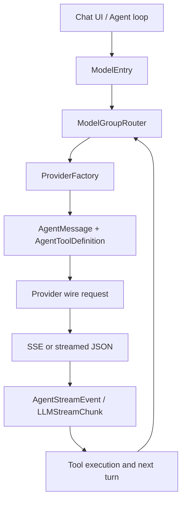

### 4.3 内部消息模型：先保留语义，再做 wire 映射

#### 4.3.1 普通消息与 Agent 消息

iOS 普通 `LLMMessage` 只有 user/assistant、文字、图片、音频；带工具的 `AgentMessage` 把内容拆成 `AgentContentPart`，并额外保留 `reasoningContent` 与 Responses API 的 `ReasoningEcho`。
代码位置：`src/ios/Providers/LLMTypes.swift:819-884`、`src/ios/Providers/AgentProvider.swift:53-122`。

Android `LLMMessage` 对应保存 `content`、`imageParts`、`audioParts`、结构化 `contentParts` 和跨轮 `reasoningContent`。
代码位置：`src/android/app/src/main/java/com/openminis/app/data/model/LLMMessage.kt:3-61`。

`AgentContentPart` 的四种语义是 Text、ToolUse、ToolResult 和 ImageData；图片在内部保持原始字节，直到 Provider 边界才按目标协议 base64 或压缩。
代码位置：`src/android/app/src/main/java/com/openminis/app/data/model/AgentContentPart.kt:5-75`；iOS 对应定义在 `src/ios/Providers/AgentProvider.swift:53-70`。

| 内部语义 | iOS 类型 | Android 类型 | 是否持久化/回传 |
|---|---|---|---|
| 文本 | `AgentContentPart.text` | `AgentContentPart.Text` | 直接回传 |
| 模型发起工具 | `toolUse(id,name,input)` | `ToolUse(id,name,input)` | 必须和结果按 id 配对 |
| 工具结果 | `toolResult(id,name,content,isError,...)` | `ToolResult(id,name,content,isError,...)` | 作为下一轮输入 |
| 图片输入/工具图片 | `imageData(Data, mimeType)` | `ImageData(ByteArray, mimeType)` | 进入目标协议前才压缩/base64 |
| 推理原文 | `AgentMessage.reasoningContent` | `LLMMessage.reasoningContent` | 仅对支持该字段的模型回传 |
| 原生 Responses 推理 | `ReasoningEcho` | Responses 解析器内部积累 | 只回传同 provider family + 同 model id |

#### 4.3.2 工具定义的三种 schema

工具注册只保存名字、描述、参数、required 和可选属性顺序；Android 的 helper 直接提供三种 JSON 构造，iOS 在各 Agent Provider 内构造 SDK schema。
代码位置：`src/android/app/src/main/java/com/openminis/app/data/model/AgentToolDefinition.kt:6-75`、`src/ios/Providers/AgentProvider.swift:14-45`。

```kotlin
/** Anthropic format: {name, description, input_schema: {type:object, properties, required}} */
fun toAnthropicJson(): JSONObject {
    val props = JSONObject()
    for ((key, param) in parameters) {
        props.put(key, param.toJson())
    }
    val schema = JSONObject().apply {
        put("type", "object")
        put("properties", props)
        if (required.isNotEmpty()) put("required", JSONArray(required))
    }
    return JSONObject().apply {
        put("name", name)
        put("description", description)
        put("input_schema", schema)
    }
}

/** Gemini format: {name, description, parameters: {type:OBJECT, properties, required}} */
fun toGeminiJson(): JSONObject {
    val props = JSONObject()
    for ((key, param) in parameters) {
        props.put(key, param.toGeminiJson())
    }
    val params = JSONObject().apply {
        put("type", "OBJECT")
        put("properties", props)
        if (required.isNotEmpty()) put("required", JSONArray(required))
        if (propertyOrdering != null) put("propertyOrdering", JSONArray(propertyOrdering))
    }
    return JSONObject().apply {
        put("name", name)
        put("description", description)
        put("parameters", params)
    }
}

/** OpenAI format: {type:function, function: {name, description, parameters: {type:object, ...}}} */
fun toOpenAIJson(): JSONObject {
    val props = JSONObject()
    for ((key, param) in parameters) {
        props.put(key, param.toJson())
    }
    val params = JSONObject().apply {
        put("type", "object")
        put("properties", props)
        if (required.isNotEmpty()) put("required", JSONArray(required))
    }
    return JSONObject().apply {
        put("type", "function")
        put("function", JSONObject().apply {
            put("name", name)
            put("description", description)
            put("parameters", params)
        })
    }
}
```

上面的三行注释对应真实实现中的字段形状，不能把工具定义统一成一份“看起来相似”的对象后直接发送；Anthropic 的 schema 键是 `input_schema`，Gemini 的参数类型是大写 `OBJECT`，OpenAI Chat 还要包一层 `function`。
代码位置：`src/android/app/src/main/java/com/openminis/app/data/model/AgentToolDefinition.kt:18-73`。

iOS 还会把 OpenAI Responses 的工具转换为扁平 `{type,name,description,parameters}`，这是 Responses API 与 Chat Completions 的一个非兼容点。
代码位置：`src/ios/Providers/OpenAI/OpenAIAgentProvider.swift:1547-1657`、`src/android/app/src/main/java/com/openminis/app/provider/openai/OpenAIProvider.kt:2488-2499`。

### 4.4 三家 wire 格式：同一语义的不同位置

#### 4.4.1 Anthropic Messages

Anthropic 的请求顶层是 `model`、`max_tokens`、`system`、`messages`、`tools`、`thinking` 和 `stream`。
系统提示词不进入 messages，而是作为 `system` 内容块；Claude Code OAuth 更要求第一个 system block 是构建时注入的标识文本，用户 prompt 作为第二个可缓存 block。
代码位置：`src/ios/Providers/Anthropic/AnthropicProvider.swift:186-220`、`src/android/app/src/main/java/com/openminis/app/provider/anthropic/AnthropicProvider.kt:274-320`。

工具定义用 `input_schema`，模型调用是 assistant 内容中的 `tool_use`，结果是紧随其后的 user 内容中的 `tool_result`，结果 id 使用 `tool_use_id`。
代码位置：`src/android/app/src/main/java/com/openminis/app/provider/anthropic/AnthropicProvider.kt:534-599`。

图片使用 `{"type":"image","source":{"type":"base64","media_type":...,"data":...}}`；Android 在 Provider 边界调用 `ImageBudget.compressUnderBudget`，iOS 在 Anthropic Agent 转换时缩放到可接受的长边和 JPEG 数据。
代码位置：`src/android/app/src/main/java/com/openminis/app/provider/anthropic/AnthropicProvider.kt:577-614`、`src/ios/Providers/Anthropic/AnthropicAgentProvider.swift:479-503`、`src/ios/Providers/Anthropic/AnthropicAgentProvider.swift:768-783`。

`cache_control` 不是系统提示词的独立顶层开关，而是挂在具体 system/tool/message 内容块上。OpenMinis 在最多四个位置设置 ephemeral breakpoint：最后一个工具、system、倒数第二个 user、最后一个 user。
代码位置：`src/ios/Providers/Anthropic/AnthropicAgentProvider.swift:814-826`。

Anthropic 的 thinking 有两种 wire 形状：Claude 4.6+ 使用 `thinking.type="adaptive"` 和 `output_config.effort`，旧模型使用 `thinking.type="enabled"` 和 `budget_tokens`；关闭时新模型必须显式发 `thinking.type="disabled"`，否则小 `max_tokens` 可能全部消耗在 thinking。
代码位置：`src/android/app/src/main/java/com/openminis/app/provider/anthropic/AnthropicProvider.kt:343-390`。

Anthropic 的消息还带有严格顺序约束。实现先注入缺失的 tool_result，再删除 orphan result，合并相邻同角色消息，并把 assistant 的 tool_use 排到文字后面、user 的 tool_result 排到其他内容前面。
代码位置：`src/ios/Providers/Anthropic/AnthropicAgentProvider.swift:455-514`、`src/ios/Providers/Anthropic/AnthropicAgentProvider.swift:516-639`、`src/ios/Providers/Anthropic/AnthropicAgentProvider.swift:641-727`。

一个最小的 Android 请求构造片段如下，字段顺序和语义均来自实现。

```kotlin
val body = JSONObject()
body.put("model", model.id)
body.put("max_tokens", maxTokens)
body.put("stream", stream)

val systemArray = resolveSystemPrompt(systemPrompt)
if (systemArray != null) body.put("system", systemArray)

if (tools.isNotEmpty()) {
    val toolsArray = JSONArray()
    for ((i, tool) in tools.withIndex()) {
        val toolJson = tool.toAnthropicJson()
        toolJson.put("eager_input_streaming", true)
        if (i == tools.lastIndex) {
            toolJson.put("cache_control", ephemeralCacheControl())
        }
        toolsArray.put(toolJson)
    }
    body.put("tools", toolsArray)
    body.put("tool_choice", JSONObject().put("type", "auto"))
}
body.put("messages", merged)
```

来源：`src/android/app/src/main/java/com/openminis/app/provider/anthropic/AnthropicProvider.kt:334-425`。

#### 4.4.2 OpenAI Chat Completions

OpenAI Chat Completions 的顶层是 `messages` 数组；system prompt 作为数组第一条 `role:system`，工具定义是 `{type:"function",function:{...}}`。
代码位置：`src/ios/Providers/OpenAI/OpenAIAgentProvider.swift:73-100`、`src/android/app/src/main/java/com/openminis/app/provider/openai/OpenAIProvider.kt:1426-1483`。

assistant 的工具调用放进 `tool_calls`，每个 function 的 arguments 是 JSON 字符串；工具结果不能继续作为 user content，而要成为单独的 `role:tool` 消息并携带 `tool_call_id`。
代码位置：`src/ios/Providers/OpenAI/OpenAIAgentProvider.swift:1081-1167`、`src/android/app/src/main/java/com/openminis/app/provider/openai/OpenAIProvider.kt:1511-1569`。

图片输入使用 Chat 的 `content` 数组，文字块是 `type:text`，图片块是 `type:image_url`，URL 可以是 `data:<mime>;base64,<bytes>`。
代码位置：`src/ios/Providers/OpenAI/OpenAIAgentProvider.swift:1137-1164`、`src/android/app/src/main/java/com/openminis/app/provider/openai/OpenAIProvider.kt:1571-1629`。

模型若不支持 image modality，OpenMinis 不把图片静默丢掉，而是发送明确的文字占位符，避免用户以为模型看到了图片。
代码位置：`src/ios/Providers/OpenAI/OpenAIAgentProvider.swift:1145-1154`、`src/android/app/src/main/java/com/openminis/app/provider/openai/OpenAIProvider.kt:1596-1615`。

Chat Completions 的 thinking 兼容性通过 `reasoning_content`、`reasoning` 或 `<think>` 文本协议处理。内部会记录字段是否出现，即使值是空字符串，因为 DeepSeek V4 等端点要求后续 assistant history 保持字段存在。
代码位置：`src/ios/Providers/OpenAI/OpenAIAgentProvider.swift:139-149`、`src/android/app/src/main/java/com/openminis/app/provider/openai/OpenAIProvider.kt:976-997`。

#### 4.4.3 OpenAI Responses API

Responses API 不使用 `messages`，而使用 `input`；system prompt 位于 `instructions`，工具定义是扁平的 function object。
代码位置：`src/ios/Providers/OpenAI/OpenAIAgentProvider.swift:390-469`、`src/android/app/src/main/java/com/openminis/app/provider/openai/OpenAIProvider.kt:2356-2499`。

模型工具调用是 input 中的 `type:function_call`，同时包含 `id`、`call_id`、`name` 和 JSON 字符串 `arguments`；结果是 `type:function_call_output`，带 `call_id` 和 `output`。
代码位置：`src/android/app/src/main/java/com/openminis/app/provider/openai/OpenAIProvider.kt:2501-2545`。

Responses 的 id 需要双 id 关系。OpenMinis 在流中把 `call_id|item_id` 组合为内部 id，下一轮再拆回 `call_id` 与 `fc_...` 的 `id`；Anthropic 又不接受 `|`，所以跨 Provider 时必须先通过 `sanitizeToolId`。
代码位置：`src/android/app/src/main/java/com/openminis/app/provider/openai/OpenAIProvider.kt:670-678`、`src/ios/Providers/AgentProvider.swift:3-12`。

Responses thinking 使用 `reasoning.effort`，可附带 `summary:"auto"` 让 `response.reasoning_summary_text.delta` 有可显示文本；若请求 reasoning，还会请求 `include:["reasoning.encrypted_content"]`，但 opaque encrypted item 只回传到同一模型。
代码位置：`src/ios/Providers/OpenAI/OpenAIAgentProvider.swift:410-449`、`src/ios/Providers/OpenAI/OpenAIAgentProvider.swift:655-736`。

#### 4.4.4 Gemini `generateContent`

Gemini 把对话放在 `contents`，user 对应 `role:"user"`，assistant 对应 `role:"model"`；系统提示词独立放在 `systemInstruction.parts`。
代码位置：`src/android/app/src/main/java/com/openminis/app/provider/gemini/GeminiProvider.kt:189-263`、`src/ios/Providers/Gemini/GeminiProvider.swift:378-409`。

文本是 `parts[].text`，图片是 `parts[].inlineData`；工具调用是 `functionCall:{name,args}`，工具返回是 `functionResponse:{name,response:{result:...}}`。
代码位置：`src/android/app/src/main/java/com/openminis/app/provider/gemini/GeminiProvider.kt:198-230`。

Gemini function call 默认没有统一的 Anthropic/OpenAI tool id。Android 流式解析用 `gemini_<nanoTime>` 生成内部 id；iOS 还保留 Gemini 3.x 的 `thoughtSignature`，缺少签名时把调用转成文字摘要以避免下一轮被拒绝。
代码位置：`src/android/app/src/main/java/com/openminis/app/provider/gemini/GeminiProvider.kt:140-155`、`src/ios/Providers/Gemini/GeminiAgentProvider.swift:103-161`。

Gemini 的 `contents[].parts[]` 是 protobuf oneof，空字符串不是一个有效 data 分支。因此 iOS 提供 `GeminiWireFormat.nonEmptyText`，Android 跳过空文本并在空 parts 时放入 `(empty)`。
代码位置：`src/ios/Providers/Gemini/GeminiWireFormat.swift:3-46`、`src/android/app/src/main/java/com/openminis/app/provider/gemini/GeminiProvider.kt:246-253`。

### 4.5 Wire 映射对照表

#### 4.5.1 消息、系统提示词和工具

| 语义 | Anthropic Messages | OpenAI Chat Completions | OpenAI Responses | Gemini generateContent |
|---|---|---|---|---|
| system prompt | 顶层 `system` 内容块 | `messages[0].role=system` | 顶层 `instructions` | 顶层 `systemInstruction.parts` |
| 普通文本 | `messages[].content[].text` | `content` 字符串或数组 | `input` 中 message/content | `contents[].parts[].text` |
| assistant role | `assistant` | `assistant` | `role=assistant` 或 output item | `model` |
| 工具声明 | `name/description/input_schema` | `type=function,function:{...}` | 扁平 `type/function/name/parameters` | `function_declarations` |
| 工具调用 | assistant `tool_use` | assistant `tool_calls[]` | `function_call` | `functionCall` |
| 工具结果 | user `tool_result` + `tool_use_id` | `role=tool` + `tool_call_id` | `function_call_output` + `call_id` | `functionResponse` + `name` |
| 图片 | `image.source.base64` | `image_url` data URL | `input_image` data URL | `inlineData` base64 |
| thinking 输入 | `thinking` 配置；兼容代理可回放 block | `reasoning_content`/`reasoning` | `reasoning.effort` + encrypted item | `thinkingConfig`/thought parts |
| cache | block 上 `cache_control` | 特定兼容端点的 `cache_control` | `prompt_cache_key` | 没有同形的 block cache |

上表中的 Anthropic/OpenAI/Gemini 具体字段分别由 `AnthropicProvider`、`OpenAIAgentProvider`、`GeminiAgentProvider` 构造，而不是由 Agent loop 拼接。
代码位置：`src/ios/Providers/Anthropic/AnthropicAgentProvider.swift:457-514`、`src/ios/Providers/OpenAI/OpenAIAgentProvider.swift:1079-1168`、`src/ios/Providers/Gemini/GeminiAgentProvider.swift:135-200`。

#### 4.5.2 常见兼容修复

| 问题 | Provider 边界的修复 | 依据 |
|---|---|---|
| Responses id 含 `|`，Anthropic 不接受 | 出站 Anthropic 统一 `sanitizeToolId` | `src/android/app/src/main/java/com/openminis/app/provider/anthropic/AnthropicProvider.kt:560-569`、`src/ios/Providers/AgentProvider.swift:5-12` |
| tool_use 没有结果 | 复制消息后注入 synthetic error tool_result | `src/ios/Providers/Anthropic/AnthropicAgentProvider.swift:535-587` |
| orphan tool_result | 仅保留最近 assistant 声明过的 id | `src/android/app/src/main/java/com/openminis/app/provider/anthropic/AnthropicProvider.kt:430-483` |
| Chat tool reply 顺序错误 | 收集所有 tool reply，再紧跟 assistant.tool_calls 重排 | `src/ios/Providers/OpenAI/OpenAIAgentProvider.swift:1377-1435` |
| 目标模型没有视觉能力 | 图片改为文字占位，而不是发送非法 image_url | `src/android/app/src/main/java/com/openminis/app/provider/openai/OpenAIProvider.kt:1436-1445` |
| Gemini 空 text | 跳过空 block 或放 `(empty)` | `src/ios/Providers/Gemini/GeminiWireFormat.swift:24-38` |
| 大图导致 413/维度错误 | Anthropic 缩放；Android 通用图片预算压缩 | `src/ios/Providers/Anthropic/AnthropicAgentProvider.swift:768-783`、`src/android/app/src/main/java/com/openminis/app/provider/anthropic/AnthropicProvider.kt:577-614` |

### 4.6 三家 SSE/流式事件对照

#### 4.6.1 事件表

| 阶段 | Anthropic Messages SSE | OpenAI Chat Completions SSE | OpenAI Responses SSE | Gemini SSE |
|---|---|---|---|---|
| 开始 | `message_start` | 首个 `choices[].delta` | `response.created`/首个 typed event | 首个 `data:` JSON，客户端补发 Started |
| 文本 | `content_block_start(text)` + `content_block_delta.text_delta` | `choices[].delta.content` | `response.output_text.delta` | `candidates[].content.parts[].text` |
| thinking | `content_block_start(thinking)` + `thinking_delta` | `delta.reasoning_content`/`reasoning` 或 `<think>` | `response.reasoning_text.delta` / `response.reasoning_summary_text.delta` | thought part 或 `thinkingConfig.includeThoughts` |
| 工具开始 | `content_block_start(tool_use)` | `delta.tool_calls[index]` 首次带 id/name | `response.output_item.added` item=function_call | `functionCall` 出现时生成内部 id |
| 工具参数 | `input_json_delta.partial_json` | `function.arguments` 增量 | `response.function_call_arguments.delta` | 一次性 functionCall args（实现直接 complete） |
| 工具结束 | `content_block_stop` | `finish_reason=tool_calls` 后 flush accumulator | `response.output_item.done` | 当前 chunk 解析后 complete |
| usage | `message_start.message.usage`、`message_delta.usage` | `stream_options.include_usage` 的 usage 块 | `response.completed.response.usage` | 每个 chunk 的 usageMetadata |
| 结束 | `message_delta.stop_reason`、`message_stop` | `[DONE]` + finish_reason | `response.completed`/`response.incomplete`/`response.failed` | 读完流后客户端补 `Finished` |

事件名称来自 iOS Anthropic switch、iOS OpenAI Responses switch、Android Anthropic/OpenAI/Gemini parser 的真实分支。
代码位置：`src/ios/Providers/Anthropic/AnthropicProvider.swift:286-320`、`src/ios/Providers/OpenAI/OpenAIAgentProvider.swift:510-765`、`src/android/app/src/main/java/com/openminis/app/provider/anthropic/AnthropicProvider.kt:184-272`、`src/android/app/src/main/java/com/openminis/app/provider/openai/OpenAIProvider.kt:786-1073`、`src/android/app/src/main/java/com/openminis/app/provider/gemini/GeminiProvider.kt:123-173`。

#### 4.6.2 Anthropic 的解析重点

Anthropic parser 把 `content_block_start` 的 `tool_use` 转成 ToolUseStart，把每个 `input_json_delta.partial_json` 追加到 buffer，在 `content_block_stop` 时 JSON parse 并发出 ToolCallComplete。
代码位置：`src/android/app/src/main/java/com/openminis/app/provider/anthropic/AnthropicProvider.kt:209-252`。

thinking delta 要单独进入 ThinkingDelta，不应混进可见文本；`message_delta` 同时提供 usage 和 stop reason。
代码位置：`src/android/app/src/main/java/com/openminis/app/provider/anthropic/AnthropicProvider.kt:219-262`。

#### 4.6.3 OpenAI 的解析重点

Chat Completions 的 tool calls 按 `index` 累积，因为每个 delta 可能只带 id、name 或 arguments 的一部分；不能按每个网络包直接视为完整调用。
代码位置：`src/android/app/src/main/java/com/openminis/app/provider/openai/OpenAIProvider.kt:1021-1061`。

Responses API 则按 `item_id` 累积，并在 `response.output_item.done` 使用服务端最终 `arguments`；这是“事件块”而不是“choice delta”的状态机。
代码位置：`src/android/app/src/main/java/com/openminis/app/provider/openai/OpenAIProvider.kt:814-866`。

Responses 的 `response.failed` 与 `response.incomplete` 必须显式转成错误，否则一个已经输出部分文本的失败响应会被错误当作正常完成。
代码位置：`src/ios/Providers/OpenAI/OpenAIAgentProvider.swift:620-653`、`src/android/app/src/main/java/com/openminis/app/provider/openai/OpenAIProvider.kt:868-911`。

#### 4.6.4 Android 与 iOS 的流式实现差异

iOS 使用 `AsyncThrowingStream` 与 `URLSession.bytes`/SDK stream；Android 使用 OkHttp `BufferedReader` + `callbackFlow`，两端最终都把事件转成统一内部 chunk。
代码位置：`src/ios/Providers/Gemini/GeminiProvider.swift:102-160`、`src/android/app/src/main/java/com/openminis/app/provider/gemini/GeminiProvider.kt:97-174`。

Android OpenAI parser 同时容忍 `data:` 和 `data: `，因为部分兼容端点省略冒号后的空格；iOS OpenAI parser通过 `ssePayload` 提取 payload 并识别 `[DONE]`。
代码位置：`src/android/app/src/main/java/com/openminis/app/provider/openai/OpenAIProvider.kt:711-746`、`src/ios/Providers/OpenAI/OpenAIAgentProvider.swift:510-518`。

iOS Anthropic 在 stream 建立阶段只对网络连接丢失做有限重试，已经产生 delta 后不透明重放，以免工具或文字重复；Android 的 silent-empty operator 会把无内容无 stop reason 的正常结束转成错误。
代码位置：`src/ios/Providers/Anthropic/AnthropicAgentProvider.swift:193-221`、`src/android/app/src/main/java/com/openminis/app/provider/LLMProvider.kt:121-162`。

### 4.7 认证：API Key、OAuth PKCE 与 device flow

#### 4.7.1 按 provider instance 隔离凭证

一个 `ProviderInstance` 是“供应商类型 + 凭证类型 + endpoint + label”的配置对象，同一 ProviderType 可以有多个实例，例如两个 Anthropic 账号或官方端点与代理端点并存。
代码位置：`src/ios/Providers/ProviderInstance.swift:14-79`。

iOS API key 使用 service `com.openminis.app.provider.<instanceId>`、account `api-key` 的 Keychain generic password，并尝试 synchronizable 项后回退 legacy 项；OAuth token 则用 account `oauth-token` 保存 Codable JSON blob。
代码位置：`src/ios/Providers/ProviderConfigStore.swift:2685-2745`、`src/ios/Providers/ProviderConfigStore.swift:2776-2835`。

iOS 保存后会设置 `kSecAttrAccessibleAfterFirstUnlock`、更新 API key 的本地时间戳并使认证缓存失效；这同时服务 iCloud Keychain 与 SwiftUI“已配置”状态刷新。
代码位置：`src/ios/Providers/ProviderConfigStore.swift:2697-2707`、`src/ios/Providers/ProviderConfigStore.swift:2767-2774`。

Android API key 使用 `EncryptedSharedPreferences` 中的 `apikey_<instanceId>`；OAuth 结构化 token 使用 `oauth_tokens_<instanceId>` JSON，辅助值使用 `oauth_<key>_<instanceId>`。
代码位置：`src/android/app/src/main/java/com/openminis/app/data/repository/ProviderRepository.kt:1748-1759`、`src/android/app/src/main/java/com/openminis/app/auth/OAuthManager.kt:283-305`。

Android 的 `EncryptedPrefsFactory.safeCreate` 用 AES-256-GCM master key 创建加密偏好；若 Android Keystore/Tink 解密失败，会清理加密文件和 alias 后重建一次，仍失败才落到带 `_plain_fallback` 后缀的普通偏好文件。
代码位置：`src/android/app/src/main/java/com/openminis/app/util/EncryptedPrefsFactory.kt:11-68`。

这个 fallback 是“先保证应用能启动、再要求用户重贴凭证”的灾备策略，不是把普通 SharedPreferences 当作正常安全存储；实现明确记录凭证会丢失。
代码位置：`src/android/app/src/main/java/com/openminis/app/util/EncryptedPrefsFactory.kt:23-35`、`src/android/app/src/main/java/com/openminis/app/util/EncryptedPrefsFactory.kt:49-55`。

| 项目 | iOS | Android |
|---|---|---|
| API Key | Keychain generic password，instanceId 在 service 中隔离 | `EncryptedSharedPreferences`，key 含 instanceId |
| OAuth bundle | Codable JSON，account=`oauth-token` | JSON 字符串，key=`oauth_tokens_<id>` |
| 辅助 OAuth 值 | Keychain account，如 `oauth-email`、`oauth-gcp-project` | `oauth_<name>_<id>` |
| 可用性缓存 | `ProviderCredentialCache` + `authRevision` | `StateFlow` 配置和 repository 读取 |
| 设备灾备 | legacy Keychain 查询回退 | Keystore/Tink 失败重建，最后 plain fallback |

#### 4.7.2 OAuth PKCE 通用时序

Claude OAuth 与 xAI OAuth 都是 loopback redirect + authorization code + PKCE；iOS 使用 `SFSafariViewController`，Android 使用 Chrome Custom Tab，回调由本地 HTTP callback server 接收。
代码位置：`src/ios/Providers/Anthropic/OAuth/ClaudeOAuthManager.swift:68-133`、`src/android/app/src/main/java/com/openminis/app/auth/ClaudeOAuthManager.kt:126-179`、`src/ios/Providers/xAI/OAuth/XAIOAuthManager.swift:67-156`。

```mermaid
sequenceDiagram
    participant App as "Minis App"
    participant Loop as "Local callback server"
    participant Browser as "Safari or Custom Tab"
    participant Auth as "Claude/xAI authorization"
    participant Token as "Token endpoint"
    participant Store as "Keychain or EncryptedPrefs"
    App->>App: "Generate verifier, S256 challenge, state"
    App->>Loop: "Bind fixed loopback port and callback"
    App->>Browser: "Open authorize URL with challenge and state"
    Browser->>Auth: "User signs in and approves"
    Auth-->>Browser: "Redirect code and state to loopback"
    Browser->>Loop: "GET /callback?code=...&state=..."
    Loop-->>App: "Resume callback continuation"
    App->>App: "Reject state mismatch"
    App->>Token: "POST code, redirect_uri, verifier"
    Token-->>App: "access_token, refresh_token, expires_in"
    App->>Store: "Persist per-instance token bundle"
    App->>App: "Provider request asks validAccessToken"
```

iOS Claude 的 verifier 由 96 个随机字节生成，challenge 是 verifier 的 SHA-256 base64url；授权 URL 包含 client_id、redirect_uri、scope、challenge 和 state，回调必须校验 state。
代码位置：`src/ios/Providers/Anthropic/OAuth/ClaudeOAuthManager.swift:82-124`、`src/ios/Providers/Anthropic/OAuth/ClaudeOAuthManager.swift:291-301`。

Android 基类把同样的 PKCE 流程抽成 `OAuthManager.buildAuthorizationUrl`，默认 verifier 使用 64 个随机字节；Claude 覆盖为 96 字节并将 verifier/state 保存到加密偏好，方便 JSON token exchange 读取。
代码位置：`src/android/app/src/main/java/com/openminis/app/auth/OAuthManager.kt:79-137`、`src/android/app/src/main/java/com/openminis/app/auth/ClaudeOAuthManager.kt:359-375`。

回调端口不是可以随意生成的普通参数。Claude 使用 54545，xAI 使用服务端 allow-list 固定的 56121；xAI 的 redirect URI 必须写 `127.0.0.1`，不能把它改成 `localhost`。
代码位置：`src/ios/Providers/Anthropic/OAuth/ClaudeOAuthManager.swift:16-21`、`src/ios/Providers/xAI/OAuth/XAIOAuthManager.swift:15-21`、`src/android/app/src/main/java/com/openminis/app/auth/XAIOAuthManager.kt:47-102`。

#### 4.7.3 Claude OAuth 的特殊 system prompt

Claude Code OAuth 请求不仅需要 bearer token，还需要 `anthropic-beta: oauth-2025-04-20`，并要求 system prompt 以 Claude Code 的识别行开头。
代码位置：`src/android/app/src/main/java/com/openminis/app/auth/ClaudeOAuthManager.kt:31-35`、`src/ios/Providers/Anthropic/AnthropicProvider.swift:164-183`。

`ANTHROPIC_OAUTH_IDENTIFIER_PROMPT` 不放在源码常量里，而由 build-time customization 注入：iOS 从 `ProviderCustomizationGenerated.anthropicOAuthIdentifierPrompt` 读取，Android 从 `BuildConfig.ANTHROPIC_OAUTH_IDENTIFIER_PROMPT` 读取；空值时第一次使用 Claude Code OAuth 会明确失败。
代码位置：`src/ios/Providers/Anthropic/AnthropicProvider.swift:43-66`、`src/android/app/src/main/java/com/openminis/app/auth/ClaudeOAuthManager.kt:42-61`。

`BUILDING.md` 解释了必要性：OAuth endpoint 检查 system prompt 的开头识别行，没有它请求会被拒绝；公开仓库不提供真实值，只提供 example 配置。
代码位置：`BUILDING.md:33-62`。

iOS 在 OAuth 模式把识别行作为第一个不带 cache 的 system block，用户 system prompt 作为第二个带 ephemeral cache 的 block；Android `resolveSystemPrompt` 同样先去重已嵌入的 prefix，再强制把 prefix 放在第一个 block。
代码位置：`src/ios/Providers/Anthropic/AnthropicProvider.swift:186-205`、`src/android/app/src/main/java/com/openminis/app/provider/anthropic/AnthropicProvider.kt:274-320`。

#### 4.7.4 xAI OAuth：OIDC discovery 与非标准 PKCE

xAI 先请求 `https://auth.x.ai/.well-known/openid-configuration`，读取 authorization/token endpoint，再限制 endpoint host 必须属于 `*.x.ai`；这样 discovery 文档不能把客户端重定向到任意域名。
代码位置：`src/ios/Providers/xAI/OAuth/XAIOAuthManager.swift:222-255`、`src/android/app/src/main/java/com/openminis/app/auth/XAIOAuthManager.kt:143-175`。

xAI verifier 使用 32 字节随机数据的 64 字符 hex 形式，授权 URL 除 challenge/state 外还带 nonce、`plan=generic` 和 `referrer=minis`。
代码位置：`src/ios/Providers/xAI/OAuth/XAIOAuthManager.swift:95-123`、`src/ios/Providers/xAI/OAuth/XAIOAuthManager.swift:258-273`。

xAI token exchange 除 verifier 外还回显 `code_challenge` 与 `code_challenge_method=S256`；这不是普通 OAuth 客户端可以省略的字段。
代码位置：`src/ios/Providers/xAI/OAuth/XAIOAuthManager.swift:277-297`、`src/android/app/src/main/java/com/openminis/app/auth/XAIOAuthManager.kt:221-234`。

xAI token 的 id_token payload 会被解析出 email、display name 和 account id；HTTP 403 代表订阅层级可能没有 API access，不应直接把 token bundle 当作 revoked 而删除。
代码位置：`src/ios/Providers/xAI/OAuth/XAIOAuthManager.swift:364-402`、`src/android/app/src/main/java/com/openminis/app/auth/XAIOAuthManager.kt:329-379`。

#### 4.7.5 Kimi Code：不是 PKCE，而是 RFC 8628 device authorization

Kimi Code 使用 RFC 8628 device authorization grant，不启动 callback server，也不需要 PKCE；客户端先 POST `client_id` 请求 device code，UI 展示 `user_code` 与 verification URL，然后按 interval 轮询 token endpoint。
代码位置：`src/ios/Providers/Kimi/OAuth/KimiDeviceFlow.swift:3-16`、`src/ios/Providers/Kimi/OAuth/KimiOAuthManager.swift:69-126`。

Kimi endpoint 只接受 `application/x-www-form-urlencoded`，并且该 client 禁止显式 `scope`；Android 与 iOS 都只发送 `client_id`。
代码位置：`src/ios/Providers/Kimi/OAuth/KimiOAuthManager.swift:107-126`、`src/android/app/src/main/java/com/openminis/app/auth/KimiOAuthManager.kt:105-145`。

轮询状态严格按 RFC 8628 分类：`authorization_pending` 继续，`slow_down` 把 interval 增加 5 秒，`access_denied`/`expired_token`/其他错误终止。
代码位置：`src/ios/Providers/Kimi/OAuth/KimiDeviceFlow.swift:59-97`、`src/android/app/src/main/java/com/openminis/app/auth/KimiDeviceFlow.kt:67-115`。

Kimi token 成功后保存 access/refresh/expireDate/deviceId；之后的 coding API base 是 `https://api.kimi.com/coding/v1`，缺少 `/v1` 会得到错误 endpoint。
代码位置：`src/ios/Providers/Kimi/OAuth/KimiOAuthManager.swift:89-104`、`src/android/app/src/main/java/com/openminis/app/auth/KimiOAuthManager.kt:196-209`、`src/android/app/src/main/java/com/openminis/app/auth/KimiDeviceFlow.kt:23-26`、`src/android/app/src/main/java/com/openminis/app/provider/ProviderFactory.kt:139-171`。

#### 4.7.6 其他 OAuth manager 的协议边界

OpenAI Codex OAuth 也是 loopback + PKCE，但它使用固定的 `auth.openai.com`、1455 端口和 `/auth/callback`，授权 URL 带 `codex_cli_simplified_flow`、`originator` 等客户端标识；完成后 ProviderFactory 将其送入 Responses API，而不是普通 Chat Completions。
代码位置：`src/ios/Providers/OpenAI/OAuth/CodexOAuthManager.swift:14-21`、`src/ios/Providers/OpenAI/OAuth/CodexOAuthManager.swift:60-121`、`src/android/app/src/main/java/com/openminis/app/auth/OpenAIOAuthManager.kt:111-136`。

Gemini OAuth 使用 Google authorization/token endpoint、PKCE 和 offline scope；登录后除了 token，还要获取用户邮箱并发现 Cloud Code Assist 的 GCP project，iOS 保存在 Keychain auxiliary account，Android 保存在 encrypted OAuth strings。
代码位置：`src/ios/Providers/Gemini/OAuth/GeminiOAuthManager.swift:70-139`、`src/android/app/src/main/java/com/openminis/app/auth/GeminiOAuthManager.kt:43-107`。

OpenRouter OAuth 的产物不是可刷新的 OAuth bundle，而是通过 PKCE code exchange 生成永久 API key；iOS/Android 都把结果保存到 API-key 存储，之后走 OpenRouter 的 OpenAI-compatible endpoint。
代码位置：`src/ios/Providers/OpenRouter/OAuth/OpenRouterOAuthManager.swift:45-97`、`src/android/app/src/main/java/com/openminis/app/auth/OpenRouterOAuthManager.kt:21-34`、`src/android/app/src/main/java/com/openminis/app/auth/OpenRouterOAuthManager.kt:98-105`。

Antigravity 复用 Google OAuth，但增加 Cloud Code Assist scopes，并在登录后发现 project/base URL；Android 源文件明确标注 request dispatch 尚未接线，因此不能把它当作已经可用的普通 Provider OAuth 实现。
代码位置：`src/ios/Providers/Antigravity/OAuth/AntigravityOAuthManager.swift:82-151`、`src/android/app/src/main/java/com/openminis/app/auth/AntigravityOAuthManager.kt:15-31`、`src/android/app/src/main/java/com/openminis/app/auth/AntigravityOAuthManager.kt:48-103`。

因此认证矩阵不能只写“支持 OAuth”一个布尔值：Codex 绑定 Responses API，Gemini/Antigravity 还绑定 project discovery，OpenRouter 变成 API key，Claude 绑定 system prefix，xAI 绑定 discovery/订阅能力，Kimi 则完全采用 device code。
代码位置：`src/ios/Providers/LLMProviderFactory.swift:81-131`、`src/ios/Agent/Chat/AIChatViewModel+ProviderFactory.swift:72-148`、`src/android/app/src/main/java/com/openminis/app/provider/ProviderFactory.kt:34-173`。

#### 4.7.7 token 刷新与并发 single-flight

iOS Claude 的 `validAccessToken` 在到期前 5 分钟触发刷新；每个 instance 有一个 in-flight Task，多个并发工具请求会 await 同一刷新，避免旋转 refresh token 被第二个请求以旧值重放。
代码位置：`src/ios/Providers/Anthropic/OAuth/ClaudeOAuthManager.swift:34-44`、`src/ios/Providers/Anthropic/OAuth/ClaudeOAuthManager.swift:141-213`。

Android 基础 OAuth 默认提前四小时刷新，但 Claude/Kimi 覆盖为五分钟；Android 使用每 instance 的 `Mutex`，刷新成功保留服务器没有返回的新 refresh token，网络/5xx 保留旧凭证，invalid grant 才清除。
代码位置：`src/android/app/src/main/java/com/openminis/app/auth/OAuthManager.kt:205-268`、`src/android/app/src/main/java/com/openminis/app/auth/ClaudeOAuthManager.kt:254-356`、`src/android/app/src/main/java/com/openminis/app/auth/KimiOAuthManager.kt:211-306`。

xAI 和 Anthropic 都有 compare-before-delete 逻辑：刷新失败时先比较当前持久化 refresh token 是否仍等于失败请求使用的旧 token；若另一个请求已经旋转成功，旧失败不能删除新凭证。
代码位置：`src/ios/Providers/xAI/OAuth/XAIOAuthManager.swift:194-219`、`src/android/app/src/main/java/com/openminis/app/auth/KimiDeviceFlow.kt:117-135`。

Android 的 `validAccessToken` 还允许 manual bearer 优先于动态 OAuth，并且不会触发 refresh；这满足自定义 proxy 用户手工粘贴 bearer 的场景。
代码位置：`src/android/app/src/main/java/com/openminis/app/auth/OAuthManager.kt:245-268`、`src/android/app/src/main/java/com/openminis/app/auth/OAuthManager.kt:307-323`。

### 4.8 配置存储、模型清单与 model groups

#### 4.8.1 三层数据模型

Provider 配置不是一个“当前模型字符串”，而是 `ProviderConfig = instances + modelEntries + modelGroups + 默认组/会话绑定/agent-loop 可用集合`。
代码位置：`src/ios/Providers/ProviderConfigStore.swift:18-46`、`src/android/app/src/main/java/com/openminis/app/data/model/ProviderConfig.kt:270-296`。

`ProviderInstance` 保存 endpoint 和 credential type；`ModelEntry` 保存具体实例上的模型，并把 API 返回的 `baseModel` 与用户可编辑 `overrides` 分离；刷新 models.dev 或 `/v1/models` 时只替换 baseModel，不抹掉用户 override。
代码位置：`src/ios/Providers/ProviderInstance.swift:14-45`、`src/ios/Providers/ModelEntry.swift:3-29`、`src/ios/Providers/ModelEntry.swift:84-133`。

Android 的 `ModelEntry.model` 是计算属性，逐项将 override 覆盖 base model；其稳定 id 是 `{providerInstanceId}/{modelId}`，而不是首次安装时随机 UUID。
代码位置：`src/android/app/src/main/java/com/openminis/app/data/model/ProviderConfig.kt:241-268`。

#### 4.8.2 自定义 endpoint 与多实例

同一 `ProviderType` 允许多个 instance；每个 instance 可设置 custom base URL、是否追加 `/v1`、custom User-Agent、Azure mode 和图片 endpoint mode。
代码位置：`src/ios/Providers/ProviderInstance.swift:23-45`、`src/ios/Providers/ProviderInstance.swift:171-215`。

iOS `resolvedBaseURL` 会清理末尾斜杠，并根据 `appendV1Suffix` 决定是否自动补 `/v1`；这避免代理 endpoint 生成 `/v1//v1`。
代码位置：`src/ios/Providers/ProviderInstance.swift:171-199`。

Android `ProviderInstance.effectiveBaseURL` 在 `ProviderFactory` 统一使用；OpenAI-compatible 的 xAI、Kimi、OpenRouter 和自定义 OpenAI 都能共享 `OpenAIProvider`，但仍保留 endpoint-specific auth/wire 选择。
代码位置：`src/android/app/src/main/java/com/openminis/app/provider/ProviderFactory.kt:19-34`、`src/android/app/src/main/java/com/openminis/app/provider/ProviderFactory.kt:94-171`。

#### 4.8.3 iOS SQLite 与 JSON downgrade mirror

iOS `ProviderConfigDB` 是 actor，按 instance、entry、group 分行存储，启用 WAL、foreign keys 和每行 CloudKit 同步；SQLite 是 v3 架构的权威源，旁边保留 `provider-config.json` 作为降级镜像。
代码位置：`src/ios/Providers/ProviderConfigDB.swift:6-23`、`src/ios/Providers/ProviderConfigDB.swift:43-64`。

表结构的关键关系是 `provider_model_entries.provider_instance_id` 外键级联到 `provider_instances`，group 用 `member_entry_ids_json` 保留顺序，local-only 表保存 session binding 和 agent loop id。
代码位置：`src/ios/Providers/ProviderConfigDB.swift:106-203`。

group 成员同步不是简单覆盖数组。`addedMembers`/`removedMembers` 记录每个 entry 的时间戳，合并时按每个成员最新意图决定保留或删除，避免两台设备同时添加不同模型时互相覆盖。
代码位置：`src/ios/Providers/ModelGroup.swift:40-52`、`src/ios/Providers/ProviderConfigDB.swift:206-229`。

删除也不能只从数组移除，否则旧设备的快照会把对象复活；`ProviderConfig` 保存 instance/entry/group tombstone。
代码位置：`src/ios/Providers/ProviderConfigStore.swift:8-16`、`src/ios/Providers/ProviderConfigStore.swift:40-46`。

#### 4.8.4 Android Room + JSON mirror

Android 使用独立 `provider.db` Room 数据库，故意不把 Provider 表放入 `minis.db`，这样降级到不认识新表的旧版本不会导致主数据库打开失败。
代码位置：`src/android/app/src/main/java/com/openminis/app/data/db/ProviderDatabase.kt:10-39`。

Room entity 与 iOS 表对齐：`provider_instances`、`provider_model_entries`、`provider_model_groups`、agent-loop ids 和 meta；entry 的主键是跨平台复合 key，baseModel/overrides 以 JSON 字符串保存。
代码位置：`src/android/app/src/main/java/com/openminis/app/data/db/ProviderInstanceEntity.kt:7-37`、`src/android/app/src/main/java/com/openminis/app/data/db/ProviderModelEntryEntity.kt:9-39`。

`ProviderRepository.loadConfigSuspending` 先读 Room，再用 JSON mirror 的 SHA-256 hash 判断 DB 是否与旧版本写入的 mirror 同步；hash 不同则从 JSON 导回 Room，双者损坏时保留 DB 而不是用空配置覆盖。
代码位置：`src/android/app/src/main/java/com/openminis/app/data/repository/ProviderRepository.kt:231-355`。

每次保存先计算 mirror hash，再 Room replaceAll，最后用 `commit()` 写 SharedPreferences mirror；同步写入的目的是让崩溃时 DB hash 与磁盘 mirror 不会错配。
代码位置：`src/android/app/src/main/java/com/openminis/app/data/repository/ProviderRepository.kt:374-426`。

#### 4.8.5 models.dev 是能力元数据回退

`scripts/update_models_dev.sh` 从 `https://models.dev/api.json` 下载并校验 JSON，然后同时更新 iOS resource 与 Android assets。
代码位置：`scripts/update_models_dev.sh:1-34`。

运行时 iOS/Android 都优先按 base URL 精确匹配，随后按 hostname 匹配；models.dev 返回 model id、context window、max output、reasoning、interleaved reasoning field 和 modality。
代码位置：`src/ios/Providers/ModelsDevAPI.swift:25-85`、`src/android/app/src/main/java/com/openminis/app/provider/ModelsDevApi.kt:52-159`。

iOS cache TTL 为 48 小时并采用内存/磁盘/bundle 回退；Android 同样是内存、磁盘、bundled asset 的三层 cache。
代码位置：`src/ios/Providers/ModelsDevAPI.swift:8-11`、`src/ios/Providers/ModelsDevAPI.swift:194-213`、`src/android/app/src/main/java/com/openminis/app/provider/ModelsDevApi.kt:16-26`、`src/android/app/src/main/java/com/openminis/app/provider/ModelsDevApi.kt:189-203`。

### 4.9 Model group 与 fallback 编排

#### 4.9.1 两种路由策略

`ModelGroup` 的 `memberEntryIds` 是有序模型入口；`fallback` 先使用第一项，失败后按顺序前进；`loadBalance` 以 sessionId hash 确定成员，保证同一会话的选择稳定。
代码位置：`src/ios/Providers/ModelGroup.swift:3-38`、`src/ios/Providers/ModelGroupRouter.swift:10-69`。

`FallbackStrategy.limited` 只在 provider-level error、rate limit、invalid key 或明确拒绝时切换；网络/瞬时 5xx 先在当前模型重试，`always` 才把这些错误也立即交给下一成员。
代码位置：`src/ios/Providers/ModelGroup.swift:11-19`。

路由器在选择前过滤隐藏 entry、禁用 instance、找不到 instance 和没有任何可用 credential 的 instance；这避免 iCloud 只同步了配置元数据而没有本机 token 时，空 OAuth instance 抢占 fallback 首选。
代码位置：`src/ios/Providers/ModelGroupRouter.swift:71-125`。

```swift
static func resolve(group: ModelGroup, sessionId: String, store: ProviderConfigStore) -> String? {
    let available = availableEntryIds(group: group, store: store)
    guard !available.isEmpty else { return nil }
    switch group.strategy {
    case .fallback:
        return available.first
    case .loadBalance:
        let index = abs(sessionId.hashValue) % available.count
        return available[index]
    }
}
```

来源：`src/ios/Providers/ModelGroupRouter.swift:10-33`。

#### 4.9.2 一轮请求的失败边界

Provider 先把 HTTP/SSE 错误映射为统一 `LLMError`，Agent loop 再依据错误分类决定“同模型重试”还是“请求 `nextFallback`”。
代码位置：`src/ios/Providers/Anthropic/AnthropicProvider.swift:464-500`、`src/ios/Providers/ModelGroupRouter.swift:36-69`。

Anthropic 的连接建立阶段可有限重试，但已经产生内容的中途断流不能透明重试；否则第二次请求会重复工具调用或重复可见文本。
代码位置：`src/ios/Providers/Anthropic/AnthropicAgentProvider.swift:193-221`、`src/ios/Providers/Anthropic/AnthropicAgentProvider.swift:392-400`。

切换 Provider 时，内部历史必须经过目标 Provider 的转换器重新清洗：Anthropic 的 tool_result adjacency、OpenAI 的 tool call adjacency、不同模型的 reasoning field 和图片能力都不能直接复用上一次 wire JSON。
代码位置：`src/ios/Providers/Anthropic/AnthropicAgentProvider.swift:509-639`、`src/ios/Providers/OpenAI/OpenAIAgentProvider.swift:1377-1435`。

#### 4.9.3 fallback 不是单纯的“换 model id”

fallback 需要同时替换 `ProviderInstance`、credential provider、base URL、协议形状、thinking ceiling 和可用能力；因此路由保存的是 `ModelEntry` id，而不是裸模型字符串。
代码位置：`src/ios/Providers/ModelEntry.swift:84-133`、`src/ios/Providers/LLMProviderFactory.swift:14-40`。

当 fallback 到没有 image input 的模型时，图片改成文字占位；当 fallback 到严格 Anthropic endpoint 时，不能把兼容代理的 unsigned thinking block 直接带过去。
代码位置：`src/android/app/src/main/java/com/openminis/app/provider/openai/OpenAIProvider.kt:1436-1445`、`src/android/app/src/main/java/com/openminis/app/provider/anthropic/AnthropicProvider.kt:487-516`。

### 4.10 iOS 与 Android 平台对照

| 抽象 | iOS 落地 | Android 落地 | 差异原因 |
|---|---|---|---|
| 普通 Provider 协议 | `LLMProvider` + `AsyncThrowingStream` | `LLMProvider` + `Flow` | Swift structured concurrency 对应 Kotlin coroutine stream |
| Agent Provider | `AgentProvider` 返回 `AgentStreamEvent` | 普通 provider 返回 `LLMStreamChunk`，ChatViewModel 组装 Agent 语义 | Android 复用了较薄的 provider chunk 层 |
| Provider factory | `LLMProviderFactory` 与 `AIChatViewModel+ProviderFactory` 两个入口 | `ProviderFactory.create` 单入口 | iOS 的 sub-task 与 Agent loop 都直接构造 provider |
| HTTP | `URLSession`、SwiftAnthropic、URLProtocol patcher | OkHttp、BufferedReader、callbackFlow | SDK/原生 streaming 生态不同 |
| Anthropic system | SDK `MessageParameter.System.list` | `JSONArray` 内容块 | 字段语义相同，序列化工具不同 |
| OpenAI OAuth | Codex OAuth 通常走 Responses API | `OpenAIOAuthManager` + Responses API | ChatGPT/Codex backend 不是普通 OpenAI key endpoint |
| xAI/Kimi OAuth | OAuth token provider 注入 OpenAI-compatible provider | `oauthOpenAICompat` 强制 Chat Completions | 防止 bearer 被误送到 Codex backend |
| Claude prefix | build-generated Swift customization | `BuildConfig` property | 两端均禁止把 identifier 写入公共源码 |
| API key | synchronizable Keychain，legacy fallback | `EncryptedSharedPreferences` | Apple Keychain 与 Android Keystore API 不同 |
| 配置结构化存储 | actor SQLite + JSON downgrade mirror | 独立 Room `provider.db` + JSON SharedPreferences mirror | 两端都需降级安全，但数据库栈不同 |
| model entry id | `{instanceId}/{modelId}` compositeKey，保留 legacy uuid | 同样的 composite key | iCloud/LAN/跨平台导入需要稳定身份 |
| 模型能力 | `ModelModality` OptionSet | input/output modality string lists | bit layout 通过 export/import 对齐 |
| SSE | SDK 事件枚举或 `URLSession.bytes` | OkHttp line reader | Android 需手工兼容 `data:` 变体 |
| 回调 OAuth | `SFSafariViewController` + localhost server | Chrome Custom Tab + callback Activity/server | 移动系统浏览器返回栈和生命周期 API 不同 |
| Kimi | RFC 8628 纯 Swift parser + Keychain manager | 纯 Kotlin parser + coroutine poll | 都不走 PKCE，设备码更适合无 loopback redirect |

对照表中的接口、存储和路由差异分别可在 `src/ios/Providers/LLMProvider.swift:3-20`、`src/android/app/src/main/java/com/openminis/app/provider/LLMProvider.kt:13-118`、`src/ios/Providers/ProviderConfigDB.swift:6-23`、`src/android/app/src/main/java/com/openminis/app/data/db/ProviderDatabase.kt:10-39` 看到。

### 4.11 设计取舍与踩坑

#### 4.11.1 不把 vendor JSON 泄漏到 Agent loop

Agent loop 只处理 `AgentContentPart`/`AgentStreamEvent`，这样工具执行器不需要知道 Anthropic 的 `tool_use`、OpenAI 的 `tool_calls`、Gemini 的 `functionCall` 三种名字。
代码位置：`src/ios/Providers/AgentProvider.swift:53-70`、`src/ios/Providers/AgentProvider.swift:124-148`。

代价是每个 Provider 都必须维护一套可逆映射和 history 修复；这是必要复杂度，因为三家 API 对 tool 结果位置和 id 约束不同。
代码位置：`src/ios/Providers/Anthropic/AnthropicAgentProvider.swift:516-639`、`src/android/app/src/main/java/com/openminis/app/provider/openai/OpenAIProvider.kt:2501-2545`。

#### 4.11.2 thinking 既是 UI 能力也是 wire contract

`supportsReasoning` 不能只控制“是否显示 Thinking 按钮”，它还决定是否发送 `reasoning_effort`、`thinkingConfig`、`thinking`，以及下一轮是否回放 reasoning 字段。
代码位置：`src/ios/Providers/LLMTypes.swift:57-61`、`src/android/app/src/main/java/com/openminis/app/data/model/LLMModel.kt:10-17`。

未识别的模型不能粗暴当作不支持 reasoning。iOS OpenAI converter 把 `supportsReasoning == nil` 作为允许用户显式打开的未知态，只有明确 `false` 才阻断。
代码位置：`src/ios/Providers/OpenAI/OpenAIAgentProvider.swift:1006-1032`。

#### 4.11.3 空内容是协议错误，不是普通空字符串

Gemini oneof 会拒绝空 text，Anthropic 的 tool result 需要非空内容，OpenAI 某些中继会在空 SSE 完成时静默断流；实现宁愿发最小占位或抛出 transient error，也不让“空成功”污染会话状态。
代码位置：`src/ios/Providers/Gemini/GeminiWireFormat.swift:13-31`、`src/android/app/src/main/java/com/openminis/app/provider/LLMProvider.kt:121-162`。

#### 4.11.4 OAuth refresh 必须按 instance single-flight

一个 provider instance 可能在同一 Agent turn 中并行执行多个工具，若每个请求都发现 token 即将过期并各自 refresh，旋转 refresh token 会产生 invalid_grant，甚至把刚成功的凭证删除。
代码位置：`src/ios/Providers/Anthropic/OAuth/ClaudeOAuthManager.swift:34-44`、`src/android/app/src/main/java/com/openminis/app/auth/ClaudeOAuthManager.kt:73-84`。

#### 4.11.5 缓存 breakpoints 要绑定具体内容块

Anthropic cache_control 不能放到一个抽象的“启用缓存”布尔值中，必须在 system/tool/user 内容块上放置且不能超过服务端允许的数量；因此 system prefix 要与用户 prompt 分块，OAuth prefix 不缓存。
代码位置：`src/ios/Providers/Anthropic/AnthropicProvider.swift:186-205`、`src/ios/Providers/Anthropic/AnthropicAgentProvider.swift:816-846`。

#### 4.11.6 降级镜像不是可选清理项

Provider 配置属于用户资产。iOS 保留 JSON 让旧版本可读，Android 保留 SharedPreferences JSON 并用 hash 发现旧版本写入；删除 mirror 会把数据库迁移与降级路径变成不可逆破坏。
代码位置：`src/ios/Providers/ProviderConfigDB.swift:6-18`、`src/android/app/src/main/java/com/openminis/app/data/db/ProviderDatabase.kt:10-28`、`src/android/app/src/main/java/com/openminis/app/data/repository/ProviderRepository.kt:231-247`。

#### 4.11.7 自定义 endpoint 需要完整的 URL 语义

自定义 base URL 不只是字符串替换：是否含 `/v1`、Azure query、User-Agent、OpenRouter headers、Anthropic OAuth UA 和图片 endpoint 都可能改变请求是否被接受。
代码位置：`src/ios/Providers/ProviderInstance.swift:23-45`、`src/ios/Providers/LLMProviderFactory.swift:42-77`、`src/android/app/src/main/java/com/openminis/app/provider/ProviderFactory.kt:19-34`。

### 4.12 从零实现清单

1. **定义内部模型。** 建立 `Model`、`ProviderInstance`、`ModelEntry` 和 `AgentMessage`；验收标准是同一条消息可以同时表达文字、图片、工具调用、工具结果和 reasoning。可砍掉音频、视频和 Responses 原生 reasoning，但不能砍掉 tool id。
   依据：`src/ios/Providers/AgentProvider.swift:53-122`、`src/android/app/src/main/java/com/openminis/app/data/model/LLMMessage.kt:3-61`。

2. **实现基础 Provider 接口。** 提供非流式与流式 API，所有实现都返回统一响应/事件；验收标准是一个 fake Provider 可以被聊天层调用而不暴露 vendor JSON。可先只实现 `text` 与 `finished`。
   依据：`src/ios/Providers/LLMProvider.swift:3-20`、`src/android/app/src/main/java/com/openminis/app/provider/LLMProvider.kt:54-106`。

3. **实现能力元数据和 clamp。** 保存 modality、context、max output、reasoning 和 thinking ceiling；验收标准是切换到低能力模型时 thinking 不越界。可先固定模型表，之后接 models.dev。
   依据：`src/ios/Providers/LLMTypes.swift:3-61`、`src/android/app/src/main/java/com/openminis/app/provider/LLMProvider.kt:108-117`。

4. **先接 Anthropic Messages。** 完成 system、messages、图片、tool schema、tool_use/tool_result 和 SSE parser；验收标准是文字流、工具流、工具结果下一轮都成功。可先不做 prompt cache 与 thinking。
   依据：`src/android/app/src/main/java/com/openminis/app/provider/anthropic/AnthropicProvider.kt:322-425`、`src/android/app/src/main/java/com/openminis/app/provider/anthropic/AnthropicProvider.kt:184-272`。

5. **实现 OpenAI Chat Completions。** 完成 system message、Chat tool schema、`role:tool`、图片 data URL、按 index 累积工具 arguments；验收标准是并行工具调用不丢参数。可先不接 `<think>` 与 provider-specific reasoning。
   依据：`src/android/app/src/main/java/com/openminis/app/provider/openai/OpenAIProvider.kt:1426-1569`、`src/android/app/src/main/java/com/openminis/app/provider/openai/OpenAIProvider.kt:1021-1061`。

6. **实现 OpenAI Responses 作为独立 wire。** 完成 `input/instructions`、function_call/function_call_output、双 id、typed SSE；验收标准是 Codex OAuth 与 API-key Responses relay 都能完成工具回合。可先不实现 encrypted reasoning replay。
   依据：`src/android/app/src/main/java/com/openminis/app/provider/openai/OpenAIProvider.kt:2356-2545`、`src/android/app/src/main/java/com/openminis/app/provider/openai/OpenAIProvider.kt:786-961`。

7. **实现 Gemini generateContent。** 完成 user/model role、systemInstruction、inlineData、functionCall/functionResponse 和空 parts 修复；验收标准是图片输入与工具回合都不触发 oneof 400。可先只实现 Gemini 2.5 Flash 的 thinkingBudget。
   依据：`src/android/app/src/main/java/com/openminis/app/provider/gemini/GeminiProvider.kt:176-300`。

8. **加入凭证存储。** iOS 使用 Keychain，Android 使用 EncryptedSharedPreferences；验收标准是重启后每个 instance 仍能读取自己的 key，删除一个 instance 不影响另一个。可先不做 synchronizable/Room mirror，但生产版本不能把 key 放普通配置 JSON。
   依据：`src/ios/Providers/ProviderConfigStore.swift:2685-2835`、`src/android/app/src/main/java/com/openminis/app/data/repository/ProviderRepository.kt:1748-1759`。

9. **先做普通 OAuth PKCE。** 生成 verifier/challenge/state，启动固定 loopback callback，打开系统浏览器，校验 state，exchange code；验收标准是 Claude-like OAuth 取消、超时、state mismatch 都能结束等待，不会卡住登录 UI。
   依据：`src/ios/Providers/Anthropic/OAuth/ClaudeOAuthManager.swift:68-133`、`src/android/app/src/main/java/com/openminis/app/auth/OAuthManager.kt:126-183`。

10. **加入刷新 single-flight。** 以 instance 为 key 合并并发 refresh，按 invalid grant/transient 分类；验收标准是两路并发 refresh 只产生一次网络请求，旧请求失败不能删除新 token。可先没有 compare-before-delete，但不能在旋转 refresh token 的 Provider 上省略它。
    依据：`src/ios/Providers/Anthropic/OAuth/ClaudeOAuthManager.swift:167-249`、`src/android/app/src/main/java/com/openminis/app/auth/ClaudeOAuthManager.kt:254-356`。

11. **接入 Claude build-time prompt。** 在私有构建配置注入 `ANTHROPIC_OAUTH_IDENTIFIER_PROMPT`，并把它作为第一个 system block；验收标准是 OAuth request 不因缺少识别行被拒绝。可砍掉 Claude OAuth，只保留 API key，但不能声称 OAuth 已支持。
    依据：`BUILDING.md:33-62`、`src/ios/Providers/Anthropic/AnthropicProvider.swift:43-66`。

12. **实现 xAI discovery 与 Kimi device flow。** xAI 要验证 discovery host、固定 56121/127.0.0.1 和额外 challenge；Kimi 要实现 RFC 8628 polling；验收标准是两者都能返回 refresh-aware bearer，并分别走 Chat-compatible coding/grok endpoint。
    依据：`src/android/app/src/main/java/com/openminis/app/auth/XAIOAuthManager.kt:143-234`、`src/android/app/src/main/java/com/openminis/app/auth/KimiOAuthManager.kt:125-193`。

13. **持久化 instance/entry/group。** 先使用 JSON 也可以，但每个 entry 必须稳定关联 instance，group 必须保存有序成员；生产版补上 SQLite/Room 与 downgrade mirror。验收标准是两个同类型账号、两个同名模型仍能在 UI 和 fallback 中区分。
    依据：`src/ios/Providers/ProviderConfigDB.swift:106-203`、`src/android/app/src/main/java/com/openminis/app/data/db/ProviderModelEntryEntity.kt:9-39`。

14. **实现 fallback router。** 过滤 disabled/hidden/no-credential，按 fallback 或 session hash 选 entry，按错误类型决定 retry 或 next fallback；验收标准是坏 key 跳到下一实例，网络短断不会立刻造成重复工具调用。
    依据：`src/ios/Providers/ModelGroupRouter.swift:16-125`、`src/ios/Providers/ModelGroup.swift:11-19`。

15. **接入 models.dev 及 Provider UI。** models.dev 只作为能力和模型清单回退，UI 修改 instance/entry/group 后走同一 store；验收标准是网络不可用时 bundle catalog 仍可建立 provider。可先不做 iCloud/LAN sync，但不能让 UI 自己保存凭证或拼 endpoint。
    依据：`scripts/update_models_dev.sh:1-34`、`src/ios/Providers/ModelsDevAPI.swift:25-85`、`src/android/app/src/main/java/com/openminis/app/provider/ModelsDevApi.kt:52-159`。

### 4.13 关键文件索引

| 路径 | 行数 | 职责 |
|---|---:|---|
| `src/ios/Providers/LLMProvider.swift` | 20 | iOS 普通 Provider 协议 |
| `src/ios/Providers/AgentProvider.swift` | 221 | Agent 协议、内部消息、统一流事件、工具定义 |
| `src/ios/Providers/LLMTypes.swift` | 927 | 模型能力、消息、响应、thinking 类型 |
| `src/ios/Providers/ProviderTypes.swift` | 115 | ProviderType、credential type、内建模型选择 |
| `src/ios/Providers/LLMProviderFactory.swift` | 287 | instance/credential 到具体 Provider 的工厂 |
| `src/ios/Agent/Chat/AIChatViewModel+ProviderFactory.swift` | 459 | Agent loop 使用的 provider factory 入口 |
| `src/ios/Providers/ProviderInstance.swift` | 363 | 多实例、endpoint、UA、Azure/image endpoint 配置 |
| `src/ios/Providers/ModelEntry.swift` | 223 | base model 与用户 override 的叠加 |
| `src/ios/Providers/ModelGroup.swift` | 100 | fallback/load-balance group 与 CRDT member intent |
| `src/ios/Providers/ModelGroupRouter.swift` | 126 | 可用成员过滤、初选、next fallback |
| `src/ios/Providers/ProviderConfigStore.swift` | 2926 | 配置状态、Keychain helper、JSON/sync bridge |
| `src/ios/Providers/ProviderConfigDB.swift` | 1447 | SQLite per-row store、WAL、迁移和组成员时间戳 |
| `src/ios/Providers/ModelsDevAPI.swift` | 402 | models.dev catalog/cache/capability enrichment |
| `src/ios/Providers/Anthropic/AnthropicProvider.swift` | 600 | Anthropic Messages 基础请求、system、SDK stream、错误 |
| `src/ios/Providers/Anthropic/AnthropicAgentProvider.swift` | 971 | Anthropic tools、图片、thinking、tool history healing、cache |
| `src/ios/Providers/Anthropic/OAuth/ClaudeOAuthManager.swift` | 702 | Claude PKCE、loopback callback、refresh single-flight |
| `src/ios/Providers/OpenAI/OAuth/CodexOAuthManager.swift` | 407 | Codex OAuth PKCE 与 Responses token |
| `src/ios/Providers/Gemini/OAuth/GeminiOAuthManager.swift` | 595 | Google OAuth、邮箱和 Cloud Code project |
| `src/ios/Providers/OpenRouter/OAuth/OpenRouterOAuthManager.swift` | 190 | PKCE 换取永久 OpenRouter API key |
| `src/ios/Providers/Antigravity/OAuth/AntigravityOAuthManager.swift` | 515 | Google OAuth、Cloud Code project/base URL |
| `src/ios/Providers/OpenAI/OpenAIProvider.swift` | 1686 | OpenAI/兼容 endpoint、认证、底层 HTTP/body |
| `src/ios/Providers/OpenAI/OpenAIAgentProvider.swift` | 1938 | Chat/Responses 转换与双 SSE parser |
| `src/ios/Providers/Gemini/GeminiProvider.swift` | 938 | Gemini URLSession、generateContent、stream 与 thinking |
| `src/ios/Providers/Gemini/GeminiAgentProvider.swift` | 266 | Gemini tools、thoughtSignature、内部消息转换 |
| `src/ios/Providers/Gemini/GeminiWireFormat.swift` | 46 | Gemini 非空 oneof wire invariant |
| `src/ios/Providers/Kimi/OAuth/KimiDeviceFlow.swift` | 98 | RFC 8628 parsing/poll classification |
| `src/ios/Providers/Kimi/OAuth/KimiOAuthManager.swift` | 254 | Kimi device login 与 refresh |
| `src/ios/Providers/xAI/OAuth/XAIOAuthManager.swift` | 457 | xAI discovery、PKCE、token/refresh |
| `src/android/app/src/main/java/com/openminis/app/provider/LLMProvider.kt` | 162 | Android Provider 接口、Flow、thinking clamp、silent-empty |
| `src/android/app/src/main/java/com/openminis/app/provider/ProviderFactory.kt` | 176 | Android provider/credential/wire 分派 |
| `src/android/app/src/main/java/com/openminis/app/provider/anthropic/AnthropicProvider.kt` | 1037 | Anthropic body、cache、tool/message/SSE |
| `src/android/app/src/main/java/com/openminis/app/provider/openai/OpenAIProvider.kt` | 3036 | Chat/Responses body、图片、tool、SSE |
| `src/android/app/src/main/java/com/openminis/app/provider/gemini/GeminiProvider.kt` | 485 | Gemini body、tool、inlineData、SSE |
| `src/android/app/src/main/java/com/openminis/app/provider/ModelsDevApi.kt` | 420 | Android models.dev 三层 cache 与 enrichment |
| `src/android/app/src/main/java/com/openminis/app/data/model/LLMModel.kt` | 309 | Android 模型 catalog 与能力字段 |
| `src/android/app/src/main/java/com/openminis/app/data/model/LLMMessage.kt` | 81 | Android 普通消息、图片、音频、reasoning |
| `src/android/app/src/main/java/com/openminis/app/data/model/AgentContentPart.kt` | 75 | Android 结构化 Agent 内容块 |
| `src/android/app/src/main/java/com/openminis/app/data/model/AgentToolDefinition.kt` | 93 | 三种工具 schema 转换 |
| `src/android/app/src/main/java/com/openminis/app/data/model/ProviderConfig.kt` | 296 | Android instance/entry/group 配置模型 |
| `src/android/app/src/main/java/com/openminis/app/data/db/ProviderDatabase.kt` | 90 | 独立 Room provider.db 与迁移 |
| `src/android/app/src/main/java/com/openminis/app/data/db/ProviderInstanceEntity.kt` | 37 | Room instance 行 |
| `src/android/app/src/main/java/com/openminis/app/data/db/ProviderModelEntryEntity.kt` | 39 | Room model entry 行与 FK |
| `src/android/app/src/main/java/com/openminis/app/data/db/ProviderModelGroupEntity.kt` | 25 | Room group 行与有序成员 JSON |
| `src/android/app/src/main/java/com/openminis/app/data/repository/ProviderRepository.kt` | 2161 | DB/mirror reconciliation、model refresh、API key |
| `src/android/app/src/main/java/com/openminis/app/util/EncryptedPrefsFactory.kt` | 87 | Android Keystore 加密偏好 self-healing |
| `src/android/app/src/main/java/com/openminis/app/auth/OAuthManager.kt` | 401 | Android OAuth 基类、PKCE、token refresh/storage |
| `src/android/app/src/main/java/com/openminis/app/auth/ClaudeOAuthManager.kt` | 376 | Claude JSON exchange、build prompt、refresh 分类 |
| `src/android/app/src/main/java/com/openminis/app/auth/XAIOAuthManager.kt` | 576 | xAI OIDC discovery、非标准 PKCE、订阅 403 |
| `src/android/app/src/main/java/com/openminis/app/auth/OpenAIOAuthManager.kt` | 323 | Codex OAuth PKCE 与 JSON token exchange |
| `src/android/app/src/main/java/com/openminis/app/auth/GeminiOAuthManager.kt` | 291 | Google OAuth、邮箱、Cloud Code project |
| `src/android/app/src/main/java/com/openminis/app/auth/OpenRouterOAuthManager.kt` | 182 | PKCE 换取永久 API key |
| `src/android/app/src/main/java/com/openminis/app/auth/AntigravityOAuthManager.kt` | 161 | Antigravity OAuth 常量与 project discovery（源码标注未接线） |
| `src/android/app/src/main/java/com/openminis/app/auth/KimiDeviceFlow.kt` | 136 | Kimi RFC 8628 parser 与 compare-before-delete |
| `src/android/app/src/main/java/com/openminis/app/auth/KimiOAuthManager.kt` | 308 | Kimi device polling、token persistence、refresh |
| `scripts/update_models_dev.sh` | 34 | 同步 iOS/Android models.dev bundle |
| `BUILDING.md` | 235 | build-time customization 与 Claude OAuth prompt 说明 |

---

本章的最小可迁移原则是：**内部消息保留语义，Provider 边界负责 wire 细节；凭证按 instance 隔离，token 刷新按 instance single-flight；model group 只选择 entry，不直接拼请求；每个 fallback 都重新走工厂和目标 Provider 的转换器。**
代码依据：`src/ios/Providers/AgentProvider.swift:174-207`、`src/ios/Providers/LLMProviderFactory.swift:14-40`、`src/ios/Providers/ModelGroupRouter.swift:16-125`。


## 5. 工具系统：定义、分发、权限与结果回灌

### 5.1 这一章解决什么问题

AI Agent 的“工具”不是一个函数表，而是一条从模型可见 schema、参数流、权限判断、设备执行，到下一次模型请求的闭环。OpenMinis 把 Linux 沙箱文件能力、浏览器、持久记忆和原生 offload 都接入同一条 agent loop；如果只实现“调用函数”，就会遗漏 session 隔离、用户确认、图片大小、tool_use/tool_result 配对等决定可用性的约束。iOS 与 Android 共享工具名和大部分参数，但 provider wire format、并发策略和原生权限落点不同。本章沿着真实代码把这条链拆开，并把配置读写作为一种“由 shell 暴露的应用内工具”单独说明。

代码位置：`src/ios/Agent/Chat/AIChatViewModel+ToolDefinitions.swift:9-142`、`src/android/app/src/main/java/com/openminis/app/tools/AgentTools.kt:14-36`、`src/ios/Agent/Chat/AIChatViewModel+ConcurrentTools.swift:67-89`、`src/android/app/src/main/java/com/openminis/app/ui/chat/ChatViewModel.kt:7101-7152`。

本章先给一个可执行的心智模型：模型只知道工具声明；真正的安全边界必须在执行器前再次判断，真正的上下文边界必须在回灌前处理。iOS 把一次 assistant 消息内的多个工具并发执行后按原顺序拼回；Android 当前 `runAgentLoop` 对 `toolCalls` 顺序执行。两端都把工具结果以 user-role 的 `tool_result` 消息加入 history，避免下一轮请求缺少模型所要求的配对块。

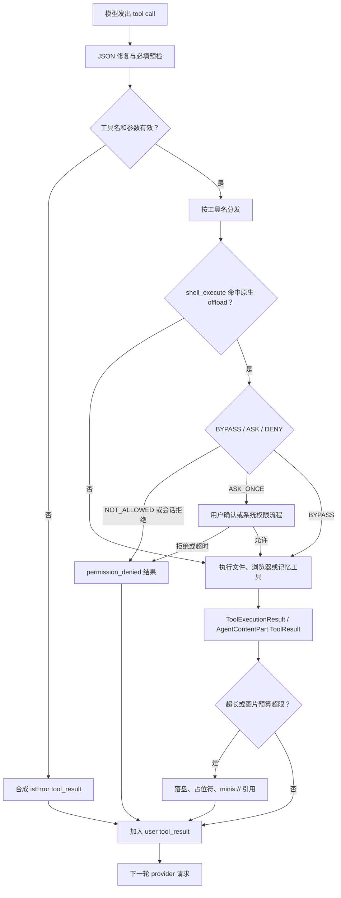

图中“会话拒绝”和“配置确认”是两个不同的门：前者针对设备能力命令，后者针对 `minis-config` 写入；不要用一个全局 Boolean 替代它们。iOS 设备 offload 的检查在 `shell_execute` 分支中发生，Android 则把检查下沉到 `OffloadGate`，因此命名工具调用和原始 shell 命令能共享同一策略。

代码位置：`src/ios/Agent/Chat/AIChatViewModel+ConcurrentTools.swift:216-250`、`src/android/app/src/main/java/com/openminis/app/sandbox/offload/OffloadGate.kt:9-24`。

### 5.2 工具清单：模型究竟拿到什么

#### 5.2.1 顶层 AgentToolDefinition 清单

下面表格只列模型通过 `tools` 参数直接看到的顶层工具。它不是根据文档猜出来的：iOS 的 `makeAgentTools()` 和 Android 的 `AgentTools.makeAgentTools()` 都逐项注册了这些名字。`read_image` 还受模型图片输入能力控制，`memory_*` 受每个会话 memory 开关控制。

代码位置：`src/ios/Agent/Chat/AIChatViewModel+ToolDefinitions.swift:16-29`、`:30-69`、`:70-100`、`:103-138`；`src/android/app/src/main/java/com/openminis/app/tools/AgentTools.kt:14-36`。

| 工具名 | 参数 schema 摘要（必填 / 可选） | 归属子系统 | 是否需要权限 |
|---|---|---|---|
| `shell_execute` | 必填 `tool_title:string`、`command:string`；可选 `timeout:integer`（默认 900 秒）、`delay:integer`（默认 0） | iSH（iOS）或 Alpine/PRoot（Android）的隔离 Linux 进程；同时是原生 offload CLI 的统一入口 | 普通 Linux 命令不走设备隐私权限；若 command 的首 token 是已注册 native offload，则按命令级权限检查 |
| `file_read` | 必填 `tool_title:string`、`path:string`；可选 `offset:integer`（1-based）、`lines:integer`、`max_length:integer`、`direction:string`（`head`/`tail`） | 沙箱文件只读 | 不需要原生权限；路径解析仍必须通过 session resolver 和 `..` 防护 |
| `file_write` | 必填 `tool_title:string`、`path:string`、`content:string`；可选 `append:boolean`、`create_dirs:boolean` | 沙箱文件写入、iSH `meta.db` 可见性维护 | 不需要原生隐私权限；只读外部 mount 会被拒绝 |
| `file_edit` | 必填 `tool_title:string`、`path:string`、`old_string:string`、`new_string:string`；可选 `replace_all:boolean` | 沙箱文件定点编辑 | 不需要原生隐私权限；只读外部 mount 会被拒绝，`old_string` 为空始终拒绝 |
| `browser_use` | 必填 `tool_title:string`、`action:string`；`action` 为 22 个枚举值；可选 URL、CSS selector、文本、坐标、滚动参数、JS、UA、tab、cookie、viewport、超时等 | 原生 WebView/WKWebView 浏览器 tab pool | 不经过 `OffloadPermissionManager`；cookie 读写本身是高风险业务动作，应在产品层继续保留用户可见状态与站点限制 |
| `memory_write` | 必填 `tool_title:string`、`content:string`；内容写入当天 `YYYY-MM-DD.md` | 持久 memory daily log | 只有 `memoryEnabled` 为真时才注册；关闭时模型根本看不到该工具，执行器仍有防御性拒绝 |
| `memory_get` | 必填仅 `tool_title:string`；可选 `scope:string`（`daily`/`all`）、`keywords:string` | 持久 memory 搜索 | 只有 `memoryEnabled` 为真时才注册；关闭时执行器同样拒绝 |
| `read_image` | 必填 `tool_title:string`、`path:string`，路径可为 Linux path 或 `minis://` | 图片读取、缩放、作为多模态输入回传 | 只有模型声明支持 `.imageInput` 时注册；不是系统照片权限，它读的是沙箱文件 |

`tool_title` 被放进 required 的原因不是执行语义，而是 UI 的工具胶囊需要一个简短标题。iOS/Android 预检都把它列入“非阻塞 required 字段”：缺少标题仍执行工具，缺少真正的 `path`、`command` 或 `content` 才合成错误结果。这个处理避免了把展示字段误当作业务必填字段。

代码位置：`src/ios/Agent/Chat/AIChatViewModel+ToolPreflight.swift:203-223`、`:229-281`；`src/android/app/src/main/java/com/openminis/app/ui/chat/ChatViewModel.kt:121-198`。

#### 5.2.2 `browser_use` 的 action 枚举

两端 action 名相同：`navigate`、`screenshot`、`click`、`type`、`get_text`、`scroll`、`get_page_info`、`execute_js`、`find_elements`、`hover`、`get_readable`、`set_user_agent`、`set_viewport`、`get_backbone`、`fetch`、`new_tab`、`close_tab`、`list_tabs`、`get_cookies`、`set_cookies`、`scroll_and_collect`、`wait_for_dom_stable`。iOS 的枚举是 canonical parser；Android 的 `BrowserAction.allValues` 同样由 enum entries 产生。

代码位置：`src/ios/Agent/BrowserUse/BrowserUseActions.swift:5-28`、`:70-110`；`src/android/app/src/main/java/com/openminis/app/browser/BrowserAction.kt:6-28`、`:39-70`。

参数分组应按 action 解释，而不是为每个 action 复制一份工具：

| 分组 | 关键参数 | 约束来源 |
|---|---|---|
| 导航/下载 | `url`、`new_tab`、`fetch` | iOS schema 对 `url` 的描述和 `BrowserActionInput.parse`；Android 同一字段在 `AgentTools` 中声明 |
| DOM 交互 | `selector`、`text`、`coordinate_x`、`coordinate_y` | selector 与坐标二选一的语义由 browser executor 决定，schema 只描述可选输入 |
| 滚动采集 | `direction`、`amount`、`scroll_count`、`item_selector` | `scroll_count` 默认 10、上限 20 的约束写在 schema 描述中 |
| 脚本/结构 | `script`、`max_depth`、`timeout` | `execute_js` 在 async wrapper 中运行；`get_backbone` 使用深度；DOM stable 使用超时 |
| 会话/显示 | `tab_id`、`user_agent`、`viewport_width`、`viewport_height`、`reset`、`full_page` | tab pool 负责 tab 生命周期；full-page screenshot 高度上限 32768 px |
| Cookie | `keywords`、`fuzzy`、`cookies` | `cookies` 因 schema 只声明为 string，iOS parser 同时接受真实数组或 JSON 编码字符串 |

Cookie 的“string schema + 运行时兼容数组”是一个实用的方言折中：模型可以发 JSON 字符串，浏览器导出的数组也不会被静默丢弃。不要把它误写成 `array<object>` 后只改 schema；parser 的兼容代码必须一起保留。

代码位置：`src/ios/Agent/Chat/AIChatViewModel+ToolDefinitions.swift:73-99`、`src/ios/Agent/BrowserUse/BrowserUseActions.swift:113-128`；`src/android/app/src/main/java/com/openminis/app/tools/AgentTools.kt:74-100`、`src/android/app/src/main/java/com/openminis/app/tools/BrowserUseTool.kt:26-107`。

#### 5.2.3 顶层工具之外的“shell 侧工具”

系统提示还告诉模型 `/usr/local/bin` 下的 native CLI。它们不是 `AgentToolDefinition` 数组中的额外 function；模型通过 `shell_execute(command=...)` 调用它们，因此权限检查必须从 shell 命令中提取首 token。iOS 系统提示列出 `apple-healthkit`、`apple-calendar`、`apple-reminders`、`apple-photos`、`apple-location`、`apple-homekit`、`apple-clipboard`、`apple-speak`、`apple-speech`、`apple-player`、`apple-media`、`apple-device`、`apple-notification`、`apple-alarm`、`apple-open`、`apple-maps`、`apple-weather`、`apple-nlp`、`apple-vision` 等；Android 系统提示列出 `android-calendar`、`android-clipboard`、`android-contacts`、`android-location`、`android-photos`、`android-notification`、`android-alarm`、`android-device`、`android-weather`、`android-speak`、`android-speech`、`android-player`、`android-open`、`android-shizuku-cli`、`android-a11y-cli` 等。

代码位置：`src/ios/Agent/Chat/AIChatViewModel.swift:1802-1815`；`src/android/app/src/main/java/com/openminis/app/ui/chat/ChatViewModel.kt:8049-8069`；iOS 权限命令表见 `src/ios/Agent/Offload/OffloadPermissionManager.swift:124-147`，Android 权限注册表见 `src/android/app/src/main/java/com/openminis/app/offload/OffloadPermissionManager.kt:68-91`。

| 平台 | 隐私/设备命令 | 权限表中的 key | 默认状态 |
|---|---|---|---|
| iOS | HealthKit、Calendar、Reminders、Photos、Location、HomeKit、Clipboard | 命令原名 `apple-*` | 未配置时 `.bypass`；用户可改为 `.askOnce` 或 `.notAllowed` |
| iOS | Speak、Speech、Player、Media；Device、Notification、Alarm、Open、Maps、Weather、NLP、Vision | 命令原名 `apple-*` | 代码标记为 media/system，不显示在设置权限列表，默认 bypass |
| Android | Calendar、Location、Clipboard、Contacts、Photos | 内部 key 为 `calendar`、`location`、`clipboard`、`contacts`、`photos` | 默认 BYPASS，设置页可降级 |
| Android | TTS、Media Player、Speech Recognition；Alarm、Weather、Notification、Device Info | `speak`、`media_player`、`speech_recognition`、`alarm`、`weather`、`notification`、`device_info` | 默认 BYPASS，隐藏于权限设置页 |
| Android | Accessibility、Shizuku | `a11y_cli`、`shizuku_cli` | 默认 NOT_ALLOWED；即便底层服务已授权也仍需 agent 权限门 |

Android 的 key 与 CLI 名不同是有意的：`AccessibilityOffloadHandler` 和 `ShizukuOffloadHandler` 分别以 `a11y_cli`、`shizuku_cli` 调用 `OffloadGate`，这样设置页名称与内部策略稳定，CLI 可以保持 `android-a11y-cli` / `android-shizuku-cli` 的用户可读命名。

代码位置：`src/android/app/src/main/java/com/openminis/app/sandbox/offload/AccessibilityOffloadHandler.kt:100-107`、`src/android/app/src/main/java/com/openminis/app/sandbox/offload/ShizukuOffloadHandler.kt:49-67`。

### 5.3 JSON Schema：声明一次，转换多个 Provider

#### 5.3.1 Provider-agnostic canonical schema

iOS 用 `AgentToolDefinition` 保存 name、description、参数字典、required 和可选的 property ordering；`AgentToolParam` 目前只有 string、integer、boolean 三种类型，enumValues 独立存储。Android 的 `AgentToolDefinition` 与 `AgentToolParam` 结构对齐，并直接提供 `toAnthropicJson()`、`toGeminiJson()`、`toOpenAIJson()` 三个转换函数。

代码位置：`src/ios/Providers/AgentProvider.swift:14-51`；`src/android/app/src/main/java/com/openminis/app/data/model/AgentToolDefinition.kt:6-93`。

```swift
// 来源：src/ios/Agent/Chat/AIChatViewModel+ToolDefinitions.swift:17-29
AgentToolDefinition(
    name: "shell_execute",
    description: "Execute a command in an isolated Linux process ...",
    parameters: [
        "tool_title": AgentToolParam(type: .string, description: "..."),
        "command": AgentToolParam(type: .string, description: "..."),
        "timeout": AgentToolParam(type: .integer, description: "..."),
        "delay": AgentToolParam(type: .integer, description: "..."),
    ],
    required: ["tool_title", "command"],
    propertyOrdering: ["tool_title", "command", "timeout", "delay"]
)
```

#### 5.3.2 三种主要 wire 方言

| Provider | 工具外层 | 参数对象 | enum / ordering 处理 | 结果配对要点 |
|---|---|---|---|---|
| Anthropic | `{name, description, input_schema}` | `type: object`、`properties`、`required` | iOS 用 SDK `JSONSchema.Property`；Android `param.toJson()` 直接保留 enum | `tool_use` 的 id 必须和 `tool_result.tool_use_id` 配对 |
| OpenAI Chat Completions | `{type:"function", function:{name,description,parameters}}` | `type: object`、`properties`、`required` | enum 作为 JSON Schema `enum`；不使用 `propertyOrdering` | 每个结果是 role=`tool`，带 `tool_call_id` |
| OpenAI Responses | `{type:"function", name, description, parameters}` | 与 Chat 相同的 object schema | 不能复用 Chat 的 `function:{...}` 包装 | 结果是 `function_call_output`，用 `call_id` 关联 |
| Gemini / Antigravity | `function_declarations` 数组 | `type: "OBJECT"`、`properties`、`required` | iOS 将 enum 文本并入 description；支持时加入 `propertyOrdering`；Android builder 直接输出大写 type 并保留 enum | `functionCall` / `functionResponse`，响应对象不能为空 |

Anthropic 转换把 canonical 类型映射到 SDK 的 JSON type，并保留 enum；Gemini 的关键差异是大写类型和值域兼容。OpenAI 的 Responses API 不能把 Chat Completions 的 function wrapper 原样发送，这也是 Android 单独定义 `toResponsesAPIJson()` 的原因。

代码位置：`src/ios/Providers/Anthropic/AnthropicAgentProvider.swift:787-811`、`src/ios/Providers/Gemini/GeminiAgentProvider.swift:205-234`、`src/ios/Providers/OpenAI/OpenAIAgentProvider.swift:1661-1715`；`src/android/app/src/main/java/com/openminis/app/data/model/AgentToolDefinition.kt:36-73`、`src/android/app/src/main/java/com/openminis/app/provider/openai/OpenAIProvider.kt:2744-2765`。

```swift
// 来源：src/ios/Providers/Gemini/GeminiAgentProvider.swift:205-231
var params: [String: Any] = [
    "type": "OBJECT",
    "properties": properties,
    "required": tool.required,
]
if let ordering = tool.propertyOrdering {
    params["propertyOrdering"] = ordering
}
return GeminiConversation.toolDefinition(
    name: tool.name,
    description: tool.description,
    parameters: params
)
```

```swift
// 来源：src/ios/Providers/OpenAI/OpenAIAgentProvider.swift:1690-1714
return [
    "type": "function",
    "name": tool.name,
    "description": tool.description,
    "parameters": [
        "type": "object",
        "properties": properties,
        "required": tool.required,
    ] as [String: Any],
]
```

Android 的三个 provider builder 会在外层再设置 provider-specific tool mode：Anthropic 设置 `eager_input_streaming`、最后一个工具的缓存控制和 `tool_choice:auto`；Gemini 使用 `function_declarations`；OpenAI Chat 使用 `tool_choice:auto`。这些字段不是工具业务 schema，应由 provider 层注入。

代码位置：`src/android/app/src/main/java/com/openminis/app/provider/anthropic/AnthropicProvider.kt:399-416`、`src/android/app/src/main/java/com/openminis/app/provider/gemini/GeminiProvider.kt:265-272`、`src/android/app/src/main/java/com/openminis/app/provider/openai/OpenAIProvider.kt:1467-1475`；iOS 对应 `src/ios/Providers/Gemini/GeminiProvider.swift:188-191`、`src/ios/Providers/OpenAI/OpenAIAgentProvider.swift:58-69`。

一个容易遗漏的差异是 enum：iOS `GeminiAgentProvider.convertTools` 明确写着 Gemini 并非所有场景都支持 enum，于是把值域拼到 description；Android `AgentToolParam.toGeminiJson()` 却在 `:88-92` 直接输出 `enum`。如果要新增复杂工具，应在目标模型矩阵上验证，而不是因为 canonical 中有 enum 就假定所有 Gemini endpoint 都接受它。

代码位置：`src/ios/Providers/Gemini/GeminiAgentProvider.swift:208-216`、`src/android/app/src/main/java/com/openminis/app/data/model/AgentToolDefinition.kt:77-92`。

#### 5.3.3 流式 JSON 修复与预检

工具参数在流式响应中可能被截断、类型错误或拼错键名。两端都采用相同的三步修复：对 raw tail 尝试补 `}`/`]`/引号；对 required scalar 做字符串化；对与 required 字段 Levenshtein 距离恰为 1（至多一处编辑）的错别字键做重命名。修复只是在预检前生成可用参数，不应替代工具自身的路径、枚举和范围验证。

代码位置：`src/ios/Agent/Chat/AIChatViewModel+ToolPreflight.swift:32-48`、`:63-163`；`src/android/app/src/main/java/com/openminis/app/provider/ToolJsonRepair.kt:14-90`。

```swift
// 来源：src/ios/Agent/Chat/AIChatViewModel+ToolPreflight.swift:229-281
nonisolated static func preflightValidateToolCall(
    name: String, args: [String: Any], tools: [AgentToolDefinition]
) -> String? {
    guard let toolDef = tools.first(where: { $0.name == name }) else { return nil }
    let enforced = toolDef.required.filter { !Self.preflightNonBlockingFields.contains($0) }
    if args.isEmpty && !enforced.isEmpty {
        return "Tool '\(name)' was called with empty arguments {} but requires: \(enforced.joined(separator: ", "))."
    }
    // 缺失、NSNull、真正空字符串按工具规则拒绝
    return nil
}
```

`file_edit.new_string == ""` 是唯一显式允许空字符串的字段，因为它代表删除匹配文本；这条白名单同时出现在 iOS 和 Android 预检中。实现新工具时，要先区分“空值合法”与“参数缺失”，否则模型无法完成删除操作。

代码位置：`src/ios/Agent/Chat/AIChatViewModel+ToolPreflight.swift:212-223`、`:256-275`；`src/android/app/src/main/java/com/openminis/app/ui/chat/ChatViewModel.kt:121-127`、`:179-192`。

### 5.4 分发与执行：从 tool call 到 ToolResult

#### 5.4.1 iOS：并发执行，但按原始顺序回灌

iOS 一次 assistant turn 最多同时运行 10 个工具。`withTaskGroup` 为每个 `toolEntries` 建立子任务，用索引收集 outcome；所有任务结束后再按索引拼接 `toolResultParts`。这是因为 Anthropic 要求同一 user message 内的 `tool_result` 顺序对应原始 `tool_use` 顺序，不能按完成时间直接 append。

代码位置：`src/ios/Agent/Chat/AIChatViewModel.swift:5209-5228`、`:5260-5309`、`src/ios/Agent/Chat/AIChatViewModel+ConcurrentTools.swift:67-89`。

```swift
// 来源：src/ios/Agent/Chat/AIChatViewModel.swift:5260-5309
var outcomesByIndex: [Int: ToolExecOutcome] = [:]
await withTaskGroup(of: (Int, ToolExecOutcome).self) { group in
    var added = 0
    var harvested = 0
    for (idx, tu) in toolEntries.enumerated() {
        while added - harvested >= Self.maxConcurrentTools {
            if let pair = await group.next() {
                outcomesByIndex[pair.0] = pair.1
                harvested += 1
            }
        }
        group.addTask {
            let outcome = await self.executeSingleToolUse(
                tu: tu, msgIdx: msgIdx, tools: toolsSnapshot,
                batchBudget: imageBudgetActor
            )
            return (idx, outcome)
        }
        added += 1
    }
    for await pair in group {
        outcomesByIndex[pair.0] = pair.1
        harvested += 1
    }
}
```

`ToolExecOutcome` 同时携带工具 id、name、`AgentContentPart.toolResult`、UI snapshot 和取消状态；这样执行任务不需要在完成顺序上直接修改历史。图片预算由 actor 保护，避免并发 `read_image` 竞争同一配额。

代码位置：`src/ios/Agent/Chat/AIChatViewModel+ConcurrentTools.swift:43-75`、`:763-813`。

#### 5.4.2 Android：顺序执行，结果块逐项收集

Android 的当前 loop 以 `for ((id, name, args) in toolCalls)` 逐项执行 `executeTool`，每次先做 JSON 修复、loop detector 和 preflight，再选择 `FileReadTool`、`FileWriteTool`、`FileEditTool`、`ReadImageTool`、shell、browser 或 memory executor。执行结果随即加入 `resultParts`，最后统一持久化 assistant turn 和 user-role tool-result message。

代码位置：`src/android/app/src/main/java/com/openminis/app/ui/chat/ChatViewModel.kt:6716-6749`、`:6793-6847`、`:6919-6963`。

```kotlin
// 来源：src/android/app/src/main/java/com/openminis/app/ui/chat/ChatViewModel.kt:7101-7152
return when (name) {
    FileReadTool.NAME -> FileReadTool.execute(argsJson, activeSessionId, context)
    FileWriteTool.NAME -> FileWriteTool.execute(argsJson, activeSessionId, context)
    FileEditTool.NAME -> FileEditTool.execute(argsJson, activeSessionId, context)
    ReadImageTool.NAME -> ReadImageTool.execute(argsJson, activeSessionId, context)
    "shell_execute" -> executeShellCommand(argsJson, toolId, toolBlocks, assistantId, currentText)
    "browser_use" -> executeBrowserUseTool(argsJson)
    "memory_write" -> executeMemoryWriteTool(argsJson)
    "memory_get" -> executeMemoryGetTool(argsJson)
    else -> ToolExecutionResult("Unknown tool: $name", false)
}
```

Android 的 `AgentContentPart.ToolResult` 保存 `id`、`name`、文本、错误标记、可选图片 bytes/MIME 和 Linux path；iOS 的 `AgentContentPart.toolResult` 保存同等信息并额外带 page URL。两端都必须保留 tool id，不能只把文本塞进 UI bubble，否则 provider 下一轮无法构造合法配对。

代码位置：`src/android/app/src/main/java/com/openminis/app/data/model/AgentContentPart.kt:13-51`；`src/ios/Providers/AgentProvider.swift:55-70`；`src/android/app/src/main/java/com/openminis/app/tools/ToolExecutionResult.kt:3-29`。

### 5.5 文件工具三件套：agent 可用性的核心

文件工具的共同原则是：模型用 Linux path，宿主用 session-specific host URL；直接 FileManager/File API 避免 shell quoting；写入后要让 sandbox 的 Linux 视图可见。iOS 额外维护 iSH fakefs 的 `meta.db`；Android 依赖 PRoot 的 per-session host resolver。

代码位置：`src/ios/Agent/Chat/AIChatViewModel+FileTools.swift:106-156`、`:158-229`；`src/android/app/src/main/java/com/openminis/app/tools/FileReadTool.kt:53-59`、`src/android/app/src/main/java/com/openminis/app/tools/FileWriteTool.kt:52-58`。

#### 5.5.1 路径解析、session 隔离与只读 mount

iOS 的 `resolveHostPath` 只接受以 `/` 开头且不含 `..` 的 Linux path；`/var/minis/` 优先查询 `ISHExecutionCoordinator` 当前 bind mount，找不到时再落到 session persistent URL。`resolveMinisPath` 把 `minis://namespace/path` 还原为 `/var/minis/namespace/path` 后复用同一 resolver。

代码位置：`src/ios/Agent/Chat/AIChatViewModel+FileTools.swift:66-104`、`:106-143`、`:146-155`。

Android 三个文件工具都调用 `PRootKernel.resolveSessionHostPath(sessionId, path, context)`，避免全局 bind map 的 last-writer-wins 导致 session A 读到 session B 文件。`ReadImageTool` 也被修正为传入 sessionId/context；不能因为图片只是输入就绕过同一隔离规则。

代码位置：`src/android/app/src/main/java/com/openminis/app/tools/FileReadTool.kt:28-59`、`src/android/app/src/main/java/com/openminis/app/tools/FileWriteTool.kt:26-58`、`src/android/app/src/main/java/com/openminis/app/tools/FileEditTool.kt:26-53`、`src/android/app/src/main/java/com/openminis/app/tools/ReadImageTool.kt:26-60`。

写入和编辑在解析前后都检查只读 external mount。iOS 同时检查 Linux prefix 与解析后的 host URL；Android 在 `FileWriteTool`/`FileEditTool` 中先调用 `PRootKernel.isLinuxPathUnderReadOnlyMount`。这不是普通文件系统错误，而是要返回告诉用户去 Settings → Mount External Folders 修改可写性。

代码位置：`src/ios/Agent/Chat/AIChatViewModel+FileTools.swift:341-350`、`:428-435`、`:536-555`；`src/android/app/src/main/java/com/openminis/app/tools/FileWriteTool.kt:39-49`、`src/android/app/src/main/java/com/openminis/app/tools/FileEditTool.kt:42-49`。

#### 5.5.2 `file_read`：行号、方向、限制与二进制

| 行为 | iOS | Android |
|---|---|---|
| 起始位置 | `offset` 至少为 1，默认 1；head 按 1-based 行号切片 | 同样 `coerceAtLeast(1)`，随后转为 0-based subList |
| tail | `direction == "tail"` 时忽略 offset，从末尾取 `lines` | 同样从末尾取 `requestedLines` |
| 行限制 | `lines` 可选；未给出则取剩余全部 | `lines` 可选；未给出则取全部 |
| 字符上限 | `min(requested, 80_000)`；默认 `kMaxToolResultChars`=15,000 | `optInt(max_length,15000).coerceAtMost(80_000)` |
| 二进制探测 | 读取全文件后检查前 512 bytes 是否有 NUL；返回前 64 bytes hex preview | 检查前最多 8192 bytes NUL；返回 binary 元数据，不展示内容 |
| 文本编码 | 必须 UTF-8；否则失败 | `File.readLines()` 读取文本，异常转为失败 |
| 元数据 | path、bytes、总行数、显示范围；`/var/minis/` 追加 `minis_url` | path、bytes、总行数、显示范围；当前 `file_read` 不追加 URL |

iOS 先把文件读入 `Data`，所以能够在二进制识别中准确报告 byte size；内容截断是在选定行之后进行，header 会声明 `truncated at N chars`。Android 在 `content.take(maxLength)` 后追加 `... (truncated)`，header 说明行范围但不额外报告字符上限。

代码位置：`src/ios/Agent/Chat/AIChatViewModel+FileTools.swift:243-325`；`src/android/app/src/main/java/com/openminis/app/tools/FileReadTool.kt:28-117`。

```swift
// 来源：src/ios/Agent/Chat/AIChatViewModel+FileTools.swift:261-325
let sampleSize = min(fileData.count, 512)
if fileData.prefix(sampleSize).contains(0) {
    let hexPreview = fileData.prefix(64)
        .map { String(format: "%02x", $0) }.joined(separator: " ")
    return FileToolResult(
        output: "[\(path) | \(fileData.count) bytes | binary file]\nHex preview: \(hexPreview)",
        success: true
    )
}
let allLines = fullText.components(separatedBy: "\n")
// 根据 offset / direction 选行，再按 maxLength 截断并附 metadata
```

```kotlin
// 来源：src/android/app/src/main/java/com/openminis/app/tools/FileReadTool.kt:67-113
val isBinary = file.inputStream().use { input ->
    val buf = ByteArray(minOf(8192, size.toInt()))
    val read = input.read(buf)
    if (read > 0) buf.take(read).any { it == 0.toByte() } else false
}
if (isBinary) {
    return ToolExecutionResult(
        "[$path | $size bytes | binary file — cannot display contents]",
        true, toolTitle = toolTitle
    )
}
var content = selectedLines.joinToString("\n")
if (content.length > maxLength) content = content.take(maxLength) + "\n... (truncated)"
```

#### 5.5.3 `file_write`：覆盖、追加、目录和 fakefs 元数据

iOS `executeFileWrite` 读取 `path/content`，解析 `append` 与 `create_dirs`，在 `/var/minis/mounts/` 场景先 prime 当前 session 的 mount table；若 mount lookup 失败且解析结果落到 fakefs shadow 或 session fallback，则拒绝写入，避免“成功但用户看不见”的孤儿文件。成功写入后按需创建父目录并调用 `ensureFakefsMetadata` 注册文件。

代码位置：`src/ios/Agent/Chat/AIChatViewModel+FileTools.swift:329-423`、`:438-486`、`:488-524`。

```swift
// 来源：src/ios/Agent/Chat/AIChatViewModel+FileTools.swift:438-455、:488-524
let appendMode = (dict["append"] as? Bool) ?? false
let createDirs = (dict["create_dirs"] as? Bool) ?? false
let parentDir = hostURL.deletingLastPathComponent()
if createDirs || !fm.fileExists(atPath: parentDir.path) {
    try fm.createDirectory(at: parentDir, withIntermediateDirectories: true)
}
if appendMode, fm.fileExists(atPath: hostURL.path) {
    let handle = try FileHandle(forWritingTo: hostURL)
    handle.seekToEndOfFile()
    handle.write(contentData)
    handle.closeFile()
} else {
    try contentData.write(to: hostURL)
}
if createDirs { ensureParentDirsInMetaDB(for: parentLinux) }
ensureFakefsMetadata(for: path, isDirectory: false)
```

`ensureFakefsMetadata` 会打开 rootfs `meta.db`，检查 `paths` 表，构造 regular-file 或 directory 的 16-byte `ish_stat` blob，再写入 `stats` 和 `paths`；这一步是 iSH 内核可见性的必要条件，不是可有可无的缓存。

代码位置：`src/ios/Agent/Chat/AIChatViewModel+FileTools.swift:158-215`、`:217-228`。

Android `file_write` 同样支持 overwrite/append，但实现会在 parent 不存在时自动 `mkdirs()`，所以 `create_dirs=false` 并不阻止新目录物化；这是 Android 对 per-session 子目录 lazy materialization 的补丁。写完后对 mounted folder 还会核对 `exists` 和长度，并记录 FUSE shadow write 的诊断日志。

代码位置：`src/android/app/src/main/java/com/openminis/app/tools/FileWriteTool.kt:67-105`。

两端的返回都应该包含可复用的 path 和 bytes；iOS 对 `/var/minis/` 立即追加 `minis_url`，Android 当前 `FileWriteTool` 返回 `Wrote to ...`，URL 由 browser artifact、shell scan 或上层 system contract 补充。设计新平台时应把“写入成功”和“模型可重新引用”视为同一验收项。

代码位置：`src/ios/Agent/Chat/AIChatViewModel+FileTools.swift:511-524`、`src/android/app/src/main/java/com/openminis/app/tools/FileWriteTool.kt:84-105`。

#### 5.5.4 `file_edit`：唯一性、不变索引和 fuzzy fallback

两端先要求文件存在、文本可读、`old_string` 非空，再统计匹配次数。默认必须恰好一次；多次匹配时返回错误并要求更多上下文，只有 `replace_all=true` 才允许全部替换。替换从最后一个 range 反向执行，保证前面的 String.Index 不因长度变化而失效。

代码位置：`src/ios/Agent/Chat/AIChatViewModel+FileTools.swift:527-568`、`:633-645`；`src/android/app/src/main/java/com/openminis/app/tools/FileEditTool.kt:55-90`。

```swift
// 来源：src/ios/Agent/Chat/AIChatViewModel+FileTools.swift:565-645
guard !oldString.isEmpty else {
    return FileToolResult(output: "Error: old_string must not be empty...", success: false)
}
let replaceAll = (dict["replace_all"] as? Bool) ?? false
let strictRanges = Self.findAllRanges(of: oldString, in: fileContent)
// strict 失败时，对两侧做 smart quote / 行尾空白 / inline space 归一化，
// 但把 normalized range 映射回原文件 range。
if editRanges.count > 1 && !replaceAll {
    return FileToolResult(
        output: "Error: old_string matches \(editRanges.count) locations...",
        success: false
    )
}
for range in editRanges.reversed() {
    updatedContent.replaceSubrange(range, with: newString)
}
```

iOS 的 fuzzy fallback 不是模糊替换整个文件：它只在 strict 没有任何命中时生效，把智能引号转 ASCII、删除每行尾部空格、折叠行内 ASCII 空格，同时保留行首缩进；随后通过 parallel index map 把 normalized range 映射回原始 `String.Index`。成功信息会标出 `fuzzy-matched`，让模型知道下次应重新读取精确字节。

代码位置：`src/ios/Agent/Chat/AIChatViewModel+FileTools.swift:572-631`、`:684-767`。

Android 目前是严格 `indexOf` 计数和 `replaceFirst`/`replace`，没有 iOS 的 smart quote、空白归一化或上下文 preview。因而 Android 模型若把空格或引号改写，工具会返回 not found；这是实现差异，不应在教学代码中声称两端同样支持 fuzzy edit。

代码位置：`src/android/app/src/main/java/com/openminis/app/tools/FileEditTool.kt:61-89`。

```kotlin
// 来源：src/android/app/src/main/java/com/openminis/app/tools/FileEditTool.kt:61-93
var count = 0
var searchFrom = 0
while (true) {
    val idx = content.indexOf(oldString, searchFrom)
    if (idx < 0) break
    count++
    searchFrom = idx + oldString.length
}
if (count > 1 && !replaceAll) {
    return ToolExecutionResult(
        "Error: old_string found $count times ...",
        false, toolTitle = toolTitle
    )
}
val newContent = if (replaceAll) content.replace(oldString, newString)
                 else content.replaceFirst(oldString, newString)
file.writeText(newContent)
```

#### 5.5.5 二进制与图片：`read_image` 不是 `file_read` 的特例分支

`file_read` 遇到 binary 时只返回元数据，不能把图片/压缩包当 UTF-8 文本塞进上下文；需要视觉分析时模型调用单独的 `read_image`。iOS 仅在 `selectedModel.capabilities.supportedModalities` 包含 image input 时注册该工具；执行器读取 Data、用 `UIImage` 解码、最长边缩到 2000，再以 JPEG（通常 quality 0.85）作为 inference bytes，同时保留原始 Linux path。

代码位置：`src/ios/Agent/Chat/AIChatViewModel+ToolDefinitions.swift:127-138`、`src/ios/Agent/Chat/AIChatViewModel+ConcurrentTools.swift:553-613`。

Android `ReadImageTool` 接受 `minis://`，先还原成 `/var/minis/` path，再走 session host resolver；`BitmapFactory.decodeFile` 解码，最长边超过 2000 就 `createScaledBitmap`，统一 JPEG quality 85，结果通过 `ToolExecutionResult.imageData/imageMimeType/imageFilePath` 返回。

代码位置：`src/android/app/src/main/java/com/openminis/app/tools/ReadImageTool.kt:41-100`、`src/android/app/src/main/java/com/openminis/app/tools/ToolExecutionResult.kt:3-29`。

需要注意一个资源生命周期坑：Android `ReadImageTool` 在第 83-84 行 recycle bitmap，却在第 86 行才读取 `original.width/height` 生成 metadata；这是潜在的 use-after-recycle 风险。若重写该逻辑，必须先缓存 width/height，再释放 bitmap。任何平台都应避免把原始 12MP 图片直接内联到下一次请求，而应在 provider boundary 再做一次压缩兜底。

代码位置：`src/android/app/src/main/java/com/openminis/app/tools/ReadImageTool.kt:66-86`；`src/android/app/src/main/java/com/openminis/app/provider/anthropic/AnthropicProvider.kt:577-615`。

#### 5.5.6 持久 memory 工具的结果边界

`memory_write` 不是通用 `file_write` 的别名：iOS 会创建当天文件、把带 timestamp comment 的 entry prepend 到旧内容，并通知同步层；Android 委托给 `MemoryRepository.writeMemory`，同样以当天文件、timestamp 和 newest-first 方式保存。`GLOBAL.md` 在两端都被描述为用户维护的只读背景，`memory_write` 不应修改它。

代码位置：`src/ios/Agent/Chat/AIChatViewModel+MemoryTools.swift:63-119`；`src/android/app/src/main/java/com/openminis/app/data/repository/MemoryRepository.kt:49-77`；工具 schema 见 `src/ios/Agent/Chat/AIChatViewModel+ToolDefinitions.swift:103-124`、`src/android/app/src/main/java/com/openminis/app/tools/MemoryTools.kt:13-71`。

memory 搜索必须有自己的预算。iOS 在无关键词时最多返回 500 行；有关键词时把 timestamp entry 按命中关键词数与 recency 各 50% 评分，最多 60 entries、至少 append 完整 entry 后在 30 KB UTF-8 处停止。Android 是 line-based fuzzy search：无关键词最多 500 行，有关键词最多 60 行，同时 30 KB bytes；匹配行带前后各两行上下文。

代码位置：`src/ios/Agent/Chat/AIChatViewModel+MemoryTools.swift:185-201`、`:300-364`；`src/android/app/src/main/java/com/openminis/app/data/repository/MemoryRepository.kt:20-42`、`:117-231`。

```swift
// 来源：src/ios/Agent/Chat/AIChatViewModel+MemoryTools.swift:300-364
let confScore = Double(entry.matchedCount) / Double(max(entry.totalKeywords, 1))
let recencyScore = tsRange > 0
    ? (entry.timestamp.timeIntervalSince1970 - minTs) / tsRange
    : 1.0
let combined = 0.5 * confScore + 0.5 * recencyScore
// sortedScored 后：最多 60 entries，累计 UTF-8 bytes 达 30 KB 即停止
```

### 5.6 权限、确认门与审计

#### 5.6.1 native offload 的三态权限

iOS `OffloadPermissionLevel` 是 `bypass`、`askOnce`、`notAllowed` 三态。权限 level 按 command name 存在 UserDefaults；没有存储值时 fallback 到 `.bypass`。shell 检查只看 command 的第一个 token，因此 `apple-healthkit query ... && ...` 的权限提示只代表首个 native command，而不是整条 shell pipeline。

代码位置：`src/ios/Agent/Offload/OffloadPermissionManager.swift:6-18`、`:154-190`；调用位置：`src/ios/Agent/Chat/AIChatViewModel+ConcurrentTools.swift:231-250`。

`askOnce` 的“once”是当前 session 的 grant：同一 session 再次使用同一个 command 不再弹窗；调用没有 session id 时进入固定的 `offload-global` bucket。用户拒绝或 30 秒超时都会返回 `PermissionResult.denied`，tool result 里会带设置页链接而不是让 agent 无限重试。会话结束时清掉该 session grant。

代码位置：`src/ios/Agent/Offload/OffloadPermissionManager.swift:114-118`、`:195-270`。

```swift
// 来源：src/ios/Agent/Offload/OffloadPermissionManager.swift:195-255
let level = permissionLevel(for: command)
switch level {
case .bypass:
    return .allowed
case .notAllowed:
    return .denied("Permission denied: the user has disabled '\(command)'...")
case .askOnce:
    if sessionGrants[sessionId]?.contains(command) == true { return .allowed }
    let allowed = await withCheckedContinuation { continuation in
        pendingRequest = PermissionRequest(..., continuation: continuation)
        Task { @MainActor in
            try? await Task.sleep(nanoseconds: 30_000_000_000)
            if pendingRequest?.id == request.id {
                pendingRequest = nil
                continuation.resume(returning: false)
            }
        }
    }
    if allowed { sessionGrants[sessionId, default: []].insert(command) }
}
```

Android 把同一策略拆成 `OffloadPermissionManager` 和 `OffloadGate`：前者保存 `PermissionLevel`、会话 grants/denials 和 UI StateFlow，后者位于每个 `android-*` handler 入口，把 suspend permission check 通过 `runBlocking` 接到同步 IPC 返回。`enforce` 失败时统一返回 exit code 126 和 JSON `permission_denied`。

代码位置：`src/android/app/src/main/java/com/openminis/app/offload/OffloadPermissionManager.kt:19-25`、`:68-116`、`:336-413`；`src/android/app/src/main/java/com/openminis/app/sandbox/offload/OffloadGate.kt:9-70`。

Android 的交互粒度比 iOS 更细：`ALLOW_SESSION` 写入本 session grant，`ALLOW_ONCE` 只放行当前调用，`DENY_SESSION` 写入 denial，后续同一 session 直接拒绝且不再骚扰用户。永久的 BYPASS/NOT_ALLOWED 仍由 Settings 的 level 控制，不由一次对话按钮偷偷升级。

代码位置：`src/android/app/src/main/java/com/openminis/app/offload/OffloadPermissionManager.kt:336-399`。

Android 还有第二层 Android runtime permission/settings gate。例如 Contacts 的 READ/WRITE、Photos 的 MediaStore、Notification Access 或 AccessibilityService 不是 agent level 本身；handler 先过 `OffloadGate`，再请求系统权限或跳转系统设置。系统权限请求有 120 秒 timeout，永久拒绝时可以转为“打开设置”流程。

代码位置：`src/android/app/src/main/java/com/openminis/app/offload/OffloadPermissionManager.kt:124-175`、`:190-263`；`src/android/app/src/main/java/com/openminis/app/sandbox/offload/CalendarOffloadHandler.kt:52-59`、`src/android/app/src/main/java/com/openminis/app/sandbox/offload/PhotosOffloadHandler.kt:64-68`。

#### 5.6.2 `minis-config` 总开关不是 offload command level

`minis-config` 有独立的 master switch。iOS 的 `MinisConfigPermissionStore` 用 `permissions.minisConfig.enabled`，关闭后在字段查找、确认入队和审计写入之前短路；Android 的 StateFlow/SharedPreferences store 有同样语义。该开关注册成 read-only（iOS `.readonly`，Android `READONLY`），agent 能读到当前状态但不能通过同一个通道自我授权。

代码位置：`src/ios/Shared/Config/MinisConfigPermissionStore.swift:4-17`、`src/ios/Shared/Config/ConfigRegistry+Builtins.swift:726-750`；`src/android/app/src/main/java/com/openminis/app/config/MinisConfigPermissionStore.kt:9-47`、`src/android/app/src/main/java/com/openminis/app/config/ConfigBuiltins.kt:83-103`。

因此权限判断应按层次理解：

| 层 | 保护对象 | 典型失败 | 记忆粒度 |
|---|---|---|---|
| 工具注册 | `memory_*`、`read_image` 是否让模型看到 | 工具缺席，不产生调用 | 会话 / 模型能力 |
| native offload level | Health、Contacts、Accessibility 等命令 | `permission_denied`，exit 126 | Settings 永久 level + session grant/denial |
| Android 系统权限 | READ_CONTACTS、POST_NOTIFICATIONS、Accessibility service | 系统拒绝或 settings gate timeout | Android OS / Settings |
| config master switch | 整个 `minis-config` CLI | permission_denied | 全局 UserDefaults/SharedPreferences |
| config confirmation gate | 每一次配置写入 batch | user_rejected / timeout | 单个待确认 request，不是永久授权 |

#### 5.6.3 ConfigRegistry：配置字段也是一个受控数据模型

ConfigRegistry 是配置 surface 的单一真相。iOS 注册 flat fields 和动态 collections；resolve 时既支持 `appearance.theme`，也支持 `models.<uuid>.<leaf>`。Android 用 `LinkedHashMap` 保存同样的 fields/collections，并在 Application 初始化时一次注册。新字段只需注册 ConfigField，bridge、help、确认 sheet、审计和 revert 都从 registry 派生。

代码位置：`src/ios/Shared/Config/ConfigRegistry.swift:3-57`；`src/android/app/src/main/java/com/openminis/app/config/ConfigRegistry.kt:9-49`、`:96-124`。

字段的 schema 不等于 LLM 工具 schema：`ConfigValueSchema`/`ConfigSchema` 支持 bool、带范围的 int/double、string 长度/regex、enum、path、optional、array、json；`ConfigAccess` 决定 hidden/readonly/readwrite，`ConfigRisk` 决定确认 UI 的风险样式，`revertable` 决定审计能否回滚。

代码位置：`src/ios/Shared/Config/ConfigField.swift:117-197`、`:200-255`；`src/android/app/src/main/java/com/openminis/app/config/ConfigSchema.kt:8-97`、`src/android/app/src/main/java/com/openminis/app/config/ConfigField.kt:9-50`。

动态 collection 解决 provider/model/group 这类运行时 id。它们可以列出 childIds、暴露 child fields，并提供 add/remove；collection add/remove 默认 sensitive，且不能简单把删除当成普通 field write，因为重新生成 UUID 会破坏依赖关系。

代码位置：`src/ios/Shared/Config/Fields/ConfigCollection.swift:3-56`；`src/android/app/src/main/java/com/openminis/app/config/ConfigCollection.kt:3-46`。

#### 5.6.4 ConfigBridge 的二次确认流程

`ConfigOffloadBridge.writeFields`/Android `ConfigBridge.writeFields` 接收 `{path,value_json}` 单项或 batch。bridge 先解析全部 path；任何 unknown、hidden、feature-unavailable、readonly 或 schema validation 失败都会在弹窗前整体拒绝。只有所有项都 resolve 成 `Resolved` 后，才建立 `PendingConfigChange` 并等待用户。

代码位置：`src/ios/NativeOffloads/ConfigOffloadBridge.swift:313-350`、`:351-497`；`src/android/app/src/main/java/com/openminis/app/config/ConfigBridge.kt:269-419`。

确认 sheet 是全局 FIFO 队列，同一时间最多一个 request；每个 request 120 秒超时，前后台都计时，后台时会发 local notification。一个 batch 可以在 sheet 中逐行取消，未勾选行记录 rejected，已勾选行才进入 writer。

代码位置：`src/ios/Shared/Config/Confirm/ConfigConfirmationGate.swift:8-19`、`:24-105`、`:110-161`；`src/android/app/src/main/java/com/openminis/app/config/confirm/ConfigConfirmationGate.kt:19-45`、`:90-156`；逐行模型见 `src/ios/Shared/Config/Confirm/PendingConfigChange.swift:3-50`。

```swift
// 来源：src/ios/NativeOffloads/ConfigOffloadBridge.swift:598-611
let outcome: PendingConfigChange.Outcome
if skipConfirmation {
    outcome = .approved(items: resolvedItems)
} else {
    let pending = PendingConfigChange(items: resolvedItems, caption: caption)
    outcome = await ConfigConfirmationGate.shared.requestConfirmation(pending)
}
```

`skipConfirmation` 只给用户已经在 Logs UI 本地确认过的 revert 使用；agent/CLI 发起的普通写入不能设置它。这样既避免 iOS sheet 嵌套，也避免 Android 端把“日志页上的本地确认”误认为 agent 已获得长期授权。

代码位置：`src/ios/NativeOffloads/ConfigOffloadBridge.swift:598-611`、`:951-963`；`src/android/app/src/main/java/com/openminis/app/config/ConfigBridge.kt:297-309`、`:531-539`。

#### 5.6.5 ConfigAuditLog：可回滚但不可由 agent 擦除

iOS 和 Android 都把审计存入独立的 `minis-config-audit.db`，避免混入聊天 sync dirty 查询；每次 insert 与 pruning 在同一事务内执行，最多保留最近 1000 行。状态包括 applied、rejected、timeout、reverted；clearAll 只从日志 UI 暴露，不能由 `minis-config` 调用，否则 agent 可以擦掉自己的痕迹。

代码位置：`src/ios/Shared/Config/Audit/ConfigAuditLog.swift:6-14`、`:21-65`、`:77-160`；`src/android/app/src/main/java/com/openminis/app/config/audit/ConfigAuditLog.kt:14-27`、`:42-94`、`:161-202`；状态定义见 `src/ios/Shared/Config/Audit/ConfigAuditEntry.swift:17-36`。

credential 的审计规则是“可写，不可读”：provider `apiKey` 的真实值进入 Keychain/加密 credential store，但 confirmation、response 和 audit 都使用 masked value；`$$ENV` 只是引用指针，可以显示，literal secret 则显示 `••• (hidden)`。OAuth token 整个字段保持 hidden，因为它来自交互登录流程。Provider remove 也被两端设为不可用，避免删掉仍被模型 group/session 引用的 provider。

代码位置：`src/ios/Shared/Config/ConfigField.swift:58-89`、`src/ios/Shared/Config/Collections/ProvidersCollection.swift:3-25`、`:46-57`、`:169-193`；`src/android/app/src/main/java/com/openminis/app/config/ConfigValue.kt:45-73`、`:107-114`、`src/android/app/src/main/java/com/openminis/app/config/collections/ProvidersCollection.kt:18-47`、`:75-148`。

回滚不是删除 audit row，而是用 old value 构造一条新的 write，再走同一确认和审计路径，成功后把原 row 标记 reverted。collection remove 需要保存 child snapshot，collection add 的逆操作则根据审计中的 entry id remove；若 field 不再注册或不可 revert，返回 `not_revertable`。

代码位置：`src/ios/NativeOffloads/ConfigOffloadBridge.swift:951-1011`；`src/android/app/src/main/java/com/openminis/app/config/ConfigBridge.kt:859-959`。

### 5.7 工具结果回灌：截断、落盘与 provider 配对

#### 5.7.1 文本结果的两级上限

iOS 对模型单个 tool result 的硬上限是 `AIChatViewModel.kMaxToolResultChars = 15_000`。`executeSingleToolUse` 在完成工具后统一处理：空输出变为 `(no output)`；超长文本先写入当前 session 的 `offloads` 持久目录，再把结果裁成正文和引用。shell/browser 采用 head + tail，各保留 7,500 字符；其他工具只取前 15,000 字符。结果同时写出 Linux path、`minis_url`（如果路径可转换）和“Use file_read tool...”提示。

代码位置：`src/ios/Agent/Chat/AIChatViewModel.swift:17-24`；`src/ios/Agent/Chat/AIChatViewModel+ConcurrentTools.swift:738-761`。

```swift
// 来源：src/ios/Agent/Chat/AIChatViewModel+ConcurrentTools.swift:738-758
if toolOutput.count > Self.kMaxToolResultChars {
    let offloadResult = offloadToolOutput(toolOutput, toolName: tu.name, toolId: tu.id)
    let offloadMinisURL = linuxPathToMinisURL(offloadResult.linuxPath)
    let truncatedBody = tu.name == "shell_execute" || tu.name == "browser_use"
        ? String(toolOutput.prefix(7_500)) + "\n\n...\n\n" + String(toolOutput.suffix(7_500))
        : String(toolOutput.prefix(Self.kMaxToolResultChars))
    finalOutput = truncatedBody
        + "\n\n[OUTPUT TRUNCATED] Full output (\(toolOutput.count) chars) saved to: \(offloadResult.linuxPath)"
        + (offloadMinisURL.map { "\nminis_url: \($0)" } ?? "")
        + "\nUse file_read tool to read the complete output."
}
```

shell 在更早阶段也做一次 head/tail 截断，用于终端输出和工具 UI；这一次不负责落盘。后面的统一 composer 仍可能再次 offload，因此新工具不能绕过 `executeSingleToolUse` 直接把巨大字符串写入 history。

代码位置：`src/ios/Agent/Chat/AIChatViewModel+ISHCommand.swift:163-184`；`src/ios/Agent/Chat/AIChatViewModel+ConcurrentTools.swift:738-761`。

Android 将同一职责拆为 `ContextOffload` 和 agent loop 的 context policy。`ContextOffload.offloadContent` 把内容写到 `filesDir/minis-sessions/<sid>/offloads/tools/`，返回 `/var/minis/offloads/tools/<file>`；history 中用 `[CONTEXT OFFLOADED]` stub 替换原 bytes。文件名用 tool name + tool id 尾部 12 字符，避免 Anthropic id 前缀恒定导致碰撞；写失败也必须留下 stub，防止原始超长 payload 被继续带入请求。

代码位置：`src/android/app/src/main/java/com/openminis/app/data/ContextOffload.kt:25-83`；`src/android/app/src/main/java/com/openminis/app/ui/chat/ChatViewModel.kt:6964-7190`；阈值策略见 `src/android/app/src/main/java/com/openminis/app/data/ContextPolicy.kt:4-85`。

Android 的 context policy 按模型 context window 分四档：小于 32K 关闭自动 offload/compact 并在接近耗尽时报告 exhausted；32K–64K 只 offload；64K–128K offload + compact；128K 以上留出更大的 compact headroom。这个阈值是上下文预算策略，不等于单个工具字符串可以无限大：文件工具、memory 和 provider 图片预算仍各自截断。

代码位置：`src/android/app/src/main/java/com/openminis/app/data/ContextPolicy.kt:48-85`。

`offloadContent` 返回的是 Linux path 而非 `minis://` URL；Android 的 agent prompt 已把 `/var/minis/offloads` 描述为可由 `file_read` 读取的目录。iOS 统一 composer 追加了 `minis_url`，而规范把“给 offload 结果追加 minis URL”列为 enhancement。实现跨平台一致性时必须以实际代码为准并在兼容层补 URL，不能把规范中的 `[ ]` checklist 当成已完成功能。

代码位置：`src/android/app/src/main/java/com/openminis/app/data/ContextOffload.kt:60-79`；`src/ios/Agent/Chat/AIChatViewModel+ConcurrentTools.swift:743-758`；`docs/specs/minis-url-scheme.md:245-258`、`:313-319`。

#### 5.7.2 `minis://` 是 session-relative 资源引用

规范定义 `minis://<namespace>/<path>`，URL 不携带 session id；解析始终以当前 active session 为隐式上下文。同一个字符串在两个 session 指向两个独立文件，session 删除后 URL 永久失效。Linux `/var/minis/` 是当前 session 的可见 mount，host app 负责 session 切换时 harvest → clear → mount → meta.db register。

代码位置：`docs/specs/minis-url-scheme.md:6-18`、`:43-71`、`:166-180`。

| namespace | Linux 目录 | 典型结果 | UI 处理 |
|---|---|---|---|
| `attachments` | `/var/minis/attachments/` | 用户图片、音频、视频 | Markdown image/audio/video 可直接内联 |
| `workspace` | `/var/minis/workspace/` | 脚本、CSV、JSON、配置 | Markdown text link / file chip |
| `offloads` | `/var/minis/offloads/` | 超长 shell/browser/tool output | 只给引用，调用 `file_read` 取全文 |
| `browser` | `/var/minis/browser/` | 浏览器截图、readable extract | 图片可内联，文字按链接读取 |

代码位置：`docs/specs/minis-url-scheme.md:73-135`、`:270-284`。

Linux path → URL 的转换应只接受已知 namespace、相对 path 不含 `..` 的路径；URL → Linux path 同样不能允许任意 host。规范中的安全条款要求 resolver 拒绝 path traversal 和未知 namespace；iOS `resolveHostPath` 的 `!linuxPath.contains("..")` 是代码层对应实现。

代码位置：`docs/specs/minis-url-scheme.md:137-164`、`:335-342`；`src/ios/Agent/Chat/AIChatViewModel+FileTools.swift:66-104`。

#### 5.7.3 图片结果需要同时保存“可见 bytes”和“可重新获取路径”

工具结果模型不是纯字符串。Android `AgentContentPart.ToolResult` 保存 `imageData`、`imageMimeType`、可选 `imageLinuxPath`；iOS `AgentMessage.Part.toolResult` 也保存 image data/ref 和 page URL。图片 bytes 用于当前 request，Linux path 用于预算超限后的文本 placeholder，以及模型下一次主动调用 `read_image`。

代码位置：`src/android/app/src/main/java/com/openminis/app/data/model/AgentContentPart.kt:13-51`；`src/ios/Providers/AgentProvider.swift:55-70`；`src/ios/Agent/Chat/AIChatViewModel.swift:20-24`。

iOS 的 image budget 有三个边界：单图压缩后最多 5 MB，单条 user message 的内联图片最多 25 MB，全 request 还会按 provider 上限留 headroom；历史最多保留 20 张，较老图片用尺寸、byte size 和持久路径的文字 placeholder 代替。并发工具执行通过 actor 原子 reserve slot，超过本批预算的图片变成 placeholder，而不是静默丢掉结果。

代码位置：`src/ios/Agent/Chat/AIChatViewModel.swift:20-58`；`src/ios/Agent/Chat/AIChatViewModel+ConcurrentTools.swift:763-778`。

#### 5.7.4 provider wire 层如何把图片回灌

Anthropic 接受 assistant `tool_use` 后紧邻 user `tool_result`。iOS conversion 把 image bytes 暂存在 `pendingToolResultImages[id]`，先发 text-only SDK block，再由 `RequestBodyPatcher` 将图片 source 注入；图片会降采样到 1568 px，并强制 MIME 与 JPEG bytes 对齐。Android 直接在 `tool_result.content` 中发 text block，若有图片追加 base64 image source，并在转换时再次执行 `ImageBudget.compressUnderBudget`。

代码位置：`src/ios/Providers/Anthropic/AnthropicAgentProvider.swift:457-506`、`:62-68`；`src/android/app/src/main/java/com/openminis/app/provider/anthropic/AnthropicProvider.kt:571-615`。

```kotlin
// 来源：src/android/app/src/main/java/com/openminis/app/provider/anthropic/AnthropicProvider.kt:571-599
is AgentContentPart.ToolResult -> {
    val resultContent = JSONArray()
    resultContent.put(JSONObject().apply {
        put("type", "text")
        put("text", part.content)
    })
    if (part.imageData != null && part.imageMimeType != null) {
        val safeBytes = ImageBudget.compressUnderBudget(part.imageData)
        val safeMime = if (safeBytes === part.imageData) part.imageMimeType else "image/jpeg"
        resultContent.put(JSONObject().apply {
            put("type", "image")
            put("source", JSONObject().apply {
                put("type", "base64")
                put("media_type", safeMime)
                put("data", Base64.encodeToString(safeBytes, Base64.NO_WRAP))
            })
        })
    }
    contentArray.put(JSONObject().apply {
        put("type", "tool_result")
        put("tool_use_id", sanitizeToolId(part.id))
        put("content", resultContent)
        if (part.isError) put("is_error", true)
    })
}
```

Gemini 的 `functionResponse.response.result` 不能是空字符串，因此 Android 用单个空格 placeholder；图片作为额外 `inlineData` part。iOS 的 `toGeminiParts` 把 tool result 放在 `functionResponse`，把 image ref 读成 `image_base64` 与 `image_mime_type` 字段。OpenAI Chat Completions 禁止把 `image_url` 放进 role=`tool`，所以 iOS 先发 text-only tool message，再紧邻附加一个临时 role=`user` image message；该 synthetic user 只存在 outbound HTTP body，不写回 history。

代码位置：`src/android/app/src/main/java/com/openminis/app/provider/gemini/GeminiProvider.kt:198-253`；`src/ios/Agent/Chat/ChatStore.swift:3773-3818`；`src/ios/Providers/OpenAI/OpenAIAgentProvider.swift:1206-1246`。

```swift
// 来源：src/ios/Providers/OpenAI/OpenAIAgentProvider.swift:1206-1233
if !toolResults.isEmpty {
    for tr in toolResults {
        result.append([
            "role": "tool",
            "tool_call_id": Self.capChatId(tr.id),
            "content": tr.content,
        ])
        // OpenAI 不允许 role=tool 携带 image_url；图片随后作为
        // synthetic role=user 发送，但不污染 agentHistory。
    }
}
```

#### 5.7.5 配对修复：宁可合成错误结果，也不要发非法 history

Anthropic provider 在 outbound conversion 前对 value-typed history 做两个互补修复：`injectMissingToolResults` 给未完成的 `tool_use` 插入 synthetic error result；`stripOrphanToolResults` 删除没有对应 `tool_use` 的结果；之后合并相邻同 role 消息并确保 tool result 紧邻 tool use。原始持久 history 不被修改，因此 UI 仍能显示中断状态，下一次请求却不会因 400 失败。

代码位置：`src/ios/Providers/Anthropic/AnthropicAgentProvider.swift:457-514`、`:516-638`；Android Anthropic 发送前使用 `stripOrphanToolResults`，位置 `src/android/app/src/main/java/com/openminis/app/provider/anthropic/AnthropicProvider.kt:519-526`、`:675-725`。

OpenAI 将 id 通过 `capChatId`/`sanitizeToolId` 转为 provider 允许的字符；Anthropic 要求 id 匹配 `[a-zA-Z0-9_-]+`，OpenAI Responses 可能产生带 `|` 的 id。清理只作用 wire id，不应覆盖 history 中原始 id，否则之后的 UI 点击、重试和数据库关联会断裂。

代码位置：`src/android/app/src/main/java/com/openminis/app/provider/anthropic/AnthropicProvider.kt:560-568`；`src/ios/Providers/Anthropic/AnthropicAgentProvider.swift:477-492`；`src/ios/Providers/OpenAI/OpenAIAgentProvider.swift:1094-1127`。

### 5.8 平台对照

| 抽象 | iOS 落地 | Android 落地 | 差异原因与工程影响 |
|---|---|---|---|
| canonical 工具定义 | `AgentToolDefinition` + `AgentToolParam`，由 ViewModel extensions 注册 | `AgentToolDefinition`/`AgentToolParam`，由 `AgentTools` 注册 | 结构相同，Swift 采用 value/SDK schema，Kotlin 采用 JSONObject builder；新增工具要同步两端注册与 provider converter |
| 文件路径 | `resolveHostPath` + iSH mount table + `meta.db` | `PRootKernel.resolveSessionHostPath` + per-session filesDir | iSH fakefs 需要显式 stat metadata；PRoot 依靠 host resolver；两端都必须拒绝 `..` 和 session 串读 |
| file_read | UTF-8 Data、512-byte NUL 检测、hex preview、80K 上限、`minis_url` | `readLines`、8192-byte NUL 检测、binary 元数据、80K 上限 | iOS 更重视 byte-preview 与 fakefs；Android 实现简洁，当前结果 URL 不完全对齐规范 |
| file_write | append/overwrite、可选父目录、fakefs `meta.db` 注册、mount 双重校验 | append/overwrite、parent `mkdirs`、PRoot mount 只读校验 | iOS 写入必须让 iSH 内核认识 inode；Android 的 PRoot host file 直接可见，目录策略更宽松 |
| file_edit | strict unique + reverse ranges + smart quote/空白 fuzzy fallback | strict unique + `indexOf` + `replaceFirst`/`replace` | iOS 兼容模型重排空白但保留缩进；Android 失败更早，模型应重新 `file_read` |
| shell 执行 | `ISHExecutionCoordinator` 运行 iSH；offload command 首 token 做权限 | `ExecutionCoordinator`/Alpine PRoot；handler 入口调用 `OffloadGate` | iOS 权限 manager 直接在 ViewModel 分支，Android 统一在 offload handler，便于 IPC/CLI 复用 |
| native offload 权限 | `.bypass`/`.askOnce`/`.notAllowed`；session grant；30 秒 dialog timeout | BYPASS/ALLOW_ONCE/ALLOW_SESSION/DENY_SESSION/NOT_ALLOWED；再叠 Android runtime/settings permission | Android 需要处理 OS permission 和 Accessibility/Shizuku 设置，故多一层 suspend gate |
| 配置写入 | `ConfigOffloadBridge` + MainActor `ConfigConfirmationGate` + SQLite audit | `ConfigBridge` + coroutine gate + synchronized SQLite audit | 两端都 batch 全量解析、逐行确认、masked secret、可审计 revert；线程模型不同 |
| tool loop | `withTaskGroup` 最多 10 个并发，按 input index 回灌 | `runAgentLoop` 当前按 tool call 顺序执行 | iOS 需控制并发图片预算和排序；Android 顺序更容易保持 provider 原始顺序，但延迟更高 |
| 文本结果 offload | 15K 上限；写 `/var/minis/offloads`，结果带 Linux path + `minis_url` | `ContextOffload` 写 `/var/minis/offloads/tools`，history 用 `[CONTEXT OFFLOADED]` stub | 两端持久目录形状近似但 URL 输出不完全一致；跨设备 sync 要以 Linux path + session context 解析 |
| 图片结果 | `UIImage`/JPEG、每图 5MB、message 25MB、history 20 张 | `Bitmap`/JPEG、`ToolExecutionResult` 保存 bytes/path、provider 再压缩 | Android 需要注意 Bitmap recycle 生命周期；两端都须 provider boundary 二次压缩 |
| Anthropic tool_result | SDK block + `RequestBodyPatcher` 注入 pending images | JSON `tool_result` content array 直接内联 text/image | iOS SDK 不支持部分图片形态，Android 直接构造 JSON；两端都 sanitize id 与补 orphan |
| Gemini functionResponse | `functionResponsePart`，结果可含 `image_base64` | `functionResponse.response.result`，空结果用空格，图片另成 `inlineData` | Gemini 对 oneof 空 part 严格，两端都要保证至少一个合法 text/part |
| OpenAI tool image | tool 文本 + synthetic user image | provider 实现应遵循同一协议，不能 image_url 塞 role=tool | Chat Completions 的 role 限制决定了 outbound payload 与 agent history 不完全相同 |

### 5.9 设计取舍与踩坑

#### 5.9.1 schema 是提示，不是安全边界

JSON Schema 主要帮助模型生成参数，不能替代执行器验证。`path` 即使声明 string，仍需检查绝对路径、session resolver、namespace 和 read-only mount；`timeout` 即使声明 integer，仍需在 shell executor 夹到最大范围；`browser_use.execute_js` 仍需由浏览器 tab pool 在正确线程执行。把 schema 当 ACL 会让模型经由 `shell_execute` 绕过同名 function 的前置条件。

代码位置：`src/ios/Agent/Chat/AIChatViewModel+FileTools.swift:66-104`、`:428-435`；`src/android/app/src/main/java/com/openminis/app/tools/BrowserUseTool.kt:26-107`；`src/android/app/src/main/java/com/openminis/app/sandbox/offload/OffloadGate.kt:9-70`。

#### 5.9.2 权限是“命令级 + 系统级”的组合

iOS 的 native CLI 复用 shell，会出现一条 command 同时含多个 shell operation 的边界问题；当前检查按首 token 判定，不会解释任意 shell AST。Android handler 可以从 `argv` 取得稳定 command，但实际数据访问仍由 OS permission 控制。实现新 offload 时，应把 agent level denial 映射为稳定的 exit 126/JSON envelope，再把系统 permission denial 的说明保留给用户；不要只返回空字符串，否则模型会认为设备能力没有数据。

代码位置：`src/ios/Agent/Offload/OffloadPermissionManager.swift:124-147`、`:195-270`；`src/android/app/src/main/java/com/openminis/app/sandbox/offload/OffloadGate.kt:53-70`；`src/android/app/src/main/java/com/openminis/app/sandbox/offload/OffloadOutput.kt:1-58`。

#### 5.9.3 “允许一次”不能变成永久授权

iOS `askOnce` 只向当前 session grant；Android 的 `ALLOW_ONCE` 和 `ALLOW_SESSION` 显式分开。配置确认更严格：每一个 write batch 都要走 FIFO gate，revert 也要用新 write 重新审计。若在执行器里缓存全局 `allowed=true`，会让不同 session、不同用户动作互相污染，是最危险的并发 bug 之一。

代码位置：`src/ios/Agent/Offload/OffloadPermissionManager.swift:114-118`、`:195-270`；`src/android/app/src/main/java/com/openminis/app/offload/OffloadPermissionManager.kt:336-399`；`src/ios/Shared/Config/Confirm/ConfigConfirmationGate.swift:24-161`。

#### 5.9.4 结果顺序和结果配对是协议约束

iOS 可以并发执行，但只能把 outcome 按原始 `toolEntries` index 排序后写入 user message。Anthropic 还要求每个 `tool_use` 的 result 紧邻下一条 user message；OpenAI 则要求每条 role=`tool` 带 `tool_call_id`。取消、超时、后台杀进程都必须产生错误结果或 outbound synthetic result，不能让 tool_use 永远悬挂。

代码位置：`src/ios/Agent/Chat/AIChatViewModel.swift:5260-5309`；`src/ios/Providers/Anthropic/AnthropicAgentProvider.swift:516-638`；`src/ios/Providers/OpenAI/OpenAIAgentProvider.swift:1094-1108`。

#### 5.9.5 图片不能只在工具执行端压缩一次

图片可能来自旧 history、数据库 restore、retry 或 browser screenshot，绕过本次 composer。因此 Anthropic/OpenAI/Gemini provider boundary 仍需压缩/转码；Android Anthropic 已在 `buildMessages` 对 tool result image 调 `ImageBudget.compressUnderBudget`，iOS Anthropic 在 `convertMessages` 降采样并放入 patcher。否则一次 session 恢复就可能发送原始 12MP PNG，引发 413 或 provider image dimension error。

代码位置：`src/android/app/src/main/java/com/openminis/app/provider/anthropic/AnthropicProvider.kt:577-615`；`src/ios/Providers/Anthropic/AnthropicAgentProvider.swift:479-503`；`src/ios/Providers/OpenAI/OpenAIAgentProvider.swift:1209-1246`。

#### 5.9.6 配置表面必须防止“自我提权”和 secret 泄漏

ConfigRegistry 的 hidden/readonly/risk/revertable 不是 UI 装饰，而是 bridge 的执行条件。master switch 自身只读；provider credential 的 audit 使用 masked JSON；remove provider 被拒绝；audit clear 只在本地日志 UI。动态 collection 的 `entry_id` 由 bridge 注入并在 revert 中用于定位，不能允许模型自由选择一个不存在或另一个 session 的 id。

代码位置：`src/ios/NativeOffloads/ConfigOffloadBridge.swift:313-497`、`:816-850`；`src/ios/Shared/Config/Audit/ConfigAuditLog.swift:77-160`；`src/android/app/src/main/java/com/openminis/app/config/ConfigBridge.kt:790-838`、`:859-959`。

#### 5.9.7 规范与实现的差异要显式处理

`docs/specs/minis-url-scheme.md` 将 `file_write`、shell scan、offload URL、browser namespace 等列为 Phase 1/2 checklist；实际 iOS composer 已对超长工具输出追加 `minis_url`，而 Android `ContextOffload` 仍返回 Linux path。规范也称 `file_read` 的 `/var/minis/` URL 为待办，但当前 iOS `executeFileRead` 已生成 URL。这种“实现先于规范”与“规范先于实现”并存时，教学代码应把两者分别标为“当前代码”和“目标 contract”，避免读者复制未完成项。

代码位置：`docs/specs/minis-url-scheme.md:313-342`；`src/ios/Agent/Chat/AIChatViewModel+FileTools.swift:306-325`；`src/android/app/src/main/java/com/openminis/app/data/ContextOffload.kt:60-79`。

### 5.10 从零实现清单

下面清单给出一个可从零落地、再扩展到 macOS/Windows/Linux 的最小实现。每一步都写验收标准；“可以砍掉”表示教学版为了先跑通 agent loop 可暂时移除，但不能把删掉的安全边界误当正式产品能力。

1. **定义 canonical 工具模型。** 实现 `ToolDefinition(name, description, properties, required)` 和 `ToolParam(type, description, enum)`，用同一份模型生成 Anthropic/OpenAI/Gemini schema。验收：打印三种 JSON，类型、required、enum 都能 round-trip；可以砍掉 `propertyOrdering`，但不能为每个 provider 重复维护工具清单。
2. **注册最小文件工具。** 先实现 `file_read`、`file_write`、`file_edit`，统一接收 `tool_title`、path 和业务参数。验收：能在 session A 写入并读回，切到 session B 读不到；可以砍掉 iOS fakefs `meta.db`（纯 host filesystem 教学版），但必须保留 path traversal 和只读 mount 检查。
3. **实现严格 file_edit。** 统计 `old_string` 次数；默认非零且恰好一次，`replace_all` 才允许多次；空 old_string 拒绝，空 new_string 允许删除。验收：0/1/2 次命中、replace_all、UTF-8 失败均返回确定性结果；可以砍掉 fuzzy fallback，不能砍掉唯一性校验。
4. **加入结果上限。** 为每次 tool result 设置 15K 字符 cap，超限保存 `/var/minis/offloads/`，回灌 head/tail 或 head 片段 + path。验收：模型能收到截断标记并用 `file_read` 取全文；可以砍掉 context compact，但不能把超长内容直接塞回 provider history。
5. **完成 tool loop 配对。** 持久化 assistant `tool_use`，执行后追加 user `tool_result`，保留 tool id；取消/超时也生成 error result。验收：Anthropic、OpenAI、Gemini 各能完成至少一轮 tool call → result → text；可以先顺序执行，不能省略 outbound orphan repair。
6. **加入图片输入。** `read_image` 只在模型支持视觉时注册，路径复用 session resolver，最长边缩放并重新编码；结果结构同时保存 bytes、MIME、Linux path。验收：视觉模型能看图，非视觉模型不会拿到原始 bytes；可以先只支持 JPEG/PNG，不能跳过 provider boundary 压缩。
7. **接入浏览器。** 用 action enum + tab pool 实现 navigate/get_text/screenshot 三个动作，再扩展交互动作。验收：tab id 在同一 session 可复用，截图保存到 `/var/minis/browser/` 并可被 `read_image` 引用；可以先砍掉 cookie/execute_js，但必须限制 action 和 tab 生命周期。
8. **建立 native offload registry。** 为每个命令注册 display name、权限 key、默认 level、是否显示设置；统一从 shell 首 token 或 handler argv 找到 entry。验收：普通 shell 不触发隐私权限，拒绝时稳定返回 permission_denied；可以先只有 BYPASS/DENY，不能让未知命令默认访问设备 API。
9. **实现 session grant。** iOS 使用 bypass/askOnce/notAllowed，Android 使用 BYPASS/ALLOW_ONCE/ALLOW_SESSION/DENY_SESSION/NOT_ALLOWED；超时和拒绝路径明确。验收：同一 session 的允许一次不影响另一 session，后台等待不会永久挂起；可以先不做漂亮 UI，但必须有可取消的 gate。
10. **将 OS permission 与 agent permission 分层。** 联系人、照片、日历等 handler 在 agent gate 后再请求系统权限；Accessibility/Shizuku 必须检查设置服务。验收：agent DENY 时不弹系统 dialog，OS DENY 时返回可操作的设置提示；可以砍掉某一设备能力，不能把系统权限结果默认为 agent grant。
11. **以 ConfigRegistry 驱动配置 CLI。** 注册 scalar field、dynamic collection、schema/access/risk/revertable；实现 read、write、batch、help。验收：未知/readonly/hidden/invalid path 在写入前整体失败；可以先只注册 appearance 和一个 provider collection，不能让 bridge 直接写 UserDefaults 任意 key。
12. **加入确认、mask 与审计。** 写 batch 经过 FIFO confirmation gate，secret 在 UI/response/audit 中 masked，成功写入与 revert 都有 audit row。验收：拒绝、超时、部分 batch、revert 均可观察且不可由 agent 清理；可以先只实现 applied/rejected 状态，不能允许 `skipConfirmation` 由模型传入。
13. **实现 minis URL 与持久目录。** 定义 namespace → Linux path → session storage 映射，session switch 时 clear-then-mount，并给可复用资源返回 URL。验收：相同 URL 在不同 session 隔离，session 删除后不可读；可以先实现 attachments/workspace/offloads，不能把 session id 拼进 URL。
14. **按 provider 做回灌适配。** Anthropic 用紧邻 `tool_result`，Gemini 用 `functionResponse`，OpenAI Chat 用 role=`tool`；图片按 provider 限制转换。验收：每种 provider 的 tool call id 配对、空 content placeholder、orphan 修复都通过真实 HTTP mock/录制请求检查；可以先不实现 reasoning echo，不能混用三种外层格式。
15. **最后再做并发和 context compact。** iOS 可用 task group + index map 并发，Android 可从顺序 loop 升级；加入 token window policy 与 compact。验收：并发结果顺序稳定、图片预算原子、context exhausted 有明确 UI；可以保持顺序执行作为第一版，不能在没有预算 actor 时并发图片工具。

### 5.11 关键文件索引

| 路径 | 行数 | 职责 |
|---|---:|---|
| `src/ios/Agent/Chat/AIChatViewModel+ToolDefinitions.swift` | 144 | iOS canonical 工具清单、参数 schema 与能力条件 |
| `src/ios/Agent/Chat/AIChatViewModel+FileTools.swift` | 812 | iOS file_read/write/edit、path resolver、fakefs metadata |
| `src/ios/Agent/Chat/AIChatViewModel+MemoryTools.swift` | 373 | iOS memory_write/get、关键词评分与结果 cap |
| `src/ios/Agent/Chat/AIChatViewModel+ToolPreflight.swift` | 284 | iOS JSON repair 后 required/空值预检 |
| `src/ios/Agent/Chat/AIChatViewModel+ConcurrentTools.swift` | 815 | iOS 并发执行、结果顺序、截断/offload、图片预算 |
| `src/ios/Agent/Chat/AIChatViewModel.swift` | 5830 | agent loop、全局结果/图片预算、tool history |
| `src/ios/Agent/Chat/AIChatViewModel+ISHCommand.swift` | 251 | iSH shell 执行与 terminal 输出截断 |
| `src/ios/Agent/Offload/OffloadPermissionManager.swift` | 271 | native offload 三态权限、session grant、dialog timeout |
| `src/ios/Shared/Config/ConfigRegistry.swift` | 107 | 配置字段/collection registry 与解析入口 |
| `src/ios/Shared/Config/ConfigRegistry+Builtins.swift` | 1142 | iOS 内置配置字段与动态 collections |
| `src/ios/Shared/Config/ConfigField.swift` | 266 | 字段 schema、access、risk、secret/revert 属性 |
| `src/ios/Shared/Config/Confirm/ConfigConfirmationGate.swift` | 236 | 配置写入 FIFO 确认队列与 timeout |
| `src/ios/Shared/Config/Confirm/PendingConfigChange.swift` | 51 | batch 确认请求与逐行 outcome |
| `src/ios/Shared/Config/Audit/ConfigAuditLog.swift` | 241 | SQLite 审计写入、查询、prune、revert 标记 |
| `src/ios/Shared/Config/Audit/ConfigAuditEntry.swift` | 66 | 审计 entry 字段与状态 |
| `src/ios/Shared/Config/MinisConfigPermissionStore.swift` | 39 | `minis-config` master switch |
| `src/ios/Shared/Config/Collections/ProvidersCollection.swift` | 355 | provider 动态 collection、credential masking 与 remove 约束 |
| `src/ios/NativeOffloads/ConfigOffloadBridge.swift` | 1018 | iOS config CLI read/write/batch/help/revert bridge |
| `src/ios/Providers/Anthropic/AnthropicAgentProvider.swift` | 971 | Anthropic schema、tool history 配对修复、图片回灌 |
| `src/ios/Providers/OpenAI/OpenAIAgentProvider.swift` | 1938 | OpenAI Chat/Responses schema 与 tool/image conversion |
| `src/ios/Providers/Gemini/GeminiAgentProvider.swift` | 266 | Gemini schema 方言与 enum/order 处理 |
| `src/ios/Agent/Chat/ChatStore.swift` | 6211 | history ContentPart 到 Anthropic/Gemini wire parts 的转换 |
| `src/android/app/src/main/java/com/openminis/app/tools/AgentTools.kt` | 132 | Android 顶层工具注册与 schema |
| `src/android/app/src/main/java/com/openminis/app/tools/FileReadTool.kt` | 118 | Android file_read、行切片、binary 探测 |
| `src/android/app/src/main/java/com/openminis/app/tools/FileWriteTool.kt` | 110 | Android file_write、append/目录/只读 mount |
| `src/android/app/src/main/java/com/openminis/app/tools/FileEditTool.kt` | 99 | Android file_edit 唯一性与 replaceAll |
| `src/android/app/src/main/java/com/openminis/app/tools/ReadImageTool.kt` | 101 | Android image resolve、Bitmap 解码/缩放/JPEG |
| `src/android/app/src/main/java/com/openminis/app/tools/BrowserUseTool.kt` | 130 | Android browser action 参数解析与执行桥接 |
| `src/android/app/src/main/java/com/openminis/app/tools/MemoryTools.kt` | 137 | Android memory tool wrapper |
| `src/android/app/src/main/java/com/openminis/app/tools/ToolExecutionResult.kt` | 54 | Android 文本/错误/图片结果统一类型 |
| `src/android/app/src/main/java/com/openminis/app/data/model/AgentToolDefinition.kt` | 93 | Android canonical schema 与三 provider JSON 转换 |
| `src/android/app/src/main/java/com/openminis/app/data/model/AgentContentPart.kt` | 75 | tool use/result/image 结构化 history part |
| `src/android/app/src/main/java/com/openminis/app/data/ContextOffload.kt` | 128 | Android 大结果/图片落盘与 history stub |
| `src/android/app/src/main/java/com/openminis/app/data/ContextPolicy.kt` | 91 | 按 context window 决定 offload/compact/exhausted |
| `src/android/app/src/main/java/com/openminis/app/data/repository/MemoryRepository.kt` | 521 | Android memory 持久化、搜索、30KB/行数 cap |
| `src/android/app/src/main/java/com/openminis/app/sandbox/offload/OffloadGate.kt` | 71 | Android handler 统一权限 gate 与 denial envelope |
| `src/android/app/src/main/java/com/openminis/app/offload/OffloadPermissionManager.kt` | 414 | Android agent 权限 registry、session grants、OS permissions |
| `src/android/app/src/main/java/com/openminis/app/sandbox/offload/OffloadArgs.kt` | 71 | Android offload CLI 参数解析 |
| `src/android/app/src/main/java/com/openminis/app/sandbox/offload/OffloadOutput.kt` | 102 | Android offload 输出/exit code/error envelope |
| `src/android/app/src/main/java/com/openminis/app/config/ConfigRegistry.kt` | 126 | Android 配置注册与解析 |
| `src/android/app/src/main/java/com/openminis/app/config/ConfigBuiltins.kt` | 995 | Android 内置配置字段/collections |
| `src/android/app/src/main/java/com/openminis/app/config/ConfigBridge.kt` | 961 | Android config CLI read/write/batch/revert |
| `src/android/app/src/main/java/com/openminis/app/config/ConfigSchema.kt` | 97 | Android 配置值 schema 验证 |
| `src/android/app/src/main/java/com/openminis/app/config/confirm/ConfigConfirmationGate.kt` | 186 | Android 配置确认队列与 suspend gate |
| `src/android/app/src/main/java/com/openminis/app/config/audit/ConfigAuditLog.kt` | 252 | Android 配置审计记录、查询、prune |
| `src/android/app/src/main/java/com/openminis/app/config/collections/ProvidersCollection.kt` | 386 | Android provider collection、secret mask、remove/revert |
| `src/android/app/src/main/java/com/openminis/app/provider/ToolJsonRepair.kt` | 136 | Android 流式工具 JSON 修复 |
| `src/android/app/src/main/java/com/openminis/app/provider/anthropic/AnthropicProvider.kt` | 1037 | Android Anthropic schema、tool_result/image wire 转换 |
| `src/android/app/src/main/java/com/openminis/app/provider/gemini/GeminiProvider.kt` | 485 | Android Gemini functionCall/functionResponse 转换 |
| `src/android/app/src/main/java/com/openminis/app/provider/openai/OpenAIProvider.kt` | 3036 | Android OpenAI schema、history 与响应工具转换 |
| `src/android/app/src/main/java/com/openminis/app/ui/chat/ChatViewModel.kt` | 9844 | Android agent loop、dispatch、context offload、config shell |
| `docs/specs/minis-url-scheme.md` | 342 | session-scoped URL、namespace、mount、tool result contract |

索引中的行数是本次研究时工作区文件的 `wc -l` 结果；代码位置引用的行区间以当前源码为准。规范文件中的 checklist 仍可能描述未完成增强项，阅读时应以 5.7.2 与 5.9.7 的“当前代码 / 目标 contract”区分为准。


## 6. iOS 沙箱：把 Linux 塞进 App 进程（iSH）

### 6.1 这一章解决什么问题

iSH 解决的不是“在 iOS 上启动一个虚拟机”，而是让 App 进程拥有一个能执行 Alpine 用户态程序的 Linux 兼容层；这使 agent 可以调用 `sh`、`apk`、Python 和文件工具，而不依赖 iOS 的命令行环境（`README.md:168-175`）。本章解释从 ARM64 guest 指令、fakefs 文件系统、rootfs 安装，到 shell 工具回收输出的完整路径；其中最重要的结论是：交互式终端和 agent 的 `shell_execute` 不是同一条 I/O 路径。读者掌握这些边界后，才能在不破坏 iOS 线程、内存和生命周期约束的前提下，从零实现一个类似的嵌入式 Linux agent 沙箱。

本文以仓库当前源码为准。`docs/specs/ios-sandbox-ish-summary.md` 与 `deps/ISH_INTEGRATION.md` 是很好的接口骨架，但其中关于“所有命令 FIFO 串行”“命令都经 PTY”“输出 100KB”的描述与当前实现存在时间差；差异会在相应小节明确标出（`docs/specs/ios-sandbox-ish-summary.md:206-263`；`src/ios/Agent/ISH/ISHExecutionCoordinator.swift:26-38`）。

### 6.2 先建立正确的心智模型：不是 VM，而是进程内用户态 Linux

#### 6.2.1 四层结构

| 层 | 当前实现 | 读源码时应关注的边界 |
|---|---|---|
| iOS 宿主 | Swift/SwiftUI、Objective-C、Foundation、UIKit | 宿主线程不能直接执行可能阻塞的 guest 调用；UI 只接收回调（`src/ios/Views/Rootfs/ISHTerminalView.swift:408-422`）。 |
| iSH 兼容内核 | `libish.a`，负责 task、syscall、TTY、设备和进程生命周期 | `ISHKernel.bootWithRootPath` 先挂载 fakefs，再把当前 task 变成 guest PID 1（`src/ios/iSH/ISHKernel.m:334-381`）。 |
| 指令执行引擎 | Asbestos；构建时选择 `-Dengine=asbestos` 与 `-Dguest_arch=arm64` | 引擎代码位于 git submodule `deps/ish`；本 checkout 的该目录为空，因此不能把未显示的 C 函数名当作本仓库事实（`deps/build_ish.sh:109-124`；`deps/build_ish.sh:193-222`）。 |
| Alpine 用户态 | `aarch64` minirootfs，转换成 `data/` + `meta.db` | 由 `fakefsify` 生成，而不是把 ext4 镜像挂到 iOS（`deps/prepare_alpine_rootfs.sh:159-186`）。 |

仓库把 iSH 描述为 iOS 上的 Linux user-mode emulation，并明确使用 ARM64 fork（`README.md:168-175`）。这里的“用户态”意味着 guest 进程看到的是 iSH 实现的 Linux task、虚拟 syscall 和 fakefs；它不拥有 iOS 的真实 `fork(2)`、`mount(2)` 或 `/dev`。因此，`apk`、`busybox ash`、Python 等程序可以在 guest 语义下工作，但不能据此推断它们拥有一个可管理的真实 Darwin kernel。

#### 6.2.2 ARM64 guest 与 Asbestos

构建脚本把宿主静态库编译为 iOS `arm64`，并把 guest 设置为 `arm64`，同时生成 ARM64 guest VDSO（`deps/build_ish.sh:35-38`；`deps/build_ish.sh:203-222`）。rootfs 脚本下载的也是 Alpine `aarch64` 包（`deps/prepare_alpine_rootfs.sh:28-33`；`deps/prepare_alpine_rootfs.sh:96-116`）。这避免了“x86 guest + ARM64 二次翻译”的额外 ISA 组合；但仍然不是原生 Linux 执行，因为 guest syscall、地址转换和异常都要经过 iSH/Asbestos。[推断] 同 ISA 只能减少一种转换成本，不能把它等同于原生进程。

设计文档把 Asbestos 记作“threaded-code JIT interpreter”（`docs/specs/ios-sandbox-ish-summary.md:10-22`）。在当前 checkout 看不到 Asbestos 的实现文件，所以能严格核实的是两点：

1. iOS 构建确实选择了 Asbestos，并复制 `ish/asbestos` 头文件和 ARM64 gadget 头文件（`deps/build_ish.sh:203-210`；`deps/build_ish.sh:284-296`）。
2. 宿主 wrapper 为 JIT 执行线程安装了崩溃恢复路径：只在 thread-local `in_jit` 为真时接管 `SIGSEGV`/`SIGBUS`，把 guest fault 信息写回 `cpu_state`，把 PC 改到 `jit_crash_trampoline`；非 iSH 线程恢复默认 handler 并重新 raise（`src/ios/iSH/ISHKernel.m:71-178`）。

“iOS 没有传统 W^X 下可随意申请并同时写入、执行的代码页”是平台设计背景；本仓库没有展示 Asbestos 的页面分配实现，也没有能证明“某次 mmap 使用了某种权限”的源码。因此不要在产品文档中声称“我们绕过了 iOS W^X”。更稳妥的教学表述是：采用仓库选择的 Asbestos 路径，把 guest ARM64 指令解释/调度放在进程内，并把 JIT/异常失效隔离在 guest 线程；具体是否生成代码、如何满足权限策略必须回到 `deps/ish` 的完整源码和构建产物核对。[推断]

#### 6.2.3 性能量级应怎样描述

当前仓库没有基准测试、宿主/guest 指令吞吐或与原生 Linux 的倍数对比，因此本章不编造“慢多少倍”。源码能给出的可操作量级是：

- 单 agent turn 的并发工具上限是 10；注释明确指出继续增加并发会让 emulator scheduling 互相竞争（`src/ios/Agent/Chat/AIChatViewModel+ConcurrentTools.swift:21-25`）。
- Node guest 被注入 `--jitless`、`--no-lazy`、`--no-expose-wasm` 和 `--max-old-space-size=512`，说明运行时必须为模拟器和移动端内存做约束（`src/ios/iSH/ISHShellExecutor.m:290-320`）。
- 可选 CPU throttle 用 tick 统计实际工作时间，按目标 duty cycle 累积 `nanosleep` 债务，睡眠债务还被限制为 100ms（`src/ios/iSH/ISHKernel.m:1160-1225`）。

因此工程验收应采用工作负载指标，而不是宣传倍数：冷启动耗时、`apk add`、Python 小脚本、文件 I/O、并发 1/4/10 时的响应时间、后台被杀前的可恢复性。只有在真实设备上运行这些实验后，才可以写出数字。

#### 6.2.4 进程级安全护栏

iSH 初始化时覆盖 `die_handler`，guest 致命错误只停车当前 iSH 线程而不是调用 `abort()` 杀死整个 App；JIT handler 还刻意不接管 `SIGABRT`，避免掩盖 Swift runtime 或 malloc 的真实 OOM（`src/ios/iSH/ISHKernel.m:180-215`）。这是嵌入式内核和独立模拟器的关键区别：独立 iSH 可以退出进程，App 内的 iSH 只能尽量牺牲 guest worker。

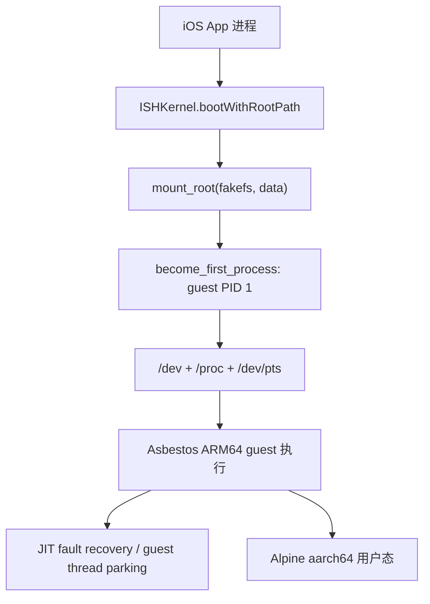

图中每个节点都有源码锚点：挂载与 PID 1 在 `src/ios/iSH/ISHKernel.m:349-381`，设备和伪文件系统在 `src/ios/iSH/ISHKernel.m:383-411`，异常隔离在 `src/ios/iSH/ISHKernel.m:86-178`。

### 6.3 fakefs：为什么需要 SQLite 元数据和真实文件两层

#### 6.3.1 两层不是缓存，而是 guest 语义的组成部分

fakefs 的核心模型可以写成：

```text
host 文件内容:  Documents/alpine-rootfs/data/<guest-path>
                 或 bind symlink 指向 Library/MinisChat/minis/<sid>/...

guest inode/stat: Documents/alpine-rootfs/meta.db
                 ├─ paths(path -> inode)
                 └─ stats(inode -> ish_stat blob)
```

仓库的文件工具直接在 `data/` 下使用 `FileManager` 读写，再把路径注册进 `meta.db`；注释明确说内容在 `data/<linux-path>`，mode、uid、gid 在 `meta.db` 的 `paths`/`stats` 表（`src/ios/Agent/Chat/AIChatViewModel+FileTools.swift:11-19`）。这解释了一个常见故障：宿主目录里已经出现文件，并不意味着 iSH 的 `open`、`readdir` 或 `stat` 一定能看到它；没有 inode 元数据时，guest 视图仍可能认为路径不存在。

#### 6.3.2 构建阶段如何生成 fakefs

`deps/prepare_alpine_rootfs.sh` 的实际产物不是 tar.gz，而是：

1. 从 Alpine 镜像下载 `alpine-minirootfs-3.21.0-aarch64.tar.gz` 到 `deps/.cache/`（`deps/prepare_alpine_rootfs.sh:96-116`）。
2. 用 native Meson 构建 `deps/ish/build-native/tools/fakefsify`，同样选择 `kernel=ish`、`engine=asbestos`、`guest_arch=arm64`（`deps/prepare_alpine_rootfs.sh:119-156`）。
3. 执行 `fakefsify tar.gz output/alpine-rootfs`；脚本硬检查 `output/alpine-rootfs/data` 与 `output/alpine-rootfs/meta.db`（`deps/prepare_alpine_rootfs.sh:159-186`）。
4. 最终压缩为 `deps/resources/alpine-rootfs.zip`，排除 `*.db-shm` 和 `*.db-wal`，避免把 SQLite 临时 WAL 状态打进包（`deps/prepare_alpine_rootfs.sh:271-297`）。

```text
alpine-minirootfs-3.21.0-aarch64.tar.gz
        │ fakefsify
        ▼
deps/resources/alpine-rootfs/
        ├── data/       真实文件/目录/符号链接的宿主表示
        └── meta.db     guest inode、stat、路径索引
        │ zip -x '*.db-shm' -x '*.db-wal'
        ▼
deps/resources/alpine-rootfs.zip
```

#### 6.3.3 `meta.db` 的插入协议

下面是当前文件工具的精简真实片段。它先查 `paths`，为新路径插入 16 字节 `ish_stat` blob，再用 `last_insert_rowid()` 将路径与 inode 对上；权限默认区分普通文件 0644 和目录 0755（来源：`src/ios/Agent/Chat/AIChatViewModel+FileTools.swift:168-215`）。

```swift
/// Creates entries in both `stats` and `paths` tables if missing.
func ensureFakefsMetadata(for linuxPath: String, isDirectory: Bool) {
    let metaDBPath = RootfsManager.shared.rootfsPath.appendingPathComponent("meta.db").path
    var db: OpaquePointer?
    guard sqlite3_open_v2(metaDBPath, &db, SQLITE_OPEN_READWRITE, nil) == SQLITE_OK,
          let db else { return }
    defer { sqlite3_close(db) }

    // Check if path already exists
    var checkStmt: OpaquePointer?
    guard sqlite3_prepare_v2(db, "SELECT inode FROM paths WHERE path = ?", -1, &checkStmt, nil) == SQLITE_OK,
          let checkStmt else { return }
    defer { sqlite3_finalize(checkStmt) }

    bindPathBlob(checkStmt, index: 1, path: linuxPath)

    if sqlite3_step(checkStmt) == SQLITE_ROW {
        return // Already exists in meta.db
    }

    // Build 16-byte ish_stat blob: mode(u32) + uid(u32) + gid(u32) + rdev(u32)
    // Regular file: S_IFREG | 0644 = 0o100644
    // Directory:    S_IFDIR | 0755 = 0o040755
    let mode: UInt32 = isDirectory ? 0o040755 : 0o100644
    var statBytes: [UInt8] = Array(repeating: 0, count: 16)
    let leMode = mode.littleEndian
    withUnsafeBytes(of: leMode) { src in
        for i in 0..<4 { statBytes[i] = src[i] }
    }

    // Insert stat
    var insertStatStmt: OpaquePointer?
    guard sqlite3_prepare_v2(db, "INSERT INTO stats (stat) VALUES (?)", -1, &insertStatStmt, nil) == SQLITE_OK,
          let insertStatStmt else { return }
    defer { sqlite3_finalize(insertStatStmt) }

    sqlite3_bind_blob(insertStatStmt, 1, statBytes, Int32(statBytes.count), Self.SQLITE_TRANSIENT)
    guard sqlite3_step(insertStatStmt) == SQLITE_DONE else { return }

    // Insert path with last_insert_rowid() as inode
    var insertPathStmt: OpaquePointer?
    guard sqlite3_prepare_v2(db, "INSERT OR REPLACE INTO paths (path, inode) VALUES (?, last_insert_rowid())", -1, &insertPathStmt, nil) == SQLITE_OK,
          let insertPathStmt else { return }
    defer { sqlite3_finalize(insertPathStmt) }

    bindPathBlob(insertPathStmt, index: 1, path: linuxPath)
    sqlite3_step(insertPathStmt)
}
```

真正的实现还使用 `SQLITE_TRANSIENT` 绑定 UTF-8 blob，确保 SQLite 立即复制路径字节（`src/ios/Agent/Chat/AIChatViewModel+FileTools.swift:158-214`）。父目录必须从根向叶子补齐；`ensureParentDirsInMetaDB` 逐层调用同一 helper（`src/ios/Agent/Chat/AIChatViewModel+FileTools.swift:217-228`）。

`RootfsManager` 的版本更完整：如果路径已经存在，它会根据 inode 更新 `stats.stat`，可用于 app 更新后重新打权限；如果不存在才插入 `stats` 和 `paths`（`src/ios/iSH/RootfsManager.swift:299-349`）。这也是为什么 overlay 每次启动都能把脚本权限修正为 0755 或把内置 MCP Python 文件改成 0444。

#### 6.3.4 权限、符号链接和设备节点分别在哪里模拟

**权限。** `ensureFakefsMetadata` 的 stat blob 不是 APFS 文件属性的被动镜像，而是 guest 看见的 mode。default mount 代码会强制标准 `bin` 目录下的文件为 0755，并把 `/usr/local/lib/minis-mcp-cli` 文件设为 0444、目录设为 0555；这样 guest 内的 `access_check` 会拒绝修改内置 Python 库（`src/ios/iSH/RootfsManager.swift:215-261`）。外部文件夹的只读挂载则通过 top-level mode 0555 让 create/unlink/rename/rmdir 返回 `EACCES`，没有额外 VFS 分支（`src/ios/iSH/ISHKernel.h:64-80`）。

**符号链接和 bind mount。** session 目录先在 `data/var/minis` 下面创建或修正 symlink；真实目录若遗留在旧位置，会把内容迁移到持久目录后删除，再创建新的 symlink（`src/ios/Agent/Chat/AIChatViewModel+Offloading.swift:640-723`）。内核层 `bindMountPath` 调用 `fakefs_bind_mount`，卸载调用 `fakefs_bind_unmount`（`src/ios/iSH/ISHKernel.m:851-875`）。coordinator 在 bind 前用 `lstat` 判断旧 symlink/目录，迁移后只允许删除 `data/var/minis` 下的路径，防止路径 bug 误删 `/dev` 或其他 rootfs 数据（`src/ios/Agent/ISH/ISHExecutionCoordinator.swift:442-496`）。

**设备节点。** fakefs 不是把 iOS 的 `/dev/null` 映射给 guest；boot 时调用 `generic_mknodat` 生成 guest character device，并用 `dev_make` 写入 TTY、内存设备的 major/minor。当前实际创建 `/dev/tty1` 到 `/dev/tty7`、`/dev/console`、`/dev/ptmx`、`/dev/null`、`/dev/zero`、`/dev/full`、`/dev/random`、`/dev/urandom`（`src/ios/iSH/ISHKernel.m:453-477`）。`/proc` 和 `/dev/pts` 是 boot 后通过 iSH filesystem driver 挂载的虚拟文件系统，不来自 zip（`src/ios/iSH/ISHKernel.m:386-392`）。

#### 6.3.5 为什么外部目录不能全部预注册

session 的四个目录可以递归收集并在一个 SQLite transaction 中批量注册（`src/ios/Agent/ISH/ISHExecutionCoordinator.swift:525-540`；`src/ios/Agent/ISH/ISHExecutionCoordinator.swift:780-850`）。用户选取的外部 vault 则可能非常大，代码只写 top-level mount inode，依赖 fakefs 在 guest 真正触摸路径时按需创建 inode（`src/ios/Agent/ISH/ISHExecutionCoordinator.swift:688-692`）。这是内存、启动时间和 SQLite 写放大之间的取舍；若实现自己的 sandbox，也应为“静态小目录递归注册”和“动态大目录 lazy inode”设计两条策略。

### 6.4 rootfs 生命周期：从构建 zip 到 reset 后冷启动

#### 6.4.1 构建时的真实输出物

| 脚本阶段 | 实际输出 | 关键事实 |
|---|---|---|
| `deps/build_ish.sh` | `deps/libs/libish.a`、`libish_emu.a`、`libfakefs.a` | static libraries，不是动态 iOS framework（`deps/build_ish.sh:5-26`；`deps/build_ish.sh:216-225`）。 |
| `deps/build_ish.sh` | `deps/include/ish/...`、`deps/resources/libvdso.so.elf`（若 VDSO 成功） | 复制 Asbestos、ARM64 emu、kernel/fs header（`deps/build_ish.sh:231-319`）。 |
| `deps/prepare_alpine_rootfs.sh` | `deps/resources/alpine-rootfs/data/`、`meta.db` | `fakefsify` 的强制检查（`deps/prepare_alpine_rootfs.sh:162-186`）。 |
| `deps/prepare_alpine_rootfs.sh` | `deps/resources/alpine-rootfs.zip` | zip 排除 `*.db-shm`/`*.db-wal`（`deps/prepare_alpine_rootfs.sh:274-296`）。 |
| `scripts/prepare_rootfs.sh` | `deps/alpine/alpine-aarch64.qcow2`、`vmlinuz-virt`、`initramfs-virt` | 这是 QEMU/VM 开发路径，不是 iSH App 的 rootfs 产物（`scripts/prepare_rootfs.sh:1-10`；`scripts/prepare_rootfs.sh:299-352`）。 |

最后一行很容易被误读：`scripts/install_alpine.sh` 和 `scripts/optimize_rootfs.sh` 操作 qcow2、QEMU 和 ext4 挂载（`scripts/install_alpine.sh:1-90`；`scripts/optimize_rootfs.sh:1-80`），不能拿它们生成的 VM 磁盘直接替换 `alpine-rootfs.zip`。iOS 这章的生产链路必须走 `deps/prepare_alpine_rootfs.sh`。

#### 6.4.2 rootfs 构建阶段的配置

脚本在 fakefsify 后创建 `/dev`、`/proc`、`/sys`、`/tmp`、`/run`、`/root`、`/home`，将 root 的 shell 固定为 `/bin/sh`（`deps/prepare_alpine_rootfs.sh:192-211`）。它还写入 login profile：`PS1`、`TERM=xterm-256color`、`HOME=/root`、UTF-8 环境、标准 PATH 和 `ll/la/l` 别名（`deps/prepare_alpine_rootfs.sh:213-231`）。`/etc/inittab` 保留 OpenRC 生命周期，但注释说明 TTY 由 iSH 管理；DNS 初值和 APK main/community mirror 也在构建期写入（`deps/prepare_alpine_rootfs.sh:247-266`）。

#### 6.4.3 App 首次启动和 boot 顺序

`RootfsManager` 把安装位置固定为 `Documents/alpine-rootfs`，实际 guest data 是其 `data` 子目录（`src/ios/iSH/RootfsManager.swift:35-42`）。`isInstalled` 同时要求 `data/` 存在且 `.arch` 内容等于当前 `aarch64`；缺少 tag 也被视为未安装（`src/ios/iSH/RootfsManager.swift:44-56`）。安装时解压 bundle 中的 `alpine-rootfs.zip`，写 `.arch`，预创建 `/var/minis/{attachments,offloads,workspace,skills,shared}`，并设置 `rootfs.freshInstall`（`src/ios/iSH/RootfsManager.swift:58-103`）。

```swift
func installIfNeeded() throws {
    if FileManager.default.fileExists(atPath: rootfsPath.path) && !isInstalled {
        print("RootfsManager: Arch mismatch or missing tag, reinstalling \(currentArch) rootfs...")
        try FileManager.default.removeItem(at: rootfsPath)
    }

    guard !isInstalled else {
        print("RootfsManager: Already installed (\(currentArch)) at \(rootfsPath.path)")
        return
    }

    guard let zipURL = Bundle.main.url(forResource: "alpine-rootfs", withExtension: "zip") else {
        throw NSError(
            domain: "RootfsManager",
            code: 1,
            userInfo: [NSLocalizedDescriptionKey: "alpine-rootfs.zip not found in bundle"]
        )
    }

    print("RootfsManager: Installing rootfs from \(zipURL.path)...")

    // Create destination directory
    try FileManager.default.createDirectory(
        at: rootfsPath,
        withIntermediateDirectories: true,
        attributes: nil
    )

    // Unzip using custom ZIP reader
    try unzipFile(at: zipURL, to: rootfsPath)

    // Write architecture tag so we detect mismatches on future launches
    try currentArch.write(to: archTagPath, atomically: true, encoding: .utf8)

    // Pre-create /var/minis/ shared directory structure
    let minisSubdirs = ["var/minis/attachments", "var/minis/offloads", "var/minis/workspace", "var/minis/skills", "var/minis/shared"]
    for subdir in minisSubdirs {
        let dirPath = dataPath.appendingPathComponent(subdir)
        try? FileManager.default.createDirectory(at: dirPath, withIntermediateDirectories: true)
    }

    // Flag fresh install so first-boot tasks (e.g. mirror auto-detect) can trigger.
    UserDefaults.standard.set(true, forKey: "rootfs.freshInstall")

    print("RootfsManager: Installation complete (\(currentArch)) at \(rootfsPath.path)")
}
```

AI agent 的 boot call 是 `installIfNeeded → ISHKernel.boot → install fakefs change tracker → MinisFsRouter.installHook → applyDefaultMountOverlay`（`src/ios/Agent/Chat/AIChatViewModel+Misc.swift:12-50`）。内核内部顺序是：安装 JIT crash handler、覆盖 `die_handler`、`mount_root(&fakefs, data)`、登记 canonical data path 防止 self-containing bind mount、成为 guest PID 1、创建设备、应用 rootfs overlay、挂载 `/proc`/`/dev/pts`、挂 DNS、注册 exit hook 和 TTY（`src/ios/iSH/ISHKernel.m:334-411`）。

`unzipFile` 是 App 内置的轻量 ZIP reader：去掉 `alpine-rootfs/` 公共前缀，创建父目录，支持 store 方法 0 和 deflate 方法 8；deflate 通过 Compression 的 `compression_decode_buffer` 解压（`src/ios/iSH/RootfsManager.swift:474-516`；`src/ios/iSH/RootfsManager.swift:632-679`）。因此首启耗时和内存不只是“复制文件”：压缩条目数据会先读入 `Data` 再写入目标，不能在超低内存时假设它是零拷贝。

#### 6.4.4 每次 boot 的 default mount overlay

`applyDefaultMountOverlay` 在每次 boot 调用，而不只是首次安装（`src/ios/iSH/RootfsManager.swift:178-187`；`src/ios/Views/Rootfs/ISHTerminalView.swift:337-339`）。它从 bundle 遍历 `default_mount`，覆盖 guest `data/` 下的文件，按路径把 `bin` 目录文件强制 0755，并将 MCP Python 库设为 0444；随后把文件和父目录登记到 `meta.db`（`src/ios/iSH/RootfsManager.swift:197-261`）。它还删除 Python 的 `EXTERNALLY-MANAGED` marker，使内置环境能够直接 `pip install`（`src/ios/iSH/RootfsManager.swift:264-288`）。

当前 default mount 至少承担三类功能：

- `/etc/profile.d/minis.sh` 设置 `HISTFILE`、`HISTSIZE` 和 `ENV=$HOME/.ashrc`，让交互式 ash 获得历史和配置（`src/ios/default_mount/etc/profile.d/minis.sh:1-16`）。
- `/usr/local/bin/minis-open` 把 URL 或 `/var/minis/...` 资源编码成 OSC 1337 `MinisOpenURL` marker，宿主终端再交给 `WKWebView`/资源预览（`src/ios/default_mount/usr/local/bin/minis-open:1-24`；`src/ios/default_mount/usr/local/bin/minis-open:32-73`）。
- `/usr/local/bin/minis-mcp-cli` 只做 POSIX wrapper，确保 `python3` 和 `httpx` 后 `exec` 共享 Python 实现；日志写入 `/var/minis/mcp-servers/mcp-cli.log`，stdout 留给 agent JSON（`src/ios/default_mount/usr/local/bin/minis-mcp-cli:1-31`）。

#### 6.4.5 “升级/迁移”真实含义

这里必须区分三种迁移：

1. **guest 架构迁移。** `currentArch` 只有 `aarch64` 一个 tag。目录存在但 tag 缺失或不匹配时，`installIfNeeded` 直接删除整个 rootfs 再解压 bundle（`src/ios/iSH/RootfsManager.swift:44-67`）。
2. **App 默认文件升级。** rootfs 只要架构仍匹配就不会整体替换；新版本通过每次 boot 的 `applyDefaultMountOverlay` 覆盖 bundle 文件（`src/ios/iSH/RootfsManager.swift:178-273`）。源码没有一个按 rootfs 版本号运行 SQL migration 或逐包升级的流程，因此不能把 app 更新描述成“自动升级 Alpine rootfs”。
3. **历史数据路径迁移。** 例如旧 `Library/MinisChat/offloads/<sid>` 会被移动到 `Library/MinisChat/minis/<sid>/offloads`（`src/ios/Agent/Chat/AIChatViewModel+Offloading.swift:614-637`）；旧的 `data/var/minis/...` 真实目录也会迁移到持久目录后换成 symlink（`src/ios/Agent/Chat/AIChatViewModel+Offloading.swift:686-723`）。这些是应用数据迁移，不是 Alpine 包管理迁移。

#### 6.4.6 reset、备份与必须冷启动

`reset(keepUserData:)` 可选备份 `data/root` 到临时目录，再删除整个 `alpine-rootfs`；恢复时要求先重新安装并把备份复制回 `data/root`（`src/ios/iSH/RootfsManager.swift:105-176`）。如果 reset 发生在 kernel 已 boot 的同一进程，fakefs 仍指向已删除的 `data/`/`meta.db`；代码把 `didResetWhileBooted` 置为 true，并明确禁止在进程内重新 mount，因为 `become_first_process()` 不可逆（`src/ios/iSH/RootfsManager.swift:21-31`；`src/ios/iSH/RootfsManager.swift:139-149`）。终端随后拒绝启动并要求用户重启 App（`src/ios/Views/Rootfs/ISHTerminalView.swift:291-305`）。这不是 UX 细节，而是 rootfs reset 的生命周期不变量。

### 6.5 agent shell 执行链路：fresh process、pipe、PTY 两条路径

#### 6.5.1 先修正“持久 shell”的误解

工具定义明确写着：`shell_execute` 在隔离 Linux 进程中运行，每次调用都是 `/bin/sh -c` 风格、stdout/stderr 分开捕获、没有共享 terminal session，默认 timeout 是 15 分钟（`src/ios/Agent/Chat/AIChatViewModel+ToolDefinitions.swift:17-28`）。当前 coordinator 的注释进一步说明：跨 session 和同一 session 都可以并发，每次调用 fork 独立 `/bin/sh`、独立 PID、独立 stdin/stdout/stderr pipe 与 `fs_context`，没有共享 PTY（`src/ios/Agent/ISH/ISHExecutionCoordinator.swift:26-38`）。

所以“持久”的只是 rootfs 和 `/var/minis` 文件，不是 shell 的 cwd、变量或 shell history 进程：

- `shell_execute` 内部的 `runRaw` 先登记命令生命周期，再把 coordinator 返回的结果做终端输出清洗和截断（`src/ios/Agent/Chat/AIChatViewModel+ISHCommand.swift:125-184`）。
#### 6.5.2 从 agent 到 guest `/bin/sh`

`AIChatViewModel+ConcurrentTools` 在一个 turn 内以 `TaskGroup` 并发调度工具，但把 tool_result 按原始 tool_use 顺序合并；shell 工具本身的并发上限是 10（`src/ios/Agent/Chat/AIChatViewModel+ConcurrentTools.swift:1-25`）。调用进入 `executeCommand` 后，先做 bashism 检测；若命中并且 bash 可用，才走 `runViaBash`，否则走 `runWithReminder`/`runRaw`（`src/ios/Agent/Chat/AIChatViewModel+ISHCommand.swift:17-54`）。

`runRaw` 做三件事：调用 `ShellCommandRingBuffer.didStart`，将 session、command、timeout、逐行回调和 PID 回调交给 `ISHExecutionCoordinator.execute`，完成后调用 `didExit`（`src/ios/Agent/Chat/AIChatViewModel+ISHCommand.swift:125-161`）。这里的 ring buffer 记录的是命令生命周期，不是 stdout 字节；后文会专门拆开这个易混淆的命名。

coordinator 为每次命令取得稳定的 session context，生成脚本：

```swift
let fsContext = MinisFsRouter.shared.context(for: sessionId)
let scriptContent = "cd /root\n({ exec 0</dev/null; } 2>/dev/null || true; \(command)\n)\n"
let stdinData = scriptContent.data(using: .utf8)

let pid = ISHShellExecutor.executeExecutable(
    "/bin/sh",
    arguments: nil,
    environment: customEnv.isEmpty ? nil : customEnv,
    stdinData: stdinData,
    fsContext: fsContext,
    lineCallback: { line, _ in lineCallback(line) },
    completion: { result in /* 合并 stdout/stderr，恢复 continuation */ }
)
```

来源：`src/ios/Agent/ISH/ISHExecutionCoordinator.swift:112-135`、`src/ios/Agent/ISH/ISHExecutionCoordinator.swift:265-337`。这个包装有四个非显然约束：

1. 每次工具从 `/root` 开始，所以 `cd /var/minis/workspace` 不会自动影响下一次工具；持久化的是文件，而不是 shell 状态（`src/ios/Agent/ISH/ISHExecutionCoordinator.swift:280-300`）。
2. `exec 0</dev/null` 让 stdio MCP server 等子进程在 command stdin 用尽后收到 EOF，避免继承已经消费完的 pipe 而永久等待；命令自己创建的 pipe 仍然可以覆盖 fd 0（`src/ios/Agent/ISH/ISHExecutionCoordinator.swift:280-291`）。
3. 末尾强制换行是 heredoc 修复：没有换行时闭合 `)` 会粘到 `EOF`，BusyBox ash 会把 heredoc 解析成未结束（`src/ios/Agent/ISH/ISHExecutionCoordinator.swift:292-300`）。
4. 环境变量来自 `EnvVarStore.shared.allAsDict()`，由 coordinator 注入；不是把整个宿主 `ProcessInfo.environment` 暴露给 guest（`src/ios/Agent/ISH/ISHExecutionCoordinator.swift:274-310`）。

`ISHShellExecutor.executeExecutable` 的真实步骤是：检查 kernel 已 boot；创建 stdout/stderr pipe 并把读端设为 non-blocking；调用 `become_new_init_child`；把 `fs_context` 写入 task group；给 guest fd 0 绑定 stdin pipe 或 `/dev/null`，fd 1/2 绑定 realfs pipe；构造 NUL-separated argv/envp；执行 `do_execve`；最后 `task_start`（`src/ios/iSH/ISHShellExecutor.m:168-220`；`src/ios/iSH/ISHShellExecutor.m:223-288`；`src/ios/iSH/ISHShellExecutor.m:351-478`）。

#### 6.5.3 agent 命令不是 PTY：交互终端才是 PTY

这是本章最重要的源码纠偏。`ISHExecutionCoordinator` 和 `ISHShellExecutor` 当前对 agent 命令使用 stdout/stderr pipes；coordinator 注释明确写着“没有 shared PTY”（`src/ios/Agent/ISH/ISHExecutionCoordinator.swift:26-38`）。因此 agent 脚本不应依赖交互式 terminal 行为，例如 shell readline、`vi` 的光标控制或要求真实 controlling terminal 的 TUI。

另一条路径是用户打开 `minis://open_terminal` 后的交互终端：`ISHKernel.executeCommand` 在后台队列创建 guest child，调用 `pty_open_fake`，设置 `winsize`，把 stdio 接到 `/dev/pts/<n>`，再 `do_execve` 和 `task_start`（`src/ios/iSH/ISHKernel.m:639-685`；`src/ios/iSH/ISHKernel.m:808-821`）。这是 PTY、job control、光标控制所在的路径，不能和 shell_execute 的 pipe 结果混称。

下图把两条路径和取消分支放在同一张时序图中。它满足“从 agent tool 到 kernel 再到输出回收”的阅读顺序，同时明确 PTY 只属于 interactive 分支。

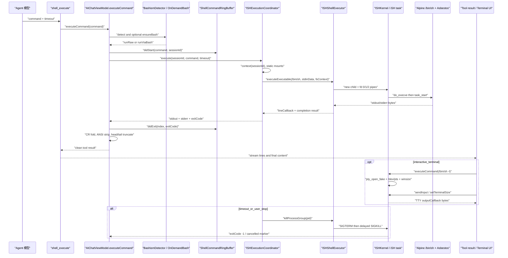

#### 6.5.4 输出回收：两套 buffer，三个截断点

**第一套是 pipe reader。** stdout 和 stderr 各有一个并发 reader；`poll` 每 500ms 检查 EOF/完成状态，按最长完整 UTF-8 前缀解码，保留不完整多字节序列到下一轮，然后按换行分发 line callback（`src/ios/iSH/ISHShellExecutor.m:693-846`）。进程 exit notification 到达后，代码仍等待约 200ms 让 reader drain，再在锁内复制 `NSMutableString`，最后回 completion（`src/ios/iSH/ISHShellExecutor.m:630-688`）。

**第二套是旧的 kernel prompt buffer。** `ISHKernel.executeCommandAndWait` 使用 `_commandOutputBuffer`，按 `$ `、`# `、`user@host:path$ 等正则判断 prompt，去掉第一行 echo 和尾部空白；没有 prompt 且超过 100000 字符时返回 `Output too large without prompt`（`src/ios/iSH/ISHKernel.m:877-1003`）。这条 API 与当前 agent coordinator 的 pipe completion 不同，不能把 100KB 当成 shell_execute 的模型输出上限。

**第三套是 agent result 清洗。** `runRaw` 在收到 coordinator 结果后先折叠 `\r`，把类似下载进度的同一行覆盖为最终片段，再剥离 CSI、OSC、ST 和单字符 ESC；清洗后的字符串超过 `AIChatViewModel.kMaxToolResultChars = 15000` 时保留一半头部和一半尾部，并要求模型用 `file_read` 读完整文件（`src/ios/Agent/Chat/AIChatViewModel.swift:14-24`；`src/ios/Agent/Chat/AIChatViewModel+ISHCommand.swift:161-249`）。

此外，实时 UI bubble 还有 30000 字符上限；最终 tool result 超过 15000 时会把完整输出写到 offloads，再把路径放入截断消息（`src/ios/Agent/Chat/AIChatViewModel+ConcurrentTools.swift:738-756`）。所以“100KB buffer”是 legacy prompt API，“15K”是模型结果，“30K”是实时聊天显示，三者不能混为一个限制。

`ShellCommandRingBuffer` 的实现很短，也很值得教学：它是 actor，容量只有 10，每条只保存 index、开始时间、命令（最多 500 字符）、session、exitCode、duration；静态锁快照供后台状态读取。它没有保存 stdout，也没有替代 pipe reader（`src/ios/Agent/ISH/ShellCommandRingBuffer.swift:3-69`）。

```swift
struct ShellCommandEntry {
    let index: Int
    let startedAt: Date
    let command: String
    let sessionId: String
    var exitCode: Int?
    var duration: TimeInterval?
    var exitedAt: Date?
}

actor ShellCommandRingBuffer {
    static let shared = ShellCommandRingBuffer()
    private let capacity = 10
    private var entries: [ShellCommandEntry] = []
    private var counter = 0

    private static let _lock = NSLock()
    nonisolated(unsafe) private static var _runningCount = 0
    nonisolated(unsafe) private static var _lastSnapshot: [ShellCommandEntry] = []

    nonisolated static var hasRunningCommand: Bool {
        _lock.lock(); defer { _lock.unlock() }
        return _runningCount > 0
    }

    nonisolated static var syncSnapshot: [ShellCommandEntry] {
        _lock.lock(); defer { _lock.unlock() }
        return _lastSnapshot
    }

    func didStart(command: String, sessionId: String) -> Int {
        let idx = counter
        counter += 1
        let trimmed = command.count > 500 ? String(command.prefix(500)) : command
        let entry = ShellCommandEntry(
            index: idx,
            startedAt: Date(),
            command: trimmed,
            sessionId: sessionId
        )
        entries.append(entry)
        if entries.count > capacity {
            entries.removeFirst(entries.count - capacity)
        }
        Self._lock.lock()
        Self._runningCount += 1
        Self._lastSnapshot = entries
        Self._lock.unlock()
        return idx
    }

    func didExit(index: Int, exitCode: Int) {
        guard let pos = entries.firstIndex(where: { $0.index == index }) else { return }
        let now = Date()
        entries[pos].exitCode = exitCode
        entries[pos].exitedAt = now
        entries[pos].duration = now.timeIntervalSince(entries[pos].startedAt)
        Self._lock.lock()
        Self._runningCount = max(0, Self._runningCount - 1)
        Self._lastSnapshot = entries
        Self._lock.unlock()
    }

    func snapshot() -> [ShellCommandEntry] {
        entries
    }
}
```
```swift
    /// Install the path-translate hook on ISHKernel. Idempotent; call once
    /// at boot before any session task is spawned. Installs both the
    /// forward hook (guest→host) and the reverse hook (host→guest) — the
    /// reverse hook is needed by readdir/getpath when fakefs has resolved
    /// a hook-routed path through F_GETPATH and needs to map it back so
    /// meta.db inode lookup works.
    func installHook() {
        ISHKernel.shared.installPathTranslateHandler { [weak self] guestPath, fsContext in
            return self?.translate(guestPath: guestPath, fsContext: fsContext)
        }
        ISHKernel.shared.installPathReverseHandler { [weak self] hostPath in
            return self?.reverse(hostPath: hostPath)
        }
    }

    // MARK: - Translation

    /// The hook itself. Called on iSH worker threads, on the fakefs hot path.
    /// MUST stay non-blocking — only a hash lookup + a few string ops.
    private func translate(guestPath: String, fsContext: UInt64) -> String? {
        guard fsContext != 0, let sid = sid(for: fsContext) else { return nil }
        return hostPath(forGuest: guestPath, sid: sid)
    }

    /// Resolve a guest path under one of the per-session buckets to its host
    /// URL for the given sid. Returns nil if the path is not under any
    /// per-session bucket (caller should fall back to the static mount table).
    /// Used by Swift call sites that need the host path without going through
    /// iSH (e.g. NSFileCoordinator on attachments).
    func hostURL(forGuest guestPath: String, sid: String) -> URL? {
        guard let path = hostPath(forGuest: guestPath, sid: sid) else { return nil }
        return URL(fileURLWithPath: path)
    }

    private func hostPath(forGuest guestPath: String, sid: String) -> String? {
        for bucket in perSessionBuckets {
            let prefix = bucket.linuxPrefix
            guard guestPath.hasPrefix(prefix) else { continue }
            let prefixEnd = guestPath.index(guestPath.startIndex, offsetBy: prefix.count)
            if prefixEnd != guestPath.endIndex && guestPath[prefixEnd] != "/" {
                continue
            }
            let tail = String(guestPath[prefixEnd...])
            return minisBaseURL
                .appendingPathComponent(sid, isDirectory: true)
                .appendingPathComponent(bucket.hostSubdir, isDirectory: true)
                .path + tail
        }
        return nil
    }
```
```swift
    static func shellLayerLines(_ script: String) -> [(line: Int, text: String?)] {
        let lines = script.components(separatedBy: "\n")
        var out: [(Int, String?)] = []
        var i = 0
        while i < lines.count {
            let line = lines[i]
            out.append((i + 1, line))  // opening line IS shell-layer
            // Collect every heredoc delimiter opened on this line, in order.
            let ns = line as NSString
            var delims: [String] = []
            for m in heredocOpen.matches(in: line, range: NSRange(location: 0, length: ns.length)) {
                if m.numberOfRanges > 1 {
                    delims.append(ns.substring(with: m.range(at: 1)))
                }
            }
            i += 1
            for delim in delims {
                while i < lines.count && lines[i].trimmingCharacters(in: .whitespaces) != delim {
                    out.append((i + 1, nil))  // body line — do not scan
                    i += 1
                }
                if i < lines.count {   // the delimiter line itself
                    out.append((i + 1, nil))
                    i += 1
                }
            }
        }
        return out
    }

    // MARK: - Detection

    static func detect(_ script: String, fuseMs: Double = 50) -> Result {
        guard !rules.isEmpty else { return Result(hits: []) }
        let start = Date()
        var hits: [Hit] = []
        for (lineNo, maybeText) in shellLayerLines(script) {
            guard let text = maybeText, !text.isEmpty else { continue }
            let scan = text.count > 4096 ? String(text.prefix(4096)) : text
            let ns = scan as NSString
            let range = NSRange(location: 0, length: ns.length)
            for rule in rules {
                if Date().timeIntervalSince(start) * 1000 > fuseMs {
                    logger.info("[Bashism] scan fuse tripped at \(hits.count) hits — fail-open")
                    return Result(hits: hits)
                }
                if rule.regex.firstMatch(in: scan, range: range) != nil {
                    hits.append(Hit(line: lineNo, ruleName: rule.name, tier: rule.tier,
                                    matchedText: scan.trimmingCharacters(in: .whitespaces),
                                    behaviorNote: rule.behaviorNote, fixHint: rule.fixHint))
                }
            }
        }
        return Result(hits: hits)
    }
}
```

来源：`src/ios/Agent/ISH/ShellCommandRingBuffer.swift:13-51`。后台 keep-alive 只使用 `hasRunningCommand` 和快照做生命周期诊断（`src/ios/Agent/Background/BackgroundKeepAliveManager.swift:271-283`）。

#### 6.5.5 超时、取消和子进程回收

工具层默认 timeout 是 900 秒（`src/ios/Agent/Chat/AIChatViewModel.swift:2017-2026`），coordinator 没有收到 timeout 时使用 300 秒默认值（`src/ios/Agent/ISH/ISHExecutionCoordinator.swift:265-276`）。实际 tool 调用通常会显式传入 900 秒，因此实现自己的 API 时要统一默认值，不能让上层和底层各有一个“默认五分钟/十五分钟”的隐性差异。

coordinator 启动后把 PID 回调给 `AIChatViewModel`，timeout work item 通过 `killProcessGroup` 杀整个进程组，并把 continuation 恢复为 `exitCode = -1` 的 timeout result（`src/ios/Agent/ISH/ISHExecutionCoordinator.swift:360-385`）。用户 stop 会枚举所有 in-flight shell，调用同一个 broad stop；并发工具时一次点击会杀整个 batch（`src/ios/Agent/Chat/AIChatViewModel+BackgroundTask.swift:475-507`）。

`killProcessGroup` 不只看 pgid，还沿 parent chain 找 root pid 的 descendants，因为 ash 子 shell 可能创建新 process group；先 SIGTERM，200ms 后重新验证 root task 指针，确认 PID 没有被回收复用才 SIGKILL（`src/ios/iSH/ISHShellExecutor.m:542-628`）。这套“进程组 + ancestry + pointer recheck”是避免 `sleep` 孙进程泄漏、误杀新命令和 guest 线程累计的关键。

### 6.6 持久文件、会话隔离与 `MinisFsRouter`

#### 6.6.1 `/var/minis` 的命名空间

`AIChatViewModel+Misc` 集中声明 guest 路径：per-session 的 `attachments`、`offloads`、`workspace`、`browser`，global 的 `memory`、`skills`、`shared`、`mcp-servers`，以及用户外部目录 `mounts`（`src/ios/Agent/Chat/AIChatViewModel+Misc.swift:99-127`）。session 持久目录是 `Library/MinisChat/minis/<sessionId>/...`，global 目录则由 app 的持久目录策略决定（`src/ios/Agent/Chat/AIChatViewModel+Misc.swift:107-140`）。

| guest 路径 | session 作用域 | 典型用途 | 当前路由 |
|---|---:|---|---|
| `/var/minis/attachments` | 是 | 图片、上传文件 | `MinisFsRouter` fs_context 路由（`src/ios/Agent/ISH/MinisFsRouter.swift:19-28`）。 |
| `/var/minis/offloads` | 是 | 大型 tool 输出、截图 | 同上。 |
| `/var/minis/workspace` | 是 | 脚本、数据和用户产物 | 同上。 |
| `/var/minis/browser` | 是 | 浏览器下载/中间文件 | 同上。 |
| `/var/minis/memory` | 否 | 跨 session memory | coordinator 静态 bind mount（`src/ios/Agent/ISH/ISHExecutionCoordinator.swift:419-429`）。 |
| `/var/minis/skills` | 否 | SKILL.md 等定义 | 静态 bind mount，文件变更仍需 meta.db/sync 更新。 |
| `/var/minis/shared` | 否 | 全局共享文件 | 静态 bind mount。 |
| `/var/minis/mcp-servers` | 否 | MCP server 配置和日志 | 静态 bind mount。 |

#### 6.6.2 为什么不再“切换 symlink”实现 session 隔离

旧路径仍由 `ensureMinisSymlinks` 创建，原因是 FileBrowser 在 kernel 尚未启动时也要能浏览文件（`src/ios/Agent/Chat/AIChatViewModel+Offloading.swift:640-651`）。但 agent 并发命令若依赖一个全局 symlink 来回替换，A session 的进程可能在 B session 切换后读到错误目录。当前核心命令路径改为 `fs_context`：每个 session 拿一个不会重复的 `UInt64` token，同一 sid 重复调用返回同一个 token（`src/ios/Agent/ISH/MinisFsRouter.swift:30-53`）。

`ISHShellExecutor` 在新 task group 上写入这个 token；fork 的子进程继承它，fakefs path hook 因而可按调用者上下文选择 host 目录（`src/ios/iSH/ISHShellExecutor.h:90-102`；`src/ios/iSH/ISHShellExecutor.m:204-221`）。这让同一时刻的两个 session 能分别访问自己的 `/var/minis/workspace`，同时共享 `/var/minis/memory`。

#### 6.6.3 forward/reverse hook 的职责

`MinisFsRouter.installHook` 同时安装 forward 和 reverse hook。forward 是 guest path 加 `fs_context` 到 host APFS path；reverse 是 host `F_GETPATH` 结果回到 canonical guest path。后者解决 `readdir`/getpath 已经解析 symlink 到 App Group 之外后，fakefs 无法用 guest `meta.db` inode 查回目录的问题（`src/ios/Agent/ISH/MinisFsRouter.swift:64-77`）。


来源：`src/ios/Agent/ISH/MinisFsRouter.swift:81-113`。hook 在 fakefs 热路径执行，源码要求它只做 hash lookup 和少量字符串操作，不做阻塞 I/O；这也是 `MinisFsRouter` 标成 `@unchecked Sendable` 且内部用 `NSLock` 的原因（`src/ios/Agent/ISH/MinisFsRouter.swift:16-18`；`src/ios/Agent/ISH/MinisFsRouter.swift:56-85`）。

reverse 还会处理 iOS 的 `/private/var` 与 `/var` 别名，且只反解已经发放 context 的 sid，避免把恰好位于同一 host base 下的陈旧目录错误映射成 guest bucket（`src/ios/Agent/ISH/MinisFsRouter.swift:115-146`）。

#### 6.6.4 静态 mount 与动态 hook 的分工

coordinator 的 `performMount` 只把 memory、skills、shared、mcp-servers 及 external folder 放进静态 bind table；per-session 四个 bucket 由 hook 动态路由，不再在 session 切换时 bind/unbind（`src/ios/Agent/ISH/ISHExecutionCoordinator.swift:168-175`；`src/ios/Agent/ISH/ISHExecutionCoordinator.swift:415-429`）。静态目录首次 mount 后记录 `staticMountsInitialized`，后续 session 只申请 context（`src/ios/Agent/ISH/ISHExecutionCoordinator.swift:157-176`）。

bind 时如果 `data/<linuxDir>` 还是旧真实目录，代码先把内容迁移到持久目录，再删除旧目录；绑定后对 session 小目录递归注册 meta.db；外部大目录只注册 top-level（`src/ios/Agent/ISH/ISHExecutionCoordinator.swift:439-540`；`src/ios/Agent/ISH/ISHExecutionCoordinator.swift:626-705`）。读路径时 coordinator 先查询静态 mount table，再 fallback 到 `MinisFsRouter.hostURL`（`src/ios/Agent/ISH/ISHExecutionCoordinator.swift:186-205`）。

#### 6.6.5 `minis://` 不是 guest 文件系统

`minis://workspace/a.txt` 是宿主 UI/工具层的 URL。`AIChatViewModel+FileTools` 先把 URL host 映射成 memory、skills、shared、mcp 或当前 session 的目录，再将 path 候选映射到 APFS；Linux `/var/minis/<namespace>/<file>` 也能转换为 `minis://<namespace>/<file>`（`src/ios/Agent/Chat/AIChatViewModel+FileTools.swift:66-104`）。这层解析不等于 fakefs 的 inode lookup：direct file read 会优先问 coordinator 的 mount table，发现 stale mount 后才 fallback 到 minis URL 或 rootfs data（`src/ios/Agent/Chat/AIChatViewModel+FileTools.swift:106-143`）。

因此建议把三种路径分开命名：

- guest path：给 `/bin/sh`、fakefs 和 native offload 使用，例如 `/var/minis/workspace/x.py`。
- host path：给 `FileManager`、`NSFileCoordinator`、FileProvider 使用，例如 `Library/MinisChat/minis/<sid>/workspace/x.py`。
- resource URL：给 chat markdown、浏览器和预览使用，例如 `minis://workspace/x.py`。

混用这三者会造成“shell 读得到但 FileBrowser 看不到”“预览链接落到错误 session”或“写入了 data shadow 而非真实持久目录”等问题；源码对 direct read 的 mount-table 优先和路径防御有明确实现（`src/ios/Agent/Chat/AIChatViewModel+FileTools.swift:106-130`）。

### 6.7 BusyBox ash 的 bashism 检测与按需安装

#### 6.7.1 先承认默认 shell 是 ash

rootfs 把 root shell 设置为 `/bin/sh`，系统 prompt 也明确告诉 agent 默认 shell 是 BusyBox ash（`deps/prepare_alpine_rootfs.sh:206-210`；`src/ios/Agent/Chat/AIChatViewModel.swift:1780-1787`）。ash 的问题不只是“某些命令报错”：`(( x > y ))`、`x+=1`、`{1..3}` 可能静默地产生错误分支或原样字符串。共享规则文件将其分为 S（silent-wrong）、E（loud error）、T1（脚本明确要求 bash），并要求逐行匹配、去掉 heredoc body、避免嵌套量词（`src/shared/bashism/bashism_rules.json:1-17`；`src/shared/bashism/bashism_rules.json:19-66`）。

#### 6.7.2 Detector 的算法

`BashismDetector` 不是 shell parser，而是有时间和输入上限的启发式匹配器：

1. `shellLayerLines` 找到 `<<EOF`、`<<-EOF` 等 delimiter，把 body 和 delimiter 行标为 nil；因此 Python/SQL/awk 内容中的 `((` 不会触发 bashism（`src/ios/Agent/Shell/BashismDetector.swift:81-114`）。
2. `detect` 逐行把输入限制在 4096 字符，逐规则 regex 匹配，并用 50ms wall-clock fuse fail-open；line number 保留原脚本的 1-based 行号（`src/ios/Agent/Shell/BashismDetector.swift:116-140`）。
3. 任意 hit 都是 `needsBash`；只有 S/E hit 会 `mustSwitchInterpreter`，T1 只负责确保 bash 已安装但不强制把外层 shell 换成 bash（`src/ios/Agent/Shell/BashismDetector.swift:28-45`）。


来源：`src/ios/Agent/Shell/BashismDetector.swift:118-140`。教学实现可以先做同样的 heredoc strip、4KB cap 和时间 fuse，再逐步增加规则；不要一开始用“完整 Bash grammar”阻塞每个命令。

#### 6.7.3 `OnDemandBash` 的状态机和网络预算

`OnDemandBash` 是 actor，availability 有 unknown、available、unavailable(until) 三态；unavailable TTL 是 10 分钟，进程内每次 launch 只允许一次安装尝试，失败计数用 UserDefaults 保留，24 小时 backoff 且三次失败后停止自动安装（`src/ios/Agent/Shell/OnDemandBash.swift:17-34`）。

执行顺序是：

1. 先跑 `command -v bash`，命中则缓存 available。
2. 若本次 launch 已尝试安装或持久 backoff 生效，直接返回 unavailable。
3. 先对 Alpine mirror 做 5 秒 host-side HEAD reachability；网络不可达不碰 `apk`。
4. 用独立 60 秒预算运行 `apk add bash`，再用 `command -v bash` 验证；失败记录 backoff，成功清零失败计数并把 guard 重新 armed（`src/ios/Agent/Shell/OnDemandBash.swift:46-103`）。

```swift
if await executor.run("command -v bash >/dev/null 2>&1", 15) == 0 {
    availability = .available
    return .available
}

if !(await networkReachable()) {
    recordFailure()
    availability = .unavailable(until: Date().addingTimeInterval(unavailableTTL))
    return .unavailable(reason: "network/apk mirror unreachable")
}

let rc = await executor.run("apk add bash", installBudget)
let verified = rc == 0
    ? (await executor.run("command -v bash >/dev/null 2>&1", 15) == 0)
    : false
```

来源：`src/ios/Agent/Shell/OnDemandBash.swift:58-102`。这个设计避免 agent 因离线而反复消耗 60 秒；同时允许用户后来手动 `apk add bash` 后由下一次 probe 自愈。

#### 6.7.4 透明切换、self-heal 和 reminder

当 detector 命中 S/E 且 OnDemandBash 返回 available，`AIChatViewModel` 不把脚本写到 host fakefs，而是把脚本 base64 编码，在 guest 内 `base64 -d > /tmp/.minis-exec-$$.sh`，运行 `bash file`，保存 rc，删除临时文件；这样绕过 host→fakefs 写入和 heredoc quoting（`src/ios/Agent/Chat/AIChatViewModel+ISHCommand.swift:72-90`）。

wrapper 先检查 bash。若 cache 认为 available 但用户刚执行 `apk del bash`，它返回 sentinel 119；代码兼容 raw 119 与 wait 编码 30464，调用 `markDisappeared`，最多重装并重跑一次，仍失败则降级回 ash（`src/ios/Agent/Chat/AIChatViewModel+ISHCommand.swift:92-110`）。

若安装失败，`BashismReminder` 把命中行、rule、行为说明和 fix hint 追加到结果；S 类 silent-wrong 即使 exit code 为 0 也会追加，E 类通常在非零退出时追加（`src/ios/Agent/Chat/AIChatViewModel+ISHCommand.swift:113-123`）。嵌入 reminder 前会把 `<`/`>` 换成 look-alike、移除控制字符、截断每行 120 字符，并最多展示 8 个去重 hit，避免用户脚本伪造 `</system-reminder>`（`src/ios/Agent/Shell/BashismReminder.swift:7-64`）。

这条纠正只覆盖 agent `shell_execute`；交互式 terminal 使用 `executeCommand(["/bin/sh", "-l"])`，源码明确写着 bashism path 不会改变它（`src/ios/Agent/Chat/AIChatViewModel+ISHCommand.swift:27-32`；`src/ios/Views/Rootfs/ISHTerminalView.swift:367-378`）。

### 6.8 终端 UI：从 TTY 字节到可选文本网格

#### 6.8.1 TTY 输出回到主线程

`ish_tty_write` 把 guest TTY bytes 转成 `NSData`/UTF-8 文本，在主队列调用等待中的 command buffer、outputCallback，并发布 `ISHTerminalOutputNotification`（`src/ios/iSH/ISHKernel.m:223-253`）。这是一条全局 callback 槽位，因此 `ISHTerminalViewModel` 用 generation token 防止旧 SwiftUI `@StateObject` 的 deinit 清掉新 terminal 的 callback（`src/ios/Views/Rootfs/ISHTerminalView.swift:192-230`）。

输出 callback 不会每个 4–24 字节都排一项主队列任务：view model 先在 lock 下 append 到 pending `Data`，只在 empty→non-empty 时 schedule 一次 `DispatchQueue.main.async`，主队列 drain 整个 burst 后交给 `emulator.feed`（`src/ios/Views/Rootfs/ISHTerminalView.swift:232-275`）。这既降低 SwiftUI redraw 数，也防止高输出命令饿死触摸和键盘事件。

#### 6.8.2 ANSIParser → TerminalEmulator → TerminalBuffer

`ANSIParser` 是简化 VT100/ECMA 状态机，维护 ground、escape、CSI、OSC 等状态；输入可按 `Data` 或 `[UInt8]` feed，输出 `printable`、C0 control、CSI、ESC、OSC action（`src/ios/iSH/Terminal/ANSIParser.swift:10-75`；`src/ios/iSH/Terminal/ANSIParser.swift:81-139`）。它自己不画 UI。

`TerminalEmulator` 把 parser action 分发给 active buffer，维护 primary/alternate screen、cursor style、origin/auto-wrap、bracketed paste、cursor shape 和 DSR response；vim/htop 等程序通过 DEC private mode 切到 alternate buffer（`src/ios/iSH/Terminal/TerminalEmulator.swift:11-85`；`src/ios/iSH/Terminal/TerminalEmulator.swift:153-171`；`src/ios/iSH/Terminal/TerminalEmulator.swift:360-412`）。OSC 1337 的 `MinisOpenURL` 会交给 `MinisOpenURLBroker`，因此 shell 中调用 `minis-open` 可以打开 app 内预览（`src/ios/iSH/Terminal/TerminalEmulator.swift:563-599`）。

`TerminalBuffer` 是 rows×cols 的 `TerminalCell` 网格，另有最多 2000 行 scrollback；wide character 写入两个 cell，scrollback 溢出时从头部裁剪（`src/ios/iSH/Terminal/TerminalBuffer.swift:10-69`；`src/ios/iSH/Terminal/TerminalBuffer.swift:126-174`；`src/ios/iSH/Terminal/TerminalBuffer.swift:203-218`）。cell 保存字符、前景/背景色、属性、宽度和 wide trailer；颜色支持 xterm 256 palette 与 RGB（`src/ios/iSH/Terminal/TerminalTypes.swift:12-17`；`src/ios/iSH/Terminal/TerminalTypes.swift:89-119`）。

#### 6.8.3 Canvas 的渲染和 resize

`TerminalCanvasView` 是 SwiftUI 到 UIKit 的 bridge；内部用 `UIScrollView` 承担 scroll，用不可编辑但可选择的 `UITextView` 承担 native copy/paste，再叠加 cursor overlay（`src/ios/iSH/Terminal/TerminalCanvasView.swift:51-87`；`src/ios/iSH/Terminal/TerminalCanvasView.swift:232-288`）。它订阅 `emulator.$version`，每次 feed 只 bump 一次 version；SwiftUI 兄弟视图重绘不会重复整份 attributed string（`src/ios/iSH/Terminal/TerminalCanvasView.swift:75-86`；`src/ios/iSH/Terminal/TerminalEmulator.swift:87-96`）。

大 scrollback 不能每次把整个文档重新排版：scrollback 达到 300 行后，renderer 冻结旧 prefix，只实时重建最近 200 行和当前 grid，并按 `scrollbackHeadIndex` 增量修剪缓存（`src/ios/iSH/Terminal/TerminalCanvasView.swift:171-205`；`src/ios/iSH/Terminal/TerminalCanvasView.swift:489-623`）。cell 被转换为 `NSAttributedString` 时，CoreText 测量真实 glyph advance，按 expected cell width 加 `kern`，避免 emoji/CJK 替换字体使 cursor 漂移（`src/ios/iSH/Terminal/TerminalCanvasView.swift:815-925`）。

窗口大小由 cell font metrics 换算成 cols/rows，经过 0.4 秒 debounce 后才把 resize 传给 `ISHTerminalViewModel`；后者同时 resize 两个 emulator buffer 和 `ISHKernel.setTerminalSize`，等价于给 guest TTY 发送稳定的 SIGWINCH 语义（`src/ios/iSH/Terminal/TerminalCanvasView.swift:329-371`；`src/ios/Views/Rootfs/ISHTerminalView.swift:434-437`）。

#### 6.8.4 输入、IME 和控制键

终端使用一个透明的 `TerminalKeyInputView`，实现 `UITextInput` 而不把可编辑文本放在屏幕上。`insertText` 把 committed UTF-8 送给 TTY；Ctrl 状态下把字母换算成 0x01–0x1A；IME marked text 只在 `unmarkText` 时提交，因而支持中文拼音等组合输入（`src/ios/iSH/Terminal/TerminalInputView.swift:76-168`）。

硬件键通过 `UIKeyCommand` 和 `pressesBegan` 处理：Ctrl+letter、Alt+letter、方向键、Home/End、F1–F12、Tab、Escape 变成 ANSI/VT bytes；application cursor mode 会在 `ESC [` 与 `ESC O` 之间切换（`src/ios/iSH/Terminal/TerminalInputView.swift:292-333`；`src/ios/iSH/Terminal/TerminalInputView.swift:335-467`）。

键盘 accessory 提供 Esc、Tab、真正的 CR Enter、sticky Ctrl、方向键、Ctrl-C/D/Z、Paste、Files、Rootfs；iPad Return 不直接依赖多行输入框的 newline，而是发送 0x0D（`src/ios/iSH/Terminal/TerminalKeyboardAccessory.swift:62-126`）。所有 `tty_input` 都走串行 background queue，因为 kernel 的 mutex 可能阻塞，不能从 main thread 调用（`src/ios/Views/Rootfs/ISHTerminalView.swift:408-422`）。

#### 6.8.5 FileBrowser 与 fakefs 的双向一致性

FileBrowser 浏览的是 host `data/` 和 symlink，而不一定启动 kernel；删除时同时删除 host 项和 `meta.db` path，并通知 FileProvider 重新枚举（`src/ios/Views/Rootfs/FileBrowserView.swift:1020-1054`）。复制、移动、导入后调用 `registerSubtreeInMetaDB`，否则 shell 可能看不到新文件（`src/ios/Views/Rootfs/FileBrowserView.swift:1180-1222`；`src/ios/Views/Rootfs/FileBrowserView.swift:1293-1319`）。

导航时故意保留 logical `currentPath`，不使用 symlink-resolved `item.url` 作为下一层路径；否则 bind-mounted `/var/minis/browser` 会被解析到 Library 外部，copy absolute path 会只剩文件名（`src/ios/Views/Rootfs/FileBrowserView.swift:1230-1274`；`src/ios/Views/Rootfs/FileBrowserView.swift:1335-1345`）。这是 host URL 和 guest logical path 必须分离的另一个实例。

### 6.9 平台对照（只做边界定位，不重复第 7 章）

本章是 iOS 专题，Android 的 PRoot/Alpine/PTY 细节请读第 7 章。下表只说明同一个抽象在两端为什么不同，避免把 Android 实现倒灌到 iOS 设计里。

| 抽象 | iOS 本章的落地 | Android 对应方向 | 差异原因 |
|---|---|---|---|
| guest Linux | iSH + Asbestos，进程内 user-mode emulation（`README.md:168-175`；`deps/build_ish.sh:203-222`） | PRoot + Alpine | iOS 不能依赖可执行 Linux binary 或真实 chroot；Android 走 PRoot 系统调用/路径拦截。 |
| 文件系统 | fakefs `data/` + `meta.db`，再叠加 bind symlink/hook（`src/ios/Agent/Chat/AIChatViewModel+FileTools.swift:11-19`） | PRoot bind 与 Android storage | iOS App sandbox 需要自定义 inode/stat 层，Android 可在 app uid 可达的 host storage 上做 PRoot 绑定。 |
| session 隔离 | `fs_context` token + `MinisFsRouter`（`src/ios/Agent/ISH/MinisFsRouter.swift:42-85`） | 见第 7 章的 session/mount 实现 | iOS shell 可并发 fork，不能靠一个全局 symlink 切换目录。 |
| 交互终端 | iSH `pty_open_fake`、自研 ANSI emulator、UIKit input（`src/ios/iSH/ISHKernel.m:661-685`；`src/ios/iSH/Terminal/TerminalEmulator.swift:11-30`） | Android PTY/Compose renderer | 两端 UI toolkit 和底层 guest PTY 接口不同。 |
| 后台 | 普通 iOS 约 30 秒 grace；location/audio 是 extended legs，但仍可能被系统终止（`src/ios/Agent/Background/BackgroundKeepAliveManager.swift:22-45`） | Android service/foreground service 策略 | 审核、后台模式和系统调度模型不同；不要照搬 iOS 的 audio/location 方案。 |

### 6.10 设计取舍与踩坑

#### 6.10.1 文档与源码不一致时，以哪一条为准

旧 spec 的 agent flow 把 coordinator 写成 FIFO、把 `/bin/sh` 写成 PTY，并以 100KB buffer 描述输出（`docs/specs/ios-sandbox-ish-summary.md:206-263`）。当前实现已经改成独立 pipe + 并发 fresh process，`ShellCommandRingBuffer` 也只是 10 条状态记录（`src/ios/Agent/ISH/ISHExecutionCoordinator.swift:26-38`；`src/ios/Agent/ISH/ShellCommandRingBuffer.swift:13-69`）。实现新功能时应以代码的 `executeExecutable(... stdinData: ... fsContext:)` 为契约，不要把 summary 中的历史架构复制回去。

#### 6.10.2 内存和并发不是“越多越快”

每个 shell 都有 guest task、pipe reader、stdout/stderr string、fakefs context 和潜在子进程；当前 agent turn 只允许 10 个并发 shell（`src/ios/Agent/Chat/AIChatViewModel+ConcurrentTools.swift:21-25`）。超时注释还记录过只杀 root pid 会留下 emu task threads、footprint 上升并触发 jetsam，因此必须杀整个 process group（`src/ios/Agent/ISH/ISHExecutionCoordinator.swift:364-378`）。[推断] 在低内存设备上，真正的并发上限应按 guest RSS、输出大小和工具类型动态压测，不能只看 Swift task 数。

agent 结果 15K、实时 bubble 30K、legacy prompt 100KB 三层上限共同避免模型上下文和 UI 字符串无限长；完整输出通过 offload 文件保留（`src/ios/Agent/Chat/AIChatViewModel.swift:17-18`；`src/ios/Agent/Chat/AIChatViewModel+ConcurrentTools.swift:738-756`；`src/ios/iSH/ISHKernel.m:995-1002`）。

#### 6.10.3 后台不是“线程继续跑”的保证

普通 iOS background 只有约 30 秒 grace；没有 long-lived leg 时，background task expiry handler 会标记 suspended、停止命令并结束 background task；启用 audio/location keep-alive 时才会重置有限 task 的时钟（`src/ios/Agent/Background/BackgroundKeepAliveManager.swift:22-45`；`src/ios/Agent/Chat/AIChatViewModel+BackgroundTask.swift:24-80`）。因此 shell 工具必须可取消、可重试、可从 `/var/minis/workspace` 恢复；不要把一次长 `apk add` 当成系统必定完成的事务。

#### 6.10.4 reset 的不可逆边界

kernel boot 后成为 PID 1 是一次性状态；reset 不能在同一进程重新 mount。若 UI 允许用户 reset 后立即点击 terminal，必须拒绝并要求 relaunch，否则 stale fakefs mount 会访问已删除的 tree（`src/ios/iSH/RootfsManager.swift:21-31`；`src/ios/Views/Rootfs/ISHTerminalView.swift:291-305`）。Rootfs 管理界面也把 reset、backup、restore 分成不同 action，并明确提示重启（`src/ios/Views/Rootfs/RootfsManagementView.swift:67-177`；`src/ios/Views/Rootfs/RootfsManagementView.swift:250-310`）。

#### 6.10.5 App Store、静态链接和许可证

仓库用 static `libish.a`、`libish_emu.a`、`libfakefs.a`，Build script 的 iOS deployment target 是 14.0（`deps/build_ish.sh:23-38`），而不是依赖私有虚拟化框架。第三方清单注明 iSH ARM64 fork 是 GPL-3.0，并带 App Store distribution exception；这也是产品整体 GPLv3 说明的一部分（`THIRD_PARTY_LICENSES.md:5-15`）。源码没有“绕过审核”的私有 API 或 entitlement 实现，因此教学实现应把合规重点放在许可证、静态库交付、公开 Foundation/UIKit API、资源大小和可解释的用户态 emulation 上。[推断] 不应把产品文案写成“获得 iOS root”或“运行真实 Linux kernel”，也不要引入动态下载可执行代码来替代 Asbestos 的构建路径。

#### 6.10.6 容易漏掉的 fakefs 一致性检查

- 直接 `FileManager` 写入 guest `data/` 后，必须 `ensureParentDirsInMetaDB` + `ensureFakefsMetadata`；否则只改变 host 层（`src/ios/Agent/Chat/AIChatViewModel+FileTools.swift:146-228`）。
- bind 目标要先 `lstat`，不要用会跟随 symlink 的 `attributesOfItem` 判断旧目录类型；coordinator 已经用 `lstat` 并做安全前缀检查（`src/ios/Agent/ISH/ISHExecutionCoordinator.swift:447-496`）。
- `MinisFsRouter` hook 热路径不能做磁盘 I/O；host URL 解析和 FileManager 访问放到非 hook 的调用侧（`src/ios/Agent/ISH/MinisFsRouter.swift:81-113`）。
- external vault 不要递归注册全树；只注册 mount 根，依赖按需 inode（`src/ios/Agent/ISH/ISHExecutionCoordinator.swift:688-692`）。
- FileBrowser 导入/复制/移动/删除要更新 `meta.db`，并维持 logical guest path，不要把 resolved APFS path 当成 `/var/minis` path（`src/ios/Views/Rootfs/FileBrowserView.swift:1180-1222`；`src/ios/Views/Rootfs/FileBrowserView.swift:1230-1274`）。

### 6.11 从零实现清单

下面是一个最小、可验收的 iOS iSH 子系统路线。每步都给出可观察的验收标准，并标注可以砍掉的功能；完整 agent 产品再逐步补回优化。

1. **固定 guest 架构和许可证。** 选择 ARM64 guest、Alpine aarch64，并记录 iSH fork 的 GPL/App Store 例外；验收是构建配置、NOTICE 和资源来源可追溯（`deps/build_ish.sh:5-26`；`THIRD_PARTY_LICENSES.md:5-15`）。可砍掉：多架构和动态 provider。
2. **构建三份静态库。** 让 Meson 选择 `kernel=ish`、`engine=asbestos`、`guest_arch=arm64`，产出 `libish.a`、`libish_emu.a`、`libfakefs.a`；验收是 Xcode 能链接且不依赖私有 framework（`deps/build_ish.sh:193-225`）。可砍掉：VDSO，先接受较慢的 guest fallback。
3. **生成 fakefs rootfs。** 下载 aarch64 minirootfs，构建 `fakefsify`，生成同时含 `data/` 和 `meta.db` 的目录；验收是脚本的两项存在性检查通过（`deps/prepare_alpine_rootfs.sh:96-186`）。可砍掉：OpenRC 多服务，只保留 `/bin/sh`。
4. **打包 zip。** 写 profile、`/etc/resolv.conf`、APK repositories，zip 时排除 SQLite WAL/SHM；验收是解压后仍有 data、meta.db，且 zip 不带临时数据库文件（`deps/prepare_alpine_rootfs.sh:192-297`）。可砍掉：motd、别名和 mirror auto-detect。
5. **实现安装标记。** 将 zip 解压到 `Documents/alpine-rootfs`，写 `.arch`，用 `data/` + `.arch` 判断已安装；验收是重复 launch 不重复解压，架构 tag 改变会安全重装（`src/ios/iSH/RootfsManager.swift:35-103`）。可砍掉：`rootfs.freshInstall`，但要提供可诊断的版本标记。
6. **实现一次性 kernel boot。** 按 `mount_root → PID 1 → device nodes → proc/devpts → DNS → TTY` 顺序启动；验收是 guest 能执行 `/bin/sh -l`，并且 `/dev/null`、`/dev/ptmx`、`/proc` 存在（`src/ios/iSH/ISHKernel.m:334-411`；`src/ios/iSH/ISHKernel.m:453-477`）。可砍掉：native offload，先不注册 Apple 工具。
7. **实现 fakefs metadata API。** 对每次 host 写入同步 `paths`、`stats` 和父目录；验收是 host `data/x` 写入后 guest `stat/open/readdir` 都能看到正确类型/权限（`src/ios/Agent/Chat/AIChatViewModel+FileTools.swift:158-228`）。可砍掉：uid/gid 的高级修改，但不要省略 mode 和 inode。
8. **实现最小 bind mount。** 先创建 host 目录，再在 guest path 下创建 symlink/bind，注册根 inode；验收是 guest 写入能在 host 持久目录看到，重启后仍能读（`src/ios/iSH/ISHKernel.m:851-875`；`src/ios/Agent/ISH/ISHExecutionCoordinator.swift:498-540`）。可砍掉：外部目录 read-only 和 lazy inode。
9. **实现 session context。** 为每个 session 分配稳定非零 token，把 token 写进 task group，hook 按 bucket 解析 host path；验收是两个并发命令分别写各自 workspace 且互不串读（`src/ios/Agent/ISH/MinisFsRouter.swift:42-110`；`src/ios/iSH/ISHShellExecutor.m:204-221`）。可砍掉：reverse hook，但必须接受 readdir/getpath 的限制。
10. **实现非交互 shell execute。** 为每次调用 fork fresh `/bin/sh`，stdin 通过 pipe 写脚本并关闭，stdout/stderr 用 non-blocking pipe 读取；验收是多行命令、stderr、退出码、EOF 都能返回（`src/ios/Agent/ISH/ISHExecutionCoordinator.swift:280-337`；`src/ios/iSH/ISHShellExecutor.m:191-478`）。可砍掉：并发，第一版每次一个 process，但不要伪造 persistent shell。
11. **实现超时和组取消。** timeout 要杀进程组和 descendants，停止后 continuation 只能恢复一次；验收是 `sleep` 的 child/grandchild 不再运行，取消不会误杀后续复用 PID 的命令（`src/ios/iSH/ISHShellExecutor.m:555-628`；`src/ios/Agent/ISH/ISHExecutionCoordinator.swift:364-385`）。可砍掉：10 分钟 preempt，但必须有用户 stop。
12. **实现 agent 结果策略。** 先 CR fold/ANSI strip，再对模型结果做 head+tail 截断，完整内容写 `/var/minis/offloads`；验收是进度条不膨胀、头尾可见、模型能拿到 file_read 路径（`src/ios/Agent/Chat/AIChatViewModel+ISHCommand.swift:187-249`；`src/ios/Agent/Chat/AIChatViewModel+ConcurrentTools.swift:738-756`）。可砍掉：实时 line streaming，不能砍掉 final output 上限。
13. **实现 bashism 最小规则。** 先支持 `(( ))`、数组、`{1..3}`、process substitution，并剥离 heredoc body；验收是 silent-wrong 命令能提示而不是悄悄错误（`src/shared/bashism/bashism_rules.json:19-66`；`src/ios/Agent/Shell/BashismDetector.swift:81-140`）。可砍掉：自动安装，先返回清晰 reminder。
14. **实现按需安装和 self-heal。** probe、5 秒网络检查、`apk add bash` 独立 60 秒预算、安装后 verify；验收是离线不反复安装，bash 被删除后下一次命令可恢复或明确降级（`src/ios/Agent/Shell/OnDemandBash.swift:46-149`；`src/ios/Agent/Chat/AIChatViewModel+ISHCommand.swift:72-110`）。可砍掉：persistent 24 小时 backoff，但生产版应保留。
15. **实现 interactive PTY。** 单独使用 `pty_open_fake`、winsize、TTY input/output，不能复用 pipe shell executor；验收是 `vi`/`htop` 至少能接收方向键、Ctrl-C、resize（`src/ios/iSH/ISHKernel.m:650-685`；`src/ios/Views/Rootfs/ISHTerminalView.swift:367-437`）。可砍掉：OSC 1337 预览、FileBrowser，但要保留基础 ANSI。
16. **实现 terminal emulator。** Parser 处理 UTF-8、CSI、OSC；Buffer 处理 alternate screen、scrollback、wide chars；renderer 处理 cursor 和 resize debounce（`src/ios/iSH/Terminal/ANSIParser.swift:31-139`；`src/ios/iSH/Terminal/TerminalBuffer.swift:10-218`；`src/ios/iSH/Terminal/TerminalCanvasView.swift:329-371`）。验收是普通 shell、CJK、颜色、复制粘贴都可用。
17. **实现 reset 的 cold-launch 语义。** 删除 rootfs 前可备份 `/root`，booted 后标记 poisoned，UI 要求 relaunch；验收是 reset 后不发生 stale mount crash，冷启动能重新解压并恢复备份（`src/ios/iSH/RootfsManager.swift:105-176`；`src/ios/Views/Rootfs/ISHTerminalView.swift:291-305`）。可砍掉：备份，不能砍掉冷启动门闩。
18. **最后做设备验收。** 不以 simulator 或构建成功代替运行证明；分别测试冷启动、并发 shell、large output、offline bash、后台、memory warning、reset/relaunch 和外部目录。仓库本身没有 Asbestos 吞吐 benchmark，因此把结果保存为设备型号、iOS 版本、rootfs 版本和命令耗时，避免把未测的数字写成保证（`src/ios/Agent/Chat/AIChatViewModel+ConcurrentTools.swift:21-25`；`src/ios/Agent/Background/BackgroundKeepAliveManager.swift:22-45`）。

### 6.12 关键文件索引

行数为当前 checkout 的文件总行数；行号引用以生成本章时源码为准。

| 路径 | 行数 | 职责 |
|---|---:|---|
| `src/ios/iSH/ISHKernel.m` | 1305 | boot、PID 1、JIT fault recovery、TTY、设备节点、DNS、PTY、bind、command prompt buffer、path hook。 |
| `src/ios/iSH/ISHKernel.h` | 175 | Objective-C API、TTY callback、bind mount、fakefs change/path hooks、CPU throttle。 |
| `src/ios/iSH/ISHShellExecutor.m` | 880 | fresh guest task、fs_context、stdin/stdout/stderr pipes、UTF-8 reader、completion、killProcessGroup。 |
| `src/ios/iSH/ISHShellExecutor.h` | 126 | 非交互执行、stdinData、fs_context、同步执行和终止 API。 |
| `src/ios/iSH/RootfsManager.swift` | 680 | zip 安装、`.arch`、reset/restore、default mount overlay、meta.db helper、ZIP reader。 |
| `src/ios/Agent/ISH/ISHExecutionCoordinator.swift` | 852 | session execute、mount 初始化、context、超时、取消、静态/外部 bind、batch meta.db。 |
| `src/ios/Agent/ISH/MinisFsRouter.swift` | 147 | fs_context↔sid、guest→host forward hook、host→guest reverse hook。 |
| `src/ios/Agent/ISH/ShellCommandRingBuffer.swift` | 69 | 最近 10 条命令状态、running 快照；不是输出 ring。 |
| `src/ios/Agent/Chat/AIChatViewModel+ISHCommand.swift` | 251 | bashism 分流、runViaBash、coordinator bridge、结果清洗和 15K 截断。 |
| `src/ios/Agent/Chat/AIChatViewModel+ConcurrentTools.swift` | 815 | turn 内并发 tool dispatch、shell line streaming、30K UI/15K final result 处理。 |
| `src/ios/Agent/Chat/AIChatViewModel.swift` | 5830 | `kMaxToolResultChars=15000`、默认 command timeout 900 秒和运行 PID 状态。 |
| `src/ios/Agent/Chat/AIChatViewModel+Misc.swift` | 327 | kernel boot orchestration、`/var/minis` 常量和持久 base URL。 |
| `src/ios/Agent/Chat/AIChatViewModel+Offloading.swift` | 818 | session symlink、offloads 历史迁移、`/var/minis` host 目录准备。 |
| `src/ios/Agent/Chat/AIChatViewModel+FileTools.swift` | 812 | host/guest/minis URL 解析、直接文件工具、fakefs metadata 注册。 |
| `src/ios/Agent/Shell/BashismDetector.swift` | 141 | heredoc stripping、规则匹配、50ms fuse、S/E/T1 结果分类。 |
| `src/ios/Agent/Shell/BashismReminder.swift` | 64 | 安全 reminder、hit 去重/限量和内容清洗。 |
| `src/ios/Agent/Shell/OnDemandBash.swift` | 150 | bash probe、网络 precheck、apk 安装、TTL/backoff/self-heal。 |
| `src/shared/bashism/bashism_rules.json` | 160 | iOS/Android 共用的 ash bashism 规则、行为说明和 POSIX 修复提示。 |
| `src/ios/Views/Rootfs/ISHTerminalView.swift` | 469 | SwiftUI terminal 生命周期、callback coalesce、session mount、输入队列、resize。 |
| `src/ios/iSH/Terminal/ANSIParser.swift` | 350 | VT100/xterm byte state machine。 |
| `src/ios/iSH/Terminal/TerminalEmulator.swift` | 631 | parser action、screen buffer、modes、OSC 1337、cursor response。 |
| `src/ios/iSH/Terminal/TerminalBuffer.swift` | 516 | cell grid、cursor、scroll region、scrollback、erase/insert/delete。 |
| `src/ios/iSH/Terminal/TerminalTypes.swift` | 154 | xterm palette、attributes、cell、cursor 和输入类型。 |
| `src/ios/iSH/Terminal/TerminalCanvasView.swift` | 1006 | UIKit renderer、UITextView selection、attributed string cache、cursor overlay、resize debounce。 |
| `src/ios/iSH/Terminal/TerminalInputView.swift` | 488 | UITextInput/IME、Ctrl/Alt、hardware key 到 ANSI bytes。 |
| `src/ios/iSH/Terminal/TerminalKeyboardAccessory.swift` | 145 | Esc/Tab/CR/Ctrl/arrow/Files/Rootfs 快捷键。 |
| `src/ios/Views/Rootfs/FileBrowserView.swift` | 1687 | rootfs 与 symlink 浏览、导入/复制/移动/删除后的 meta.db 同步。 |
| `src/ios/Views/Rootfs/RootfsManagementView.swift` | 318 | 安装、reset、backup、restore UI 和 relaunch 提示。 |
| `src/ios/Views/Rootfs/RootfsResetButton.swift` | 238 | 可复用 reset/backup 快捷按钮。 |
| `src/ios/default_mount/etc/profile.d/minis.sh` | 16 | ash history、`ENV` 和交互配置入口。 |
| `src/ios/default_mount/root/.ashrc` | 2 | ash 的 `ENV` 目标文件。 |
| `src/ios/default_mount/usr/local/bin/minis-open` | 86 | OSC 1337 URL/`minis://` 资源 marker wrapper。 |
| `src/ios/default_mount/usr/local/bin/minis-mcp-cli` | 31 | MCP Python CLI 的 POSIX 启动 wrapper。 |
| `deps/build_ish.sh` | 433 | iSH ARM64 iOS cross-build、静态库/header/VDSO 复制。 |
| `deps/prepare_alpine_rootfs.sh` | 383 | Alpine aarch64 下载、fakefsify、配置、zip 打包。 |
| `scripts/prepare_rootfs.sh` | 380 | QEMU qcow2/ISO 开发 rootfs，不是 iSH 生产包。 |
| `scripts/install_alpine.sh` | 90 | 通过 QEMU setup-alpine 安装 qcow2。 |
| `scripts/optimize_rootfs.sh` | 308 | qcow2 挂载、服务禁用和 QEMU 启动优化。 |
| `docs/specs/ios-sandbox-ish-summary.md` | 263 | iSH 能力、mount、offload、历史执行流骨架；需以源码纠偏。 |
| `deps/ISH_INTEGRATION.md` | 526 | 静态库、bridge header、TTY/初始化示例；示例代码不是当前所有实现。 |
| `README.md` | 217 | iSH/ARM64 fork、Alpine 和 Android PRoot 的项目定位。 |
| `THIRD_PARTY_LICENSES.md` | 55 | iSH GPL 与 App Store distribution exception 记录。 |

下一章再展开 Android 的 PRoot、rootfs 和 Compose terminal；本章只保留一个判断标准：iOS 的核心难题不是“把 Linux 文件复制进 App”，而是同时维持 guest inode 语义、进程内 ARM64 执行、PTY/pipe 两条 I/O 契约、session 路由和 iOS 生命周期。

## 7. Android 沙箱：PRoot 用户态 chroot

### 7.1 这一章解决什么问题

Android 端需要在普通应用 UID 下提供一个可安装 Alpine 软件包、可保留工作目录、可运行脚本和交互式终端的 Linux 用户空间；本章解释这个用户空间怎样从资产变成可执行进程。核心不是“把命令包在 `Runtime.exec` 里”，而是把 PRoot、rootfs、PTY、持久 shell、SAF 挂载和终端渲染连成一个可恢复的执行链。没有 rootfs，`/bin/sh`、`/etc/resolv.conf` 和 `/var/minis` 不存在；没有 PRoot，应用 UID 不能把 Alpine 的 `/` 当成 guest 根目录；没有真实 PTY，readline、Ctrl+C、全屏程序和 ANSI 光标都会失真。Android 实现还必须面对 Doze、前台服务、scoped storage、SELinux/seccomp 和可执行文件路径等 iOS 不同的约束。上述组件的产品定位在 README 中被概括为“Android 使用 PRoot + Alpine”，而 iOS 使用 iSH；具体构建产物由 `BUILDING.md` 的 Android 小节规定。`README.md:119-140` `README.md:168-175` `BUILDING.md:159-180`

本章以仓库当前代码为准；涉及 PRoot 内部 syscall tracer 的部分，仓库中的 `deps/proot` 子模块在当前工作树没有源码，因此会明确标记 `[推断]`，不会把没有在本仓库验证的函数名写成事实。`BUILDING.md:202-205`

### 7.2 先建立正确模型：用户态 chroot，不是 Android 容器

#### 7.2.1 三个层次

可以把 Android 沙箱分成三层：

| 层 | 真实实现 | 负责什么 |
|---|---|---|
| host Android | 应用 UID、bionic、Android 文件系统、系统服务 | 运行 PRoot、提供 `/dev`、`/proc`、`/sys` 和设备能力 |
| PRoot 进程 | `libproot.so` 对应的 aarch64 PRoot 可执行文件 | 在不获取 root 的情况下重写 guest 路径、伪造 uid 0、绑定 host 目录 |
| guest Alpine | `filesDir/alpine-rootfs` 解压出来的用户空间 | `/bin/sh`、`apk`、Python、Node、用户脚本和 `/var/minis` |

`RootfsManager` 把 guest 根目录固定在 `context.filesDir/alpine-rootfs`，把真正执行的 PRoot 固定为 `applicationInfo.nativeLibraryDir/libproot.so`；这不是抽象描述，而是两个公开属性。`src/android/app/src/main/java/com/openminis/app/sandbox/RootfsManager.kt:40-49`

`PRootKernel` 也直接说明自己不是持久内核，而是“process-per-command”的配置持有者和命令构造器；持久性后来由 `PersistentShell` 以一个长生命周期的 PRoot 子进程实现。`src/android/app/src/main/java/com/openminis/app/sandbox/PRootKernel.kt:17-23` `src/android/app/src/main/java/com/openminis/app/sandbox/PersistentShell.kt:16-23`

#### 7.2.2 `-r`、`-b`、`-0` 到底做了什么

每一次一次性执行的命令都由 `buildProotCommand` 组装成下面的形状：

```text
<proot> -0 --link2symlink -r <rootfs>
        -b /dev -b /proc -b /sys -w /root
        [-b <host>:<linux> ...]
        [--native-offload=<socket>:<handlers>]
        /bin/sh -c <shellCommand>
```

来源：`src/android/app/src/main/java/com/openminis/app/sandbox/PRootKernel.kt:576-647`。

- `-r <rootfs>` 使 guest 看到的 `/` 解析到解压的 Alpine 树，而不是应用 UID 的真实 Android `/`。代码把 rootfs 的绝对路径作为参数传入。`src/android/app/src/main/java/com/openminis/app/sandbox/PRootKernel.kt:606-608`
- `-0` 只是在 PRoot 的用户态视图里把进程呈现为 uid 0；它不是 Android root，也不能绕过 Android 权限。代码只验证它被加入 argv，获得“真正 root 权限”是没有依据的说法。`src/android/app/src/main/java/com/openminis/app/sandbox/PRootKernel.kt:589-604`
- `/dev`、`/proc`、`/sys` 使用 bind 让 guest 工具能看到必要的伪文件系统；这不是把 Android 的所有目录暴露给 guest。`src/android/app/src/main/java/com/openminis/app/sandbox/PRootKernel.kt:610-616`
- `-w /root` 设定初始工作目录；会话启动后，带聊天 session 的交互终端另外发送 `cd /var/minis && clear`。`src/android/app/src/main/java/com/openminis/app/sandbox/PRootKernel.kt:618-620` `src/android/app/src/main/java/com/openminis/app/sandbox/TerminalSession.kt:163-166`
- `--link2symlink` 是 Android 上一个很关键的补丁：代码注释解释了 Android ext4/F2FS 对应用 UID 跨目录 hardlink 的拒绝，以及 Alpine `apk` 安装 busybox applet 时的失败场景，因此 PRoot 把 hardlink 转成 symlink。`src/android/app/src/main/java/com/openminis/app/sandbox/PRootKernel.kt:596-604`

#### 7.2.3 PRoot 的 ptrace 原理与本项目可验证边界

PRoot 的“用户态 chroot”通常依靠一个 tracer 进程跟踪 guest 子进程的系统调用：当 guest 发起 `openat`、`stat`、`execve`、`chdir`、`link` 等调用时，tracer 在用户态检查参数，把以 `/` 开始的 guest 路径重写到 `-r` 的 rootfs，或把 `-b host:linux` 的路径重写到 host 路径，再让 Android host kernel 执行。[推断] 本仓库没有 `deps/proot` 的源码来逐个核对 tracer 函数；仓库能直接验证的是 PRoot fork 的构建、`-r`/`-b`/`-0` 参数和运行时命令，而不是 ptrace 实现细节。`deps/build_proot.sh:4-12` `src/android/app/src/main/java/com/openminis/app/sandbox/PRootKernel.kt:576-647` `BUILDING.md:204-205`

这个差异决定了 PRoot 不是虚拟机，也不是 Android `chroot(2)` 的内核调用。应用没有声明 root 权限，命令依然是由 host kernel 调度的普通 aarch64 进程；guest 目录、伪 uid 和 bind 视图由 tracer 的路径/系统调用重写提供。[推断] 代码层面对应的是 PRoot 可执行文件由 `ProcessBuilder` 启动、再由它执行 `/bin/sh`，而不是由 Android 内核切换 namespace。`src/android/app/src/main/java/com/openminis/app/sandbox/ShellExecutor.kt:48-81` `src/android/app/src/main/java/com/openminis/app/sandbox/PersistentShell.kt:81-150`

与之相比，iOS 的 iSH 在应用进程中运行自己实现的 Linux kernel、fakefs 和 Asbestos threaded-code JIT interpreter；摘要明确列出 `GUEST_ARM64`、`ENGINE_ASBESTOS`、fakefs 及 guest syscall 层。`docs/specs/ios-sandbox-ish-summary.md:9-42`

因此两者的指令路径不同：Android 的 Alpine aarch64 用户程序在 ARM64 Android 设备上直接使用相同 ISA 执行，PRoot 主要在系统调用边界付出 tracer 开销；iOS 的 guest 指令由 Asbestos JIT/interpreter 转译/解释后再运行。[推断] 本仓库没有跨设备 benchmark，不能把“快几倍”写成结论；只能说 Android 避免了 guest ISA 翻译，而每次被跟踪的 syscall、路径查找和跨 host/guest bind 都增加额外工作。Android 的编译目标是 aarch64、API 26、仅 `arm64-v8a`，iOS 摘要则将 Asbestos 列为 engine。`src/android/app/build.gradle.kts:33-53` `deps/build_proot.sh:45-48` `docs/specs/ios-sandbox-ish-summary.md:13-20`

#### 7.2.4 PRoot 的性能与代价清单

1. 纯用户空间计算通常不需要 syscall 重写，因此更接近原生 ARM64 执行；文件、进程、网络和设备调用越多，ptrace 路径重写成本越明显。[推断] PRoot 的命令构造器明确把 `/dev`、`/proc`、`/sys` 和大量 bind mount 放进每次命令 argv，说明这些边界是热路径的一部分。`src/android/app/src/main/java/com/openminis/app/sandbox/PRootKernel.kt:610-638`
2. Android 版本和 ABI 不是自由组合：项目 `minSdk=26`、`targetSdk=35`、`abiFilters=arm64-v8a`，构建脚本以 Android API 26 的 NDK triple 编译；x86 模拟器不会得到本章这套 PRoot 二进制。[推断] 设备上仍可能受 ROM 的 ptrace、SELinux 或 seccomp 策略影响。`src/android/app/build.gradle.kts:25-60` `deps/build_proot.sh:45-48`
3. `crash_handler.cpp` 特意注册 `SIGSYS`，并在注释中把它与 seccomp violation 联系起来；这不是 PRoot 绕过 seccomp 的证明，而是一个明确的故障观测点。`src/android/app/src/main/cpp/crash_handler.cpp:120-148`
4. Android `/proc` 并不保证可遍历。代码安装 `top` wrapper，只列出当前 UID 实际可读的 `/proc/<pid>/stat`，以应对 `hidepid` 和 SELinux 阻拦。`src/android/app/src/main/java/com/openminis/app/sandbox/PRootKernel.kt:721-831`
5. 外部存储的 host 视图可能被 FUSE/Scoped Storage 过滤，即使 `File.canRead()` 为真，`list()` 仍可能返回 null；这会表现为 guest 中“挂载成功但目录为空”。`src/android/app/src/main/java/com/openminis/app/sandbox/RootfsManager.kt:403-431`

### 7.3 启动、rootfs 与增量更新

#### 7.3.1 构建时资产的两个来源

Android 沙箱资产不是普通 Kotlin 资源，而是两个构建脚本共同准备的产物：

```text
src/android/app/src/main/assets/alpine-minirootfs.tar.gz
src/android/app/src/main/assets/proot-aarch64
src/android/app/src/main/jniLibs/arm64-v8a/libproot.so
```

`prepare_android_sandbox.sh` 固定 Alpine 3.21.3 aarch64 下载地址，同时固定 Termux PRoot `.deb` 下载地址，最后将它们放入 `src/android/app/src/main/assets/`。`scripts/prepare_android_sandbox.sh:13-28` `scripts/prepare_android_sandbox.sh:30-81`

`deps/build_proot.sh` 是另一条“从源构建”路径：它指向 `deps/proot` fork，静态编译 talloc，再以 NDK 构建 PRoot，并把二进制同时安装到 `assets/proot-aarch64` 和 `jniLibs/arm64-v8a/libproot.so`。`deps/build_proot.sh:4-38` `deps/build_proot.sh:201-234` `deps/build_proot.sh:237-287` `deps/build_proot.sh:289-309`

`BUILDING.md` 把两步写成 Android 首次构建顺序，并说明输出被 gitignore；当前工作树也可能没有生成的 `alpine-minirootfs.tar.gz`、`proot-aarch64` 或 `jniLibs` 文件。不要把“资产不在 checkout”误判为运行时不需要资产。`BUILDING.md:162-180` `BUILDING.md:221-223`

Gradle 对 `tar.gz` 和 `proot-aarch64` 设置 `noCompress`，并只打包 `arm64-v8a`；这样 rootfs 的压缩流可由代码直接读取，native PRoot 只能供 arm64 变体使用。`src/android/app/build.gradle.kts:35-60` `src/android/app/build.gradle.kts:96-98`

#### 7.3.2 为什么 `jniLibs` 中放了一个可执行文件

这是 Android 端很容易被忽略的工程 trick。运行时属性不是 `assets/proot-aarch64`，而是 `File(applicationInfo.nativeLibraryDir, "libproot.so")`；`installProotIfNeeded` 检查该文件存在并且 `canExecute()`，错误信息也明确说它应当由 `jniLibs` 自动解包。`src/android/app/src/main/java/com/openminis/app/sandbox/RootfsManager.kt:159-178`

对应的构建脚本用 `install -m 0755` 把 PRoot 复制到 `jniLibs/arm64-v8a/libproot.so`，并明确注释“APK 也把 proot 当 native library 交付，安装时提取到 nativeLibraryDir”。`deps/build_proot.sh:28-38` `deps/build_proot.sh:292-308`

这样 Kotlin 可以直接把 native library extraction 目录下的文件绝对路径传给 `forkpty` 的 `execve`；`PtyBridge.forkExec` 的文档示例就是 `/data/data/.../libproot.so`。`src/android/app/src/main/java/com/openminis/app/sandbox/PtyBridge.kt:17-38`

Android 某些 ROM/挂载策略会让从普通 app data 目录复制出来的 ELF 不可执行（常见表现是 `noexec` 或权限被重置）。[平台约束背景，需在目标 ROM 实机验证] 本项目不在 `filesDir` 里手动拷贝 PRoot，而把它放入 `jniLibs` 让 APK 安装器负责 native library extraction，并在启动时验证 `canExecute()`；因此这是规避 app-data 执行不确定性的策略，而不是宣称 Android 所有版本都绝对禁止执行。`src/android/app/src/main/java/com/openminis/app/sandbox/RootfsManager.kt:42-49` `src/android/app/src/main/java/com/openminis/app/sandbox/RootfsManager.kt:165-170` `deps/build_proot.sh:35-38`

注意运行时还有一个非显然事实：`RootfsManager` 定义了 `PROOT_ASSET = "proot-aarch64"` 常量，但当前 `installProotIfNeeded` 只检查 nativeLibraryDir，并没有把 asset 拷贝到 filesDir；因此资产 PRoot 可能是构建/分发的兼容产物，真正执行路径以 `libproot.so` 为准。`src/android/app/src/main/java/com/openminis/app/sandbox/RootfsManager.kt:159-178` `src/android/app/src/main/java/com/openminis/app/sandbox/RootfsManager.kt:627-633`

#### 7.3.3 安装状态、手工 tar 解压与目录布局

`isInstalled` 不是单看目录是否存在，而是要求 `alpine-rootfs/.arch` 存在且内容为 `aarch64`；这是避免半解压目录或错误架构被误判为可启动。`src/android/app/src/main/java/com/openminis/app/sandbox/RootfsManager.kt:42-60`

安装流程在 IO dispatcher 中运行：先把状态置为 `Preparing`，删除残留目录并重建，然后尝试打开 `.tar.gz`，如果 AAPT 已把它处理成 tar，则回退到 `.tar`；压缩资产的长度用于进度流。`src/android/app/src/main/java/com/openminis/app/sandbox/RootfsManager.kt:61-104`

```kotlin
val assetName = try {
    context.assets.open(ROOTFS_ASSET).close()
    ROOTFS_ASSET
} catch (_: FileNotFoundException) {
    ROOTFS_ASSET_TAR
}

context.assets.open(assetName).use { rawAsset ->
    val progressStream = ProgressInputStream(rawAsset, assetTotal) { fraction ->
        _installState.value = RootfsInstallState.Extracting(fraction)
    }
    if (assetName.endsWith(".gz")) {
        GZIPInputStream(progressStream).use { extractTar(it, rootfsDir) }
    } else {
        extractTar(progressStream, rootfsDir)
    }
}
```

来源：`src/android/app/src/main/java/com/openminis/app/sandbox/RootfsManager.kt:85-117`。进度是“消费了多少 asset 字节”，不是网络下载百分比；rootfs 已经随 APK 打包。`src/android/app/src/main/java/com/openminis/app/sandbox/RootfsManager.kt:18-33` `src/android/app/src/main/java/com/openminis/app/sandbox/RootfsManager.kt:591-625`

`extractTar` 自己解析 512 字节 POSIX header，支持普通文件、目录、软链接、hard link 和 GNU/POSIX prefix；普通文件按 tar mode 恢复 execute bit，再跳过 512 字节对齐填充。`src/android/app/src/main/java/com/openminis/app/sandbox/RootfsManager.kt:464-552`

这段手工解析避免新增 archive 依赖，适合首启但也意味着输入必须是可信的应用资产；代码将 `fullName` 直接拼到 `File(targetDir, fullName)`，没有为外部不可信 tar 展示 canonical-path 防穿越检查。[审计提醒/推断] 若未来允许用户导入 rootfs，必须增加路径归一化和目标目录边界校验。`src/android/app/src/main/java/com/openminis/app/sandbox/RootfsManager.kt:474-490`

安装完成后写 `.arch`，预创建 `/var/minis/attachments`、`offloads`、`workspace`、`skills`、`memory`、`shared`、`mounts`，再创建 `/opt/bin` 和 DNS 文件；`mounts` 目标目录必须先存在，否则 PRoot 可能静默跳过 bind。`src/android/app/src/main/java/com/openminis/app/sandbox/RootfsManager.kt:120-148`

#### 7.3.4 “增量升级”实际是什么

当前代码没有 rootfs 版本号、tar 差分包或 SQLite migration；`.arch` 只表示架构，不表示 Alpine release 或 overlay 版本。`installIfNeeded` 只有在 `isInstalled` 为 false 时重新解压，若 rootfs 已安装则直接返回。`src/android/app/src/main/java/com/openminis/app/sandbox/RootfsManager.kt:47-73`

项目实际采用的是“完整 rootfs 一次安装 + 每次启动覆盖小型 default_mount”的增量路径。`PRootKernel.boot` 每次启动都调用 `applyDefaultMountOverlay`，用新 APK 的 profile、wrapper 和 `minis-mcp-cli` 覆盖 guest 中的对应文件。`src/android/app/src/main/java/com/openminis/app/sandbox/PRootKernel.kt:53-76` `src/android/app/src/main/java/com/openminis/app/sandbox/RootfsManager.kt:309-366`

覆盖层递归读取 `assets/default_mount`，在 `/bin`、`/sbin`、`/usr/bin`、`/usr/sbin`、`/usr/local/bin`、`/usr/local/sbin` 下重新设置 execute bit；覆盖前会把曾被锁成只读的目标重新设为可写，避免应用升级无法替换文件。`src/android/app/src/main/java/com/openminis/app/sandbox/RootfsManager.kt:417-455`

覆盖后还会删除 Python `EXTERNALLY-MANAGED` marker，并把 `/usr/local/lib/minis-mcp-cli` 锁为只读，但 wrapper 本身仍保持 app-managed。`src/android/app/src/main/java/com/openminis/app/sandbox/RootfsManager.kt:349-365` `src/android/app/src/main/java/com/openminis/app/sandbox/RootfsManager.kt:376-414`

从零实现时要把这两个概念分开：完整 rootfs 升级需要版本/哈希、临时目录、原子替换和失败恢复；本仓库目前只验证了“未安装时完整解压”和“每次 boot 覆盖 overlay”。[推断] 不应把 overlay 误称为 Alpine rootfs 的增量升级。`src/android/app/src/main/java/com/openminis/app/sandbox/RootfsManager.kt:68-157` `src/android/app/src/main/java/com/openminis/app/sandbox/RootfsManager.kt:321-366`

#### 7.3.5 boot 的顺序与环境

`PRootKernel.boot` 依次安装 rootfs、检查 PRoot、应用 overlay、重新应用镜像选择、刷新 DNS、配置 `LD_LIBRARY_PATH`/loader、设置 guest 默认环境、注册 bind mount、启动 native offload server、写 handler stub、物化外部 mount target，最后才把 `isBooted` 置为 true。`src/android/app/src/main/java/com/openminis/app/sandbox/PRootKernel.kt:50-179`

默认环境包括 `/usr/local/...:/opt/bin` 的 PATH、`HOME=/root`、`BROWSER=/usr/local/bin/minis-open`、`ENV=/etc/profile`、`CHARSET=UTF-8`、`NO_COLOR=1`、`PYTHONDONTWRITEBYTECODE=1`、`GOMAXPROCS=2`、`UV_LINK_MODE=symlink`。这些值由 `customEnvironment` 注入后，未来每个 PRoot 子进程都会继承。`src/android/app/src/main/java/com/openminis/app/sandbox/PRootKernel.kt:92-148`

时区使用 POSIX 反号格式，例如 UTC+8 变为 `LCL-8`，避免 musl 将 `GMT+8` 中的符号解释混乱；系统时区变化时再广播到 live shell。`src/android/app/src/main/java/com/openminis/app/sandbox/PRootKernel.kt:475-511` `src/android/app/src/main/java/com/openminis/app/sandbox/ExecutionCoordinator.kt:264-282`

DNS 通过 `ConnectivityManager.activeNetwork` 和 `LinkProperties` 读取 search domain/nameserver，写入 guest `/etc/resolv.conf`；没有系统 DNS 时回退到 `8.8.8.8` 和 `8.8.4.4`。网络监控在 Android 应用启动时立即刷新，并在网络切换时重复刷新。`src/android/app/src/main/java/com/openminis/app/sandbox/RootfsManager.kt:254-307` `src/android/app/src/main/java/com/openminis/app/MinisApp.kt:326-330`
#### 7.3.6 设置页如何暴露 rootfs 状态

`RootfsManagementViewModel` 订阅 `RootfsManager.installState`，把 `Preparing`、`Extracting(progress)`、`Finalizing`、`Installed`、`Failed` 映射为 UI 文案和进度条；它取消上一个 `progressJob`，避免用户重复点击安装/重置时留下多个 collector。`src/android/app/src/main/java/com/openminis/app/ui/sandbox/RootfsManagementViewModel.kt:36-70`

安装按钮调用 `manager.installIfNeeded()`，完成后刷新 rootfs 路径和大小；重置按钮调用 `manager.reset(keepUserData)`，可把 `/root` 备份到 cache，再由 restore 动作复制回去。`src/android/app/src/main/java/com/openminis/app/ui/sandbox/RootfsManagementViewModel.kt:72-119` `src/android/app/src/main/java/com/openminis/app/ui/sandbox/RootfsManagementViewModel.kt:121-197`

`RootfsManagementScreen` 不直接操作文件，而是显示 installed/path/size、浏览文件入口、镜像入口、安装/重置/备份恢复动作和进度 section；这使“删除 rootfs”成为显式用户操作，不会被 boot 流程静默触发。`src/android/app/src/main/java/com/openminis/app/ui/sandbox/RootfsManagementScreen.kt:59-180` `src/android/app/src/main/java/com/openminis/app/ui/sandbox/RootfsManagementScreen.kt:180-310`

终端还支持 guest wrapper 通过 OSC 1337 发起 URL：`TerminalEmulator.handleITermOsc` 把 `MinisOpenURL` payload 交给 `MinisOpenUrlBroker`，broker 再按 `http(s)/about/minis` scheme 交给 WebView 或 deep-link/file preview。`src/android/app/src/main/java/com/openminis/app/ui/terminal/emulator/TerminalEmulator.kt:378-392` `src/android/app/src/main/java/com/openminis/app/terminal/MinisOpenUrlBroker.kt:8-69`

`MinisUrlMarker` 仍保留一个文本流解析器，可以从文本中提取并移除 `ESC ] 1337 ; MinisOpenURL=... BEL`；完整 emulator 路径优先走 OSC action，二者不要同时对同一输出重复消费。`src/android/app/src/main/java/com/openminis/app/terminal/MinisUrlMarker.kt:3-55`
#### 7.3.7 rootfs 浏览器与镜像配置

`FileBrowserViewModel` 不是直接 `ls` PRoot，而是维护 host `File` listing，同时可用 `linuxRootPath` 将 `/var/minis/skills`、`memory`、`shared` 等路径交给 PRoot resolver；session browser 还保存 `sessionId`，避免全局 bind map 的 last-writer-wins 让聊天文件显示错 session。`src/android/app/src/main/java/com/openminis/app/ui/sandbox/FileBrowserViewModel.kt:163-220`

`FileBrowserScreen` 负责 breadcrumb、排序、隐藏文件、进入目录、预览和删除确认；用户退回初始目录时退出 screen，不继续爬到 rootfs 根目录。`src/android/app/src/main/java/com/openminis/app/ui/sandbox/FileBrowserScreen.kt:74-100` `src/android/app/src/main/java/com/openminis/app/ui/sandbox/FileBrowserScreen.kt:133-219`

`FilePreviewScreen` 对文本/图片等文件做 inline preview，并用 SAF `CreateDocument` 让用户把非图片文件 Save As 到系统可见位置；这条路径是 host 文件 IO，不应误称为 guest 命令执行。`src/android/app/src/main/java/com/openminis/app/ui/sandbox/FilePreviewScreen.kt:93-139` `src/android/app/src/main/java/com/openminis/app/ui/sandbox/FilePreviewScreen.kt:145-183`

镜像配置按 Alpine APK、pip、npm 三类记录目标配置文件；`PRootKernel.boot` 在 default overlay 后重新应用用户选择，避免 app update 把用户镜像恢复成 shipped stock。`src/android/app/src/main/java/com/openminis/app/ui/sandbox/MirrorSettingsScreen.kt:79-103` `src/android/app/src/main/java/com/openminis/app/sandbox/PRootKernel.kt:63-74`


### 7.4 JNI/PTY：让 `/bin/sh` 真的相信自己在终端里

#### 7.4.1 Kotlin 外部函数名是协议的一部分

`PtyBridge` 在 object 初始化时加载 `pty_bridge`，并声明七个 native 函数：`forkExec`、`readBytes`、`writeBytes`、`setWindowSize`、`closeFd`、`sendSignal`、`waitFor`。`forkExec` 返回 master fd，并通过单元素 `outPid` 返回 child pid。`src/android/app/src/main/java/com/openminis/app/sandbox/PtyBridge.kt:1-38` `src/android/app/src/main/java/com/openminis/app/sandbox/PtyBridge.kt:40-65`

JNI 的真实导出函数名不是猜测的 `nativeFork`，而是：

| Kotlin 声明 | C JNI 导出函数 |
|---|---|
| `PtyBridge.forkExec` | `Java_com_openminis_app_sandbox_PtyBridge_forkExec` |
| `PtyBridge.readBytes` | `Java_com_openminis_app_sandbox_PtyBridge_readBytes` |
| `PtyBridge.writeBytes` | `Java_com_openminis_app_sandbox_PtyBridge_writeBytes` |
| `PtyBridge.setWindowSize` | `Java_com_openminis_app_sandbox_PtyBridge_setWindowSize` |
| `PtyBridge.closeFd` | `Java_com_openminis_app_sandbox_PtyBridge_closeFd` |
| `PtyBridge.sendSignal` | `Java_com_openminis_app_sandbox_PtyBridge_sendSignal` |
| `PtyBridge.waitFor` | `Java_com_openminis_app_sandbox_PtyBridge_waitFor` |

C 文件中七个函数的定义分别位于 `src/android/app/src/main/cpp/pty_bridge.c:30-146`、`:148-160`、`:162-182`、`:184-196`、`:198-205`、`:207-214`、`:216-236`。

CMake 只把 `pty_bridge.c` 编译成 `pty_bridge` shared library；同一个 CMakeLists 还编译独立的 `minis_crash_handler` 和 `jieba_jni`，它们不是 PTY 数据路径。`src/android/app/src/main/cpp/CMakeLists.txt:1-25`

#### 7.4.2 `forkExec` 的真实动作

`forkExec` 先从 Java `String`/数组复制 command、argv、envp，再构造 winsize 和 termios。它调用的是 bionic 的 `forkpty(&masterFd, NULL, &tio, &ws)`，不是普通 `fork` 加 pipe。`src/android/app/src/main/cpp/pty_bridge.c:27-35` `src/android/app/src/main/cpp/pty_bridge.c:39-106`

初始化 termios 打开 `ICRNL`、`ISIG`、`ICANON`、`ECHO` 等能力，并设置 Ctrl+C、Ctrl+D、退格等控制字符；因此 shell 可以把 PTY 当作 TTY，内核负责把 VINTR 变成 SIGINT。`src/android/app/src/main/cpp/pty_bridge.c:75-103`

核心代码可缩减为：

```c
struct winsize ws = { .ws_col = cols > 0 ? cols : 80,
                      .ws_row = rows > 0 ? rows : 24 };
struct termios tio;
/* configure ICRNL, ISIG, ICANON, ECHO, VINTR ... */
int masterFd = -1;
pid_t pid = forkpty(&masterFd, NULL, &tio, &ws);
if (pid == 0) {
    if (cwd && *cwd) chdir(cwd);
    sigprocmask(SIG_SETMASK, &empty, NULL);
    for (int s = 1; s < NSIG; s++) signal(s, SIG_DFL);
    execve(cmd, argv, envp);
    _exit(127);
}
SetIntArrayRegion(env, outPid, 0, 1, &pid);
return masterFd;
```

来源：`src/android/app/src/main/cpp/pty_bridge.c:75-145`。子进程先切 cwd、清除 signal mask/handler，再 `execve` PRoot；父进程释放 Java 字符串的 native copy，并把 fd/pid 交回 Kotlin。`src/android/app/src/main/cpp/pty_bridge.c:119-145`

`readBytes` 对 master fd 调 `read` 并返回字节数、0 或负 errno；`writeBytes` 会循环处理 short write 和 EINTR，直到一个调用传入的 len 全部写完。`src/android/app/src/main/cpp/pty_bridge.c:148-182`

`setWindowSize` 使用 `ioctl(TIOCSWINSZ)`；`sendSignal` 使用 `kill`；`waitFor` 阻塞 `waitpid`，正常退出返回 `WEXITSTATUS`，信号退出返回 `-(128+signal)`。`src/android/app/src/main/cpp/pty_bridge.c:184-236`

#### 7.4.3 Kotlin 侧读、写、等待是三条协程路径

`TerminalSession.start` 在 `SupervisorJob + Dispatchers.IO` 上启动：先 boot PRoot，组装 `/bin/sh -l -i` 的 argv 和 envp，再调用 `PtyBridge.forkExec`；成功后进入 `RUNNING`，登记 weak reference。`src/android/app/src/main/java/com/openminis/app/sandbox/TerminalSession.kt:93-161`

随后有两条 sibling coroutine：`readerJob` 持续调用 `readBytes` 并把每次读到的原始 ByteArray emit 到 `outputBytes`；另一条直接 `waitFor(childPid)`，收到退出码后向 UI 发送 `[Process exited: ...]` 并改为 `STOPPED`。`src/android/app/src/main/java/com/openminis/app/sandbox/TerminalSession.kt:168-196`

```kotlin
readerJob = scope.launch { readLoop() }
scope.launch {
    val status = PtyBridge.waitFor(childPid)
    _outputBytes.emit("\r\n[Process exited: $status]\r\n".toByteArray())
    _state.value = State.STOPPED
}
```

来源：`src/android/app/src/main/java/com/openminis/app/sandbox/TerminalSession.kt:168-176`。这也是为什么不能只读 stdout：PTY master 同时承载回显、stdout、stderr、控制序列和程序输入输出。`src/android/app/src/main/java/com/openminis/app/sandbox/TerminalSession.kt:82-87` `src/android/app/src/main/cpp/pty_bridge.c:105-145`

写入端把 UTF-8 文本的 LF/CRLF 规范化为 CR，符合真实 TTY 的 Enter 语义；超过 2048 字节的粘贴分块写入，并在块之间 `yield`，避免大粘贴占满 PTY。`src/android/app/src/main/java/com/openminis/app/sandbox/TerminalSession.kt:205-249` `src/android/app/src/main/java/com/openminis/app/sandbox/TerminalSession.kt:320-343`

Ctrl+C 不走 shell 字符串，而是向 master 写入单字节 `0x03`，由 termios VINTR 触发 SIGINT；窗口变化调用 `setWindowSize`。`src/android/app/src/main/java/com/openminis/app/sandbox/TerminalSession.kt:258-273`

停止顺序是取消 reader、关闭 master fd、向 child 发 SIGTERM、更新状态并从 live session registry 删除；关闭 fd 能让阻塞 read 返回，signal 则让 child 收尾退出。`src/android/app/src/main/java/com/openminis/app/sandbox/TerminalSession.kt:276-287`

#### 7.4.4 交互 PTY 与 agent 一次性执行是两条路径

Agent 的 `ShellExecutor.execute` 仍然使用 `ProcessBuilder(prootCommand)`，合并 stderr/stdout，逐字符读取以保留 `\r`，在协程 timeout 时强杀当前 Process；它适合 run-to-completion，不提供 TTY prompt。`src/android/app/src/main/java/com/openminis/app/sandbox/ShellExecutor.kt:32-81` `src/android/app/src/main/java/com/openminis/app/sandbox/ShellExecutor.kt:83-145`

聊天 agent 默认由 `ExecutionCoordinator` 进入每 session 一个 `PersistentShell`，而全屏终端由 `TerminalSession + PtyBridge` 提供交互体验；不要用 `ShellExecutor` 替代 PTY，也不要用 PTY 输出来解析 agent 的命令结果边界。`src/android/app/src/main/java/com/openminis/app/sandbox/ExecutionCoordinator.kt:63-124` `src/android/app/src/main/java/com/openminis/app/sandbox/TerminalSession.kt:103-183`

### 7.5 持久 shell：哨兵、退出码与并发

#### 7.5.1 为什么需要一个长生命周期 `/bin/sh`

`PersistentShell` 的文档明确列出环境变量、工作目录、已安装包和运行中的服务都要在同一 session 的命令之间保留；它通过 stdin 写命令，通过唯一结束标记收集输出。`src/android/app/src/main/java/com/openminis/app/sandbox/PersistentShell.kt:16-23`

`startProcess` 手工构建 PRoot argv，区别于一次性命令的是末尾只有 `/bin/sh`，没有 `-c <command>`；后续命令都写入该 shell 的 stdin。debug 构建把 stderr 单独排到 logcat，避免 native offload stderr 污染 marker；release 仍合并 stderr。`src/android/app/src/main/java/com/openminis/app/sandbox/PersistentShell.kt:81-120` `src/android/app/src/main/java/com/openminis/app/sandbox/PersistentShell.kt:149-171`

shell 环境设置 `PROOT_TMP_DIR`、可选 `LD_LIBRARY_PATH`/loader、`TERM=dumb`、空 `PS1`、fresh `TZ`、聊天 session id，并叠加 `PRootKernel.customEnvironment`。`TERM=dumb` 是 agent 输出稳定性的取舍，交互 PTY 则由 `TerminalSession` 设置 `xterm-256color`。`src/android/app/src/main/java/com/openminis/app/sandbox/PersistentShell.kt:121-147` `src/android/app/src/main/java/com/openminis/app/sandbox/TerminalSession.kt:127-146`

#### 7.5.2 哨兵的真实做法

每次命令生成一个随机 UUID 的前 8 位，写入：

```sh
<command>
echo "__MINIS_DONE_<marker>_EXIT_$?__"
```

`readLoop` 在输出块中寻找 `__MINIS_DONE_<marker>_EXIT_`，先把 marker 之前的内容交给 output 和 line callback，再从 marker 中解析退出码，恢复挂起的 continuation。`src/android/app/src/main/java/com/openminis/app/sandbox/PersistentShell.kt:182-255`

对应 Kotlin 逻辑是：

```kotlin
val marker = UUID.randomUUID().toString().take(8)
val wrappedCommand = "$command\necho \"__MINIS_DONE_${marker}_EXIT_\$?__\"\n"
pendingCallback = cb
writer.write(wrappedCommand)
writer.flush()
```

来源：`src/android/app/src/main/java/com/openminis/app/sandbox/PersistentShell.kt:265-307`。shell 仍是同一个进程，所以 `$?` 表示用户命令的退出码，而不是 `echo` 的退出码。`src/android/app/src/main/java/com/openminis/app/sandbox/PersistentShell.kt:257-278`

标记协议比“等待 prompt”可靠，因为用户可以自定义 PS1，命令输出也可能包含 `$ ` 或 `# `；本实现通过不把 prompt 纳入返回数据来减少 agent 解析歧义。[推断] iOS 对照文档明确说 iOS 有 prompt detection，而 Android 这里使用 marker。`docs/specs/ios-sandbox-ish-summary.md:80-89` `src/android/app/src/main/java/com/openminis/app/sandbox/PersistentShell.kt:182-255`

#### 7.5.3 超时、死亡和哨兵边界

`executeCommand` 使用 `withTimeoutOrNull(timeout)`；超时会清空 `pendingCallback`，返回 exit code 124，但刻意不杀 shell，以保留 session 状态。`src/android/app/src/main/java/com/openminis/app/sandbox/PersistentShell.kt:280-317`

进程真的退出时，reader 会把 pending callback 以 exit `-1` 完成，然后清空 process/writer；下一次 `ExecutionCoordinator.execute` 发现 shell 不 alive，重新创建相同 session 的 shell。`src/android/app/src/main/java/com/openminis/app/sandbox/PersistentShell.kt:221-235` `src/android/app/src/main/java/com/openminis/app/sandbox/ExecutionCoordinator.kt:132-162`

这里有一个必须写进验收测试的边界：`readLoop` 在每个 `read()` 返回的 text chunk 内查 marker，没有显示的跨 chunk marker buffer；理论上 marker 可能被拆在两个 read 之间。[审计提醒/推断] 生产实现应把上一个 chunk 的尾部保留到下一次匹配，或者使用逐行缓冲，否则极低概率会把已完成命令等成超时。`src/android/app/src/main/java/com/openminis/app/sandbox/PersistentShell.kt:182-217`

另一个边界是 `pendingCallback` 明确标注“only one command at a time”；直接并发调用同一个 `PersistentShell` 会覆盖 callback，正确的串行保证不在类本身，而在上层 per-session `Mutex`。`src/android/app/src/main/java/com/openminis/app/sandbox/PersistentShell.kt:35-58` `src/android/app/src/main/java/com/openminis/app/sandbox/ExecutionCoordinator.kt:39-57`

#### 7.5.4 ExecutionCoordinator 的并发模型

`ExecutionCoordinator` 为每个 session 保存 `PersistentShell`、`Mutex` 和已注入环境 key 快照：同一 session 的命令在自己的 Mutex 内排队，不同 session 可以并发；shell 创建另有 `globalLock` 防止首个并发命令重复创建。`src/android/app/src/main/java/com/openminis/app/sandbox/ExecutionCoordinator.kt:11-57`

执行顺序是：获取 session Mutex；必要时 boot；get-or-create shell；把环境变量按完整 snapshot 注入；执行 marker 命令；用 `TerminalSanitizer` 清理并截断输出；非零退出码附加 `(exit code: N)`。`src/android/app/src/main/java/com/openminis/app/sandbox/ExecutionCoordinator.kt:63-124`

```kotlin
return mutex.withLock {
    if (!PRootKernel.isBooted) PRootKernel.boot(appContext)
    val shell = getOrCreateShell(sessionId)
    val envVars = envVarRepository?.allAsDict() ?: emptyMap()
    shell.applyEnvironment(envVars, previousKeys = previousKeys)
    val (rawOutput, exitCode) = shell.executeCommand(command, timeout, lineCallback)
    val sanitized = TerminalSanitizer.sanitize(rawOutput)
    CommandResult(...)
}
```

来源：`src/android/app/src/main/java/com/openminis/app/sandbox/ExecutionCoordinator.kt:72-124`。旧的环境 key 会被 `unset`，所以长期 shell 不会保留用户在设置页删除的变量；系统 TZ/proxy 广播则只覆盖指定 key，不清空用户 snapshot。`src/android/app/src/main/java/com/openminis/app/sandbox/ExecutionCoordinator.kt:45-51` `src/android/app/src/main/java/com/openminis/app/sandbox/PersistentShell.kt:320-355`

#### 7.5.5 `ShellTimeoutPolicy` 的现状

`ShellTimeoutPolicy` 定义 quick 60 秒、network 180 秒、install 600 秒、build 1200 秒、long-running 1800 秒和默认 600 秒，并按命令首段分类。`src/android/app/src/main/java/com/openminis/app/sandbox/ShellTimeoutPolicy.kt:23-81` `src/android/app/src/main/java/com/openminis/app/sandbox/ShellTimeoutPolicy.kt:83-116`

但文件注释明确写着“Not wired yet”；当前 `ExecutionCoordinator.execute` 和 `PersistentShell.executeCommand` 的默认值仍是 600000ms。实现者不能在教学代码里声称策略已经生效；要接入，必须在 call site 调 `forCommand` 后把结果传下去。`src/android/app/src/main/java/com/openminis/app/sandbox/ShellTimeoutPolicy.kt:18-21` `src/android/app/src/main/java/com/openminis/app/sandbox/ExecutionCoordinator.kt:72-76` `src/android/app/src/main/java/com/openminis/app/sandbox/PersistentShell.kt:265-268`

#### 7.5.6 PRoot 命令执行时序图

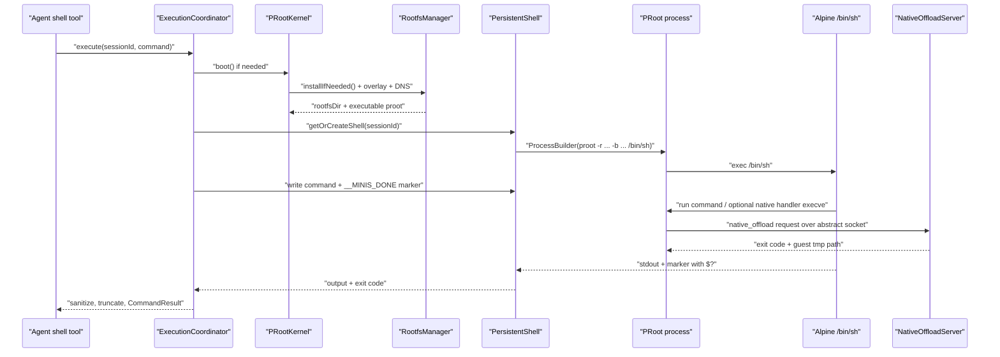

图中每个边都有真实实现：boot 流程在 `PRootKernel.boot`，shell 创建在 `ExecutionCoordinator.getOrCreateShell`，持久进程在 `PersistentShell.startProcess`，marker 在 `PersistentShell.executeCommand`，native socket 在 `NativeOffloadServer.handleClient`。`src/android/app/src/main/java/com/openminis/app/sandbox/PRootKernel.kt:50-179` `src/android/app/src/main/java/com/openminis/app/sandbox/ExecutionCoordinator.kt:132-162` `src/android/app/src/main/java/com/openminis/app/sandbox/PersistentShell.kt:81-150` `src/android/app/src/main/java/com/openminis/app/sandbox/PersistentShell.kt:257-317` `src/android/app/src/main/java/com/openminis/app/sandbox/NativeOffload.kt:127-217`

### 7.6 挂载与共享：SAF 路径如何进入 guest

#### 7.6.1 三种 `/var/minis` 目录

全局目录 `memory`、`skills`、`shared`、`mcp-servers` 位于 `filesDir/minis-global/<name>`，在启动时注册到 `PRootKernel.bindMounts`。`src/android/app/src/main/java/com/openminis/app/sandbox/PRootKernel.kt:185-200`

session 目录 `attachments`、`offloads`、`workspace`、`browser` 位于 `filesDir/minis-sessions/<sessionId>/<name>`，由 `ExecutionCoordinator.buildSessionBindMounts` 为每个持久 shell 建立自己的 host map。`src/android/app/src/main/java/com/openminis/app/sandbox/ExecutionCoordinator.kt:165-190` `src/android/app/src/main/java/com/openminis/app/sandbox/RootfsManager.kt:243-252`

用户选择的外部目录统一放到 guest `/var/minis/mounts/<name>`；它们不是复制到 rootfs，而是将 host POSIX path 作为 PRoot `-b host:linux` 参数。`src/android/app/src/main/java/com/openminis/app/sandbox/PRootKernel.kt:210-216` `src/android/app/src/main/java/com/openminis/app/sandbox/ExecutionCoordinator.kt:209-221`

#### 7.6.2 `MountedFolderCoordinator` 与实际执行路径

`MountedFolderCoordinator` 提供两个纯数据层接口：`requireWritable` 在写工具触碰锁定挂载时抛 `ReadOnlyMountException`，`bindMountSpecs` 将 `resolvedHostPath` 转成 `(linuxDir, hostPath)` pair。`src/android/app/src/main/java/com/openminis/app/sandbox/MountedFolderCoordinator.kt:19-70`

当前 live shell 的实际 argv 由 `ExecutionCoordinator.buildSessionBindMounts` 直接从 `MountedFoldersStore.Entry.resolvedHostPath` 组装；`PRootKernel.applyMountedFoldersSnapshot` 同时维护全局 map，供路径解析、debug 和索引使用。不要只更新全局 map 后期待已经运行的 PRoot 自动看到新增 mount。`src/android/app/src/main/java/com/openminis/app/sandbox/ExecutionCoordinator.kt:209-223` `src/android/app/src/main/java/com/openminis/app/sandbox/PRootKernel.kt:232-299`

应用层的 onChange 回调会先重做快照，再停止当前所有 shell，让下一条命令用新 bind 参数重建 shell；原因是 PRoot `-b` argv 在进程启动时冻结。`src/android/app/src/main/java/com/openminis/app/MinisApp.kt:337-365`

#### 7.6.3 SAF tree URI 到 POSIX path

Android 的 `ACTION_OPEN_DOCUMENT_TREE` 返回 `content://com.android.externalstorage.documents/tree/<volume>:<relative>`；当前实现只接受 authority `com.android.externalstorage.documents`，拆出 volume id 和相对路径，再映射 primary 或 removable volume 根目录。`src/android/app/src/main/java/com/openminis/app/sandbox/PRootKernel.kt:366-403` `src/android/app/src/main/java/com/openminis/app/sandbox/PRootKernel.kt:458-472`

Drive、Dropbox、OneDrive 等 cloud provider 没有 app 可直接传给 PRoot 的 POSIX path，因此解析返回 null；移除的 SD card、不可读目录也会跳过。`src/android/app/src/main/java/com/openminis/app/sandbox/PRootKernel.kt:375-387` `src/android/app/src/main/java/com/openminis/app/sandbox/PRootKernel.kt:424-437`

解析成功也不等于 guest 一定能读：代码显式调用 `candidate.list()`，若返回 null，则记录“readdir EACCES / scoped-storage filtered”诊断，但仍返回 path；这样 UI 能看到“路径存在但挂载后为空”的真实原因。`src/android/app/src/main/java/com/openminis/app/sandbox/PRootKernel.kt:403-431`

Manifest 申请了 `MANAGE_EXTERNAL_STORAGE`，并对 API 29 及以下声明 legacy `READ/WRITE_EXTERNAL_STORAGE`；注释解释 Android 11+ 的 FUSE 可能过滤其他包创建的文件，Android 10 某些 ROM 则需要 legacy storage 才能得到可遍历的 `/mnt/runtime/write` 视图。`src/android/app/src/main/AndroidManifest.xml:58-75`

`storageAccessDiag` 对 API 30+ 记录 `Environment.isExternalStorageManager()`，对旧版本记录 READ grant 和 legacy mode；这不是权限自动授予，用户仍需通过设置页/系统 picker 完成授权。`src/android/app/src/main/java/com/openminis/app/sandbox/PRootKernel.kt:439-455`

#### 7.6.4 只读挂载不是 PRoot 原生只读

`-b` 在当前命令构造器中没有 read-only modifier；因此 store 的 `effectiveWritable=false` 不能单独阻止 shell 的 `>`、`cp` 或 `rm`。代码同时在工具层调用 `isLinuxPathUnderReadOnlyMount`，并安装 `touch`、`tee`、`cp`、`mv`、`mkdir`、`rm`、`rmdir`、`ln`、`dd` wrappers，在 guest 中检查 `/var/minis/.mount-readonly-prefixes`。`src/android/app/src/main/java/com/openminis/app/sandbox/PRootKernel.kt:333-352` `src/android/app/src/main/java/com/openminis/app/sandbox/PRootKernel.kt:834-908`

纯 shell redirect 仍交给 host open(2) 返回 EACCES；wrapper 主要是让 agent 获得可读的“read-only mounted folder”错误，而不是 ROM 上的静默 no-op。`src/android/app/src/main/java/com/openminis/app/sandbox/PRootKernel.kt:834-851`

这是 defense-in-depth，而不是安全边界：如果新增一种写入工具没有纳入 wrapper，必须同时在 FileWrite/FileEdit 层使用 `MountedFolderCoordinator.requireWritable`。`src/android/app/src/main/java/com/openminis/app/sandbox/MountedFolderCoordinator.kt:24-33` `src/android/app/src/main/java/com/openminis/app/sandbox/PRootKernel.kt:274-284`

### 7.7 终端模拟器：raw bytes 到 ANSI canvas

#### 7.7.1 数据链路

`TerminalSession.outputBytes` 发出未经清洗的 PTY bytes；`TerminalScreen` 的 `LaunchedEffect` 收集 bytes 后调用 `TerminalEmulator.feed`，而不是先调用 `TerminalSanitizer`。这点保证 ANSI 光标、颜色和全屏程序不会在进入 emulator 前被删除。`src/android/app/src/main/java/com/openminis/app/sandbox/TerminalSession.kt:82-87` `src/android/app/src/main/java/com/openminis/app/ui/terminal/TerminalScreen.kt:90-105`

Agent run-to-completion 的输出才走 `TerminalSanitizer`：先 CR folding，再移除 ANSI，再过滤控制字符、去 null artifact 和折叠空行，并把过长返回截成 head/tail。`src/android/app/src/main/java/com/openminis/app/sandbox/TerminalSanitizer.kt:17-57`

因此要区分“交互终端显示”与“聊天工具结果清洗”：前者需要保留 ANSI 语义，后者需要稳定的纯文本。`src/android/app/src/main/java/com/openminis/app/ui/terminal/TerminalScreen.kt:95-105` `src/android/app/src/main/java/com/openminis/app/sandbox/ExecutionCoordinator.kt:108-123`

#### 7.7.2 ANSI parser 的状态机

当前 emulator 使用 `ui/terminal/emulator/AnsiParser.kt`，不是同包下较早的 Compose `ui/terminal/AnsiParser.kt`。前者输出 `Printable`、`ControlChar`、`CsiDispatch`、`EscDispatch`、`OscDispatch`，后者只把 SGR 颜色样式转成 `AnnotatedString`。`src/android/app/src/main/java/com/openminis/app/ui/terminal/emulator/AnsiParser.kt:3-20` `src/android/app/src/main/java/com/openminis/app/ui/terminal/AnsiParser.kt:41-272` `src/android/app/src/main/java/com/openminis/app/ui/terminal/AnsiParser.kt:10-14`

emulator parser 的状态有 `GROUND`、`ESCAPE`、`CSI_ENTRY`、`CSI_PARAM`、`CSI_INTERMEDIATE`、`OSC_PARAM`、`OSC_STRING`，能跨输入 chunk 保存 state 和 UTF-8 continuation。`src/android/app/src/main/java/com/openminis/app/ui/terminal/emulator/AnsiParser.kt:20-55` `src/android/app/src/main/java/com/openminis/app/ui/terminal/emulator/AnsiParser.kt:57-105`

CSI 参数按数字和分号累积，终结字节生成 `CsiDispatch(params, intermediate, finalByte)`；OSC 以 BEL 或 ESC 结束，生成 title/URL 等 payload。`src/android/app/src/main/java/com/openminis/app/ui/terminal/emulator/AnsiParser.kt:145-225` `src/android/app/src/main/java/com/openminis/app/ui/terminal/emulator/AnsiParser.kt:227-260`

#### 7.7.3 TerminalEmulator 与 TerminalBuffer

`TerminalEmulator` 为主屏和 alternate screen 各保留一个 `TerminalBuffer`；主屏有 2000 行 scrollback，alternate buffer 禁止 scrollback，匹配全屏程序的语义。每次 `feed` 批量处理后只 bump 一次 Compose `version`。`src/android/app/src/main/java/com/openminis/app/ui/terminal/emulator/TerminalEmulator.kt:12-67`

`handleAction` 将 Printable 写入 cell grid，将控制字符映射为光标后退、tab、换行、CR；CSI 支持光标移动、擦除、插删行列、滚动区、SGR、DSR/DA 响应和 cursor shape。`src/android/app/src/main/java/com/openminis/app/ui/terminal/emulator/TerminalEmulator.kt:184-278`

`TerminalBuffer.writeChar` 处理 wrap pending、自动换行和宽字符 trailer；`characterWidth` 将常见 CJK、emoji、全角范围视为 2 列。`src/android/app/src/main/java/com/openminis/app/ui/terminal/emulator/TerminalBuffer.kt:54-80` `src/android/app/src/main/java/com/openminis/app/ui/terminal/emulator/TerminalBuffer.kt:226-248`

scrollback 在 scroll region 顶端滚出时进入 `ArrayDeque`，最多保留 maxScrollback；resize 复制旧 grid、重设 scroll region 和光标边界。`src/android/app/src/main/java/com/openminis/app/ui/terminal/emulator/TerminalBuffer.kt:97-115` `src/android/app/src/main/java/com/openminis/app/ui/terminal/emulator/TerminalBuffer.kt:200-214`

`TerminalEmulator` 还处理 alternate buffer、bracketed paste、application cursor keys、OSC 1337 的 `MinisOpenURL`，后者投递给 `MinisOpenUrlBroker`。`src/android/app/src/main/java/com/openminis/app/ui/terminal/emulator/TerminalEmulator.kt:281-305` `src/android/app/src/main/java/com/openminis/app/ui/terminal/emulator/TerminalEmulator.kt:378-401`

#### 7.7.4 Canvas/native View 渲染

Compose `TerminalScreen` 当前使用 `TerminalNativeViewCompose`；旧的 `TerminalCanvasView` 保留为 fallback。两者都用 monospace Paint 的 `M` 宽度和 font metrics 计算 cols/rows，再通过 `onResize` 同步 emulator 与 PTY winsize。`src/android/app/src/main/java/com/openminis/app/ui/terminal/TerminalScreen.kt:167-220` `src/android/app/src/main/java/com/openminis/app/ui/terminal/canvas/TerminalNativeView.kt:43-71` `src/android/app/src/main/java/com/openminis/app/ui/terminal/canvas/TerminalCanvasView.kt:37-79`

native View 每 16ms 轮询 emulator `version` 并 invalidate，每 500ms 翻转 cursor；这是一种简单的渲染同步方案，代价是 View 即使没有新输出也有低频调度。`src/android/app/src/main/java/com/openminis/app/ui/terminal/canvas/TerminalNativeView.kt:94-167`

`onDraw` 按 row/cell 遍历，跳过 wide trailer，绘制背景、glyph、selection highlight 和 block/underline/bar cursor；JetBrains Mono typeface 用于稳定 glyph metrics。`src/android/app/src/main/java/com/openminis/app/ui/terminal/canvas/TerminalNativeView.kt:328-406` `src/android/app/src/main/java/com/openminis/app/ui/terminal/canvas/TerminalNativeView.kt:414-479`

Canvas fallback 的 `drawCell` 会根据 inverse/bold/italic/underline/strike/dim/hidden 生成 Paint，并把 wide cell 的宽度乘二；它不使用 Compose 文本布局，所以每个 cell 都由 Android Canvas 绘制。`src/android/app/src/main/java/com/openminis/app/ui/terminal/canvas/TerminalCanvasView.kt:165-245` `src/android/app/src/main/java/com/openminis/app/ui/terminal/canvas/TerminalCanvasView.kt:248-311`

长按选择在 native View 中用 `GestureDetector` 做 word expand，使用 Android floating `ActionMode` 和 `ClipboardManager` 复制 emulator 选区；这属于 Android UI 侧增强，不改变 PTY 协议。`src/android/app/src/main/java/com/openminis/app/ui/terminal/canvas/TerminalNativeView.kt:182-326`

#### 7.7.5 输入如何回到 PTY

Android 用不可见 1×1 `EditText` 抢占 IME 和硬件键，`BaseInputConnection.commitText` 立即把 UTF-8 字节发送，不让隐藏控件积累 composing text。`src/android/app/src/main/java/com/openminis/app/ui/terminal/canvas/TerminalInputView.kt:18-57` `src/android/app/src/main/java/com/openminis/app/ui/terminal/canvas/TerminalInputView.kt:102-151`

Enter 是 CR，退格是 DEL，箭头根据 DECCKM 在 CSI 与 SS3 之间切换，Ctrl+字母变成控制码，Alt 使用 ESC 前缀；这与 `TerminalSession.sendText` 的 CR 规则互相配合。`src/android/app/src/main/java/com/openminis/app/ui/terminal/canvas/TerminalInputView.kt:153-205` `src/android/app/src/main/java/com/openminis/app/sandbox/TerminalSession.kt:205-263`

`TerminalScreen` 在用户输入时把 scrollOffset 拉回 0，窗口变更同时调用 `emulator.resize` 和 `terminalSession.setWindowSize`；clear 不只擦画布，还发送 Ctrl+U 清掉 readline 半行，随后发送 RIS 重置 emulator。`src/android/app/src/main/java/com/openminis/app/ui/terminal/TerminalScreen.kt:190-245`

### 7.8 Agent shell、native offload 与 Shizuku 边界

#### 7.8.1 Alpine 默认是 ash，不是 bash

`PersistentShell` 启动的是 `/bin/sh`，而 Alpine 的 `/bin/sh` 通常由 busybox ash 提供；项目的 `BashismDetector` 从共享 JSON 加载规则，跳过 heredoc body，逐行 regex 扫描，50ms fuse 超时则 fail-open。`src/android/app/src/main/java/com/openminis/app/sandbox/PersistentShell.kt:105-111` `src/android/app/src/main/java/com/openminis/app/agent/shell/BashismDetector.kt:8-19` `src/android/app/src/main/java/com/openminis/app/agent/shell/BashismDetector.kt:112-170`

发现 bashism 后，`OnDemandBash.ensureBash` 先检查 `command -v bash`，再做 5 秒网络探测，最多每进程尝试一次 `apk add bash`，验证成功后缓存 available；失败会记录 24 小时/三次 strike backoff。`src/android/app/src/main/java/com/openminis/app/agent/shell/OnDemandBash.kt:12-34` `src/android/app/src/main/java/com/openminis/app/agent/shell/OnDemandBash.kt:56-101` `src/android/app/src/main/java/com/openminis/app/agent/shell/OnDemandBash.kt:111-142`

`BashismReminder` 不把脚本文本原样注入 system reminder，而是替换尖括号、过滤控制字符并限制 120 字符；这是 agent shell 层的提示安全措施。`src/android/app/src/main/java/com/openminis/app/agent/shell/BashismReminder.kt:9-19` `src/android/app/src/main/java/com/openminis/app/agent/shell/BashismReminder.kt:21-54`

#### 7.8.2 native offload 从 guest execve 回到 Kotlin

boot 时 `NativeOffloadServer.start(rootfsDir)` 监听 abstract Unix socket；`PRootKernel.buildProotCommand` 把已注册 handler 名称拼进 `--native-offload=<socket>:<handlers>`，并为每个名字安装 `/usr/local/bin` stub，让 shell 的 PATH 查找能触发 execve interception。`src/android/app/src/main/java/com/openminis/app/sandbox/PRootKernel.kt:150-163` `src/android/app/src/main/java/com/openminis/app/sandbox/PRootKernel.kt:634-639` `src/android/app/src/main/java/com/openminis/app/sandbox/PRootKernel.kt:699-719`

Kotlin server 的协议头是 little-endian magic/version/pid/argv/env/cwd；accept loop 每个客户端起一个 daemon worker，按 handler 名 dispatch，写入 rootfs `/tmp/.native-offload-*`，返回 exit code 和 guest tmp path。`src/android/app/src/main/java/com/openminis/app/sandbox/NativeOffload.kt:53-145` `src/android/app/src/main/java/com/openminis/app/sandbox/NativeOffload.kt:148-217`

这条链路让 guest 看见普通 stdout：server 写结果文件，协议返回 `/tmp/...`，PRoot extension 再将 exec 改写成 `/bin/cat <tmpfile>`。[推断] 最终 `/bin/cat` 的改写在外部 PRoot fork 中，当前仓库可验证 server 的 tmpfile/reply 和命令行 flag，不可验证 extension 内部函数名。`src/android/app/src/main/java/com/openminis/app/sandbox/NativeOffload.kt:15-26` `src/android/app/src/main/java/com/openminis/app/sandbox/NativeOffload.kt:203-215`

#### 7.8.3 Shizuku 不等于 PRoot 提权

`ShizukuOffloadHandler` 是 sandbox 外的 native-offload handler：guest 运行 `android-shizuku-cli` stub 后，handler 通过 `ShizukuManager.runProcess` 在 Shizuku service UID（adb 启动通常 uid 2000，root 启动为 uid 0）执行 `pm`、`am`、`cmd`、`settings`、`dumpsys`、`input` 等命令。`src/android/app/src/main/java/com/openminis/app/sandbox/offload/ShizukuOffloadHandler.kt:12-40`

它先经过 agent permission gate，再刷新 Shizuku 状态；未安装、未运行或未授权都会返回结构化错误，只有 READY 才 dispatch 到各 subcommand。`src/android/app/src/main/java/com/openminis/app/sandbox/offload/ShizukuOffloadHandler.kt:41-107`

因此 Shizuku 不能让 PRoot 里的 `/bin/sh` 直接获得 Android root，也不改变 rootfs 的 uid 视图；它只是把某些明确授权的 Android 系统操作通过 offload 送到 sandbox 外。细节、权限策略和命令面留给第 8 章。`src/android/app/src/main/java/com/openminis/app/sandbox/offload/ShizukuOffloadHandler.kt:55-80` `src/android/app/src/main/java/com/openminis/app/sandbox/NativeOffload.kt:183-199`

### 7.9 Android 平台对照

本章是 Android 单平台专题；下面只用最小表格指向第 6 章，不把 iOS 机制混写成 Android 能力。

| 同一个抽象 | Android 当前落地 | iOS 对应落地 | 差异原因 |
|---|---|---|---|
| guest Linux | PRoot fork + Alpine aarch64 rootfs；`-r` 设根，路径由用户态 tracer 重写。[推断] | iSH fork 在进程内实现 Linux kernel、fakefs、Asbestos JIT | Android 可直接运行同 ISA host 进程但无 root；iOS 不允许这种 host Linux syscall 路径，因此使用虚拟 kernel。`src/android/app/src/main/java/com/openminis/app/sandbox/PRootKernel.kt:576-647` `docs/specs/ios-sandbox-ish-summary.md:9-42` |
| rootfs | `filesDir/alpine-rootfs`，手工 tar 解压，`.arch=aarch64` | `~/Documents/alpine-rootfs/`，fakefs metadata | Android 使用真实目录和 host 文件权限；iOS fakefs 还要登记 `meta.db`。`src/android/app/src/main/java/com/openminis/app/sandbox/RootfsManager.kt:42-49` `src/android/app/src/main/java/com/openminis/app/sandbox/RootfsManager.kt:464-552` `docs/specs/ios-sandbox-ish-summary.md:59-68` |
| 一次性命令 | `ShellExecutor` 建 ProcessBuilder，合并输出，timeout 后 destroy | `ISHShellExecutor` 提供同步/异步执行、callback、signal | Android PRoot 是外部进程；iSH kernel 在 app 内。`src/android/app/src/main/java/com/openminis/app/sandbox/ShellExecutor.kt:42-145` `docs/specs/ios-sandbox-ish-summary.md:70-78` |
| 持久 agent shell | 每 session 一个 PRoot `/bin/sh`，marker 回收 `$?`，per-session Mutex | iOS coordinator 采用全局 FIFO，prompt detection，文档记载跨 session 一次一条 | Android 以并发 session 换吞吐；iOS 的 kernel/共享资源策略不同。`src/android/app/src/main/java/com/openminis/app/sandbox/ExecutionCoordinator.kt:11-24` `docs/specs/ios-sandbox-ish-summary.md:80-89` |
| 交互终端 | bionic `forkpty` JNI、真实 master fd、Compose/native Canvas emulator | iSH TTY driver + Swift terminal view | Android Java/Kotlin 没有足够的低层 PTY API，因此在 C 中包 `forkpty/ioctl/waitpid`。`src/android/app/src/main/cpp/pty_bridge.c:1-8` `src/android/app/src/main/java/com/openminis/app/sandbox/PtyBridge.kt:3-15` |
| bind mount | PRoot `-b host:linux`，SAF URI 解成 POSIX path；更新要杀旧 shell | iSH `bindMountPath` / `bindUnmountPath`，fakefs metadata | Android scoped storage 让 host path 可能不可读；iOS 文档直接提供 bind API。`src/android/app/src/main/java/com/openminis/app/sandbox/PRootKernel.kt:232-299` `docs/specs/ios-sandbox-ish-summary.md:46-57` |
| native offload | abstract socket + handler stub + Kotlin server；Shizuku 是其中一个 handler | iSH 注册 `native_offload_add_handler`，转到 iOS frameworks | 两端都保持 guest CLI 形状，host 权限入口不同。`src/android/app/src/main/java/com/openminis/app/sandbox/NativeOffload.kt:72-217` `docs/specs/ios-sandbox-ish-summary.md:3-5` |
| 后台保活 | `AgentForegroundService`、mediaPlayback FGS、WakeLock、Doze/OEM 指引 | iOS 不允许任意时长后台工作 | Android 允许但受 FGS/电池优化政策约束；iOS 只能使用系统授权后台模式。`src/android/app/src/main/java/com/openminis/app/service/AgentForegroundService.kt:58-94` `src/android/app/src/main/java/com/openminis/app/power/PowerOptimizationManager.kt:14-37` |

如果读者要看 iOS 的 `ISHKernel` boot、fakefs 和 bind 细节，应跳转第 6 章及 `docs/specs/ios-sandbox-ish-summary.md`；本章不把 iSH 的 JIT 代码当作 Android PRoot 的实现。`docs/specs/ios-sandbox-ish-summary.md:46-90`

### 7.10 设计取舍与踩坑

#### 7.10.1 Android 专有的生命周期问题

`targetSdk=35`、`compileSdk=36`、`minSdk=26` 是当前工程事实；只编译 arm64，故从零实现要先决定是否接受只支持 ARM64 设备。`src/android/app/build.gradle.kts:25-60`

长时间 agent/shell 任务由 `AgentForegroundService` 维持前台通知；manifest 选择 `mediaPlayback`，代码注释解释这是为了避免 Android 14+ `dataSync` 6 小时/24 小时累计 cap 触发 `ForegroundServiceDidNotStopInTimeException`。这是一项 Android 平台/发布策略取舍，不是 PRoot 能力。`src/android/app/src/main/AndroidManifest.xml:11-26` `src/android/app/src/main/AndroidManifest.xml:434-441`

服务在 `startForegroundService` 后调用 `startForeground`，并在活跃期间持有 `PARTIAL_WAKE_LOCK`；`onDestroy` 释放锁。`src/android/app/src/main/java/com/openminis/app/service/AgentForegroundService.kt:58-94` `src/android/app/src/main/java/com/openminis/app/service/AgentForegroundService.kt:556-588`

Doze 仍可能影响后台任务，且 OEM ROM 还有 autostart 白名单；`PowerOptimizationManager` 只负责检测 `isIgnoringBatteryOptimizations` 和跳设置页，不能静默替用户授予豁免。`src/android/app/src/main/java/com/openminis/app/power/PowerOptimizationManager.kt:14-37` `src/android/app/src/main/java/com/openminis/app/power/PowerOptimizationManager.kt:41-80`

Manifest 注释承认 `mediaPlayback` 的“实际媒体”是 Play Store policy 风险，而不是操作系统 runtime check；从零实现应把“能运行”和“能上架”分别验收，不要把绕过 FGS cap 当成审核建议。`src/android/app/src/main/AndroidManifest.xml:12-22`

#### 7.10.2 PRoot/host 边界的故障诊断

PRoot 出错时先看 `RootfsManager.prootBinary` 是否存在且可执行，再看 `PRootKernel.isBooted`、`rootfsDir/.arch`、`PROOT_TMP_DIR` 和 native library path；这些都是代码显式设置或检查的值。`src/android/app/src/main/java/com/openminis/app/sandbox/RootfsManager.kt:42-49` `src/android/app/src/main/java/com/openminis/app/sandbox/RootfsManager.kt:159-178` `src/android/app/src/main/java/com/openminis/app/sandbox/PersistentShell.kt:121-138`

如果 guest 能启动但 `top`/`ps` 报权限问题，先考虑 Android `/proc` hidepid，而不是认为 Alpine 缺包；当前 overlay 已专门安装 top wrapper。`src/android/app/src/main/java/com/openminis/app/sandbox/PRootKernel.kt:721-831`

如果 APK 安装后 shell 不启动，`BUILDING.md` 的首要建议是重新准备 PRoot 和 rootfs assets；不要只重建 Kotlin。`BUILDING.md:217-223`

如果 native crash 日志出现 SIGSYS，crash handler 会将 signal、地址、pid/tid 写入 logs，并重新 raise 让 Android tombstone 生成；这有助于区别 JNI 内存错误和 seccomp/系统调用拒绝。`src/android/app/src/main/cpp/crash_handler.cpp:47-118` `src/android/app/src/main/cpp/crash_handler.cpp:120-152`

#### 7.10.3 PersistentShell 的非显然约束

一个 session 的 shell mount 在启动时冻结；如果 UI 重新指向附件目录，必须停止旧 shell，否则旧 PRoot 继续使用旧 host path。`src/android/app/src/main/java/com/openminis/app/sandbox/PersistentShell.kt:25-29` `src/android/app/src/main/java/com/openminis/app/MinisApp.kt:347-357`

一个 session 的命令必须串行；否则单 `pendingCallback` 会让输出归属不确定。不同 session 可并发是有意设计，但要确保每个 session 的 `/var/minis/attachments` 等路径隔离。`src/android/app/src/main/java/com/openminis/app/sandbox/PersistentShell.kt:35-58` `src/android/app/src/main/java/com/openminis/app/sandbox/ExecutionCoordinator.kt:39-57` `src/android/app/src/main/java/com/openminis/app/sandbox/ExecutionCoordinator.kt:165-190`

marker 解析、partial line callback、UTF-8 分片和命令 timeout 都应有 on-device 测试；当前 instrumented tests 已覆盖基本 echo、退出码、stderr 合并、rootfs 访问和 timeout 结果语义。`src/android/app/src/androidTest/java/com/openminis/app/sandbox/ShellExecutorInstrumentedTest.kt:43-149` `src/android/app/src/androidTest/java/com/openminis/app/sandbox/ExecutionCoordinatorInstrumentedTest.kt:149-190`

#### 7.10.4 共享存储的非显然约束

SAF 授权的 URI 不是任意 provider 的 POSIX path；只有 externalstorage provider 能走当前 Option A，云盘 provider 必须另做 content resolver/复制桥。`src/android/app/src/main/java/com/openminis/app/sandbox/PRootKernel.kt:375-403`

即使 rootfs 内创建了 `/var/minis/mounts/name`，仍要确保 PRoot bind target 是真实目录；boot 后的 `materializeMountTargets` 负责创建并清理 placeholder。`src/android/app/src/main/java/com/openminis/app/sandbox/PRootKernel.kt:268-331`

`MANAGE_EXTERNAL_STORAGE` 是特殊权限，不是 SAF picker 的一次授权替代品；实际产品仍需把 picker 的持久 URI、系统权限页和不可读诊断呈现给用户。Manifest 只声明权限，resolver 仍检查 `exists/canRead/list`。`src/android/app/src/main/AndroidManifest.xml:66-75` `src/android/app/src/main/java/com/openminis/app/sandbox/PRootKernel.kt:403-455`

#### 7.10.5 不要把 `ui/terminal/AnsiParser` 当成完整 emulator

`src/android/app/src/main/java/com/openminis/app/ui/terminal/AnsiParser.kt` 只识别 SGR 和其他 escape 的文本清洗，适合旧的 AnnotatedString renderer；完整 cursor/alternate-screen/OSC 逻辑在 `ui/terminal/emulator/AnsiParser.kt` 和 `TerminalEmulator.kt`。`src/android/app/src/main/java/com/openminis/app/ui/terminal/AnsiParser.kt:10-48` `src/android/app/src/main/java/com/openminis/app/ui/terminal/emulator/AnsiParser.kt:3-20` `src/android/app/src/main/java/com/openminis/app/ui/terminal/emulator/TerminalEmulator.kt:184-205`

从零实现时应先写 parser 的跨 chunk 状态测试，再接 Canvas；把 regex 一次性套在每个 read chunk 上会破坏被拆开的 ANSI/UTF-8 序列。完整 parser 当前显式保留 state 和 UTF-8 continuation，正是为了避免这个问题。`src/android/app/src/main/java/com/openminis/app/ui/terminal/emulator/AnsiParser.kt:27-85`

### 7.11 从零实现清单

1. **确定 ABI 与最低系统。**
   - 实现：选择 `arm64-v8a`，设置 `minSdk`，用 NDK triple 编译 PRoot。
   - 验收：设备 ABI、应用 minSdk 和 PRoot ELF 架构一致；本项目目标是 API 26、aarch64、arm64-v8a。
   - 可砍掉：x86 模拟器支持；但不能在运行时假装已支持。
   - 依据：`src/android/app/build.gradle.kts:33-53` `deps/build_proot.sh:45-48`。

2. **生成并校验 PRoot 可执行文件。**
   - 实现：构建 talloc 静态库和 PRoot fork，将同一二进制装入 `jniLibs/arm64-v8a/libproot.so`，必要时保留 `assets/proot-aarch64` 作为分发资产。
   - 验收：`nativeLibraryDir/libproot.so.exists()`、`canExecute()`、架构正确；`ProcessBuilder` 能启动 `proot --help`。
   - 可砍掉：32 位 loader；当前代码仅在文件存在时才设置 loader。
   - 依据：`deps/build_proot.sh:201-234` `deps/build_proot.sh:237-287` `deps/build_proot.sh:292-308` `src/android/app/src/main/java/com/openminis/app/sandbox/RootfsManager.kt:159-178`。

3. **准备 Alpine rootfs 资产。**
   - 实现：下载 aarch64 `alpine-minirootfs.tar.gz`，使用 `noCompress` 保持读取可控。
   - 验收：AssetManager 能打开 `.tar.gz`，缺失时明确报错而不是创建空 rootfs。
   - 可砍掉：从网络运行时下载；本项目选择随 APK 携带。
   - 依据：`scripts/prepare_android_sandbox.sh:17-36` `src/android/app/build.gradle.kts:96-98` `src/android/app/src/main/java/com/openminis/app/sandbox/RootfsManager.kt:85-117`。

4. **写 rootfs 安装器。**
   - 实现：`filesDir/alpine-rootfs`、架构 marker、IO dispatcher、gzip/tar、进度 StateFlow、失败状态。
   - 验收：首次安装后 `.arch` 是 `aarch64`，`/bin/sh`、`/etc`、`/var/minis` 存在；二次安装不重复解压。
   - 可砍掉：进度 UI，但不能砍掉清理 partial install 和失败传播。
   - 依据：`src/android/app/src/main/java/com/openminis/app/sandbox/RootfsManager.kt:42-157`。

5. **建立 default overlay 与 DNS。**
   - 实现：每次 boot 覆盖 profile/wrapper，设置 execute bit，读取 `LinkProperties` 写 resolv.conf。
   - 验收：更新 overlay 文件后无需删除 rootfs，下一次 boot 可见；Wi-Fi/VPN 切换后 resolv.conf 更新。
   - 可砍掉：镜像测速 UI，但不能让 overlay 覆盖用户镜像选择。
   - 依据：`src/android/app/src/main/java/com/openminis/app/sandbox/RootfsManager.kt:309-366` `src/android/app/src/main/java/com/openminis/app/sandbox/RootfsManager.kt:254-307` `src/android/app/src/main/java/com/openminis/app/sandbox/PRootKernel.kt:63-76`。

6. **实现 PRoot argv 构造。**
   - 实现：`-0`、`--link2symlink`、`-r`、`-b /dev/proc/sys`、`-w /root`、用户 bind、native offload 参数和 `/bin/sh -c`。
   - 验收：`echo`, `pwd`, `cat /etc/resolv.conf`, `ls /var/minis` 返回 guest 结果；未 boot 时构造命令必须失败。
   - 可砍掉：native offload，先不注册 handler；不能砍掉基础 pseudo-fs bind。
   - 依据：`src/android/app/src/main/java/com/openminis/app/sandbox/PRootKernel.kt:576-647`。

7. **实现一次性执行器。**
   - 实现：ProcessBuilder、环境叠加、合并 stdout/stderr、原始 CR 保留、timeout destroy、exit code/duration。
   - 验收：命令 exit 42 得到 42；stderr 也在 output；timeout 得到 124 且子进程被杀。
   - 可砍掉：line callback；但 agent UI 流式输出会变差。
   - 依据：`src/android/app/src/main/java/com/openminis/app/sandbox/ShellExecutor.kt:42-145`。

8. **实现真实 PTY JNI。**
   - 实现：Kotlin `PtyBridge` 七个声明，C `forkpty/read/write/ioctl/kill/waitpid` 的确切 JNI 名称。
   - 验收：`isatty(0)` 为真、输入回显正常、Ctrl+C 中断当前前台程序、resize 改变 rows/cols。
   - 可砍掉：长按复制；不能把 PTY 替换成普通 pipe 后仍声称支持 vi/top。
   - 依据：`src/android/app/src/main/java/com/openminis/app/sandbox/PtyBridge.kt:12-65` `src/android/app/src/main/cpp/pty_bridge.c:30-236`。

9. **实现交互 TerminalSession。**
   - 实现：boot、forkExec、IO reader、waiter、2048 字节写 chunk、CR normalization、SIGTERM stop、winsize 同步。
   - 验收：shell prompt、history、箭头、Tab、Ctrl+C、CJK 粘贴和全屏程序均可使用。
   - 可砍掉：应用内 proxy/TZ 广播；但要明确会话不会实时看到系统变化。
   - 依据：`src/android/app/src/main/java/com/openminis/app/sandbox/TerminalSession.kt:103-196` `src/android/app/src/main/java/com/openminis/app/sandbox/TerminalSession.kt:222-373`。

10. **实现 PersistentShell 与 marker。**
    - 实现：长生命周期 `/bin/sh`、UUID marker、跨命令 stdin、读 loop、退出码解析、timeout 和死亡重建。
    - 验收：`cd /tmp` 后下一条 `pwd` 保留目录；`false` 返回 1；marker 不泄漏到 output；超时后下一条命令可继续。
    - 可砍掉：持久 shell，先统一使用 ShellExecutor；代价是环境/工作目录/daemon 不持久。
    - 依据：`src/android/app/src/main/java/com/openminis/app/sandbox/PersistentShell.kt:81-317`。

11. **补上并发边界。**
    - 实现：session→Mutex、session→PersistentShell、global shell creation lock、环境 key snapshot。
    - 验收：同 session 并发两个 command 不串 marker；不同 session 的 workspace/attachments 不互相覆盖；shell 死亡可重建。
    - 可砍掉：跨 session 并发，改全局 Mutex 更简单但吞吐更低；不能忽略 `pendingCallback` 单槽事实。
    - 依据：`src/android/app/src/main/java/com/openminis/app/sandbox/ExecutionCoordinator.kt:39-162` `src/android/app/src/main/java/com/openminis/app/sandbox/PersistentShell.kt:35-58`。

12. **实现 SAF/外部目录 bind。**
    - 实现：持久 tree URI、externalstorage volume 解码、POSIX 可读性诊断、`/var/minis/mounts/<name>` placeholder、snapshot diff。
    - 验收：primary storage 的 Downloads/DCIM 可在 guest `ls`；云盘/不可读目录返回可解释的 dropped 状态；mount CRUD 后新 shell 看到新 host path。
    - 可砍掉：removable SD 支持；不能把 cloud `content://` 直接拼成 `-b` host path。
    - 依据：`src/android/app/src/main/java/com/openminis/app/sandbox/PRootKernel.kt:244-331` `src/android/app/src/main/java/com/openminis/app/sandbox/PRootKernel.kt:366-472`。

13. **实现只读语义。**
    - 实现：工具层 `requireWritable`、shell write guard wrappers、配置文件重写与清理。
    - 验收：FileWrite、`touch`、`cp`、`>` 在锁定 mount 上都给出明确错误；解锁后 wrappers 被清理且写入恢复。
    - 可砍掉：wrapper，只保留工具层；但 agent 直接运行 shell 时会失去防护。
    - 依据：`src/android/app/src/main/java/com/openminis/app/sandbox/MountedFolderCoordinator.kt:24-81` `src/android/app/src/main/java/com/openminis/app/sandbox/PRootKernel.kt:274-284` `src/android/app/src/main/java/com/openminis/app/sandbox/PRootKernel.kt:834-908`。

14. **实现 ANSI parser、buffer 和 renderer。**
    - 实现：跨 chunk VT 状态机、UTF-8、cell grid、scrollback、alternate buffer、SGR/CSI/OSC、Canvas/native View。
    - 验收：`printf '\033[31mred\033[0m'`、进度条 CR 覆盖、vim alternate screen、CJK/emoji 宽度和 cursor blink 正确。
    - 可砍掉：selection ActionMode、fling scroll、复杂 256 色；不能砍掉跨 chunk parser state。
    - 依据：`src/android/app/src/main/java/com/openminis/app/ui/terminal/emulator/AnsiParser.kt:20-272` `src/android/app/src/main/java/com/openminis/app/ui/terminal/emulator/TerminalBuffer.kt:7-248` `src/android/app/src/main/java/com/openminis/app/ui/terminal/emulator/TerminalEmulator.kt:12-427`。

15. **实现 Android 生命周期保活。**
    - 实现：O+ `startForegroundService`、5 秒内 `startForeground`、通知、WakeLock、Doze/OEM 设置引导、停止时释放资源。
    - 验收：锁屏后长命令仍能进度；用户点击 Stop 会取消 stream 和 service；没有权限时 UI 给出设置入口而不是 crash。
    - 可砍掉：浮窗 overlay；不能砍掉前台通知和对 Doze 的明确产品策略。
    - 依据：`src/android/app/src/main/java/com/openminis/app/service/AgentForegroundService.kt:148-210` `src/android/app/src/main/java/com/openminis/app/service/AgentForegroundService.kt:556-588` `src/android/app/src/main/java/com/openminis/app/power/PowerOptimizationManager.kt:41-80`。

16. **最后再接 native offload/Shizuku。**
    - 实现：注册 handler、abstract socket、协议校验、tmpfile 回传、permission gate；Shizuku 仅作为 sandbox 外系统能力。
    - 验收：普通 handler 能返回 stdout/exit code；服务未运行时返回结构化错误；拒绝权限不会执行 privileged command。
    - 可砍掉：Shizuku 和所有设备 offload，保留基础 shell；不能把 offload 当作 PRoot root 权限。
    - 依据：`src/android/app/src/main/java/com/openminis/app/sandbox/NativeOffload.kt:72-217` `src/android/app/src/main/java/com/openminis/app/sandbox/offload/ShizukuOffloadHandler.kt:41-107`。

### 7.12 关键文件索引

下表的行数按当前工作树实际统计；职责中的符号和行段均对应本章已引用的实现。

| 路径 | 行数 | 职责 |
|---|---:|---|
| `src/android/app/src/main/java/com/openminis/app/sandbox/PRootKernel.kt` | 920 | boot、环境、`-r/-b` 命令构造、挂载快照、handler stub、wrapper、host path 解析 |
| `src/android/app/src/main/java/com/openminis/app/sandbox/RootfsManager.kt` | 660 | `alpine-rootfs` 状态、tar/gzip 解压、overlay、DNS、session 目录、权限 |
| `src/android/app/src/main/java/com/openminis/app/sandbox/PtyBridge.kt` | 66 | Kotlin 侧 JNI `forkExec/readBytes/writeBytes/setWindowSize/closeFd/sendSignal/waitFor` 声明 |
| `src/android/app/src/main/cpp/pty_bridge.c` | 236 | bionic `forkpty`、termios、JNI fd 读写、winsize、signal、waitpid |
| `src/android/app/src/main/java/com/openminis/app/sandbox/PersistentShell.kt` | 371 | 长生命周期 PRoot `/bin/sh`、marker、退出码、环境广播、timeout |
| `src/android/app/src/main/java/com/openminis/app/sandbox/ShellExecutor.kt` | 157 | 一次性 ProcessBuilder 执行、合并输出、timeout、exit/duration |
| `src/android/app/src/main/java/com/openminis/app/sandbox/ShellTimeoutPolicy.kt` | 116 | 命令前缀分层 timeout；当前未接入 call site |
| `src/android/app/src/main/java/com/openminis/app/sandbox/ExecutionCoordinator.kt` | 300 | session shell/mutex registry、环境 snapshot、mount map、重建和广播 |
| `src/android/app/src/main/java/com/openminis/app/sandbox/TerminalSession.kt` | 375 | 交互 PTY state、reader/waiter、原始输入、窗口尺寸、TZ/proxy 广播 |
| `src/android/app/src/main/java/com/openminis/app/sandbox/TerminalSanitizer.kt` | 89 | agent 输出 CR folding、ANSI/control 清洗、null/blank 处理、截断 |
| `src/android/app/src/main/java/com/openminis/app/sandbox/MountedFolderCoordinator.kt` | 81 | read-only mount 检查、`ReadOnlyMountException`、bind specs |
| `src/android/app/src/main/java/com/openminis/app/sandbox/NativeOffload.kt` | 246 | abstract socket server、binary protocol、handler worker、tmpfile reply |
| `src/android/app/src/main/java/com/openminis/app/ui/sandbox/RootfsManagementViewModel.kt` | 197 | 安装/重置/恢复 rootfs 的 StateFlow、进度 collector 与用户数据备份 |
| `src/android/app/src/main/java/com/openminis/app/ui/sandbox/RootfsManagementScreen.kt` | 378 | rootfs 状态、浏览、镜像、安装、重置、备份恢复和进度 UI |
| `src/android/app/src/main/java/com/openminis/app/ui/sandbox/FileBrowserViewModel.kt` | 513 | host 文件列表、Linux bind 路径、session 浏览隔离与排序状态 |
| `src/android/app/src/main/java/com/openminis/app/ui/sandbox/FileBrowserScreen.kt` | 559 | rootfs/session 文件 breadcrumb、预览、删除和隐藏文件 UI |
| `src/android/app/src/main/java/com/openminis/app/ui/sandbox/FilePreviewScreen.kt` | 1200 | 文本/图片/媒体预览与 SAF Save As/分享 |
| `src/android/app/src/main/java/com/openminis/app/ui/sandbox/MirrorSettingsScreen.kt` | 824 | Alpine/pip/npm 镜像类别、测速和用户选择 UI |
| `src/android/app/src/main/java/com/openminis/app/terminal/MinisOpenUrlBroker.kt` | 70 | OSC `MinisOpenURL` 的进程级 pending URL、scheme 路由和 terminal visibility |
| `src/android/app/src/main/java/com/openminis/app/terminal/MinisUrlMarker.kt` | 56 | 文本流 OSC 1337 marker 提取/移除备用实现 |
| `src/android/app/src/main/cpp/CMakeLists.txt` | 24 | `pty_bridge`、`minis_crash_handler`、`jieba_jni` 三个 native target |
| `src/android/app/src/main/cpp/crash_handler.cpp` | 152 | native fatal signal 报告、SIGSYS/SIGSEGV 等 handler、tombstone 复投 |
| `src/android/app/src/main/cpp/jieba_jni.cpp` | 212 | 与沙箱无关的中文分词 JNI；索引时用于区分 native target，不要误接入 PTY |
| `src/android/app/src/main/java/com/openminis/app/ui/terminal/emulator/AnsiParser.kt` | 272 | 完整 VT/ANSI state machine、UTF-8、CSI/ESC/OSC action |
| `src/android/app/src/main/java/com/openminis/app/ui/terminal/emulator/TerminalBuffer.kt` | 251 | cell grid、宽字符、光标、scrollback、alternate buffer 的数据结构底层 |
| `src/android/app/src/main/java/com/openminis/app/ui/terminal/emulator/TerminalEmulator.kt` | 428 | action dispatch、CSI/SGR/OSC 语义、可见行和 UI version |
| `src/android/app/src/main/java/com/openminis/app/ui/terminal/emulator/TerminalTypes.kt` | 114 | 颜色、text attributes、cell、cursor shape 类型 |
| `src/android/app/src/main/java/com/openminis/app/ui/terminal/TerminalScreen.kt` | 439 | Compose 屏幕、PTY→emulator、输入、resize、clear、accessory bar |
| `src/android/app/src/main/java/com/openminis/app/ui/terminal/canvas/TerminalNativeView.kt` | 479 | Android View Canvas 绘制、cursor、选择、ActionMode、滚动 |
| `src/android/app/src/main/java/com/openminis/app/ui/terminal/canvas/TerminalCanvasView.kt` | 312 | Compose Canvas fallback、cell 绘制、scroll/fling、resize |
| `src/android/app/src/main/java/com/openminis/app/ui/terminal/canvas/TerminalInputView.kt` | 206 | hidden EditText、IME commit、键盘/控制码/箭头映射 |
| `src/android/app/src/main/java/com/openminis/app/ui/terminal/AnsiParser.kt` | 121 | 旧的 Compose `AnnotatedString` SGR parser；不是完整 emulator parser |
| `src/android/app/src/main/java/com/openminis/app/agent/shell/BashismDetector.kt` | 171 | ash/bashism 规则加载、heredoc 跳过、regex/fuse 检测 |
| `src/android/app/src/main/java/com/openminis/app/agent/shell/OnDemandBash.kt` | 143 | bash availability、网络探测、`apk add bash`、backoff |
| `src/android/app/src/main/java/com/openminis/app/agent/shell/BashismReminder.kt` | 55 | 安全清洗 bashism system reminder |
| `src/android/app/src/main/java/com/openminis/app/sandbox/offload/ShizukuOffloadHandler.kt` | 1226 | sandbox 外 Shizuku CLI handler；privileged 命令细节属于第 8 章 |
| `src/android/app/src/main/cpp/crash_handler.cpp` | 152 | JNI/PRoot 崩溃观测和 Android tombstone 衔接 |
| `deps/build_proot.sh` | 346 | NDK/talloc/PRoot fork 构建、assets 与 jniLibs 双输出 |
| `scripts/prepare_android_sandbox.sh` | 86 | Alpine aarch64 与 Termux PRoot 资产准备 |
| `scripts/gen_debug_skill_android.sh` | 139 | debug-only skill/client/curl 资产；不参与生产 PRoot 执行 |
| `src/android/app/src/main/AndroidManifest.xml` | 529 | FGS mediaPlayback、WAKE_LOCK、存储/Doze/通知权限、service 声明 |
| `src/android/app/build.gradle.kts` | 252 | SDK/ABI、CMake、asset noCompress、debug skill staging |
| `src/android/app/src/main/assets/default_mount/etc/profile.d/minis.sh` | 35 | guest profile、PS1、history、BROWSER、UV link mode |

`CMakeLists.txt` 中的 `jieba_jni` 虽然与本章的 PTY 无关，仍列出是为了完整覆盖 `src/android/app/src/main/cpp/` 的 native target；它的真实 JNI 函数是 `Java_com_openminis_app_shared_JiebaEngine_nativeInit/nativeSegment/nativeSegmentForSearch/nativePosTag`，而 PTY 只属于 `pty_bridge.c`。`src/android/app/src/main/cpp/CMakeLists.txt:4-25` `src/android/app/src/main/cpp/jieba_jni.cpp:85-212`

`gen_debug_skill_android.sh` 也不改变 rootfs：它只把 debug-server skill、Android 明文 JSON-RPC Python client 和 curl 速查表写入 `src/debug/assets`，且 Gradle 只在 debug asset merge 时执行。`scripts/gen_debug_skill_android.sh:1-18` `scripts/gen_debug_skill_android.sh:33-140` `src/android/app/build.gradle.kts:133-151`


## 8. Native Offload：让沙箱里的 agent 调用设备能力

### 8.1 这一章解决什么问题

Linux guest 适合运行脚本、包管理器和 CLI，但它不能直接调用 iOS 的 EventKit/HealthKit 或 Android 的 ContentProvider、AccessibilityService；Native Offload（原生能力卸载）就是把 guest 中的一个命令映射成宿主进程中的一个受控 handler。它承担发现命令、跨 guest/host 传递参数、调用原生框架、把结构化结果写回 guest stdout 四件事。没有这层，agent 只能把设备当成没有日历、相册、通知、浏览器和麦克风的普通 Linux 主机；有了它，shell 脚本可以组合设备能力，也可以从 `minis-model-use` 反过来调用 LLM。iOS 与 Android 的能力名、权限弹窗和 IPC 细节不同，但两端都把 API key、系统对象和权限状态留在宿主。本文以当前注册表和 handler 为准；旧的 iSH 概述只作为背景，不替代实现源码。

`src/ios/iSH/ISHKernel.m:413-445` `src/android/app/src/main/java/com/openminis/app/MinisApp.kt:367-429` `src/ios/NativeOffloads/NativeOffloadUtils.h:57-94`

### 8.2 先建立正确模型：两个协议层

Native Offload 有两个协议层：

1. **进程捕获层**：guest 通过 `execve()` 找到同名 stub；iOS 的 iSH native-offload 在宿主进程内拦截并把 handler 的 fd 接到 guest 管道，Android 的 PRoot extension 把请求编码后发到抽象 Unix socket。
2. **业务输出层**：handler 自己决定 stdout 是 JSON envelope、纯文本还是文件引用。`OffloadArgs`/`OffloadOutput` 是 Android CLI 参数和 JSON 输出约定，不是 socket wire format；Android socket 上传输的是 argv/env/cwd 的二进制帧。

iOS 当前可直接验证的注册入口是 `ISHKernel`：启动时逐个调用 `*_offload_register()`，每个 handler 再调用 `native_offload_add_handler()` 并创建 guest stub。`src/ios/iSH/ISHKernel.m:394-445` `src/ios/NativeOffloads/WeatherOffload.m:233-240`。iSH 集成说明把运行时链路写成 `execve → native_offload.c → Objective-C handler → EventKit → pipe`，并说明 native handler 负责实时 I/O。`docs/specs/ios-sandbox-ish-summary.md:133-145`。

Android 有完整的宿主端 endpoint：guest exec 触发后，PRoot extension 发送 argv/env/cwd，handler 输出写入 rootfs 内临时文件，再返回 guest 路径；extension 将原 exec 改写成 `/bin/cat <tmpfile>`。`src/android/app/src/main/java/com/openminis/app/sandbox/NativeOffload.kt:15-26`

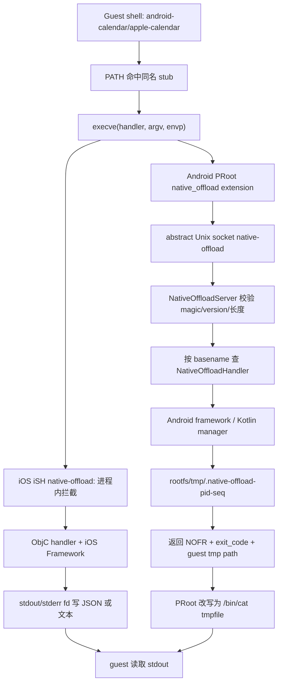

图中 Android 的 magic/version/临时文件是源码直接实现的协议；iOS 的进程内 fd 语义来自 iSH 集成层文档和 handler 签名。不要把 Android socket 帧误写成 JSON，也不要把 iOS handler stdout envelope 当成统一的 socket 协议。`src/android/app/src/main/java/com/openminis/app/sandbox/NativeOffload.kt:148-217` `src/ios/NativeOffloads/NativeOffloadUtils.h:57-94`

#### 8.2.1 Android 二进制 IPC：字段、方向和边界

Android endpoint 使用 `LocalServerSocket("native-offload")`，名称是 Linux abstract local socket 而不是 TCP 端口；常量给出请求 magic `NOFF`、响应 magic `NOFR`、版本 1。`src/android/app/src/main/java/com/openminis/app/sandbox/NativeOffload.kt:53-70` `src/android/app/src/main/java/com/openminis/app/sandbox/NativeOffload.kt:78-103`

```text
u32 magic = 0x46464F4E      // NOFF
u32 version = 1
u32 pid
u32 argc
repeat argc: u32 byte_len + argv[i] bytes
u32 envc
repeat envc: u32 byte_len + "KEY=VALUE" bytes
u32 cwd_len + cwd bytes

u32 magic = 0x52464F4E      // NOFR
 i32 exit_code
u32 tmpfile_len + guest_tmpfile bytes
```

字段是 little-endian；字符串是“4 字节长度 + UTF-8 bytes”。服务端核对 magic/version，限制 `argc <= 256`、`envc <= 4096`，并限制单字符串不超过 1 MiB；这些是 framing 防线，不是业务参数校验。`src/android/app/src/main/java/com/openminis/app/sandbox/NativeOffload.kt:148-177` `src/android/app/src/main/java/com/openminis/app/sandbox/NativeOffload.kt:221-245`

服务端按 `argv.first().substringAfterLast('/')` 提取 basename，再从 `ConcurrentHashMap<String, NativeOffloadHandler>` 查找；找不到返回 exit 127，handler 抛异常返回 exit 1。业务文本写进 rootfs 的 `/tmp/.native-offload-<pid>-<seq>`，socket 响应只携带临时文件 guest 路径。`src/android/app/src/main/java/com/openminis/app/sandbox/NativeOffload.kt:179-217`

```kotlin
val name = argv.firstOrNull().orEmpty().substringAfterLast('/')
val handler = handlers[name]
val result = if (handler == null) {
    NativeOffloadResult(127, "native_offload: no handler for '$name'\n")
} else {
    handler.handle(NativeOffloadRequest(pid, argv, env, cwd, sessionId = ...))
}
tmpHost.writeText(result.output)
output.writeLEInt(MAGIC_RSP)
output.writeLEInt(result.exitCode)
output.writeLEString("/tmp/${tmpHost.name}")
```

来源：`src/android/app/src/main/java/com/openminis/app/sandbox/NativeOffload.kt:179-217`。每个连接由 daemon worker thread 处理，不同请求可并行进入不同 handler；handler 若调用 `runBlocking`，只阻塞这个 offload worker，不阻塞 Android 主线程。`src/android/app/src/main/java/com/openminis/app/sandbox/NativeOffload.kt:127-146` `src/android/app/src/main/java/com/openminis/app/sandbox/offload/OffloadGate.kt:16-25`

#### 8.2.2 Android 业务参数：`OffloadArgs` 和 `OffloadOutput`

`OffloadArgs` 把 shell argv 分成 positional、flags、values，支持 `--flag`、`--key value`、`--key=value` 和短 flag；所有 handler 共享 `--compact`、`--quiet`、`-q`。`src/android/app/src/main/java/com/openminis/app/sandbox/offload/OffloadArgs.kt:3-14` `src/android/app/src/main/java/com/openminis/app/sandbox/offload/OffloadArgs.kt:19-70`

```kotlin
val args = OffloadArgs(request.argv.drop(1), booleanFlags = setOf("all-day"))
val command = args.positional.firstOrNull() ?: "list"
val limit = args.getInt("limit", "max") ?: 50
val compact = args.hasFlag("compact")
```

来源：`src/android/app/src/main/java/com/openminis/app/sandbox/offload/OffloadArgs.kt:14-18` `src/android/app/src/main/java/com/openminis/app/sandbox/offload/CalendarOffloadHandler.kt:43-50`。

`OffloadOutput.formatBody()` 默认原样返回 body；`--compact` 只改变 JSON 空白；`--quiet` 只有在 JSON 对象有 `error` 或 `data` 时才抽出字段，数组和纯文本不变。它刻意与 iOS `noff_emit_json` 对齐。`src/android/app/src/main/java/com/openminis/app/sandbox/offload/OffloadOutput.kt:15-31` `src/android/app/src/main/java/com/openminis/app/sandbox/offload/OffloadOutput.kt:45-101`

```kotlin
val body = JSONObject().put("error", "permission_denied").toString()
return NativeOffloadResult(126, OffloadOutput.formatBody(body, args) + "\n")
```

来源：`src/android/app/src/main/java/com/openminis/app/sandbox/offload/OffloadGate.kt:52-70`。

#### 8.2.3 iOS 业务输出：JSON envelope 不是 IPC 帧

iOS `NativeOffloadUtils` 定义成功 envelope 为 `{ok, tool, action, data, timestamp}`，失败 envelope 为 `{ok:false, tool, action, error:{code,message}, timestamp}`。`noff_emit_json` 默认 pretty + sorted keys，`--compact` 变单行，`--quiet` 只保留 `data` 或 `error`。`src/ios/NativeOffloads/NativeOffloadUtils.h:57-68` `src/ios/NativeOffloads/NativeOffloadUtils.m:133-193`

```objc
NSDictionary *noff_json_envelope(NSString *tool, NSString *action, id data) {
    return @{
        @"ok": @YES,
        @"tool": tool,
        @"action": action,
        @"data": data ?: [NSNull null],
        @"timestamp": noff_format_date([NSDate date]),
    };
}
```

来源：`src/ios/NativeOffloads/NativeOffloadUtils.m:135-142`。Weather handler 在宿主 API 完成后把 envelope 写到 stdout fd，注册函数再确保 `/usr/local/bin/apple-weather` stub 存在。`src/ios/NativeOffloads/WeatherOffload.m:229-240`

iOS 的 host path helper 只是去掉 guest 绝对路径的前导 slash，再拼到 `Documents/alpine-rootfs/data`；它不是完整的 canonical path sandbox。`src/ios/NativeOffloads/NativeOffloadUtils.m:242-258`


### 8.3 handler 注册与分发：从“加一个命令”到全链路可用

#### 8.3.1 iOS：启动时静态注册，handler 自带 stub

`ISHKernel` 在挂载 fakefs、创建 PID 1、TTY 和 stdio 后，按固定顺序注册原生命令。当前列表包括 `ffmpeg`、Apple 服务、`minis-model-use`、`minis-sessions-cli`、`minis-browser-use`、`minis-config` 和 `minis-debug`。`src/ios/iSH/ISHKernel.m:394-445`

| 注册行 | 命令 | 注册函数/实现 |
|---:|---|---|
| 413-419 | `ffmpeg`、`apple-calendar`、`apple-location`、`apple-weather`、`apple-vision`、`apple-open` | `FFmpegOffload.m`、`CalendarOffload.m`、`LocationOffload.m`、`WeatherOffload.m`、`VisionOffload.m`、`OpenOffload.m` |
| 420-426 | `apple-clipboard`、`apple-healthkit`、`apple-photos`、`apple-maps`、`apple-nlp`、`apple-alarm`、`apple-media` | 对应 `*_offload_register()` |
| 427-433 | `apple-speak`、`apple-speech`、`apple-device`、`apple-homekit`、`apple-notification`、`apple-player`、`minis-model-use` | 对应 handler 与 Swift bridge |
| 434-445 | `apple-reminders`、`apple-bluetooth`、`apple-nfc`、`minis-sessions-cli`、`minis-browser-use`、`minis-config`、`minis-debug` | 对应 handler；debug handler 在 Release 中仍提供日志子命令 |

每个 handler 的注册函数把公开名字交给 `native_offload_add_handler()`，成功后调用 `noff_ensure_guest_stub()`。以 Weather 为例，真正的路由键是 `apple-weather`，stub 是 `/usr/local/bin/apple-weather`；guest 只需要 PATH 命中这个文件。`src/ios/NativeOffloads/WeatherOffload.m:233-240`。FFmpeg 例外是命令名直接为 `ffmpeg`，它把 `ffmpeg_main()` 在宿主线程执行并把 stdout/stderr 重定向回 guest。`src/ios/NativeOffloads/FFmpegOffload.m:217-220` `src/ios/NativeOffloads/FFmpegOffload.m:243-340` `src/ios/NativeOffloads/FFmpegOffload.m:342-348`

新增 iOS handler 的最小步骤：

1. 建立 `FooOffload.m`/`.h`，实现 `foo_handler(argc, argv, stdin_fd, stdout_fd, stderr_fd)`。
2. 用 `noff_json_envelope`/`noff_json_error` 输出结构化结果，对输入做参数和 exit code 检查。
3. 加 `foo_offload_register()`，调用 `native_offload_add_handler("apple-foo", foo_handler)`，成功后 `noff_ensure_guest_stub("/usr/local/bin/apple-foo")`。
4. 在 `ISHKernel.m` 注册区调用它；若需要 Swift-only 框架，则加 bridge，通过 generated Swift header 暴露最小异步入口。
5. 把系统权限和拒绝后的 JSON error 写进 handler；隐私能力再加入 `OffloadPermissionManager.allCommands`。

验收不是“文件能编译”：guest 中 `foo --help` 必须命中 stub；错误参数要返回非零 exit code；首次授权和拒绝不能让线程永久等待；Release 不能意外暴露 debug-only RPC。`src/ios/NativeOffloads/NativeOffloadUtils.h:23-30` `src/ios/NativeOffloads/HealthKitOffload.m:239-257` `src/ios/iSH/ISHKernel.m:440-445`

#### 8.3.2 Android：先注册 map，再 boot PRoot 和 stub

Android 在 `MinisApp.onCreate()` 先把 handler 放入 `NativeOffloadServer` map，再启动 server；socket 可以在 shell session 启动前接收连接。当前注册区覆盖 `android-*`、`minis-*`、Accessibility、Shizuku 和 debug。`src/android/app/src/main/java/com/openminis/app/MinisApp.kt:367-429`

```kotlin
NativeOffloadServer.register("android-calendar", CalendarOffloadHandler(this))
NativeOffloadServer.register("android-a11y-cli", AccessibilityOffloadHandler(this))
NativeOffloadServer.register("minis-model-use", ModelUseOffloadHandler(this, providerRepository))
NativeOffloadServer.register("minis-config", ConfigOffloadHandler())
NativeOffloadServer.register("android-shizuku-cli", ShizukuOffloadHandler(this))
if (BuildConfig.DEBUG) {
    NativeOffloadServer.register("minis-debug", DebugOffloadHandler(this))
}
NativeOffloadServer.start(RootfsManager.getInstance(this).rootfsDir)
```

来源：`src/android/app/src/main/java/com/openminis/app/MinisApp.kt:367-429`。随后 `PRootKernel.boot()` 启动 server 后，遍历已注册名字创建 `/usr/local/bin/<name>` stub；stub 只需要是可执行 shell 文件，因为 PRoot 会在真正运行前拦截 `execve`。`src/android/app/src/main/java/com/openminis/app/sandbox/PRootKernel.kt:150-178` `src/android/app/src/main/java/com/openminis/app/sandbox/PRootKernel.kt:699-717`

每次 PRoot 命令的 argv 还带上 `--native-offload=<socket>:<comma-separated-handlers>`；这是 extension 获取 socket 名称和允许 basename 的入口。`src/android/app/src/main/java/com/openminis/app/sandbox/PRootKernel.kt:576-647`。新增 Android handler 的步骤是：

1. 实现 `NativeOffloadHandler.handle(NativeOffloadRequest)`，用 `OffloadArgs` 解析 argv。
2. 在 `MinisApp.onCreate()` 注册稳定名字；名字必须与 stub basename、帮助文本和权限 registry 一致。
3. 让 PRoot boot 后自动 materialize stub，不要提交一个会被覆盖的 rootfs 二进制。
4. 对隐私/提权能力在 handler 入口调用 `OffloadGate.enforce()` 或系统权限流程。
5. 用 `OffloadOutput.formatBody()` 统一 compact/quiet，并把错误映射到稳定 exit code。
6. 跨 session 输出使用 request `sessionId` 或显式 resolver，不要把最后一次挂载当成当前调用者。

`NativeOffloadServer.register()` 只检查名字非空并覆盖同名 map；它不自动验证 handler 的权限或业务参数。`src/android/app/src/main/java/com/openminis/app/sandbox/NativeOffload.kt:62-76`。所以“注册成功”不等于“安全可用”，新 handler 的安全边界必须在入口建立。

### 8.4 能力总表：两端同一个抽象如何落地

表中“确认”区分：`无` 表示代码不显示 app 内确认；`系统` 表示系统权限或设置页；`应用` 表示 Minis 自己的 Ask Once/Config confirm；`系统+应用` 表示两层都存在。iOS 静态 app gate 清单见 `OffloadPermissionManager.allCommands`，未列入的命令不会被 `extractOffloadCommand` 识别为 gate。`src/ios/Agent/Offload/OffloadPermissionManager.swift:124-147` `src/ios/Agent/Offload/OffloadPermissionManager.swift:181-191`

| 能力 | iOS 实现 | Android 实现 | 所需权限/前置条件 | 是否需要用户确认 |
|---|---|---|---|---|
| 反向调用 LLM | `minis-model-use` + `ModelUseOffloadBridge`，解析可见 model entry | `minis-model-use` + `ProviderRepository`/`ProviderFactory` | 宿主已配置 provider API key；模型在 Agent Loop 可见 | 无额外系统权限；调用由 agent 发起 |
| 浏览器自动化 | `minis-browser-use` + `BrowserUseOffloadBridge`，驱动 WKWebView | `minis-browser-use` + `sharedBrowserTabPool`，单 tab 模式 | 网络；浏览器池可用 | 无系统权限；页面登录/站点确认仍存在 |
| 配置读取 | `minis-config get/list-topics` + Config bridge | `minis-config` + `ConfigBridge` | 配置 registry；隐藏字段不可读 | 读取无；写入另有确认 |
| 配置写入/审计回滚 | `ConfigOffload.m` 的 `set/set-batch/audit-revert` | `ConfigOffloadHandler` 对应命令 | value JSON、路径和批量大小校验 | **应用确认**；每批一次 |
| 会话查询 | `minis-sessions-cli`，可 list/search/messages/send/retry/status/open | `minis-sessions-cli`，当前主要 list/search/messages | ChatStore/Room 数据库 | 无额外权限；数据隐私可另设 gate |
| 定时 AI 任务 | 当前 iOS 注册表没有 `minis-scheduled` | `minis-scheduled` + ScheduledTaskManager/AlarmManager | Android alarm/通知和任务 runner | 通常由用户创建；run-now 由 agent 调用 |
| Debug RPC | `minis-debug`；Release 仍允许 logs，RPC 子命令 DEBUG gate | `minis-debug` 仅 `BuildConfig.DEBUG` 注册 | DebugServer/OSLogStore | Release 不可用 |
| 设备信息 | `apple-device`，型号、OS、电池、存储 | `android-device`，model/OS/battery/storage | 无危险 runtime permission | 无 |
| 日历 | `apple-calendar` + EventKit | `android-calendar` + CalendarContract/CalendarManager | iOS Calendar authorization；Android READ/WRITE_CALENDAR | 系统 + app gate 可 ASK_ONCE |
| 提醒事项 | `apple-reminders` 复用 EventKit reminder store | 当前无独立 reminders handler | iOS Reminders authorization | 系统 + iOS privacy gate |
| 联系人 | 当前没有 `apple-contacts` handler | `android-contacts` + ContactsContract | READ_CONTACTS；删除还需 WRITE_CONTACTS | 系统 + Android privacy gate |
| 相册查询 | `apple-photos` + Photos/PhotosUI | `android-photos` + MediaStore | iOS Photos read/write；Android READ_MEDIA_IMAGES/selected media | 系统 + app gate |
| 相册原图地理信息 | Photos handler 读取 PHAsset metadata | MediaStore 原图需要 ACCESS_MEDIA_LOCATION | 相册访问 + media-location 条件 | 系统 |
| 健康数据 | `apple-healthkit` + HKHealthStore | 当前无 Health Connect offload | HealthKit entitlement、数据类型授权 | 系统 + iOS privacy gate |
| 智能家居 | `apple-homekit` + HMHomeManager/accessory/scene | 当前没有 HomeKit 等价 handler | HomeKit entitlement、家庭授权、主线程 ready | 系统/家庭授权 + app gate |
| 当前位置 | `apple-location` + CLLocationManager | `android-location` + LocationManager/Fused path | iOS When In Use；Android FINE/COARSE_LOCATION | 系统 + app gate |
| 天气 | `apple-weather` + WeatherKit，位置由 CLLocationManager 提供 | `android-weather` + Open-Meteo，无 API key | iOS current weather 需要 location；Android 网络 | iOS 系统 location；Android 无 |
| 地图/地点/路线 | `apple-maps` + MapKit/CLGeocoder | 无独立 maps offload；可用 browser/open | iOS MapKit；坐标/地点输入 | 通常无 |
| 剪贴板 | `apple-clipboard` + UIPasteboard | `android-clipboard` + ClipboardManager | Android 10+ 后台读取需前台；iOS 有 pasteboard privacy | app gate 可 ASK_ONCE；Android 还需前台 |
| 本地通知 | `apple-notification` + UserNotifications | `android-notification` + NotificationManager/ScheduledNotificationStore | iOS notification auth；Android POST_NOTIFICATIONS；list 需 Notification Access | 系统；Android settings gate |
| 闹钟/计时器 | `apple-alarm` + AlarmKit bridge（iOS 26+） | `android-alarm` + Clock intents/AlarmManager | iOS AlarmKit；Android SET_ALARM/SCHEDULE_EXACT_ALARM | 系统/设置 |
| 语音合成 | `apple-speak` + AVSpeechSynthesizer | `android-speak` + Android TTS | 无危险权限 | 无 |
| 语音识别 | `apple-speech` + SFSpeechRecognizer/AVAudioSession | `android-speech` + SpeechRecognizer | iOS Speech + microphone；Android RECORD_AUDIO | 系统 |
| 播放器会话 | `apple-player` + AVPlayer bridge | `android-player` + MediaPlayerManager | 音频路径/session；无危险权限 | 无 |
| Media Library | `apple-media` + MPMediaLibrary/AVFoundation | 无同名 library handler；Player 管 app 会话 | iOS Media Library authorization | iOS 系统 |
| FFmpeg 转码 | `ffmpeg` + FFmpeg.framework `ffmpeg_main` | 当前无 FFmpeg handler | 输入输出文件/网络 | 无；iOS handler 自己 mutex 串行 |
| Vision/OCR/条码 | `apple-vision` + Vision | 当前无同名 vision handler | 图片路径；相册输入另算 | 无 |
| NLP | `apple-nlp` + NaturalLanguage | 当前无同名 handler | 文本 | 无 |
| Bluetooth LE | `apple-bluetooth` + CoreBluetooth | 当前无对应 handler | Bluetooth entitlement/系统授权 | 系统 |
| NFC | `apple-nfc` + CoreNFC session | 当前无对应 handler | NFC capability、实体标签和用户动作 | 系统 session/用户动作 |
| 打开 URL/应用 | `apple-open` + UIApplication/openURL | `android-open` + Intent/Activity | 系统是否有 resolver/OEM fallback | 无 |
| Accessibility UI 自动化 | 无通用系统级等价 offload | `android-a11y-cli` + AccessibilityService | Settings → Accessibility 手动启用；API 30 截图 | **应用默认 NOT_ALLOWED + 系统设置** |
| Shizuku/ADB 级控制 | 无等价提权通道 | `android-shizuku-cli` + Shizuku binder，uid 2000/0 | manager/binder、用户授权、ADB/root 启动 | **应用默认 NOT_ALLOWED + Shizuku 授权** |

iOS 现有注册表可核对 `ffmpeg`、Apple 命令和 `minis-*`，而不是旧文档中的“22 total”。`src/ios/iSH/ISHKernel.m:413-445`。Android 全部注册名和 debug 条件见 `src/android/app/src/main/java/com/openminis/app/MinisApp.kt:371-426`；manifest 的危险权限与特殊服务见 `src/android/app/src/main/AndroidManifest.xml:39-102` `src/android/app/src/main/AndroidManifest.xml:466-525`。

能力表的实现名可由以下源码符号核对，而不是仅看产品文案：iOS 各 handler 的 `TOOL_NAME` 定义集中在 `src/ios/NativeOffloads/AlarmOffload.m:25-27`、`src/ios/NativeOffloads/CalendarOffload.m:15-17`、`src/ios/NativeOffloads/HealthKitOffload.m:18-20`、`src/ios/NativeOffloads/HomeKitOffload.m:22-24`、`src/ios/NativeOffloads/LocationOffload.m:15-18`、`src/ios/NativeOffloads/ModelUseOffload.m:15-17`、`src/ios/NativeOffloads/PhotosOffload.m:18-22`、`src/ios/NativeOffloads/SpeechOffload.m:16-20`、`src/ios/NativeOffloads/WeatherOffload.m:22-26`，总注册调用见 `src/ios/iSH/ISHKernel.m:413-445`。

Android 对应的 handler 类和入口分别位于 `src/android/app/src/main/java/com/openminis/app/sandbox/offload/AccessibilityOffloadHandler.kt:28-40`、`src/android/app/src/main/java/com/openminis/app/sandbox/offload/AlarmOffloadHandler.kt:37-43`、`src/android/app/src/main/java/com/openminis/app/sandbox/offload/CalendarOffloadHandler.kt:43-50`、`src/android/app/src/main/java/com/openminis/app/sandbox/offload/ContactsOffloadHandler.kt:28-34`、`src/android/app/src/main/java/com/openminis/app/sandbox/offload/LocationOffloadHandler.kt:47-53`、`src/android/app/src/main/java/com/openminis/app/sandbox/offload/ModelUseOffloadHandler.kt:35-51`、`src/android/app/src/main/java/com/openminis/app/sandbox/offload/NotificationOffloadHandler.kt:53-89`、`src/android/app/src/main/java/com/openminis/app/sandbox/offload/PhotosOffloadHandler.kt:56-64`、`src/android/app/src/main/java/com/openminis/app/sandbox/offload/ShizukuOffloadHandler.kt:41-69`，完整注册 map 见 `src/android/app/src/main/java/com/openminis/app/MinisApp.kt:371-426`。
未在上组展开的工具名仍可由以下符号核对：iOS `src/ios/NativeOffloads/BluetoothOffload.m:16-20`、`src/ios/NativeOffloads/BrowserUseOffload.m:24-33`、`src/ios/NativeOffloads/ClipboardOffload.m:14-18`、`src/ios/NativeOffloads/ConfigOffload.m:46-50`、`src/ios/NativeOffloads/DeviceOffload.m:16-20`、`src/ios/NativeOffloads/DebugOffload.m:30-34`、`src/ios/NativeOffloads/FFmpegOffload.m:342-348`、`src/ios/NativeOffloads/MapsOffload.m:17-21`、`src/ios/NativeOffloads/MediaOffload.m:16-20`、`src/ios/NativeOffloads/NFCOffload.m:67-71`、`src/ios/NativeOffloads/NLPOffload.m:15-19`、`src/ios/NativeOffloads/NotificationOffload.m:14-18`、`src/ios/NativeOffloads/OpenOffload.m:14-18`、`src/ios/NativeOffloads/PlayerOffload.m:17-21`、`src/ios/NativeOffloads/RemindersOffload.m:14-18`、`src/ios/NativeOffloads/SessionsOffload.m:48-52`、`src/ios/NativeOffloads/SpeakOffload.m:15-19`、`src/ios/NativeOffloads/VisionOffload.m:15-19`；Android `src/android/app/src/main/java/com/openminis/app/sandbox/offload/BrowserUseOffloadHandler.kt:39-49`、`ConfigOffloadHandler.kt:39-47`、`DeviceOffloadHandler.kt:26-32`、`OpenOffloadHandler.kt:27-35`、`PlayerOffloadHandler.kt:20-28`、`ScheduledTaskOffloadHandler.kt:41-48`、`SessionsOffloadHandler.kt:37-45`、`SpeakOffloadHandler.kt:43-51`、`SpeechOffloadHandler.kt:63-71`、`WeatherOffloadHandler.kt:37-45`。

### 8.5 权限模型：应用 gate、系统授权和拒绝降级

#### 8.5.1 iOS 三态 gate

iOS `OffloadPermissionLevel` 是 `bypass`、`askOnce`、`notAllowed`。永久等级写入 `UserDefaults` 的 `offloadPermission.<command>`，Ask Once grant 只存内存中的 `[sessionId: Set<command>]`。`src/ios/Agent/Offload/OffloadPermissionManager.swift:6-22` `src/ios/Agent/Offload/OffloadPermissionManager.swift:151-179`

```swift
switch level {
case .bypass:
    return .allowed
case .notAllowed:
    return .denied("Permission denied: the user has disabled ...")
case .askOnce:
    if sessionGrants[sessionId]?.contains(command) == true { return .allowed }
    let allowed = await withCheckedContinuation { continuation in
        pendingRequest = PermissionRequest(..., continuation: continuation)
        Task { @MainActor in
            try? await Task.sleep(nanoseconds: 30_000_000_000)
            if pendingRequest?.id == request.id {
                pendingRequest = nil
                continuation.resume(returning: false)
            }
        }
    }
    if allowed { sessionGrants[sessionId, default: []].insert(command) }
    return allowed ? .allowed : .denied("...")
}
```

来源：`src/ios/Agent/Offload/OffloadPermissionManager.swift:195-256`。shell 工具在真正启动 iSH 命令前，从 command 第一个 token 提取已知 offload，调用 `checkPermission`；拒绝时不会进入 guest。`src/ios/Agent/Chat/AIChatViewModel+ConcurrentTools.swift:216-250`。

永久 `notAllowed` 的降级是结构化用户消息，提示 Settings → Permissions；Ask Once 拒绝或 30 秒超时会变成 `toolSuccess = false`，不会伪装成功。`src/ios/Agent/Offload/OffloadPermissionManager.swift:243-254` `src/ios/Agent/Chat/AIChatViewModel+ConcurrentTools.swift:238-245`

这个 gate 只覆盖 allCommands 中的隐私命令；媒体和系统项被登记成默认 bypass。`src/ios/Agent/Offload/OffloadPermissionManager.swift:124-147`。这不等于跳过 Apple 系统授权：Calendar 仍调用 EventKit，Photos 仍调用 PHPhotoLibrary，Speech 仍调用 SFSpeechRecognizer。`src/ios/NativeOffloads/CalendarOffload.m:112-188` `src/ios/NativeOffloads/PhotosOffload.m:129-147` `src/ios/NativeOffloads/SpeechOffload.m:143-157`

#### 8.5.2 iOS 系统 API 首次调用的约束

- **HealthKit**：多个 guest handler 线程同时授权时，iOS 一次只允许一个 HealthKit sheet。代码用串行 `NSOperationQueue`，在 sheet 消失后等待；同时过滤只能读不能 share 的类型，以 `@try/@catch` 防止版本变化导致 ObjC exception。`src/ios/NativeOffloads/HealthKitOffload.m:239-281` `src/ios/NativeOffloads/HealthKitOffload.m:284-355`
- **EventKit**：Calendar 和 Reminders 共用单例 `EKEventStore`，首次调用按 entity type 请求访问。`src/ios/NativeOffloads/CalendarOffload.m:112-120` `src/ios/NativeOffloads/CalendarOffload.m:145-188`
- **Location/Weather**：Location 在 NotDetermined 时请求 When In Use；Weather 先取 CLLocation，再调用 Swift WeatherKit bridge。`src/ios/NativeOffloads/LocationOffload.m:101-123` `src/ios/NativeOffloads/WeatherOffload.m:8-13` `src/ios/NativeOffloads/WeatherOffload.m:94-100`
- **HomeKit**：`HMHomeManager` 必须在主线程长存，并等待 `homeManagerDidUpdateHomes:`。`src/ios/NativeOffloads/HomeKitOffload.m:77-119`
- **Media/Notification**：Media Library 和 UserNotifications 各自调用系统 request authorization。`src/ios/NativeOffloads/MediaOffload.m:68-84` `src/ios/NativeOffloads/NotificationOffload.m:244-270`

#### 8.5.3 Android 三态 gate 和系统 permission coordinator

Android registry 定义 BYPASS、ASK_ONCE、NOT_ALLOWED；日历、位置、剪贴板、联系人、相册默认 BYPASS，Accessibility 和 Shizuku integrations 默认 NOT_ALLOWED。`src/android/app/src/main/java/com/openminis/app/offload/OffloadPermissionManager.kt:13-17` `src/android/app/src/main/java/com/openminis/app/offload/OffloadPermissionManager.kt:59-100`

永久等级存于 `SharedPreferences("offload_permissions")` 的 `level_<toolName>`；grant/denial 是内存 session map，session 结束清除。`src/android/app/src/main/java/com/openminis/app/offload/OffloadPermissionManager.kt:101-120` `src/android/app/src/main/java/com/openminis/app/offload/OffloadPermissionManager.kt:308-334` `src/android/app/src/main/java/com/openminis/app/offload/OffloadPermissionManager.kt:336-413`

handler 是同步接口，而权限 UI 是 suspend，所以 `OffloadGate.allow()` 用 `runBlocking` 把 IPC worker 暂停到用户响应；被拒绝时返回 exit 126 和 `permission_denied` envelope。`src/android/app/src/main/java/com/openminis/app/sandbox/offload/OffloadGate.kt:16-25` `src/android/app/src/main/java/com/openminis/app/sandbox/offload/OffloadGate.kt:40-70`

Android runtime 系统授权另有 coordinator：

1. `requestAndroidPermission()` 把权限暴露给 UI，最长等待 120 秒；denied 后可进入 Settings gate 并轮询 grant。`src/android/app/src/main/java/com/openminis/app/offload/OffloadPermissionManager.kt:124-182` `src/android/app/src/main/java/com/openminis/app/offload/OffloadPermissionManager.kt:190-263`。
2. 代码持久记录“是否曾询问过”某个 permission，以区分“从未问过”和“永久拒绝”。`src/android/app/src/main/java/com/openminis/app/offload/OffloadPermissionManager.kt:293-305`。
3. Notification `send/schedule` 在 Android 13+ 检查 POST_NOTIFICATIONS，拒绝后转 app details Settings；超时/拒绝返回 exit 77。`src/android/app/src/main/java/com/openminis/app/sandbox/offload/NotificationOffloadHandler.kt:103-177`。
4. Calendar、Contacts、Location、Photos 都有系统权限 + settings gate 模式。`src/android/app/src/main/java/com/openminis/app/sandbox/offload/LocationOffloadHandler.kt:120-141` `src/android/app/src/main/java/com/openminis/app/sandbox/offload/ContactsOffloadHandler.kt:100-122`。
5. Accessibility、Notification Access、Shizuku、exact alarm 不是普通 runtime permission；handler 只能检测状态并给下一步。`src/android/app/src/main/AndroidManifest.xml:466-525` `src/android/app/src/main/java/com/openminis/app/sandbox/offload/ShizukuOffloadHandler.kt:71-80`。

常见错误是只检查 `PackageManager.PERMISSION_GRANTED`，不处理永久拒绝后系统不会再次弹窗。本项目把“system dialog → grant race polling → settings gate → timeout”拆成可复用状态机，读者应保留这个顺序。

### 8.6 ModelUse offload：为什么让 guest 再调用一次 LLM

#### 8.6.1 设计动机和接口

普通 agent loop 已在宿主中调用模型，但脚本、批处理和第三方 skill 不能直接访问 provider 对象。`minis-model-use` 给 guest 一个稳定 CLI：脚本可以列出模型、按 provider 搜索，再提交 OpenAI Chat Completions 形状的 JSON；宿主负责模型解析、API key、provider body 转换、multimodal 文件落盘和 usage 返回。iOS help 把 `--input/stdin` 限定为 provider-agnostic OpenAI shape，并说明不要手写 provider-native body。`src/ios/NativeOffloads/ModelUseOffload.m:62-73`。Android 只暴露 `resolvedAgentLoopEntries()` 中允许 agent 使用的模型。`src/android/app/src/main/java/com/openminis/app/sandbox/offload/ModelUseOffloadHandler.kt:21-34`

接口最小集合：

```text
minis-model-use list [--provider P] [--modality M]
minis-model-use search <query> [--provider P] [--modality M]
minis-model-use run --model <id_or_name>
    [--provider <instance>] [--input <json-path>]
    [--system <text>|--system-file <path>]
    [--max-tokens N] [--temperature F]
    [--output <absolute-path>]
```

iOS 另有 `--prompt`、`--prompt-file`、`--stream` 和 `--endpoint`；Android 当前 help 没有 `--stream`，但支持 image generation 和 OpenAI-compatible passthrough。`src/ios/NativeOffloads/ModelUseOffload.m:29-60` `src/android/app/src/main/java/com/openminis/app/sandbox/offload/ModelUseOffloadHandler.kt:1709-1778`

模型选择不是“把任意 API endpoint 暴露给 guest”：iOS `resolveModelEntry` 和 Android `resolveEntry` 都从 app 配置解析可见 entry；重复 model id 要用 `instance_label/model_id` 或 `--provider` 消歧。`src/ios/NativeOffloads/ModelUseOffloadBridge.swift:84-134` `src/android/app/src/main/java/com/openminis/app/sandbox/offload/ModelUseOffloadHandler.kt:115-135`

#### 8.6.2 iOS 调用路径：ObjC 同步 CLI → Swift Task → provider

ObjC handler 负责 shell 世界：读取 stdin/input/prompt、拒绝相对 output path、创建 semaphore，调用 Swift `runModel`。`runModel` 在 `Task` 内 await `performRun`，最后通过 completion 回到 ObjC。`src/ios/NativeOffloads/ModelUseOffload.m:295-407` `src/ios/NativeOffloads/ModelUseOffload.m:409-447` `src/ios/NativeOffloads/ModelUseOffloadBridge.swift:182-214`

```objc
__block NSDictionary *result = nil;
__block NSString *errorMsg = nil;
dispatch_semaphore_t sem = dispatch_semaphore_create(0);
[ModelUseOffloadBridge runModelWithIdOrName:modelIdOrName
    providerFilter:providerFilter inputJSON:inputJSON
    systemPrompt:systemPrompt maxTokens:maxTokens
    temperature:temperature outputHostPath:outputHostPath
    streamFd:streamFd completion:^(NSDictionary *data, NSString *error) {
        result = data;
        errorMsg = error;
        dispatch_semaphore_signal(sem);
    }];
dispatch_semaphore_wait(sem, dispatch_time(DISPATCH_TIME_NOW, 300 * NSEC_PER_SEC));
```

来源：`src/ios/NativeOffloads/ModelUseOffload.m:409-447`。这里有一个真实坑：代码没有检查 `dispatch_semaphore_wait` 返回值；5 分钟超时且 completion 未到达时，非 streaming 分支可能把空 result 当作成功 envelope。新实现应显式返回 `model_timeout`。

Swift `performRun` 先解析模型和 provider，再识别 passthrough，接着解析 OpenAI messages、generation config、extra body/headers，最后在 streaming 或普通 `sendMessage` 路由执行。`src/ios/NativeOffloads/ModelUseOffloadBridge.swift:280-327` `src/ios/NativeOffloads/ModelUseOffloadBridge.swift:632-687`

- streaming 逐 token 写 `streamFd`，结束写换行；全量文本仍在内存中累积并可写 output file。`src/ios/NativeOffloads/ModelUseOffloadBridge.swift:643-680`。
- non-streaming 调用 `provider.sendMessage`，按 output extension 或 session attachments 保存图片/音频/视频，并在 JSON 中返回 `media_files`。`src/ios/NativeOffloads/ModelUseOffloadBridge.swift:681-802`。
- usage 只把 provider 返回的 input/output token 放回结果；没有本地价格表或余额扣减。`src/ios/NativeOffloads/ModelUseOffloadBridge.swift:782-802`。

#### 8.6.3 Android 调用路径：worker → `runBlocking` → provider

Android `cmdRun` 解析 model、拒绝 relative output、读取 guest input，通过 `ProviderRepository.loadApiKey()` 得到 host-side key，再创建 provider。`src/android/app/src/main/java/com/openminis/app/sandbox/offload/ModelUseOffloadHandler.kt:115-186` `src/android/app/src/main/java/com/openminis/app/sandbox/offload/ModelUseOffloadHandler.kt:188-275`

```kotlin
val apiKey = providerRepository.loadApiKey(entry.providerInstanceId)
    ?: return NativeOffloadResult(2, "missing_api_key\n")
val provider = ProviderFactory.create(instance, apiKey, entry.model, context)
val response = runBlocking {
    provider.sendMessage(
        messages = messages,
        systemPrompt = systemPrompt,
        maxTokens = maxTokens,
        temperature = temperature,
        imageParts = imageParts,
    )
}
```

来源：`src/android/app/src/main/java/com/openminis/app/sandbox/offload/ModelUseOffloadHandler.kt:260-289` `src/android/app/src/main/java/com/openminis/app/sandbox/offload/ModelUseOffloadHandler.kt:379-399`。key 不经过 guest argv/env，也不会出现在 `NativeOffloadResult`；skill 可以“用模型”但不能直接读取 provider secret。

Android 对 multimodal 做显式 precheck：输入有 audio block 但模型没有 audio modality 时失败；非 OpenAI-compatible provider 会拒绝当前 input_audio 路径而不是悄悄丢音频。`src/android/app/src/main/java/com/openminis/app/sandbox/offload/ModelUseOffloadHandler.kt:224-241` `src/android/app/src/main/java/com/openminis/app/sandbox/offload/ModelUseOffloadHandler.kt:276-289`。passthrough 只接受 OpenAI provider，并允许 raw body/headers/endpoint path；返回带 HTTP status、warnings 和 applied extras。`src/android/app/src/main/java/com/openminis/app/sandbox/offload/ModelUseOffloadHandler.kt:294-321` `src/android/app/src/main/java/com/openminis/app/sandbox/offload/ModelUseOffloadHandler.kt:647-709`

普通输出回传 `model`、`text`、可选 `usage`、`output_file` 和媒体引用；没有 output path 时，媒体自动保存到调用 session 的 attachments。`src/android/app/src/main/java/com/openminis/app/sandbox/offload/ModelUseOffloadHandler.kt:401-478`。iOS 也根据 mounted session 选择 attachment 目录，避免并发 session 共享动态 symlink。`src/ios/NativeOffloads/ModelUseOffloadBridge.swift:694-761`

#### 8.6.4 并发、超时、计费和预算：代码实际做了什么

| 维度 | iOS 当前实现 | Android 当前实现 | 从零实现建议 |
|---|---|---|---|
| 并发 | 每次 handler 一个 Swift `Task`，ObjC 一个 semaphore；无 ModelUse 全局串行锁 | server 每连接 worker；handler 在 worker 中 `runBlocking`；无 ModelUse 全局串行锁 | 按 provider/key 或 session 建 semaphore |
| 单次上限 | ObjC 等 completion 最多 300 秒，但 wait 返回值未检查 | ModelUse handler 无统一 timeout，依赖 provider/外层 shell | provider call 外包 `withTimeout`，明确 timeout exit code |
| 生成长度 | `--max-tokens` 默认 4096，传给 provider | 同样默认 4096 | 同时限制 input bytes、output tokens、wall-clock |
| 价格/余额 | 只回传 `usage.input_tokens/output_tokens`；未见本地 cost/quota ledger | 只回传同名 usage；未见本地 cost/quota ledger | token usage 乘 price，持久写 budget，超额前置拒绝 |
| stream | iOS 有 `--stream`，直接写 fd；stream result 不含完整 usage | 当前 CLI 无 stream flag，返回完整响应 | token stream 与最终 accounting 做两阶段提交 |
| API key | Swift provider factory 在 app 进程创建 provider | `ProviderRepository.loadApiKey` 在宿主读取 | 永远不把 key 放进 guest 文件、stdout、error |

“没有计费/预算控制”是指相关 handler 文件只有 `maxTokens` 和 usage 回传，没有价格、余额、quota、budget 分支，不是说 provider API 不收费。`src/ios/NativeOffloads/ModelUseOffload.m:240-246` `src/ios/NativeOffloads/ModelUseOffloadBridge.swift:793-798` `src/android/app/src/main/java/com/openminis/app/sandbox/offload/ModelUseOffloadHandler.kt:260-265` `src/android/app/src/main/java/com/openminis/app/sandbox/offload/ModelUseOffloadHandler.kt:464-478`

真正预算实现应在 provider entry 解析后、读取 key 前做 `estimate(input) + maxTokens <= sessionBudget`；调用结束以实际 usage 原子扣减。并发调用不能同时通过余额检查，reserve 与 settle 要由同一把锁或数据库事务保护。当前代码没有这一步，不能声称它已防止 API 费用失控。

### 8.7 Android 独有的 Accessibility 与 Shizuku

#### 8.7.1 Accessibility：把 UI 树变成短期可引用对象

`MinisAccessibilityService` 是 host-side Android `AccessibilityService`，用户必须在系统设置手动开启，应用不会也不能程序化启动。服务实例存入静态 `_instance`；收到事件时写入容量 1024 的 ring，并通知 listeners。`src/android/app/src/main/java/com/openminis/app/accessibility/MinisAccessibilityService.kt:23-39` `src/android/app/src/main/java/com/openminis/app/accessibility/MinisAccessibilityService.kt:49-99`

handler CLI 分成 `ui/tap/input/scroll/gesture/wait/event/notify/dialog/extract/service`，非 diagnostic 子命令先过 `OffloadGate("a11y_cli")`；`service status/ping` 可在未授权时报告服务状态。`src/android/app/src/main/java/com/openminis/app/sandbox/offload/AccessibilityOffloadHandler.kt:34-56` `src/android/app/src/main/java/com/openminis/app/sandbox/offload/AccessibilityOffloadHandler.kt:81-145`

`ui dump` 枚举 windows/root nodes，递归读取 class/text/contentDescription/bounds/clickable，并通过 `NodeRegistry` 分配短 ID；后续 `tap node a3f2` 使用这个 ID。`src/android/app/src/main/java/com/openminis/app/sandbox/offload/AccessibilityOffloadHandler.kt:173-223`。节点不是永久句柄：`AccessibilityNodeInfo` 刷新后 identity 不保证，registry 只保留 60 秒，service destroy 时清空。`src/android/app/src/main/java/com/openminis/app/accessibility/NodeRegistry.kt:7-16` `src/android/app/src/main/java/com/openminis/app/accessibility/NodeRegistry.kt:23-56`

动作最终调用 Accessibility API；输入文本使用 `ACTION_SET_TEXT`，截图使用 API 30+ `takeScreenshot`，截图有 5 秒 latch timeout，API 30 以下返回 not supported。`src/android/app/src/main/java/com/openminis/app/accessibility/MinisAccessibilityService.kt:206-263` `src/android/app/src/main/java/com/openminis/app/sandbox/offload/AccessibilityOffloadHandler.kt:329-340`

安全边界不是“agent 只能操作 Minis 自己 UI”：AccessibilityService 可以看到系统窗口和其他 app 的可访问树，所以 registry 默认 NOT_ALLOWED 必要。即便系统服务已启用，`OffloadPermissionManager` 仍要求 app integration gate 通过。`src/android/app/src/main/java/com/openminis/app/offload/OffloadPermissionManager.kt:84-100`

#### 8.7.2 Shizuku：不是 root API，而是显式特权 shell 通道

Shizuku backend 检查未安装、binder 未运行、已连接但 app 未授权三种状态，只有 `READY` 才允许调用。`src/android/app/src/main/java/com/openminis/app/offload/ShizukuBackend.kt:50-76`。ready snapshot 暴露 uid：2000 是 adb shell，0 是 root；handler `service status` 报告 state/version/uid/startup_type。`src/android/app/src/main/java/com/openminis/app/sandbox/offload/ShizukuOffloadHandler.kt:110-130`

非 service 子命令先经过默认 NOT_ALLOWED 的 `shizuku_cli` gate，再检查 binder/授权。`src/android/app/src/main/java/com/openminis/app/sandbox/offload/ShizukuOffloadHandler.kt:51-80`。通过后 backend 反射调用 `Shizuku.newProcess(argv, env, cwd)`，读取 stdout/stderr，并以 timeout 结束进程；SDK 的 `waitFor` 异常还有 polling fallback。`src/android/app/src/main/java/com/openminis/app/offload/ShizukuBackend.kt:141-177` `src/android/app/src/main/java/com/openminis/app/offload/ShizukuBackend.kt:179-241`

能力面相当于 adb shell：package、permission、activity、settings、user、network、input、notification、file 和 raw `exec`。handler 允许未知 group 建议转 `exec`，raw exec 会以 Shizuku uid 运行 `sh -c`。`src/android/app/src/main/java/com/openminis/app/sandbox/offload/ShizukuOffloadHandler.kt:83-106` `src/android/app/src/main/java/com/openminis/app/sandbox/offload/ShizukuOffloadHandler.kt:901-910`

Manifest 声明 Shizuku provider 和 API_V23 sentinel，以便官方 Shizuku/AXManager 推送 binder；这只是连接前置条件，不代表 app 自动拥有 shell/root 权限。`src/android/app/src/main/AndroidManifest.xml:91-102` `src/android/app/src/main/AndroidManifest.xml:479-498`

### 8.8 安全边界、参数校验和路径逃逸

#### 8.8.1 guest 能做什么、不能做什么

1. guest 能执行已注册 basename 的 stub；Android server 通过 handler map 查找，未注册命令 exit 127；iOS 注册表由 `ISHKernel` 固定。`src/android/app/src/main/java/com/openminis/app/sandbox/NativeOffload.kt:179-199` `src/ios/iSH/ISHKernel.m:413-445`。
2. guest 不能从 IPC 得到 Swift/Java 对象或 API key，只能提交字符串 argv/env/cwd，读取 handler stdout/tmpfile。request data class 字段正是 pid/argv/env/cwd/sessionId。`src/android/app/src/main/java/com/openminis/app/sandbox/NativeOffload.kt:28-46`。
3. PRoot 的 guest root 不是 Android root；但能调用 `android-shizuku-cli` 时，操作可能触达 uid 2000/0。`src/android/app/src/main/java/com/openminis/app/sandbox/PRootKernel.kt:589-608` `src/android/app/src/main/java/com/openminis/app/sandbox/offload/ShizukuOffloadHandler.kt:15-21`。
4. iOS native handler 与 app 共进程，ObjC exception、死锁、无限等待会伤害主应用；HealthKit 的 `@try` 和 semaphore 约束是稳定性边界。`src/ios/NativeOffloads/HealthKitOffload.m:323-355` `src/ios/NativeOffloads/ModelUseOffload.m:446-468`。

#### 8.8.2 通用参数防线

- socket 帧先校验 magic/version/count/string length；handler 再校验 subcommand、必填项、数值范围和 modality。`src/android/app/src/main/java/com/openminis/app/sandbox/NativeOffload.kt:152-177` `src/android/app/src/main/java/com/openminis/app/sandbox/offload/ModelUseOffloadHandler.kt:115-185`。
- iOS `NativeOffloadUtils` 统一 exit code：0 success、1 internal、2 invalid args、3 authorization denied、4 unavailable。`src/ios/NativeOffloads/NativeOffloadUtils.h:23-30`。
- Config 写入的 stdin 限制 1 MiB、批量最多 50 items；Android Config bridge 解析 hidden/unknown path。`src/ios/NativeOffloads/ConfigOffload.m:312-346` `src/android/app/src/main/java/com/openminis/app/sandbox/offload/ConfigOffloadHandler.kt:194-227`。
- Accessibility node ID 是短期缓存，不是 host object；Shizuku backend 有 timeout。`src/android/app/src/main/java/com/openminis/app/accessibility/NodeRegistry.kt:30-56` `src/android/app/src/main/java/com/openminis/app/offload/ShizukuBackend.kt:198-241`。

#### 8.8.3 路径映射的真实风险

iOS `noff_resolve_host_path()` 只移除前导 slash，再把剩余字符串 append 到 fakefs dataRoot；代码没有 `..`、canonical prefix 或 symlink containment 检查。`src/ios/NativeOffloads/NativeOffloadUtils.m:244-258`。较新的 agent FileTools 有更严格的 `guard linuxPath.hasPrefix("/"), !linuxPath.contains("..")` 和 read-only mount 检查，但两个 resolver 不是同一个安全层。`src/ios/Agent/Chat/AIChatViewModel+FileTools.swift:146-156` `src/ios/Agent/Chat/AIChatViewModel+FileTools.swift:428-486`

ModelUse iOS 对 `/var/minis/`、`/home/`、`/tmp/` 走 `noff_resolve_host_path`，其他 output path 直接作为 host path；relative output 被拒绝，但绝对 host path 仍不是自动归一化沙箱。`src/ios/NativeOffloads/ModelUseOffload.m:248-264` `src/ios/NativeOffloads/ModelUseOffload.m:383-407`。新实现必须只接受允许 guest prefix，再 canonicalize 并检查 root/component 边界。

Android `PRootKernel.resolveHostPath()` 做最长 bind prefix 匹配，再把 `relativePath` 直接 `File(hostBase, relativePath)`；fallback 直接 append 到 rootfs。`src/android/app/src/main/java/com/openminis/app/sandbox/PRootKernel.kt:674-697`。ModelUse 额外拒绝相对 output，并优先当前 session host file，但这不是通用 canonical containment。`src/android/app/src/main/java/com/openminis/app/sandbox/offload/ModelUseOffloadHandler.kt:137-160` `src/android/app/src/main/java/com/openminis/app/sandbox/offload/ModelUseOffloadHandler.kt:409-418`

外部 folder mount 还要防止“只读 UI、shell 可写”的错觉：PRoot `-b` 没有 read-only modifier，Android 因此安装 shell wrappers 拒绝 raw `touch/cp/mv/tee/redirect`，iOS FileTools 做 host URL defense-in-depth。`src/android/app/src/main/java/com/openminis/app/sandbox/PRootKernel.kt:268-284` `src/ios/Agent/Chat/AIChatViewModel+FileTools.swift:431-486`

#### 8.8.4 passthrough 的网络边界

ModelUse raw passthrough 允许 extra headers、replace body 和 endpoint path，所以必须限制在已解析 provider 的 base host，不能接受完整 `https://attacker` URL。iOS help 说明 custom endpoint 是 provider own base URL host 上的 path；Android help 也注明 credentials 不离开 provider base host。`src/ios/NativeOffloads/ModelUseOffload.m:101-120` `src/android/app/src/main/java/com/openminis/app/sandbox/offload/ModelUseOffloadHandler.kt:1748-1778`

即使如此，extra headers 仍可能把 provider header 发给同一 host 的非标准 endpoint；生产实现应维护 header allowlist，并审计 endpoint/status/bytes/usage。当前代码会返回 warnings/applied extras，但不等同于计费或泄露审计。`src/ios/NativeOffloads/ModelUseOffloadBridge.swift:313-358` `src/android/app/src/main/java/com/openminis/app/sandbox/offload/ModelUseOffloadHandler.kt:324-354`

### 8.9 平台对照

| 维度 | iOS/iSH | Android/PRoot | 为什么不同 |
|---|---|---|---|
| guest 执行引擎 | iSH fakefs/用户态 Linux kernel；handler 在 app 进程中注册 | Android Alpine + PRoot；handler 是 Kotlin host server | iOS 依赖 iSH fork，Android 可使用原生 ARM64 PRoot |
| stub | `noff_ensure_guest_stub` 在 fakefs 创建同名文件 | `PRootKernel.installHandlerStubs` 在 rootfs 写 shell stub | 两端都让 PATH/execve 看见命令，拦截点不同 |
| IPC | iSH native-offload 进程内 fd/pipe；stdout 回 guest | abstract Unix socket + little-endian frame + tmpfile | Android handler 与 PRoot 是不同进程，必须 socket |
| wire JSON | handler stdout envelope `{ok,tool,action,data}` | handler body 可是 envelope/raw JSON/文本；socket 不传 JSON | 业务协议统一趋势，底层帧不能混淆 |
| 分发键 | C `native_offload_add_handler` 注册名 | `ConcurrentHashMap` basename → handler | Android 还把 sessionId 从 env 转发给 gate |
| 参数解析 | ObjC `noff_find_arg`/`noff_get_subcommand` | Kotlin `OffloadArgs` | 语义需兼容，Kotlin 共享 boolean flag 集合 |
| API key | Swift provider factory 在 app 进程 | `ProviderRepository.loadApiKey` 在宿主 | guest 只传 model/input |
| ModelUse async | Swift `Task` + ObjC semaphore，支持 stream fd | worker `runBlocking`，当前无 stream flag | iOS 已有 fd streaming；Android 先返回完整响应 |
| ModelUse budget | maxTokens + usage 回传；无 cost ledger | maxTokens + usage 回传；无 cost ledger | 两端尚未建立统一 billing 层 |
| app permission | UserDefaults 永久等级；Ask Once 按 chat session 内存缓存 | SharedPreferences 永久等级；grant/denial 按 session 内存缓存 | 都要避免一次授权泄漏到其他 chat |
| 系统权限 | EventKit/HealthKit/Photos/HomeKit/Location 等 Apple sheet | runtime permission、Settings gate、Notification Access/Shizuku | Android 特殊权限常不能由普通 dialog 完成 |
| Accessibility | 无通用系统级等价能力 | AccessibilityService + NodeRegistry 60 秒 node ID | Android 可读其他 app UI，安全风险更高 |
| 提权 | 无 Shizuku 等价通道 | Shizuku uid 2000/0，支持 raw shell | 必须 NOT_ALLOWED、二次 gate、timeout、审计 |
| 路径 resolver | native helper 较宽松；FileTools 较严格 | PRoot bind prefix + File append；ModelUse 只拒绝 relative | 都应补 canonical containment |
| 并发 | HealthKit/FFmpeg 等 handler 自己串行；ModelUse 可并发 | server 每连接 worker；manager 自己约束 | 原生框架线程规则比 offload 线程模型重要 |
| 后台行为 | iSH/宿主 app lifecycle 受 iOS 限制 | Doze、前台服务、电池优化、OEM service kill | 权限与可靠性不能只看 API 是否可调用 |

### 8.10 设计取舍与踩坑

1. **选择命令 stub 而不是 guest SDK。** 脚本语言无需 Swift/Kotlin FFI；任意 shell、Python、Node 都能 `execve`。代价是 argv/env 都是字符串，复杂 JSON 需要 stdin/file，shell quoting 成为输入面。`src/android/app/src/main/java/com/openminis/app/sandbox/offload/OffloadArgs.kt:3-14` `src/ios/NativeOffloads/ConfigOffload.m:81-104`
2. **Android 使用 tmpfile + cat，而不是把 stdout 直接穿 socket。** 这样 extension 可用普通 guest `/bin/cat` 恢复输出，不必伪造完整 fd 生命周期；代价是额外文件写入。server 仍写 response exit code，guest shell 最终如何观察它取决于 extension rewrite。`src/android/app/src/main/java/com/openminis/app/sandbox/NativeOffload.kt:203-217`
3. **iOS handler 同进程，性能好但崩溃半径大。** HealthKit 对不可 share 类型会同步抛 ObjC exception；FFmpeg 全局状态不能并发，所以使用 mutex、重置 globals、8 MB worker stack。`src/ios/NativeOffloads/HealthKitOffload.m:260-355` `src/ios/NativeOffloads/FFmpegOffload.m:217-337`
4. **权限分层而不是只相信系统授权。** Android Accessibility/Shizuku 即使系统授权，agent 仍默认不可用；iOS HealthKit 即使 app gate bypass，系统仍可拒绝具体数据类型。`src/android/app/src/main/java/com/openminis/app/offload/OffloadPermissionManager.kt:84-100` `src/ios/NativeOffloads/HealthKitOffload.m:284-355`
5. **默认 bypass 是产品选择，不是安全证明。** Android privacy tools 默认 BYPASS，但 integrations 默认 NOT_ALLOWED；新相册/联系人 handler 若忘记 registry/gate，会在 host 权限下直接执行。`src/android/app/src/main/java/com/openminis/app/offload/OffloadPermissionManager.kt:59-91`
6. **iOS summary 文档存在版本漂移。** 它仍把 Contacts 列为 Apple handler并写“22 total”，当前 `ISHKernel` 已注册 Bluetooth、NFC、Sessions、Browser、Config、Debug；章节应以注册代码和 `TOOL_NAME` 为准。`docs/specs/ios-sandbox-ish-summary.md:147-193` `src/ios/iSH/ISHKernel.m:413-445`
7. **绝对路径不等于安全路径。** iOS native helper 与 Android PRoot resolver 都可能把未经 canonicalize 的尾路径 append 到 root；仅 FileTools 做了 `..` guard。`src/ios/NativeOffloads/NativeOffloadUtils.m:242-258` `src/android/app/src/main/java/com/openminis/app/sandbox/PRootKernel.kt:674-697`
8. **系统设置页是异步状态机。** Notification Access、Accessibility、Shizuku、exact alarm 可能离开 app 后才改变状态；handler 必须返回 timeout/denied，而不是同步假设授权。`src/android/app/src/main/java/com/openminis/app/offload/OffloadPermissionManager.kt:190-263` `src/android/app/src/main/java/com/openminis/app/sandbox/offload/NotificationOffloadHandler.kt:103-177`
9. **ModelUse 的 maxTokens 不是预算。** 它不能阻止多次并发调用、昂贵图像生成或 passthrough；真正预算须在 host 侧原子 reserve/settle。`src/ios/NativeOffloads/ModelUseOffloadBridge.swift:782-802` `src/android/app/src/main/java/com/openminis/app/sandbox/offload/ModelUseOffloadHandler.kt:464-478`
10. **超时必须可观测。** iOS ModelUse semaphore 没检查 timeout 返回值；Android BrowserUse 有 90 秒 timeout，但 ModelUse 无统一 wall-clock timeout。`src/ios/NativeOffloads/ModelUseOffload.m:446-468` `src/android/app/src/main/java/com/openminis/app/sandbox/offload/BrowserUseOffloadHandler.kt:86-120`

### 8.11 从零实现清单

下面按“最小可用、再逐步增强”排序；每一步都有可观察验收标准。

1. **定义 handler 名称和 envelope。** 决定 `apple-foo`/`android-foo` basename、action、成功/错误字段和 exit codes。验收：help、坏参数、成功结果格式稳定；可砍掉 quiet，不要砍 error code。
2. **写 guest stub 安装器。** iOS 注册成功后调用 `noff_ensure_guest_stub`；Android 由注册 map 在 boot 后写 `/usr/local/bin` stub。验收：`command -v foo` 能找到，stub 不会真正执行。`src/ios/NativeOffloads/NativeOffloadUtils.h:81-87` `src/android/app/src/main/java/com/openminis/app/sandbox/PRootKernel.kt:699-717`
3. **先做 echo handler。** 暂不接系统 API，只回传 argv/cwd JSON。验收：并发调用不串线；Android 错 magic/version 被拒绝。
4. **建立 IPC transport。** iOS 接 iSH native-offload signature；Android 建立 `LocalServerSocket`、LE framing、tmpfile/cat。验收：纯文本和结构化输出都能回到 guest，server 重启后能重新 bind。
5. **统一 CLI parser。** iOS 使用 `noff_find_arg` 等 helper，Android 使用 `OffloadArgs`；定义 flag/value/positional 冲突规则。验收：`--flag value` 不吞掉 subcommand，坏数字返回 exit 2。
6. **统一 JSON output。** 实现 `{ok,tool,action,data|error,timestamp}`、compact、quiet。验收：脚本可依赖 `-q`，纯文本不被错误地 JSON parse。
7. **注册并 materialize stub。** 把名字加入 iOS `ISHKernel` 或 Android `MinisApp`，不要只创建 handler 类。验收：冷启动后 PATH 命令存在，未知命令返回 127。
8. **接入原生 API 的最小读取路径。** 先做 `device info` 或天气 current，再做写操作。验收：API unavailable、权限 denied、空数据各有稳定 error，不阻塞 handler 线程。
9. **实现 app permission gate。** 隐私能力先 default ASK_ONCE/NOT_ALLOWED；记录永久等级，session grant/denial 在会话结束清理。验收：同一 session 不重复弹；换 session 必须重新问。
10. **接入系统权限 coordinator。** Android 把 runtime dialog、永久拒绝 Settings gate、polling timeout 分开；iOS 处理主线程、单例和系统 sheet 串行。验收：用户拒绝后不会无限重弹，系统未授权返回可行动 message。
11. **实现路径 resolver。** 只接受允许 guest prefix；`standardized/canonical` 后检查 root component 边界、symlink 和 read-only mount。验收：`../`、绝对 host path、外部 mount 越界都失败；合法 session path 可读写。
12. **实现 ModelUse list/search。** 只返回 agent-visible model entry 和 modality/hint，不返回 API key。验收：重复 model id 可 provider 消歧，不可见模型返回结构化 not found。
13. **实现 ModelUse run。** 解析 OpenAI messages，执行 modality precheck，宿主读取 key，调用 provider，把文本/媒体/usage 回传。验收：输入 JSON、stdin、图片输出和 provider error 均可复现。
14. **加并发和预算。** 为 provider 设置 semaphore；预算 reserve 使用原子事务；结束时按实际 usage settle。验收：并发压测不会超卖 budget，timeout 不遗留 task。
15. **实现高风险能力。** Accessibility 默认关闭并验证 node TTL；Shizuku 默认关闭、验证 binder uid、限制命令和 timeout。验收：服务未启用/未授权时只能得到 typed error，不能执行 raw shell。
16. **做生命周期验收。** 冷启动、后台、Doze/前台服务、进程重启、系统权限切换、rootfs 重建都要跑一遍。验收：socket 能重新 bind，stub 会重建，session 文件不会串到另一个会话。
17. **补审计和可观测性。** 记录 handler、session、provider、permission decision、endpoint、耗时、exit code，不记录 API key 和完整健康/联系人内容。验收：一次失败可以从日志定位到“guest 参数/系统权限/provider/路径”哪一层。

### 8.12 关键文件索引

行数按当前工作树统计；同一功能的 `.h` 仅在暴露注册/协议 API 时列出，handler 实现和 bridge 全部列出。

#### iOS 核心与调用链

| 路径 | 行数 | 职责 |
|---|---:|---|
| `src/ios/iSH/ISHKernel.m` | 1305 | boot、fakefs、PID 1、全部 handler 注册 |
| `src/ios/Agent/Chat/AIChatViewModel+ConcurrentTools.swift` | 815 | shell_execute 前的 offload permission gate、tool 输出回写 |
| `src/ios/Agent/Offload/OffloadPermissionManager.swift` | 271 | 三态 app permission、UserDefaults、Ask Once session map |
| `src/ios/Agent/Chat/AIChatViewModel+FileTools.swift` | 812 | agent file resolver、`..` guard、mount read-only defense |
| `src/ios/NativeOffloads/NativeOffloadUtils.h` | 108 | exit code、arg、JSON、stub、path API 声明 |
| `src/ios/NativeOffloads/NativeOffloadUtils.m` | 301 | envelope 序列化、fd 输出、stub、host path 映射 |
| `src/ios/NativeOffloads/ModelUseOffload.m` | 518 | ModelUse CLI、stdin/prompt/output、semaphore、注册 |
| `src/ios/NativeOffloads/ModelUseOffloadBridge.swift` | 2074 | model resolve、provider、stream、multimodal、passthrough、usage |
| `src/ios/NativeOffloads/ConfigOffload.m` | 460 | config CLI、stdin batch、写入确认入口 |
| `src/ios/NativeOffloads/ConfigOffloadBridge.swift` | 1018 | config registry、确认、audit/revert |
| `src/ios/NativeOffloads/BrowserUseOffload.m` | 356 | browser_use CLI envelope |
| `src/ios/NativeOffloads/BrowserUseOffloadBridge.swift` | 248 | WKWebView browser action bridge |
| `src/ios/NativeOffloads/SessionsOffload.m` | 434 | sessions CLI 参数和 envelope |
| `src/ios/NativeOffloads/SessionsOffloadBridge.swift` | 525 | ChatStore 查询、send/retry/status |
| `src/ios/NativeOffloads/AlarmOffload.m` | 517 | AlarmKit CLI、权限错误码 |
| `src/ios/NativeOffloads/AlarmOffloadBridge.swift` | 477 | AlarmKit async authorization/操作 |
| `src/ios/NativeOffloads/CalendarOffload.m` | 1179 | EventKit calendar CRUD/free-busy |
| `src/ios/NativeOffloads/RemindersOffload.m` | 117 | EventKit reminders |
| `src/ios/NativeOffloads/HealthKitOffload.m` | 3773 | HealthKit 查询/写入、授权串行和重试 |
| `src/ios/NativeOffloads/HomeKitOffload.m` | 784 | HomeManager、accessory/scene 控制 |
| `src/ios/NativeOffloads/LocationOffload.m` | 318 | CoreLocation current/geocode |
| `src/ios/NativeOffloads/WeatherOffload.m` | 241 | WeatherKit CLI、location bridge |
| `src/ios/NativeOffloads/WeatherOffloadBridge.swift` | 123 | WeatherKit Swift-only API |
| `src/ios/NativeOffloads/PhotosOffload.m` | 1378 | Photos/PhotosUI 查询、导入、favorite |
| `src/ios/NativeOffloads/MediaOffload.m` | 506 | MPMediaLibrary/AVFoundation |
| `src/ios/NativeOffloads/PlayerOffload.m` | 326 | AVPlayer session CLI |
| `src/ios/NativeOffloads/PlayerOffloadBridge.swift` | 444 | 播放器 Swift bridge |
| `src/ios/NativeOffloads/SpeechOffload.m` | 446 | SFSpeechRecognizer、audio input |
| `src/ios/NativeOffloads/SpeakOffload.m` | 344 | AVSpeechSynthesizer |
| `src/ios/NativeOffloads/VisionOffload.m` | 797 | Vision OCR/barcode/classify |
| `src/ios/NativeOffloads/NLPOffload.m` | 515 | NaturalLanguage 分析 |
| `src/ios/NativeOffloads/BluetoothOffload.m` | 1061 | CoreBluetooth BLE CLI |
| `src/ios/NativeOffloads/NFCOffload.m` | 2152 | CoreNFC session |
| `src/ios/NativeOffloads/NotificationOffload.m` | 373 | UserNotifications schedule/list/cancel |
| `src/ios/NativeOffloads/ClipboardOffload.m` | 224 | UIPasteboard |
| `src/ios/NativeOffloads/DeviceOffload.m` | 213 | device/battery/storage |
| `src/ios/NativeOffloads/MapsOffload.m` | 457 | MapKit search/directions |
| `src/ios/NativeOffloads/OpenOffload.m` | 130 | UIApplication open URL |
| `src/ios/NativeOffloads/DebugOffload.m` | 511 | debug/log CLI |
| `src/ios/NativeOffloads/FFmpegOffload.m` | 349 | in-process FFmpeg、mutex、fd redirect |

#### Android IPC、权限和 handler

| 路径 | 行数 | 职责 |
|---|---:|---|
| `src/android/app/src/main/java/com/openminis/app/MinisApp.kt` | 726 | 注册 handler、启动 server、初始化权限/manager |
| `src/android/app/src/main/java/com/openminis/app/sandbox/NativeOffload.kt` | 246 | abstract socket server、binary framing、dispatch、tmpfile |
| `src/android/app/src/main/java/com/openminis/app/sandbox/PRootKernel.kt` | 920 | PRoot argv、bind、native-offload 参数、stub、path resolver |
| `src/android/app/src/main/java/com/openminis/app/sandbox/offload/OffloadArgs.kt` | 71 | 通用 CLI parser |
| `src/android/app/src/main/java/com/openminis/app/sandbox/offload/OffloadOutput.kt` | 102 | compact/quiet/envelope shaping |
| `src/android/app/src/main/java/com/openminis/app/sandbox/offload/OffloadGate.kt` | 71 | synchronous handler 到 suspend permission bridge |
| `src/android/app/src/main/java/com/openminis/app/offload/OffloadPermissionManager.kt` | 414 | app 三态 permission、runtime/settings coordinator |
| `src/android/app/src/main/AndroidManifest.xml` | 529 | runtime permission、special service、Shizuku provider |
| `src/android/app/src/main/java/com/openminis/app/sandbox/offload/ModelUseOffloadHandler.kt` | 1815 | list/search/run、provider、multimodal、passthrough |
| `src/android/app/src/main/java/com/openminis/app/offload/ModelUseManager.kt` | 91 | model entry 输出辅助 |
| `src/android/app/src/main/java/com/openminis/app/sandbox/offload/AccessibilityOffloadHandler.kt` | 1119 | UI tree、tap/input/gesture/event/screenshot |
| `src/android/app/src/main/java/com/openminis/app/accessibility/MinisAccessibilityService.kt` | 264 | Accessibility lifecycle、event ring、screenshot、actions |
| `src/android/app/src/main/java/com/openminis/app/accessibility/NodeRegistry.kt` | 57 | 60 秒 node ID cache |
| `src/android/app/src/main/java/com/openminis/app/sandbox/offload/ShizukuOffloadHandler.kt` | 1226 | package/settings/input/file/raw exec CLI |
| `src/android/app/src/main/java/com/openminis/app/offload/ShizukuBackend.kt` | 259 | binder state、newProcess、timeout |
| `src/android/app/src/main/java/com/openminis/app/offload/ShizukuManager.kt` | 135 | Shizuku state façade |
| `src/android/app/src/main/java/com/openminis/app/sandbox/offload/AlarmOffloadHandler.kt` | 443 | alarm/timer/Clock intent |
| `src/android/app/src/main/java/com/openminis/app/offload/AlarmOffloadManager.kt` | 336 | AlarmManager persistence/receiver support |
| `src/android/app/src/main/java/com/openminis/app/sandbox/offload/CalendarOffloadHandler.kt` | 766 | CalendarContract CRUD/free-busy |
| `src/android/app/src/main/java/com/openminis/app/offload/CalendarManager.kt` | 133 | calendar host manager |
| `src/android/app/src/main/java/com/openminis/app/sandbox/offload/ClipboardOffloadHandler.kt` | 246 | ClipboardManager + foreground restriction |
| `src/android/app/src/main/java/com/openminis/app/sandbox/offload/ContactsOffloadHandler.kt` | 332 | ContactsContract read/delete |
| `src/android/app/src/main/java/com/openminis/app/sandbox/offload/LocationOffloadHandler.kt` | 445 | current/geocode + permission/settings gate |
| `src/android/app/src/main/java/com/openminis/app/sandbox/offload/WeatherOffloadHandler.kt` | 309 | Open-Meteo current/hourly/daily/report |
| `src/android/app/src/main/java/com/openminis/app/offload/WeatherManager.kt` | 194 | weather host/network helper |
| `src/android/app/src/main/java/com/openminis/app/sandbox/offload/NotificationOffloadHandler.kt` | 579 | schedule/list/cancel/settings |
| `src/android/app/src/main/java/com/openminis/app/offload/ScheduledNotificationStore.kt` | 85 | pending notification persistence |
| `src/android/app/src/main/java/com/openminis/app/offload/MinisNotificationListenerService.kt` | 130 | Notification Access service |
| `src/android/app/src/main/java/com/openminis/app/sandbox/offload/PhotosOffloadHandler.kt` | 1008 | MediaStore query/import/favorite/EXIF |
| `src/android/app/src/main/java/com/openminis/app/sandbox/offload/SpeechOffloadHandler.kt` | 465 | SpeechRecognizer/status/languages |
| `src/android/app/src/main/java/com/openminis/app/sandbox/offload/SpeakOffloadHandler.kt` | 272 | Android TTS |
| `src/android/app/src/main/java/com/openminis/app/sandbox/offload/PlayerOffloadHandler.kt` | 91 | media playback session CLI |
| `src/android/app/src/main/java/com/openminis/app/offload/MediaPlayerManager.kt` | 214 | playback session host manager |
| `src/android/app/src/main/java/com/openminis/app/sandbox/offload/BrowserUseOffloadHandler.kt` | 483 | browser action parse、90 秒 timeout、single tab |
| `src/android/app/src/main/java/com/openminis/app/sandbox/offload/OpenOffloadHandler.kt` | 141 | Intent URL open |
| `src/android/app/src/main/java/com/openminis/app/sandbox/offload/ConfigOffloadHandler.kt` | 389 | config CLI、confirmation/audit bridge |
| `src/android/app/src/main/java/com/openminis/app/sandbox/offload/SessionsOffloadHandler.kt` | 346 | Room session/message query |
| `src/android/app/src/main/java/com/openminis/app/sandbox/offload/ScheduledTaskOffloadHandler.kt` | 237 | scheduled AI task create/list/run |
| `src/android/app/src/main/java/com/openminis/app/sandbox/offload/DeviceOffloadHandler.kt` | 155 | model/OS/battery/storage |
| `src/android/app/src/main/java/com/openminis/app/sandbox/offload/DebugOffloadHandler.kt` | 341 | DEBUG DebugServer CLI |
| `src/android/app/src/main/java/com/openminis/app/sandbox/offload/OsCompat.kt` | 67 | Harmony/Xiaomi/Huawei compatibility checks |
| `src/android/app/src/main/java/com/openminis/app/power/PowerOptimizationManager.kt` | 193 | battery optimization/background execution guidance |
| `src/android/app/src/main/java/com/openminis/app/offload/AlarmReceiver.kt` | 92 | AlarmManager 广播接收和触发 |
| `src/android/app/src/main/java/com/openminis/app/offload/HealthManager.kt` | 51 | Android 健康数据 host 辅助（当前未注册 health handler） |
| `src/android/app/src/main/java/com/openminis/app/offload/ScheduledNotificationReceiver.kt` | 73 | 定时通知 AlarmManager receiver |

以上索引覆盖本章引用的协议、注册、权限、ModelUse、Accessibility、Shizuku 以及两端能力 handler；未把空的 git submodule 当作可编辑源码。


### 8.13 失败诊断：沿着协议层逐跳定位

当 agent 说“设备能力不可用”时，不要先改 provider 或重装 rootfs。Native Offload 的失败点通常在以下五跳之一：stub 没有安装、exec 没被拦截、IPC framing 失败、handler/系统权限失败、业务输出无法被 guest 消费。逐跳诊断能把“一个黑盒错误”缩小成一条可验证的证据链。

| 现象 | 最先观察什么 | 可能层次 | 代码证据/修复方向 |
|---|---|---|---|
| `command not found` | guest 的 PATH 和 `/usr/local/bin` | stub materialize | iOS `noff_ensure_guest_stub`、Android `installHandlerStubs`；确认注册发生在 boot 前/后正确阶段。`src/ios/NativeOffloads/NativeOffloadUtils.m:219-240` `src/android/app/src/main/java/com/openminis/app/sandbox/PRootKernel.kt:699-717` |
| 命令执行但返回 handler 127 | host server 日志中的 basename/registeredHandlers | 名字不一致或未注册 | Android 按 basename 查 map；检查 CLI 名、注册名、stub 名三者完全一致。`src/android/app/src/main/java/com/openminis/app/sandbox/NativeOffload.kt:179-199` |
| Android 立即断开 socket | magic/version/长度日志 | wire framing 或旧 extension | 检查 LE int、NOFF/NOFR 常量、版本；不要把 pretty JSON 写进 socket。`src/android/app/src/main/java/com/openminis/app/sandbox/NativeOffload.kt:152-177` |
| handler 有日志但 guest 无输出 | rootfs `/tmp/.native-offload-*` 和 cat 路径 | tmpfile 写入、bind、rewrite | server 先写 host tmp，再返回 guest path；检查 rootfs tmp 是否可写。`src/android/app/src/main/java/com/openminis/app/sandbox/NativeOffload.kt:203-217` |
| iOS handler 不回调 | 主线程、系统 sheet、semaphore | EventKit/HealthKit/HomeKit 生命周期 | HealthKit 串行授权、HomeManager 主线程、ModelUse wait timeout；不要从 main thread 同步等待 main-only bridge。`src/ios/NativeOffloads/HealthKitOffload.m:307-355` `src/ios/NativeOffloads/HomeKitOffload.m:77-119` |
| Android 权限拒绝后再也不弹 | `hasAskedForPermission` 与 Settings gate | 永久拒绝状态 | 不能重复 launch runtime dialog；跳 app details 并轮询 grant。`src/android/app/src/main/java/com/openminis/app/offload/OffloadPermissionManager.kt:293-305` |
| Accessibility `SERVICE_NOT_RUNNING` | `service ping`、`MinisAccessibilityService.getInstance()` | 系统服务未开启/被 OEM 杀掉 | 用户开启 Settings；不要尝试程序化启动；必要时给 OEM battery/autostart 指引。`src/android/app/src/main/java/com/openminis/app/accessibility/MinisAccessibilityService.kt:23-39` `src/android/app/src/main/java/com/openminis/app/sandbox/offload/AccessibilityOffloadHandler.kt:149-168` |
| Shizuku `NEED_PERMISSION` | state、binder uid、manager package | binder 在但 app 未授权 | 先显示 Settings/manager 引导，再重新 `refresh`；不要把 NOT_RUNNING 与 NEED_PERMISSION 混为一类。`src/android/app/src/main/java/com/openminis/app/offload/ShizukuBackend.kt:62-76` |
| ModelUse `model_not_found` | list/search 输出和 provider label | entry 不在 Agent Loop 可见集合 | 不直接用全配置模型；让用户把 entry 加入 model group。`src/android/app/src/main/java/com/openminis/app/sandbox/offload/ModelUseOffloadHandler.kt:63-135` |
| ModelUse 有文本但图片文件不存在 | output extension、session host file、media_files | modality 路由或 host path | 先做 modality precheck，再写 session scoped host path，返回实际 guest path。`src/android/app/src/main/java/com/openminis/app/sandbox/offload/ModelUseOffloadHandler.kt:401-478` |
| 费控统计为零 | response usage 是否存在 | provider 未返回 usage 或代码未 settle | usage 缺失不能当作零成本；将未知 usage 记为 unknown，预算策略决定是否允许继续。当前 handler 只条件性输出 usage。`src/ios/NativeOffloads/ModelUseOffloadBridge.swift:793-798` |
| `../` 读取到 host 外文件 | resolver 的 standardized/canonical 路径 | native helper/PRoot path escape | 先拒绝 traversal，再 canonicalize；不要只依赖 `File.exists`。`src/ios/NativeOffloads/NativeOffloadUtils.m:244-258` `src/android/app/src/main/java/com/openminis/app/sandbox/PRootKernel.kt:678-697` |

推荐的现场记录格式是：

```text
session=<id> command=<basename> argv_hash=<hash>
stub=<guest path> intercepted=<yes/no>
transport=<ish-fd|android-local-socket> framing=<ok/error>
handler=<name> permission=<bypass|ask|denied|system-denied>
elapsed_ms=<n> exit=<n> output_bytes=<n> usage=<known|unknown>
```

日志不能记录 API key、完整健康数据、联系人内容或剪贴板原文。iOS 的 handler 可以用 `AppLogger`/`NSLog` 记录 action 和错误 code；Android server 已记录 name、exit、bytes、tmpGuest、elapsed，但新 handler 仍应避免把原始 argv 中的秘密写入 log。`src/android/app/src/main/java/com/openminis/app/sandbox/NativeOffload.kt:201-211` `src/ios/NativeOffloads/NativeOffloadUtils.m:180-193`

### 8.14 一个可迁移到 macOS/Windows/Linux 的抽象

如果以后把实现扩展到桌面端，不应复制 iOS 的每一个 `.m` 或 Android 的每一个 `Handler.kt`；应保留下面四个跨平台接口：

```text
OffloadRegistry.register(name, descriptor, invoke)
OffloadTransport.request(name, argv, env, cwd) -> exit/output
PermissionPolicy.check(capability, session, request) -> allow/deny/prompt
PathPolicy.resolveGuestPath(session, guestPath, mode) -> canonical host path
```

`OffloadRegistry` 对应 iOS `native_offload_add_handler` 和 Android `NativeOffloadServer.register`；`OffloadTransport` 在 iOS 可以是进程内 fd，在 Android 是 local socket，在桌面可以是 Unix socket/pipe。`PermissionPolicy` 必须独立于 handler：Accessibility/Shizuku 的“系统授权”和 agent 的“本次允许”是两个状态，不应散落在命令分支中。`PathPolicy` 必须独立于 transport：无论 stdout 是 pipe 还是 tmpfile，`--output ../secret` 都应得到相同拒绝结果。

桌面移植的验收矩阵至少包括：

1. 相同 CLI 名和 JSON action，在三个 host 得到同一个 schema。
2. 未注册 basename 永远不会进入 native code。
3. permission deny 不产生副作用，系统 permission pending 不堵住主 UI。
4. session A 的 `/var/minis/workspace` 不能读取 session B 的文件。
5. handler crash 只终止调用，不应终止整个 agent UI；iOS 当前同进程模型需要额外 worker/process 才能达到这个目标。
6. LLM API key 只存在 host secret store，日志和 guest 文件都不出现。
7. 预算 reserve 在并发调用中原子化，usage 缺失时采用保守策略。
8. 高风险桌面能力（自动化、系统设置、shell）默认关闭，并且每一次启用都有可审计的 capability 名。

这套抽象保留了本章最重要的设计：让 guest 获得可组合的命令能力，但不让 guest 获得 native object、API key、系统 root 或无界 host path。


## 9. Skills、Soul、Memory 与 MCP：可扩展的 agent 能力面

### 9.1 这一章解决什么问题

一个可以持续工作的 AI Agent，不应把所有说明、历史和外部服务一次性塞进 system prompt。OpenMinis 把能力面拆成四种不同生命周期的对象：

1. **Skill**：面向任务的可分发指令包。它有自己的目录、`SKILL.md`、脚本和参考资料；默认只公开元数据，真正命中任务后才读正文。
2. **Soul**：应用级身份与表达偏好。它不是某个技能，也不是用户历史，而是每次会话建立时都参与的 Layer 1 身份段。
3. **Memory**：跨会话的文件型事实和日志。`GLOBAL.md` 是用户维护的长期背景，日期文件是 agent 可追加的日志；二者都不是 standing instruction。
4. **MCP（Model Context Protocol）**：外部工具服务器的连接配置。应用只向模型披露服务器目录，具体工具通过 `minis-mcp-cli tools` 动态发现。

这四者的边界必须先设计清楚，否则会出现三个常见故障：把每个技能正文都注入导致上下文膨胀；把历史日志误当作系统指令；把访问令牌写进可同步的服务器配置。iOS 的 `SkillStore` 在文件注释中明确区分 SQLite 元数据、原始 `SKILL.md` 和 system prompt 注入（`src/ios/Agent/Session/SkillStore.swift:1-8,45-65`）；Android 的 `SkillRepository` 对应地把元数据放入 `skills.db`，正文放入 `minis-global/skills/<id>/SKILL.md`（`src/android/app/src/main/java/com/openminis/app/data/repository/SkillRepository.kt:33-40,86-100,113-119`）。

本章的阅读方法是“先看存储，再看 prompt，再看执行”：

- 存储回答“对象是否可同步、可编辑、可恢复”；
- prompt 回答“模型在当前请求看到了什么”；
- 执行回答“模型如何从一个名字走到文件、脚本或远端工具”。

不要把 README 的兼容性宣称直接当成解析器规范。README 的原话是 Claude、Codex、OpenClaw、Hermes Agent 的技能通常可以直接运行（`README.md:69-83`）；真正的格式兼容性要以 `SkillStore.parse`、`SkillRepository.parseSkillMd` 和可用工具为准。

### 9.2 总体架构：四条能力链和一个受控入口

原生层不把脚本直接执行在 app 进程里。技能与 MCP 配置被放进 `/var/minis/` 下的共享目录，由 iSH（iOS）或 PRoot（Android）中的 shell/CLI 读取；原生层负责注册、选择、UI、同步和敏感凭据。iOS 的 system prompt 已把这些根目录写给模型：`/var/minis/workspace/` 是工作文件，`/var/minis/memory/` 是记忆，`/var/minis/mcp-servers/` 是 MCP 配置，技能目录则由技能片段单独给出（`src/ios/Agent/Chat/AIChatViewModel.swift:1742-1750,1751-1762`）。Android prompt 保持同样的目录合同（`src/android/app/src/main/java/com/openminis/app/ui/chat/ChatViewModel.kt:7999-8017`）。

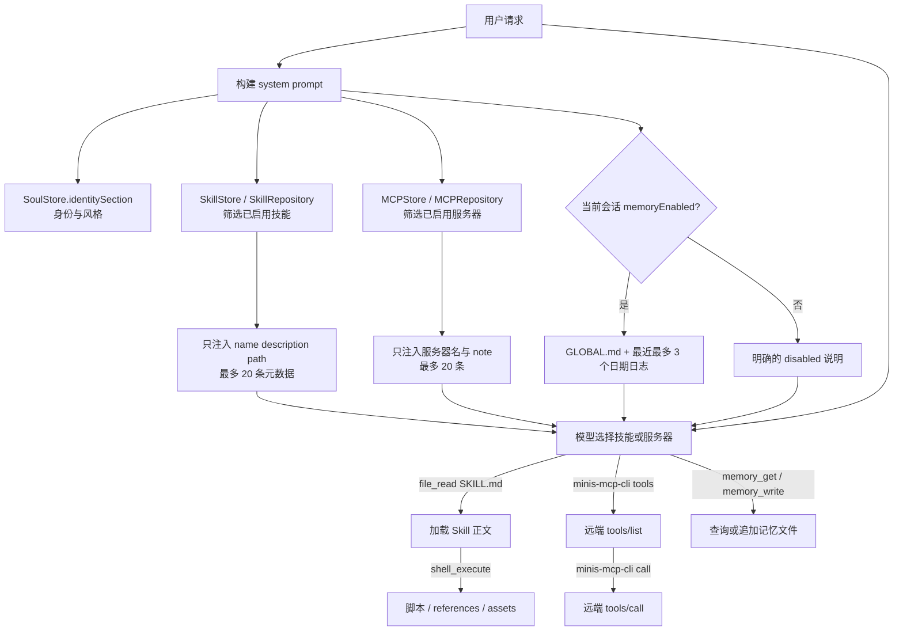

图中的关键是箭头发生在不同时间：`MD`、`MCMD` 是 prompt 构建时的低成本目录；`BODY`、`RES` 和 `DISC` 是模型决定使用之后的高成本动作。iOS 在 `runAgentLoop` 中按“skill → MCP → memory”追加片段（`src/ios/Agent/Chat/AIChatViewModel.swift:4267-4307`）；Android 的 `buildSystemPrompt` 同样按“skills → MCP → global memory → daily memory”追加，并在读取片段前重新扫描磁盘（`src/android/app/src/main/java/com/openminis/app/ui/chat/ChatViewModel.kt:8081-8124`）。

### 9.3 Skill 的可移植格式：以 `SKILL.md` 为唯一入口

#### 9.3.1 目录合同

内置的 `skill-creator` 不是抽象文档，而是应用自带的真实模板。它定义了如下目录：

```text
skill-name/
├── SKILL.md              # 必需：frontmatter + Markdown body
└── scripts/              # 可选：可执行脚本
    references/           # 可选：按需读取的长文档
    assets/               # 可选：模板、图标、输出素材
```

源码同时强调 `SKILL.md` 正文是在触发后加载，正文接近 500 行时应拆到 reference 文件；`metadata → body → resources` 是三个披露层级（`src/ios/Agent/Session/SkillStore.swift:331-360`）。这里的目录描述是教程性约定，解析器并不会验证 `scripts/`、`references/` 或 `assets/` 的名字；它只要求能找到 `SKILL.md`，其余文件按相对路径保存。

iOS 的归档导入在压缩包根目录或恰好一层目录内寻找 `SKILL.md`，然后把其余条目写到 skill 目录及 rootfs 镜像，并为 `/var/minis/skills/<id>/...` 建立 fakefs 元数据（`src/ios/Agent/Session/SkillStore.swift:811-875`）。Android 采用相同的根目录/一层目录规则，并额外拒绝包含 `..` 的相对路径，避免 zip-slip（`src/android/app/src/main/java/com/openminis/app/data/repository/SkillRepository.kt:414-460`）。因此，从零实现时要同时满足：

- 包内有一个名为 `SKILL.md` 的普通文件；
- 同级资源使用相对路径；
- 不依赖压缩包外的绝对路径；
- 资源脚本需要在设备 Linux 环境中可运行，而不是假设 macOS 命令存在。

#### 9.3.2 frontmatter 实际认可的字段

这是本章最重要的“不要想当然”表。OpenMinis 目前把 frontmatter 当作轻量 key-value 解析，而不是完整 YAML。

| 字段 | iOS `SkillStore.parse` | Android `SkillRepository.parseSkillMd` | 进入数据库/提示词的用途 |
|---|---|---|---|
| `name` | 认可；缺省为 `Untitled Skill` | 认可；为空则返回 `null` | 显示名，也是 slug/id 的输入 |
| `description` | 认可；缺省空串 | 认可；缺省空串 | 触发目录中的短说明，最多 200 字符 |
| `version` | 认可；缺省 `1.0.0` | 认可；缺省 `1.0.0` | 更新比较和 UI 展示 |
| `body` | 不是键；关闭 fence 后的剩余 Markdown | 不是键；关闭 fence 后的剩余 Markdown | 只有读取 `SKILL.md` 后才作为指令正文 |
| `allowed-tools`、`tools`、`triggers`、`license`、`compatibility` 等 | 未在 `switch key` 中处理，落入 `default` 丢弃 | 未在 `when (key)` 中处理，落入 `else` 丢弃 | 不会自动产生工具白名单、触发器或许可证约束 |

iOS 的证据是：`ParsedSkillMD` 只有 `name`、`description`、`version`、`body` 四个属性（`src/ios/Agent/Session/SkillStore.swift:417-426`），最终 `switch` 只有三个 frontmatter key（`src/ios/Agent/Session/SkillStore.swift:491-547`）。Android 的 `ParsedSkill` 结构完全对应（`src/android/app/src/main/java/com/openminis/app/data/repository/SkillRepository.kt:1270-1275`），解析分支也只有 `name`、`description`、`version`（`src/android/app/src/main/java/com/openminis/app/data/repository/SkillRepository.kt:1310-1387`）。

一个最小可移植文件应写成：

```markdown
---
name: csv-report
version: 1.0.0
description: Create and validate CSV reports when the user asks for one.
---

# CSV report

1. Read the input file.
2. Use the bundled script only after checking its arguments.
3. Save the result in `/var/minis/workspace/`.
```

这个片段只使用了两个平台都识别的字段。`version` 不负责语义版本解析，只是字符串；iOS 在内置 skill 更新时以字符串比较版本（`src/ios/Agent/Session/SkillStore.swift:383-390`），Android 也按字符串判断 bundled skill 是否需要升级（`src/android/app/src/main/java/com/openminis/app/data/repository/SkillRepository.kt:1104-1139`）。[推断] 如果要实现真正的 semver，必须新增明确的比较器和迁移规则，不能把当前比较当成完整 semver 规范。

#### 9.3.3 两个平台的 parser 差异

iOS 更宽松：如果文件没有开头的 `---`，它会尝试把前导 `key: value` 块识别为 headless frontmatter；只有至少出现 `name`、`description`、`version` 之一才会接受，避免把普通 Markdown 的 `Author: ...` 误当元数据（`src/ios/Agent/Session/SkillStore.swift:428-489`）。Android 要求去掉空白后以 `---` 开始，并且必须找到下一条独立的 `---`，否则返回 `null`（`src/android/app/src/main/java/com/openminis/app/data/repository/SkillRepository.kt:1310-1325`）。

两边都支持短值和 block scalar：`description: |` 保留换行，`description: >` 折叠为空格；iOS 还检查 `|-`、`>-2` 一类 suffix，Android 也接受 `>-`、`|+` 和显式缩进数字（`src/ios/Agent/Session/SkillStore.swift:498-536`；`src/android/app/src/main/java/com/openminis/app/data/repository/SkillRepository.kt:1338-1369`）。两边都不是 YAML 引擎：嵌套 map、数组、引用、复杂引号转义不能被当作通用 YAML 语法依赖。[推断] 面向第三方技能发布时，应把三个字段写成简单的单行值，长描述优先用 `>`，正文放在 fence 之后。

#### 9.3.4 agent 如何访问脚本和资源

SkillStore 不执行脚本，也不自动解析资源名称。它提供的是相对路径枚举、读取和写入：iOS 的 `listSkillFiles` 合并 Library 与 rootfs，`readSkillFile` 先读 Library 再回退到 rootfs，`writeSkillFile` 对 `SKILL.md` 走 metadata 更新、对其他文件同时写两处（`src/ios/Agent/Session/SkillStore.swift:1053-1099`）。Android 对应 `listSkillFiles`、`readSkillFile`、`writeSkillFile`，并在读写时拒绝包含 `..` 的路径（`src/android/app/src/main/java/com/openminis/app/data/repository/SkillRepository.kt:726-747,799-817`）。

模型真正获得入口，是 prompt 中的路径：

```text
Reusable instruction sets stored at /var/minis/skills/<name>/SKILL.md.
Read the SKILL.md file to load full instructions before using a skill.
```

这段文字和 `<path>/var/minis/skills/<id>/SKILL.md</path>` 由两个平台的 prompt fragment 生成（`src/ios/Agent/Session/SkillStore.swift:1332-1356`；`src/android/app/src/main/java/com/openminis/app/data/repository/SkillRepository.kt:266-294`）。模型随后用通用 `file_read` 读取正文；当正文指示“运行 `scripts/report.py`”时，再用 `shell_execute` 调用它。[推断] 因为 parser 没有 `allowed-tools` 分支，Skill 不能通过 frontmatter 自动缩小工具权限；权限仍由应用的全局 `makeAgentTools` 和文件系统沙箱决定。

### 9.4 渐进式加载：metadata 何时进入 prompt，body 何时进入上下文

#### 9.4.1 数据流

启动时，SkillStore 先建/打开 `skills.db`，读取 DB 行和磁盘文件；Android 也在 repository 初始化时 `loadAll()`，再安装 bundled skill（`src/ios/Agent/Session/SkillStore.swift:67-102,124-161`；`src/android/app/src/main/java/com/openminis/app/data/repository/SkillRepository.kt:41-51,104-119`）。这一步把 `body` 也保存在内存结构中，但这不等于把 body 发送给模型。

在每次 agent loop 构建 prompt 时，iOS 只调用 `skillPromptFragment(for:)` 并拼接返回的 metadata（`src/ios/Agent/Chat/AIChatViewModel.swift:4267-4283`）。Android 在 `buildSystemPrompt` 中先 `reloadFromDisk()`，再取 `skillPromptFragment(activeSessionId)`（`src/android/app/src/main/java/com/openminis/app/ui/chat/ChatViewModel.kt:8081-8090`）。这样做有两个效果：shell 新建的技能无需重启即可出现在下一轮；当前会话开关也能在下一次请求生效。

#### 9.4.2 20 条上限和选择优先级

两端都把最大元数据条目设为 20，描述上限为 200 字符（`src/ios/Agent/Session/SkillStore.swift:1248-1256,1329-1344`；`src/android/app/src/main/java/com/openminis/app/data/repository/SkillRepository.kt:43-51,266-276`）。少于等于 20 个时按最近更新排序；多于 20 个时按三层优先级：

1. `bundled`：保证内置基础能力可被发现；
2. 最近 7 天修改/创建的技能，最多占 10 个位置；
3. 剩余位置按 `useCount` 从高到低填充。

iOS 的选择和省略提示在 `skillPromptFragment` 中实现（`src/ios/Agent/Session/SkillStore.swift:1262-1313,1348-1359`），Android 的等价逻辑在 `SkillRepository.skillPromptFragment`（`src/android/app/src/main/java/com/openminis/app/data/repository/SkillRepository.kt:229-264,282-295`）。每条 metadata 写入 name、截断后的 description 和准确的 `SKILL.md` path，而不是 body。

#### 9.4.3 body 的加载边界

当模型决定使用某技能，它要按照 metadata 中的 path 发出 `file_read`。源码把“读 `SKILL.md`”定义成使用事件：iOS 由 `skillIdFromPath` 只匹配 `/var/minis/skills/<id>/SKILL.md`，再由并发工具执行器调用 `recordSkillUse`；脚本和 references 的读取不会增加技能使用次数（`src/ios/Agent/Session/SkillStore.swift:1172-1191,1235-1245`；`src/ios/Agent/Chat/AIChatViewModel+ConcurrentTools.swift:415-457`）。Android 同样只识别 `SKILL.md`，`ChatViewModel` 在 `FileReadTool` 成功后记录 use count（`src/android/app/src/main/java/com/openminis/app/data/repository/SkillRepository.kt:298-315,350-364`；`src/android/app/src/main/java/com/openminis/app/ui/chat/ChatViewModel.kt:7119-7131`）。

因此上下文成本可以画成：

```text
首轮：20 × (name + <=200 字 description + path)
命中：首轮 metadata + SKILL.md body
继续：再加被 body 指示读取的 references / 脚本输出
```

`hasMore` 为真时，prompt 会告诉模型仍有更多技能，并建议列目录或 grep；这是一种“发现能力的二级索引”，而不是把所有名称硬塞进首轮（`src/ios/Agent/Session/SkillStore.swift:1352-1359`；`src/android/app/src/main/java/com/openminis/app/data/repository/SkillRepository.kt:286-294`）。[推断] 对正文的工程约束应是：短正文包含决策和入口，长规范拆到 `references/`；否则渐进式加载虽成立，第二轮仍可能产生巨大的 tool result。

#### 9.4.4 会话开关和草稿会话

全局 enabled 只决定默认值；会话可以在 `session_skill_overrides` 中覆盖。iOS 的读取优先级是 session override → 全局 skill → false，写入时若值等于全局默认则删除 override 行（`src/ios/Agent/Session/SkillStore.swift:1150-1170`）。Android 具有相同的 fallback 和 draft-id 重命名 API（`src/android/app/src/main/java/com/openminis/app/data/repository/SkillRepository.kt:179-219`）。

这个“稀疏 override”设计很重要：把“当前值等于全局值”保存成一条永久行，会让之后的全局开关无法传播。[推断] 新实现可把 session id 作为所有能力开关的统一键，并在草稿首次发送、得到真实 session id 时迁移 skill 与 MCP 两类 override；Android `ChatViewModel.ensureSession` 已同时调用两个重命名方法（`src/android/app/src/main/java/com/openminis/app/ui/chat/ChatViewModel.kt:2796-2799`）。

### 9.5 兼容性：README 的“能运行”不等于字段完全兼容

README 的兼容性表述是“Claude、Codex、OpenClaw、Hermes Agent 的技能一般可直接运行”（`README.md:76-79`）。逆向代码后，可以把这个结论拆成三层：

| 兼容层 | 已实现的事实 | 没有实现的事实 |
|---|---|---|
| 文件入口 | 识别常见的 `SKILL.md`，正文是 Markdown；zip 可根目录或一层目录 | 没有跨生态 manifest 解析器 |
| 元数据 | `name`、`description`、`version` 三个键在 iOS/Android 都生效 | 没有 `allowed-tools`、`triggers`、`license`、`compatibility` 等字段映射 |
| 执行面 | generic `file_read`、`file_write`、`file_edit`、`shell_execute`、`browser_use` 能承接很多通用技能 | 没有把外部生态工具名自动映射为 Minis 工具名的兼容层 |

工具名字来自 iOS `makeAgentTools` 的固定定义（`src/ios/Agent/Chat/AIChatViewModel+ToolDefinitions.swift:9-18,30-69`），Android 则由 `AgentTools.makeAgentTools` 注册（`src/android/app/src/main/java/com/openminis/app/tools/AgentTools.kt:8-36`）。因此，外部技能如果只要求读取文件、运行 shell、操作浏览器，通常可以迁移；如果正文明确要求 Claude 专有工具，不能因为 frontmatter 能解析就声称完全兼容。[推断]

不要把 `version` 误当兼容版本，也不要把未知键当触发器。当前解析器对未知键直接忽略（`src/ios/Agent/Session/SkillStore.swift:538-543`；`src/android/app/src/main/java/com/openminis/app/data/repository/SkillRepository.kt:1372-1379`）。若产品需要真正的生态适配，应在解析阶段保留原始 frontmatter、建立显式 alias 表，并在 tool registry 做能力探测；这已经超出当前实现，不能在教程中伪装成已有功能。

### 9.6 分发、安装、校验与更新

#### 9.6.1 用户入口

iOS Settings 的技能页提供 URL、Paste、File 三种模式；File 接受普通文本、`.skill` 和 `.zip`（`src/ios/Views/Skills/SkillsManagementView.swift:214-337,347-385`）。Android Compose 页面提供 URL、Paste、File 三个 tab，文件通过 Android Activity Result 选择（`src/android/app/src/main/java/com/openminis/app/ui/settings/SkillsManagementScreen.kt:114-153,387-548`）。

URL 不是盲写：iOS `preflightGitHubImport` 先把 GitHub URL 转成 raw URL、检查 HTTP 200、解析 frontmatter，之后才 commit（`src/ios/Agent/Session/SkillStore.swift:703-727`）。Android `importFromGitHub` 先下载 `SKILL.md`，通过 `importFromContent` 解析成功后才进入 repository（`src/android/app/src/main/java/com/openminis/app/data/repository/SkillRepository.kt:489-527`）。这就是最小校验链：HTTP 成功、UTF-8 非空、frontmatter 可解析、`name` 可生成非空 slug。

#### 9.6.2 GitHub sibling 资源和部分成功

导入 GitHub 后，两端都递归读取同目录 sibling 文件，目的是把 `scripts/`、`references/`、`assets/` 同步下来，而不只是下载 `SKILL.md`。iOS 将 sibling 下载放进 detached task，更新完成后标记 dirty；更新既有 URL 技能时同步等待并返回 `partialSuccess`（`src/ios/Agent/Session/SkillStore.swift:724-765,768-809`）。Android 使用 repository-owned `backgroundScope`，避免离开 Compose 页面取消递归；`updateFromURL` 把 sibling 失败显式返回 `PartialSuccess`（`src/android/app/src/main/java/com/openminis/app/data/repository/SkillRepository.kt:64-70,503-527,558-621`）。

Android 的目录遍历最多深度 5，GitHub API 和 blob 请求对 transient 失败各重试一次，UI 能看到第一个具体失败原因（`src/android/app/src/main/java/com/openminis/app/data/repository/SkillRepository.kt:820-939,943-1010`）。这不是完整签名校验：当前源码没有在导入时核验签名、SHA 或作者身份。[推断] 面向生产分发时，应把 HTTPS、内容大小限制、可选哈希/签名放在导入器外层，而不要误以为 `name` 能防篡改。

#### 9.6.3 更新、导出和 bundled skill

URL 技能的更新是“原地更新”：读取记录中的 source URL，刷新 `SKILL.md` 和 sibling 文件，不创建第二个 id；缺少旧 source URL 时 Android 明确要求重新导入（`src/android/app/src/main/java/com/openminis/app/data/repository/SkillRepository.kt:565-620`）。两端都支持把整个目录导出为 zip；Android 在 `cacheDir/share/skill-export-<uuid>/` 生成非空文件，并在新导出前清理超过 24 小时的旧目录（`src/android/app/src/main/java/com/openminis/app/data/repository/SkillRepository.kt:623-705,708-723`），iOS 也采用 24 小时 sweep 和唯一导出目录（`src/ios/Views/Skills/SkillsManagementView.swift:769-837`）。

bundled skill 在 app 初始化时按内置版本升级：iOS 当前内置 `skill-creator` 为 `2.1.0`（`src/ios/Agent/Session/SkillStore.swift:285-390`），Android 当前写入的是 `2.0.0`（`src/android/app/src/main/java/com/openminis/app/data/repository/SkillRepository.kt:1104-1139`）。这是平台构建产物的版本差异，不能在跨平台同步中简单假定版本相同。[推断]

#### 9.6.4 磁盘发现和 iCloud/LAN 边界

agent 可以在 shell 中直接创建 `/var/minis/skills/<id>/SKILL.md`，所以两端都有 reload/rescan：Android Skills 页面进入时 `reloadFromDisk`（`src/android/app/src/main/java/com/openminis/app/ui/settings/SkillsManagementScreen.kt:148-154`），iOS 通过 `reload`、rescan 发现磁盘新目录并在必要时 mark dirty（`src/ios/Agent/Session/SkillStore.swift:1362-1403,974-1022`）。

iOS 进一步把 skill 内容和 bundled files 纳入 iCloud 的 dirty queue，并用本地较新的 `updatedAt` 拒绝陈旧云记录（`src/ios/Agent/Session/SkillStore.swift:618-701`）。Android `SkillRepository` 的设计是本地 SQLite + 文件目录，没有对应 CloudKit 实现（`src/android/app/src/main/java/com/openminis/app/data/repository/SkillRepository.kt:33-40`）。[推断] 要拓展到 macOS/Windows/Linux，应先把目录根、元数据数据库和 dirty/sync 接口抽成平台适配层，不能直接复制 iOS 的 CloudKit 调用。

### 9.7 Soul：稳定身份，不是可选技能

#### 9.7.1 文件格式和持久化

`SOUL.md` 和记忆文件放在同一目录。iOS 的 `SoulMetadata` 认可 `name`、`emoji`、`style`、`lang`，`SoulFile` 则是 metadata + body（`src/ios/Agent/Session/SoulStore.swift:4-47`）；Android 数据类相同（`src/android/app/src/main/java/com/openminis/app/agent/SoulStore.kt:10-76`）。解析器要求首个独立行是 `---`、之后有闭合 `---`，未知键忽略；序列化只写 `name/style/lang` 三个键，旧 `emoji` 可读但下一次保存会被移除（`src/ios/Agent/Session/SoulStore.swift:49-116`；`src/android/app/src/main/java/com/openminis/app/agent/SoulStore.kt:78-152`）。

默认文件只播种 frontmatter 或默认人格内容，`ensureExists` 不覆盖已有文件（`src/ios/Agent/Session/SoulStore.swift:229-267`；`src/android/app/src/main/java/com/openminis/app/agent/SoulStore.kt:271-315`）。iOS 用原子写入并在保存后标记 `SoulV2` dirty（`src/ios/Agent/Session/SoulStore.swift:298-314`）；Android 用 `.tmp` 后 rename，并刷新 StateFlow cache（`src/android/app/src/main/java/com/openminis/app/agent/SoulStore.kt:333-367`）。

#### 9.7.2 进入 system prompt 的顺序

Soul 是 base prompt 的第一段，不受 memory 开关控制。iOS 的 `baseSystemPrompt` 先调用 `SystemPromptBuilder.identitySection()`，再接运行时指导和工具说明（`src/ios/Agent/Chat/AIChatViewModel.swift:1701-1711`）；Android `buildSystemPrompt` 同样先计算 `identitySection`（`src/android/app/src/main/java/com/openminis/app/ui/chat/ChatViewModel.kt:7938-7948`）。其后才是 skills、MCP、GLOBAL、daily logs：iOS 的具体拼接在 `runAgentLoop`（`src/ios/Agent/Chat/AIChatViewModel.swift:4278-4307`），Android 的具体拼接在 `buildSystemPrompt`（`src/android/app/src/main/java/com/openminis/app/ui/chat/ChatViewModel.kt:8089-8124`）。

Soul body 以明确的 `Personality (from SOUL.md...)` 标签注入，style 作为单独的 `Response style` 段注入；超出限制时不截断，而回退到 identity-only（`src/ios/Agent/Session/SoulStore.swift:413-488`；`src/android/app/src/main/java/com/openminis/app/agent/SoulStore.kt:449-518`）。两端还会删除疑似 “ignore previous instructions” 的行（同文件 `scrubInjections`）。[推断] 这说明 Soul 适合表达名字、语气和人格，不适合承载项目规范、秘密或临时任务；项目规范应进 Skill 或 Memory，秘密应进环境变量/Keychain。

body 长度规则也要按平台实际实现：iOS 统一按 CJK glyph/punctuation 或空白分隔词计数，硬上限为 2000 token（`src/ios/Agent/Session/SoulStore.swift:144-188`）；Android 按 CJK 比例选择 1600 code point 或 1000 个英文词（`src/android/app/src/main/java/com/openminis/app/agent/SoulStore.kt:187-243`）。不要在跨端文档中把“字符数”和“token”混用。

### 9.8 Memory：文件型跨会话上下文，与 workspace 分离

#### 9.8.1 存储介质

Memory 目录是 `<persistent>/memory/`，不是 SQLite：iOS `minisMemoryPersistentDir` 下有 `GLOBAL.md`、`YYYY-MM-DD.md` 和 `SOUL.md`；Android `MemoryRepository` 接收 `memoryDir`，约定相同文件名（`src/ios/Agent/Chat/AIChatViewModel+MemoryTools.swift:9-20`；`src/android/app/src/main/java/com/openminis/app/data/repository/MemoryRepository.kt:9-26,18-47`）。

`memory_write` 将带时间注释的 Markdown entry 插入当天文件头部，所以同一文件新记录在前。iOS 写入后注册 fakefs 元数据并加入 iCloud `MemoryDailyV2` dirty queue（`src/ios/Agent/Chat/AIChatViewModel+MemoryTools.swift:63-119`）；Android 直接写文件并返回保存结果（`src/android/app/src/main/java/com/openminis/app/data/repository/MemoryRepository.kt:49-77`）。

`memory_get` 支持 `scope=daily|all` 和空格分隔关键词。iOS 把带 timestamp 的块作为 entry，按匹配置信度 50% + 新鲜度 50% 排序，最多返回 60 个 entry 或约 30 KB（`src/ios/Agent/Chat/AIChatViewModel+MemoryTools.swift:122-365`）。Android 采用所有关键词在 ±2 行窗口内都出现的模糊搜索，完整倾倒最多 500 行，关键词搜索最多 60 行并有 30 KB 字节上限（`src/android/app/src/main/java/com/openminis/app/data/repository/MemoryRepository.kt:80-231`）。两者都不是向量数据库，也没有嵌入检索。[推断]

#### 9.8.2 自动注入和工具检索的差别

自动注入只做背景预览：`GLOBAL.md` 整体读取；最近 30 天内最多挑 3 个非空 daily log；每个 daily log 最多前 200 行，超出部分提示使用 `memory_get`（`src/ios/Agent/Chat/AIChatViewModel+MemoryTools.swift:19-60`；`src/android/app/src/main/java/com/openminis/app/data/repository/MemoryRepository.kt:234-301`）。这是和 Skill metadata 同样的渐进式思想：system prompt 放小的常用窗口，完整搜索延迟到工具调用。

`GLOBAL.md` 的 prompt 文案明确要求把它当 background context，不是 standing instruction，并且用户最新消息冲突时优先最新消息（`src/ios/Agent/Chat/AIChatViewModel+MemoryTools.swift:9-17`；`src/android/app/src/main/java/com/openminis/app/data/repository/MemoryRepository.kt:241-255`）。Android tool definition 还把 GLOBAL 标成“read-only, user-maintained via Settings”（`src/android/app/src/main/java/com/openminis/app/tools/MemoryTools.kt:15-37`）。因此建议的职责是：

- `GLOBAL.md`：偏好、设置、稳定约定；用户明确要求时才用 `file_edit` 更新；
- `YYYY-MM-DD.md`：每天的事实、已完成任务、行动项；agent 可用 `memory_write` 追加；
- `/var/minis/workspace/`：脚本、数据集、报告、网页项目等工作产物，不会自动成为记忆。

workspace 与 memory 的分离由 base prompt 的目录说明直接体现（`src/ios/Agent/Chat/AIChatViewModel.swift:1742-1750`；`src/android/app/src/main/java/com/openminis/app/ui/chat/ChatViewModel.kt:7999-8007`）。[推断] 如果把构建产物写进 daily log，会导致后续检索噪音；如果把用户偏好只写到 workspace，则不会跨会话自动可见。

#### 9.8.3 memory 开关和跨会话可见性

iOS `makeAgentTools` 在 `memoryEnabled` 为 false 时根本不注册 `memory_write` 和 `memory_get`（`src/ios/Agent/Chat/AIChatViewModel+ToolDefinitions.swift:9-17,103-124`）；执行函数还有 defense-in-depth 拒绝（`src/ios/Agent/Chat/AIChatViewModel+MemoryTools.swift:63-71,126-135`）。Android `AgentTools.makeAgentTools(memoryEnabled)` 同样条件注册（`src/android/app/src/main/java/com/openminis/app/tools/AgentTools.kt:14-35`），`ChatViewModel` 同时跳过 memory fragment 和工具执行（`src/android/app/src/main/java/com/openminis/app/ui/chat/ChatViewModel.kt:7949-7987,8096-8105`）。

会话开关不是“删文件”：它只改变本次 prompt 是否注入、模型是否看到 memory 工具；文件仍在磁盘，下一会话若开启就可见。Android 从现有 session DB 恢复 `memoryEnabled`（`src/android/app/src/main/java/com/openminis/app/ui/chat/ChatViewModel.kt:2950-2955`），复制 session 时也复制此字段（`src/android/app/src/main/java/com/openminis/app/data/SessionForkManager.kt:41-45,78-83`）。iOS 的跨设备 memory 复制由 `SessionForkManager.copyRemoteMemory` 写入同一 persistent memory 目录（`src/ios/Agent/Session/SessionForkManager.swift:192-213`）。

### 9.9 MCP：配置、传输、发现与命名

#### 9.9.1 `servers.json` 是共享事实源

两个平台和 guest CLI 共用如下形状：

```json
{
  "mcpServers": {
    "weather": {
      "url": "https://example.test/mcp",
      "headers": { "Authorization": "Bearer $$WEATHER_TOKEN" },
      "note": "天气查询",
      "enabled": true
    },
    "local-tools": {
      "command": "python3",
      "args": ["/var/minis/workspace/server.py"],
      "env": { "API_KEY": "$$API_KEY" },
      "enabled": true
    }
  }
}
```

iOS 的 `MCPServerConfig` 明确把 server name 作为 `id`，HTTP 使用 `url + headers`，STDIO 使用 `command + args + env`；文件位置是可同步的 `MinisConfig/mcp-servers/servers.json`，guest bind mount 到 `/var/minis/mcp-servers`（`src/ios/Agent/Session/MCPStore.swift:1-16,22-73,107-120`）。Android 的 `MCPRepository` 把同一文件放在 `filesDir/minis-global/mcp-servers/servers.json`，且明确说这是 CLI 和 file browser 共同读写的 Claude Desktop 兼容形状（`src/android/app/src/main/java/com/openminis/app/data/repository/MCPRepository.kt:14-35,46-107`）。guest `config.py` 也把 `mcpServers` object 作为跨 iOS/Android/UI 的固定 schema（`src/ios/default_mount/usr/local/lib/minis-mcp-cli/utils/config.py:1-23,54-82`）。

保存必须是原子的：iOS 用 JSONEncoder + `.atomic`（`src/ios/Agent/Session/MCPStore.swift:338-371`），guest CLI 用临时文件 + `os.replace`（`src/ios/default_mount/usr/local/lib/minis-mcp-cli/utils/config.py:70-77`）。Android 用 `serversFile.writeText` 保存 JSON（`src/android/app/src/main/java/com/openminis/app/data/repository/MCPRepository.kt:168-180`）。[推断] 在 Android 新增跨进程写入时应补原子 rename，否则 Settings、file browser、CLI 并发读写时可能看到半截 JSON。

#### 9.9.2 HTTP、SSE 和 STDIO

UI 中 iOS 显示 HTTP、SSE、STDIO 三个选择；源码把 SSE 当 HTTP-family URL transport，实际由 CLI 的 HTTP transport 解析返回的 SSE（`src/ios/Views/MCP/MCPFormSheet.swift:20-25`）。Android model 也把 HTTP/SSE 统一成 `url + headers`，或者把 command family 归为 STDIO（`src/android/app/src/main/java/com/openminis/app/data/repository/MCPRepository.kt:48-71`）。

HTTP transport 的真实流程是：POST JSON-RPC `initialize`，发送 `notifications/initialized`，再调用 `tools/list` 或 `tools/call`；响应可以是 `application/json` 或 `text/event-stream`，SSE 取最后一个可解析的 `data:` payload（`src/ios/default_mount/usr/local/lib/minis-mcp-cli/transport/http.py:1-15,54-75,284-307`）。它会覆盖用户自定义的 `Accept`/`Content-Type` 变体，保证 `application/json, text/event-stream`（`src/ios/default_mount/usr/local/lib/minis-mcp-cli/transport/http.py:225-256`）。

STDIO transport 启动 `[command] + args` 子进程，使用换行分隔 JSON-RPC；先发 `initialize`，再发 `notifications/initialized`，每次 session 结束时关闭进程，崩溃最多自动重试一次（`src/ios/default_mount/usr/local/lib/minis-mcp-cli/transport/stdio.py:30-57,59-122,124-159`）。daemon 将 HTTP session 和 STDIO child 放进统一 pool，每个 server 独立保持 10 分钟 idle TTL，并以 server 名作为 pool key（`src/ios/default_mount/usr/local/lib/minis-mcp-cli/daemon.py:41-45,208-239,242-317`）。

环境变量在 HTTP 的 URL、headers 和 STDIO env 中展开，支持 `$VAR`、`${VAR}`、`$$VAR`、`$${VAR}`；`$$` 只是 UI 显式引用形式，不会二次展开（`src/ios/default_mount/usr/local/lib/minis-mcp-cli/transport/http.py:23-44`）。prompt 也要求 agent 使用 `$$VARNAME` 而不是把 secret 硬编码（`src/ios/Agent/Session/MCPStore.swift:622-639`；`src/android/app/src/main/java/com/openminis/app/data/repository/MCPRepository.kt:450-466`）。

#### 9.9.3 startup timeout 的别名层

MCP 协议本身不规定本地子进程启动等待，所以 Minis 把它作为本地配置。原生层为 `startupTimeoutSeconds`，并兼容 `startup_timeout_sec`、`startupTimeout`、`handshakeTimeout`、`initializeTimeout`（`src/ios/Agent/Session/MCPStore.swift:551-579`；`src/android/app/src/main/java/com/openminis/app/data/repository/MCPRepository.kt:213-234`）。guest config 按相同优先级读取，默认 60 秒、上限 900 秒，对非法值返回 warning 而不是静默吞掉（`src/ios/default_mount/usr/local/lib/minis-mcp-cli/utils/config.py:25-44,127-169`）。这是真正存在的 MCP 配置 alias；不要把它和 Skill frontmatter alias 混为一谈。

#### 9.9.4 发现、调用和冲突

system prompt 不枚举远端工具本身，只列最多 20 个已启用 server 的 name/note，并告诉模型执行：

```text
minis-mcp-cli tools <server>
minis-mcp-cli call <server> <tool> [args]
```

iOS 的 `systemPromptSnippet` 按 `createdAt` 降序取 Top-20，note 截断 200 字符（`src/ios/Agent/Session/MCPStore.swift:601-639`）；Android 采用相同数量和 note 上限（`src/android/app/src/main/java/com/openminis/app/data/repository/MCPRepository.kt:432-466`）。CLI 的 `tools` 实际转发到 `tools/list`，`call` 转发到 `tools/call`（`src/ios/default_mount/usr/local/lib/minis-mcp-cli/main.py:321-361`；`src/ios/default_mount/usr/local/lib/minis-mcp-cli/transport/http.py:300-307`）。Settings 的 Refresh 也只是执行 `minis-mcp-cli refresh` 并解析工具数组（`src/ios/Agent/Session/MCPStore.swift:642-698`）。

server 名是 `mcpServers` 的 key，也是 `MCPServerConfig.id`；同名添加是覆盖而不是生成第二个 namespace：iOS `add` 按 id 替换（`src/ios/Agent/Session/MCPStore.swift:403-425`），Android `add` 过滤旧 id 再追加（`src/android/app/src/main/java/com/openminis/app/data/repository/MCPRepository.kt:275-291`），CLI `upsert_server` 也按 name 覆盖（`src/ios/default_mount/usr/local/lib/minis-mcp-cli/utils/config.py:90-105`）。远端工具名没有在原生层重命名，也没有把同名工具合并到一个全局列表；调用参数始终带 server 和 tool 两级定位（`src/ios/default_mount/usr/local/lib/minis-mcp-cli/main.py:341-361`）。因此“工具名冲突”的解决办法是保持 server 参数，不是在 prompt 中拼接未经验证的别名。[推断]

JSON 导入支持三种常见外形：标准 `{mcpServers:{...}}`、以 server name 为顶层 key、单个带 `command` 或 `url` 的对象；`disabled:true` 映射为 `enabled:false`（`src/ios/Agent/Session/MCPStore.swift:444-498`；`src/android/app/src/main/java/com/openminis/app/data/repository/MCPRepository.kt:370-429`）。

### 9.10 MCP OAuth：非秘密配置、PKCE 和 guest 边界

#### 9.10.1 配置与秘密分离

iOS `MCPOAuthConfig` 只保存 mode、client id、authorization endpoint、token endpoint、scopes、redirect URI；`client_secret` 和 token 不进入 `servers.json`（`src/ios/Agent/Session/MCPOAuthController.swift:37-50`）。Android `MCPOAuthConfig` 也只保存相同的非秘密信息，secret/token 放进 `EncryptedSharedPreferences`（`src/android/app/src/main/java/com/openminis/app/mcp/oauth/MCPOAuthConfig.kt:5-27`；`src/android/app/src/main/java/com/openminis/app/mcp/oauth/MCPOAuthStore.kt:9-27,32-90`）。

注意字段名的跨端边界：iOS 使用 Swift `Codable` 属性名如 `clientId`、`authorizationEndpoint`；Android `toJson/fromJson` 使用 `client_id`、`authorization_endpoint`、`token_endpoint`、`redirect_uri`（`src/ios/Agent/Session/MCPOAuthController.swift:37-50`；`src/android/app/src/main/java/com/openminis/app/mcp/oauth/MCPOAuthConfig.kt:29-59`）。guest CLI 的 `add` 则写 camelCase oauth 对象（`src/ios/default_mount/usr/local/lib/minis-mcp-cli/main.py:431-453`）。[推断] 这不是一个已实现的字段别名层；跨平台交换 OAuth JSON 时必须做显式转换，不能只复制 `oauth` 对象。

#### 9.10.2 iOS 完整流程

iOS 使用 PKCE Authorization Code：随机 verifier，SHA-256 得到 S256 challenge，生成 state；默认 loopback `http://localhost:54546/callback`，也支持 custom scheme；authorization request 和 token exchange 都可带 RFC 8707 `resource`（`src/ios/Agent/Session/MCPOAuthController.swift:65-74,269-329,347-385`）。loopback 由本地 `OAuthCallbackServer` + in-app Safari 完成，custom scheme 回退到 `ASWebAuthenticationSession`，回调必须校验 state（`src/ios/Agent/Session/MCPOAuthController.swift:337-445`）。

token 写入不可同步的 Keychain；成功后再 materialize guest bridge `/var/minis/mcp-servers/oauth/<server>.json`，权限 0600，桥中包含 access/refresh token、token endpoint、client id 和可选 client secret（`src/ios/Agent/Session/MCPOAuthController.swift:16-27,90-135,227-267`）。guest HTTP transport 在 token 过期前 60 秒刷新，遇到 401 强制刷新一次并重试，失败时返回带 `minis://settings/mcp-servers/<name>` 的授权链接（`src/ios/default_mount/usr/local/lib/minis-mcp-cli/transport/http.py:78-135,153-223,266-282`）。

#### 9.10.3 Android 当前阶段

Android `MCPOAuthController.authorize` 使用同一个 54546 loopback 端口、Chrome Custom Tab、state 校验、PKCE 和 RFC 8707 resource，授权码交换成功后把 token 写入 `MCPOAuthStore`（`src/android/app/src/main/java/com/openminis/app/mcp/oauth/MCPOAuthController.kt:21-31,50-117,120-172`；`src/android/app/src/main/java/com/openminis/app/mcp/oauth/McpPkce.kt:22-101`）。

源码明确标记当前阶段的边界：Android 已完成浏览器 round-trip、token exchange 和加密存储，但 guest transport bridge 与自主刷新“故意留到后续阶段”（`src/android/app/src/main/java/com/openminis/app/mcp/oauth/MCPOAuthController.kt:27-30`）。因此不能把 Android 的“Authorized” UI 当作与 iOS 完全同等的端到端调用保障；当前实现是否能让 PRoot 中的 CLI 使用 token，需要额外的 bridge/refresh 接口。[推断]

### 9.11 Session fork 与 lock：复制一致性和本地隐私是两件事

#### 9.11.1 Fork/duplicate 解决什么

iOS `SessionForkManager.forkSession` 从远端设备读取 session 和 messages，创建新本地 session，并为每条消息生成新 id；`duplicateSession` 对本地 session 做同样的深复制，并额外重映射 compact marker 的 message id/sort order（`src/ios/Agent/Session/SessionForkManager.swift:12-53,56-167`）。它还可以把远程 skill 重新导入本机，或把远程 memory 文件写入本地 memory 目录（`src/ios/Agent/Session/SessionForkManager.swift:169-213`）。

Android 当前只实现 local duplicate；类注释明确说明来自 iCloud 远端的 `forkSession` 等待跨设备同步层（`src/android/app/src/main/java/com/openminis/app/data/SessionForkManager.kt:9-19`）。复制时会带上 category、modelBinding、memoryEnabled、thinking override，消息得到全新 id，compact markers 在所有消息写入后再重映射（`src/android/app/src/main/java/com/openminis/app/data/SessionForkManager.kt:30-89,90-167`）。

因此 fork 的核心不是“复制一段文本”，而是复制可恢复的关系：消息 id、排序、压缩边界、模型绑定和 memory 开关必须一起处理。复制 skill/memory 时还要走各自 repository/file contract，不能把远端路径直接当成本地路径。[推断]

#### 9.11.2 iOS SessionLock 的职责

`SessionLockStore` 是 iOS 的本地生物识别门，不修改 `ChatSession` 数据模型，也不进入同步/导出管线；锁定 id 集合持久化到 UserDefaults，解锁时间戳只在内存中保存（`src/ios/Agent/Session/SessionLockStore.swift:5-20,64-82,100-115`）。每个 session 的可视锁状态由 global toggle、设备可用性、locked set 和 idle timeout 共同决定（`src/ios/Agent/Session/SessionLockStore.swift:117-152`）。

它支持永久解锁、解锁后 idle 重锁、后台清除解锁时间戳，以及 app-level lock；生物识别 wrapper 使用 `.deviceOwnerAuthentication`，允许 Face ID/Touch ID 失败后走 passcode（`src/ios/Agent/Session/SessionLockStore.swift:154-221,476-505`）。Android 目标源码中没有 `SessionLockStore`、`lockedSessionIds` 或同等 session biometric gate；现有 Android `EncryptedPrefsFactory` 只服务加密偏好存储（`src/android/app/src/main/java/com/openminis/app/util/EncryptedPrefsFactory.kt:17-20`）。[推断] 将产品拓展到 Android 时应把 lock 作为独立本地安全层实现，而不是把锁字段塞进会话同步记录。

#### 9.11.3 一次请求的可观测时序

下面把一次“用户询问某领域问题”的请求拆成可以在日志中定位的阶段。它不是新的抽象 API，而是把现有调用点串起来：

| 阶段 | iOS 观察点 | Android 观察点 | 模型是否已经看到正文 |
|---|---|---|---|
| 会话载入 | `SkillStore.loadSkills`、`SoulStore.load` | `SkillRepository.loadAll`、`SoulStore.load` | 否 |
| prompt 建立 | `runAgentLoop` | `buildSystemPrompt` | 只看到 Soul、Skill metadata、MCP metadata、可选 memory 预览 |
| 技能选择 | 模型生成 `file_read` | 模型生成 `file_read` | 否，tool call 尚未返回 |
| 正文读取 | `FileReadTool` + `skillIdFromPath` | `FileReadTool` + `skillIdFromPath` | 是，返回值进入下一轮上下文 |
| 资源执行 | `shell_execute` 访问脚本或 reference | `shell_execute` 访问脚本或 reference | 取决于 tool result 是否返回 |
| MCP 发现 | `minis-mcp-cli tools` | 同一 guest CLI | 看到远端工具 schema/列表 |
| MCP 调用 | `minis-mcp-cli call` | 同一 guest CLI | 看到远端结果 |

这张表的前两行分别由 iOS 的初始化和 prompt 代码实现（`src/ios/Agent/Session/SkillStore.swift:96-102`；`src/ios/Agent/Chat/AIChatViewModel.swift:4267-4307`），Android 的对应点是 repository 初始化和 `buildSystemPrompt`（`src/android/app/src/main/java/com/openminis/app/data/repository/SkillRepository.kt:104-119`；`src/android/app/src/main/java/com/openminis/app/ui/chat/ChatViewModel.kt:8081-8124`）。后四行的 file read、MCP tools/call 入口分别可在 iOS 并发工具执行器与 CLI main 中看到（`src/ios/Agent/Chat/AIChatViewModel+ConcurrentTools.swift:415-457`；`src/ios/default_mount/usr/local/lib/minis-mcp-cli/main.py:321-361`）。

实现时要给每个阶段留下不同错误，而不是全部返回“skill failed”：

```text
IMPORT_INVALID        # fence/name/body 无法解析
SKILL_RESOURCE_MISSING # SKILL.md 已安装，但 sibling 下载失败
SKILL_BODY_READ_FAILED # file_read 失败
MCP_NOT_FOUND          # server key 不存在
MCP_TOOL_DISCOVERY_FAILED
MCP_AUTH_REQUIRED
MEMORY_DISABLED
```

当前代码已经把其中多项区分开：Android URL 更新把正文成功、资源失败表示为 `PartialSuccess`（`src/android/app/src/main/java/com/openminis/app/data/repository/SkillRepository.kt:530-620`）；MCP CLI 用 `NOT_FOUND`、`AUTH_REQUIRED` 等统一 envelope（`src/ios/default_mount/usr/local/lib/minis-mcp-cli/main.py:67-77,224-268`）；memory disabled 则在工具执行时返回明确失败原因（`src/ios/Agent/Chat/AIChatViewModel+MemoryTools.swift:63-71,126-135`）。

#### 9.11.4 reload、同步和 prompt cache 的相互作用

技能文件可能从三个地方改变：Settings UI、agent 的 file tools、guest shell/CLI。iOS 的 `rescanAndMarkChangedSkillsDirty` 先保存 DB 侧时间快照，再 reload，最后把新增、修改、删除和 bundled 文件变化转为 dirty 记录（`src/ios/Agent/Session/SkillStore.swift:1364-1403`）。Android 每次打开 Skills 页面或构建 prompt 时重新 `loadAll`/`reloadFromDisk`，避免只依赖 app 启动时的 StateFlow（`src/android/app/src/main/java/com/openminis/app/data/repository/SkillRepository.kt:1142-1159`；`src/android/app/src/main/java/com/openminis/app/ui/chat/ChatViewModel.kt:8081-8090`）。

MCP 也存在外部修改路径。iOS `scanExternalChanges` 比较服务器语义 fingerprint，发现 guest CLI 绕过 CRUD 改写 `servers.json` 时重新盖 `updatedAt` 并 mark dirty（`src/ios/Agent/Session/MCPStore.swift:859-897`）；Android 通过 Settings 进入时 `reloadFromDisk`，但 repository 注释说明它是本地模型，不提供对应 CloudKit per-server sync（`src/android/app/src/main/java/com/openminis/app/data/repository/MCPRepository.kt:14-35,113-121`）。

Android 还刻意把动态日期、时区、语言和 model count 放到 prompt 的尾部，使静态 prefix 更容易命中 provider 的 prefix cache（`src/android/app/src/main/java/com/openminis/app/ui/chat/ChatViewModel.kt:7920-7937,8125-8132`）。iOS 也在构建后记录 context baseline 和 token 估计（`src/ios/Agent/Chat/AIChatViewModel.swift:4312-4343`）。[推断] 因此 metadata 的稳定排序不仅影响模型可发现性，也影响缓存命中；不要在每一轮用随机顺序列技能或服务器。

#### 9.11.5 一个可迁移的 Skill 接口

如果要把这套机制移到 macOS、Windows 或 Linux，可以先实现一个平台无关的窄接口，再把 FileManager/`File`/SQLite/同步接到适配器：

```text
SkillCatalog
  listEnabled(sessionId) -> [SkillMeta]
  promptFragment(sessionId, limit=20) -> String?
  import(content, source) -> SkillId
  importArchive(stream) -> SkillId
  readFile(id, relativePath) -> bytes/text
  writeFile(id, relativePath, content)
  rescan()
  recordBodyRead(id)
```

这个接口的每个方法都能在现有实现中找到对应函数：prompt、导入、归档、资源读取、重扫和 usage 分别对应 iOS `SkillStore` 的公开方法（`src/ios/Agent/Session/SkillStore.swift:554-616,811-896,1053-1099,1152-1177,1364-1387`），Android 则是 `SkillRepository` 的同名能力（`src/android/app/src/main/java/com/openminis/app/data/repository/SkillRepository.kt:123-219,229-315,372-460,731-817,1157-1234`）。

适配器必须把“正文”和“元数据”作为两个返回层，而不是把 `Skill` 直接序列化成 prompt。iOS `Skill` 结构虽然包含 `body`，但 prompt 生成只读 name/description/id（`src/ios/Agent/Session/SkillStore.swift:45-65,1332-1344`）；这正是跨桌面端保持上下文成本可控的最小合同。

#### 9.11.6 一个可迁移的 Memory 接口

Memory 的窄接口可以只有以下方法：

```text
MemoryStore
  writeDaily(markdown) -> filename
  get(keywords, scope) -> text
  globalFragment() -> text?
  recentDailyFragment() -> text?
  listFiles() -> [MemoryFile]
  readFile(name) / saveFile(name, content)
```

Android `MemoryRepository` 已按这个形状实现：写入、搜索、两个 prompt fragment、文件列表和文件读写集中在同一 repository（`src/android/app/src/main/java/com/openminis/app/data/repository/MemoryRepository.kt:49-77,80-231,241-301,314-369`）。iOS 则把 fragment 和工具执行放在 `AIChatViewModel+MemoryTools`，但文件路径、日期命名和输出限制仍集中在同一 extension（`src/ios/Agent/Chat/AIChatViewModel+MemoryTools.swift:9-60,63-119,122-365`）。

接口实现时应显式传 `scope`，不要把 `GLOBAL.md` 和 daily log 混成一张表：Android `memory_get` 的 schema 用 `daily`/`all` 枚举，iOS 执行器也读取相同两种值（`src/android/app/src/main/java/com/openminis/app/tools/MemoryTools.kt:41-71`；`src/ios/Agent/Chat/AIChatViewModel+MemoryTools.swift:144-177`）。

#### 9.11.7 一个可迁移的 MCP 接口

MCP 适配器最小需要三个层次：

```text
ConfigStore
  loadServers() / saveServers()
Transport
  initialize() / listTools() / callTool(name, args)
CredentialStore
  clientSecret(server) / tokens(server) / signOut(server)
```

`ConfigStore` 的事实源是 mcpServers object；`Transport` 的协议动作是 initialize、notifications/initialized、tools/list、tools/call；`CredentialStore` 不能和 config JSON 共用存储。三层分别由 guest `config.py`、`http.py`/`stdio.py` 和 iOS/Android OAuth store 实现（`src/ios/default_mount/usr/local/lib/minis-mcp-cli/utils/config.py:54-115`；`src/ios/default_mount/usr/local/lib/minis-mcp-cli/transport/http.py:284-307`；`src/ios/default_mount/usr/local/lib/minis-mcp-cli/transport/stdio.py:111-159`；`src/ios/Agent/Session/MCPOAuthController.swift:90-135`；`src/android/app/src/main/java/com/openminis/app/mcp/oauth/MCPOAuthStore.kt:32-90`）。

这三个层次不要合成一个“连接 MCP”函数：HTTP 无子进程但有 session id，STDIO 有子进程和握手超时，OAuth 还需要浏览器 callback。daemon 用 `MCPHTTPSession` 和 `MCPServerProcess` 做接口兼容，但保留了两种实现的生命周期差异（`src/ios/default_mount/usr/local/lib/minis-mcp-cli/daemon.py:208-239,244-289`）。

### 9.12 从代码到产品的调试观测点

#### 9.12.1 验证渐进式加载，而不是只看 UI

最小调试实验应建立一个拥有长 body 的 skill，并分别观察三次上下文：

1. 导入完成后调用 prompt builder：只能看到 `<name>`、截断 `<description>` 和 path；
2. 让模型发出 `file_read`：tool result 才出现 body；
3. 让模型读取 `references/large.md`：只有再次 tool result 才出现长参考资料。

第一步可直接对照 iOS fragment 的 XML 生成位置（`src/ios/Agent/Session/SkillStore.swift:1332-1350`）或 Android 的 `buildString`（`src/android/app/src/main/java/com/openminis/app/data/repository/SkillRepository.kt:266-285`）；第二步用 iOS/Android 的 `FileReadTool` 路径统计入口核对（`src/ios/Agent/Chat/AIChatViewModel+ConcurrentTools.swift:415-417`；`src/android/app/src/main/java/com/openminis/app/ui/chat/ChatViewModel.kt:7121-7129`）。

如果第一步已经出现 body，说明实现把 `Skill.body` 误拼进 prompt；如果第二步没有 body，说明 guest mount、skill id、file_read 路径或权限有问题。若第三步把整个 references 目录自动塞进上下文，则说明正文没有遵守“按需读取”的指令约定。[推断]

#### 9.12.2 验证 memory 的可见性边界

要分开测试“文件存在”和“模型可见”：

```text
会话 A：memory_write(content="偏好：CSV 使用 UTF-8")
会话 B：memoryEnabled=true，memory_get(keywords="CSV UTF-8")
会话 C：memoryEnabled=false，尝试同一 memory_get
```

A 的成功结果应是当天日期文件，且 entry 在文件头；B 可从自动注入预览或 `memory_get` 搜到；C 的工具 schema 和执行都应拒绝。iOS 写入格式和前置行为见（`src/ios/Agent/Chat/AIChatViewModel+MemoryTools.swift:78-119`），Android 文件格式见（`src/android/app/src/main/java/com/openminis/app/data/repository/MemoryRepository.kt:59-73`），两个平台的 disabled gate 见（`src/ios/Agent/Chat/AIChatViewModel+ToolDefinitions.swift:9-17`；`src/android/app/src/main/java/com/openminis/app/tools/AgentTools.kt:14-35`）。

GLOBAL 测试要额外确认：文件不存在时 `memory_get` 返回可解释的空状态；用户没有明确请求时，agent 不应把 daily entry 改写成 GLOBAL。Android 的 repository 明确禁止删除 GLOBAL，Settings 另有 `saveGlobalMd`（`src/android/app/src/main/java/com/openminis/app/data/repository/MemoryRepository.kt:353-374`）；iOS prompt 也把 GLOBAL 标成 read-only user-maintained（`src/ios/Agent/Chat/AIChatViewModel+MemoryTools.swift:9-17`）。

#### 9.12.3 验证 MCP 的 transport 分叉

至少准备一个本地 STDIO server 和一个返回 SSE 的 HTTP server：

- STDIO：检查 `initialize` 收到的协议版本，之后收到 `notifications/initialized`，再检查 `tools/list`；
- HTTP：检查 `Content-Type: application/json`、`Accept: application/json, text/event-stream`，并返回 `data:` 行；
- 两者：用同一个 `minis-mcp-cli call <server> <tool>`，确认 daemon 的外部接口不依赖具体 transport。

STDIO 的握手和 retry 在（`src/ios/default_mount/usr/local/lib/minis-mcp-cli/transport/stdio.py:102-159`）；HTTP 的 SSE 解析和强制 header 在（`src/ios/default_mount/usr/local/lib/minis-mcp-cli/transport/http.py:54-75,225-282`）；daemon 的统一 pool 在（`src/ios/default_mount/usr/local/lib/minis-mcp-cli/daemon.py:244-317`）。

再测试四个错误：配置中没有 server、server disabled、工具不存在、HTTP 401 且 OAuth refresh 失败。CLI 已为前三类保留统一 envelope，HTTP OAuth 失败会返回授权 deeplink（`src/ios/default_mount/usr/local/lib/minis-mcp-cli/main.py:67-77,313-361`；`src/ios/default_mount/usr/local/lib/minis-mcp-cli/transport/http.py:153-176`）。[推断] Android 在 bridge 尚未实现的构建中应明确把第四类标为“native token 已存储但 guest 未接入”，不能吞掉成普通网络错误。

#### 9.12.4 验证 fork 的引用完整性

建立一个已经 compact 过的 session，然后 duplicate。验收不只看消息数量，还要检查：

- 每条新消息 id 与源 id 不同；
- marker 的 `firstKeptMessageId`、`lastCompactedMessageId`、`boundaryMessageId` 都指向新消息；
- marker 的 legacy sort order 按新消息 sort order 重算；
- category、model binding、memoryEnabled 保留；
- source session 的 lock/解锁时间戳不被复制。

Android 复制实现对所有引用逐条校验，发现 dangling marker 就跳过，不写坏数据（`src/android/app/src/main/java/com/openminis/app/data/SessionForkManager.kt:109-157`）；iOS 也在复制 marker 时建立 old-to-new map（`src/ios/Agent/Session/SessionForkManager.swift:74-160`）。锁的 side-channel 设计由（`src/ios/Agent/Session/SessionLockStore.swift:10-20`）保证。

#### 9.12.5 安全边界的最小检查

能力面扩大后，最容易漏掉的不是 parser，而是“谁能写什么”。当前代码给出了四个可复用的边界：

1. Skill 的相对资源路径不能越过 skill root；Android `readSkillFile`、`writeSkillFile` 和 zip importer 都检查 `..`（`src/android/app/src/main/java/com/openminis/app/data/repository/SkillRepository.kt:444-456,799-817`）。
2. Soul body 在 prompt-build 时会过滤常见的指令注入行，超限则整体回退，不把半截人格发给模型（`src/ios/Agent/Session/SoulStore.swift:461-487,490-510`）。
3. Memory 工具在 disabled 时即使被历史重放或未来调用者绕过 schema，也会返回失败；不能只依赖模型“不发工具调用”（`src/ios/Agent/Chat/AIChatViewModel+MemoryTools.swift:126-135`）。
4. OAuth 秘密与可同步的服务器配置分开；删除 server 时要同时 purge secret、token 和 bridge（`src/ios/Agent/Session/MCPStore.swift:427-434`；`src/ios/Agent/Session/MCPOAuthController.swift:193-204`）。

从零实现时，可以把每个写入口标成以下权限矩阵：

| 入口 | 可写对象 | 必须额外做的检查 |
|---|---|---|
| Settings 导入 | skill 目录、MCP 配置 | 解析、路径、原子写 |
| `file_write` | workspace、skill 资源、memory 文件 | Linux 路径沙箱、session memory gate |
| `shell_execute` | PRoot/iSH 可见文件系统 | 子进程超时、不要把秘密打印到输出 |
| `memory_write` | 当天日志 | 非空、敏感信息提示、disabled gate |
| OAuth | Keychain/EncryptedPrefs 和本地 bridge | state、PKCE、权限 0600、401 refresh |

原生工具描述已经把环境变量、API key、token 不应输出写入 prompt（`src/ios/Agent/Chat/AIChatViewModel.swift:1733-1739`；`src/android/app/src/main/java/com/openminis/app/ui/chat/ChatViewModel.kt:8073-8077`）。[推断] 新平台应把这类约束放在工具执行器，而不只是写在 prompt，因为 prompt 可能被第三方 provider 截断或改写。

#### 9.12.6 版本迁移的顺序

一个安全的升级顺序是：先迁文件位置，再迁数据库，再重扫 prompt，最后标记同步。iOS MCP 在加载前把旧 rootfs 路径迁移到新的 `MinisConfig` 目录，并保留 mtime 作为 LWW 时钟（`src/ios/Agent/Session/MCPStore.swift:132-176`）；SkillStore 的数据库迁移先创建表，再增加 `use_count` 列（`src/ios/Agent/Session/SkillStore.swift:134-160`）。Android Skill DB 通过 `DB_VERSION` 和 `SQLiteOpenHelper.onUpgrade` 承载版本演进（`src/android/app/src/main/java/com/openminis/app/data/repository/SkillRepository.kt:43-51,1401-1439`）。

迁移后要立刻执行一次 parser self-heal。Android `loadAll` 会识别旧 parser 留下的 `description == ">"` 或 `"|"`，重新读取磁盘的 `SKILL.md` 并更新 DB（`src/android/app/src/main/java/com/openminis/app/data/repository/SkillRepository.kt:1175-1195`）。这比在 UI 层特判显示文本可靠，因为下一次 prompt、导出和同步都会拿到同一份修复后的 metadata。

同步写入还要避免回声：iOS inbound skill/MCP apply 不 mark dirty，且对 local-newer 做 LWW 保护（`src/ios/Agent/Session/SkillStore.swift:618-647,699-701`；`src/ios/Agent/Session/MCPStore.swift:805-845`）。[推断] 桌面端采用 LAN 或文件同步时，也应为“本地变更、远端应用、删除墓碑”定义不同操作，不能用每次 reload 都上传来替代同步协议。

### 9.X 平台对照

| 维度 | iOS | Android |
|---|---|---|
| Skill 元数据 | `skills.db`，`SkillStore`，Library + rootfs 双写 | `skills.db`，`SkillRepository`，`filesDir/minis-global/skills` |
| Skill parser | 识别 name/description/version；额外接受 headless frontmatter | 识别同三键；要求开头 fence |
| Skill prompt | `SkillStore.skillPromptFragment`，最多 20，bundled/recent/useCount | `SkillRepository.skillPromptFragment`，同样最多 20 和三层优先级 |
| Skill 资源 | `readSkillFile` Library 优先并同步 rootfs | `readSkillFile` 直接读 skillsDir，拒绝 `..` |
| 分发/同步 | URL、paste、file/zip、bundled、iCloud dirty/LWW | URL、paste、file/zip、bundled；本地 DB/文件，无 CloudKit skill 同步 |
| Soul | `SOUL.md` 在 memory dir；2000 unified tokens；Keychain/同步由上层处理 | `SOUL.md` 在 `minis-global/memory`；CJK 1600 / English 1000；Context-scoped store |
| Memory | daily write + iCloud dirty；置信度/新鲜度搜索 | daily write；关键词 ±2 行搜索；repository 文件管理 |
| MCP 配置 | `MinisConfig/mcp-servers/servers.json`，per-server iCloud records | `filesDir/minis-global/mcp-servers/servers.json`，本地 SQLite overrides |
| MCP OAuth | Keychain + guest bridge + guest refresh | EncryptedSharedPreferences + PKCE；当前源码未接 guest bridge/refresh |
| Session fork | 远程 fork + 本地 duplicate + remote skill/memory copy | 本地 duplicate；远端 fork deferred |
| Session lock | UserDefaults + LocalAuthentication + idle/app lock | 目标源码未发现对应 session lock |

表中每一项都对应前述实现，而不是平台能力的抽象愿望；关键路径可从 iOS/Android 的各自源文件直接跳转验证。

### 9.Y 设计取舍与踩坑

1. **不要在初始化时注入所有 body。** `Skill` 结构确实缓存 body，但 system prompt 只使用 `skillPromptFragment`；真正 body 的边界是 `file_read SKILL.md`。把 DB 的 body 字段误认为 prompt 字段，会同时破坏上下文缓存和渐进式加载（`src/ios/Agent/Session/SkillStore.swift:45-65,1248-1359`）。
2. **未知 frontmatter 不是未来兼容。** parser 对未知 key 使用 `default`/`else` 丢弃；如果要保存生态字段，需要原样保存 raw frontmatter 或正式扩展模型（`src/ios/Agent/Session/SkillStore.swift:538-543`；`src/android/app/src/main/java/com/openminis/app/data/repository/SkillRepository.kt:1372-1379`）。
3. **iOS headless 与 Android strict 的差异要在导入 UI 提前报错。** 不能只在一端测试；同一个缺开头 fence 的文件可能 iOS 可读、Android 被视为非法（`src/ios/Agent/Session/SkillStore.swift:433-489`；`src/android/app/src/main/java/com/openminis/app/data/repository/SkillRepository.kt:1310-1325`）。
4. **frontmatter 的 `description` 应短。** prompt 两端都截断到 200 字符；长描述应进正文或 `references/`，否则重要触发词可能被截断（`src/ios/Agent/Session/SkillStore.swift:1329-1344`；`src/android/app/src/main/java/com/openminis/app/data/repository/SkillRepository.kt:266-276`）。
5. **脚本资源要做路径安全。** Android zip importer 拒绝 `..`；iOS 归档路径写入 fakefs/rootfs，跨平台实现必须把相对路径规范化后再落盘（`src/android/app/src/main/java/com/openminis/app/data/repository/SkillRepository.kt:444-456`；`src/ios/Agent/Session/SkillStore.swift:839-859`）。
6. **不要宣称有签名校验。** 当前 import 流程核验的是非空、HTTP 和 frontmatter；没有 SHA/签名验证函数。需要供应链安全时，应在下载层加入 hash/签名并把结果写入可审计 metadata。[推断]
7. **Skill 使用统计只记 `SKILL.md`。** 读取 `scripts/foo.py` 不会把技能标记为触发；这是为了不把资源读取次数当成触发次数（`src/ios/Agent/Session/SkillStore.swift:1235-1245`；`src/android/app/src/main/java/com/openminis/app/data/repository/SkillRepository.kt:350-364`）。
8. **Soul、Memory 不要共用语义。** Soul 是 identity/base 层且 memory toggle 不影响它；Memory 是 background context 并受 per-session toggle 影响（`src/ios/Agent/Chat/AIChatViewModel.swift:1701-1711,4290-4310`；`src/android/app/src/main/java/com/openminis/app/ui/chat/ChatViewModel.kt:7948-7987`）。
9. **记忆默认遵守“最新用户消息优先”。** GLOBAL 和 daily fragment 都把历史定义成背景，不是 standing instruction；否则历史中的旧目标可能劫持当前任务（`src/ios/Agent/Chat/AIChatViewModel+MemoryTools.swift:16-17,57-60`；`src/android/app/src/main/java/com/openminis/app/data/repository/MemoryRepository.kt:241-255,297-301`）。
10. **MCP 服务器名必须稳定且唯一。** 同名 add 是覆盖；name 同时是 JSON key、session override key、daemon pool key，随意改名等价于删除旧服务器并创建新服务器（`src/ios/Agent/Session/MCPStore.swift:24-28,405-420`；`src/ios/default_mount/usr/local/lib/minis-mcp-cli/daemon.py:244-278`）。
11. **工具发现不等于工具授权。** `tools/list` 返回远端声明的工具，native prompt 没有逐工具白名单；权限仍是 server 可连接性和 MCP server 自身的 `tools/call` 校验。[推断] 要做细粒度授权，应在 daemon 侧按 server/tool 配置校验，而不是只改 prompt 文本。
12. **OAuth secret 永远不能进入可同步 JSON。** iOS 明确把 secret/token 放 Keychain，Android 放 EncryptedSharedPreferences；iOS bridge 仅为 guest 运行时准备并设 0600（`src/ios/Agent/Session/MCPOAuthController.swift:16-27,90-135,237-263`；`src/android/app/src/main/java/com/openminis/app/mcp/oauth/MCPOAuthStore.kt:9-14,57-90`）。
13. **Android OAuth 目前不是 iOS 的功能等价物。** Android controller 注释直接写明 bridge/自主 refresh 尚未接入；部署时必须测试 PRoot CLI 是否收到 token（`src/android/app/src/main/java/com/openminis/app/mcp/oauth/MCPOAuthController.kt:27-30`）。
14. **Fork 不能只复制 message text。** compact marker 里的旧 message id 必须 remap；session-level model binding 和 memoryEnabled 也应复制（`src/android/app/src/main/java/com/openminis/app/data/SessionForkManager.kt:72-89,90-155`）。
15. **Lock 不应写进可同步 session。** iOS 把锁放 UserDefaults side-channel，并明确不参与 sync/export；这样复制会话不会意外复制“解锁状态”（`src/ios/Agent/Session/SessionLockStore.swift:5-20`）。

### 9.Z 从零实现清单

1. **定义目录根。** 为目标平台确定 persistent root，并映射 `/var/minis/skills`、`/var/minis/memory`、`/var/minis/mcp-servers`。验收：shell 写入这些路径后，原生 reload 能看到文件；对照 iOS 目录合同（`src/ios/Agent/Chat/AIChatViewModel+Misc.swift:118-123`）。
2. **实现 Skill 元数据表。** 至少保存 id、name、description、version、source、enabled、installedAt、updatedAt、useCount。验收：重复导入保留 enabled/useCount，表结构参照 iOS（`src/ios/Agent/Session/SkillStore.swift:134-160,167-194`）。
3. **实现有限 frontmatter parser。** 支持独立 `---` fence、name/description/version、`|` 和 `>`；未知键明确忽略或明确保留。验收：普通样例、block scalar、缺 name、缺闭合 fence 各有可观察结果，参照 Android 行为（`src/android/app/src/main/java/com/openminis/app/data/repository/SkillRepository.kt:1310-1387`）。
4. **实现安全导入。** 支持 raw GitHub URL、粘贴文本、纯 `SKILL.md`、zip；zip 只接受根或一层入口，拒绝 `..`。验收：恶意 `../escape` 不会写出 skill root，参照（`src/android/app/src/main/java/com/openminis/app/data/repository/SkillRepository.kt:422-460`）。
5. **实现 sibling 资源下载。** 先落 `SKILL.md`，再递归脚本/reference/assets，报告部分成功。验收：网络中断时正文仍可用、UI 显示明确 partial reason，参照（`src/android/app/src/main/java/com/openminis/app/data/repository/SkillRepository.kt:558-621`）。
6. **实现 session override。** 采用 override → global → false 的读取顺序；等于 global 时删除 override。验收：修改全局开关后没有显式 override 的会话跟随变化，参照（`src/android/app/src/main/java/com/openminis/app/data/repository/SkillRepository.kt:181-219`）。
7. **实现 progressive prompt。** 每次请求只注入最多 20 个 metadata，描述截断 200 字符并带 `SKILL.md` path；超过上限时给出搜索提示。验收：21 个技能时正文未出现在首轮 prompt，参照（`src/ios/Agent/Session/SkillStore.swift:1251-1359`）。
8. **把 file read 接到使用统计。** 仅 `/var/minis/skills/<id>/SKILL.md` 增加 useCount，资源读取不增加。验收：读取正文后下一次选择优先级改变，参照（`src/android/app/src/main/java/com/openminis/app/ui/chat/ChatViewModel.kt:7119-7131`）。
9. **实现 Soul。** 解析四个字段，原子保存，做长度限制和 prompt-injection 行过滤；identity 段放在 skills/memory 之前。验收：Soul body 不为空时出现 Personality 段，memory off 仍保留身份，参照（`src/android/app/src/main/java/com/openminis/app/agent/SoulStore.kt:388-518`）。
10. **实现 Memory 文件和工具。** `memory_write` 追加当天日志；`memory_get` 支持 daily/all、关键词和输出上限；GLOBAL 只能按用户意图编辑。验收：新会话开启 memory 能看到旧文件，关闭时工具 schema 和自动注入都消失，参照（`src/android/app/src/main/java/com/openminis/app/tools/MemoryTools.kt:15-71`；`src/android/app/src/main/java/com/openminis/app/ui/chat/ChatViewModel.kt:7949-7987`）。
11. **实现 MCP 配置读写。** 使用 `{mcpServers:{name:entry}}`，原子保存，支持 HTTP/SSE 和 STDIO；验收：CLI、设置页、file browser 读到同一配置，参照（`src/ios/default_mount/usr/local/lib/minis-mcp-cli/utils/config.py:1-15,70-82`）。
12. **实现 MCP discovery/call。** 初始化 JSON-RPC 后调用 `tools/list`，再用 `tools/call`；HTTP 解析 JSON/SSE，STDIO 解析 newline JSON。验收：工具列表刷新后包含远端新增工具，参照（`src/ios/default_mount/usr/local/lib/minis-mcp-cli/transport/http.py:284-307`；`src/ios/default_mount/usr/local/lib/minis-mcp-cli/transport/stdio.py:111-159`）。
13. **实现 OAuth 最小闭环。** PKCE verifier/challenge/state、loopback callback、token exchange、加密存储；验收：state mismatch、取消、无 token 三条路径都可显示错误。iOS 完整范式参照（`src/ios/Agent/Session/MCPOAuthController.swift:269-385`）。
14. **补齐 guest token bridge 或明确暂不支持。** 如果目标平台的 CLI 要自动刷新，必须桥接 access/refresh token、设文件权限、在 401 时重试。验收：过期 token 不要求用户每次重新登录；iOS 参照（`src/ios/Agent/Session/MCPOAuthController.swift:227-267`；`src/ios/default_mount/usr/local/lib/minis-mcp-cli/transport/http.py:153-223`）。
15. **实现 fork/duplicate 一致性。** 新建消息 id、复制 compact marker 并 remap 引用，同时复制 model binding 和 memoryEnabled。验收：复制后的 compact divider 和会话开关与源会话一致，参照（`src/android/app/src/main/java/com/openminis/app/data/SessionForkManager.kt:56-167`）。
16. **把 lock 作为独立本地安全层。** session lock 不写 ChatSession、不参加 sync；验收：重启后锁集合仍在，解锁时间戳不会随 session export 泄露，参照 iOS（`src/ios/Agent/Session/SessionLockStore.swift:5-20,100-152`）。
17. **做端到端验收矩阵。** 至少覆盖“导入 → 首轮 metadata → file_read body → 脚本执行 → memory_write → 新会话 memory_get → MCP tools/list → fork”，并记录 iOS/Android 差异。验收：每一条都能在日志、文件或 tool result 中观察到，而不是只检查 UI 是否显示绿色状态。[推断]

### 9.W 关键文件索引

| 路径 | 行数 | 职责 |
|---|---:|---|
| `src/ios/Agent/Session/SkillStore.swift` | 2459 | Skill 模型、SQLite、解析、导入、资源、渐进 prompt、iCloud dirty |
| `src/ios/Agent/Session/SoulStore.swift` | 530 | SOUL.md parser、长度规则、原子保存、身份 prompt |
| `src/ios/Agent/Session/MCPStore.swift` | 925 | `servers.json`、HTTP/STDIO config、session override、Top-20、发现刷新 |
| `src/ios/Agent/Session/MCPOAuthController.swift` | 502 | Keychain、PKCE、loopback/custom scheme、token bridge |
| `src/ios/Agent/Session/SessionForkManager.swift` | 216 | 远程 fork、本地 duplicate、skill/memory copy |
| `src/ios/Agent/Session/SessionLockStore.swift` | 507 | UserDefaults session/app lock、LocalAuthentication、idle re-lock |
| `src/ios/Agent/Chat/AIChatViewModel.swift` | 5831 | base prompt 与 skill/MCP/memory 注入顺序 |
| `src/ios/Agent/Chat/AIChatViewModel+MemoryTools.swift` | 373 | memory fragment、读写、搜索与截断 |
| `src/ios/Agent/Chat/AIChatViewModel+ToolDefinitions.swift` | 145 | iOS agent tool registry 与 memory gate |
| `src/ios/Agent/Chat/AIChatViewModel+ConcurrentTools.swift` | 815 | file_read 后技能使用统计、SKILL.md reload |
| `src/ios/Views/Skills/SkillsManagementView.swift` | 1203 | URL/paste/file/zip 导入、更新、导出 UI |
| `src/ios/Views/MCP/MCPFormSheet.swift` | 594 | MCP transport、env reference、OAuth 表单与保存 |
| `src/ios/default_mount/usr/local/lib/minis-mcp-cli/utils/config.py` | 169 | 共享 `servers.json` schema、timeout alias、原子保存 |
| `src/ios/default_mount/usr/local/lib/minis-mcp-cli/transport/http.py` | 312 | HTTP/streamable SSE、环境变量、OAuth refresh |
| `src/ios/default_mount/usr/local/lib/minis-mcp-cli/transport/stdio.py` | 159 | STDIO JSON-RPC 子进程、handshake、retry |
| `src/ios/default_mount/usr/local/lib/minis-mcp-cli/daemon.py` | 490 | MCP session pool、TTL、server-key 路由 |
| `src/ios/default_mount/usr/local/lib/minis-mcp-cli/main.py` | 642 | CLI 的 list/tools/refresh/call/add 命令 |
| `src/android/app/src/main/java/com/openminis/app/data/repository/SkillRepository.kt` | 1536 | Android Skill DB、parser、URL/zip、资源、prompt |
| `src/android/app/src/main/java/com/openminis/app/agent/SoulStore.kt` | 530 | Android SOUL.md parser/store/prompt builder |
| `src/android/app/src/main/java/com/openminis/app/data/repository/MemoryRepository.kt` | 521 | Android memory 文件、搜索、注入片段、设置编辑 |
| `src/android/app/src/main/java/com/openminis/app/tools/MemoryTools.kt` | 137 | Android memory tool schema 与执行 |
| `src/android/app/src/main/java/com/openminis/app/tools/AgentTools.kt` | 132 | Android tool registry、memoryEnabled 条件注册 |
| `src/android/app/src/main/java/com/openminis/app/data/repository/MCPRepository.kt` | 487 | Android MCP JSON、transport model、override、Top-20 |
| `src/android/app/src/main/java/com/openminis/app/mcp/oauth/MCPOAuthConfig.kt` | 62 | Android 非秘密 OAuth JSON schema |
| `src/android/app/src/main/java/com/openminis/app/mcp/oauth/MCPOAuthStore.kt` | 91 | EncryptedSharedPreferences secret/token |
| `src/android/app/src/main/java/com/openminis/app/mcp/oauth/MCPOAuthController.kt` | 214 | Custom Tab、loopback、PKCE、token exchange |
| `src/android/app/src/main/java/com/openminis/app/mcp/oauth/McpPkce.kt` | 102 | PKCE、resource、authorization URL 构造 |
| `src/android/app/src/main/java/com/openminis/app/data/SessionForkManager.kt` | 213 | Android local duplicate、metadata/marker remap |
| `src/android/app/src/main/java/com/openminis/app/ui/chat/ChatViewModel.kt` | 9845 | Android agent loop、prompt、skill/MCP/memory/tool routing |
| `src/android/app/src/main/java/com/openminis/app/ui/settings/SkillsManagementScreen.kt` | 1215 | Android skill 安装、更新、文件/zip 分享 UI |
| `src/android/app/src/main/java/com/openminis/app/ui/settings/MCPIntegrationsScreen.kt` | 982 | Android MCP CRUD、JSON import、OAuth 表单 |


## 10. 浏览器自动化：让 agent 用你的登录态上网

### 10.1 这一章解决什么问题

浏览器自动化（browser automation）不是把一个 URL 丢给 HTTP 客户端，而是让模型在带有页面状态、Cookie、渲染器和用户界面的 WebView 上逐步观察、决策、操作。OpenMinis 把这条链拆成动作协议、页面表示、Tab 池、Cookie 边界和 UI 接管五层；iOS 以 `WKWebView` 为执行面，Android 以 `WebView` 为执行面。没有页面表示，模型只能盲猜 CSS 选择器；没有 Tab 池，并发工具调用会互相覆盖页面；没有 Cookie 边界，复用登录态就会变成不可审计的凭据泄露。读者可以把本章当作一份“从一个 WebView 到可生产使用的 agent 浏览器”的实现顺序。

本章所有行为都以仓库中的 Swift/Kotlin/JavaScript 为准；对于跨平台代码的差异，优先说明实际实现，而不是假设两端完全对称。

### 10.2 先画出系统边界

模型拿到的不是 WebView 对象，而是一次 `browser_use` 工具调用的文本、可选图片、文件引用和页面 URL。调用先由输入解析器将 JSON 变成 `BrowserActionInput`，再由 Tab 池确定目标 Tab，最后由单 Tab manager 把动作翻译成 WebKit/Android WebView API 或注入 JavaScript。

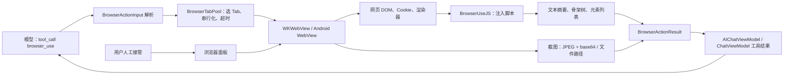

**入口与结果对象。** iOS 的动作枚举和输入字段位于 `` `src/ios/Agent/BrowserUse/BrowserUseActions.swift:5-128` ``；Android 的同一组枚举和解析字段位于 `` `src/android/app/src/main/java/com/openminis/app/browser/BrowserAction.kt:6-71` ``、`` `src/android/app/src/main/java/com/openminis/app/browser/BrowserActionInput.kt:9-105` ``。两端结果对象都携带 `text`、`success`、可选截图、可选下载文件、页面 URL 和实际 Tab ID，分别见 `` `src/ios/Agent/BrowserUse/BrowserUseActions.swift:180-217` `` 与 `` `src/android/app/src/main/java/com/openminis/app/browser/BrowserActionResult.kt:6-35` ``。

**关键数据流。** iOS 聊天工具分支解析 JSON 后调用 `browserTabPool.execute`，将结果文本、截图路径、页面 URL 和图片数据写回工具消息，见 `` `src/ios/Agent/Chat/AIChatViewModel+ConcurrentTools.swift:460-527` ``。Android 的 agent 分支做同样的路由，并把 base64 解码、缩放后保存到 session 的 `/var/minis/browser/`，见 `` `src/android/app/src/main/java/com/openminis/app/ui/chat/ChatViewModel.kt:7380-7448` ``。

### 10.3 动作空间：模型究竟能发什么指令

#### 10.3.1 输入协议的公共字段

工具定义要求 `tool_title` 与 `action`，其余字段按动作使用。iOS agent 的完整 schema 在 `` `src/ios/Agent/Chat/AIChatViewModel+ToolDefinitions.swift:70-100` ``；Android agent 的完整 schema 在 `` `src/android/app/src/main/java/com/openminis/app/tools/AgentTools.kt:55-101` ``。独立的 Android `BrowserUseTool.toolDefinition()` 也提供了通用 API schema，但只显式列出基础字段，见 `` `src/android/app/src/main/java/com/openminis/app/tools/BrowserUseTool.kt:21-108` ``；实际 app agent 应以 `AgentTools.browserUseDefinition` 的字段为准。

输入解析器的行为有几个容易忽略的细节：

- iOS 先验证 JSON、`action` 字符串和 `BrowserAction` 枚举；`keywords` 既可为字符串也可为字符串数组，见 `` `src/ios/Agent/BrowserUse/BrowserUseActions.swift:70-110` ``。
- Android 解析器把 `keywords` 当作 JSON 数组；shell offload 层会先把空白/逗号分隔字符串正规化成数组，分别见 `` `src/android/app/src/main/java/com/openminis/app/browser/BrowserActionInput.kt:48-80` ``、`` `src/android/app/src/main/java/com/openminis/app/sandbox/offload/BrowserUseOffloadHandler.kt:154-165` ``。
- Cookie 字段在两端都接受真实数组或“JSON 编码的字符串”，iOS 见 `` `src/ios/Agent/BrowserUse/BrowserUseActions.swift:113-128` ``，Android 见 `` `src/android/app/src/main/java/com/openminis/app/browser/BrowserActionInput.kt:86-103` ``。
- `tab_id` 是目标 Tab 的提示，不是结果中“猜出来的”编号；池在真正 dispatch 后把已验证的目标 ID 写回结果，iOS 见 `` `src/ios/Agent/BrowserUse/BrowserTabPool.swift:949-966` ``，Android 见 `` `src/android/app/src/main/java/com/openminis/app/browser/BrowserTabPool.kt:632-685` ``。

#### 10.3.2 完整动作表

下表列出 `BrowserAction` 的全部 22 个值，而不是只列常用的 navigate/click/type。Swift 枚举完整列表见 `` `src/ios/Agent/BrowserUse/BrowserUseActions.swift:5-28` ``；Kotlin 枚举完整列表见 `` `src/android/app/src/main/java/com/openminis/app/browser/BrowserAction.kt:6-28` ``。返回值均为 `BrowserActionResult`；“文本结果”指 `text` 字段，“失败”通常是 `success=false` 且 `text` 以 `Error:` 开头。

| 动作 | 参数与默认值 | 实际执行与返回 | 代码位置 |
|---|---|---|---|
| `navigate` | `url` 必填；无 scheme 时补 `https://` | iOS 仅允许 `http/https/minis` 直接导航；Android 由 WebViewClient 处理 Google OAuth 与外部 scheme；两端等待完成或 30 秒超时，返回 URL、标题、viewport、页面尺寸、滚动位置 | iOS `` `src/ios/Agent/BrowserUse/BrowserUseManager.swift:662-729` ``；Android `` `src/android/app/src/main/java/com/openminis/app/browser/BrowserUseManager.kt:565-647` `` |
| `screenshot` | `full_page` 可选，默认 `false` | 当前 viewport 或拉伸到页面高度后截图；返回 JPEG base64 与本地路径，`text` 含尺寸/URL/滚动元数据 | iOS `` `src/ios/Agent/BrowserUse/BrowserUseManager.swift:741-851` ``；Android `` `src/android/app/src/main/java/com/openminis/app/browser/BrowserUseManager.kt:651-733` `` |
| `click` | `selector`，或同时提供 `coordinate_x` + `coordinate_y` | 选择器走 `querySelector`；坐标走 `elementFromPoint`；成功返回元素 tag/短文本，找不到或 disabled 返回错误 | iOS `` `src/ios/Agent/BrowserUse/BrowserUseManager.swift:900-910` ``、`` `src/ios/Agent/BrowserUse/BrowserUseJavaScript.swift:26-66` ``；Android `` `src/android/app/src/main/java/com/openminis/app/browser/BrowserUseManager.kt:834-843` `` |
| `type` | `selector`、`text` 均必填 | 设置 input/textarea/contenteditable，派发键盘、input、change 事件；成功返回 selector 与字符数 | iOS `` `src/ios/Agent/BrowserUse/BrowserUseManager.swift:914-924` ``、`` `src/ios/Agent/BrowserUse/BrowserUseJavaScript.swift:70-117` ``；Android `` `src/android/app/src/main/java/com/openminis/app/browser/BrowserUseManager.kt:845-851` `` |
| `get_text` | `selector` 可选；省略则读 body | `innerText` 最多 10,000 字符；指定 selector 时返回元素诊断信息，未找到返回错误 | iOS `` `src/ios/Agent/BrowserUse/BrowserUseJavaScript.swift:121-180` ``、`` `src/ios/Agent/BrowserUse/BrowserUseManager.swift:929-959` ``；Android `` `src/android/app/src/main/java/com/openminis/app/browser/BrowserUseJS.kt:114-135` `` |
| `scroll` | `direction`=`up/down`，默认 down；`amount` 默认 500；`selector` 可选 | 先滚 window；若 window 不动，在最多 10 层 DOM 中选择面积最大的可滚动容器；返回滚动容器、位置、高度和其它容器提示 | iOS `` `src/ios/Agent/BrowserUse/BrowserUseJavaScript.swift:232-315` ``；Android `` `src/android/app/src/main/java/com/openminis/app/browser/BrowserUseJS.kt:163-212` `` |
| `get_page_info` | 无 | 返回 URL、标题、`scrollY`、页面尺寸、viewport、readyState、forms/links/images 数量 | iOS `` `src/ios/Agent/BrowserUse/BrowserUseJavaScript.swift:840-858` ``；Android `` `src/android/app/src/main/java/com/openminis/app/browser/BrowserUseJS.kt:250-267` `` |
| `execute_js` | `script` 必填 | 在 page world 执行；iOS 使用 `callAsyncJavaScript` 支持顶层 `await/return`，Android 用 `__minis__` bridge 等 Promise，返回 JSON 或字符串 | iOS `` `src/ios/Agent/BrowserUse/BrowserUseManager.swift:1333-1353` ``；Android `` `src/android/app/src/main/java/com/openminis/app/browser/BrowserUseManager.kt:881-931` `` |
| `find_elements` | `selector` 必填 | 查询最多 20 个匹配元素；返回总数、显示数、局部 `index`、tag/id/class/text/href/rect/可见性 | iOS `` `src/ios/Agent/BrowserUse/BrowserUseJavaScript.swift:349-372` ``；Android `` `src/android/app/src/main/java/com/openminis/app/browser/BrowserUseJS.kt:228-248` `` |
| `hover` | `selector` 必填 | 派发 mouseenter/mouseover，返回 tag 与最多 100 字符文本 | iOS `` `src/ios/Agent/BrowserUse/BrowserUseJavaScript.swift:335-345` ``；Android `` `src/android/app/src/main/java/com/openminis/app/browser/BrowserUseJS.kt:214-224` `` |
| `get_readable` | 无 | 按 `article`、`role=main`、`main`、常见内容 class 顺序选择正文，回退 body；空白折叠后最多 15,000 字符 | iOS `` `src/ios/Agent/BrowserUse/BrowserUseJavaScript.swift:185-227` ``；Android `` `src/android/app/src/main/java/com/openminis/app/browser/BrowserUseJS.kt:137-159` `` |
| `set_user_agent` | `user_agent`：iOS pool 支持 `mobile_safari/desktop_safari/custom`；Android agent schema 暴露 `mobile_chrome/desktop_chrome`，`custom` 由设置 UI 应用 | iOS pool 会把 profile/已保存 custom UA 同步到现有 Tab；Android action path 更新 profile并 reload，custom UA 通过 `setUserAgentFromUI` 传入；两端已有 URL 都会 reload | iOS `` `src/ios/Agent/BrowserUse/BrowserTabPool.swift:864-870` ``、`` `src/ios/Agent/BrowserUse/BrowserTabPool.swift:1385-1408` ``；Android `` `src/android/app/src/main/java/com/openminis/app/browser/BrowserUseManager.kt:1051-1065` ``、`` `src/android/app/src/main/java/com/openminis/app/ui/browser/BrowserSettingsSheet.kt:164-218` `` |
| `set_viewport` | `viewport_width` + `viewport_height` 均为正数，或 `reset=true` | session 级覆盖；iOS/Android 都对现有 Tab 应用新尺寸并 reload；返回设置/重置说明 | iOS `` `src/ios/Agent/BrowserUse/BrowserTabPool.swift:873-890` ``、`` `src/ios/Agent/BrowserUse/BrowserTabPool.swift:1356-1383` ``；Android `` `src/android/app/src/main/java/com/openminis/app/browser/BrowserTabPool.kt:1070-1172` `` |
| `get_backbone` | `max_depth` 可选，manager 默认 5 | 注入脚本生成可见 DOM 骨架树；返回节点数、深度、合并数及每节点的 selector/role/text/href/input/rect | iOS `` `src/ios/Agent/BrowserUse/BrowserUseManager.swift:1479-1514` ``；Android `` `src/android/app/src/main/java/com/openminis/app/browser/BrowserUseManager.kt:947-963` `` |
| `fetch` | `url` 必填 | 在当前页面上下文用 `fetch` 读取资源，返回 status/content-type/size/文件名，并把原始 bytes 放到 `fetchedFileData` | iOS `` `src/ios/Agent/BrowserUse/BrowserUseManager.swift:1551-1637` ``；Android `` `src/android/app/src/main/java/com/openminis/app/browser/BrowserUseManager.kt:965-1016` `` |
| `new_tab` | `url` 可选；`tab_id` 不用于创建 | Tab 池创建新 WebView、选中并返回新 ID；iOS/Android 每池最多 3 个；若有 URL 会加载 | iOS `` `src/ios/Agent/BrowserUse/BrowserTabPool.swift:423-454` ``；Android `` `src/android/app/src/main/java/com/openminis/app/browser/BrowserTabPool.kt:822-843` `` |
| `close_tab` | `tab_id` 可选，省略使用 selected tab | 从池移除 WebView/Tab，选择剩余 Tab；不存在返回错误 | iOS `` `src/ios/Agent/BrowserUse/BrowserTabPool.swift:512-529` ``；Android `` `src/android/app/src/main/java/com/openminis/app/browser/BrowserTabPool.kt:846-861` `` |
| `list_tabs` | 无 | 返回每个 Tab 的 ID、标题、URL，当前 selected Tab 有标记 | iOS `` `src/ios/Agent/BrowserUse/BrowserTabPool.swift:531-543` ``；Android `` `src/android/app/src/main/java/com/openminis/app/browser/BrowserTabPool.kt:863-874` `` |
| `get_cookies` | `keywords` 可选；`fuzzy` 两端默认值不同：iOS true，Android input 默认 false | iOS 只取当前 host/root domain，返回环境文件路径、名称和 value length；Android 取当前 URL 的 `Cookie` header，返回 name/value 预览 | iOS `` `src/ios/Agent/BrowserUse/BrowserUseManager.swift:1062-1183` ``；Android `` `src/android/app/src/main/java/com/openminis/app/browser/BrowserUseManager.kt:1425-1465` `` |
| `set_cookies` | `cookies` 数组或 JSON 字符串；每项必须 `name/value`，可选 domain/path/secure/http_only/expires | 通过原生 Cookie store 写入，能写 HttpOnly；默认 domain 为当前页面 host、path 为 `/`；SameSite 目前只接受不应用 | iOS `` `src/ios/Agent/BrowserUse/BrowserUseManager.swift:1185-1284` ``；Android `` `src/android/app/src/main/java/com/openminis/app/browser/BrowserUseManager.kt:1467-1561` `` |
| `scroll_and_collect` | iOS：direction/amount/scroll_count 默认 10、最多 20，selector/item_selector 可选；Android：实现要求 `item_selector`，iterations 默认 5、最多 50，keywords 可选 | 滚动并按文本去重；iOS 自动寻找重复元素并有单项 500、总输出 30,000 字符上限；Android 每步抓 selector、滚一 viewport、等待 400ms | iOS `` `src/ios/Agent/BrowserUse/BrowserUseManager.swift:1006-1052` ``、`` `src/ios/Agent/BrowserUse/BrowserUseJavaScript.swift:647-835` ``；Android `` `src/android/app/src/main/java/com/openminis/app/browser/BrowserUseManager.kt:1667-1724` `` |
| `wait_for_dom_stable` | iOS `timeout` 秒默认 10；Android `timeout` 毫秒默认 5,000，限制 1,000–60,000 | iOS `MutationObserver` 每 0.5 秒采样，连续 3 次不增且可为 0 即稳定；Android 比较 body `innerHTML.length`，两个连续读数相同即成功，超时返回失败 | iOS `` `src/ios/Agent/BrowserUse/BrowserUseManager.swift:1355-1463` ``；Android `` `src/android/app/src/main/java/com/openminis/app/browser/BrowserUseManager.kt:1599-1665` `` |

#### 10.3.3 Tab ID 与并发语义

`tab_id` 不能被当作“页面元素编号”。它标识 Tab；元素引用是 CSS selector 或坐标。动作结果追加 `tab_id: N`，用于模型把下一次 `get_text`、`scroll` 或 `click` 送回实际执行动作的 Tab。这个设计修复了并发 navigate 改写全局 selected ID 后，后续读取落到错误页面的问题，iOS 的说明与 stamping 逻辑见 `` `src/ios/Agent/BrowserUse/BrowserUseActions.swift:193-200` ``、`` `src/ios/Agent/BrowserUse/BrowserTabPool.swift:953-966` ``，Android 对应说明见 `` `src/android/app/src/main/java/com/openminis/app/browser/BrowserActionResult.kt:20-28` ``。

对“没有 `tab_id` 的调用”不能简单理解为永远使用 Tab 0：只有打开/替换页面的 `navigate` 允许在 busy grace 窗口 fan-out；读取、执行 JS、点击、滚动和截图必须跟随 selected/current page。iOS 在 `` `src/ios/Agent/BrowserUse/BrowserTabPool.swift:751-835` `` 明确区分 `isOpenPageAction`；Android 用 `BrowserAction.opensNewPage` 只把 `NAVIGATE` 放入集合，见 `` `src/android/app/src/main/java/com/openminis/app/browser/BrowserAction.kt:30-68` ``，路由分支见 `` `src/android/app/src/main/java/com/openminis/app/browser/BrowserTabPool.kt:547-576` ``。

#### 10.3.4 一次动作如何组合成可靠步骤

动作表只说明单个调用；agent 实际运行的是“观察—动作—再观察”的短序列。一个稳健的登录后读取流程通常是：先 `navigate`，再用 `get_page_info` 判断 readyState/尺寸，用 `get_backbone` 或 `find_elements` 找到 selector，随后 `click`/`type`，再显式 `wait_for_dom_stable`，最后 `get_readable` 或 `screenshot`。页面变化动作的自动 snapshot 只用于 UI preview，不能替代最后一次显式 screenshot，见 `` `src/ios/Agent/BrowserUse/BrowserUseManager.swift:243-321` ``、`` `src/android/app/src/main/java/com/openminis/app/browser/BrowserUseManager.kt:528-559` ``。

这套序列有三个可观察的边界：

1. **导航边界。** `navigate` 的文本结果会包含实际 URL、标题、viewport、页面尺寸和滚动位置；模型可以发现重定向或 viewport 不一致，见 `` `src/ios/Agent/BrowserUse/BrowserUseManager.swift:616-657` ``、`` `src/android/app/src/main/java/com/openminis/app/browser/BrowserUseManager.kt:610-647` ``。
2. **结构边界。** `get_backbone` 生成的 `sel` 是下一步动作输入；如果 click 后 URL/DOM 改变，旧 backbone 不再是当前页面的事实，应再次提取，见 `` `src/ios/Agent/BrowserUse/BrowserUseJavaScript.swift:614-640` ``。
3. **结果边界。** 每次结果都带 `success` 与实际 `tab_id`；失败时先根据 `text` 决定重读页面、换 selector、换 Tab 还是放弃，而不是把同一 JSON 无限重放，见 `` `src/ios/Agent/BrowserUse/BrowserTabPool.swift:966-989` ``、`` `src/android/app/src/main/java/com/openminis/app/browser/BrowserActionResult.kt:29-35` ``。

一个“发现后点击”的最小例子如下，参数名与仓库 schema 一致：

```json
{"action":"get_backbone","max_depth":5}
```

模型从返回树中选择 `sel`，而不是自己编造编号：

```json
{"action":"click","selector":"#search > button"}
```

点击返回成功但页面可能异步更新，因此下一步应是：

```json
{"action":"wait_for_dom_stable","timeout":10}
```

然后再读文本或截图：

```json
{"action":"get_readable"}
```

这些 JSON 片段是协议示例，不是仓库中的固定调用；它们对应的参数校验与实际返回仍由 `` `src/ios/Agent/BrowserUse/BrowserUseActions.swift:32-110` `` 和 `` `src/android/app/src/main/java/com/openminis/app/browser/BrowserActionInput.kt:9-80` `` 执行。

对于并发场景，两个没有 `tab_id` 的 `navigate` 可以被池分到不同 Tab；但其后的 `get_text` 应使用第一个 navigate 返回的 `tab_id`，否则模型可能跟随最新 selected Tab。iOS 的 fan-out 与 result stamping 见 `` `src/ios/Agent/BrowserUse/BrowserTabPool.swift:808-829` ``、`` `src/ios/Agent/BrowserUse/BrowserTabPool.swift:949-966` ``；Android 的同等规则见 `` `src/android/app/src/main/java/com/openminis/app/browser/BrowserTabPool.kt:547-576` ``、`` `src/android/app/src/main/java/com/openminis/app/browser/BrowserTabPool.kt:632-685` ``。

### 10.4 页面表示：给模型的不是“整个网页”

这是浏览器 agent 成败的核心。OpenMinis 没有把完整 DOM、HTML 或无障碍树直接塞给模型，而是提供四种互补表示：可读正文、截断文本、结构骨架和有限元素列表；截图作为多模态补充。模型要先选择一种表示，再用 CSS selector/坐标进行动作。

#### 10.4.1 `get_text` 与 `get_readable`：便宜的文本通道

`get_text` 读取可见 `innerText`，body 结果最多 10,000 字符；指定 selector 时也最多 10,000 字符，并附带 readyState、DOM 数量、滚动高度等诊断字段，真实脚本见 `` `src/ios/Agent/BrowserUse/BrowserUseJavaScript.swift:121-180` ``。Android 脚本的核心截断同样是 10,000 字符，但 Android 的 `get_text` 结果诊断字段更少，见 `` `src/android/app/src/main/java/com/openminis/app/browser/BrowserUseJS.kt:114-135` ``。

`get_readable` 是启发式正文抽取，不是浏览器的阅读模式实现。脚本按 `article`、`[role="main"]`、`main`、`.post-content`、`.article-body`、`.entry-content`、`#content`、`.content` 顺序找第一个可见且有文字的元素，找不到才回退 body；文本折叠连续空白后截断到 15,000 字符，见 `` `src/ios/Agent/BrowserUse/BrowserUseJavaScript.swift:185-227` ``。Android 移植了同一选择器顺序，见 `` `src/android/app/src/main/java/com/openminis/app/browser/BrowserUseJS.kt:137-159` ``。

这两个通道适合文章、搜索结果和登录后的文本页面，但不适合识别按钮位置、Canvas、图片里的文字或复杂 SPA 的视觉层。此时使用 `get_backbone`、`find_elements` 或显式 `screenshot`。

#### 10.4.2 `find_elements`：有局部 index，但没有永久 element handle

真实注入脚本如下，来自 `` `src/ios/Agent/BrowserUse/BrowserUseJavaScript.swift:347-372` ``：

```swift
// source: src/ios/Agent/BrowserUse/BrowserUseJavaScript.swift:349-370
(function() {
    var els = document.querySelectorAll('\(jsQuote(selector))');
    var results = [];
    var limit = Math.min(els.length, 20);
    var scrollX = window.scrollX || window.pageXOffset || 0;
    var scrollY = window.scrollY || window.pageYOffset || 0;
    for (var i = 0; i < limit; i++) {
        var el = els[i];
        var rect = el.getBoundingClientRect();
        results.push({
            index: i,
            tag: el.tagName,
            id: el.id || null,
            className: el.className || null,
            text: (el.innerText || '').substring(0, 80),
            href: el.href || null,
            rect: {x: Math.round(rect.x), y: Math.round(rect.y),
                   width: Math.round(rect.width), height: Math.round(rect.height),
                   pageX: Math.round(rect.x + scrollX),
                   pageY: Math.round(rect.y + scrollY),
                   visible: rect.width > 0 && rect.height > 0 &&
                            rect.top < window.innerHeight && rect.bottom > 0}
        });
    }
    return JSON.stringify({count: els.length, shown: limit, elements: results});
})()
```

这里的 `index` 是本次 `querySelectorAll` 结果里的 0 到 19，不是页面全局 ID，也不是可以直接传给 `click` 的参数。`click` 的协议只接受 CSS selector 或坐标，见 `` `src/ios/Agent/BrowserUse/BrowserUseManager.swift:900-909` ``；Android 的 `click` 同样只接受 selector/coordinate，见 `` `src/android/app/src/main/java/com/openminis/app/browser/BrowserUseManager.kt:836-842` ``。因此从零实现时应让模型复制结果里的 selector，不能设计成“click index=3”，除非你自己再增加一层编号到 selector 的映射。

#### 10.4.3 `get_backbone`：压缩的可见 DOM 骨架

这是本项目最重要的注入算法。下面片段保留了真实 Swift 字符串中的核心语义，来源是 `` `src/ios/Agent/BrowserUse/BrowserUseJavaScript.swift:377-403` ``：

```swift
// source: src/ios/Agent/BrowserUse/BrowserUseJavaScript.swift:377-403
static func getBackbone(maxDepth: Int) -> String {
    """
    (function() {
        var MAX_DEPTH = \(maxDepth);
        var MERGE_THRESHOLD = 10;
        var MIN_SIZE = 8;

        function isVisible(el) {
            if (!el.getBoundingClientRect) return false;
            var st = window.getComputedStyle(el);
            if (st.display === 'none' || st.visibility === 'hidden' || st.opacity === '0') return false;
            var r = el.getBoundingClientRect();
            return r.width >= MIN_SIZE && r.height >= MIN_SIZE;
        }

        var SEMANTIC_TAGS = new Set(['IMG','SVG','VIDEO','CANVAS','INPUT','TEXTAREA','BUTTON','A','SELECT','IFRAME']);
        var SKIP_TAGS = new Set(['SCRIPT','STYLE','NOSCRIPT','BR','HR','META','LINK','TEMPLATE']);

        function isLeaf(el) {
            if (SKIP_TAGS.has(el.tagName)) return false;
            if (SEMANTIC_TAGS.has(el.tagName)) return true;
            var children = el.children;
            for (var i = 0; i < children.length; i++) {
                if (!SKIP_TAGS.has(children[i].tagName) && isVisible(children[i])) return false;
            }
            return true;
        }
    })()
    """
}
```

算法分七个概念步骤：

1. **过滤可见节点。** `display:none`、`visibility:hidden`、`opacity:0` 或宽高小于 8 的节点先被过滤；脚本把按钮、链接、输入框、媒体等语义标签直接当作叶子候选，见 `` `src/ios/Agent/BrowserUse/BrowserUseJavaScript.swift:384-403` ``。
2. **向上合并。** 可见叶子会向父级冒泡；如果父级矩形与代表节点在四条边上都相差不超过 10 px，就把父级作为代表，减少重复的布局包裹层，见 `` `src/ios/Agent/BrowserUse/BrowserUseJavaScript.swift:405-485` ``。
3. **补结构组节点。** 从每个代表向上走最多 6 层；一个祖先包含至少两个代表时，它会被加成 group node，保留页面的区域结构，见 `` `src/ios/Agent/BrowserUse/BrowserUseJavaScript.swift:487-509` ``。
4. **提取可操作信息。** 节点携带 tag、短 class、selector、role、最多 120 字符 text；链接只保留 path 与最多 40 字符 query，图片 src 最多 120 字符，输入 value/placeholder 最多 60 字符，见 `` `src/ios/Agent/BrowserUse/BrowserUseJavaScript.swift:511-549` ``。
5. **按真实 DOM containment 建树。** 节点先按面积排序，再用 `el.contains` 找最小面积父节点，避免纯矩形包含在浮层/重叠布局上的误判，见 `` `src/ios/Agent/BrowserUse/BrowserUseJavaScript.swift:551-575` ``。
6. **清理冗余组节点。** 只有一个子节点的空 group 会被展平；没有内容的空 group 被删除，见 `` `src/ios/Agent/BrowserUse/BrowserUseJavaScript.swift:577-605` ``。
7. **深度裁剪与序列化。** `max_depth` 默认由 manager 设为 5；达到深度后清空 children。序列化结果包含 `sel`、role、text、href、input、`rect` 与页面坐标 `pageXY`，见 `` `src/ios/Agent/BrowserUse/BrowserUseJavaScript.swift:607-640` ``。

Android 的 `BrowserUseJS.getBackbone` 是逐行移植，使用同样的可见性、10 px 合并、短 selector、DOM containment、group prune 和 `MAX_DEPTH`，见 `` `src/android/app/src/main/java/com/openminis/app/browser/BrowserUseJS.kt:271-434` ``。

#### 10.4.4 稳定引用：短 CSS selector，而不是无障碍编号

短 selector 的真实实现如下，来源 `` `src/ios/Agent/BrowserUse/BrowserUseJavaScript.swift:412-439` ``：

```javascript
// source: src/ios/Agent/BrowserUse/BrowserUseJavaScript.swift:412-439
// Short selector: #id or #ancestor > tag:nth(n) — max 2 segments after anchor
function shortSelector(el) {
    if (el.id) return '#' + el.id;
    var path = [];
    var cur = el;
    while (cur && cur !== document.body && cur !== document.documentElement) {
        if (cur.id) { path.unshift('#' + cur.id); break; }
        var seg = cur.tagName.toLowerCase();
        var parent = cur.parentElement;
        if (parent) {
            var siblings = parent.children;
            var sameTag = 0, idx = 0;
            for (var i = 0; i < siblings.length; i++) {
                if (siblings[i].tagName === cur.tagName) {
                    sameTag++;
                    if (siblings[i] === cur) idx = sameTag;
                }
            }
            if (sameTag > 1) seg += ':nth-of-type(' + idx + ')';
        }
        path.unshift(seg);
        cur = parent;
    }
    if (path.length > 3 && path[0].charAt(0) === '#') {
        path = [path[0]].concat(path.slice(-2));
    } else if (path.length > 2) {
        path = path.slice(-2);
    }
    return path.join(' > ');
}
```

规则是：有 id 就使用 `#id`；没有 id 时根据同 tag 兄弟生成 `:nth-of-type(n)`，最终最多保留锚点加两段或最后两段。它比完整 DOM 路径短，适合模型上下文；但它仍是对当前 DOM 的 CSS 查询字符串，不是浏览器原生 element handle。DOM 重排、列表插入或 selector 变化都可能使旧引用指向别的节点或失效，这是由“每次结果只返回字符串 selector、下一次又重新 `querySelector`”直接得到的工程结论，标记为[推断]。因此每次 click/type 前最好重新 `get_backbone` 或 `find_elements`。

骨架会保留 `role` 属性，但脚本没有调用 `AccessibilityNodeInfo`，也没有构造完整无障碍树；模型收到的是简化 DOM 树。iOS 序列化 `role` 的代码在 `` `src/ios/Agent/BrowserUse/BrowserUseJavaScript.swift:618-635` ``，Android 对应在 `` `src/android/app/src/main/java/com/openminis/app/browser/BrowserUseJS.kt:415-429` ``。

#### 10.4.5 大页面与无限滚动裁剪

普通文本有 10,000/15,000 字符上限，骨架有深度上限；无限滚动专用动作还限制单项和总输出。iOS `scrollAndCollect` 的 `ITEM_CAP=500`、`TOTAL_CAP=30000`、最多 `scrollCount` 次，并按前 80 字符文本去重；脚本会观察滚动容器 mutation，最多等 2 秒并在 mutation 后等待至多 1 秒 settle，见 `` `src/ios/Agent/BrowserUse/BrowserUseJavaScript.swift:662-665` ``、`` `src/ios/Agent/BrowserUse/BrowserUseJavaScript.swift:741-809` ``。manager 把次数限制在 20，见 `` `src/ios/Agent/BrowserUse/BrowserUseManager.swift:1008-1026` ``。

Android 的同名动作不是调用 Kotlin 端的完整移植脚本，而是在 manager 中要求 `item_selector`，每次抓匹配节点文本、向下滚一 viewport、等待 400ms，再进行大小写不敏感的关键词过滤；默认 5 次、最多 50 次，见 `` `src/android/app/src/main/java/com/openminis/app/browser/BrowserUseManager.kt:1667-1724` ``。这是两端实际行为的重要差异：跨平台文档不能笼统写成“item selector 可省略且两端自动检测”。

#### 10.4.6 截图是第二种页面表示，不是 DOM 的替代品

显式 `screenshot` 才会把 JPEG base64 放入结果。iOS 当前 viewport 使用 `WKSnapshotConfiguration`；`full_page=true` 先读 `scrollHeight`、临时改变 WebView frame、让 lazy image eager 化并等待两个 RAF，最后用 JPEG quality 0.8 编码，同时把高度限制到 32,768 CSS px，见 `` `src/ios/Agent/BrowserUse/BrowserUseManager.swift:741-851` ``。Android 以设备 density 把 CSS 高度换成物理像素，使用同样的 32,768 px 上限，拉伸后 `Bitmap` 绘制再 JPEG quality 80，见 `` `src/android/app/src/main/java/com/openminis/app/browser/BrowserUseManager.kt:46-53` ``、`` `src/android/app/src/main/java/com/openminis/app/browser/BrowserUseManager.kt:651-733` ``。

视觉变化动作（navigate/click/scroll/scroll_and_collect/hover/type）会自动等待 DOM 变化并保存一张 UI preview snapshot，但这张自动 snapshot 只放 `imageFilePath`，不自动放 `base64Image` 给模型；iOS 代码在 `` `src/ios/Agent/BrowserUse/BrowserUseManager.swift:243-321` ``，Android 的 `attachSnapshot` 在 `` `src/android/app/src/main/java/com/openminis/app/browser/BrowserUseManager.kt:497-559` ``。模型需要视觉信息时应显式发 `screenshot`，或者在后续动作中引用保存的 `minis://` 图片。

### 10.5 从动作到 WebView：执行、等待与失败反馈

#### 10.5.1 iOS dispatch 顺序

iOS `BrowserUseManager.execute(action:)` 在任何动作前调用 `CookieBackupStore.syncIfNeeded()`，随后 switch 到 22 个动作；Tab 管理动作由池处理，`set_viewport` 也由池处理，见 `` `src/ios/Agent/BrowserUse/BrowserUseManager.swift:249-300` ``。成功的视觉变化动作进入 `waitForDomSettleAndSnapshot`：安装 MutationObserver，最多观察 5 秒；DOM 摘要会追加到 `text` 并送给模型，snapshot 仅作为文件路径给 UI，见 `` `src/ios/Agent/BrowserUse/BrowserUseManager.swift:318-393` ``。

导航用 `CheckedContinuation` 等 delegate；`didFinish` 会更新 URL/title/back-forward 状态、写历史并 resume，失败 delegate 设置 `loadError` 同时以 error resume，见 `` `src/ios/Agent/BrowserUse/BrowserUseManager.swift:2047-2093` ``。导航的自身 timeout 是 30 秒，超时时不直接报失败，而是 resume 让页面的部分加载结果仍可被读取，见 `` `src/ios/Agent/BrowserUse/BrowserUseManager.swift:693-729` ``。

JavaScript evaluation 特别容易无限等待。iOS 对导航 metadata 的 `evaluateJavaScript` 使用 `DispatchSourceTimer` 与 continuation race，默认 10 秒；代码注释还解释了后台 CPU throttle 下 `Task.sleep` 可能延迟，所以采用 GCD wall-clock timer，见 `` `src/ios/Agent/BrowserUse/BrowserUseManager.swift:551-614` ``。单动作在 Tab 池外层还有 300 秒 hard ceiling；超时会丢弃 wedged WebView、创建新 Tab，并把新 ID 和旧 URL 反馈给模型，见 `` `src/ios/Agent/BrowserUse/BrowserTabPool.swift:997-1114` ``。

#### 10.5.2 Android dispatch 顺序

Android manager 的 `execute` 先记录前 URL，再 switch；显式截图直接返回，其他视觉变化动作执行后等待 300ms 并附加文件 snapshot，同时检查 URL 是否变化，见 `` `src/android/app/src/main/java/com/openminis/app/browser/BrowserUseManager.kt:497-559` ``。导航通过 `CompletableDeferred` 等 `onPageFinished`，Handler 30 秒后完成 deferred；页面错误也完成 deferred，所以模型能拿到可读的导航 metadata，而不是永远挂住，见 `` `src/android/app/src/main/java/com/openminis/app/browser/BrowserUseManager.kt:347-383` ``、`` `src/android/app/src/main/java/com/openminis/app/browser/BrowserUseManager.kt:563-607` ``。

Android `evaluateJavascript` 的回调返回 JSON 编码字符串，helper 会先 unquote，再将 `{error:...}` 转成失败结果，见 `` `src/android/app/src/main/java/com/openminis/app/browser/BrowserUseManager.kt:1225-1279` ``。由于 Android WebView 的 `evaluateJavascript` 不会等待 Promise，`execute_js` 使用 `__minis__.resolve/reject` bridge，单次等待上限 30 秒；`fetch` 使用同样的 bridge，但等待上限 60 秒，见 `` `src/android/app/src/main/java/com/openminis/app/browser/BrowserUseManager.kt:881-931` ``、`` `src/android/app/src/main/java/com/openminis/app/browser/BrowserUseManager.kt:1018-1048` ``。

#### 10.5.3 结果如何回到模型

iOS 工具分支捕获 `execute` 抛出的错误并转成 `BrowserActionResult.error`；成功结果的 `text` 写入 tool block，`imageFilePath` 与 `browserURL` 更新 UI，显式 base64 会被解码、缩放到最长边 2,000 后作为 JPEG 输入模型，见 `` `src/ios/Agent/Chat/AIChatViewModel+ConcurrentTools.swift:460-514` ``。fetch bytes 也被保存到 session workspace，并追加 `minis_url`，见 `` `src/ios/Agent/Chat/AIChatViewModel+ConcurrentTools.swift:516-527` ``。

Android agent 分支将 base64 解码为原始 JPEG，保留原文件，另外生成最多 2,000 长边的推理副本，并把 `/var/minis/browser/...` 转成 percent-encoded `minis://browser/...`，见 `` `src/android/app/src/main/java/com/openminis/app/ui/chat/ChatViewModel.kt:7380-7448` ``。当模型在 sandbox 中通过 `minis-browser-use` 调用时，offload handler 使用 90 秒 hard timeout；成功输出 JSON envelope，截图默认以路径/`minis_url` 引用，只有 `--with-base64` 才内嵌 base64，见 `` `src/android/app/src/main/java/com/openminis/app/sandbox/offload/BrowserUseOffloadHandler.kt:23-37` ``、`` `src/android/app/src/main/java/com/openminis/app/sandbox/offload/BrowserUseOffloadHandler.kt:86-120` ``、`` `src/android/app/src/main/java/com/openminis/app/sandbox/offload/BrowserUseOffloadHandler.kt:239-301` ``。

### 10.6 Tab 池：并发、复用与内存回收

#### 10.6.1 iOS 的两级容量模型

单个 `BrowserTabPool` 最多 3 个 Tab；进程级 `BrowserTabPoolRegistry` 对所有 session 的 live tabs 设硬上限 8，优先回收其它 pool 中最老的 idle Tab，没有 idle 才 preempt in-use Tab，见 `` `src/ios/Agent/BrowserUse/BrowserTabPool.swift:20-108` ``、`` `src/ios/Agent/BrowserUse/BrowserTabPool.swift:191-204` ``。收到内存警告时，registry 回收所有非 `inUse` Tab，保留正在执行的动作，见 `` `src/ios/Agent/BrowserUse/BrowserTabPool.swift:110-123` ``。

Tab 在 action 期间及 action 完成后 15 秒 grace 内保持 `inUse`；隐式 navigate 遇到 busy Tab 会优先重用 free Tab，否则在容量允许时 fan-out 新 Tab，避免连续 navigate 覆盖同一页面。这个状态与 grace 的字段定义见 `` `src/ios/Agent/BrowserUse/BrowserTabPool.swift:206-229` ``，选择策略见 `` `src/ios/Agent/BrowserUse/BrowserTabPool.swift:790-835` ``，grace timer 见 `` `src/ios/Agent/BrowserUse/BrowserTabPool.swift:1151-1170` ``。

同一 Tab 上的动作必须串行。iOS pool 用 per-tab serial chain，等待前一操作最多 60 秒；不同 Tab 仍可并行。超时返回“打开新 Tab 或换 tab_id”的指导，而不是无限排队，见 `` `src/ios/Agent/BrowserUse/BrowserTabPool.swift:546-658` ``、`` `src/ios/Agent/BrowserUse/BrowserTabPool.swift:892-907` ``。

Tab 闲置超过 15 分钟、每 60 秒检查一次；回收前保存当前 URL，下一次创建同 ID 的 Tab 时恢复。Tab URL、selected ID 和 session viewport 写入 `Application Support/MinisChat/browser_tabs/<session>.json`，见 `` `src/ios/Agent/BrowserUse/BrowserTabPool.swift:1181-1217` ``、`` `src/ios/Agent/BrowserUse/BrowserTabPool.swift:1411-1509` ``。

#### 10.6.2 iOS WebView 的 cookie/session 共享与重建

所有 manager 使用同一个 `WKProcessPool` 与 `.default()` `WKWebsiteDataStore`；这样多个 Tab 能共享 OAuth/session Cookie，配置工厂见 `` `src/ios/Agent/BrowserUse/BrowserUseManager.swift:69-72` ``、`` `src/ios/Agent/BrowserUse/BrowserUseManager.swift:132-169` ``。新窗口由 `window.open` 回调携带配置创建新 manager，因此 opener 的会话与 Tab 池仍相连，见 `` `src/ios/Agent/BrowserUse/BrowserTabPool.swift:469-502` ``。

切换 UA 或 viewport 会重建 WKWebView，并在旧 URL 上 reload，而不是尝试对既有 renderer 打补丁；见 `` `src/ios/Agent/BrowserUse/BrowserUseManager.swift:1698-1742` ``。若 WebContent process 被系统杀死，manager 会让 pending continuation 失败，Tab 池在 300 秒动作上限路径中丢掉有毒 WebView 并开新 Tab，见 `` `src/ios/Agent/BrowserUse/BrowserUseManager.swift:2191-2221` ``、`` `src/ios/Agent/BrowserUse/BrowserTabPool.swift:1097-1114` ``。

#### 10.6.3 Android 的 per-pool 模型

Android `BrowserTabPool` 也限制 3 个 Tab，idle 默认 15 分钟、60 秒检查；设置可以调到 1–240 分钟。Tab 是 `data class`，持有一个 `BrowserUseManager(WebView)`、`inUse`、最近活动时间、初始 blank page 标记和 grace job，见 `` `src/android/app/src/main/java/com/openminis/app/browser/BrowserTabPool.kt:28-133` ``、`` `src/android/app/src/main/java/com/openminis/app/browser/BrowserTabPool.kt:189-246` ``。

Android 没有 iOS registry 的跨 session 8 Tab 总上限；这里的容量控制是 pool 实例内 `MAX_TABS=3`，见 `` `src/android/app/src/main/java/com/openminis/app/browser/BrowserTabPool.kt:34-60` ``。当所有 Tab 都 busy 且达到 3 个时，隐式 acquire 最多等待 20 秒、每 250ms 轮询；仍没有空闲 Tab 才回退到最近活动策略，见 `` `src/android/app/src/main/java/com/openminis/app/browser/BrowserTabPool.kt:721-778` ``。

显式 `tab_id` 的并发调用用每 Tab `Mutex`，等待锁最多 60 秒；没有 `tab_id` 的调用不共用一个锁，`navigate` 可以 fan-out，读取/操作动作跟随 selected Tab，见 `` `src/android/app/src/main/java/com/openminis/app/browser/BrowserTabPool.kt:98-110` ``、`` `src/android/app/src/main/java/com/openminis/app/browser/BrowserTabPool.kt:522-611` ``。隐式 action 返回后保持 15 秒 grace，显式 tab_id 则释放 `inUse`，见 `` `src/android/app/src/main/java/com/openminis/app/browser/BrowserTabPool.kt:624-707` ``。

#### 10.6.4 Android WebView 的复用方式

Android pool 在创建 Tab 时分配一个 detached `WebView`，设置 UA、viewport、`window.open/close` 和下载回调；没有 initial URL 时先标记 `needsInitialBlankPage`，在 suspend context 中加载带 viewport meta 的空页面，避免 `about:blank` 报告固定 980 CSS px，见 `` `src/android/app/src/main/java/com/openminis/app/browser/BrowserTabPool.kt:781-817` ``、`` `src/android/app/src/main/java/com/openminis/app/browser/BrowserUseManager.kt:55-72` ``。

Compose 重新组合不能只依赖 `AndroidView.factory` 返回一次 WebView。`BrowserWebView` 使用 `FrameLayout` 容器，在 `update` 中拆下并挂载当前 Tab 的 WebView；Tab 切换或 idle 后重建时不会让标题栏已经变化而内容仍显示旧 WebView，见 `` `src/android/app/src/main/java/com/openminis/app/ui/browser/BrowserWebView.kt:12-73` ``。iOS 则把 manager 的 WKWebView 直接交给 `UIViewRepresentable`，并在 sheet 里用 `.id(pool.selectedTabId)` 触发 Tab remount，见 `` `src/ios/Agent/BrowserUse/BrowserWebView.swift:3-14` ``、`` `src/ios/Agent/BrowserUse/BrowserSheetView.swift:58-75` ``。

### 10.7 登录态、Cookie 与隐私边界

#### 10.7.1 “用你的登录态”到底是什么

两端的 agent Tab 都运行在 app 自己的 WebView cookie store 中。用户在浏览器面板里完成登录后，agent 后续动作继续使用同一个 Tab/共享 store；iOS 的 manager 明确使用默认 website data store，Android 使用全局 `CookieManager` 并为每个 WebView 打开 first-party 与 third-party cookies，见 `` `src/ios/Agent/BrowserUse/BrowserUseManager.swift:132-169` ``、`` `src/android/app/src/main/java/com/openminis/app/browser/BrowserUseManager.kt:75-111` ``。

这不等于“自动读取系统 Safari/Chrome 的所有登录态”。Android 对 Google OAuth 明确把 accounts/signin/myaccount/oauth 域名路由到 Chrome Custom Tab；认证后的 Cookie 留在 Chrome，不会回到 app WebView，见 `` `src/android/app/src/main/java/com/openminis/app/browser/GoogleAuthRouter.kt:10-23` ``、`` `src/android/app/src/main/java/com/openminis/app/browser/GoogleAuthRouter.kt:40-66` ``。因此 Android agent 遇到 Google 登录页时应请求用户在 Chrome 完成登录并把结果带回，而不是反复重试 WebView。

iOS 的导航策略没有同等的 Google 外部路由；其 delegate 允许 `http`、`https`、`about`、`blob`、`minis`，阻止 `tel/mailto/itms-apps` 等 scheme，并避免 universal link 自动跳外部 app，见 `` `src/ios/Agent/BrowserUse/BrowserUseManager.swift:2095-2145` ``。是否能在某个站点完成 WebView 登录取决于该站点策略，不能把“有 Cookie store”误写成“所有 OAuth 都可用”。

#### 10.7.2 iOS CookieBackupStore：抗 ITP 的本地恢复层

iOS 每次 browser action 前最多每 60 秒同步一次 Cookie backup；同步先读取默认 `WKHTTPCookieStore`，将 domain/path/expires/secure/HttpOnly 与完整 value 按 registrable domain 写入 Netscape `cookies.txt`，再把 backup 中 live store 缺少的 Cookie 重新 set 回去，见 `` `src/ios/Agent/BrowserUse/CookieBackupStore.swift:6-22` ``、`` `src/ios/Agent/BrowserUse/CookieBackupStore.swift:206-300` ``。

它专门应对 WebKit ITP 在高流量域名上清除站点数据的情形；agent 自动浏览通常不构成真实用户 gesture。backup 在 Application Support 的每域文件目录，标记 excluded-from-backup，并设置 `completeUntilFirstUserAuthentication` 文件保护，不放进 iCloud/设备迁移，也不让 guest rootfs 直接读取原始登录 Cookie，见 `` `src/ios/Agent/BrowserUse/CookieBackupStore.swift:24-40` ``、`` `src/ios/Agent/BrowserUse/CookieBackupStore.swift:126-140` ``、`` `src/ios/Agent/BrowserUse/CookieBackupStore.swift:397-407` ``。

为防止 backup 无限增长，真实 navigate 才会刷新 domain 的 lastVisit；30 天未访问的 domain 被丢弃，最多保留 1,000 个 domain，见 `` `src/ios/Agent/BrowserUse/CookieBackupStore.swift:45-56` ``、`` `src/ios/Agent/BrowserUse/CookieBackupStore.swift:164-173` ``、`` `src/ios/Agent/BrowserUse/CookieBackupStore.swift:220-276` ``。用户在 Settings 清理 domain 时，UI 还会调用 `reconcileDomainAfterUserEdit`，确保下次 sync 不把用户刚删掉的 Cookie 复活，见 `` `src/ios/Agent/BrowserUse/BrowserManagementView.swift:422-459` ``。

#### 10.7.3 CookieAuditLogger：审计“变化”，而不是记录凭据

`CookieAuditLogger` 观察默认 Cookie store 的变化，采用 live diff 与启动后的 offline diff 两层机制；每个 key 是 `domain|path|name`，metadata 只包括 value length、expiry、HttpOnly，不记录 raw value，见 `` `src/ios/Agent/BrowserUse/CookieAuditLogger.swift:6-19` ``、`` `src/ios/Agent/BrowserUse/CookieAuditLogger.swift:24-75` ``。observer 事件会延迟 400ms 合并，diff 会逐条记录 removal，并将 additions/modifications 限制为每事件 20 条，见 `` `src/ios/Agent/BrowserUse/CookieAuditLogger.swift:79-125` ``。

为什么要审计 Cookie 访问：登录失效可能来自页面写入、agent `set_cookies`、Cookie 过期或 WebKit ITP 删除；没有“何时哪个域名的哪种 metadata 消失”的记录，用户只能看到空白登录页。审计的隐私边界是可归因而不可逆：日志可以证明 `x.com|/|sid` 被删除、它是 HttpOnly、值长度是多少，但不能从日志恢复 token。snapshot 本身写入 Application Support，见 `` `src/ios/Agent/BrowserUse/CookieAuditLogger.swift:138-147` ``。

Android 当前实现没有 iOS 同名的 backup/audit 层；它在每个动作里直接使用 `CookieManager`。`get_cookies` 读取当前 URL 的 Cookie header、按分号拆分，并把 value 原样或截断到 80 字符显示，见 `` `src/android/app/src/main/java/com/openminis/app/browser/BrowserUseManager.kt:1425-1465` ``。这是与 iOS 明显不同的隐私行为：Android agent result 可能看到 value preview；iOS agent result 只返回 env 文件位置、Cookie 名称和 value length，raw value 不放进 tool response，见 `` `src/ios/Agent/BrowserUse/BrowserUseManager.swift:1128-1182` ``。

#### 10.7.4 `set_cookies` 与跨域

两端都使用 native cookie API，而不是只在 JS 中写 `document.cookie`，因此可以落地 HttpOnly。iOS 接受 `http_only/httpOnly`、`expires/expirationDate` 等别名，`sameSite` 只读取不写入；见 `` `src/ios/Agent/BrowserUse/BrowserUseManager.swift:1217-1269` ``。Android 组装 Set-Cookie 字符串、调用 `CookieManager.setCookie` 后 `flush()`，同样接受 aliases，但 SameSite 目前不应用，见 `` `src/android/app/src/main/java/com/openminis/app/browser/BrowserUseManager.kt:1510-1548` ``。

`get_cookies` 有意收窄读取范围：iOS 只允许当前 host、root domain 或其子域匹配，见 `` `src/ios/Agent/BrowserUse/BrowserUseManager.swift:1067-1097` ``；Android 直接调用当前 URL 的 `CookieManager.getCookie(url)`，见 `` `src/android/app/src/main/java/com/openminis/app/browser/BrowserUseManager.kt:1435-1451` ``。但两端共享 store 都意味着 Tab 之间没有账号隔离。若产品需要多账号，不能只增加 `tab_id`；必须设计不同的 data store/profile/container，并明确哪些动作允许跨 profile。

### 10.8 反自动化对抗：UA、viewport、webdriver 与等待

#### 10.8.1 UA 不是一个字符串就结束

iOS 的 browser UA 定义在 `UserAgentProfile`，mobile Safari 为 iPhone UA、desktop Safari 为 macOS UA，并分别绑定 390×844 与 1280×800 逻辑 viewport，见 `` `src/ios/Agent/BrowserUse/BrowserUseActions.swift:131-175` ``。WebView 工厂同时设置 custom UA、preferred content mode，并在 desktop/custom viewport 时注入固定宽度 meta viewport，见 `` `src/ios/Agent/BrowserUse/BrowserUseManager.swift:123-191` ``。navigation delegate 还按 profile/viewport 决定 mobile 或 desktop content mode，见 `` `src/ios/Agent/BrowserUse/BrowserUseManager.swift:2135-2145` ``。

Android profile 是 mobile Chrome 412×915、desktop Chrome 1280×800，见 `` `src/android/app/src/main/java/com/openminis/app/browser/BrowserAction.kt:81-108` ``。Android 先按 density 把 CSS viewport 换成物理像素 measure/layout，再计算 shrink-to-fit 初始 scale；否则在高 density 手机上直接传 CSS px 会让页面逻辑宽度过窄，见 `` `src/android/app/src/main/java/com/openminis/app/browser/BrowserUseManager.kt:1067-1115` ``。

`src/ios/Shared/MinisUserAgent.swift` 容易被误读：它生成的是 LLM provider 的出站 URLSession UA，例如 `Minis/<version> (iOS <version>; iPhone)`，不是浏览器 WebView UA，见 `` `src/ios/Shared/MinisUserAgent.swift:4-32` ``。浏览器反自动化应改 `UserAgentProfile`/`customUserAgentString`，而不是修改该 provider helper。

#### 10.8.2 webdriver 痕迹的实际结论

已核对 iOS `BrowserUseJS` 的注入脚本与 Android 对应移植：它们访问 `document.querySelector`、样式、矩形、事件和 mutation observer，没有写入 `navigator.webdriver`、没有伪造完整无障碍树，也没有独立的 stealth/undetected-driver 层，见 `` `src/ios/Agent/BrowserUse/BrowserUseJavaScript.swift:3-858` ``、`` `src/android/app/src/main/java/com/openminis/app/browser/BrowserUseJS.kt:3-463` ``。因此本项目的“反自动化”策略主要是贴近 Safari/Chrome UA、保持 viewport/content mode 一致、用真实事件序列和等待页面稳定；不能声称它消除了站点的所有自动化检测。

点击脚本派发 mouseover/mouseenter/mousemove/mousedown/mouseup 后调用 `el.click()`；输入脚本使用 native value setter，再逐字符派发 keydown/keypress/input/keyup/change，并尝试触发 Angular/Vue 更新，见 `` `src/ios/Agent/BrowserUse/BrowserUseJavaScript.swift:26-43` ``、`` `src/ios/Agent/BrowserUse/BrowserUseJavaScript.swift:70-115` ``。这是为了兼容 controlled input，而不是为了伪造 WebDriver 的低层输入。

#### 10.8.3 站点策略与外部登录

Android 对 Google OAuth 采用域名后缀匹配，命中 accounts.google.com、signin.google.com、myaccount.google.com、oauth2.googleapis.com、accounts.youtube.com 就交给 Custom Tab；这是平台合规策略，不是继续升级 UA 的办法，见 `` `src/android/app/src/main/java/com/openminis/app/browser/GoogleAuthRouter.kt:28-45` ``。

Android 还将 `intent://`、`market://`、`tel:`、`mailto:`、`geo:` 等外部 scheme 路由到系统 Activity，未知 app scheme 阻断并 toast；http/https/about/file 留在 WebView，见 `` `src/android/app/src/main/java/com/openminis/app/ui/browser/BrowserExternalSchemeHandler.kt:11-32` ``、`` `src/android/app/src/main/java/com/openminis/app/ui/browser/BrowserExternalSchemeHandler.kt:78-107` ``。iOS 则在 navigation delegate 阻断非允许 scheme，见 `` `src/ios/Agent/BrowserUse/BrowserUseManager.swift:2101-2128` ``。

#### 10.8.4 等待策略不是固定 sleep

动作后，iOS 观察 DOM mutation 数量与新增 tag/text，连续三次 mutation 增长不再上升就结束，最多 5 秒；结果摘要包含 added/removed/attribute/text/new content/title，见 `` `src/ios/Agent/BrowserUse/BrowserUseManager.swift:396-548` ``。显式 `wait_for_dom_stable` 则把 mutation 计数每 0.5 秒采样，连续三次稳定后结束，见 `` `src/ios/Agent/BrowserUse/BrowserUseManager.swift:1357-1461` ``。

Android 自动 preview 使用 300ms 延迟；显式 `wait_for_dom_stable` 用 body HTML 长度轮询 200ms，并对 readyState=complete 且 body 非空的页面提供快速路径，见 `` `src/android/app/src/main/java/com/openminis/app/browser/BrowserUseManager.kt:550-559` ``、`` `src/android/app/src/main/java/com/openminis/app/browser/BrowserUseManager.kt:1601-1665` ``。动态页面最好让模型显式调用 `wait_for_dom_stable`，不要把一次 300ms 当作通用网络完成信号。

### 10.9 UI 面板与人工接管

#### 10.9.1 iOS 浏览器面板

`BrowserSheetView` 由 Tab bar、URL bar、live `BrowserWebView`、前进后退/停止/刷新/全屏工具栏组成；agent busy 时禁用 Tab、URL 输入、底部导航和关闭操作，并在 WebView 上覆盖 `AgentBrowsingOverlay`，见 `` `src/ios/Agent/BrowserUse/BrowserSheetView.swift:16-152` ``。overlay 半透明遮罩捕获所有触摸，显示“Minis is browsing”，并提供 `Takeover` 按钮，见 `` `src/ios/Agent/BrowserUse/BrowserSheetView.swift:332-384` ``。

UI 显示的 WebView 与 agent 驱动的是同一个 manager；页面加载失败显示 Safari 风格错误层而不是白屏，见 `` `src/ios/Agent/BrowserUse/BrowserSheetView.swift:58-75` ``、`` `src/ios/Agent/BrowserUse/BrowserUseManager.swift:16-23` ``。浏览器设置允许切换 UA、custom UA、viewport，并列出 Cookie domain；清理 all website data 时同时删除 Cookie backup，见 `` `src/ios/Agent/BrowserUse/BrowserManagementView.swift:32-56` ``、`` `src/ios/Agent/BrowserUse/BrowserManagementView.swift:361-459` ``。

#### 10.9.2 iOS takeover 如何衔接 agent loop

普通 takeover 在 agent loop 中等待用户返回前景，然后截一张新图，向 `agentHistory` 追加一条 user message 和 JPEG，让模型看到用户操作后的状态，见 `` `src/ios/Agent/Chat/AIChatViewModel+BackgroundTask.swift:373-410` ``。如果用户在一次 browser action 中途 takeover，系统等待 continuation；最长 5 分钟，恢复后重新截图并将结果交回工具分支，见 `` `src/ios/Agent/Chat/AIChatViewModel+BackgroundTask.swift:412-455` ``。工具结果会附加 `[Browser takeover] User manually operated...`，见 `` `src/ios/Agent/Chat/AIChatViewModel+ConcurrentTools.swift:472-483` ``。

这条链的关键是“人工操作后重新观察”，而不是假设模型知道用户点击了什么。否则模型的 DOM/视觉记忆会过期，下一次 selector 很可能已经失效。

#### 10.9.3 Android Compose 面板

`BrowserSheet` 使用 `StandardChatSheet`，展示 Tab chips、URL bar、加载进度、WebView、下载 banner、history/settings 和底部导航。sheet 打开时确保至少有一个 Tab；WebView 外侧的 nested-scroll guard 把滚动 delta 消费掉，防止网页滚动拖动 bottom sheet，见 `` `src/android/app/src/main/java/com/openminis/app/ui/browser/BrowserSheet.kt:83-138` ``。UI 在没有 URL 时不挂载空 WebView，避免 ModalBottomSheet/OpenGL 首屏出现黑白空白，见 `` `src/android/app/src/main/java/com/openminis/app/ui/browser/BrowserSheet.kt:302-333` ``。

agent busy 时 Compose 显示呼吸灯 overlay，点击 `Takeover` 目前只调用 `tabPool.releaseAllTabs()`，见 `` `src/android/app/src/main/java/com/openminis/app/ui/browser/BrowserSheet.kt:335-339` ``、`` `src/android/app/src/main/java/com/openminis/app/ui/browser/BrowserSheet.kt:573-625` ``。Android pool 的 `releaseAllTabs` 只是把 `inUse=false` 并保存状态，见 `` `src/android/app/src/main/java/com/openminis/app/browser/BrowserTabPool.kt:1041-1046` ``。

因此两端 takeover 语义不完全相同：iOS 有 5 分钟 continuation、恢复截图和 agent history 注入；在本章核对到的 Android browser/chat 路径中，Takeover 按钮没有对应的等待 continuation 或自动截图实现。这是一个[核实到的实现差异]，从零实现 Android 时必须补上“暂停 tool / 等用户结束 / 截图 / 继续 agent loop”，否则只是释放 busy 标志，并不能保证当前模型 turn 已被正确暂停。

#### 10.9.4 历史、下载与 `minis://` 资源

浏览器面板不仅是一个“把 WebView 塞进 sheet”的容器，还要把 agent 产生的文件、历史和内部资源交给用户可检查的路径。iOS 历史 store 保留 7 天，连续访问同一 URL 不重复；`didFinish` 时记录 URL/title，见 `` `src/ios/Agent/BrowserUse/BrowserHistory.swift:30-113` ``、`` `src/ios/Agent/BrowserUse/BrowserUseManager.swift:2047-2058` ``。Android `BrowserHistoryStore` 也保留 7 天、连续 URL 去重，并支持按 title/URL 搜索，见 `` `src/android/app/src/main/java/com/openminis/app/browser/BrowserHistory.kt:14-63` ``、`` `src/android/app/src/main/java/com/openminis/app/browser/BrowserHistory.kt:96-139` ``。

历史不是 agent 的页面表示：它只告诉用户“曾经访问过什么”，不会替代当前 Tab 的 DOM 或截图。点击历史项时，iOS history view 调用 `onSelect(url)`，Android history sheet 在没有 selected Tab 时先创建 Tab 再导航，见 `` `src/ios/Agent/BrowserUse/BrowserHistory.swift:173-183` ``、`` `src/android/app/src/main/java/com/openminis/app/ui/browser/BrowserSheet.kt:451-465` ``。

下载也分为“浏览器原生下载”和 `fetch` 两条路径。iOS 对 `<a download>`、Content-Disposition attachment 或 WebKit 不可内联的 MIME 类型走 `WKDownload`，把文件保存到 session workspace，并通过 BrowserDownloadCenter 显示进度，见 `` `src/ios/Agent/BrowserUse/BrowserUseManager.swift:2103-2165` ``、`` `src/ios/Agent/BrowserUse/BrowserUseManager.swift:2226-2312` ``。Android 的 WebView download listener 区分 http/data/blob：http 交给 pool 的 workspace downloader，blob/data 通过页面 JS 的 FileReader/bridge 解码，见 `` `src/android/app/src/main/java/com/openminis/app/browser/BrowserUseManager.kt:138-231` ``、`` `src/android/app/src/main/java/com/openminis/app/browser/BrowserUseManager.kt:252-275` ``。

下载要复用登录 Cookie。Android downloader 从 `CookieManager.getCookie(url)` 构造请求头，所以需要用同一个 WebView cookie store；见 `` `src/android/app/src/main/java/com/openminis/app/browser/BrowserTabPool.kt:391-417` ``。iOS 的 WKDownload 由 WebKit 自己在同一 session 中执行，再由 delegate 选择 workspace 目标文件，见 `` `src/ios/Agent/BrowserUse/BrowserUseManager.swift:2227-2269` ``。这比让 agent 重新用 curl/wget 下载更能保留登录态。

`minis://` 是 app 内部资源 scheme，不是把任意本地路径暴露给网页。iOS scheme handler 将 URL 解析为 `AIChatViewModel.resolveMinisURL` 能解析的本地文件，再根据扩展名生成 MIME；找不到文件就失败，见 `` `src/ios/Agent/BrowserUse/BrowserUseManager.swift:2399-2463` ``。Android 的 WebViewClient 将 `minis://workspace/...` 映射到 PRoot 的 host path，HTML 没有 viewport meta 时才注入 session viewport，见 `` `src/android/app/src/main/java/com/openminis/app/browser/BrowserUseManager.kt:386-454` ``。

模型侧得到的是受控的 `minis_url`，不是任意 `file://`；iOS 将 browser artifact 写入 session 目录后转换成 minis URL，见 `` `src/ios/Agent/Chat/AIChatViewModel+ConcurrentTools.swift:499-527` ``。Android 也只把 `/var/minis/` 下的 namespace/filename 做 percent-encoding，见 `` `src/android/app/src/main/java/com/openminis/app/ui/chat/ChatViewModel.kt:7463-7476` ``。从零实现时应限制 scheme、根目录和 MIME，禁止把 Cookie backup 目录映射进 WebView。[推断]

#### 10.9.5 viewport 与可见 WebView 的生命周期

iOS 的 agent WebView 可能平时停在视图层级之外，打开 BrowserSheet 时又被拉伸到 sheet 宽度；如果截图后只恢复 frame 而不触发 resize，页面可能保持错误的 CSS visual viewport。`restoreViewportFrame` 会释放焦点键盘、恢复当前 viewport、layout，并派发 `resize`，见 `` `src/ios/Agent/BrowserUse/BrowserUseManager.swift:1744-1781` ``。输入动作结束后也主动 blur/endEditing，避免 offscreen WebView 留下全屏键盘占位，见 `` `src/ios/Agent/BrowserUse/BrowserUseManager.swift:914-924` ``、`` `src/ios/Agent/BrowserUse/BrowserUseManager.swift:1784-1802` ``。

Android 的 detached WebView 必须先 measure/layout 才能让 `window.innerWidth` 与截图尺寸正确；`applyViewport` 以 density 换算物理像素，写入 `lastAppliedViewport` 并设置初始缩放，见 `` `src/android/app/src/main/java/com/openminis/app/browser/BrowserUseManager.kt:1094-1115` ``。改变 viewport 后 pool 会对每个 Tab reload 并等待 `onPageFinished`，否则 follow-up `get_page_info` 读到的还是旧 CSS viewport，见 `` `src/android/app/src/main/java/com/openminis/app/browser/BrowserTabPool.kt:1133-1155` ``。

这解释了为什么“UI 看起来有页面”并不等于“agent 能正确读页面”：UI 容器尺寸、WebView layout、CSS viewport、截图 rect 和模型 metadata 必须一致。iOS 以重建/restore frame 保证一致，Android 以 measure/layout/reload 保证一致；只在 UI 层改变宽高而不通知 manager 会产生裁切、固定定位漂移或 980px blank fallback。

#### 10.9.6 停止、错误层与可恢复性

iOS 浏览器面板的 stop 按钮调用 `stopAllLoading`，遍历所有 loading Tab 并调用 manager `stopLoading`，从而让等待中的 navigation continuation 走 delegate 错误路径，见 `` `src/ios/Agent/BrowserUse/BrowserTabPool.swift:323-335` ``、`` `src/ios/Agent/BrowserUse/BrowserUseManager.swift:1820-1823` ``。导航失败既写入 `loadError` 给用户看，也 resume agent continuation 给模型处理，不把 UI 错误和工具错误二选一，见 `` `src/ios/Agent/BrowserUse/BrowserUseManager.swift:2066-2092` ``。

Android 面板把 stop/reload 与 `isAgentBusy` 绑定：agent 正在操作时禁用用户导航控件，空闲时才允许手动 back/forward/reload，见 `` `src/android/app/src/main/java/com/openminis/app/ui/browser/BrowserSheet.kt:379-440` ``。Android `onReceivedError` 对主 frame 清理 loading 并完成 navigation deferred，但不会像 iOS 一样持有一个 `loadError` overlay 状态，见 `` `src/android/app/src/main/java/com/openminis/app/browser/BrowserUseManager.kt:375-384` ``。实现跨平台 UI 时应分别处理“用户看到的错误页”和“agent 收到的失败文本”。

#### 10.9.7 面向调试的最小观测字段

一个可诊断的 browser result 至少需要：动作名、实际 `tab_id`、请求 URL、当前 page URL、标题、viewport、success/error、截图路径以及是否触发下载。iOS manager 的 navigation/screenshot metadata 已包含 URL、title、viewport、page size、scroll position，见 `` `src/ios/Agent/BrowserUse/BrowserUseManager.swift:616-657` ``、`` `src/ios/Agent/BrowserUse/BrowserUseManager.swift:854-895` ``；Android 也在对应 metadata 中查询 live `window.innerWidth/Height`，见 `` `src/android/app/src/main/java/com/openminis/app/browser/BrowserUseManager.kt:610-647` ``、`` `src/android/app/src/main/java/com/openminis/app/browser/BrowserUseManager.kt:735-781` ``。

不要只记录 selected Tab。并发 fan-out 会在 action 等待期间改变 selected ID；两端都把“实际 acquired/dispatch 的 Tab ID”单独写入结果，见 `` `src/ios/Agent/BrowserUse/BrowserTabPool.swift:949-966` ``、`` `src/android/app/src/main/java/com/openminis/app/browser/BrowserTabPool.kt:632-685` ``。这一个字段能把大量“模型读到空白页面”的问题从猜测变成可复盘事件。

### 10.10 平台对照

| 抽象 | iOS 落地 | Android 落地 | 为什么有差异 |
|---|---|---|---|
| Web 执行面 | `WKWebView`，`@MainActor` manager | Android `WebView`，WebView 调用跳 `Dispatchers.Main` | 两套系统 API 的线程与 Promise 回调模型不同 |
| 共享登录态 | `WKProcessPool` + `WKWebsiteDataStore.default()` | 全局 `CookieManager`；显式开启 third-party Cookie | iOS 通过 process pool 共享，Android CookieManager 本身是进程级接口 |
| Tab 上限 | pool 3；registry 跨 session 8 | pool 3；无对应跨 session registry | iOS 对 WebContent/jetsam 建了进程级回收层，Android 当前仅 pool 级约束 |
| idle 回收 | 60 秒检查，15 分钟固定；保存 URL | 60 秒检查，默认 15 分钟，可调 1–240；保存 URL | Android 将设置暴露给 Compose，iOS 固定常量 |
| 同 Tab 并发 | per-tab serial chain，等待 60 秒 | per-tab `Mutex`，等待 60 秒 | Swift continuation chain 与 Kotlin Mutex 的实现方式不同 |
| 隐式 navigate | busy grace 期间优先 free、必要时 fan-out | 同样 15 秒 grace；满容量最多等 20 秒 | 两端都避免连续导航覆盖 Tab 0 |
| 读取/操作跟随 | 非 navigate 跟随 selected/current Tab，不 fan-out | `opensNewPage` 只有 NAVIGATE，其它操作跟随 selected | 修复 navigate 后立即 get_text 落到空 Tab 的问题 |
| UA | mobile/desktop/custom Safari；viewport 390×844 或 1280×800 | mobile/desktop/custom Chrome；viewport 412×915 或 1280×800 | 平台默认浏览器身份不同 |
| viewport | UA/content mode + document-start meta script；改动重建 WKWebView | CSS px 转物理 px measure/layout，setInitialScale，再 reload | Android density 与 detached WebView 需要额外布局 |
| 页面正文 | `get_text` 10k；`get_readable` 15k | 同样 10k/15k，但诊断字段较少 | JS 基本移植，但 manager formatting 不完全相同 |
| 元素列表 | `find_elements` 最多 20，返回局部 index/rect | 同样最多 20 | index 都不是稳定句柄，动作仍需 selector/坐标 |
| DOM 骨架 | 可见 leaf、合并、group、短 selector、深度裁剪 | 1:1 移植算法 | 两端共享页面表示协议，降低模型提示差异 |
| 无限滚动 | 自动探测容器/item，item 500、总 30k，最多 20 步 | manager 要求 `item_selector`，默认 5、最多 50 步，400ms | Android manager 没有调用同等 `BrowserUseJS.scrollAndCollect` |
| DOM 等待 | MutationObserver 0.5 秒采样，3 次梯度稳定；默认 10 秒 | body innerHTML 长度，200ms 轮询；默认 5 秒，1–60 秒 | Android 使用 evaluateJavascript 结果更简单、成本更低 |
| 显式截图 | `WKSnapshotConfiguration`，base64 + path，32,768 CSS px cap | `Bitmap` 绘制，base64 + path，32,768 physical px cap | WebKit snapshot 与 Android Canvas 的内存单位不同 |
| 自动 snapshot | 视觉动作后 DOM 摘要给模型，snapshot path 给 UI | 视觉动作后延迟 300ms，path 给 UI | 两端都避免每个点击自动上传图片 |
| Cookie 读取 | 当前 host/root domain；结果不含 raw value，写 guest env 文件 | 当前 URL Cookie header；结果显示 value preview | iOS 选择更严格的 tool 输出隐私，Android 实现仍暴露 preview |
| Cookie backup | 有 per-domain Netscape backup、ITP restore、audit diff | 无同名 backup/audit 层，直接 CookieManager | WebKit ITP 清理问题在 iOS 更突出；Android 尚未实现对应恢复层 |
| Google OAuth | 本章代码只做 scheme 过滤，不自动路由 Google | 命中 Google auth 域名交 Chrome Custom Tab，Cookie 不回 WebView | Google 禁止 WebView 登录，Android 显式遵守该策略 |
| UI wrapper | `UIViewRepresentable`，sheet 用 `.id(selectedTabId)` | `AndroidView` + FrameLayout update/reparent | Compose factory 一次性执行，需要显式换 child WebView |
| Takeover | overlay + continuation + 5 分钟 timeout + 恢复截图/history | overlay 的 Takeover 只 `releaseAllTabs` | 当前两端人工接管协议尚未完全对称 |
| shell offload | iOS agent 直接使用 pool（本章引用的聊天路径） | `minis-browser-use` JSON envelope，90 秒 timeout，singleTab=true | Android sandbox 通过 PRoot/native offload 访问宿主 WebView |

### 10.11 设计取舍与踩坑

1. **不要把“元素编号”与 Tab ID 混为一谈。** `find_elements.index` 只在一次查询的前 20 个结果中有效；真正的 click/type 参数是 selector 或坐标，见 `` `src/ios/Agent/BrowserUse/BrowserUseJavaScript.swift:349-372` ``、`` `src/ios/Agent/BrowserUse/BrowserUseManager.swift:900-909` ``。如果教学项目想提供 `click(element_id=7)`，必须在页面变化后重新生成编号表并拒绝旧编号。

2. **短 selector 减少 token，但不保证永久稳定。** selector 只保留 id 或最多两段 `nth-of-type`，见 `` `src/ios/Agent/BrowserUse/BrowserUseJavaScript.swift:412-439` ``。列表插入后 nth-of-type 会改变；模型在 click 失败时应重新读取 backbone，而不是盲目重试旧字符串。[推断]

3. **文本截断是上下文预算策略，不是完整抓取。** `get_text`/`get_readable` 明确截断到 10k/15k；完整数据应使用 selector 分区、scroll_and_collect 或 fetch，见 `` `src/ios/Agent/BrowserUse/BrowserUseJavaScript.swift:127-154` ``、`` `src/ios/Agent/BrowserUse/BrowserUseJavaScript.swift:207-225` ``。

4. **大截图必须设硬上限。** 32,768 px 高度仍可能产生很大的 ARGB bitmap；代码选择“截断并在 metadata 告知原始高度”，而不是冒险 OOM，见 `` `src/android/app/src/main/java/com/openminis/app/browser/BrowserUseManager.kt:46-53` ``、`` `src/ios/Agent/BrowserUse/BrowserUseManager.swift:741-745` ``。从零实现时可先只支持 viewport screenshot，把 full page 留到有内存预算和滚动拼接方案后。

5. **Cookie backup 与显式 Cookie 导出是两个权限面。** iOS backup 受文件保护且不可被 guest rootfs 读；但 `get_cookies` 为 shell 使用而写出 env 文件，且 raw value 会存在该文件中，见 `` `src/ios/Agent/BrowserUse/CookieBackupStore.swift:24-32` ``、`` `src/ios/Agent/BrowserUse/BrowserUseManager.swift:1128-1180` ``。产品必须在 UI/提示中把“恢复登录态”和“把 token 交给 shell”区分开。

6. **审计不能记录 Cookie value。** `CookieAuditLogger` 只保存 value length、expiry、HttpOnly，见 `` `src/ios/Agent/BrowserUse/CookieAuditLogger.swift:24-32` ``。如果为了调试把 raw value 打进日志，审计本身就成为凭据泄露渠道。

7. **共享 Cookie store 没有账号隔离。** iOS 默认 store 与 Android CookieManager 都让 Tab 共享登录态，见 `` `src/ios/Agent/BrowserUse/BrowserUseManager.swift:136-140` ``、`` `src/android/app/src/main/java/com/openminis/app/browser/BrowserUseManager.kt:98-111` ``。多账号需要 profile/container 级隔离，`tab_id` 不足以解决。

8. **SameSite 不是“接受字段”就完成了。** 两端代码都解析 `sameSite` 但明确不应用，见 `` `src/ios/Agent/BrowserUse/BrowserUseManager.swift:1257-1261` ``、`` `src/android/app/src/main/java/com/openminis/app/browser/BrowserUseManager.kt:1537-1543` ``。跨站登录、验证码和第三方 iframe 流程要用真实设备验证，不要只测 cookie name/value。

9. **UA 与 viewport 必须成套调整。** iOS 管理 UI 会在 mobile UA 配大于等于 768 的 viewport 时警告可能拿到桌面布局，见 `` `src/ios/Agent/BrowserUse/BrowserManagementView.swift:265-291` ``；Android 切 UA 后还要重应用 session/global viewport，见 `` `src/android/app/src/main/java/com/openminis/app/browser/BrowserTabPool.kt:1024-1039` ``。只改 UA 而不改 viewport 会让截图裁切或 CSS media query 与服务端 UA-sniffing 矛盾。

10. **不要把 `MinisUserAgent` 当 WebView UA。** 它是 provider URLSession 的默认 header，见 `` `src/ios/Shared/MinisUserAgent.swift:4-16` ``；浏览器 profile 在 `BrowserUseActions.UserAgentProfile` 与 WebView factory 中实现，见 `` `src/ios/Agent/BrowserUse/BrowserUseActions.swift:131-175` ``、`` `src/ios/Agent/BrowserUse/BrowserUseManager.swift:123-169` ``。

11. **导航 timeout 与 renderer dead timeout 是两种错误。** iOS 30 秒导航 timeout 可以继续读取部分加载页面；300 秒 action dead timeout 则认为 WebContent 已 wedged，必须丢弃 WebView，见 `` `src/ios/Agent/BrowserUse/BrowserUseManager.swift:699-729` ``、`` `src/ios/Agent/BrowserUse/BrowserTabPool.swift:997-1114` ``。把两个 timeout 合成一个会让模型既等太久又拿不到可恢复提示。

12. **Android 的 Promise bridge 不能省略。** `evaluateJavascript` 不会等待 Promise；`execute_js`/`fetch` 必须通过 `__minis__.resolve/reject`，见 `` `src/android/app/src/main/java/com/openminis/app/browser/BrowserUseManager.kt:881-931` ``、`` `src/android/app/src/main/java/com/openminis/app/browser/BrowserUseManager.kt:1018-1048` ``。直接返回 evaluateJavascript 的 `{}` 会被误报为资源没有 body。

13. **后台执行要使用 wall-clock 上限。** iOS 代码明确避免用受后台 throttle 影响的 `Task.sleep` 来限制 WebKit eval，而用 GCD timer，见 `` `src/ios/Agent/BrowserUse/BrowserUseManager.swift:555-570` ``。Android offload 也用 `withTimeout(90s)`，见 `` `src/android/app/src/main/java/com/openminis/app/sandbox/offload/BrowserUseOffloadHandler.kt:86-104` ``。

14. **Takeover 必须刷新观察。** iOS takeover 恢复后主动截图并写入 agent history，见 `` `src/ios/Agent/Chat/AIChatViewModel+BackgroundTask.swift:381-409` ``。Android 当前 UI 只释放 `inUse`，见 `` `src/android/app/src/main/java/com/openminis/app/ui/browser/BrowserSheet.kt:335-339` ``；如果直接照搬而不补暂停/恢复，模型上下文会停留在 takeover 之前。

15. **外链策略是安全边界。** iOS delegate 阻止非 web/minis scheme，Android 将外部 app scheme 交给系统并阻止未知 scheme，见 `` `src/ios/Agent/BrowserUse/BrowserUseManager.swift:2101-2128` ``、`` `src/android/app/src/main/java/com/openminis/app/ui/browser/BrowserExternalSchemeHandler.kt:78-107` ``。不要让 `javascript:`、`intent:`、`tel:` 等 URL 直接绕过策略进入 WebView 或 shell。

### 10.12 从零实现清单

1. **定义动作协议。**
   - 最小实现：`navigate`、`screenshot`、`click`、`type`、`get_text`、`scroll`。
   - 验收：非法 action、缺少 selector/text/url 都返回结构化失败，不抛出无法解析的异常。
   - 可砍掉：先不做 `fetch`、Cookie 管理、UA 切换和 `scroll_and_collect`。
   - 对照 `` `src/ios/Agent/BrowserUse/BrowserUseActions.swift:5-128` `` 与 `` `src/android/app/src/main/java/com/openminis/app/browser/BrowserActionInput.kt:9-45` ``。

2. **建立单 Tab WebView manager。**
   - iOS 设置 navigation/ui delegate；Android 设置 WebViewClient/WebChromeClient，所有 WebView API 在正确线程执行。
   - 验收：navigate 在页面完成、失败、30 秒超时三种情况下都能返回；不会遗留 pending continuation。
   - 对照 `` `src/ios/Agent/BrowserUse/BrowserUseManager.swift:80-107` `` 与 `` `src/android/app/src/main/java/com/openminis/app/browser/BrowserUseManager.kt:211-231` ``。

3. **实现安全的 JS 注入边界。**
   - 对 selector/text 做 JavaScript 字符串转义；所有脚本返回可解析 JSON 的 `{error:...}` 或成功对象。
   - 验收：selector 包含引号、换行、反斜杠时不会破坏脚本；元素不存在时模型收到明确错误。
   - 对照 `` `src/ios/Agent/BrowserUse/BrowserUseJavaScript.swift:7-22` ``、`` `src/android/app/src/main/java/com/openminis/app/browser/BrowserUseJS.kt:10-23` ``。

4. **加入页面表示。**
   - 先实现 10k `get_text` 和 15k `get_readable`；再实现 `find_elements` 的局部列表；最后实现 backbone。
   - 验收：模型可以先读取正文，再通过真实 selector click；大页面不会把完整 HTML 送入上下文。
   - 对照 `` `src/ios/Agent/BrowserUse/BrowserUseJavaScript.swift:121-227` ``、`` `src/ios/Agent/BrowserUse/BrowserUseJavaScript.swift:377-640` ``。

5. **让 selector 引用可重新生成。**
   - backbone 输出短 selector、role、text、rect；不要把 index 当永久句柄。
   - 验收：DOM 更新后重新 backbone 能得到新 selector；旧 selector 失败时工具结果能引导模型重读页面。
   - 对照 `` `src/ios/Agent/BrowserUse/BrowserUseJavaScript.swift:412-439` ``、`` `src/ios/Agent/BrowserUse/BrowserUseManager.swift:1467-1497` ``。

6. **实现显式截图和内存上限。**
   - 先做 viewport JPEG/base64；设置最大高度并在结果 metadata 声明是否截断。
   - 验收：模型能收到 image input；截图文件可被 UI 和后续 `read_image` 读取；超长页面不会 OOM。
   - 对照 `` `src/ios/Agent/BrowserUse/BrowserUseManager.swift:747-851` ``、`` `src/android/app/src/main/java/com/openminis/app/browser/BrowserUseManager.kt:651-733` ``。

7. **加入 Tab 池和结果中的实际 Tab ID。**
   - 最小实现 1 个默认 Tab；再扩展到 3 个、new/close/list 和显式 `tab_id`。
   - 验收：并发操作同一 Tab 串行；并发 navigate 不会覆盖彼此；后续动作能使用返回的 `tab_id`。
   - 对照 `` `src/ios/Agent/BrowserUse/BrowserTabPool.swift:722-907` ``、`` `src/android/app/src/main/java/com/openminis/app/browser/BrowserTabPool.kt:522-685` ``。

8. **加入 idle 回收与 URL 恢复。**
   - 回收非 busy Tab，保存 URL；重新创建时恢复；接收 iOS memory warning 或 Android 生命周期时不杀正在执行的 Tab。
   - 验收：闲置超过阈值的 WebView 被释放，下一次使用能恢复页面地址；in-flight action 不会被普通 idle timer 删除。
   - 对照 `` `src/ios/Agent/BrowserUse/BrowserTabPool.swift:1189-1283` ``、`` `src/android/app/src/main/java/com/openminis/app/browser/BrowserTabPool.kt:1048-1067` ``。

9. **实现登录态共享，再定义 Cookie 权限。**
   - 将用户可见 WebView 与 agent WebView 绑定到同一 data store；默认只允许当前 origin/domain 的读取。
   - 验收：用户在面板登录后 agent 可访问同一站点；get_cookies 不跨域泄露；clear cookies 能真正退出登录。
   - 对照 `` `src/ios/Agent/BrowserUse/BrowserUseManager.swift:132-140` ``、`` `src/android/app/src/main/java/com/openminis/app/browser/BrowserUseManager.kt:98-111` ``。

10. **再做 Cookie backup/audit。**
    - iOS 可采用 per-domain Netscape backup、ITP 恢复和 metadata-only audit；Android 若要同等能力需另建持久化与审计层。
    - 验收：删 Cookie 后审计能指出 removal；用户主动清理后 backup 不会复活它；日志永远没有 raw value。
    - 对照 `` `src/ios/Agent/BrowserUse/CookieBackupStore.swift:206-300` ``、`` `src/ios/Agent/BrowserUse/CookieAuditLogger.swift:93-147` ``。
    - 可砍掉：第一版可以不做 backup，但必须明确“WebKit ITP 可能让登录态消失”。

11. **实现等待与死 renderer 恢复。**
    - action 后使用 MutationObserver/body size；为 JS eval、导航和整次 action 分别设置上限；iOS 在 renderer 死亡时重建 Tab。
    - 验收：SPA 异步渲染可由 wait action 等到稳定；无限 JS/被挂起的 WebContent 不会永久占用 agent turn。
    - 对照 `` `src/ios/Agent/BrowserUse/BrowserUseManager.swift:1355-1463` ``、`` `src/ios/Agent/BrowserUse/BrowserTabPool.swift:1048-1114` ``。

12. **把结果接进 agent loop。**
    - 文本写入 tool result；显式 screenshot 作为 multimodal image；文件 bytes 保存到 session workspace 并产生稳定 URL。
    - 验收：模型能根据失败文本重试；能看到显式截图；能在下一 turn 通过 `minis://` 读取图片/下载文件。
    - 对照 `` `src/ios/Agent/Chat/AIChatViewModel+ConcurrentTools.swift:460-527` ``、`` `src/android/app/src/main/java/com/openminis/app/ui/chat/ChatViewModel.kt:7380-7448` ``。

13. **最后加 UI 与 takeover。**
    - 面板显示 Tab、URL、加载状态、截图/下载；agent busy 时遮罩，人工接管需要暂停并刷新模型观察。
    - 验收：用户可以看到 agent 当前页面；Takeover 后模型收到新截图；停止/超时能恢复控制权。
    - iOS 的完整参考是 `` `src/ios/Agent/BrowserUse/BrowserSheetView.swift:58-98` `` 与 `` `src/ios/Agent/Chat/AIChatViewModel+BackgroundTask.swift:412-455` ``；Android 当前 UI 参考是 `` `src/android/app/src/main/java/com/openminis/app/ui/browser/BrowserSheet.kt:302-341` ``，但 takeover 协调仍需补齐。

### 10.13 关键文件索引

| 路径 | 行数 | 职责 |
|---|---:|---|
| `src/ios/Agent/BrowserUse/BrowserUseActions.swift` | 218 | iOS 22 个动作、输入解析、UA profile、结果对象；`` `:5-217` `` |
| `src/ios/Agent/BrowserUse/BrowserUseJavaScript.swift` | 858 | 点击、输入、文本、滚动、元素列表、骨架、collect、页面信息注入脚本；`` `:3-858` `` |
| `src/ios/Agent/BrowserUse/BrowserUseManager.swift` | 2640 | 单 WKWebView 生命周期、动作 dispatch、截图、Cookie、fetch、等待、导航 delegate；`` `:80-300` ``、`` `:662-1823` `` |
| `src/ios/Agent/BrowserUse/BrowserTabPool.swift` | 1517 | 3 Tab 池、跨 session registry、并发串行、grace、idle/memory 回收、URL 持久化；`` `:20-108` ``、`` `:191-1517` `` |
| `src/ios/Agent/BrowserUse/BrowserWebView.swift` | 15 | SwiftUI `UIViewRepresentable` 显示 manager-owned WKWebView；`` `:3-14` `` |
| `src/ios/Agent/BrowserUse/BrowserHistory.swift` | 235 | 7 日浏览历史、连续 URL 去重、持久化与 SwiftUI history view；`` `:30-114` ``、`` `:118-235` `` |
| `src/ios/Agent/BrowserUse/BrowserSheetView.swift` | 814 | Tab/URL/导航面板、agent overlay、Takeover、下载 banner；`` `:4-152` ``、`` `:332-410` `` |
| `src/ios/Agent/BrowserUse/BrowserManagementView.swift` | 469 | UA/viewport 设置、Cookie domain 列表、清理与 backup reconcile；`` `:4-57` ``、`` `:361-459` `` |
| `src/ios/Agent/BrowserUse/CookieAuditLogger.swift` | 157 | live/offline Cookie metadata diff，禁止记录 raw value；`` `:6-19` ``、`` `:67-157` `` |
| `src/ios/Agent/BrowserUse/CookieBackupStore.swift` | 461 | ITP 抗性 Cookie backup、Netscape 文件、恢复、域名 retention；`` `:6-40` ``、`` `:206-300` `` |
| `src/ios/Shared/MinisUserAgent.swift` | 33 | provider outbound UA；不是 WebView UA；`` `:4-32` `` |
| `src/ios/Agent/Chat/AIChatViewModel+ConcurrentTools.swift` | 816 | iOS browser_use tool loop、结果/图片/下载文件回写；`` `:460-551` `` |
| `src/ios/Agent/Chat/AIChatViewModel+BackgroundTask.swift` | 529 | iOS takeover 等待、5 分钟 timeout、恢复截图注入 history；`` `:373-463` `` |
| `src/ios/Agent/Chat/AIChatViewModel+ToolDefinitions.swift` | 145 | iOS LLM browser_use schema 与参数说明；`` `:70-100` `` |
| `src/android/app/src/main/java/com/openminis/app/browser/BrowserAction.kt` | 109 | Android 动作枚举、visual/open-page 集合、UA profile；`` `:6-108` `` |
| `src/android/app/src/main/java/com/openminis/app/browser/BrowserActionInput.kt` | 105 | Android JSON 输入解析、cookie string/array 兼容；`` `:9-103` `` |
| `src/android/app/src/main/java/com/openminis/app/browser/BrowserActionResult.kt` | 36 | Android 结果、图片/文件/页面 URL/实际 Tab ID；`` `:6-35` `` |
| `src/android/app/src/main/java/com/openminis/app/browser/BrowserUseJS.kt` | 463 | iOS JS 移植版，另含页面信息、骨架和 fetch；`` `:3-463` `` |
| `src/android/app/src/main/java/com/openminis/app/browser/BrowserUseManager.kt` | 1726 | 单 WebView 配置、动作实现、Promise bridge、截图、Cookie、DOM wait；`` `:35-112` ``、`` `:499-1724` `` |
| `src/android/app/src/main/java/com/openminis/app/browser/BrowserTabPool.kt` | 1244 | 3 Tab、Mutex、grace、idle 回收、viewport、下载与 session URL；`` `:28-246` ``、`` `:505-1244` `` |
| `src/android/app/src/main/java/com/openminis/app/browser/BrowserHistory.kt` | 148 | 7 日历史、搜索、domain 列表与 JSON 持久化；`` `:14-140` `` |
| `src/android/app/src/main/java/com/openminis/app/browser/GoogleAuthRouter.kt` | 69 | Google OAuth → Chrome Custom Tab，解释 Cookie 不回 WebView；`` `:10-66` `` |
| `src/android/app/src/main/java/com/openminis/app/ui/browser/BrowserSheet.kt` | 636 | Compose 浏览器面板、Tab/URL/导航/下载、busy overlay 与 takeover 按钮；`` `:83-341` ``、`` `:573-635` `` |
| `src/android/app/src/main/java/com/openminis/app/ui/browser/BrowserWebView.kt` | 74 | Compose `AndroidView` 容器、WebView reparent、触摸滚动隔离；`` `:12-73` `` |
| `src/android/app/src/main/java/com/openminis/app/ui/browser/BrowserSettingsSheet.kt` | 692 | UA/viewport/idle timeout、Cookie domain/clear UI；`` `:67-114` ``、`` `:334-435` `` |
| `src/android/app/src/main/java/com/openminis/app/ui/browser/BrowserHistorySheet.kt` | 213 | Compose 历史列表与选中导航；`` `:1-213` `` |
| `src/android/app/src/main/java/com/openminis/app/ui/browser/BrowserDownloadsSheet.kt` | 248 | 下载记录、进度、取消与清理面板；`` `:1-248` `` |
| `src/android/app/src/main/java/com/openminis/app/ui/browser/BrowserExternalSchemeHandler.kt` | 174 | intent/market/tel/mailto 等外部 scheme 路由与未知 scheme 阻断；`` `:11-107` `` |
| `src/android/app/src/main/java/com/openminis/app/tools/BrowserUseTool.kt` | 130 | 基础 Android browser_use API schema；`` `:11-108` `` |
| `src/android/app/src/main/java/com/openminis/app/tools/AgentTools.kt` | 132 | Android agent 实际完整 browser_use schema；`` `:55-101` `` |
| `src/android/app/src/main/java/com/openminis/app/sandbox/offload/BrowserUseOffloadHandler.kt` | 483 | PRoot 内 `minis-browser-use` 参数、90 秒 timeout、JSON envelope、图片/文件落盘；`` `:23-120` ``、`` `:408-481` `` |
| `src/android/app/src/main/java/com/openminis/app/ui/chat/ChatViewModel.kt` | 9845 | Android browser pool lazy session 绑定、agent tool 结果/图片/`minis_url`；`` `:761-778` ``、`` `:7380-7448` `` |


## 11. 持久化与多端同步

### 11.1 这一章解决什么问题

AI Agent 的“记住上下文”不是一个数组问题，而是一个可恢复、可迁移、可合并的存储问题（本章的本地持久化入口是 `ChatStore`，见 `src/ios/Agent/Chat/ChatStore.swift:ChatStore:355-413`）。
本章把一次会话从 UI 中的 `ChatMessage` 还原到磁盘上的数据库行、JSON 内容块、附件文件和沙箱路径，再追踪它如何变成同步队列中的 `PortableRecord`（见 `src/ios/Agent/Chat/ChatStore.swift:ChatStore.appendMessages/saveMedia:1909-2020,2441-2487` 和 `src/ios/Agent/Sync/V2/PortableRecord.swift:PortableRecord:90-137`）。
如果没有明确的持久化边界，进程被杀、工具输出很大、用户在另一台设备删除消息、或模型配置发生并发修改时，都会出现空白会话、重复内容、消息复活或密钥泄露；对应的删除、分页、冲突和密钥边界分别见 `src/ios/Agent/Sync/V2/TombstoneManager.swift:TombstoneManager:5-45`、`src/android/app/src/main/java/com/openminis/app/data/repository/ChatRepository.kt:ChatRepository.loadMessages:118-195`、`src/ios/Agent/Sync/V2/SyncableTypeRegistry.swift:SyncableTypeRegistry.erase.resolveConflict:167-180`、`src/ios/Agent/Sync/V2/ChatStoreSyncHydrators.swift:buildEnvVarItem:726-754`。
阅读完本章，读者应能在 iOS 和 Android 各写出一个最小可用的会话库，并知道何时使用整条记录 LWW（last-write-wins）、何时必须拆成子记录或使用集合合并。

本章主要依据以下真实实现：iOS 的 `ChatStore` 是直接调用 SQLite C API 的 actor；Android 的 `AppDatabase`/`ChatDao` 是 Room 数据库；同步只在本章核查到的 iOS Sync V2 上完整实现，Android 当前保留设备身份和未来同步边界，而没有对应的 CloudKit 同步引擎，见 `src/ios/Agent/Chat/ChatStore.swift:ChatStore:355-396`、`src/android/app/src/main/java/com/openminis/app/data/db/AppDatabase.kt:AppDatabase:10-22`、`src/ios/Agent/Sync/V2/SyncV2Bootstrap.swift:SyncV2Bootstrap.startIfEnabled:135-175`、`src/android/app/src/main/java/com/openminis/app/data/DeviceIdentity.kt:DeviceIdentity:7-19`。

### 11.2 先建立一张端到端地图

把系统分成四层，学习和实现时不要把它们混成一个“保存消息”函数：

1. **应用模型层**：`RawMessage`、`ContentPart`、`ChatSession`、工具调用和工具结果。
2. **本地存储层**：iOS SQLite + 文件目录，Android Room + `filesDir` 文件目录。
3. **同步形状层**：iOS `Syncable` 元数据把模型变成 `PortableRecord`；该层不应该知道 CloudKit 还是 LAN。
4. **传输与合并层**：iCloud `CKSyncEngine`/固定 record zone 负责可靠存储，`SyncCore` 负责 dirty 队列、节流和合并入口。

代码位置：iOS `ChatStore` 的 actor、数据库初始化和缓存见 `src/ios/Agent/Chat/ChatStore.swift:ChatStore.init/openDatabase/createTables:355-755`；同步中枢见 `src/ios/Agent/Sync/V2/SyncCore.swift:SyncCore:17-40`。
Android 的 Room 入口见 `src/android/app/src/main/java/com/openminis/app/data/db/AppDatabase.kt:AppDatabase:10-22`，会话仓库入口见 `src/android/app/src/main/java/com/openminis/app/data/repository/ChatRepository.kt:ChatRepository:10-40`。

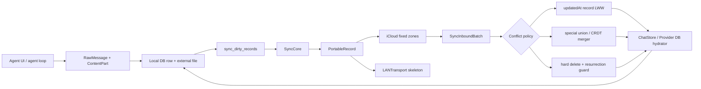

图中的关键点是：`PortableRecord` 是跨传输的中间格式，不是第二份业务数据库；落地仍由各自的 hydrator 写 SQLite 或文件。`SyncCoreHydrators` 明确把“如何构建”和“如何合并”拆为两个闭包，避免同步核心直接依赖具体 store，见 `src/ios/Agent/Sync/V2/SyncCoreHydrators.swift:SyncCoreHydrators:3-17,23-37`。

### 11.3 一个会话在 iOS 磁盘上长什么样

#### 11.3.1 根目录和文件目录

iOS 的默认根目录是 `Library/MinisChat`：`minis.db` 是主 SQLite 数据库，`minis/` 是每个会话的文件根。`ChatStore.init` 同时创建这两个路径，故物理布局可以先画成：

```text
<Library>/MinisChat/
├── minis.db
├── minis/
│   └── <sessionId>/
│       ├── workspace/
│       ├── attachments/
│       ├── browser/
│       └── offloads/
├── env-vars.json
├── provider-config.json
└── provider-config.db
```

`minis.db` 和 `minis/` 的实际构造见 `src/ios/Agent/Chat/ChatStore.swift:ChatStore.init:386-408`；附件相对路径的实际生成见 `src/ios/Agent/Chat/ChatStore.swift:ChatStore.saveMedia/mediaFileURL:2441-2487`。

不是所有同名目录都属于一个同步域：`workspace`、`attachments`、`browser`、`offloads` 是 session-scoped 文件；技能、memory、shared 等目录由独立的文件扫描/同步类型管理。`scanAndMarkSessionFiles` 的子目录白名单见 `src/ios/Agent/Chat/ChatStore.swift:ChatStore.scanAndMarkSessionFiles:3628-3695`。

#### 11.3.2 `sessions`、`messages` 和 `compact_markers`

最小的会话关系是：一个 `sessions` 父行，多个 `messages` 子行，零个或多个 `compact_markers` 历史压缩边界。

`sessions` 的初始 DDL 包含 `id`、`title`、`model_id`、`created_at`、`updated_at`；运行中再通过幂等 `ALTER TABLE` 增加 `category`、`model_binding`、`source`、`memory_enabled`、同步时间、远端设备、置顶和 tombstone 等字段，见 `src/ios/Agent/Chat/ChatStore.swift:ChatStore.createTables:442-510`。

`messages` 的基本 DDL 是 `id` 主键、`session_id` 外键、`role`、`parts_json`、`created_at`、可选 `token_usage`、`sort_order`；后续增加 `reasoning_content`、`stream_interrupt_count`、`updated_at`、`error_info` 和派生的 `part_flags`，见 `src/ios/Agent/Chat/ChatStore.swift:ChatStore.createTables:453-498`。

`compact_markers` 保存模型生成的摘要和压缩边界，不是删除旧消息的替代物；当前表同时保留旧的 sort-order 字段和 id-first 字段，并以 `version` 区分旧/新边界模型，见 `src/ios/Agent/Chat/ChatStore.swift:ChatStore.createTables:532-556`。

#### 11.3.3 消息内容的粒度

消息没有拆成 `tool_calls`、`tool_results` 多张表。一个 `messages` 行的 `parts_json` 是 `[ContentPart]` 的 JSON，文本、图片引用、tool use 和 tool result 都是该数组中的元素。

`appendMessages` 在一个 SQLite transaction 中逐行编码 `message.parts`，并写入 `parts_json`；同一批消息只触发一次提交，再为每个 message 和 touched session 写 dirty 标记，见 `src/ios/Agent/Chat/ChatStore.swift:ChatStore.appendMessages:1909-2020`。

真实的字段绑定如下，片段保留了数据粒度和写入顺序：

**来源：`src/ios/Agent/Chat/ChatStore.swift:ChatStore.appendMessages:1939-1983`**

```swift
let sql = """
    INSERT INTO messages
      (id, session_id, role, parts_json, created_at, token_usage,
       sort_order, reasoning_content, stream_interrupt_count,
       updated_at, error_info, part_flags)
    VALUES (?, ?, ?, ?, ?, ?, ?, ?, ?, ?, ?, ?)
"""

let data = try JSONEncoder().encode(message.parts)
let partsJSON = String(data: data, encoding: .utf8) ?? "[]"
let partFlags = Self.partFlags(for: message.parts)
```

因此工具调用的输入参数和工具结果输出默认和普通文本一样位于 `parts_json`；工具结果里的图片数据不一定内嵌在 JSON，而是通过 `MediaRef` 指向文件。`RawMessage.toAgentMessage` 在重建 agent history 时按 ref 重新读文件，见 `src/ios/Agent/Chat/ChatStore.swift:RawMessage.toAgentMessage:4135-4147`。

#### 11.3.4 空会话和删除的语义

新建 session 不会立即同步：`createSession` 只插入占位父行，等首条消息、标题/置顶等明确意图发生时才 mark dirty，避免把用户没有使用的 “New Chat” 空行传播到所有设备，见 `src/ios/Agent/Chat/ChatStore.swift:ChatStore.createSession:791-854`。

删除不是只执行 `DELETE FROM sessions`。删除前必须枚举并标记 Session、Message、CompactMarker 和 SessionFile 的 `op=delete`，再删除本地 rows 和目录，见 `src/ios/Agent/Chat/ChatStore.swift:ChatStore.markSessionForCloudDeletion/deleteSessionLocalRowsOnly:1809-1894`。

这是一个通用设计原则：如果删除时已经丢失了子记录 id，就无法向远端发出可靠的删除操作；先写同步意图，再删本地数据。

### 11.4 iOS 的 SQLite 实现和大库优化

#### 11.4.1 技术选型：不是 Core Data，也不是 Codable 文件数据库

`ChatStore` 直接 `import SQLite3` 并持有 `OpaquePointer? db`；`openDatabase` 调用 `sqlite3_open(dbURL.path, &db)`，所以主聊天存储是原生 SQLite，不是 Core Data、SwiftData 或一整个 Codable JSON 文件，见 `src/ios/Agent/Chat/ChatStore.swift:ChatStore.openDatabase:432-440`。

`ChatStore` 是 actor，注释要求所有同步 SQLite 操作在 actor 内执行；数据库文件可在 `closeDatabase`/`reloadDatabase` 中关闭、重新打开并重新建表，方便 backup/restore，见 `src/ios/Agent/Chat/ChatStore.swift:ChatStore:355-428`。

打开时开启 `PRAGMA journal_mode=WAL` 和 `PRAGMA foreign_keys=ON`。WAL（write-ahead logging）让并发读更适合会话列表、加载历史和同步合并；外键保证消息/压缩标记不会脱离 session，见 `src/ios/Agent/Chat/ChatStore.swift:ChatStore.openDatabase:432-440`。

#### 11.4.2 索引和预览位图

基础索引 `idx_messages_session(session_id, sort_order)` 支持按会话顺序读取；`idx_msg_sess_role_sort(session_id, role, sort_order DESC)` 支持会话列表找最新 assistant/user 预览，见 `src/ios/Agent/Chat/ChatStore.swift:ChatStore.createTables:465-470`。

早期实现对 `parts_json` 做多次 `LIKE`，100k-message 数据库上会产生大量不可索引扫描。现在写入时根据 parts 计算 `part_flags`：bit0 表示 text，bit1 表示 toolUse；列表查询改用整数位运算，并且对旧行做一次性 SQL backfill，见 `src/ios/Agent/Chat/ChatStore.swift:ChatStore.createTables:558-583` 和 `src/ios/Agent/Chat/ChatStore.swift:ChatStore.partFlags/partFlagsSQLExpr:857-909`。

会话列表还保留四个相关子查询，但它们使用角色/排序索引而不是在 JSON 中找类型；源码记录的实测是约 523ms 降到约 30–58ms，窗口函数方案反而约 1100ms，见 `src/ios/Agent/Chat/ChatStore.swift:ChatStore.listSessions:944-1003`。

#### 11.4.3 缓存和避免重复解码

`listSessions()` 解析每个 session 的预览，重复调用会重复分配大量字符串。`ChatStore` 在 actor 内维护 `sessionListCache` 和 `sessionListCacheDirty`；所有影响列表的 mutation 使缓存失效，未失效时直接返回同一个数组，见 `src/ios/Agent/Chat/ChatStore.swift:ChatStore:365-384` 和 `src/ios/Agent/Chat/ChatStore.swift:ChatStore.listSessions:944-951,1099-1103`。

只需要计数时不应调用 `listSessions().count`。`sessionCount()` 直接 `SELECT COUNT(*)`，源码注释记录这比大库完整列表快很多，并能避免 actor 串行队列被列表解析阻塞，见 `src/ios/Agent/Chat/ChatStore.swift:ChatStore.sessionCount:911-923`。

加载单个会话时按 `sort_order ASC, created_at ASC, id ASC` 读取，逐行解码 `[ContentPart]`；该路径会记录 SQL/IO 和 JSON decode 耗时，便于判断瓶颈是数据库还是 Codable，见 `src/ios/Agent/Chat/ChatStore.swift:ChatStore.loadMessages:2041-2150`。

`AIChatViewModel.loadSession` 不是每次 iCloud 到达都无条件重建 UI。它先读取 DB，比较最后 sort order、行数和 `(id, sortOrder)` hash；只有新增、删除或重排时才 `loadSession()`，并在处理中的 streaming/compaction 阶段把 reload 延后，见 `src/ios/Agent/Chat/AIChatViewModel+Persistence.swift:AIChatViewModel.reloadMessagesFromDB/computeOrderHash:10-132`。

#### 11.4.4 增量写、批量写和发送时机

消息写入是 batch transaction，不是每个 token 一次 fsync；`appendMessages` 将一批 message 包在 `BEGIN TRANSACTION`/`COMMIT` 中，并在 commit 后发 session update 通知，见 `src/ios/Agent/Chat/ChatStore.swift:ChatStore.appendMessages:1913-2019`。

同步 dirty 标记和网络发送是两个时序。消息写入时立即把 dirty row 写入 SQLite，保证进程崩溃后仍能恢复；agent loop 期间可以设置 `syncSendDeferred`，只延迟 `scheduleSend`，loop 结束再扫描文件并触发一次发送，见 `src/ios/Agent/Chat/ChatStore.swift:ChatStore.setSyncSendDeferred/flushPendingSyncDirty:3589-3625`。

V2 的 dirty 查询按 priority、父类型先于子类型和批量上限排序：优先发送用户刚写的 row，不让迁移历史队列饿死；Session/Message 的父子顺序避免 peer 先收到孤儿消息，见 `src/ios/Agent/Chat/ChatStore.swift:ChatStore.loadDirtyRecords:4785-4830`。

### 11.5 消息、工具结果和大附件：为什么不能全放在一行里

#### 11.5.1 JSON 行适合结构，文件适合字节

`parts_json` 适合保存需要和消息一起原子提交的结构：role、文本、toolUse 参数、toolResult 文本、token usage 引用等。

图片、浏览器下载、文件工具输出等大字节保存为 `MediaRef`，数据库只保存 `id`、相对路径、MIME 和原文件名；iOS `saveMedia` 将数据写入 `Library/MinisChat/minis/<sessionId>/<subdir>/<UUID>.<ext>`，再返回 ref，见 `src/ios/Agent/Chat/ChatStore.swift:ChatStore.saveMedia:2441-2476`。

加载时 `mediaFileURL(for:)` 只做根目录和 relative path 拼接，`loadMediaData` 再按需读 `Data`，见 `src/ios/Agent/Chat/ChatStore.swift:ChatStore.mediaFileURL/loadMediaData:2479-2487`。这是一种懒加载边界：打开历史时可以先构建文字和 tool block，真正渲染图片时才读文件。

#### 11.5.2 SessionFile 的同步 identity

V2 不把 SessionFile 的 identity 设成随机文件 id，而是用 `sessionId:relativePath` 组成复合 key；`SyncedSessionFile` 的 `idKeyPath` 指向 `compositeKey`，文件本体通过 `PortableAsset` 引用，见 `src/ios/Agent/Sync/V2/SyncedTypes.swift:SyncedSessionFile:185-216`。

这样重启后同一个路径仍然对应同一个远端 record；文件内容变化只更新 `updatedAt` 和 asset，不需要维护一张额外的 attachment SQL 表。

#### 11.5.3 文件变更如何变成 dirty row

iSH fakefs 事件可能带 guest 路径 `/var/minis/...`，也可能带 host path。`SessionFileChangeTracker` 以 actor 保存 `sessionId -> relativePath -> Change`，同一路径只留下最后一次 upsert/delete；消费时原子 read-and-clear，避免事件在 drain 期间丢失，见 `src/ios/Agent/Sync/V2/SessionFileChangeTracker.swift:SessionFileChangeTracker:1-19,24-109`。

`resolveSessionRelative` 只接受 `workspace`、`attachments`、`browser`、`offloads` 四个 session 子目录；memory、skills、shared 走自己的同步机制，见 `src/ios/Agent/Sync/V2/SessionFileChangeTracker.swift:resolveSessionRelative/validateAndReturnSubpath:208-267`。

`SyncCore.sendNow` 在读取 dirty rows 之前先 drain tracker 并将每个文件转换为 `SessionFile` dirty row，且以 mtime 过滤“只 open 没有实际写入”的假阳性，见 `src/ios/Agent/Sync/V2/SyncCore.swift:SyncCore.drainSessionFileChangesIntoDirty:805-857`。

#### 11.5.4 文件大小和 junk 目录策略

扫描 SessionFile 时跳过 `.git`、`node_modules`、缓存、虚拟环境等目录，并以 `UploadPolicy.maxFileSizeBytes` 做每文件上限；默认上限是 1 MiB，超限文件不进入 dirty 队列，见 `src/ios/Agent/Chat/ChatStore.swift:ChatStore.scanAndMarkSessionFiles:3628-3695` 和 `src/ios/Agent/Sync/V2/UploadPolicy.swift:UploadPolicy.maxFileSizeBytes:86-97`。

CloudKit 传输层把超过 750,000 bytes 的字段视为 asset 候选，低于阈值可内联；`PortableAsset` 只携带本地 file URL、size 和 MIME，真正如何上传由 transport 决定，见 `src/ios/Agent/Sync/V2/Syncable.swift:AssetPolicy:16-22`、`src/ios/Agent/Sync/V2/PortableRecord.swift:PortableAsset:80-88` 和 `src/ios/Agent/Sync/V2/ICloudSharedZoneTransport.swift:ICloudSharedZoneTransport.assetInlineThreshold:77-80`。

注意：1 MiB upload policy 是“是否允许这个设备上传”，750 KB 是“CloudKit 字段何时倾向 CKAsset”；二者不是同一个阈值，也不是保证所有文件都能上传的替代品。

### 11.6 `minis://` 如何落到物理路径

#### 11.6.1 iOS 的命名空间规则

iOS 将 `minis://` host 视为命名空间。`memory`、`skills`、`shared`、`mcp-servers` 走全局目录；其他 host 被视为 session 子目录，拼成 `minisPersistentBase/<sessionId>/<host>/`，见 `src/ios/Agent/Chat/AIChatViewModel+FileTools.swift:AIChatViewModel.resolveMinisURL:66-91`。

Linux 路径 `/var/minis/<namespace>/<filename>` 通过 `linuxPathToMinisURL` 变成 `minis://<namespace>/<percent-encoded-filename>`；源码只编码 namespace 之后的 filename，并拒绝不在 `/var/minis/` 下的路径，见 `src/ios/Agent/Chat/AIChatViewModel+FileTools.swift:AIChatViewModel.linuxPathToMinisURL:94-104`。

转换必须只做一次 URL percent-encoding。点击解析时 `URL.path` 已经解码一层；`MinisURLPathDecoding.subPathCandidates` 先尝试这一层，再在磁盘不存在时尝试第二次解码，以兼容中间 Markdown 处理多编码一次的链接，见 `src/ios/Agent/Chat/MinisURLPathDecoding.swift:MinisURLPathDecoding.subPathCandidates:3-35`。

```swift
let subPaths = MinisURLPathDecoding.subPathCandidates(for: url)
let candidates = subPaths.map { base.appendingPathComponent($0) }
return candidates.first { FileManager.default.fileExists(atPath: $0.path) }
    ?? candidates.first
```

#### 11.6.2 Android 的物理路径

Android 的 `MediaRef` 不是绝对路径，而是相对于 `context.filesDir/media` 的 `relativePath`。普通保存路径为 `media/yyyy/MM/dd/<sessionId>/<uuid>.<ext>`，大文件用 `saveMediaStreamed` 通过 InputStream 复制，避免一次性 `readBytes()`，见 `src/android/app/src/main/java/com/openminis/app/data/storage/MediaStore.kt:MediaStore.mediaBaseDir/saveMedia/saveMediaStreamed:12-79`。

Android agent 的会话沙箱文件另外位于 `filesDir/minis-sessions/<sessionId>/<subdir>`，再 bind mount 为 `/var/minis/<subdir>`；`ExecutionCoordinator.buildSessionBindMounts` 明确建立 `workspace`、`attachments` 等 host 目录，见 `src/android/app/src/main/java/com/openminis/app/sandbox/ExecutionCoordinator.kt:ExecutionCoordinator.buildSessionBindMounts:176-205`。

Android WebView 处理 `minis://workspace/foo.html` 时，先转成 `/var/minis/workspace/foo.html`，再调用 `PRootKernel.resolveHostPath` 找 host file；这不是把 URI 当网络 URL，而是一个本地命名空间解析器，见 `src/android/app/src/main/java/com/openminis/app/browser/BrowserUseManager.kt:BrowserUseManager.interceptMinisURL:396-425`。

因此跨平台约定应保存逻辑相对路径或 Linux-visible path，不要把 iOS 的 `/var/mobile/...` 或 Android 的 `/data/user/0/...` 写进同步记录。

### 11.7 Android Room：同一抽象的另一种落地

#### 11.7.1 Room 数据库和版本迁移

Android 主数据库名为 `minis.db`，`AppDatabase` 继承 `RoomDatabase`，实体包含 `ChatSessionEntity`、`MessageEntity`、`CompactMarkerEntity` 和 `WebAppShortcutEntity`，当前版本为 10，见 `src/android/app/src/main/java/com/openminis/app/data/db/AppDatabase.kt:AppDatabase:10-22,196-205`。

Room 的 schema 迁移是显式 `Migration(from,to)`，例如 1→2 增加 session 列、2→3 增加 reasoning_content、3→4 增加 parity 字段和 compact_markers、7→8 增加 marker version、9→10 增加 message error_info，见 `src/android/app/src/main/java/com/openminis/app/data/db/AppDatabase.kt:AppDatabase.MIGRATION_1_2/MIGRATION_2_3/MIGRATION_3_4/MIGRATION_7_8/MIGRATION_9_10:28-193`。

初始化时使用 `addMigrations(...)`，没有 `fallbackToDestructiveMigration`；这保证聊天历史不会因为忘记写迁移而被静默删库，见 `src/android/app/src/main/java/com/openminis/app/data/db/AppDatabase.kt:AppDatabase.getInstance:196-204`。

#### 11.7.2 Entity 结构

`ChatSessionEntity` 的字段是 nullable/primitive Kotlin 属性，时间单位是 epoch milliseconds；包括 model binding、source、memory、pin、edit counter 和 thinking override，见 `src/android/app/src/main/java/com/openminis/app/data/db/ChatSessionEntity.kt:ChatSessionEntity:7-28`。

`MessageEntity` 一行保存 `role`、`partsJson`、token usage、sort order、reasoning、stream interruption、updatedAt 和 error_info；外键 `session_id` 对 `sessions.id` 使用 `CASCADE`，并有 `(session_id, sort_order)` 索引，见 `src/android/app/src/main/java/com/openminis/app/data/db/MessageEntity.kt:MessageEntity:9-37`。

`CompactMarkerEntity` 与 session 同样使用级联外键，并保留旧 sort-order 边界和 id-first 边界；`version=2` 时 `lastCompactedMessageId` 是权威锚点，见 `src/android/app/src/main/java/com/openminis/app/data/db/CompactMarkerEntity.kt:CompactMarkerEntity:14-57`。

#### 11.7.3 DAO 和 repository 的职责

`ChatDao` 用 `@Query` 定义 Flow session 列表、session 读取、消息读取、插入和删除；消息按 `sort_order ASC` 读取，`nextSortOrder` 通过 `MAX(sort_order)+1` 生成下一个位置，见 `src/android/app/src/main/java/com/openminis/app/data/db/ChatDao.kt:ChatDao:56-138`。

`ChatRepository` 不把所有 SQL 暴露给 UI。它负责创建 UUID session、映射 memoryEnabled、包装 DAO，并在加载大历史时分页，见 `src/android/app/src/main/java/com/openminis/app/data/repository/ChatRepository.kt:ChatRepository.createSession/loadMessages:10-176`。

Android 的 `ContentPart` 与 iOS 的 `ContentPart` 采用同样的四类数据形状：`text`、`mediaRef`、`toolUse`、`toolResult`；`ToolResult` 还可带一个 `MediaRef`，见 `src/android/app/src/main/java/com/openminis/app/data/model/ContentPart.kt:ContentPart/ToolResult:11-68`。

#### 11.7.4 Android 的大消息补丁

Android 的 `CursorWindow` 通常约有 2 MB 行窗口限制。仓库中记录过一个大 tool_result 让整批消息读取抛出 `SQLiteBlobTooBigException`，所以 `ChatRepository.loadMessages` 现在按页读取，单页仍失败则逐行读取，并用 proxy row 跳过不能 materialize 的单行，见 `src/android/app/src/main/java/com/openminis/app/data/repository/ChatRepository.kt:ChatRepository.loadMessages:118-195`。

新消息写入还会限制 `partsJson` 长度；超过上限时保留同一 JSON parts 形状而不是写坏数组，避免 UI 和搜索解析器因为截断成非法 JSON 而二次崩溃，见 `src/android/app/src/main/java/com/openminis/app/data/repository/ChatRepository.kt:ChatRepository.appendMessage:222-255`。

这和 iOS 的策略不同：iOS 以文件外置和列表 bitmask 优化为主，Android 额外针对 CursorWindow 做分页和单行降级。不要只复制 SQL schema，不复制平台的内存/IPC 限制。

### 11.8 存储 schema 对照表

下面的表只列本章真正核查到的主结构；“同步字段”不等于“每端都同步”，Android 当前没有 iOS Sync V2 的对应实现。

| 逻辑对象 | iOS 物理结构 | Android 物理结构 | 粒度与差异 |
|---|---|---|---|
| 会话 | `sessions`，`id` 主键；`model_id`、时间、title/category/binding/source/memory/pin 等，`src/ios/Agent/Chat/ChatStore.swift:ChatStore.createTables:442-510` | Room `sessions`，`ChatSessionEntity`，`src/android/app/src/main/java/com/openminis/app/data/db/ChatSessionEntity.kt:ChatSessionEntity:7-28` | 一行一个 session；iOS 时间为 SQLite REAL 秒，Android 为 Long 毫秒。 |
| 消息 | `messages`，`parts_json`、role、token usage、reasoning、sort、updated/error/flags，`src/ios/Agent/Chat/ChatStore.swift:ChatStore.createTables:453-498` | Room `messages`，`MessageEntity.partsJson` 等，`src/android/app/src/main/java/com/openminis/app/data/db/MessageEntity.kt:MessageEntity:9-37` | 一行一个 agent iteration/message；toolUse/toolResult 在 JSON parts 内，不是独立表。 |
| 工具调用 | 消息的 `ContentPart.toolUse` JSON，写入 `parts_json`，`src/ios/Agent/Chat/ChatStore.swift:ChatStore.appendMessages:1950-1982` | `ContentPart.Tool`/`ToolUse` 序列化为 `partsJson`，`src/android/app/src/main/java/com/openminis/app/data/model/ContentPart.kt:ContentPart:35-51` | 保留调用 id、name、input；重建历史时按 parts 顺序解析。 |
| 工具结果 | 消息的 `ContentPart.toolResult`；文字 inline，图片可挂 `MediaRef`，`src/ios/Agent/Chat/ChatStore.swift:RawMessage.toAgentMessage:4135-4147` | `ContentPart.Result` 的 `ToolResult`，可带 `mediaRef`，`src/android/app/src/main/java/com/openminis/app/data/model/ContentPart.kt:ToolResult:27-33` | 结果和调用仍在 message row 内；大图不应复制进文本 JSON。 |
| 压缩标记 | `compact_markers` + id-first/version 字段，`src/ios/Agent/Chat/ChatStore.swift:ChatStore.createTables:532-556` | Room `CompactMarkerEntity` + migration version，`src/android/app/src/main/java/com/openminis/app/data/db/CompactMarkerEntity.kt:CompactMarkerEntity:14-57` | 一行一个摘要边界；外键 cascade 删除。 |
| 图片/附件 | `Library/MinisChat/minis/<sid>/<subdir>/<uuid>.<ext>`，`MediaRef.relativePath`，`src/ios/Agent/Chat/ChatStore.swift:ChatStore.saveMedia:2441-2487` | `filesDir/media/yyyy/MM/dd/<sid>/<uuid>.<ext>`，`MediaStore`，`src/android/app/src/main/java/com/openminis/app/data/storage/MediaStore.kt:MediaStore:12-83` | DB 只存引用；Android 额外提供 streamed copy。 |
| agent 沙箱文件 | `Library/MinisChat/minis/<sid>/{workspace,attachments,browser,offloads}`，`src/ios/Agent/Chat/ChatStore.swift:ChatStore.scanAndMarkSessionFiles:3638-3684` | `filesDir/minis-sessions/<sid>/<subdir>` bind 到 `/var/minis/<subdir>`，`src/android/app/src/main/java/com/openminis/app/sandbox/ExecutionCoordinator.kt:ExecutionCoordinator.buildSessionBindMounts:176-205` | session file 通过相对路径定位；不要同步绝对 sandbox 路径。 |
| 同步 dirty | `sync_dirty_records`、`sync_pushed_records`、删除 tombstone 表，`src/ios/Agent/Chat/ChatStore.swift:ChatStore.createTables:586-647` | 本章核查的 Android `data/db` 没有对应 SyncCore dirty schema | iOS 是 crash-safe queue；Android 的 DeviceIdentity 仅预留未来 namespace。 |
| Provider instance | iOS `provider-config.db` 的 `provider_instances`，`src/ios/Providers/ProviderConfigDB.swift:ProviderConfigDB.defaultURL/runMigrations:23-64,106-136` | Room `provider.db` 的 `provider_instances`，`src/android/app/src/main/java/com/openminis/app/data/db/ProviderDatabase.kt:ProviderDatabase:10-42` 和 entity | 两端都从整文件逐步转 per-row；密钥不放普通列。 |
| Provider model entry/group | iOS `provider_model_entries`、`provider_model_groups`，`src/ios/Providers/ProviderConfigDB.swift:ProviderConfigDB.runMigrations:138-168` | Room `ProviderModelEntryEntity`/`ProviderModelGroupEntity`，`src/android/app/src/main/java/com/openminis/app/data/db/ProviderModelEntryEntity.kt:ProviderModelEntryEntity:20-39`、`ProviderModelGroupEntity.kt:ProviderModelGroupEntity:14-25` | model/group 结构化为行，member order 仍以 JSON array 保存。 |
| 环境变量元数据 | iOS `Library/MinisChat/env-vars.json`，值在 synchronizable Keychain，`src/ios/Shared/EnvVarStore.swift:EnvVarStore.init/saveEntries/saveValue:34-52,95-126,148-206` | `filesDir/env-vars.json` 元数据，值在 EncryptedSharedPreferences，`src/android/app/src/main/java/com/openminis/app/data/repository/EnvVarRepository.kt:EnvVarRepository:14-50,137-175` | key/note/id 与 secret value 分离；Android 没有本章范围内的跨设备上传。 |

### 11.9 Sync V2 的可移植记录模型

#### 11.9.1 `Syncable` 是 schema contract

`Syncable` 本身只有 `static syncMetadata`；字段、wire name、类型、optional、scope、冲突策略和 schema version 全由 `SyncTypeMetadata` 携带，见 `src/ios/Agent/Sync/V2/Syncable.swift:SyncTypeMetadata/Syncable:190-248`。

`SyncScope` 区分 global、perObject、perParent。Session 是 perObject；Message 和 CompactMarker 是 SessionV2 的子记录；这种 scope 让 transport 可以按父子关系组织记录并支持整棵 session 重推，见 `src/ios/Agent/Sync/V2/Syncable.swift:SyncScope:3-14`。

`FieldDescriptor` 同时定义字段的读取和写回闭包，并且 optional nil 映射为 `.null`；transport 在写入时应省略 null，而不是把一个无意义的 null literal 上传，见 `src/ios/Agent/Sync/V2/Syncable.swift:FieldDescriptor:55-70,91-110`。

#### 11.9.2 `PortableRecord` 的字段、资产和未知字段

`SyncRecordID` 统一成 `type:id`，这个格式同时被 `ChatStore.clearDirtyRecord(recordName:)` 解析，所以改变分隔符会破坏 dirty queue，见 `src/ios/Agent/Sync/V2/PortableRecord.swift:SyncRecordID:3-24`。

`PortableRecord` 保存 `id`、typed `fields`、`assets`、`schemaVersion`、`minimumCompatibleVersion`、`unknownFields` 和 `updatedAt`。未知字段必须随记录 round-trip，避免旧客户端读到新字段后再写回时把新数据删掉，见 `src/ios/Agent/Sync/V2/PortableRecord.swift:PortableRecord:90-137`。

`SyncableTypeRegistry.erase` 将 generic metadata 擦除成 `AnySyncableTypeMetadata`，在运行时通过 recordType 查找 builder、已有模型写回和冲突闭包；registry 用 lock 保护，注册重复版本会 assert，见 `src/ios/Agent/Sync/V2/SyncableTypeRegistry.swift:AnySyncableTypeMetadata/SyncableTypeRegistry:3-104`。

registry 的默认 builder 从字段 descriptor 提取值，并从冲突 policy 的 Date keypath 提取 `updatedAt`；默认的 `resolveConflict` 是一个模型级选择，不是逐字段自动 merge，见 `src/ios/Agent/Sync/V2/SyncableTypeRegistry.swift:SyncableTypeRegistry.erase:120-180`。

#### 11.9.3 Session/Message/SessionFile 的 wire shape

`SyncedSession` 是 SessionV2，包含 session id、title、category、model、创建/更新日期、memory、binding、pin，冲突 policy 是 `updatedAt` 的 record-level LWW，见 `src/ios/Agent/Sync/V2/SyncedTypes.swift:SyncedSession:14-58`。

`SyncedMessage` 是 MessageV2 的 per-parent 子记录，包含 `partsJson`、token usage、reasoning、stream interruption、created/updatedAt；wire `sortOrder` 只是 hint，接收端按自己的 `(created_at,id)` 排名，见 `src/ios/Agent/Sync/V2/SyncedTypes.swift:SyncedMessage:64-123`。

`SyncedSessionFile` 的 wire record 用复合 identity，且 `fileURL` 不直接序列化到字段；它通过 `PortableAsset` 交给 transport，冲突 policy 是 server etag，见 `src/ios/Agent/Sync/V2/SyncedTypes.swift:SyncedSessionFile:187-216`。

### 11.10 dirty 扫描、队列和发送调度

#### 11.10.1 事件驱动不是唯一来源

iOS 有 `SyncDirtyScanner` 作为磁盘变化 backstop：每 180 秒扫描 skills、provider/env 配置文件和最近 30 天 memory 文件；首次看到文件只记录 baseline，不把所有文件重新上传，见 `src/ios/Agent/Sync/SyncDirtyScanner.swift:SyncDirtyScanner:6-24,25-95` 和 `src/ios/Agent/Sync/SyncDirtyScanner.swift:scanSkills/scanConfigFiles/scanMemoryFiles:128-305`。

scanner 用 `NSLock` 保护 `isScanning`，保证 timer tick 和首轮 Task 不会同时改动 `knownModDates`；文件枚举仍在后台，不把大磁盘扫描放到主线程，见 `src/ios/Agent/Sync/SyncDirtyScanner.swift:SyncDirtyScanner.scan:70-95`。

`ChatStore.markDirty` 先检查 sync zone 是否初始化，再检查 `UploadPolicy`；关闭某类上传时该类记录连 dirty queue 都不进入，见 `src/ios/Agent/Chat/ChatStore.swift:ChatStore.markDirty:4183-4201` 和 `src/ios/Agent/Sync/V2/UploadPolicy.swift:UploadPolicy.allowsRecordType:59-84`。

#### 11.10.2 dirty row 的语义

写 dirty row 使用 `(record_type, record_id)` 主键，`INSERT OR REPLACE` 合并同一记录的重复写；operation 为 upsert/delete，priority 0 是用户写，priority 1 是迁移 backlog，见 `src/ios/Agent/Chat/ChatStore.swift:ChatStore.markDirty:4222-4273` 和 `src/ios/Agent/Chat/ChatStore.swift:ChatStore.createTables:503-508,586-605`。

V2 `SyncCore.markDirty` 将模型 metadata 的 record type/id 写入 ChatStore，再 debounce 3 秒触发发送；agent streaming 时可 defer，网络上不会有每个 token 的请求，见 `src/ios/Agent/Sync/V2/SyncCore.swift:SyncCore.markDirty/scheduleSend:278-321`。

发送前 `SyncCore.sendNow` 从 dirty table 取最多 100 行，未知 builder 的 dirty row 保留，已知 builder 但本地行已消失才清掉；这区分了“代码尚未支持该类型”和“记录真的被删掉”，见 `src/ios/Agent/Sync/V2/SyncCore.swift:SyncCore.sendNow:362-416`。

#### 11.10.3 节流和背压

`currentSendDelay` 的基准是 5 秒：同步页面 1×，普通前台 3×，后台 4×；蜂窝网络再乘 2×，见 `src/ios/Agent/Sync/V2/SyncCore.swift:SyncCore.currentSendDelay:83-104`。

如果 CloudKit 返回 `requestRateLimited`，transport 暴露 retry-after，SyncCore 设置 `nextEarliestSendAt`，不在窗口内继续 hammer；transient failure 保留 dirty row，permanent failure 才清除，见 `src/ios/Agent/Sync/V2/SyncCore.swift:SyncCore.sendNow:324-353,469-531` 和 `src/ios/Agent/Sync/V2/SyncCore.swift:SyncCore.applyOutcomes:536-568`。

入站批次每 25 条处理并 sleep 50ms，让主线程滚动和 SwiftUI diff 有机会运行；这是为迁移时数百条消息导致的内存峰值而加的背压，见 `src/ios/Agent/Sync/V2/SyncCore.swift:SyncCore.processInbound:583-701`。

### 11.11 冲突解决：源码实际是哪些算法

这一节必须和“听起来合理的同步算法”区分。源码没有 vector clock；默认策略也不是所有字段独立合并。

#### 11.11.1 默认策略：按一个 Date keypath 选择整条模型

`ConflictPolicy.lastWriteWinsByField(KeyPath<T, Date>)` 的名字容易误读。“ByField”指用哪个 Date 字段做比较，不是逐字段 merge。registry 的实现是：若 `local.updatedAt >= remote.updatedAt` 返回 local，否则返回 remote，见 `src/ios/Agent/Sync/V2/SyncableTypeRegistry.swift:SyncableTypeRegistry.erase.resolveConflict:167-180`。

Session 和 Message 都注册为 `lastWriteWinsByField(updatedAt)`，因此同一 id 的并发更新会选择整条较新的模型；时间相等时本地获胜，见 `src/ios/Agent/Sync/V2/SyncedTypes.swift:SyncedSession.syncMetadata:25-44` 和 `src/ios/Agent/Sync/V2/SyncedTypes.swift:SyncedMessage.syncMetadata:80-100`。

`lastWriteWinsByServerEtag` 只适合“服务器 etag 才有意义”的资产记录；`alwaysAccept` 用于自然按设备隔离的 heartbeat；custom policy 允许业务代码提供纯 merge 函数，见 `src/ios/Agent/Sync/V2/Syncable.swift:ConflictPolicy:24-40`。

#### 11.11.2 Session/Message 的接收端补丁

Session 合并沿用 `ChatStore.mergeRemoteSession`：远端 `updated_at` 严格大于本地才 update，否则保持本地；不存在时先检查最近删除 tombstone，避免旧云记录把已删除 session 重新插入，见 `src/ios/Agent/Chat/ChatStore.swift:ChatStore.mergeRemoteSession:5219-5381`。

Message 合并的 LWW 比较的是 `COALESCE(updated_at,created_at)`。远端旧于或等于本地时跳过内容覆盖；远端更新时只更新 parts/token/reasoning/interrupt/updated_at/flags，不覆盖接收端自己的 sort order，见 `src/ios/Agent/Chat/ChatStore.swift:ChatStore.mergeRemoteMessage:5408-5515`。

新插入的远端 message 也不盲信发送端 sort order，而是按 `(created_at,id)` 计算本端 rank；有 gap 就插入，没有 gap 才把后续行整体右移，见 `src/ios/Agent/Chat/ChatStore.swift:ChatStore.mergeRemoteMessage:5517-5614`。

这使“消息内容的胜者”和“本地展示顺序”分离：跨设备消息数量不同不再把发送端的整数位置泄漏到接收端。

#### 11.11.3 Provider group 的特殊集合 CRDT

Provider model group 不是简单整行 LWW。标量字段（name、strategy、limits、sortOrder）按 `updatedAt` LWW；成员集合使用 `addedMembers`/`removedMembers` 的每成员时间戳 map，分别取 local/inbound 的最大时间，成员在 `added >= removed` 时存在，见 `src/ios/Providers/ProviderConfigDB.swift:ProviderConfigDB.upsertGroupFromInbound:963-1047`。

成员顺序仍由较新的 group scalar record 决定，另一端看见但新端未列出的成员追加到后面；因此“成员不丢失”和“路由顺序收敛”是两条不同规则，见 `src/ios/Providers/ProviderConfigDB.swift:ProviderConfigDB.upsertGroupFromInbound:1049-1125`。

这是一个很适合学习的设计：若把成员数组整体 LWW，两台设备各自新增一个模型时，后写入的一方会覆盖另一方；拆出 per-member timestamp 后，删除也能压住旧快照的复活。

#### 11.11.4 MemoryDaily 的 set union

每日 memory 记录的合并不是文本文件 LWW。`mergeMemoryDaily` 按 `<!-- timestamp -->` 分块解析，本地和远端同 timestamp 同内容时幂等跳过；同 timestamp 不同内容时保留双方，远端使用 `content.hashValue` 后缀避免 key 冲突，见 `src/ios/Agent/Sync/V2/ChatStoreSyncHydrators.swift:mergeMemoryDaily:974-1106`。

union 没有新增内容时不重写文件，避免 mtime 被 inbound apply 推进后又被 dirty scanner 识别为新的本地编辑，见 `src/ios/Agent/Sync/V2/ChatStoreSyncHydrators.swift:mergeMemoryDaily:1108-1125`。

#### 11.11.5 Server conflict 的回路

CloudKit 保存遇到 `serverRecordChanged` 时，transport 返回 `.conflict(serverRecord)`；SyncCore 把 server record 重新喂入 inbound merger，但不清掉 dirty，等 transport 使用新的 server etag 重试，见 `src/ios/Agent/Sync/V2/ICloudSharedZoneTransport.swift:CKSyncEngineDelegate.handleSentRecordZoneChanges:1562-1581` 和 `src/ios/Agent/Sync/V2/SyncCore.swift:SyncCore.applyOutcomes:536-560`。

这不是 vector clock：没有看到向量时钟、device counter 或 causal context 字段。默认因果信息只有 `updatedAt`、CloudKit etag 和 dirty operation；因此设备时钟异常会影响 LWW，必须在产品约束中接受或额外设计服务端时间戳。

### 11.12 删除墓碑和“防复活”

#### 11.12.1 为什么只发 delete 还不够

CloudKit 的查询可能在 delete 传播前再次读到仍存在的旧 record。若接收端看到本地 session 已不存在，就直接 INSERT，刚删掉的 session 会短暂或永久复活。

`ChatStore` 为最近删除的 session 保存 `deleted_session_tombstones(session_id,deleted_at)`，TTL 为 30 天；若 remoteUpdatedAt 不晚于 deletedAt 加 5 秒偏差，就拒绝 inbound，见 `src/ios/Agent/Chat/ChatStore.swift:ChatStore.createTables/recordDeletedSessionTombstone/isResurrectionOfDeleted:607-647,2720-2757`。

Skill、EnvVarItem、CompactMarker、MCPServerItem 和 Provider V3 rows 使用通用 `deleted_record_tombstones(record_type,record_id,deleted_at)`；`markDirty(op=delete)` 在写 dirty 前记录墓碑，见 `src/ios/Agent/Chat/ChatStore.swift:ChatStore.markDirty/recordDeletedRecordTombstone:4202-4211,2765-2795`。

#### 11.12.2 V2 入站删除是 hard delete

V2 曾考虑 soft tombstone：保留 session 行并在恢复时 cascade re-push，但这样会在会话列表留下 phantom empty rows，因此当前 `TombstoneManager` 对 `SessionV2 op=delete` 直接删除本地 session、子消息、compact marker 和 session files，不再次把 delete 排入 dirty queue，见 `src/ios/Agent/Sync/V2/TombstoneManager.swift:TombstoneManager:5-28,34-45`。

`SyncCore.processInbound` 先检查 registry，再把 deletes 交给 `SyncCoreHydrators.applyRemoteDeletion`；删除器通常是 local-only，不会反向放大 tombstone，见 `src/ios/Agent/Sync/V2/SyncCore.swift:SyncCore.processInbound:669-681` 和 `src/ios/Agent/Sync/V2/SyncCoreHydrators.swift:SyncCoreHydrators.applyRemoteDeletion:84-96`。

#### 11.12.3 重新创建和 tombstone 的边界

Session UUID 不复用，30 天 tombstone 不会挡住一个相同 id 的新 session；真正需要允许复活时，业务必须写出比 deletion timestamp 更新的记录，`isResurrectionOfDeleted` 才会放行，见 `src/ios/Agent/Chat/ChatStore.swift:ChatStore.isResurrectionOfDeleted:2748-2757`。

Provider group 的成员删除与 session 删除不同：它不删整行，而是以 per-member removed timestamp 抑制旧成员重新出现，见 `src/ios/Providers/ProviderConfigDB.swift:ProviderConfigDB.upsertGroupFromInbound:973-1047`。

### 11.13 两种 transport：iCloud 实现与 LAN 边界

#### 11.13.1 iCloud 实际不是 `CKShare` 对象

用户需求中常把这一层称为“CKShare 共享 zone”。当前源码实际使用的是同一个 Apple ID 的 private database + 三个固定 custom record zones，并通过 `CKSyncEngine` 做持久同步；`ICloudSharedZoneTransport` 的注释和 zone map 没有创建/传递 `CKShare` 对象，见 `src/ios/Agent/Sync/V2/ICloudSharedZoneTransport.swift:ICloudSharedZoneTransport:6-19,30-75`。

这一区别影响实现路线：读者不能照着“生成 CKShare、邀请参与者”的教程实现当前产品的同一语义；当前产品依赖 private CloudKit container 下的固定 zone 和同账户设备共享。

三类 zone 是：`minis-shared` 放会话、消息、文件、skills、memory；`minis-devices` 放设备 heartbeat；`minis-secrets` 放 provider/env/MCP 等敏感配置，见 `src/ios/Agent/Sync/V2/ICloudSharedZoneTransport.swift:ICloudSharedZoneTransport.zoneByRecordType:12-75`。

#### 11.13.2 iCloud 发现、鉴权和增量

iCloud 的“发现”不是 Bonjour，而是同一 CloudKit container 中的 record zone 和 CKSyncEngine change token；transport capabilities 声明支持 deltaFetch、assets、persistence 和 conflictDetect，见 `src/ios/Agent/Sync/V2/SyncTransport.swift:TransportCapabilities:3-27`。

启动时 queue 三个 zone 的保存操作并调用 `modifyRecordZones` 确保它们存在，见 `src/ios/Agent/Sync/V2/ICloudSharedZoneTransport.swift:ICloudSharedZoneTransport.ensureZonesExist:894-922`。

正常 fetch 使用 CKSyncEngine token；额外的 `fetchRecentV2` 对各 record type 用 `CKQuery` 查询最近窗口，并按类型选择 zone。新设备恢复 provider/group 时，配置类型使用 full history 和 query cursor 分页，单页上限 200，见 `src/ios/Agent/Sync/V2/ICloudSharedZoneTransport.swift:ICloudSharedZoneTransport.fetchRecentV2:599-718`。

鉴权由 CloudKit private database 的 Apple ID 容器提供；本层代码没有自定义用户密码或 LAN token 交换。记录名由 `type:id` 生成并在送入 `CKRecord.ID` 前做合法性校验，以避免非法 dirty id 触发 Objective-C 异常，见 `src/ios/Agent/Sync/V2/ICloudSharedZoneTransport.swift:ICloudSharedZoneTransport.send:955-1005`。

#### 11.13.3 iCloud 资产和分块

iCloud 端不实现自定义 socket 分块；小字段可作为 CKRecord value，大文件由 `CKAsset`/CloudKit API 负责传输，业务层只传 `PortableAsset` 的 file URL、size 和 MIME，见 `src/ios/Agent/Sync/V2/PortableRecord.swift:PortableAsset:80-88` 和 `src/ios/Agent/Sync/V2/ICloudSharedZoneTransport.swift:ICloudSharedZoneTransport.assetInlineThreshold:77-80`。

入站 CKSyncEngine 修改会被切成 50-record sub-batch 再交给 SyncCore，SyncCore 内部再按 25 条处理；这两个边界分别保护 transport delegate 和主 actor 内存，见 `src/ios/Agent/Sync/V2/ICloudSharedZoneTransport.swift:CKSyncEngineDelegate.handleFetchedZoneChanges:1460-1479` 和 `src/ios/Agent/Sync/V2/SyncCore.swift:SyncCore.processInbound:599-667`。

#### 11.13.4 LANTransport 的真实状态

`LANTransport` 目前是 skeleton，`isImplemented=false`，SyncCore 明确拒绝注册；任何把它描述成“已经能局域网同步”的文档都是错误的，见 `src/ios/Agent/Sync/V2/LANTransport.swift:LANTransport:3-7,27-40` 和 `src/ios/Agent/Sync/V2/SyncCore.swift:SyncCore.register:182-199`。

源码留下了未来协议契约：Bonjour `_minis-sync._tcp` + `NWListener/NWBrowser` 发现 peer，WebSocket 推送 Codable JSON，asset 用同一连接 length-prefixed binary frame；LAN 无 durable persistence，因此 fullFetch 通常为空，见 `src/ios/Agent/Sync/V2/LANTransport.swift:LANTransport.future implementation outline:9-26`。

这意味着 LAN 的鉴权、重连、历史补偿、分块和冲突重放尚未在仓库中落地。教学实现可以沿着注释写，但必须把它标为后续实现，不应把预留设计写成现有能力。

### 11.14 V1 → V2：为什么重写以及如何迁移

#### 11.14.1 V1 的结构性问题

V1 `CloudSyncEngine` 以设备 zone 为中心，record mapping 和各 store 的 union/LWW 逻辑混在一个巨大 engine 中；provider/env 还采用 whole-file payload，导致两台设备各改一个变量时，整文件 LWW 会覆盖对方的新增，见 `src/ios/Agent/Sync/CloudSyncEngine.swift:CloudSyncEngine provider/env merge:1661-1993`。

V2 的目标不是换一个 API 名称，而是把模型、dirty queue、hydrator、transport 和 migration 分层：`SyncV2Bootstrap` 启动时注册 all `Syncable` types、设置 zone、注册 ChatStore hydrators，再注册 iCloud transport，见 `src/ios/Agent/Sync/V2/SyncV2Bootstrap.swift:SyncV2Bootstrap.startIfEnabled:135-175`。

V2 同时把 provider instance/model entry/model group 拆成 per-record V3，env var 拆成每个变量一个 `EnvVarItem`；旧 whole-file 类型保留为 inbound-only 兼容记录，见 `src/ios/Agent/Sync/V2/SyncedTypes.swift:SyncedProviderInstanceV3/SyncedProviderModelEntryV3/SyncedProviderModelGroupV3:354-523` 和 `src/ios/Agent/Sync/V2/SyncedTypes.swift:SyncedEnvVars/SyncedEnvVar:526-602`。

#### 11.14.2 迁移状态机

`MigrationEngine` 的状态机是 detect → v1FullFetch → v2ZonesCreate → v2InitialPush → v1ZoneDelete → lock/completed；状态落在 `Library/MinisChat/cloud-sync-v2/migration-state.json` 并用 UserDefaults 保存状态 key，见 `src/ios/Agent/Sync/V2/MigrationEngine.swift:MigrationEngine.init/currentStatus:56-115` 和 `src/ios/Agent/Sync/V2/MigrationEngine.swift:runPhase:499-522`。

迁移默认 opt-in，不会因为启用 V2 就自动把多年历史上传；用户点击 Request Migration 后才设置 requested flag，见 `src/ios/Agent/Sync/V2/MigrationEngine.swift:runIfNeeded:339-361` 和 `src/ios/Agent/Sync/V2/SyncV2Bootstrap.swift:SyncV2Bootstrap.isMigrationRequested:99-112`。

`phaseV1FullFetch` 统计旧 zone；`phaseV2ZonesCreate` 让 CKSyncEngine 建立新 zones；`phaseV2InitialPush` 以本地 SQLite 为 authority，调用 `V2InitialPusher.markAllLocalDirty()`，再等待 dirty queue drain，见 `src/ios/Agent/Sync/V2/MigrationEngine.swift:phaseV1FullFetch/phaseV2ZonesCreate/phaseV2InitialPush:524-595`。

如果 30 分钟内没有 drain 完，状态不是立即 failed，而是 `deferredUntilNextLaunch`，因为 CloudKit throttle 下仍可能在后台推进；这样不会把正常慢迁移误计为连续失败，见 `src/ios/Agent/Sync/V2/MigrationEngine.swift:phaseV2InitialPush:572-592`。

只有确认 V2 云端 Session 数不少于本地的一半，才删除当前设备的 V1 zone；查询失败返回 unknown 时也延期删除，避免误删唯一的旧备份，见 `src/ios/Agent/Sync/V2/MigrationEngine.swift:phaseV1ZoneDelete:597-641`。

#### 11.14.3 旧记录的兼容策略

V2 `SyncableTypeRegistry` 的 unknown fields 和 `minimumCompatibleVersion` 让旧 app 可以跳过不兼容记录或保留未来字段；SyncCore 对 minimum version 不满足的 record 只 skip，不写坏本地数据，见 `src/ios/Agent/Sync/V2/PortableRecord.swift:PortableRecord:102-115` 和 `src/ios/Agent/Sync/V2/SyncCore.swift:SyncCore.processInbound:623-658`。

EnvVar 的 legacy `EnvVarV2` builder 返回 nil，但 merger 保留；第一次 per-key push 后再排队删除旧 whole-file record，见 `src/ios/Shared/EnvVarStore.swift:EnvVarStore.scheduleLegacyRecordCleanupIfNeeded:54-93` 和 `src/ios/Agent/Sync/V2/ChatStoreSyncHydrators.swift:ChatStoreSyncHydrators.registerAll:100-117`。

### 11.15 敏感数据、密钥和脱敏

#### 11.15.1 iOS env var 的本地边界

iOS `env-vars.json` 只保存 `id/key/createdAt/note` 元数据；真正 value 写入 synchronizable Keychain，且 Keychain 写入采用 update-first、add-on-missing，避免 delete/add 竞态造成值变空，见 `src/ios/Shared/EnvVarStore.swift:EnvVarStore:9-31,42-50,148-206`。

添加或更新 env var 时先提交 Keychain，再更新 metadata JSON；删除时先移除 entry 和 Keychain，再把该 UUID 标成 EnvVarItem delete，见 `src/ios/Shared/EnvVarStore.swift:EnvVarStore.add/update/delete:277-360`。

#### 11.15.2 iOS 同步是否“排除密钥”

这里必须按源码事实表述：iOS V2 **没有把 env value 排除出同步 payload**。`buildEnvVarItem` 在构造 PortableRecord 时从 Keychain 读 value，UTF-8 转 base64 放入 `valueB64`；`SyncedEnvVar` 的注释明确说明 base64 是 encoding，不是 encryption，见 `src/ios/Agent/Sync/V2/ChatStoreSyncHydrators.swift:buildEnvVarItem:726-754` 和 `src/ios/Agent/Sync/V2/SyncedTypes.swift:SyncedEnvVar:558-575`。

因此“敏感数据策略”是分层的：本地普通文件不存 value、云端放在单独 `minis-secrets` zone、同步 category 可关闭，但 payload 本身仍含可解码的 base64 value。若产品要求真正排除密钥，应改协议为只同步 key metadata，并接受新设备不会自动得到 value；当前源码没有这样做。

Provider V3 的 instance record 则有 `secretBlob` 和 `secretKind` 字段，注释说明它是 base64-wrapped ciphertext；它与 env var 的明文 base64 不是同一安全等级，见 `src/ios/Agent/Sync/V2/SyncedTypes.swift:SyncedProviderInstanceV3:368-429`。

#### 11.15.3 Android env var 的本地策略

Android metadata 在 `filesDir/env-vars.json`，值在 `EncryptedSharedPreferences`，仓库注释标明 AES-256-GCM；`allAsDict` 只在注入 shell 时从加密 preferences 读取 value，见 `src/android/app/src/main/java/com/openminis/app/data/repository/EnvVarRepository.kt:EnvVarRepository:14-50,120-135`。

Android 当前没有本章 iOS V2 对应的 CloudKit/SyncCore；`DeviceIdentity` 仅生成稳定 per-install UUID，并注明 Android 没有 iCloud Keychain 等价物，见 `src/android/app/src/main/java/com/openminis/app/data/DeviceIdentity.kt:DeviceIdentity:7-19,21-58`。

#### 11.15.4 脱敏只保护模型上下文，不保护 UI/数据库

iOS `EnvVarPrivacyStore` 的 `enabled` 默认值是 true，`EnvVarRedactor.redactIfEnabled` 读取本地所有 env values，按最长字符串优先做普通替换，不用正则；命中后追加 system reminder，见 `src/ios/Shared/EnvVarPrivacyStore.swift:EnvVarPrivacyStore:4-43` 和 `src/ios/Shared/EnvVarRedactor.swift:EnvVarRedactor:1-89`。
代码注释仍写着“Default OFF”，但运行时 `defaultEnabled = true`，首次没有 UserDefaults key 时实际开启；Android 的注释同样写 OFF 而常量 `DEFAULT_ENABLED = true`。实现新端时应以测试验证实际默认值，并把产品文案与代码统一，见 `src/ios/Shared/EnvVarPrivacyStore.swift:EnvVarPrivacyStore:11-33` 和 `src/android/app/src/main/java/com/openminis/app/data/EnvVarPrivacyStore.kt:EnvVarPrivacyStore:18-43`。

这条路径只改传给模型的 tool output，UI 仍可显示原始 shell output；所以它不是数据库加密，也不是 CloudKit payload 脱敏。Android 同样使用最长优先、普通 `String.replace`，见 `src/android/app/src/main/java/com/openminis/app/data/EnvVarRedactor.kt:EnvVarRedactor:5-87`。

### 11.16 小型但重要的本地状态：Provider、badge、Share Extension

#### 11.16.1 Provider 配置是第二个 SQLite

iOS Provider 配置不是 `ChatStore` 的表，而是 `Library/MinisChat/provider-config.db`，`ProviderConfigDB` 是独立 actor，开启 WAL/foreign keys/synchronous NORMAL，并用 `PRAGMA user_version` 做事务迁移，见 `src/ios/Providers/ProviderConfigDB.swift:ProviderConfigDB.defaultURL/init/runMigrations:23-104`。

Provider DB 将 instances、model entries、groups 每个对象一行保存；local KV、session bindings、inference config 和 agent loop ids 是 device-local 表，见 `src/ios/Providers/ProviderConfigDB.swift:ProviderConfigDB.runMigrations:106-203`。

为 downgrade safety，旧的 `provider-config.json` 仍保持在旁边，每次 mutate 后重写为完整 snapshot；V3 SQLite 是 authority，JSON 是旧版本可读的 mirror，见 `src/ios/Providers/ProviderConfigDB.swift:ProviderConfigDB:6-22` 和 `src/ios/Providers/ProviderConfigDB.swift:ProviderConfigDB.dumpProviderConfig:662-813`。

Android 也拆出独立 `provider.db`，并保留 legacy JSON mirror；Room schema 当前版本 3，明确不使用 destructive migration，见 `src/android/app/src/main/java/com/openminis/app/data/db/ProviderDatabase.kt:ProviderDatabase:10-28,30-85`。

#### 11.16.2 session badge 不是会话正文

`SessionBadgeStore` 在 UserDefaults 保存 per-session badge 队列。`.paused` 可恢复，`.unread` 是 transient hint，persist 时会剔除；打开 session 会移除 unread，见 `src/ios/Shared/SessionBadgeStore.swift:SessionBadgeStore:37-52,77-104,141-169`。

这说明“用户看到的状态”不一定属于会话同步数据：将 unread 误写进 SessionV2 会让一台设备的阅读状态覆盖另一台设备，不符合正文同步语义。

#### 11.16.3 Share Extension 的跨进程交接

Share Extension 不直接写 ChatStore。它把 Codable `PendingShare` 写到 App Group `group.com.openminis.app` 的 shared UserDefaults，附件放到同一 shared container 的 `ShareExtension/` 目录；主 app 读取后消费并清理，见 `src/ios/Shared/SharedContainerStore.swift:SharedContainerStore:3-57`。

这个模式适合短生命周期 handoff，不适合消息历史：UserDefaults 里是一次 pending envelope，真正的大附件应放文件，再由主 app 转成 session MediaRef。

### 11.17 平台对照

| 主题 | iOS | Android | 选择原因与迁移提示 |
|---|---|---|---|
| 主聊天 DB | `ChatStore` actor + SQLite C API + WAL，`src/ios/Agent/Chat/ChatStore.swift:ChatStore.openDatabase:432-440` | Room `AppDatabase` version 10，`src/android/app/src/main/java/com/openminis/app/data/db/AppDatabase.kt:AppDatabase:10-22` | iOS 需要直接控制既有 SQLite/CloudSync 表；Android 用 Room 让 Kotlin data layer 获得编译期 DAO 映射。 |
| 并发边界 | actor 串行化 db handle，`src/ios/Agent/Chat/ChatStore.swift:ChatStore:355-376` | suspend DAO + Flow，`src/android/app/src/main/java/com/openminis/app/data/db/ChatDao.kt:ChatDao:56-109` | 两端都不应让 UI 线程直接跑大历史；actor 与 coroutine 是不同的调度工具。 |
| 消息内容 | `[ContentPart]` JSON → `parts_json`，`src/ios/Agent/Chat/ChatStore.swift:ChatStore.appendMessages:1950-1982` | `ContentPart` kotlinx.serialization → `partsJson`，`src/android/app/src/main/java/com/openminis/app/data/model/ContentPart.kt:ContentPart:35-68` | 共享逻辑 shape，但时间/序列化库不同；跨端协议应保持字段名兼容。 |
| 大消息 | 附件外置、`part_flags`、list cache，`src/ios/Agent/Chat/ChatStore.swift:ChatStore.createTables/listSessions:465-498,944-1003` | 分页、逐行 fallback、JSON cap，`src/android/app/src/main/java/com/openminis/app/data/repository/ChatRepository.kt:ChatRepository.loadMessages/appendMessage:118-176,222-255` | Android CursorWindow 限制更直接；iOS 重点是 actor 阻塞和字符串分配。 |
| 附件目录 | `Library/MinisChat/minis/<sid>/<subdir>`，`src/ios/Agent/Chat/ChatStore.swift:ChatStore.saveMedia:2441-2487` | `filesDir/media/date/<sid>`，沙箱另有 `filesDir/minis-sessions/<sid>`，`src/android/app/src/main/java/com/openminis/app/data/storage/MediaStore.kt:MediaStore:12-83`、`src/android/app/src/main/java/com/openminis/app/sandbox/ExecutionCoordinator.kt:176-205` | 同步 identity 用 relative path；不要跨平台同步绝对目录。 |
| minis URL | host → global/session base，双重 percent decode 容错，`src/ios/Agent/Chat/AIChatViewModel+FileTools.swift:66-143` | URI → `/var/minis/...` → PRoot host resolver，`src/android/app/src/main/java/com/openminis/app/browser/BrowserUseManager.kt:396-425` | Linux-visible namespace 是跨端协议，宿主物理路径不是协议。 |
| Provider storage | 独立 `provider-config.db` actor + JSON downgrade mirror，`src/ios/Providers/ProviderConfigDB.swift:6-64` | 独立 Room `provider.db` + JSON mirror，`src/android/app/src/main/java/com/openminis/app/data/db/ProviderDatabase.kt:10-28` | Provider schema 演进和聊天 schema 解耦，避免旧版本启动崩溃。 |
| Env value | Keychain value；V2 `EnvVarItem` 当前 base64 入 secrets zone，`src/ios/Shared/EnvVarStore.swift:148-255`、`src/ios/Agent/Sync/V2/ChatStoreSyncHydrators.swift:726-754` | EncryptedSharedPreferences，本章范围无云端同步，`src/android/app/src/main/java/com/openminis/app/data/repository/EnvVarRepository.kt:44-50,120-135` | “本地加密”和“同步不上传”是两件事，必须单独定义。 |
| 多端 sync | V2 `SyncCore` + `PortableRecord` + iCloud transport，`src/ios/Agent/Sync/V2/SyncCore.swift:17-29` | Device identity 预留 namespace，远程 fork 明确 deferred，`src/android/app/src/main/java/com/openminis/app/data/DeviceIdentity.kt:7-19`、`src/android/app/src/main/java/com/openminis/app/data/SessionForkManager.kt:9-19` | 不应把 Android 本地 fork 或 device id 误称为已经实现的同步。 |
| 删除语义 | V2 Session inbound delete hard-delete，另有最近删除墓碑防复活，`src/ios/Agent/Sync/V2/TombstoneManager.swift:5-45` | 本章 Android repository 仅本地级联删除，`src/android/app/src/main/java/com/openminis/app/data/repository/ChatRepository.kt:107-110` | Android 将来实现 sync 时需重新选择删除 tombstone，而不是直接照搬 local delete。 |

### 11.18 设计取舍与踩坑

#### 11.18.1 不要把整条会话做成一个 JSON 文件

整文件 Codable 的优点是快速原型，但它会让一个 token、一个工具结果或一个标题变化都重写整个历史；iOS 选择 `messages` 行粒度并用 transaction/索引/缓存解决大库问题，见 `src/ios/Agent/Chat/ChatStore.swift:ChatStore.appendMessages/listSessions:1913-2020,944-1103`。

Android Room 进一步把 message page 化，因为单行大 tool_result 会触发 CursorWindow 限制，见 `src/android/app/src/main/java/com/openminis/app/data/repository/ChatRepository.kt:ChatRepository.loadMessages:118-176`。

#### 11.18.2 “逐字段 LWW”这个名字可能误导维护者

V2 默认 `lastWriteWinsByField` 实际只选择拥有较新日期的整个模型。若 UI 同时编辑 title 和 category，较旧设备对其中一个字段的改动也会被整条记录丢掉；需要保留独立字段时，必须写 custom merge 或拆成 per-field/per-record，而不是只改 enum 名称，见 `src/ios/Agent/Sync/V2/SyncableTypeRegistry.swift:167-180`。

Provider group 已经示范了正确的混合策略：标量 LWW、成员集合 timestamp CRDT、排序按较新 scalar side 收敛，见 `src/ios/Providers/ProviderConfigDB.swift:963-1125`。

#### 11.18.3 客户端时间不是可靠因果序

Session/Message LWW 只使用 `updatedAt`；代码没有 vector clock 或服务端逻辑时钟。用户改动设备系统时间、离线很久再上线时，时间戳可能让旧内容“赢”，这是当前实现的约束，不应在教学文档里偷偷宣称它具备因果一致性，见 `src/ios/Agent/Sync/V2/PortableRecord.swift:117-120` 和 `src/ios/Agent/Sync/V2/SyncableTypeRegistry.swift:167-180`。

#### 11.18.4 同步不要覆盖正在运行的 agent loop

收到远端消息时，如果本地 session 正在 streaming 或执行工具，`mergeRemoteMessage` 直接 defer；否则远端回显或 sort-order shift 可能改写正在运行的 UI 和历史，见 `src/ios/Agent/Chat/ChatStore.swift:ChatStore.mergeRemoteMessage:5417-5431`。

ViewModel reload 还要在 await 后重新检查 `isProcessing`，否则磁盘读取期间刚发送的 placeholder assistant 可能被 wholesale assignment 抹掉，见 `src/ios/Agent/Chat/AIChatViewModel+Persistence.swift:AIChatViewModel.reloadMessagesFromDB:71-120`。

#### 11.18.5 unknown fields 是升级安全阀

当新版本增加 CloudKit 字段时，旧客户端如果 decode 后重新写入时丢弃未知字段，会造成字段 ping-pong。`PortableRecord.unknownFields` 和 Provider V3 `extrasJson` 正是为此存在，见 `src/ios/Agent/Sync/V2/PortableRecord.swift:90-115` 和 `src/ios/Agent/Sync/V2/SyncedTypes.swift:362-375,394-429`。

#### 11.18.6 迁移删除必须有可逆的安全检查

V1 zone 是旧设备仍可能需要的最后副本。V2 迁移在删除前查询 V2 session count，并允许 50% slack；查询失败或云端明显过少时保留 V1，见 `src/ios/Agent/Sync/V2/MigrationEngine.swift:602-641`。

取消 migration 只删除 priority=1 backlog，已上传 V2 记录不做 zone-wide 清理；这让用户可以停止历史回填而不损坏已成功上传的数据，见 `src/ios/Agent/Sync/V2/MigrationEngine.swift:117-146`。

#### 11.18.7 Android 还没有“照搬 iOS SyncCore”的条件

Android `SessionForkManager` 明确说来自 iCloud mirrored remote devices 的 fork 延后到 cross-device sync layer；`DeviceIdentity` 也明确没有 iCloud Keychain equivalent，见 `src/android/app/src/main/java/com/openminis/app/data/SessionForkManager.kt:9-19` 和 `src/android/app/src/main/java/com/openminis/app/data/DeviceIdentity.kt:7-13`。

因此从零跨平台实现时，应先稳定 Android Room/文件引用和设备 identity，再选择 CloudKit 不可用时的服务端或 LAN 协议；不要在 Room entity 上添加一个看似同步的 `remoteOrigin` 字段就宣称完成多端一致性。

### 11.19 从零实现清单

以下清单以“先能可靠恢复，再能同步”为顺序。每一步都有可观察验收标准。

1. **定义跨端逻辑模型。**
   - 写出 `Session`、`Message`、`ContentPart`、`MediaRef`、`CompactMarker` 的字段和时间单位。
   - 验收：同一个包含文本、toolUse、toolResult、图片 ref 的 message 能在 JSON 编码/解码后保持调用 id、顺序和成功状态。
   - 可砍：初版可去掉 reasoning、token usage 和 compact marker；不能去掉 stable message id、session id 和 parts discriminator。

2. **建立 iOS 主库或 Android Room 主库。**
   - iOS 先实现 `sessions/messages` DDL、WAL、foreign key；Android 先写 Entity、DAO 和 version 1。
   - 验收：杀进程后重启，session/message 仍可按 sort order 读取；父 session 删除会级联子行。
   - 参考：`src/ios/Agent/Chat/ChatStore.swift:ChatStore.openDatabase/createTables:432-470`；`src/android/app/src/main/java/com/openminis/app/data/db/AppDatabase.kt:AppDatabase:10-22`。

3. **为每个 message 写原子 append。**
   - 用 transaction 批量写 JSON parts、createdAt、sortOrder，并在 commit 后更新 session updatedAt/preview。
   - 验收：一次 agent turn 的多条 iteration 不会留下半批提交；assistant 空 parts 不会破坏下一轮 provider history。
   - 参考：`src/ios/Agent/Chat/ChatStore.swift:ChatStore.appendMessages:1913-2020`；`src/android/app/src/main/java/com/openminis/app/data/repository/ChatRepository.kt:ChatRepository.appendMessage:222-255`。

4. **把大字节从数据库外置。**
   - 建立 `MediaStore`/`saveMedia`，返回相对路径 ref；加载时按需读；删除 session 时清理目录。
   - 验收：带 10 MB 图片的历史能打开文本部分；删除 session 后附件目录不再存在。
   - 可砍：第一版可以只支持 PNG/JPEG 和内存 `ByteArray`，但必须保留 `relativePath` 边界。

5. **定义 Linux-visible 文件命名空间。**
   - 约定 `/var/minis/<namespace>/...`，实现 `minis://` 转换和 host path resolver；拒绝 `..` 越界和非 minis 路径。
   - 验收：含空格、中文、百分号的文件名从 agent 生成 minis URL 后可被 WebView/文件工具再次打开。
   - 参考：`src/ios/Agent/Chat/AIChatViewModel+FileTools.swift:66-143`；`src/android/app/src/main/java/com/openminis/app/browser/BrowserUseManager.kt:396-425`。

6. **先做本地搜索和列表优化，再做同步。**
   - iOS 加 `(session_id,role,sort_order)` 索引和 session list cache；Android 用 Flow、分页 DAO 和 message JSON cap。
   - 验收：100k 条模拟消息列表不会在 UI 线程一次性解码全部内容；大 tool result 不会让 Android CursorWindow 崩溃。
   - 参考：`src/ios/Agent/Chat/ChatStore.swift:ChatStore.createTables/listSessions:465-470,944-1003`；`src/android/app/src/main/java/com/openminis/app/data/repository/ChatRepository.kt:118-195`。

7. **给本地 mutation 建 crash-safe dirty queue。**
   - 主键用 `(recordType,recordId)`，operation 支持 upsert/delete，写 dirty 和本地 mutation 的边界要明确。
   - 验收：在写完 DB、发送前强制 kill，重启后队列仍能构建同一个 record；重复 markDirty 不会生成无限重复行。
   - 参考：`src/ios/Agent/Chat/ChatStore.swift:ChatStore.markDirty:4183-4273`。

8. **先定义 transport-neutral record。**
   - 实现 `SyncRecordID`、typed field enum、`PortableAsset`、`PortableRecord`，加入 schema version、minimum compatibility 和 unknown fields。
   - 验收：一个未知字段从旧客户端读取再写回时仍存在；不兼容版本会 skip 而不是破坏本地。
   - 参考：`src/ios/Agent/Sync/V2/PortableRecord.swift:3-24,26-40,80-120`。

9. **建立 type registry 和 hydrator。**
   - 每个 record type 注册 builder、merge、deletion applier；SyncCore 不直接调用 SQL。
   - 验收：删除一个 local row 后 builder 返回 nil 能清理 stale dirty；未注册 builder 的 dirty row 会保留等待未来版本。
   - 参考：`src/ios/Agent/Sync/V2/SyncableTypeRegistry.swift:57-104`；`src/ios/Agent/Sync/V2/SyncCoreHydrators.swift:23-96`。

10. **实现默认 record-level LWW。**
    - 每个可合并类型选择稳定 `updatedAt`；比较时明确 tie 行为；接收端不要覆盖自己负责的排序字段。
    - 验收：同 id 的旧 remote 不覆盖新 local；相同时间戳的行为固定可测；Message remote sort hint 不会改变本端 rank。
    - 参考：`src/ios/Agent/Sync/V2/SyncableTypeRegistry.swift:167-180`；`src/ios/Agent/Chat/ChatStore.swift:5408-5614`。

11. **识别必须拆分或自定义 merge 的对象。**
    - Provider group 成员用 per-member add/remove timestamp；MemoryDaily 用 block union；env var 用 per-variable record。
    - 验收：两台设备分别新增不同成员/变量，合并后双方都存在；同一个变量并发改动按规则只保留一个胜者。
    - 参考：`src/ios/Providers/ProviderConfigDB.swift:963-1125`；`src/ios/Agent/Sync/V2/ChatStoreSyncHydrators.swift:974-1125`；`src/ios/Agent/Sync/V2/SyncedTypes.swift:558-602`。

12. **先做删除 tombstone，再做远端 hard delete。**
    - delete 前枚举 children 并写 dirty；接收端 hard delete 不反向 requeue；短期墓碑拦截旧云快照复活。
    - 验收：设备 A 删除 session，设备 B 在 delete 延迟期间 pull 旧 record，不会重新插入 session；同一 delete 重放是幂等的。
    - 参考：`src/ios/Agent/Sync/V2/TombstoneManager.swift:5-45`；`src/ios/Agent/Chat/ChatStore.swift:2720-2795`。

13. **实现 iCloud 或你的 durable server transport。**
    - iOS 当前路径是 private CloudKit fixed zones + CKSyncEngine；为 record type 映射 zone，支持 change token、asset、etag conflict、retry-after。
    - 验收：掉网时 dirty 保留；恢复后推送；serverRecordChanged 会 remerge 并用新 etag 重试。
    - 参考：`src/ios/Agent/Sync/V2/ICloudSharedZoneTransport.swift:6-80,936-1008`。

14. **把 LAN 明确标成独立阶段。**
    - 如果实现 LAN，先做 Bonjour discovery、peer authentication、WebSocket JSON、length-prefixed asset frame，再决定历史补偿。
    - 验收：无 server 时新设备能发现 peer，但离线后仍能解释为什么没有 full history；未实现前不要注册 skeleton。
    - 参考：`src/ios/Agent/Sync/V2/LANTransport.swift:3-67`；`src/ios/Agent/Sync/V2/SyncCore.swift:182-199`。

15. **最后做 V1→V2 迁移和可视化。**
    - 迁移必须可暂停、可恢复、可取消；先 local dirty backfill，再确认 V2 cloud count，最后删 V1 zone。
    - 验收：迁移被 kill 后从 `migration-state.json` 继续；CloudKit throttle 不会被误标 failed；低云端计数时 V1 保留。
    - 参考：`src/ios/Agent/Sync/V2/MigrationEngine.swift:339-486,524-683`。

16. **把敏感策略单独验收。**
    - 明确 metadata、Keychain/EncryptedSharedPreferences、云端 payload、模型上下文脱敏四个边界。
    - 验收：shell 输出中的长 secret 在送模型前被 mask；数据库普通文件不含 value；若云端策略禁止上传 secret，则测试 PortableRecord 中确实不存在 value，而不是只做 base64。
    - 参考：`src/ios/Shared/EnvVarRedactor.swift:34-69`；`src/ios/Agent/Sync/V2/ChatStoreSyncHydrators.swift:726-754`；`src/android/app/src/main/java/com/openminis/app/data/EnvVarRedactor.kt:46-87`。

### 11.20 关键文件索引

| 路径 | 行数 | 职责 |
|---|---:|---|
| `src/ios/Agent/Chat/ChatStore.swift` | 6211 | iOS 主 SQLite actor；sessions/messages/markers、附件、dirty queue、远端 merge、删除保护和列表优化。 |
| `src/ios/Agent/Chat/AIChatViewModel+Persistence.swift` | 1711 | DB → UI 的 reload/loadSession、排序 hash、streaming/compaction 期间的 reload 延迟。 |
| `src/ios/Agent/Chat/AIChatViewModel+FileTools.swift` | 813 | `/var/minis`、`minis://` 与 host 文件路径解析；文件工具直接读写。 |
| `src/ios/Agent/Chat/MinisURLPathDecoding.swift` | 36 | `minis://` 单次/双次 percent decode 候选。 |
| `src/ios/Agent/Sync/V2/SyncCore.swift` | 858 | dirty dispatch、debounce、背压、transport broadcast、inbound chunk 和 outcome。 |
| `src/ios/Agent/Sync/V2/Syncable.swift` | 248 | scope、asset、conflict policy、field descriptor、metadata contract。 |
| `src/ios/Agent/Sync/V2/PortableRecord.swift` | 163 | transport-neutral ID、typed fields、assets、schema compatibility 和 outcomes。 |
| `src/ios/Agent/Sync/V2/SyncableTypeRegistry.swift` | 197 | generic metadata type erasure、builder、apply 和默认冲突选择。 |
| `src/ios/Agent/Sync/V2/SyncedTypes.swift` | 748 | SessionV2/MessageV2/SessionFileV2、Provider V3、EnvVarItem、Memory 等 wire models。 |
| `src/ios/Agent/Sync/V2/SyncCoreHydrators.swift` | 101 | builder/merger/deletionApplier 注册接口。 |
| `src/ios/Agent/Sync/V2/ChatStoreSyncHydrators.swift` | 1595 | ChatStore/Provider/Env/Memory 的实际 build 和 inbound merge。 |
| `src/ios/Agent/Sync/V2/ICloudSharedZoneTransport.swift` | 1817 | private CloudKit 三固定 zone、CKSyncEngine、CKQuery、asset/etag/retry。 |
| `src/ios/Agent/Sync/V2/SyncTransport.swift` | 99 | transport capabilities 与统一 send/fetch/observe/delete 协议。 |
| `src/ios/Agent/Sync/V2/LANTransport.swift` | 68 | Bonjour/WebSocket/二进制 frame 的未来协议注释；当前 skeleton。 |
| `src/ios/Agent/Sync/V2/TombstoneManager.swift` | 74 | V2 Session inbound delete 的 hard-delete 和 full-fetch reconcile。 |
| `src/ios/Agent/Sync/V2/UploadPolicy.swift` | 122 | category upload toggle、record type allowlist 和单文件上限。 |
| `src/ios/Agent/Sync/V2/MigrationEngine.swift` | 936 | V1→V2 状态机、backfill、V1 删除安全阀、可取消迁移。 |
| `src/ios/Agent/Sync/V2/SessionFileChangeTracker.swift` | 423 | iSH fakefs 事件去重、路径验证、mtime 过滤和原子 drain。 |
| `src/ios/Agent/Sync/SyncDirtyScanner.swift` | 307 | skills/provider/env/memory 文件 mtime backstop 扫描。 |
| `src/ios/Providers/ProviderConfigDB.swift` | 1447 | iOS provider per-row SQLite、JSON downgrade mirror、group 成员 timestamp CRDT。 |
| `src/ios/Shared/EnvVarStore.swift` | 460 | env metadata JSON + Keychain value、本地 CRUD、EnvVarItem build 前的数据源。 |
| `src/ios/Shared/EnvVarPrivacyStore.swift` | 44 | iOS shell output Privacy Mode preference。 |
| `src/ios/Shared/EnvVarRedactor.swift` | 90 | 长 secret 值脱敏和 system reminder。 |
| `src/ios/Shared/SharedContainerStore.swift` | 58 | App Group UserDefaults/file transfer 的 Share Extension 交接。 |
| `src/ios/Shared/SessionBadgeStore.swift` | 171 | 非正文的 per-session badge queue 和持久化规则。 |
| `src/android/app/src/main/java/com/openminis/app/data/db/AppDatabase.kt` | 209 | Android 主 Room database、schema version 10 和 migrations。 |
| `src/android/app/src/main/java/com/openminis/app/data/db/ChatDao.kt` | 301 | session/message/marker 查询、Flow、分页和 last-tail predicate。 |
| `src/android/app/src/main/java/com/openminis/app/data/db/ChatSessionEntity.kt` | 28 | Android `sessions` entity。 |
| `src/android/app/src/main/java/com/openminis/app/data/db/MessageEntity.kt` | 37 | Android `messages` entity、cascade foreign key 和 index。 |
| `src/android/app/src/main/java/com/openminis/app/data/db/CompactMarkerEntity.kt` | 57 | Android compact marker entity 和 id-first/version 字段。 |
| `src/android/app/src/main/java/com/openminis/app/data/repository/ChatRepository.kt` | 754 | Room repository、分页/2 MB fallback、parts JSON cap、session CRUD。 |
| `src/android/app/src/main/java/com/openminis/app/data/storage/MediaStore.kt` | 104 | Android media external file store、streamed write 和 session cleanup。 |
| `src/android/app/src/main/java/com/openminis/app/data/model/ContentPart.kt` | 68 | Android serializable text/media/toolUse/toolResult model。 |
| `src/android/app/src/main/java/com/openminis/app/sandbox/ExecutionCoordinator.kt` | 300 | Android session host directories到 `/var/minis` bind mount。 |
| `src/android/app/src/main/java/com/openminis/app/browser/BrowserUseManager.kt` | 1726 | Android WebView `minis://` → PRoot host path。 |
| `src/android/app/src/main/java/com/openminis/app/data/db/ProviderDatabase.kt` | 90 | Android 独立 provider Room DB、JSON mirror 和 migrations。 |
| `src/android/app/src/main/java/com/openminis/app/data/db/ProviderInstanceEntity.kt` | 37 | Android provider instance entity，credential 不放普通列。 |
| `src/android/app/src/main/java/com/openminis/app/data/db/ProviderModelEntryEntity.kt` | 39 | Android model entry entity 和 instance 外键。 |
| `src/android/app/src/main/java/com/openminis/app/data/db/ProviderModelGroupEntity.kt` | 25 | Android model group entity、ordered member JSON。 |
| `src/android/app/src/main/java/com/openminis/app/data/repository/EnvVarRepository.kt` | 175 | Android env metadata JSON + encrypted preferences value。 |
| `src/android/app/src/main/java/com/openminis/app/data/EnvVarPrivacyStore.kt` | 50 | Android Privacy Mode state flow 和 preference。 |
| `src/android/app/src/main/java/com/openminis/app/data/EnvVarRedactor.kt` | 88 | Android shell output secret mask。 |
| `src/android/app/src/main/java/com/openminis/app/data/DeviceIdentity.kt` | 59 | Android per-install identity、zone namespace 预留。 |
| `src/android/app/src/main/java/com/openminis/app/data/SessionForkManager.kt` | 213 | Android local session clone；remote-device fork 明确 deferred。 |


## 12. UI 层与流式渲染：让 8000 行的对话不掉帧

### 12.1 这一章解决什么问题

对话 UI 同时面对两个增长方向：消息历史不断变长，当前回答又以每个 token 的频率增长；把这两个维度都交给默认的声明式列表和 Markdown 组件，通常会把解析、布局、滚动和状态传播叠加到同一帧。OpenMinis 把消息拆成稳定的块（block），把高频流式字段从低频消息结构中分离，并在 iOS、Android 两端分别用 UIKit/Compose 的缓存与节流机制控制工作量；证据见 `src/ios/Agent/MessageList/MessageListInfrastructure.swift:18-29`、`src/android/app/src/main/java/com/openminis/app/ui/chat/ChatModels.kt:81-96`。本章重点不是“把 Markdown 画出来”，而是解释一帧里哪些内容可以不动、哪些内容必须更新、更新时如何不重新测量整个会话。读者还会看到工具卡片、数学公式、跨块选择和输入区为何都必须遵守同一套增量更新原则。

本文中的“流式渲染”指模型增量到达后的可见 UI 更新，不等于网络层本身；iOS 网络事件在后台处理后再回到 `MainActor` 更新块，Android 则把 token 保存在 `streamingById`，由具体渲染项订阅高频通道。引用的行号均来自当前仓库；如果把这些实现迁移到 macOS、Windows、Linux，应保留“稳定前缀 + 活跃尾部 + 最终 flush”的抽象，再替换平台文本、列表和窗口 API。

### 12.2 先建立正确的性能模型：列表、块、文本三层

#### 12.2.1 不是“不能用声明式列表”，而是不能把整条回答当作一个不断重建的大对象

一个朴素实现通常是：`messages` 改变 → 重新构造所有消息行 → 每行把整段 Markdown 解析成树 → 重新测量整行高度 → 列表重新计算滚动位置。这样的实现有三个放大器：

1. **结构放大**：一次 token 只改变回答尾部，却令父消息、扁平列表、所有子项都获得新值。
2. **文本放大**：解析器看到的是从开头到当前 token 的完整字符串，成本随回答长度增长。
3. **布局放大**：高度变化发生在视口底部或用户正在阅读的上方时，列表必须决定是跟随底部还是保持用户的阅读位置。

Android 代码直接记录过这种退化：`AssistantText` 旧的自动 `equals` 会逐字符比较整段 `messageMarkdown`；典型 50 个片段、每片约 1KB 的消息在主线程耗时约 3.7 秒，`String.charAt` 占 profile 的 91.8%，见 `src/android/app/src/main/java/com/openminis/app/ui/chat/ChatFlatItems.kt:314-323`。这不是 LazyColumn 本身的固定缺陷，而是“大字符串 + 自动相等比较 + 每 token 重建列表”的组合缺陷。

#### 12.2.2 iOS 的选择：UICollectionView 外壳，SwiftUI 内容

iOS 的 `CollectionViewMessageListV3` 是 `UIViewControllerRepresentable`，实际创建的是 `MessageListViewController`；消息项定义为用户整条消息、assistant header、assistant block、assistant footer，见 `src/ios/Agent/MessageList/MessageListInfrastructure.swift:18-38`。V3 的设计注释明确列出四个约束：UIKit self-sizing 是唯一高度来源、按“已测量 → NSAttributedString 预计算 → estimate”三级求高、滚动只有 `autoScrolling/userBrowsing` 两态、消息查找用 UUID 索引，见 `src/ios/Agent/MessageList/CollectionViewMessageListV3.swift:12-20`。

这使一个回答可以变成多个可回收 cell：已完成的段落、代码块、表格和工具胶囊各自拥有高度和身份；只有正在增长的 cell 需要频繁重排。`BridgedAssistantBlockV3` 明确声明“不使用 GeometryReader，UIKit self-sizing 是唯一高度源”，见 `src/ios/Agent/MessageList/CollectionViewMessageListV3.swift:195-210`。

**为什么不是直接用 SwiftUI `List`/`LazyVStack`：**仓库没有一条“SwiftUI List 永远不能用”的规则，反而把 SwiftUI 继续用于 cell 内容。可验证的结论是：当每个 cell 内有 TextKit、`NSTextAttachment`、异步图片/公式和动态高度时，UIKit 的可控 self-sizing、diffable snapshot、布局缓存和滚动偏移修正提供了默认 List 难以同时提供的控制面。[推断] 因此迁移到另一套平台时，应复用“原生列表做回收和位置管理、声明式组件做单块内容”的分层，而不是照搬 UIKit 类型名。

#### 12.2.3 Android 的选择：LazyColumn 外壳，块级 item，文本分片

Android 的聊天表面使用 `LazyColumn(reverseLayout = true)`，并把 `flatItems.asReversed()` 以稳定 `key` 和 `contentType` 提交，见 `src/android/app/src/main/java/com/openminis/app/ui/chat/ChatScreen.kt:3007-3129`。`ChatFlatItems` 将 assistant 的每个 Markdown 子块做成独立 `AssistantMarkdownBlock`；代码注释说明，旧方案把整条 assistant 放在一个 item 内部的 `Column`，流式过程中滚动锚点会漂移，现方案让已完成块冻结，只让最后一个 live block 重解析，见 `src/android/app/src/main/java/com/openminis/app/ui/chat/ChatFlatItems.kt:351-379`。

Android 还把长会话做成尾部窗口：`ChatScreen` 消费 `uiMessages`，300 条以内保持同一引用，超过后只保留 `INITIAL_VISIBLE_MESSAGE_CAP`，滚到顶部再调用 `loadOlderMessages`，见 `src/android/app/src/main/java/com/openminis/app/ui/chat/ChatScreen.kt:430-440`。高频 token 不直接写入 canonical `messages`；`ChatModels` 的 `StreamingDelta` 旁路保存内容，渲染项读取 `streamingById[id]?.content ?: message.content`，一轮结束才回写并删除旁路项，见 `src/android/app/src/main/java/com/openminis/app/ui/chat/ChatModels.kt:81-102`。

#### 12.2.4 “长文档用 LazyColumn，聊天 Markdown 用 Column”并不矛盾

Android 的 `MarkdownDocument` 确实使用 LazyColumn；它是独立的文件预览表面，200 个 block 首帧只组合视口部分，见 `src/android/app/src/main/java/com/openminis/app/ui/chat/StreamingMarkdownText.kt:603-618`。聊天消息则已经位于外层 LazyColumn，如果在每个聊天 item 中再放一个垂直 LazyColumn，会触发 Compose 的 infinite vertical constraint；因此 `StreamingMarkdownText` 在聊天侧使用 `Column`，依靠外层块级 item 和内部缓存控制成本。这是嵌套滚动约束，不是对 LazyColumn 的否定。

### 12.3 iOS 消息列表：把高度、身份和滚动拆开

#### 12.3.1 cell 身份是稳定性基础

`MessageListItem` 把 assistant turn 拆成 header、每个 block 和 footer；一个 block 的 UUID 由 `(messageId, blockId)` 构成，见 `src/ios/Agent/MessageList/MessageListInfrastructure.swift:18-38`。diffable data source 因而不必把整条回答作为一个变化 item；当新增工具块时，只需在 snapshot 中插入对应 item，已有文本 cell 的身份不变。

V3 coordinator 同时维护 `messageIndex` 与 `itemToIndex`，注释标明这是 O(1) lookup，见 `src/ios/Agent/MessageList/CollectionViewMessageListV3.swift:660-666`。cell 配置前后还记录 `contentKey`，把真正测得的高度按内容键保存，而不是依赖可能暂时为 `-1` 的 indexPath，见 `src/ios/Agent/MessageList/MessageListInfrastructure.swift:89-111`。

#### 12.3.2 三级高度解析不是装饰，而是把昂贵工作推迟到必要时

`MessageListLayout` 的第一层是 `heightCache` 中已经由 UIKit 测得的高度；第二层是完成文本的 `NSAttributedString.boundingRect()` 预计算；第三层才是按内容长度、角色等得到的 estimate，见 `src/ios/Agent/MessageList/MessageListLayout.swift:15-40` 及 `src/ios/Agent/MessageList/MessageListLayout.swift:173-205`。布局在失效时不会丢弃离屏高度，因此不会发生 contentSize 先塌缩、再重建、再让滚动条闪烁的循环，见 `src/ios/Agent/MessageList/MessageListLayout.swift:4-14`。

`SelfSizingCell` 还提供两个不同语义的缓存：50ms 内重复的 `preferredLayoutAttributesFitting` 直接复用上一次实测高度；跨 cell 回收的 `seededHeight` 只接受此前 UIKit 真正测过的值，绝不把粗略 estimate 当作硬高度，见 `src/ios/Agent/MessageList/MessageListInfrastructure.swift:64-103`、`src/ios/Agent/MessageList/MessageListInfrastructure.swift:120-143`。这一区分避免“初始估算短了导致文字被截断，后来才扩张”的错误。

#### 12.3.3 为什么主动关闭 UIKit prefetch

Coordinator 在 attach 时保留 `prefetchDataSource` 接口，但明确把 `collectionView.isPrefetchingEnabled` 设为 false。仓库注释记录了 Time Profiler 证据：预取会从 `_prefetchItemsForPrefetchingContext_` 链到 `SelfSizingCell.preferredLayoutAttributesFitting` 和 `systemLayoutSizeFitting`，一个离屏大 cell 约占主线程样本 44ms（30%），用户感知为显示大文本/表格前的 2–3 帧卡顿；关闭后只在真正上屏时测量，见 `src/ios/Agent/MessageList/CollectionViewMessageListV3.swift:740-758`。

#### 12.3.4 滚动两态：自动跟随和用户阅读不能混成一个布尔值

`scrollMode` 只有 `.autoScrolling` 与 `.userBrowsing`；状态变化同步给布局的 `isAutoScrollPinning`，见 `src/ios/Agent/MessageList/CollectionViewMessageListV3.swift:643-650`。流式 cell 在自动跟随时增长，布局可以在同一 pass 把 content offset 按增量调整，让新行从底部平滑升起；用户离开底部后，增长不能把视口强行拉回去，见 `src/ios/Agent/MessageList/MessageListLayout.swift:109-118`。

流式布局刷新再做一次时间节流：自动跟随为 100ms，用户浏览历史时为 3s，并用 trailing work item 保证尾部更新不会丢失；滚动信号另以 80ms 合并，见 `src/ios/Agent/MessageList/CollectionViewMessageListV3.swift:1754-1810`。这不是隐藏内容，而是把“用户正在看什么”转成布局调度策略。

#### 12.3.5 空 block、异步媒体和 suspend 是必须显式处理的边界

流式文本 block 从空到非空时，UIHostingConfiguration 不一定触发 `preferredLayoutAttributesFitting`；`applyStreamingTextBlockContent` 因此发送 `blockContentFilledSignal`，Coordinator 先失效旧高度，再 reconfigure 该 item，见 `src/ios/Agent/Chat/AIChatViewModel.swift:5668-5690` 和 `src/ios/Agent/MessageList/CollectionViewMessageListV3.swift:1614-1634`。

图片、视频或公式异步完成时，attachment 的 intrinsic height 改变，但 cell 的宽泛缓存可能阻止再次测量；V3 订阅 attachment size change 并清理相应缓存，相关设计注释见 `src/ios/Agent/MessageList/CollectionViewMessageListV3.swift:684-690`。如果用户在滚动、转场、后台或工具详情 sheet 中，`AIChatViewModel` 会把最新 `DeferredStreamingTextUpdate` 暂存；结构体和数组见 `src/ios/Agent/Chat/AIChatViewModel.swift:1079-1091`，真正应用时再合并到 block，见 `src/ios/Agent/Chat/AIChatViewModel.swift:5623-5658`、`src/ios/Agent/Chat/AIChatViewModel.swift:5693-5710`。

### 12.4 Android 消息列表：窗口化、轻量相等和反向布局

#### 12.4.1 canonical messages 与 uiMessages 分层

`uiMessages` 是给聊天窗口的尾部视图，VM 的完整 `messages` 仍服务于发送、压缩、fork、重试等操作；`ChatScreen` 的注释明确要求这些全历史操作继续读取 VM 全量数据，见 `src/android/app/src/main/java/com/openminis/app/ui/chat/ChatScreen.kt:430-440`。这种分层比在每个 Composable 中做 `drop` 更可靠，因为分页窗口的状态和 `loadOlderMessages` 由 ViewModel 负责。

高频字段走 `streamingById` 旁路，保持 `messages` 的对象引用稳定；顶层 `ChatScreen` 的 `.any/.associate/.isNotEmpty/.lastOrNull` 因而不必每个 token 重组，见 `src/android/app/src/main/java/com/openminis/app/ui/chat/ChatModels.kt:81-96`。块级渲染项再按自己的订阅频率更新。

#### 12.4.2 手写 equals 是性能修复，不是微优化

`AssistantText.equals` 比较 message id、block identity、streaming 状态和正文长度，不逐字符扫描 `messageMarkdown`；`AssistantMarkdownBlock.equals` 同样比较稳定 id、block index、长度和状态，见 `src/android/app/src/main/java/com/openminis/app/ui/chat/ChatFlatItems.kt:314-390`。这是在 Compose/LazyColumn 需要判断 skip 时减少字符串访问。

列表提交时必须使用稳定 key：`key = { itemKey(it) }` 与 `contentType = { itemType(it) }` 的组合让 Compose 保留可复用节点；`ChatScreen` 还在 `snapshotFlow` 中读取滚动索引与 offset，见 `src/android/app/src/main/java/com/openminis/app/ui/chat/ChatScreen.kt:3007-3129`、`src/android/app/src/main/java/com/openminis/app/ui/chat/ChatScreen.kt:1127-1140`。

#### 12.4.3 反向布局的滚动语义

`reverseLayout = true` 让新消息插入底部时不需要把整段历史的 index 重新映射；用户上拉加载旧消息时，`loadOlderMessages` 以 prepend 语义补齐窗口。代码用 `isNearBottom` 的 derived state 与 `userScrolledAway` 的真实拖拽状态区分模型更新和用户手势，见 `src/android/app/src/main/java/com/openminis/app/ui/chat/ChatScreen.kt:995-1055`、`src/android/app/src/main/java/com/openminis/app/ui/chat/ChatScreen.kt:1210-1290`。

Compose 侧不能只依据 `firstVisibleItemIndex == 0` 判断底部：反向列表有 item 高度、动画和正在组合的工具块，`snapshotFlow` 还会合并最近滚动状态。`ChatScreen` 只有在 `!userScrolledAway`、接近底部且列表不在滚动中时才跟随，见 `src/android/app/src/main/java/com/openminis/app/ui/chat/ChatScreen.kt:1385-1458`、`src/android/app/src/main/java/com/openminis/app/ui/chat/ChatScreen.kt:1573-1588`。这与 iOS 的两态模型是同一抽象，但 Android 由 `LazyListState` 和协程滚动实现。

### 12.5 流式增量渲染：网络 token 到屏幕的一条可审计管线

核心原则是：**状态可以每 token 追加，解析和布局不能每 token 无条件同步执行**。下面的时序图只展示已经由网络层交付到 UI 层的 delta；持久化和 agent 业务不在本章范围。

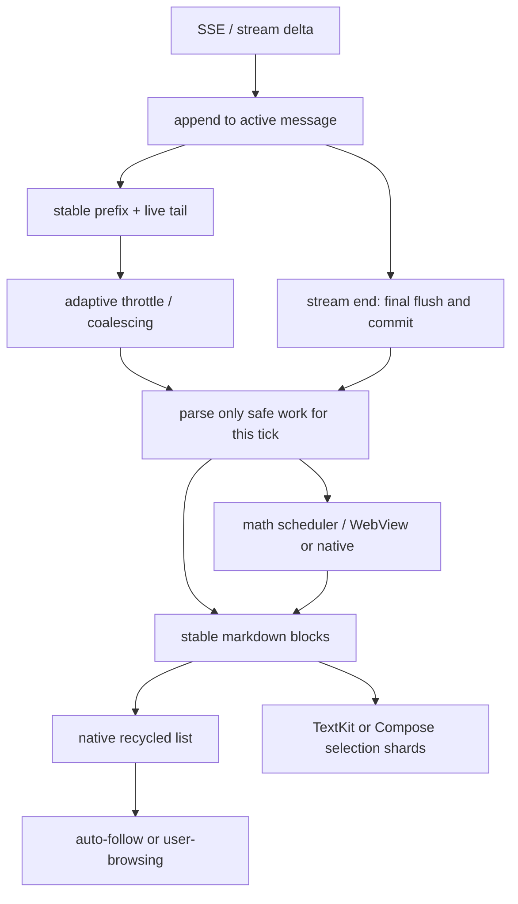

#### 12.5.1 iOS：节流在 SSE stream，增量快路径在 TextKit view

iOS 的 `textDelta` 分支把增量追加到当前 `StreamResult.assistantText`，达到时间/换行阈值后在 `MainActor` 回写对应的 text block；阈值和合并逻辑位于 `src/ios/Agent/Chat/AIChatViewModel+SSEStream.swift:417-513`。关键刷新分支如下，保留真实语义：

来源：`src/ios/Agent/Chat/AIChatViewModel+SSEStream.swift:479-511`

```swift
let throttle: TimeInterval = len < 500 ? 0.20
                            : len < 2000 ? 0.30
                            : len < 32_000 ? 0.50
                            : len < 64_000 ? 1.00
                            : len < 128_000 ? 1.50
                            : 2.00
let newlineFlush = len < 5000 && text.contains("\n") && unflushed >= 50

if elapsed >= throttle || newlineFlush {
    lastTextDeltaFlush = now
    lastTextDeltaFlushedLength = len
    let snapshot = result.assistantText
    let prepared = prepareMarkdownForRender(snapshot)
    let parsed = MarkdownContent(prepared)
    await MainActor.run {
        guard msgIdx < messages.count, blockIdx < messages[msgIdx].blocks.count else { return }
        self.setStreamingTextBlockContent(
            msgIdx: msgIdx,
            blockIdx: blockIdx,
            text: snapshot,
            parsedMarkdown: parsed,
            cacheAttributedString: false,
            requestScroll: true
        )
    }
}
```

这是 `textDelta` 分支中的精简片段：省略了上层事件枚举和统计字段，但保留了真实阈值、`MarkdownContent` 后台构造、`MainActor` 回写以及 block 边界保护。

这段代码说明一个容易被误读的事实：当前 iOS 路径**不是**一个按字符追加的完整增量 Markdown parser；每次 flush 仍会为当前快照构造 `MarkdownContent`。节流、解析放在非主线程的上游、以及视图层 append-only 快路径共同限制成本，不能把它宣传成“每次只解析最后一个字符”。

`prepareMarkdownForRender` 会把未闭合代码围栏/表格尾部等特殊情况转换为可测量的临时输入，位于 `src/ios/Agent/Chat/AIChatViewModel+SSEStream.swift:515-599`。当正文只是在已有段落末尾追加，`SelectableMarkdownView` 复用旧 attributed prefix，仅替换 tail；当新 block 边界或结构改变时才走完整渲染，见 `src/ios/Views/Chat/SelectableMarkdownView.swift:6753-6868`。

可把它概括为两层增量：

- **数据层增量**：`result.assistantText` 只在当前 stream result 中增长，采样点才调用 `setStreamingTextBlockContent` 回写对应 block。
- **文本层增量**：`updateUIView` 比较旧文本前缀；若旧值是新值的 prefix，则只追加新尾巴并重新测量必要的 glyph range，见 `src/ios/Views/Chat/SelectableMarkdownView.swift:6828-6868`。

#### 12.5.2 iOS：adaptive throttle 的具体边界

刷新不是固定的 16ms 定时器。`textDelta` 分支按 `assistantText` 长度选择 0.20、0.30、0.50、1.00、1.50 或 2.00 秒 tier；短文还允许“换行 + 至少 50 个未 flush 字符”的 fast path，长于 5000 字则关闭该 fast path，见 `src/ios/Agent/Chat/AIChatViewModel+SSEStream.swift:465-495`。这种节奏把全文 Markdown 重解析从每 token 调用改成合并批次。

因此要用两个指标评价流式体验：可见 token 延迟和单次 flush 工作量。把 interval 固定为“每 token 一次”会让长回答的全量解析/布局变成锯齿；把 interval 固定为“每秒一次”又会使短回答反馈变慢。仓库用按长度分 tier 的 throttle 和 newline fast path 折中，而不是伪造一个永远稳定的 FPS。

#### 12.5.3 Android：采样快照与 live tail

Android `StreamingMarkdownText` 在 `content` 改变时先通过 `snapshotFlow { content }.conflate()` 合并值，再按 `streamingThrottleFor` 延迟；当前 tier 为 200、300、500、1000、1500、2000ms，见 `src/android/app/src/main/java/com/openminis/app/ui/chat/StreamingMarkdownText.kt:517-525`、`src/android/app/src/main/java/com/openminis/app/ui/chat/StreamingMarkdownText.kt:551-566`。UI 读取的是最近完成快照，解析由后续 `LaunchedEffect` 调度。

来源：`src/android/app/src/main/java/com/openminis/app/ui/chat/StreamingMarkdownText.kt:551-580`

```kotlin
val sampledText by produceState(initialValue = streamingText, streamingText, policy) {
    if (!isStreaming) {
        value = streamingText
        return@produceState
    }
    val delayMs = policy.delayFor(streamingText.length)
    delay(delayMs)
    value = streamingText
}

val parsed by produceState(initialValue = emptyList<MdBlock>(), sampledText) {
    value = withContext(Dispatchers.Default) {
        parseMarkdownBlocks(sampledText)
    }
}
```

`parseMarkdownBlocks` 在采样点仍看到整段 `sampledText`，所以 Android 的块级 parser 也是“分块渲染 + 采样全量解析”，而不是任意位置的 AST 增量合并。真正的增量优化发生在 live paragraph 的 inline/math 层：安全前缀进入 `ParsedInlineCache`，只有最后一段未闭合内容重算，见 `src/android/app/src/main/java/com/openminis/app/ui/chat/StreamingMarkdownText.kt:2712-3033`。

`streamingTailBlock` 会给正在增长的段落单独的 key；已经完成的 `MdBlock` 不因尾部变化而换 key，见 `src/android/app/src/main/java/com/openminis/app/ui/chat/StreamingMarkdownText.kt:1500-1606`。`ChatFlatItems` 再把这些块映射到外层 LazyColumn item，因此 Compose 不会把一个 20KB 回答的所有 block 作为同一个重组单元。

#### 12.5.4 Android：后台 parse 不能等于无界缓存

Android 的 `MarkdownParseCaches` 用按字符预算的 LRU；默认每个 cache 的 source 字符预算为 2,000,000，`Lru.put` 按总字符数淘汰旧项，见 `src/android/app/src/main/java/com/openminis/app/ui/chat/StreamingMarkdownText.kt:2712-2831`、`src/android/app/src/main/java/com/openminis/app/ui/chat/StreamingMarkdownText.kt:2851-2862`。这是因为一个包含代码和表格的条目可能比几十个短段落更大；按 entry count 会低估内存。

`safeInlineSplitOffset` 不会在代码围栏、链接、强调或数学分隔符中间切断。它只把“已知不会随尾部重新解释”的前缀交给缓存；短文本或没有安全边界时回退普通 parse，见 `src/android/app/src/main/java/com/openminis/app/ui/chat/StreamingMarkdownText.kt:2887-2937`、`src/android/app/src/main/java/com/openminis/app/ui/chat/StreamingMarkdownText.kt:3060-3135`。

#### 12.5.5 完成事件是协议的一部分

两端都不能只依赖定时器：流结束时必须取消等待任务、强制解析最后的半行/半个表格，并把旁路流文本提交为 canonical message。iOS 的 `force: true` 路径位于 `src/ios/Agent/Chat/AIChatViewModel+SSEStream.swift:465-513`；Android 的 `updateAssistantMessage(..., isStreaming = false)` 会把 `StreamingDelta` 写回 `_messages` 并清理旁路，见 `src/android/app/src/main/java/com/openminis/app/ui/chat/ChatViewModel.kt:7540-7692`。否则最后一个 token 可能只存在于旁路 state，重新打开会话后消失。

### 12.6 Markdown 管线：块级身份优先，inline 只在必要处重算

#### 12.6.1 iOS：MarkdownMathExtractor → cmark block → RenderedBlock

`MinisMarkdownParser` 的入口先提取数学公式，再把公式替换为不会与普通文字冲突的对象替代占位符；它支持 `$$...$$`、`\[...\]`、`$...$`、`\(...\)`，同时跳过 fenced code 和 inline code，见 `src/ios/Agent/Markdown/MinisMarkdownParser.swift:28-84`、`src/ios/Agent/Markdown/MinisMarkdownParser.swift:452-607`。跳过代码是必要的：代码示例里的美元符号不能变成公式 attachment。

随后 parser 以 cmark-gfm AST 遍历 block。heading、paragraph、blockquote、list、table、code block、thematic break 和 HTML 分别生成 block node；表格会保留 header/rows/alignment 元数据，见 `src/ios/Agent/Markdown/MinisMarkdownParser.swift:91-225`。行级 inline 再生成普通文本、强调、删除线、code span、link 和媒体节点，见 `src/ios/Agent/Markdown/MinisMarkdownParser.swift:227-345`。

`SelectableMarkdownView` 不把所有内容拼成一个无差别的 Text，而是把每个 node 变成 `RenderedBlock`。段落使用 `renderInlines`；heading 设定独立 paragraph style；blockquote 累积 quote depth；代码块使用固定的 Menlo 字体和可横向裁切的 TextView，见 `src/ios/Views/Chat/SelectableMarkdownView.swift:559-593`、`src/ios/Views/Chat/SelectableMarkdownView.swift:1348-1430`。

来源：`src/ios/Views/Chat/SelectableMarkdownView.swift:1404-1418`

```swift
let codeStyle = NSMutableParagraphStyle()
codeStyle.lineSpacing = 4
codeStyle.lineBreakMode = .byClipping
let codeAttr = NSAttributedString(string: code, attributes: [
    .font: theme.codeBlockFont,
    .foregroundColor: theme.codeBlockTextColor,
    .paragraphStyle: codeStyle,
])
codeTextView.attributedText = codeAttr
```

当前 iOS 对话渲染器没有接入一个独立的语言服务器式高亮器；代码块主要由专用字体、颜色和复制/横向滚动容器呈现，真实逻辑见上述范围。把“语法高亮”写成 iOS 已经使用完整 compiler highlighter 会超出代码证据，应避免这种误读。

#### 12.6.2 Android：MarkdownParser 的块模型和表格保护

Android `MarkdownParser.parseWithMath` 的顺序与 iOS 对齐：先 `extractMath`，再扫描 fenced code、heading、列表、引用、表格和段落，见 `src/android/app/src/main/java/com/openminis/app/ui/markdown/MarkdownParser.kt:31-90`、`src/android/app/src/main/java/com/openminis/app/ui/markdown/MarkdownParser.kt:331-480`。数学提取器按字符走状态机，遇到 code fence 或 inline code 会原样复制分隔符；`` 样式的 Object Replacement Character + `MATH<n>` 占位符避免与普通 Markdown 符号冲突，见 `src/android/app/src/main/java/com/openminis/app/ui/markdown/MarkdownParser.kt:331-345`。

表格解析不是简单 `split("|")`：当单元格有 Markdown link 的括号时，`splitTableRow` 追踪括号深度，只有 depth 为 0 的竖线才分列，见 `src/android/app/src/main/java/com/openminis/app/ui/markdown/MarkdownParser.kt:298-328`。渲染阶段再把 `MdBlock.Table` 映射到横向滚动的 Row/Column，见 `src/android/app/src/main/java/com/openminis/app/ui/chat/StreamingMarkdownText.kt:1558-1645`。

Android 的 `SyntaxHighlighter` 是轻量词法着色器，只按 keyword、string、comment、number、type 着色，未声明为完整 parser，见 `src/android/app/src/main/java/com/openminis/app/ui/markdown/SyntaxHighlighter.kt:8-94`。普通 Markdown 组件支持 headings、粗斜体、代码块、列表、引用、表格、分隔线和链接，入口说明在 `src/android/app/src/main/java/com/openminis/app/ui/markdown/MarkdownText.kt:81-99`。

#### 12.6.3 `minis://` 媒体是解析后、布局前的资源解析问题

Markdown link 的 URL 不能直接交给平台图片加载器。iOS 的媒体 renderer 为 image、video、audio 生成 attachment，并以 source 为 key 缓存 audio attachment；图像则交给 `MinisMediaCache`，见 `src/ios/Views/Chat/SelectableMarkdownView.swift:1000-1057`、`src/ios/Views/Chat/SelectableMarkdownView.swift:1260-1365`。图片加载完成后必须发 size change，消息列表才会清除高度缓存并重排。

Android 的 `resolveMdMediaFile` 先把 `minis://attachments/foo` 映射成 Linux `/var/minis/attachments/foo`，优先调用 session-scoped `PRootKernel.resolveSessionHostPath`；找不到时遍历所有 session 目录和 global 目录，见 `src/android/app/src/main/java/com/openminis/app/ui/chat/StreamingMarkdownText.kt:2129-2198`。它特意只剥离 query、不剥离 `#`，因为 attachment 文件名允许包含 `#`；这类资源解析细节不能由 URL 组件的默认 fragment 规则替代。

Android 找到文件后还通过 `FileProvider` 生成可分享 URI，媒体外部打开入口见 `src/android/app/src/main/java/com/openminis/app/ui/chat/StreamingMarkdownText.kt:2201-2223`。因此 `minis://` 的完整链路是“Markdown link → session resolver → File/attachment → 尺寸回调或外部 intent”，并非把自定义 scheme 当成网络 URL。

### 12.7 数学公式：KaTeX WebView 与 SwiftMath 原生双通道

#### 12.7.1 两条路分别解决什么问题

KaTeX 适合覆盖完整 LaTeX 语法、显示公式和 HTML/CSS 排版；代价是 WebView 初始化、HTML 注入和快照高度测量。SwiftMath 直接生成原生图片，首屏和短 inline 公式开销低，但语法覆盖和复杂布局边界不同，见 `src/ios/Agent/Markdown/KaTeXRenderer.swift:34-70`、`src/ios/Agent/Markdown/SwiftMathRenderer.swift:6-19`。

iOS 的两条通道不是由 `MathRenderScheduler` 按长度自动选择的：普通 `MathAttachment` 进入 scheduler 后，`performRender()` 先走 `SwiftMathRenderer.render`，失败再走 `renderFallback`；显式 KaTeX 请求则由 `KaTeXRenderer` 自己排队并缓存，见 `src/ios/Views/Chat/SelectableMarkdownView.swift:3208-3235`、`src/ios/Agent/Markdown/KaTeXRenderer.swift:42-70`。

`MathRenderScheduler` 是主线程串行队列，每个 run-loop tick 最多处理 4 个 attachment，队列未空时用 `DispatchQueue.main.async` 让手势、滚动和布局先运行，见 `src/ios/Agent/Markdown/MathRenderScheduler.swift:5-24`、`src/ios/Agent/Markdown/MathRenderScheduler.swift:25-101`。缓存不在 scheduler：SwiftMath 用 `NSCache`（上限 256），KaTeX 用 `NSCache`（上限 200），见 `src/ios/Agent/Markdown/SwiftMathRenderer.swift:6-19`、`src/ios/Agent/Markdown/KaTeXRenderer.swift:21-69`。

#### 12.7.2 iOS 调度顺序

`KaTeXRenderer` 将 latex HTML-escape 后放进本地 KaTeX HTML 模板，以 `WKWebView` 计算内容尺寸并在完成后回传 snapshot，见 `src/ios/Agent/Markdown/KaTeXRenderer.swift:22-147`。HTML 和资源都来自仓库 `src/ios/Resources/KaTeX/`，因此公式渲染不依赖外网；资源加载完成后才允许计算高度。

`SwiftMathRenderer` 对短公式创建原生 attributed/drawing 结果；字符遍历和字体选择见 `src/ios/Agent/Markdown/SwiftMathRenderer.swift:128-155`。它不替代 KaTeX 的复杂显示布局，而是让 inline 公式不必为每个 token 启动或唤醒 WebView。

视图层收到 scheduler 结果后，用 `NSTextAttachment` 替换占位符；占位符在公式仍在生成时保持稳定宽度/最小高度，真实 attachment 完成再发送尺寸变化，见 `src/ios/Views/Chat/SelectableMarkdownView.swift:1150-1262`。这一步把异步公式网络与消息 cell 高度缓存连接起来。

#### 12.7.3 Android WebView pool 与 Compose 状态

`KatexWebViewPool` 这个名字虽叫 Pool，实际是一个 offscreen WebView 加 `Mutex` 串行请求；它用容量 150 的 `LruCache`，key 包含 latex、displayMode、isDark、fontSizePx，失败/超时返回 null 让调用方显示 raw LaTeX，见 `src/android/app/src/main/java/com/openminis/app/ui/chat/KatexWebViewPool.kt:21-85`、`src/android/app/src/main/java/com/openminis/app/ui/chat/KatexWebViewPool.kt:222-225`。`StreamingMarkdownText.RenderMath` 使用 `produceState`，以 latex、dark、fontSize 为 key；状态变化会重新申请结果，见 `src/android/app/src/main/java/com/openminis/app/ui/chat/StreamingMarkdownText.kt:2010-2085`。

Android `MarkdownParser.MathSpan` 只携带 placeholder、latex 和 display 标志；解析器不在后台线程里做 WebView 工作，UI 层拿到 span 后才渲染，见 `src/android/app/src/main/java/com/openminis/app/ui/markdown/MarkdownParser.kt:16-31`。这样 `Dispatchers.Default` parse 不会触碰 Android View，只把可序列化的数据传回主线程。

#### 12.7.4 数学公式的流式边界

单个 `$`、`$$`、`\(` 或 `\[` 处于未闭合状态时，iOS/Android 都必须保留普通文本或临时 placeholder，不能把“半个公式”交给 KaTeX 并在下一 token 里重写整段布局。Android 的 `extractMath` 在找不到 close delimiter 时不生成 `MathSpan`，见 `src/android/app/src/main/java/com/openminis/app/ui/markdown/MarkdownParser.kt:426-478`；iOS 对应逻辑见 `src/ios/Agent/Markdown/MinisMarkdownParser.swift:452-607`。

公式 cache 的视觉输入要分别核对：Android key 明确包含 dark/display/font size；iOS `KaTeXRenderer.cacheKey` 也读取当前 trait 的 dark 状态，但 `SwiftMathRenderer.cacheKey` 只包含 display、字号和 latex，暗色切换若仍复用 SwiftMath bitmap 可能需要由上层失效或重新建 attachment，见 `src/android/app/src/main/java/com/openminis/app/ui/chat/KatexWebViewPool.kt:222-225`、`src/ios/Agent/Markdown/KaTeXRenderer.swift:171-174`、`src/ios/Agent/Markdown/SwiftMathRenderer.swift:73-75`。这是双通道实现中不能忽略的 cache 约束。

### 12.8 8006 行 `SelectableMarkdownView` 与 Android TextKit 选择器

#### 12.8.1 iOS 解决的是跨 block 选择，不只是“给 Text 加 selectable”

`SelectableMarkdownView.swift` 同时包含 Markdown AST、RenderedBlock、TextKit 容器、attachment、手势、复制和动态尺寸，是一个 8006 行的 UIKit 适配层；它把多个 `NSTextStorage`/`UITextView` block 组织成一个可感知全局位置的选择面。文本视图使用 TextKit 1，选择范围按全局 offset 计算，见 `src/ios/Views/Chat/SelectableMarkdownView.swift:6330-6410`、`src/ios/Views/Chat/SelectableMarkdownView.swift:6500-6578`。

选择跨越多个 block 时，`selectedRange` 先转换成 block range，再把各 block 的子范围拼成 plain string；attachment 会变成可复制的占位文本而不是静默丢失，见 `src/ios/Views/Chat/SelectableMarkdownView.swift:5022-5095`。菜单同时提供 plain text、Markdown、富文本和“复制表格”等路径，`copyMarkdown` 会还原公式 delimiter 和代码围栏，见 `src/ios/Views/Chat/SelectableMarkdownView.swift:5099-5195`。

TextKit 不能在每次尾部追加时对整个 storage 调 `ensureLayout`; 代码把可见 glyph range 加一个小 overscan 作为快路径，只在需要时做 bounded layout，见 `src/ios/Views/Chat/SelectableMarkdownView.swift:6828-6872`。同一段还说明，全文 `ensureLayout` 在流式和大表格下曾造成明显卡顿，因此避免把“测量完整文本”当作默认操作。

#### 12.8.2 Android 为什么自行实现 `MinisTextKitSelection`

Compose `SelectionContainer` 以 Composable 子树为边界；聊天 item 会被 LazyColumn 回收，跨 item selection 的 anchor 可能失效。因此 `MinisTextKitSelection` 在 LazyColumn 外提升一个共享 `SelectionController`，注册每个可见 TextShard 的稳定 id、文本和坐标，见 `src/android/app/src/main/java/com/openminis/app/ui/chat/MinisTextKitSelection.kt:16-33`、`src/android/app/src/main/java/com/openminis/app/ui/chat/MinisTextKitSelection.kt:189-213`。

选择值是全局 `TextPosition(shardId, offset)`；拖拽时 controller 根据当前注册 shards 做 window-space hit test，再扩展 anchor/head，见 `src/android/app/src/main/java/com/openminis/app/ui/chat/MinisTextKitSelection.kt:214-390`。LazyColumn 回收 shard 后，registry 移除它，但选择模型保留逻辑位置；重新进入视口时再注册。这一行为是默认 `SelectionContainer` 不保证的，正是造轮子的原因。

#### 12.8.3 Android 手势层的 frame-safe 设计

`MinisTextKitGesture` 不直接在 pointer move 回调里无限修改布局，而是把最新拖拽点写入 `DragIntent`，由一个 16ms ticker 合并更新；边缘滚动只在 handle 距离顶部/底部阈值内触发，见 `src/android/app/src/main/java/com/openminis/app/ui/chat/MinisTextKitGesture.kt:1-179`。这样同一帧多次 move 不会重复做 hit test 和 selection recomposition。

手柄绘制和触摸命中区域分开：视觉圆点较小，命中 padding 更大；代码以 density 将 44dp 左右的触摸范围换算到像素，见 `src/android/app/src/main/java/com/openminis/app/ui/chat/MinisTextKitGesture.kt:170-390`。长按、拖拽、点击工具栏分别处理，不让 Compose 的普通 scroll gesture 抢走所有事件。

`MinisMarkdownTextToolbar` 将复制、复制 Markdown、加入输入框、朗读和选择全选等动作绑定到 controller，见 `src/android/app/src/main/java/com/openminis/app/ui/chat/MinisMarkdownTextToolbar.kt:216-390`。因此 toolbar 是选择状态机的一部分，不是脱离文本的浮层按钮。

### 12.9 工具调用 UI：实时输出与最终 diff 都不能阻塞聊天列表

#### 12.9.1 iOS ToolLiveSheet 的数据模型

`ToolLiveSheet` 接收当前 assistant block 的 tool snapshots；它以 `toolUseId` 维护当前 index，并把 shell 输出、文件 edits、browser snapshots 和图片工具分开呈现，见 `src/ios/Views/Chat/ToolLiveSheet.swift:1-83`。顶部实时预览显示有限行的 ANSI 清洗文本，tap 后进入全屏详情；iOS 不是把 70KB shell 输出全部塞进聊天 cell。

实时文本 renderer 对一条超长行做 2000 字截断、允许的行数做上限，并把输出分成约 40 行的增量 chunk；这三个约束和 ANSI 清洗在 `src/ios/Views/Chat/ToolLiveSheet.swift:28-60`、`src/ios/Views/Chat/ToolLiveSheet.swift:100-185`。文件 edit 另走 `old_string/new_string` 的 unified diff 展示，见 `src/ios/Views/Chat/ToolLiveSheet.swift:200-372`。

详情页不是普通滚动全文：初次只渲染约 5 个 chunk，最多约 10KB；用户接近底部才 reveal 下一批，并提供 Load more，见 `src/ios/Views/Chat/ToolLiveSheet.swift:1240-1340`。这是“渐进加载”而不是删除工具输出；最终 snapshot 仍可按需查看。

#### 12.9.2 Android ToolDetailSheet 的对应做法

Android `ChatToolDetailUI` 把工具状态映射为 pending/running/success/failed/timeout/cancelled，卡片点击打开 `ModalBottomSheet`，见 `src/android/app/src/main/java/com/openminis/app/ui/chat/ChatToolDetailUI.kt:269-320`、`src/android/app/src/main/java/com/openminis/app/ui/chat/ChatToolDetailUI.kt:560-620`。`ChatAssistantMessageUI` 的工具行只显示标题、状态和摘要，避免把结果正文挂在每次消息重组上，见 `src/android/app/src/main/java/com/openminis/app/ui/chat/ChatAssistantMessageUI.kt:760-910`。

工具详情的 lazy reveal 以约 40 行为一批，初始约 5 批；单个文件 edit 的 diff 解析 old/new 行并显示 added/deleted，见 `src/android/app/src/main/java/com/openminis/app/ui/chat/ChatToolDetailUI.kt:1379-1538`。实现明确指出一次性构造 70KB 文本、测量全部行会导致打开 sheet 时卡顿，所以只在用户滚动到末尾时追加 `Text`，见同文件 `LazyRevealToolText` 的注释和范围 `src/android/app/src/main/java/com/openminis/app/ui/chat/ChatToolDetailUI.kt:1381-1518`。

Android 详情页的文本选择故意使用独立 `SelectionContainer`，不嵌入聊天列表的 `MinisTextKitSelection` registry，见 `src/android/app/src/main/java/com/openminis/app/ui/chat/ChatToolDetailUI.kt:1389-1395`。这是为了避免工具 sheet 关闭后仍有 shard 注册在聊天树中；两种选择模型的边界必须显式保持。

#### 12.9.3 为什么工具输出要有“折叠卡片 + 实时面板 + 最终详情”三层

折叠卡片解决历史列表密度；实时面板解决用户需要观察正在运行的命令；最终详情解决审计和复制。三者展示的是同一 `ToolSnapshot` 的不同窗口，而不是复制三份不一致的 state。iOS 的 `toolSnapshots`/current index 见 `src/ios/Views/Chat/ToolLiveSheet.swift:70-83`，Android 的 `toolBlocks` 与 `expanded` 见 `src/android/app/src/main/java/com/openminis/app/ui/chat/ChatToolDetailUI.kt:280-320`。

工具状态不能只用布尔 `isLoading`：Android 的 `ToolBlockStatus` 显式区分 `STREAMING`、`PENDING`、`RUNNING`、`SUCCESS`、`FAILED`、`CANCELLED`、`TIMEOUT`，枚举与注释在 `src/android/app/src/main/java/com/openminis/app/ui/chat/ChatModels.kt:212-225`，卡片状态映射在 `src/android/app/src/main/java/com/openminis/app/ui/chat/ChatAssistantMessageUI.kt:580-638`；iOS 也以 snapshot status 驱动实时/最终视图。状态枚举决定取消按钮、错误颜色和是否允许展示最终 diff。

### 12.10 输入区：附件、语音、@ mention 和斜杠命令也要节流

#### 12.10.1 iOS 输入区的组件边界

`ChatInputBar` 把附件 grid、录音按钮、文本输入和发送 capsule 组合为一个组件；`InputAttachmentGridView` 维护 `InputAttachment` 数组、加载中的视频计数、拖拽 id 和删除回调，见 `src/ios/Views/Chat/ChatInputBar.swift:150-210`。拖拽时只修改顺序和 opacity，删除/上传完成才改变附件集合，避免拖动过程触发整个聊天列表更新。

`AIChatView` 将附件预览放在 composer 上方，并设置最大内容宽度/最大高度，避免 iPad 横屏或大量图片把输入区无限撑高，见 `src/ios/Views/Chat/AIChatView.swift:3190-3340`。语音模式使用 `voiceInputActive`，识别回调只追加新增 delta，发送后再 `clearAndRearm`，见 `src/ios/Views/Chat/AIChatView.swift:3217-3247`、`src/ios/Views/Chat/AIChatView.swift:4140-4149`。

#### 12.10.2 iOS 的 slash 与 mention 是输入状态机

`AIChatViewModel+SlashCommands.swift` 定义 slash command 的 id、icon、title、subtitle，并区分用户安装 skill 与 MCP row；选择后不是立刻在 UI 执行脚本，而是把 `<name>`/SKILL.md 提示注入 agent loop，见 `src/ios/Agent/Chat/AIChatViewModel+SlashCommands.swift:1-180`。这说明菜单是 prompt 选择器，不是另一个发送 API。

mention picker 读取 `inputText` 和 caret，只有 caret 前的 token 以 `@` 开头时才显示；选择后在原光标位置替换 token，逻辑见 `src/ios/Agent/Chat/AIChatViewModel+MentionMenu.swift:1-130` 与 `src/ios/Views/Chat/AIChatView.swift:3190-3340`。因此不能简单用 `inputText.contains("@")` 全局触发菜单。

#### 12.10.3 Android 复刻语义而不是复刻 UIKit

`ChatComposerWidgets` 提供 `AttachmentChip`、`MicButton`、`InputCircleButton` 和 launcher；录音按钮进入 inline voice panel，而不是跳转到新页面，见 `src/android/app/src/main/java/com/openminis/app/ui/chat/ChatComposerWidgets.kt:278-405`。`ChatScreen` 使用 `BasicTextField` 并维护 selection，插入 mention/slash 后通过 `TextFieldValue` 保留 caret，见 `src/android/app/src/main/java/com/openminis/app/ui/chat/ChatScreen.kt:599-623`。

附件 picker 限制最多 50 项并按照 `image/jpeg` 等 mime 类型选择，见 `src/android/app/src/main/java/com/openminis/app/ui/chat/ChatScreen.kt:719-742`。相机使用 `rememberLauncherForActivityResult`，启动前设置 overlay state，回调中再关闭 overlay，见 `src/android/app/src/main/java/com/openminis/app/ui/chat/ChatScreen.kt:804-823`。这类 Activity 前后台边界是 Compose 输入区最容易遗漏的地方。

Android mention popup 从 ViewModel 的 `mentionMenuOpenForSpy`、entries、selectedIndex 收集状态；选择项通过 `executeSelectedMention` 替换 caret 前 token，见 `src/android/app/src/main/java/com/openminis/app/ui/chat/ChatScreen.kt:3979-4150`。slash popup 使用同样的 `showSlashMenu`/`executeSelectedSlash` 状态，不把候选列表硬编码在文本组件里，见 `src/android/app/src/main/java/com/openminis/app/ui/chat/ChatScreen.kt:3660-3798`。

### 12.11 主题、动态字号和无障碍：缓存键必须包含视觉状态

#### 12.11.1 iOS：系统颜色 + 自定义字号通知

iOS `ChatColors` 直接从 `UIColor.systemBackground`、`label`、`secondaryLabel` 和 `tertiarySystemFill` 派生 light/dark 颜色；工具、输入框、用户气泡和发送按钮共享同一 palette，见 `src/ios/Views/Chat/AIChatView.swift:67-94`。这比在每个 Markdown renderer 写一套 dark literal 更能跟随系统对比度。

`FontSettings` 定义六档 `FontScaleLevel`，倍率从 0.88 到 1.21，`AppFontScaleModifier` 将用户字号应用到 `dynamicTypeSize`，见 `src/ios/Shared/FontSettings.swift:8-45`、`src/ios/Shared/FontSettings.swift:196-216`。字号改变会发 `fontSettingsMessageBaseChanged`；`AIChatViewModel` 清理 attributed string cache，消息列表再按可见项重新测量，见 `src/ios/Shared/FontSettings.swift:1-8`、`src/ios/Agent/Chat/AIChatViewModel.swift:501-513`。

代码块、attachment 和公式的高度都受字号影响，因此 cache key 不能只用 message id。V3 的 layout cache 按 attributed string identity 保存，user bubble 的真实高度 key 还包含 content、width、fontsize；字号变化由 VM 清空 attributed cache 并触发布局更新，见 `src/ios/Agent/MessageList/CollectionViewMessageListV3.swift:671-690`、`src/ios/Agent/Chat/AIChatViewModel.swift:501-513`。选择控制器还把拖动 handle 的全局 offset 交给 collection view 做边缘自动滚动，见 `src/ios/Views/Chat/SelectableMarkdownView.swift:4700-4798`。

#### 12.11.2 Android：ChatPalette、Typography 和 Markdown font scale

`ChatColors` 把 iOS palette 语义映射到 `ChatPalette`：background、secondaryBg、userBubble、toolBg、label、separator 等都由 `isDark` 选择，见 `src/android/app/src/main/java/com/openminis/app/ui/theme/ChatColors.kt:10-162`。Markdown 与工具卡片不要直接读取 `Color.White`，否则系统切暗色或用户切换应用内主题时会出现局部亮色。

`AppearanceScreen` 的字号档位与 iOS 对齐，`scaledTypography(factor)` 复制各个 TextStyle 并缩放 `fontSize`，见 `src/android/app/src/main/java/com/openminis/app/ui/settings/AppearanceScreen.kt:119-169`。`Theme.kt` 把这些 Typography 放入 `MinisTheme`，见 `src/android/app/src/main/java/com/openminis/app/ui/theme/Theme.kt:119-178`；流式 Markdown 另外读取 `LocalMarkdownFontScale`，见 `src/android/app/src/main/java/com/openminis/app/ui/chat/StreamingMarkdownText.kt:180-235`。

工具详情和 markdown 复合树要避免两套 dark 判定。`ChatToolDetailUI` 的注释明确指出 `isSystemInDarkTheme()` 不跟随应用内 override，实际取 `ChatColors.isDark` 决定 diff 卡片颜色，见 `src/android/app/src/main/java/com/openminis/app/ui/chat/ChatToolDetailUI.kt:616-628`。[推断] 如果产品继续允许独立应用内主题，应把所有 preview branch 统一到 `LocalChatPalette`，并在切换时清空 KaTeX/图片/测量缓存。

无障碍要覆盖输入和媒体：`ChatComposerWidgets` 为图片 chip、mic、send 等提供 content description，`StreamingMarkdownText` 对公式和图片给出可读 fallback，见 `src/android/app/src/main/java/com/openminis/app/ui/chat/ChatComposerWidgets.kt:278-405`、`src/android/app/src/main/java/com/openminis/app/ui/chat/StreamingMarkdownText.kt:2060-2120`。自定义选择器还要让 TalkBack 能知道当前 selected range；不能因为替换了 SelectionContainer 就删掉语义节点。

### 12.12 流式渲染时序与实现要点

下面按一次 assistant 回答拆解，括号中的文件是实现证据。

1. SSE/transport 收到 delta；iOS 把它追加到活跃消息的 `streamingText`，Android 写入 `streamingById`，不立即重建历史列表（`src/ios/Agent/Chat/AIChatViewModel+SSEStream.swift:363-464`；`src/android/app/src/main/java/com/openminis/app/ui/chat/ChatModels.kt:81-102`）。
2. 根据文本长度、最近耗时和滚动状态合并更新；iOS 使用 streaming work item，Android 使用 `produceState`/policy delay（`src/ios/Agent/Chat/AIChatViewModel+SSEStream.swift:301-513`；`src/android/app/src/main/java/com/openminis/app/ui/chat/StreamingMarkdownText.kt:528-600`）。
3. 到达安全点后解析：iOS 构造 `MarkdownContent`，Android 在 `Dispatchers.Default` 调 `parseMarkdownBlocks`（`src/ios/Agent/Chat/AIChatViewModel+SSEStream.swift:465-513`；`src/android/app/src/main/java/com/openminis/app/ui/chat/StreamingMarkdownText.kt:551-580`）。
4. 解析器在 code fence/inline code 中保护公式 delimiter，把安全的 heading、paragraph、table、code block 转成稳定 block（`src/ios/Agent/Markdown/MinisMarkdownParser.swift:28-225`；`src/android/app/src/main/java/com/openminis/app/ui/markdown/MarkdownParser.kt:331-480`）。
5. 外层列表只插入/更新变化 block：iOS diffable + UICollectionView cell，Android LazyColumn stable key + `AssistantMarkdownBlock`（`src/ios/Agent/MessageList/MessageListInfrastructure.swift:18-38`；`src/android/app/src/main/java/com/openminis/app/ui/chat/ChatFlatItems.kt:351-390`）。
6. 活跃文本在 TextKit/Compose 中只重排安全尾部，公式交给 scheduler/WebView pool，媒体完成后触发尺寸失效（`src/ios/Views/Chat/SelectableMarkdownView.swift:6753-6872`；`src/android/app/src/main/java/com/openminis/app/ui/chat/StreamingMarkdownText.kt:2712-3033`）。
7. 滚动层根据 auto-follow/user-browsing 决定是否 pin bottom；用户阅读历史时不能被 token 抢回底部（`src/ios/Agent/MessageList/MessageListLayout.swift:109-118`；`src/android/app/src/main/java/com/openminis/app/ui/chat/ChatScreen.kt:995-1055`、`src/android/app/src/main/java/com/openminis/app/ui/chat/ChatScreen.kt:1385-1458`）。
8. stream end 强制 flush、提交 canonical message、清理旁路和 in-flight tasks（`src/ios/Agent/Chat/AIChatViewModel+SSEStream.swift:465-513`；`src/android/app/src/main/java/com/openminis/app/ui/chat/ChatViewModel.kt:7540-7692`）。

### 12.13 平台对照

| 抽象 | iOS 落地 | Android 落地 | 差异与原因 |
|---|---|---|---|
| 外层消息列表 | `CollectionViewMessageListV3` + `UICollectionView`，`src/ios/Agent/MessageList/CollectionViewMessageListV3.swift:12-20` | `ChatScreen` + `LazyColumn(reverseLayout = true)`，`src/android/app/src/main/java/com/openminis/app/ui/chat/ChatScreen.kt:3007-3129` | iOS 需要控制 UIKit self-sizing、content offset 和 TextKit attachment；Compose 则用 key/contentType/协程状态完成节点复用。 |
| 消息拆块 | `MessageListItem.assistantBlock`，`src/ios/Agent/MessageList/MessageListInfrastructure.swift:18-38` | `AssistantMarkdownBlock`，`src/android/app/src/main/java/com/openminis/app/ui/chat/ChatFlatItems.kt:351-390` | 两端都冻结已完成 block；iOS 以 diffable item 身份管理，Android 以 LazyColumn item key 管理。 |
| 高度缓存 | measured → attributed precompute → estimate，`src/ios/Agent/MessageList/MessageListLayout.swift:15-40` | Compose 测量由 item 组合完成，长会话还做 ui window，`src/android/app/src/main/java/com/openminis/app/ui/chat/ChatScreen.kt:430-440` | UIKit 需要主动保存 layout attributes；Compose 的 Lazy 布局保存组合节点，但仍须避免整条文本变成一个 item。 |
| 流式节流 | `textDelta` 的长度 tier/newline fast path，`src/ios/Agent/Chat/AIChatViewModel+SSEStream.swift:465-513`；布局 100ms/3s flush，`src/ios/Agent/MessageList/CollectionViewMessageListV3.swift:1754-1810` | `streamingThrottleFor` + `produceState`/`snapshotFlow.conflate()`，`src/android/app/src/main/java/com/openminis/app/ui/chat/StreamingMarkdownText.kt:517-580` | iOS 重点保护 MainActor/TextKit；Android 重点把采样和 block parse 分开，并把 block parse 放到 `Dispatchers.Default`。 |
| Markdown block parser | cmark-gfm AST + `MarkdownContent`，`src/ios/Agent/Markdown/MinisMarkdownParser.swift:91-225` | 自定义 `MdBlock`，`src/android/app/src/main/java/com/openminis/app/ui/markdown/MarkdownParser.kt:31-90` | 两端均保护 code fence、表格和公式；Android parser 便于在 Kotlin/Compose 中传递轻量数据。 |
| 流式尾部优化 | `SelectableMarkdownView` prefix reuse / bounded glyph layout，`src/ios/Views/Chat/SelectableMarkdownView.swift:6753-6872` | `MarkdownParseCaches.inlineIncremental` + safe prefix + live tail，`src/android/app/src/main/java/com/openminis/app/ui/chat/StreamingMarkdownText.kt:2887-3033` | 两端都不是任意 AST 增量；iOS 全量 MarkdownContent 后在 TextKit 复用，Android block parse 采样后在 inline/math 层复用。 |
| 数学公式 | `MathRenderScheduler` 在 SwiftMath/KaTeX 间选择，`src/ios/Agent/Markdown/MathRenderScheduler.swift:1-109` | `KatexWebViewPool` + `RenderMath`，`src/android/app/src/main/java/com/openminis/app/ui/chat/KatexWebViewPool.kt:1-240` | WebView 覆盖复杂 LaTeX，原生/缓存降低 inline 公式延迟；两端 cache key 都包含主题、字号、display。 |
| 文本选择 | TextKit 多 block 全局 range，`src/ios/Views/Chat/SelectableMarkdownView.swift:5022-5195` | registry + `TextShard` + 自定义 gesture，`src/android/app/src/main/java/com/openminis/app/ui/chat/MinisTextKitSelection.kt:16-390` | UIKit 原生 selection 不跨多个子 TextView；Compose item 会回收，需提升共享 controller。 |
| 工具实时输出 | `ToolLiveSheet` 2000 字/约 40 行 chunk，`src/ios/Views/Chat/ToolLiveSheet.swift:28-60` | `ChatToolDetailUI` lazy reveal，`src/android/app/src/main/java/com/openminis/app/ui/chat/ChatToolDetailUI.kt:1379-1538` | 都先折叠、再按需详情；Android sheet 使用独立 SelectionContainer。 |
| 输入附件 | `InputAttachmentGridView` + UIKit drag，`src/ios/Views/Chat/ChatInputBar.swift:150-210` | Compose chips + ActivityResult picker，`src/android/app/src/main/java/com/openminis/app/ui/chat/ChatComposerWidgets.kt:278-405`、`src/android/app/src/main/java/com/openminis/app/ui/chat/ChatScreen.kt:719-823` | iOS 组件直接管理 attachment view；Android 必须处理 Activity 前后台和 remember launcher。 |
| slash/mention | ViewModel extension + caret 前 token，`src/ios/Agent/Chat/AIChatViewModel+SlashCommands.swift:1-180`、`src/ios/Agent/Chat/AIChatViewModel+MentionMenu.swift:1-130` | StateFlow popup + `TextFieldValue` selection，`src/android/app/src/main/java/com/openminis/app/ui/chat/ChatScreen.kt:3660-3798`、`src/android/app/src/main/java/com/openminis/app/ui/chat/ChatScreen.kt:3979-4150` | 语义一致，交互载体不同；两端都不应全局扫描 `@` 或直接丢失 caret。 |
| 主题/字号 | `FontSettings` + dynamicType + cache invalidation，`src/ios/Shared/FontSettings.swift:8-45` | `AppearanceScreen` + `MinisTheme` + Markdown scale，`src/android/app/src/main/java/com/openminis/app/ui/settings/AppearanceScreen.kt:119-169` | 视觉状态必须进入高度、公式、图片缓存 key。 |

### 12.14 设计取舍与踩坑

#### 12.14.1 iOS：UIKit 外壳带来的收益与成本

收益是可观察的：`UICollectionViewLayout` 能单独控制缓存、prefetch、content offset 和 diffable snapshot，V3 还有真实测量/estimate 分层。成本也同样具体：SwiftUI view 的重建不代表 UIKit cell 已重新测量，`UIHostingConfiguration` 在空 block 首次填充时可能不触发 fitting，因此必须有 `blockContentFilledSignal`，见 `src/ios/Agent/MessageList/CollectionViewMessageListV3.swift:1614-1634`。

另一个成本是 ViewModel 生命周期。`UIViewControllerRepresentable` 在 SwiftUI 重建时可能收到同一 session 的新 VM；Coordinator 会更新 weak VM 引用，否则 scroll callback 会写入旧 VM，注释和更新逻辑见 `src/ios/Agent/MessageList/CollectionViewMessageListV3.swift:50-62`、`src/ios/Agent/MessageList/CollectionViewMessageListV3.swift:620-642`。[推断] 任何 UIKit bridge 都应该把“controller 身份”和“数据源身份”分开测试。

TextKit 的危险操作是对全文调用 `ensureLayout`。当前代码只布局 visible glyph range 加 overscan，并限制 attachment/layout 回调的同步范围，见 `src/ios/Views/Chat/SelectableMarkdownView.swift:6828-6918`。大表格、未闭合代码块和异步图片会使全量测量成本突然变大；不要用“每次 append 后全文 ensureLayout”作为最简单实现。

#### 12.14.2 iOS：为什么没有把 prefetch 当作优化

常规列表建议预取，但本章对象是动态高度和重文本 cell；仓库的注释已经给出 44ms 的测量证据，预取反而在用户尚未看到内容时占用主线程，见 `src/ios/Agent/MessageList/CollectionViewMessageListV3.swift:740-758`。可砍掉的不是“按需测量”，而是离屏主动测量；如果迁移到桌面端，应重新以 profiler 验证，而不要盲目保留该数值。

#### 12.14.3 Android：lazy 不等于免费

LazyColumn 只保证 item 级组合和布局惰性；如果一个 item 内部持有整条 100KB 文本、`Column` 遍历所有 block，仍会在该 item 首次进入时集中工作。`ChatFlatItems` 的块级模型和 `ChatToolDetailUI` 的 lazy reveal 都是针对这一点的直接修补，见 `src/android/app/src/main/java/com/openminis/app/ui/chat/ChatFlatItems.kt:351-390`、`src/android/app/src/main/java/com/openminis/app/ui/chat/ChatToolDetailUI.kt:1379-1538`。

后台 parse 也有代价：`produceState` 的 sampled snapshot 可能落后 token；policy 变长是延迟换主线程稳定性。必须在 stream end 走 force update，并把出错 parse 作为可渲染的 plain text fallback，`StreamingMarkdownText` 的异常/空结果分支见 `src/android/app/src/main/java/com/openminis/app/ui/chat/StreamingMarkdownText.kt:580-620`。

Compose 的 selection registry 若没有在 `DisposableEffect` 中 unregister，会保留已回收 shard 的坐标；代码在 `MinisTextKitSelection` 对注册/注销做成显式生命周期，见 `src/android/app/src/main/java/com/openminis/app/ui/chat/MinisTextKitSelection.kt:189-213`。这类泄漏比普通文本 bug 更隐蔽，因为只在拖动选择或长会话回收后出现。

#### 12.14.4 共同约束：安全前缀和主题版本

Markdown 增量合并只能在语法安全边界做。表格中 `|`、链接中 `)`、代码 fence 和 `$` delimiter 都可能使之前的文本重新解释；Android 通过 `safeInlineSplitOffset` 防止切开 token，见 `src/android/app/src/main/java/com/openminis/app/ui/chat/StreamingMarkdownText.kt:2887-2937`、`src/android/app/src/main/java/com/openminis/app/ui/chat/StreamingMarkdownText.kt:3060-3135`；iOS 则在 `prepareMarkdownForRender` 对未闭合结构做临时保护，见 `src/ios/Agent/Chat/AIChatViewModel+SSEStream.swift:515-599`。

主题/字体变化必须令相关缓存失效。只刷新 Text color 而不重测高度会让代码块、公式和图片 attachment 的 frame 错位；iOS 的 font notification 清理 attributed cache，Android 的 Typography 从主题重新下发，见 `src/ios/Agent/Chat/AIChatViewModel.swift:495-515`、`src/android/app/src/main/java/com/openminis/app/ui/theme/Theme.kt:119-178`。

#### 12.14.5 可见性和后台行为

流式更新在用户正在滚动或打开工具详情时不应抢占主界面布局；iOS 用 `DeferredStreamingTextUpdate` 暂存并在恢复后合并，见 `src/ios/Agent/Chat/AIChatViewModel.swift:1079-1091`。Android 的 live state 仍可继续收集，但 UI item 只在 LazyColumn 组合/采样时消费；这一差异要求 ViewModel 的 canonical commit 与 UI snapshot 解耦，见 `src/android/app/src/main/java/com/openminis/app/ui/chat/ChatModels.kt:81-102`。[推断] 桌面端可把相同机制扩展到窗口最小化和多窗口会话。

#### 12.14.6 失败模式矩阵：用症状定位错误层

| 症状 | 先查哪一层 | 代码证据 | 常见错误修复 |
|---|---|---|---|
| token 到达但 UI 不变 | stream side-channel / sampled snapshot | iOS `flushStreamingUIUpdate`：`src/ios/Agent/Chat/AIChatViewModel+SSEStream.swift:465-513`；Android `StreamingDelta`：`src/android/app/src/main/java/com/openminis/app/ui/chat/ChatModels.kt:81-102` | 不要直接加 `objectWillChange`/`mutableState` 频率；先确认最终 flush 和 snapshot key。 |
| 只有正在生成的段落抖动 | block identity / equals | iOS `MessageListItem`：`src/ios/Agent/MessageList/MessageListInfrastructure.swift:18-38`；Android block equals：`src/android/app/src/main/java/com/openminis/app/ui/chat/ChatFlatItems.kt:351-390` | 不要把正文作为 key；不要让 equals 逐字符比较整条答案。 |
| 用户阅读历史时被拉到底 | scroll mode | iOS `scrollMode`：`src/ios/Agent/MessageList/CollectionViewMessageListV3.swift:643-650`；Android `isNearBottom/userScrolledAway`：`src/android/app/src/main/java/com/openminis/app/ui/chat/ChatScreen.kt:995-1055`、`src/android/app/src/main/java/com/openminis/app/ui/chat/ChatScreen.kt:1210-1290` | 不要无条件 `scrollTo(last)`；分离 programmatic scroll 与用户滚动。 |
| 公式出现后下方内容跳动 | math result/height invalidation | iOS scheduler：`src/ios/Agent/Markdown/MathRenderScheduler.swift:31-109`；Android render key：`src/android/app/src/main/java/com/openminis/app/ui/chat/KatexWebViewPool.kt:30-70` | 不要把异步公式结果当普通 string 替换而不清 height cache。 |
| 图片是旧尺寸或占位高度不消失 | media cache / attachment size | iOS attachment cache：`src/ios/Views/Chat/SelectableMarkdownView.swift:1000-1057`；Android resolver：`src/android/app/src/main/java/com/openminis/app/ui/chat/StreamingMarkdownText.kt:2141-2198` | 不要只缓存文件名；纳入 session、主题、宽度，并在完成时发尺寸信号。 |
| 表格列错位 | block parser | iOS table nodes：`src/ios/Agent/Markdown/MinisMarkdownParser.swift:180-225`；Android `splitTableRow`：`src/android/app/src/main/java/com/openminis/app/ui/markdown/MarkdownParser.kt:298-328` | 不要用未考虑 link 括号的 `split("|")`；保留空单元格。 |
| 复制缺少后半段 | selection registry/range mapping | iOS copy：`src/ios/Views/Chat/SelectableMarkdownView.swift:5022-5195`；Android shards：`src/android/app/src/main/java/com/openminis/app/ui/chat/MinisTextKitSelection.kt:214-390` | 不要只读取当前可见 Text；复制操作必须走全局 range。 |
| 工具 sheet 打开卡顿 | reveal window | iOS chunks：`src/ios/Views/Chat/ToolLiveSheet.swift:1240-1340`；Android lazy reveal：`src/android/app/src/main/java/com/openminis/app/ui/chat/ChatToolDetailUI.kt:1379-1538` | 不要在 bottom sheet 首帧构造完整 stdout；先显示摘要和有限批次。 |
| 切字号后截断/重叠 | font generation/cache invalidation | iOS font notification：`src/ios/Shared/FontSettings.swift:1-8`；Android Typography：`src/android/app/src/main/java/com/openminis/app/ui/theme/Theme.kt:119-178` | 不要只更新颜色或 TextStyle；清理 layout、attributed、math 结果。 |

这张表的使用顺序是从外到内：先确认 token 是否进入正确的 snapshot，再看 block key，最后才看 parser 和 TextKit/Compose 细节。否则很容易用“增加延迟”“禁用动画”来掩盖 state 丢失或高度失效的问题。

#### 12.14.7 需要保留的状态不变量

以下不变量可以直接作为平台无关的单元或手工 smoke 检查；它们分别对应仓库中的真实 state 边界。

1. **稳定前缀不被重写。** 当新文本是旧文本的 append 时，已完成 block 的 identity 与渲染结果不变；如果 append 闭合了 fence/table/link，允许只重算受影响的尾部（`src/android/app/src/main/java/com/openminis/app/ui/chat/ChatFlatItems.kt:351-390`、`src/ios/Views/Chat/SelectableMarkdownView.swift:6828-6868`）。
2. **旁路最终必回 canonical。** stream end 后 `streamingById`/`streamingText` 为空，完整正文仍在消息模型；应用重启或切换会话不会丢最后一个 token（`src/android/app/src/main/java/com/openminis/app/ui/chat/ChatViewModel.kt:7540-7692`、`src/ios/Agent/Chat/AIChatViewModel+SSEStream.swift:465-513`）。
3. **用户滚动优先级高于自动 pin。** 只有用户接近底部且没有主动拖拽时才自动跟随；流式状态不能把 user-browsing 改成 auto-scrolling（`src/ios/Agent/MessageList/MessageListLayout.swift:109-118`、`src/android/app/src/main/java/com/openminis/app/ui/chat/ChatScreen.kt:995-1055`、`src/android/app/src/main/java/com/openminis/app/ui/chat/ChatScreen.kt:1385-1458`）。
4. **异步尺寸变化可传回列表。** 公式、图片、视频和字体变化必须能触发对应 block 的 remeasure；不能只更新 attachment 内部状态（`src/ios/Agent/MessageList/CollectionViewMessageListV3.swift:684-690`、`src/ios/Views/Chat/SelectableMarkdownView.swift:1150-1262`）。
5. **选区位置与视口位置分离。** TextKit/Compose 的 selection 用逻辑 offset，回收和滚动只改变 shard 的可见坐标，不改变用户已选的 range（`src/ios/Views/Chat/SelectableMarkdownView.swift:6330-6410`、`src/android/app/src/main/java/com/openminis/app/ui/chat/MinisTextKitSelection.kt:214-390`）。
6. **主题变化使视觉 cache 失效。** dark、fontScale、display mode 是渲染输入；同一 latex 或正文在主题改变后不能命中旧 bitmap/height（`src/ios/Agent/Markdown/MathRenderScheduler.swift:31-64`、`src/android/app/src/main/java/com/openminis/app/ui/chat/KatexWebViewPool.kt:30-70`）。
7. **失败降级保持文本可读。** parser、WebView、媒体 resolver 失败时展示原始 fenced/plain text 或占位符，并允许复制；不能用一个空 View 把消息吞掉（`src/android/app/src/main/java/com/openminis/app/ui/chat/StreamingMarkdownText.kt:580-620`、`src/ios/Views/Chat/SelectableMarkdownView.swift:985-1057`）。

#### 12.14.8 迁移到桌面端时不能直接复制移动端常数

仓库中的 iOS 200–2000ms 文本 throttle、Android 200–2000ms sampled throttle、100ms/3s layout flush、44ms prefetch 代价和 2M 字符 LRU 都是当前移动设备/实现下的证据，不是跨平台协议。Windows/macOS/Linux 仍需实现：

- 一个可以取消或合并的 render scheduler；
- 一个按稳定 block key 回收的列表/虚拟化容器；
- 一个能报告真实尺寸变化的文本/媒体 renderer；
- 一个把用户滚动和自动跟随分开的状态机；
- 一个最终 flush 和 canonical commit 事件。

迁移时应重新测量 parser、文本布局、WebView/HTML、GPU 纹理上传和窗口滚动的时间，而不是把 iOS 的 100ms/3s 或 Android 的 200–2000ms 写死。该结论来自两端都采用按长度分 tier 的事实：iOS 的 `textDelta` 计算 `throttle`，见 `src/ios/Agent/Chat/AIChatViewModel+SSEStream.swift:465-495`；Android 的 `streamingThrottleFor` 计算采样间隔，见 `src/android/app/src/main/java/com/openminis/app/ui/chat/StreamingMarkdownText.kt:517-525`。

### 12.15 从零实现清单

下面每一步都包含最小验收标准；“可以砍掉”表示单平台 MVP 可先省略的能力，但不能改变核心流式语义。

1. **定义消息与 block 数据模型。** 为 message、assistant turn、Markdown block、tool block 分配稳定 id；高频 `streamingText` 独立于 canonical message。验收：追加一个 token 时，已完成 block 的 id、文本和列表 key 不变（参照 `src/android/app/src/main/java/com/openminis/app/ui/chat/ChatModels.kt:81-102`、`src/ios/Agent/MessageList/MessageListInfrastructure.swift:18-38`）。MVP 可以先只支持 paragraph 和 plain text，不要把整条回答作为唯一 item。
2. **先实现可回收的原生外层列表。** iOS 用 UICollectionView cell-per-block；Android 用 LazyColumn stable key/contentType。验收：插入新 block 不会让历史 block 全部重组/重测；上拉或向上滚动时视口不被新 token 拉回底部（参照 `src/ios/Agent/MessageList/CollectionViewMessageListV3.swift:12-20`、`src/android/app/src/main/java/com/openminis/app/ui/chat/ChatScreen.kt:3007-3129`）。MVP 可以不做分页，但必须有稳定 key。
3. **建立滚动状态机。** 至少区分 auto-follow 与 user-browsing，并记录 programmatic scroll。验收：用户接近底部时回答增长会跟随；用户阅读历史时增长不会改变可见首行（参照 `src/ios/Agent/MessageList/CollectionViewMessageListV3.swift:643-650`、`src/android/app/src/main/java/com/openminis/app/ui/chat/ChatScreen.kt:995-1055`、`src/android/app/src/main/java/com/openminis/app/ui/chat/ChatScreen.kt:1385-1458`）。MVP 可不做复杂跳转按钮，但不能只用“总是 scrollTo(last)” 。
4. **把 token 采样成 UI snapshot。** 追加可以每 token 发生，parse/layout 以 iOS/Android 约 200–2000ms 的可调策略发生；stream end 走强制 flush。验收：长回答仍连续可见，主线程不在每个 token 调全文测量（参照 `src/ios/Agent/Chat/AIChatViewModel+SSEStream.swift:465-495`、`src/android/app/src/main/java/com/openminis/app/ui/chat/StreamingMarkdownText.kt:517-580`）。MVP 可固定 500ms，但必须可替换并有最终 flush。
5. **实现 block parser。** 先支持 paragraph、heading、fenced code、列表和 link；每个 block 输出可渲染数据和稳定 key。验收：未闭合 fence 的增量不破坏此前段落，代码中的 `$` 不会生成公式（参照 `src/ios/Agent/Markdown/MinisMarkdownParser.swift:28-84`、`src/android/app/src/main/java/com/openminis/app/ui/markdown/MarkdownParser.kt:331-480`）。MVP 可以砍掉 table/HTML，但要保留 fence 状态。
6. **为活跃尾部加入安全边界。** 维护 stable prefix 和 live tail；只在已闭合 paragraph/inline/link/math 边界缓存。验收：链接、代码、强调和公式跨多个 token 时不会闪成错误文本；无法判定边界就回退全文 parse（参照 `src/android/app/src/main/java/com/openminis/app/ui/chat/StreamingMarkdownText.kt:2887-2937`、`src/android/app/src/main/java/com/openminis/app/ui/chat/StreamingMarkdownText.kt:3060-3135`）。MVP 可没有 LRU，但不能在任意字符切 prefix。
7. **实现文本高度缓存。** iOS 至少保存 measured/estimate 两层并在字体、宽度、媒体尺寸变化时失效；Android 通过块级 item 避免单 item 大文本。验收：cell 回收再出现时高度稳定，字号改变后不截断（参照 `src/ios/Agent/MessageList/MessageListLayout.swift:15-40`、`src/ios/Shared/FontSettings.swift:8-45`）。MVP 可砍掉预计算层，但必须保留真实测量和失效机制。
8. **添加代码块与表格的渲染。** 代码块使用可复制、可横向滚动的容器；表格处理 link 括号，不直接无脑 split pipe。验收：含 `|` 的 link 不错列，复制代码保留换行（参照 `src/android/app/src/main/java/com/openminis/app/ui/markdown/MarkdownParser.kt:298-328`、`src/ios/Views/Chat/SelectableMarkdownView.swift:1348-1430`）。MVP 可砍掉轻量 syntax coloring，但不要伪称完整高亮器。
9. **接入数学双通道或明确降级策略。** 复杂公式交给 KaTeX/WebView，短 inline 可用原生 renderer；cache key 包含 latex、display、字号、主题。验收：公式异步完成会更新高度，切暗色/字号后不会复用旧图（参照 `src/ios/Agent/Markdown/MathRenderScheduler.swift:1-109`、`src/android/app/src/main/java/com/openminis/app/ui/chat/KatexWebViewPool.kt:30-70`）。MVP 可以只做 KaTeX 或只做 plain fallback，但要保证未闭合公式不吞文字。
10. **实现媒体 scheme resolver。** 把 `minis://` 解析到 session-scoped 文件，再处理 image/video/audio 的尺寸与外部打开。验收：不同 session 有同名 attachment 时读取当前会话，query 不误删文件名中的 `#`（参照 `src/android/app/src/main/java/com/openminis/app/ui/chat/StreamingMarkdownText.kt:2141-2198`）。MVP 可只支持 image，但必须有找不到资源的占位符。
11. **加入跨块选择和复制格式。** iOS 把 TextKit block 映射到全局 range；Android 在 LazyColumn 外维护 shard registry，并在回收时注销。验收：拖过两个段落复制出完整文本；复制 Markdown 保留 fence/公式 delimiter（参照 `src/ios/Views/Chat/SelectableMarkdownView.swift:5022-5195`、`src/android/app/src/main/java/com/openminis/app/ui/chat/MinisTextKitSelection.kt:189-390`）。MVP 可先做单块选择，但必须预留 global offset 接口。
12. **把工具输出分为 card、live、detail。** 限制实时长行/行数，详情按 chunk reveal，文件 edit 计算 added/deleted。验收：70KB shell 输出打开详情不会一次性测量全部文本，最终 diff 可复制（参照 `src/ios/Views/Chat/ToolLiveSheet.swift:28-60`、`src/android/app/src/main/java/com/openminis/app/ui/chat/ChatToolDetailUI.kt:1379-1538`）。MVP 可只做折叠卡片和最后结果，但不要在主消息 item 渲染未限长 stdout。
13. **实现附件、语音、mention/slash 输入。** 先维护 `TextFieldValue`/caret，再做 popup；附件和语音都是独立 state。验收：选择 mention 后 caret 位于插入文本之后，Activity/录音取消不会清空已输入文字（参照 `src/android/app/src/main/java/com/openminis/app/ui/chat/ChatScreen.kt:599-623`、`src/android/app/src/main/java/com/openminis/app/ui/chat/ChatScreen.kt:3979-4150`）。MVP 可以砍掉相机和语音，但不能通过全局字符串扫描替代 caret。
14. **接入主题、动态字号和语义标签。** 把颜色、字号、深色、content description 统一从主题环境读取；主题/字号变化使文本、公式和高度缓存失效。验收：切换 dark/large text 后可见消息重新测量，图片/按钮可被辅助技术识别（参照 `src/ios/Shared/FontSettings.swift:196-216`、`src/android/app/src/main/java/com/openminis/app/ui/theme/Theme.kt:119-178`）。MVP 可只做两档字号，但不能把颜色写死在 block renderer。
15. **最后做 profiling 和回归场景。** 测试 300+ 历史、长代码块、9 行以上表格、未闭合公式、异步图片、工具 70KB 输出、用户离底部滚动后继续流式。验收：记录 parse、layout、compose/main-thread 时间，并验证 stream end 后重开内容一致；iOS 可参考 prefetch 的 44ms/30% 证据，`src/ios/Agent/MessageList/CollectionViewMessageListV3.swift:740-758`。MVP 可以不设固定 FPS 门槛，但不能只测短句 demo。

#### 12.15.1 最小可重复验收场景

实现者可以用下面的固定输入做手工或自动化 smoke；每个场景都专门打一个边界，不需要先构造完整 agent 后端。

1. **短 plain paragraph。** 逐 token 发送“hello world”，检查采样窗口内文本连续出现，stream end 后旁路为空、canonical 仍是完整句子（`src/android/app/src/main/java/com/openminis/app/ui/chat/ChatViewModel.kt:7540-7692`；`src/ios/Agent/Chat/AIChatViewModel+SSEStream.swift:465-513`）。
2. **跨换行段落。** 发送一个段落后追加空行和 heading，确认前一个 block key 不变、新 block 才加入列表；iOS 应触发 block snapshot，而不是重建全部 cells（`src/ios/Agent/MessageList/MessageListInfrastructure.swift:18-38`；`src/android/app/src/main/java/com/openminis/app/ui/chat/ChatFlatItems.kt:351-390`）。
3. **未闭合代码 fence。** 依次发送 ` ```swift`、代码、闭合 fence；在中间帧 `$x$` 必须仍是代码文字，闭合后才进入 code block 渲染（`src/android/app/src/main/java/com/openminis/app/ui/markdown/MarkdownParser.kt:354-415`；`src/ios/Agent/Markdown/MinisMarkdownParser.swift:452-607`）。
4. **跨 token link。** 将 `[Open`、`Minis](minis://attachments/a.png)` 分成多个 delta；中间帧不应丢失 `Open`，完成后 URL 进入媒体 resolver（`src/android/app/src/main/java/com/openminis/app/ui/chat/StreamingMarkdownText.kt:2141-2198`）。
5. **表格和空单元格。** 发送 `| | Name |` 与 body 行，检查第一列仍存在；含 link 括号的 cell 不应多出列（`src/android/app/src/main/java/com/openminis/app/ui/markdown/MarkdownParser.kt:298-328`；`src/ios/Agent/Markdown/MinisMarkdownParser.swift:180-225`）。
6. **未闭合数学。** 发送 `$x` 再发送 `$`；前一帧显示普通文本或受控 placeholder，后一帧才调用 renderer，公式 bitmap 完成后下方 block 重测（`src/ios/Agent/Markdown/MathRenderScheduler.swift:31-109`；`src/android/app/src/main/java/com/openminis/app/ui/chat/StreamingMarkdownText.kt:2010-2085`）。
7. **用户离开底部。** 回答流式增长时先上滑到历史位置，再继续发送 token；视口首行保持，出现新消息按钮或状态提示而不是强制回底（`src/ios/Agent/MessageList/MessageListLayout.swift:109-118`；`src/android/app/src/main/java/com/openminis/app/ui/chat/ChatScreen.kt:995-1055`、`src/android/app/src/main/java/com/openminis/app/ui/chat/ChatScreen.kt:1385-1458`）。
8. **跨块选择。** 长按第一个段落拖到第二个 block，复制 plain 和 Markdown 两次；两次结果分别保留/去除 Markdown 标记，且回收中间 item 后仍能继续拖（`src/ios/Views/Chat/SelectableMarkdownView.swift:5022-5195`；`src/android/app/src/main/java/com/openminis/app/ui/chat/MinisTextKitSelection.kt:214-390`）。
9. **大工具输出。** 生成 70KB shell stdout 和一条 3000 字单行，打开详情只渲染首批，滚到底才追加，复制仍可取得全文（`src/ios/Views/Chat/ToolLiveSheet.swift:28-60`、`src/ios/Views/Chat/ToolLiveSheet.swift:1240-1340`；`src/android/app/src/main/java/com/openminis/app/ui/chat/ChatToolDetailUI.kt:1379-1538`）。
10. **字号/主题切换。** 在公式、图片、代码块同时可见时切 dark 与大字号，检查文本颜色、公式颜色、attachment 尺寸和列表高度都更新；旧 cache 不应覆盖新状态（`src/ios/Shared/FontSettings.swift:1-8`；`src/android/app/src/main/java/com/openminis/app/ui/settings/AppearanceScreen.kt:119-169`）。

#### 12.15.2 一个可移植的伪代码接口

平台实现可以先把 UI 依赖压缩到四个接口。以下不是仓库新增 API，而是从两端现有字段抽出的教学型协议；每个接口的真实落点在注释中给出。

```text
onDelta(messageID, delta):
    streamState[messageID].append(delta)
    scheduler.coalesce(messageID)

onRenderTick(messageID):
    snapshot = streamState[messageID]
    safe = parser.safePrefix(snapshot.text)
    blocks = parser.render(snapshot.text, safe)
    list.apply(blocks.withStableKeys())
    list.updateScroll(mode)

onAsyncSize(blockID, size):
    list.invalidateHeight(blockID)

onStreamEnd(messageID):
    scheduler.cancel(messageID)
    onRenderTick(messageID, force = true)
    canonical.commit(messageID, streamState[messageID])
```

`streamState` 对应 iOS 当前 stream result 的 `assistantText` 和 Android 的 `streamingById`；`scheduler.coalesce` 对应 iOS work item/interval 和 Android `produceState` delay；`safePrefix` 对应 Android `safeInlineSplitOffset`，iOS 则在 `prepareMarkdownForRender` 保护未闭合结构，见 `src/ios/Agent/Chat/AIChatViewModel+SSEStream.swift:515-599`、`src/android/app/src/main/java/com/openminis/app/ui/chat/StreamingMarkdownText.kt:2887-2937`。

`list.apply` 不应接收“整条消息的一个可变字符串”作为唯一输入，而应接收 stable key 的 block 集合；iOS 对应 diffable snapshot，Android 对应 `flatItems`，见 `src/ios/Agent/MessageList/CollectionViewMessageListV3.swift:1000-1130`、`src/android/app/src/main/java/com/openminis/app/ui/chat/ChatFlatItems.kt:351-390`。

`onAsyncSize` 是公式、图片和视频完成后的必要回调。没有它，渲染内容虽然正确，下一条消息仍可能使用旧高度；iOS 的 attachment size change 和 reconfigure 位于 `src/ios/Agent/MessageList/CollectionViewMessageListV3.swift:684-690`、`src/ios/Agent/MessageList/CollectionViewMessageListV3.swift:1614-1634`。

`onStreamEnd` 是一致性边界而非 UI 小优化：它同时完成“最后一个 token 可见”和“旁路状态被清理”。Android 通过 `ChatViewModel.updateAssistantMessage(..., isStreaming = false)`，iOS 通过 `flushStreamingUIUpdate(force:)`，见 `src/android/app/src/main/java/com/openminis/app/ui/chat/ChatViewModel.kt:7540-7692`、`src/ios/Agent/Chat/AIChatViewModel+SSEStream.swift:465-513`。

#### 12.15.3 可以砍掉什么，不能砍掉什么

为了先做出可运行的跨平台原型，可以按顺序砍掉：SwiftMath 原生捷径、复杂 HTML block、浏览器截图工具卡、语音转写、跨块 Markdown 复制、历史分页和轻量 syntax coloring。砍掉这些功能时仍应留下 plain text、代码 fence、稳定 block key、采样 snapshot、scroll mode 和最终 commit。

不能砍掉的是安全边界：没有 fence/table/math 状态，增量 parser 会在后续 token 到来时篡改已经显示的前缀；不能砍掉的是尺寸失效：没有媒体/公式回调，用户看到的是重叠或大空白；不能砍掉的是用户阅读状态：没有 user-browsing，流式回答会抢走滚动位置。这三类约束分别由 `src/android/app/src/main/java/com/openminis/app/ui/chat/StreamingMarkdownText.kt:2884-2948`、`src/ios/Agent/MessageList/CollectionViewMessageListV3.swift:684-690`、`src/ios/Agent/MessageList/MessageListLayout.swift:109-118` 直接体现。

#### 12.15.4 事件字段与调试日志

流式卡顿很难只凭肉眼定位，最小诊断事件应记录 message id、block id、文本长度、采样原因、parse 耗时、layout 耗时、是否自动跟随和最终提交状态。iOS 的 streaming policy 已保存更新耗时与 interval 依据，见 `src/ios/Agent/Chat/AIChatViewModel+SSEStream.swift:301-362`；Android 的 sampled render 在后台 parse 后更新快照，见 `src/android/app/src/main/java/com/openminis/app/ui/chat/StreamingMarkdownText.kt:551-600`。

推荐把一帧拆成三个时间段，而不是只记录总耗时：

1. `deltaToSnapshot`：token 进入旁路到采样快照可用；
2. `snapshotToLayout`：block/inline 结果进入文本引擎到高度稳定；
3. `layoutToPresent`：列表更新、滚动调整和系统绘制提交。

iOS 若 `snapshotToLayout` 大，先检查 `ensureLayout` 是否越过 visible glyph range；代码的可见 range + overscan 限制位于 `src/ios/Views/Chat/SelectableMarkdownView.swift:6828-6872`。Android 若 `deltaToSnapshot` 大，先检查 policy 是否在长文本放宽了采样间隔；若 `snapshotToLayout` 大，则检查是否误把 `MarkdownDocument` 的长文 LazyColumn 逻辑复制到聊天内层，相关聊天/文档分支见 `src/android/app/src/main/java/com/openminis/app/ui/chat/StreamingMarkdownText.kt:603-618`。

调试日志不能把完整正文或 shell stdout 写入每帧日志；应只写长度、hash、block 数、cache hit/miss 和错误类型。Android 的 tool detail 已采用有限 preview 和 lazy reveal，见 `src/android/app/src/main/java/com/openminis/app/ui/chat/ChatToolDetailUI.kt:1379-1538`；同样的限量原则适用于流式日志。

当出现视觉跳动时，先打印旧/新 content key 和 measured height，而不是截图猜测。iOS 的 `contentKey` 与 measured height 由 `MessageListInfrastructure` 保存，见 `src/ios/Agent/MessageList/MessageListInfrastructure.swift:89-143`；Android 则应打印 `AssistantMarkdownBlock` 的 stable id、block index 与正文长度，字段定义见 `src/android/app/src/main/java/com/openminis/app/ui/chat/ChatFlatItems.kt:351-390`。

这套日志字段可在移动端和桌面端复用，因为它描述的是协议状态，不描述 UIKit 或 Compose 的具体类。生产版本可以关闭正文内容和高频 debug 输出，但应保留错误、取消、最终 flush 及 cache eviction 计数，方便还原“最后一个 token 是否提交”的问题。

#### 12.15.5 代码评审时的边界问题

审查流式 UI 时，先问“这个字段是否改变了列表 item identity”，再问“这个字段是否只改变当前 block 的内容”。如果答案混在一起，历史 item 会被重建；`ChatFlatItems` 把 `AssistantText` 与 `AssistantMarkdownBlock` 分开正是为此，见 `src/android/app/src/main/java/com/openminis/app/ui/chat/ChatFlatItems.kt:314-390`。

再问“这个缓存的失效输入是否完整”：正文长度、宽度、字号、颜色模式、display mode、session 和媒体尺寸中任意一个变化，都可能使旧结果不可用。iOS 公式 key 和消息 font generation 给出了实现证据，见 `src/ios/Agent/Markdown/MathRenderScheduler.swift:31-64`、`src/ios/Agent/MessageList/CollectionViewMessageListV3.swift:655-690`。

最后问“取消和错误是否有可见结果”：用户不能因为 WebView 失败、解析器异常或 activity 被系统回收而看到空白；应保留 plain fallback、错误状态或未加载占位符。Android 的 resolver/外部打开分支和 iOS 的 HTML/media block 都保留了这些边界，见 `src/android/app/src/main/java/com/openminis/app/ui/chat/StreamingMarkdownText.kt:2164-2198`、`src/ios/Views/Chat/SelectableMarkdownView.swift:983-1057`。

若代码只新增一个 debounce，而没有 stable key、最终 flush、尺寸回调或 user-browsing 状态，它解决的通常只是症状；应继续沿本章的四个协议追踪到源头。

#### 12.15.6 迁移顺序建议

先迁移稳定 block 与滚动状态，再迁移 parser；先保证文本可见，再接入公式、媒体和选择。这样每一步都有可观察的回归点，而不会同时调试网络、HTML、字体和列表。

iOS 迁移到另一种原生列表时，先保留 `MessageListItem`/height cache 的语义；Android 迁移到桌面 Compose 时，先保留 `ChatFlatItems`/stable key 的语义。平台类名可以换，stable identity、safe prefix、size invalidation 不能换（`src/ios/Agent/MessageList/MessageListInfrastructure.swift:18-143`；`src/android/app/src/main/java/com/openminis/app/ui/chat/ChatFlatItems.kt:314-390`）。

最后再调视觉细节：颜色、圆角、动画和工具卡图标不应先于“最后 token 可见、用户滚动不跳、复制完整、字号可重测”这些契约。它们是本章所有实现路径都共享的验收顺序。

这也解释了为什么 OpenMinis 的 UI 文件看起来很大：复杂度不是来自某一个 Markdown switch，而来自列表回收、异步尺寸、选择、媒体和输入状态同时存在。把每个复杂部分放在可取消、可缓存、可回退的协议后面，才有机会继续扩展到桌面平台。

在关键文件索引之前，建议把一次真实回答的 trace 与这些文件对应起来：token 进入哪一个 state、哪一次采样生成 snapshot、哪一个 block 触发测量、哪一个异步结果触发失效。这样读者可以从代码位置反向验证本章的性能结论，而不是把“掉帧”归因于单一 UI 框架。

表中行数按当前工作区 `wc -l` 结果记录；目录行表示资源集合，不把其中每个 KaTeX 资源重复列出。

### 12.16 关键文件索引

| 路径 | 行数 | 职责 |
|---|---:|---|
| `src/ios/Agent/MessageList/CollectionViewMessageListV3.swift` | 4290 | UIKit message list、diffable snapshot、滚动状态、缓存、流式布局 flush。 |
| `src/ios/Agent/MessageList/MessageListInfrastructure.swift` | 1018 | `MessageListItem`、cell 注册、self-sizing、真实高度种子。 |
| `src/ios/Agent/MessageList/MessageListLayout.swift` | 930 | height cache、estimate、content offset 和 auto pinning。 |
| `src/ios/Agent/Chat/AIChatViewModel.swift` | 5830 | 消息状态、deferred streaming update、cache invalidation、UI bridge。 |
| `src/ios/Agent/Chat/AIChatViewModel+SSEStream.swift` | 1243 | token 追加、adaptive streaming policy、MarkdownContent flush、完成提交。 |
| `src/ios/Agent/Chat/AIChatViewModel+SlashCommands.swift` | 416 | slash command/skill/MCP 候选与选择语义。 |
| `src/ios/Agent/Chat/AIChatViewModel+MentionMenu.swift` | 246 | @ mention 候选、caret token 解析和插入。 |
| `src/ios/Agent/Markdown/MinisMarkdownParser.swift` | 785 | cmark-gfm block/inline、表格、link、math placeholder。 |
| `src/ios/Agent/Markdown/MathRenderScheduler.swift` | 109 | SwiftMath/KaTeX 调度、in-flight 合并、generation 与缓存。 |
| `src/ios/Agent/Markdown/KaTeXRenderer.swift` | 364 | 本地 KaTeX HTML、WKWebView 测量和 snapshot。 |
| `src/ios/Agent/Markdown/SwiftMathRenderer.swift` | 232 | 原生短公式/inline attributed renderer。 |
| `src/ios/Views/Chat/SelectableMarkdownView.swift` | 8006 | Markdown block render、TextKit 选择、复制、attachment、增量尾部布局。 |
| `src/ios/Views/Chat/AIChatView.swift` | 5818 | 消息列表容器、composer、工具浮层、slash/mention、语音/附件入口。 |
| `src/ios/Views/Chat/ToolLiveSheet.swift` | 2521 | tool snapshot、实时 stdout、渐进详情、文件 diff 和 browser 预览。 |
| `src/ios/Views/Chat/ChatInputBar.swift` | 1517 | attachment grid、录音/发送 capsule、输入交互。 |
| `src/ios/Shared/FontSettings.swift` | 216 | 字号档位、倍率、dynamic type modifier 与通知。 |
| `src/ios/Resources/KaTeX/` | — | 离线 KaTeX CSS/JS/字体资源；由 `KaTeXRenderer` 使用。 |
| `src/android/app/src/main/java/com/openminis/app/ui/chat/ChatModels.kt` | 269 | canonical messages、`StreamingDelta` 和 streaming side-channel。 |
| `src/android/app/src/main/java/com/openminis/app/ui/chat/ChatFlatItems.kt` | 763 | message→flat block items、stable key、轻量 equals。 |
| `src/android/app/src/main/java/com/openminis/app/ui/chat/ChatScreen.kt` | 5867 | LazyColumn、滚动/分页、消息组合、composer、slash/mention。 |
| `src/android/app/src/main/java/com/openminis/app/ui/chat/ChatViewModel.kt` | — | 流式消息旁路、完成提交、会话消息窗口状态。 |
| `src/android/app/src/main/java/com/openminis/app/ui/chat/StreamingMarkdownText.kt` | 3542 | adaptive sampled render、safe prefix、inline cache、媒体 resolver、KaTeX composable。 |
| `src/android/app/src/main/java/com/openminis/app/ui/markdown/MarkdownParser.kt` | 620 | `MdBlock`、表格、math extraction 和 placeholder。 |
| `src/android/app/src/main/java/com/openminis/app/ui/markdown/MarkdownText.kt` | 958 | 非流式 Markdown 组件和 block renderer 入口。 |
| `src/android/app/src/main/java/com/openminis/app/ui/markdown/SyntaxHighlighter.kt` | 94 | 常见语言的轻量关键词/字符串/注释/数字着色。 |
| `src/android/app/src/main/java/com/openminis/app/ui/chat/KatexWebViewPool.kt` | 240 | 复用 WebView、合并相同公式请求、render key cache。 |
| `src/android/app/src/main/java/com/openminis/app/ui/chat/MinisTextKitSelection.kt` | 1152 | 跨 LazyColumn shard 的全局选择 controller。 |
| `src/android/app/src/main/java/com/openminis/app/ui/chat/MinisTextKitGesture.kt` | 935 | long press、handle drag、边缘自动滚动和 frame ticker。 |
| `src/android/app/src/main/java/com/openminis/app/ui/chat/MinisMarkdownTextToolbar.kt` | — | 复制、复制 Markdown、加入输入、朗读等选择动作。 |
| `src/android/app/src/main/java/com/openminis/app/ui/chat/ChatToolDetailUI.kt` | 1654 | tool 状态卡、bottom sheet、lazy reveal、shell/file diff。 |
| `src/android/app/src/main/java/com/openminis/app/ui/chat/ChatAssistantMessageUI.kt` | 1127 | assistant block、thinking、tool 摘要和 markdown item 组合。 |
| `src/android/app/src/main/java/com/openminis/app/ui/chat/ChatComposerWidgets.kt` | 1046 | Compose 附件 chip、mic、输入圆按钮和 launcher。 |
| `src/android/app/src/main/java/com/openminis/app/ui/theme/ChatColors.kt` | 162 | light/dark ChatPalette 语义颜色。 |
| `src/android/app/src/main/java/com/openminis/app/ui/theme/Theme.kt` | 178 | MinisTheme、Typography 和字号缩放。 |
| `src/android/app/src/main/java/com/openminis/app/ui/settings/AppearanceScreen.kt` | 699 | 字号选项、动态 Typography、thinking 展开偏好。 |

本章的最小可迁移单元不是某个具体 View，而是四个可测试协议：稳定 block identity、采样后的 render snapshot、安全前缀/活跃尾部、完成事件的最终 flush。列表、文本引擎、KaTeX WebView 和输入组件都只实现这些协议的一个平台版本。

## 13. 系统集成：让 agent 长在操作系统里

### 13.1 这一章解决什么问题

一个能调用模型的聊天页还不是移动端 agent；真正可用的 agent 必须能从 Siri、快捷指令、分享菜单、通知、桌面图标和系统文件入口被唤起，也必须在用户离开页面后继续完成工具调用。OpenMinis 把这些入口汇聚到三类稳定抽象：`minis://` 资源/导航地址、可观察的会话活动状态、以及把后台工作交给操作系统的前台执行载体。iOS 组合了 App Intents、App Group、`UIApplication.beginBackgroundTask`、后台音频、位置后台活动和 Live Activity；Android 组合了前台服务、部分唤醒锁、AlarmManager、通知和可选悬浮窗。本文按“资源地址—入口—后台生命周期—结果呈现—持久化文件”的顺序拆开两端实现，并明确指出规范与当前实现不一致的地方。

本章中的“后台执行”只指 agent loop、shell、browser 或 native offload 继续运行；它不等于模型 API 的异步回调，也不等于系统承诺无限执行。引用的代码位置均以当前仓库为准；把同样的架构迁移到 macOS、Windows 或 Linux 时，应保留会话、资源作用域和可恢复状态这三个边界，再替换平台调度器与窗口表面。

### 13.2 先画出系统入口和汇合点

系统集成最容易失败的做法，是为每个入口各写一套“打开聊天、发送文本、通知完成”的流程。OpenMinis 的关键汇合点是：入口只负责产生一个动作或 `sessionId`，会话 ViewModel/Headless runner 才负责真正发送；完成事件再统一进入通知、Live Activity 或悬浮窗。

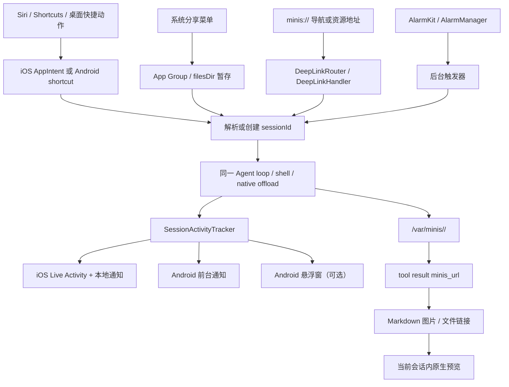

图中的“当前会话”不是 UI 选择器，而是安全边界。规范明确规定，同一个字符串 `minis://attachments/photo.png` 在两个会话中指向不同的持久目录，且 URL 本身不携带 session ID，见 `docs/specs/minis-url-scheme.md:43-71`。因此入口可以携带会话 ID，资源地址却不应该把会话 ID 拼进去。

### 13.3 `minis://`:同时给 agent、Markdown 和系统导航使用

#### 13.3.1 URL 的正式语义是 session-relative，而不是普通网络 URL

规范定义的格式只有一层 host（namespace）和相对 path：`minis://<namespace>/<path>`，path 可以继续包含子目录，见 `docs/specs/minis-url-scheme.md:20-41`。`minis://` 不是可以交给公网浏览器的 HTTP 地址，而是当前会话上下文里的不透明资源标识；agent、shell 和聊天 UI 都只看到当前会话的 `/var/minis/` 工作副本，见 `docs/specs/minis-url-scheme.md:43-64`。

规范的解析链是三段：

1. URL 到 Linux 路径：`minis://attachments/a.png` 映射为 `/var/minis/attachments/a.png`，见 `docs/specs/minis-url-scheme.md:137-148`。
2. Linux 工作副本到 host 文件：iSH/PRoot 的 `/var/minis/` 是一次只挂载一个会话的工作副本，见 `docs/specs/minis-url-scheme.md:150-180`。
3. host 文件到持久目录：会话目录是 `Library/MinisChat/minis/<sessionId>/`，切会话时按 harvest、clear、mount、meta.db register 顺序切换，见 `docs/specs/minis-url-scheme.md:166-187`。

这套语义解释了为什么 URL 不带 session ID：如果把 URL 当成跨会话全局文件地址，用户从历史会话点开链接时就会产生越权或“同名文件命中另一个会话”的风险。iOS 的媒体解析器已经针对这个问题禁用了“扫描所有 session 找第一个同名文件”的旧兜底，见 `src/ios/Views/Chat/MinisMediaViews.swift:233-243`。

#### 13.3.2 规范规定的四个资源 namespace

下表是规范的完整资源 namespace，不把 `settings`、`session` 等导航 host 混进来。路径、持久化位置和渲染语义来自 `docs/specs/minis-url-scheme.md:73-136`。

| namespace | Linux 路径 | 规范中的持久位置 | 写入者 | Markdown/预览语义 |
|---|---|---|---|---|
| `attachments` | `/var/minis/attachments/<path>` | `Library/MinisChat/minis/<sessionId>/attachments/<path>` | agent 的 `file_write`/`shell_execute`、host 的 `saveAttachment`、用户附件 | 图片、音频、视频可以内联；其余文件可链接 |
| `workspace` | `/var/minis/workspace/<path>` | `Library/MinisChat/minis/<sessionId>/workspace/<path>` | agent 的 `file_write`/`shell_execute` | 普通文件链接，不自动以内联媒体显示 |
| `offloads` | `/var/minis/offloads/<filename>` | `Library/MinisChat/minis/<sessionId>/offloads/<filename>` | host 自动保存超长工具输出 | 不内联；用 `file_read` 读取全文 |
| `browser` | `/var/minis/browser/<filename>` | `Library/MinisChat/minis/<sessionId>/browser/<filename>` | `browser_use` 截图、extract 或下载 | 图片可以内联，其他文件按链接预览 |

`offloads` 的文件名还承担可追踪性：规范要求 `<toolName>_<timestamp>_<toolIdPrefix>.txt`，并规定工具输出超过 20,000 字符时把完整结果写入该文件，见 `docs/specs/minis-url-scheme.md:114-124`。这不是把大字符串再复制一份到 UI，而是把模型上下文变成“截断预览 + 可再次读取的文件”。

#### 13.3.3 当前实现还存在全局扩展 namespace

规范的安全清单要求只接受上述四个 namespace，见 `docs/specs/minis-url-scheme.md:335-342`；但当前 iOS 代码已经支持若干全局或系统扩展：

| 实现中的 host | 作用域 | 代码证据 | 与四个正式 namespace 的关系 |
|---|---|---|---|
| `shared` | 全局共享目录，不随 session 变化 | `src/ios/Agent/Chat/AIChatViewModel+FileTools.swift:69-91`；`src/ios/Views/Chat/MinisMediaViews.swift:183-197` | prompt 也把它列为 `/var/minis/shared/`，见 `src/ios/Agent/Chat/AIChatViewModel.swift:1742-1750` |
| `memory` | 全局持久 memory | `src/ios/Views/Chat/MinisMediaViews.swift:183-197` | 非规范四 namespace 的全局扩展 |
| `skills` | 全局 Skills 文件 | `src/ios/Views/Chat/MinisMediaViews.swift:183-197` | 非规范四 namespace 的全局扩展 |
| `mcp-servers` | 全局 MCP 配置资源 | `src/ios/Agent/Chat/AIChatViewModel+FileTools.swift:77-86` | 只在 iOS direct resolver 的 host switch 中出现 |
| `mounts` | 用户授权的外部目录 | `src/ios/Views/Chat/MinisMediaViews.swift:199-230` | 属于外部挂载，不应误当 session 文件 |

因此从零实现时要先决定“规范 namespace”和“系统导航 host”是否共用 URI 语法；若共用，至少要在 parser 中区分资源解析和动作路由，并对非规范扩展做显式 allow-list。当前 iOS `DeepLinkRouter` 只处理导航 host，不处理资源 host，`src/ios/Shared/DeepLinkRouter.swift:14-45`；Android 也在 `ChatLinkResolver.resolve` 中先尝试动作，未知 `minis://` 再落到 sandbox 文件，见 `src/android/app/src/main/java/com/openminis/app/ui/chat/ChatLinkResolver.kt:30-67`。

#### 13.3.4 Linux path 与 URL 的互转：iOS 已有统一函数

iOS 的 `linuxPathToMinisURL` 只接受 `/var/minis/` 下、且至少包含 namespace 和文件路径的字符串，并对文件部分做 URL path 编码，见 `src/ios/Agent/Chat/AIChatViewModel+FileTools.swift:94-104`。

```swift
// 来源：src/ios/Agent/Chat/AIChatViewModel+FileTools.swift:94-104
func linuxPathToMinisURL(_ path: String) -> String? {
    let prefix = "/var/minis/"
    guard path.hasPrefix(prefix) else { return nil }
    let rest = String(path.dropFirst(prefix.count))
    guard let slashIdx = rest.firstIndex(of: "/") else { return nil }
    let namespace = String(rest[rest.startIndex..<slashIdx])
    let filename = String(rest[rest.index(after: slashIdx)...])
    let encoded = filename.addingPercentEncoding(withAllowedCharacters: .urlPathAllowed) ?? filename
    return "minis://\(namespace)/\(encoded)"
}
```

这段函数的非显然约束有两个。第一，中文、emoji、空格等文件名必须 percent-encode；系统 prompt 要求模型直接使用工具返回的 `minis_url`，见 `src/ios/Agent/Chat/AIChatViewModel.swift:1763-1767`。第二，函数不把 session ID 放进 URL，所以调用它的对象必须已经持有正确的 `AIChatViewModel.sessionId`，而不是从任意全局 mount 表猜测。

iOS 的直接读取 resolver 对 `memory`、`skills`、`shared` 先走全局目录，其余 host 走当前 session 目录，并且会尝试单解码和双解码候选，见 `src/ios/Agent/Chat/AIChatViewModel+FileTools.swift:69-91`。媒体层同样先用 active session，再用全局目录和 mount；它不扫描其他 session，见 `src/ios/Views/Chat/MinisMediaViews.swift:155-243`。

#### 13.3.5 工具结果：地址必须在资源产生的同一轮返回

规范的核心契约是“工具产生或修改可寻址资源时，工具结果必须带 `minis://`”，见 `docs/specs/minis-url-scheme.md:189-218`。iOS 当前实现已覆盖三个关键位置。

**文件读写。** `file_read` 在成功结果末尾追加 URL，`file_write` 在写盘和 meta.db 注册后追加 URL，见 `src/ios/Agent/Chat/AIChatViewModel+FileTools.swift:314-325`、`src/ios/Agent/Chat/AIChatViewModel+FileTools.swift:511-524`。

```swift
// 来源：src/ios/Agent/Chat/AIChatViewModel+FileTools.swift:511-524
let bytesWritten = contentData.count
let action = appendMode ? "Appended" : "Wrote"
var result = "\(action) to \(path) (\(bytesWritten) bytes)"
if let minisURL = linuxPathToMinisURL(path) {
    result += "\nminis_url: \(minisURL)"
}
return FileToolResult(output: result, success: true)
```

**shell 和 browser。** iOS 在 shell 结果中枚举 new/modified 文件并追加 URL，见 `src/ios/Agent/Chat/AIChatViewModel+ConcurrentTools.swift:387-390`；browser 截图和下载保存到 browser 持久目录后分别追加 URL，见 `src/ios/Agent/Chat/AIChatViewModel+ConcurrentTools.swift:495-527`。

**超长输出。** iOS 的 `offloadToolOutput` 用 session 持久目录生成标准文件名，见 `src/ios/Agent/Chat/AIChatViewModel+RequestBudget.swift:339-360`；工具循环截断时同时输出 Linux path、`minis_url` 和 `file_read` 指引，见 `src/ios/Agent/Chat/AIChatViewModel+ConcurrentTools.swift:738-758`。

```swift
// 来源：src/ios/Agent/Chat/AIChatViewModel+ConcurrentTools.swift:743-758
let offloadResult = offloadToolOutput(toolOutput, toolName: tu.name, toolId: tu.id)
let offloadMinisURL = linuxPathToMinisURL(offloadResult.linuxPath)
finalOutput = truncatedBody
    + "\n\n[OUTPUT TRUNCATED] Full output (\(toolOutput.count) chars) saved to: \(offloadResult.linuxPath)"
    + (offloadMinisURL.map { "\nminis_url: \($0)" } ?? "")
    + "\nUse file_read tool to read the complete output."
```

**Android 的一致处与缺口。** Android 的 `browser_use` 确实把截图写入 `/var/minis/browser/` 并返回 `minis_url`，下载文件返回 `fetched_minis_url`，见 `src/android/app/src/main/java/com/openminis/app/sandbox/offload/BrowserUseOffloadHandler.kt:245-295`。`read_image` 接受 `minis://` 输入并转成 `/var/minis/`，见 `src/android/app/src/main/java/com/openminis/app/tools/ReadImageTool.kt:41-60`。

但 Android `FileWriteTool.execute` 的成功结果只返回 `Wrote to $path ($bytes bytes)`，没有像 iOS 那样追加 `minis_url`，见 `src/android/app/src/main/java/com/openminis/app/tools/FileWriteTool.kt:78-108`。Android 的仓库搜索也没有在 `file_read` 结果路径发现规范要求的 `minis_url` 字段；因此这是当前实现相对于 `docs/specs/minis-url-scheme.md:200-218` 和 §9 checklist 的可验证缺口，而不是文档应忽略的细节。[推断] 如果模型在 Android 上写入 workspace 后要生成 Markdown 链接，当前 prompt 只能让它自行构造 URL，可靠性低于 iOS。

#### 13.3.6 Markdown 渲染：资源 URL 和动作 URL 必须分流

iOS 的 `resolveMinisFileURL` 把当前 session 的 `minis://attachments/...`、`workspace/...` 等映射到 host 文件，并按扩展名决定图片、音频、视频、Markdown、文本、HTML、PDF 或通用分享预览，见 `src/ios/Views/Chat/MinisMediaViews.swift:155-243` 和 `src/ios/Views/Chat/AIChatView.swift:2703-2764`。

```swift
// 来源：src/ios/Views/Chat/AIChatView.swift:2703-2754
private func handleMinisURLTap(_ url: URL) -> OpenURLAction.Result {
    if let scheme = url.scheme?.lowercased(), scheme == "http" || scheme == "https" {
        withAnimation { safariURL = url }
        return .handled
    }
    guard url.scheme == "minis" else { return .systemAction }
    if url.host == "open_terminal" {
        let comps = URLComponents(url: url, resolvingAgainstBaseURL: false)
        let initCmd = comps?.queryItems?.first(where: { $0.name == "init_command" })?.value
        let dl = DeepLinkCoordinator.shared
        dl.terminalInitCommand = initCmd
        dl.showTerminal = true
        return .handled
    }
    if url.host == "views" && url.path == "/alarm" {
        DeepLinkCoordinator.shared.showAlarmList = true
        return .handled
    }
    if url.host == "settings" {
        DeepLinkRouter.handle(url: url, shareCoordinator: shareCoordinator)
        return .handled
    }
if let fileURL = resolveMinisFileURL(url: url) {
    let ext = url.pathExtension.lowercased()
    withAnimation {
        if minisImageExtensions.contains(ext) { previewImageFile = fileURL }
        else if minisVideoExtensions.contains(ext) { previewVideoFile = fileURL }
        else if minisAudioExtensions.contains(ext) { previewAudioFile = fileURL }
        else if minisMarkdownExtensions.contains(ext) { previewMarkdownFile = fileURL }
        else if minisTextExtensions.contains(ext) { previewTextFile = fileURL }
        else if minisHTMLExtensions.contains(ext) { previewHTMLFile = fileURL }
        else if minisDocumentExtensions.contains(ext) { previewDocumentFile = fileURL }
        else { shareFile = fileURL }
    }
} else {
    let name = url.lastPathComponent.removingPercentEncoding ?? url.lastPathComponent
    missingMinisFileName = name.isEmpty ? url.absoluteString : name
    return .handled
}
```

代码片段中的注释分支对应真实实现：`open_terminal` 和 `views/alarm` 是导航动作，`settings` 进入 `DeepLinkRouter`，其它可解析 host 才是文件资源，完整分支见 `src/ios/Views/Chat/AIChatView.swift:2708-2764`。图片 tile 还按文件大小和 mtime 生成缓存 key，避免同一路径被 agent 覆盖后仍显示旧图，见 `src/ios/Views/Chat/MinisMediaViews.swift:344-362`。

Android 的 Markdown 图片由 Coil `MinisImageFetcher` 处理：去掉 query、percent-decode、拼接 `/var/minis/`，再交给 `PRootKernel.resolveHostPath`，见 `src/android/app/src/main/java/com/openminis/app/ui/MinisImageFetcher.kt:16-51`。链接点击由 `ChatLinkResolver` 先调用 `DeepLinkHandler.parse`，未知动作才解析成 sandbox 文件，见 `src/android/app/src/main/java/com/openminis/app/ui/chat/ChatLinkResolver.kt:37-67`。这实现了同一原则：`minis://settings/...` 不应被当作丢失的文件，`minis://workspace/...` 才进入文件预览。

Android browser WebView 也把 minis 资源当本地子资源服务；`BrowserUseManager.interceptMinisURL` 将 host/path 映射为 `/var/minis/$host$path`，返回 MIME 和文件流，见 `src/android/app/src/main/java/com/openminis/app/browser/BrowserUseManager.kt:386-427`。因此 agent 生成多文件 HTML 时，HTML、JS、CSS、图片可以共享同一个 minis 资源命名空间；Android tool definition 也把这一点写入 prompt，见 `src/android/app/src/main/java/com/openminis/app/tools/AgentTools.kt:55-70`。

#### 13.3.7 导航 deep link：同一 scheme 的另一张表

资源 namespace 与导航 host 的区别可以用下表固定下来。iOS 路由清单来自 `src/ios/Shared/DeepLinkRouter.swift:18-40`，Android 解析器的相同 route 表来自 `src/android/app/src/main/java/com/openminis/app/deeplink/DeepLinkHandler.kt:6-45` 和 `src/android/app/src/main/java/com/openminis/app/deeplink/DeepLinkHandler.kt:99-143`。

| URL | 语义 | iOS 落点 | Android 落点 |
|---|---|---|---|
| `minis://share` | 打开待注入分享 | `DeepLinkRouter.handle` 调 `ShareCoordinator.raisePendingShare`，见 `src/ios/Shared/DeepLinkRouter.swift:47-60` | `DeepLinkAction.OpenShare`，见 `src/android/app/src/main/java/com/openminis/app/deeplink/DeepLinkHandler.kt:105-107` |
| `minis://views/alarm` | 查看系统闹钟 | `DeepLinkCoordinator.showAlarmList`，见 `src/ios/Shared/DeepLinkRouter.swift:62-66` | `AlarmClock.ACTION_SHOW_ALARMS`，见 `src/android/app/src/main/java/com/openminis/app/MainActivity.kt:607-619` |
| `minis://open_terminal?init_command=...` | 打开终端并传初始命令 | `DeepLinkCoordinator.terminalInitCommand/showTerminal`，见 `src/ios/Shared/DeepLinkRouter.swift:68-71` | `DeepLinkAction.OpenTerminal`，见 `src/android/app/src/main/java/com/openminis/app/deeplink/DeepLinkHandler.kt:111-113` |
| `minis://session/<id>` | 打开一个会话 | 发布 `.openSessionFromIntent`，见 `src/ios/Shared/DeepLinkRouter.swift:76-91` | `Routes.chat(sessionId)`，见 `src/android/app/src/main/java/com/openminis/app/MainActivity.kt:547-567` |
| `minis://sessions/<id>` | canonical 会话别名 | iOS 与 singular route 共用，见 `src/ios/Shared/DeepLinkRouter.swift:76-91` | 当前 `DeepLinkHandler` 主要解析 `session`，通知和 runner 使用 singular 形式，见 `src/android/app/src/main/java/com/openminis/app/scheduled/ScheduledAgentRunner.kt:256-264` |
| `minis://settings/...` | 设置导航 | `SettingsDeepLinkTarget` 与 `DeepLinkCoordinator`，见 `src/ios/Shared/DeepLinkCoordinator.swift:7-29` | `Routes` 字符串路由，见 `src/android/app/src/main/java/com/openminis/app/deeplink/DeepLinkHandler.kt:161-225` |
| `minis://action/new_chat` / `voice_chat` / `camera_chat` | 桌面长按动作 | `UIApplicationShortcutItem` + `QuickActionWorkflow`，见 `src/ios/Shared/QuickActionRouter.swift:48-112` | 静态 `shortcuts.xml` + `DeepLinkAction`，见 `src/android/app/src/main/res/xml/shortcuts.xml:8-48`、`src/android/app/src/main/java/com/openminis/app/deeplink/DeepLinkHandler.kt:114-122` |
| `minis://open?session=...&path=...` | WebApp launcher 回跳 | `handleWebAppLauncherReturn`，见 `src/ios/Shared/DeepLinkRouter.swift:73-75` | 当前 WebApp 主要由显式 `ACTION_OPEN_WEBAPP` intent 启动，见 `src/android/app/src/main/AndroidManifest.xml:340-358` |

`DeepLinkCoordinator` 只保存“一次性待处理副作用”，例如 Android 的 `pendingChatAction` 被 ChatScreen 消费一次，见 `src/android/app/src/main/java/com/openminis/app/deeplink/DeepLinkCoordinator.kt:64-86`；iOS 的设置焦点、终端和目标 session 也都是发布属性，见 `src/ios/Shared/DeepLinkCoordinator.swift:47-75`。这种 coordinator 让 cold start、warm start 和导航重建都能复用同一个动作，而不是依赖一次可能早于 UI 订阅建立的 NotificationCenter 事件。

### 13.4 App Intents、Shortcuts 与 Android 的入口对照

#### 13.4.1 iOS intent 清单：参数和返回值是公共 API

以下清单对应当前 `src/ios/Agent/Intents/` 的实际类型；“返回”是 App Intents 类型签名，不是注释推测。

| Intent | `openAppWhenRun` | 参数 | 返回/行为 | 代码位置 |
|---|---:|---|---|---|
| `AskMinisIntent` | `true` | `prompt: String`；`session: SessionEntity?` | 只返回 dialog，打开 app 并发布 `.openSessionFromIntent` | `src/ios/Agent/Intents/AskMinisIntent.swift:14-29`、`src/ios/Agent/Intents/AskMinisIntent.swift:73-91` |
| `QuickTaskIntent` | `false` | `task: QuickTask`；`files: [IntentFile]?`；`model: ModelSelectionEntity?`；`waitForResult: Bool = false` | `ReturnsValue<SendPromptResult>`；Running 或 Completed | `src/ios/Agent/Intents/QuickTaskIntent.swift:52-70`、`src/ios/Agent/Intents/QuickTaskIntent.swift:179-239` |
| `SendPromptIntent` | `false` | `prompt`；`files`；`session: SessionEntity?`；`model: ModelSelectionEntity?`；`waitForResult` | `ReturnsValue<SendPromptResult>`；默认立即返回 Running | `src/ios/Agent/Intents/SendPromptIntent.swift:8-31`、`src/ios/Agent/Intents/SendPromptIntent.swift:161-220` |
| `FollowUpSessionIntent` | `false` | `session: SessionEntity`；`prompt`；`files`；`waitForResult` | `ReturnsValue<SendPromptResult>`；`isNewSession=false` | `src/ios/Agent/Intents/FollowUpSessionIntent.swift:7-28`、`src/ios/Agent/Intents/FollowUpSessionIntent.swift:112-176` |
| `RetryRunIntent` | `false` | `session`；`message: UserMessageEntity?`；替换附件 `files`；`waitForResult` | 从选定 user message 重跑，返回 `SendPromptResult` | `src/ios/Agent/Intents/RetryRunIntent.swift:7-28`、`src/ios/Agent/Intents/RetryRunIntent.swift:103-142`、`src/ios/Agent/Intents/RetryRunIntent.swift:169-227` |
| `OpenSessionIntent` | `true` | `session: SessionEntity` | 发布 `.openSessionFromIntent`，返回空 result | `src/ios/Agent/Intents/OpenSessionIntent.swift:4-21` |
| `ListSessionsIntent` | `false` | 无 | `ReturnsValue<String>`，每行 title、相对时间和 ID | `src/ios/Agent/Intents/ListSessionsIntent.swift:4-27` |
| `GetSessionStatusIntent` | `false` | `sessionID: String` | `ReturnsValue<SessionStatus>`，运行态、最后消息、最后工具等 | `src/ios/Agent/Intents/GetSessionStatusIntent.swift:58-126` |

`QuickTask` 不是自由文本，而是八个固定枚举：睡眠分析、健康报告、天气、早间简报、日历、拍照、闹钟和 HomeKit，提示词映射见 `src/ios/Agent/Intents/QuickTaskIntent.swift:7-49`。这让 Siri 可以在一次选择里表达任务，但代价是新任务必须新增枚举和本地化文本，而不是让模型解释任意自然语言。

`SessionEntity` 只暴露 `id`、显示名和 model ID，并从 `ChatStore` 建议最多 100 个 session，见 `src/ios/Agent/Intents/SessionEntity.swift:4-45`。`ModelSelectionEntity` 同时支持 model group 和具体 model entry，group 会解析第一个 member 作为初始 entry，见 `src/ios/Agent/Intents/ModelSelectionEntity.swift:6-57`。

结构化结果 `SendPromptResult` 的字段是 `sessionId`、`modelName`、`status`、`isNewSession`、`prompt`、`responseText`，见 `src/ios/Agent/Intents/SendPromptResult.swift:4-44`。`SessionStatus` 额外提供 `title`、`isRunning`、`lastMessage`、`lastTool`、`updatedAt`，见 `src/ios/Agent/Intents/GetSessionStatusIntent.swift:4-49`。

#### 13.4.2 `waitForResult` 如何同时支持同步和异步 automation

`SendPromptIntent` 的 perform 先把 `vm.send()` 发出去；如果 `waitForResult` 为真，就观察 `vm.$isProcessing` 直到 false，返回完整 response，否则立即返回 Running，并在另一个 `Task` 中等待完成后发通知，见 `src/ios/Agent/Intents/SendPromptIntent.swift:130-220`。

```swift
// 来源：src/ios/Agent/Intents/SendPromptIntent.swift:130-187
vm.inputText = prompt
vm.send()

if waitForResult {
    for await processing in vm.$isProcessing.values {
        if !processing { break }
    }
    let responseText = Self.extractResponseText(from: vm)
    let result = SendPromptResult(
        sessionId: sid, modelName: modelName, status: "Completed",
        isNewSession: isNewSession, prompt: prompt, responseText: responseText
    )
    return .result(value: result, dialog: "\(responseText.prefix(500))")
}

let result = SendPromptResult(
    sessionId: sid, modelName: modelName, status: "Running",
    isNewSession: isNewSession, prompt: prompt
)
return .result(value: result, dialog: "Task started with \(modelName). I'll notify you when it's done.")
```

这不是把后台任务“伪装成已完成”：Shortcuts 的下一步若需要答案就必须显式选择等待，若选择异步就应把 `sessionId` 传给 `GetSessionStatusIntent` 或等待本地通知。iOS system prompt 对同一事实也有约束：没有 scheduler 时，当前 turn 结束后不会自动继续 polling，见 `src/ios/Agent/Chat/AIChatViewModel.swift:1727-1732`。

App Shortcuts provider 将 Ask、QuickTask、SendPrompt、GetStatus、ListSessions、FollowUp、OpenSession 注册为 Siri/Spotlight 可发现动作，见 `src/ios/Agent/Intents/MinisShortcutsProvider.swift:13-89`。`RetryRunIntent` 刻意不注册到 `appShortcuts`，因为其 `@IntentParameterDependency` 会在 iOS 16 触发 launch crash，但仍可在 Shortcuts 的 All Actions 找到，见 `src/ios/Agent/Intents/MinisShortcutsProvider.swift:78-81`。

`AskMinisIntent` 和普通 `SendPromptIntent` 不走第二套 agent 逻辑：它们都取 `ViewModelCache` 中的 VM、设置 `inputText`、调用 `vm.send()`；Ask 额外将 app 打开并发布 `.openSessionFromIntent`，见 `src/ios/Agent/Intents/AskMinisIntent.swift:48-91`。这正是“系统入口薄、agent loop 厚”的边界。

#### 13.4.3 Android 对应能力：有入口和调度，但没有 App Intent 类型系统

Android 当前公开的系统入口是三项 app-icon long-press shortcut：new chat、voice chat、camera chat，XML 每项都以 `minis://action/<name>` 启动 `MainActivity`，见 `src/android/app/src/main/res/xml/shortcuts.xml:3-48`。`DeepLinkHandler` 将其转换成 `NewChat`、`NewVoiceChat`、`NewCameraChat`，`MainActivity.handleDeepLink` 再把 voice/camera 待动作放进 `DeepLinkCoordinator`，见 `src/android/app/src/main/java/com/openminis/app/deeplink/DeepLinkHandler.kt:55-68`、`src/android/app/src/main/java/com/openminis/app/MainActivity.kt:587-606`。

Android 没有与 `AskMinisIntent`、`SendPromptResult` 对等的 App Intents/App Actions 声明；仓库可验证的 assistant-like surface 是上述静态 shortcuts XML，而不是一个可被 Siri/Google Assistant 直接填充参数的 Intent schema。因此不要把 Android shortcut 描述成 iOS Siri action 的等价物；若要实现等价能力，需要另建 Android App Actions/Assistant schema，并把参数映射到同一个 Headless runner。[推断]

Android 的真正对等抽象出现在 scheduled target mode：`NEW_SESSION` 相当于无 session 的 SendPrompt，`APPEND_TO` 相当于 FollowUp，`RERUN` 相当于 RetryRun，见 `src/android/app/src/main/java/com/openminis/app/scheduled/ScheduledTask.kt:36-72`。这是“产品行为对等”，不是“系统 API 对等”。

### 13.5 后台执行：在有限时间预算里让 agent 活着

#### 13.5.1 先纠正 iOS 的“BGTask”称呼

当前 iOS agent loop 使用的是 `UIApplication.beginBackgroundTask(withName:)`，不是 `BGTaskScheduler` 的 `BGProcessingTaskRequest`。`beginBackgroundProcessing` 保存一个 `UIBackgroundTaskIdentifier`，设置 expiry handler，并在结束时调用 `endBackgroundProcessing`，见 `src/ios/Agent/Chat/AIChatViewModel+BackgroundTask.swift:10-83`、`src/ios/Agent/Chat/AIChatViewModel+BackgroundTask.swift:85-117`。

```swift
// 来源：src/ios/Agent/Chat/AIChatViewModel+BackgroundTask.swift:12-51
func beginBackgroundProcessing() {
    guard backgroundTaskID == .invalid else { return }
    backgroundTaskID = UIApplication.shared.beginBackgroundTask(withName: "AgentLoop") { [weak self] in
        guard let self else { return }
        if BackgroundKeepAliveManager.shared.enhancedBackgroundEffective {
            let expiringId = self.backgroundTaskID
            self.backgroundTaskID = .invalid
            if expiringId != .invalid {
                UIApplication.shared.endBackgroundTask(expiringId)
            }
            self.beginBackgroundProcessing()
            return
        }
        self.backgroundSuspended = true
        self.stopCurrentCommand()
        self.endBackgroundProcessing()
    }
    startBackgroundStatusTimer()
}
```

仓库的 `Info.plist` 确实声明了 `BGTaskSchedulerPermittedIdentifiers`，但当前源码搜索不到 `BGTaskScheduler.shared.register`、`BGProcessingTask` 或 `BGAppRefreshTask` 的注册/提交，只有 `com.openminis.app.liveactivity-refresh` 这个 identifier，见 `src/ios/Info.plist:33-47` 和 `src/ios/Agent/Chat/AIChatViewModel+BackgroundTask.swift:10-83`。[已核实搜索结果] 因此本章不能把它写成“系统会在任意时间重新唤醒 agent 的 BGProcessing 任务”。现状是：前台触发的 agent loop 通过有限 `UIApplication` 背景窗口运行；若用户开启增强后台，再由音频/位置腿维持进程。

普通 iOS app 的标准短窗口在 `BackgroundSurvivalTier.short` 的注释中记为约 30 秒，见 `src/ios/Agent/Background/BackgroundKeepAliveManager.swift:18-45`。这不是可精确依赖的 SLA；代码每次都记录 `UIApplication.shared.backgroundTimeRemaining`，见 `src/ios/Agent/Background/BackgroundKeepAliveManager.swift:273-282`。

#### 13.5.2 iOS 的三条保活腿是互补关系

`BackgroundKeepAliveManager` 的有效条件是 `enhancedBackgroundEnabled && backgroundSpeakEnabled`，仅打开 master switch 不代表后台保活生效，见 `src/ios/Agent/Background/BackgroundKeepAliveManager.swift:88-101`。它把以下机制组合起来：

| 机制 | 触发条件和实现 | 可观察时间/频率 | 解决的问题 | 证据 |
|---|---|---|---|---|
| `UIApplication` finite background task | 每轮 agent loop 调 `beginBackgroundProcessing`; expiry 时重启 finite task 或暂停 shell | 系统给出动态 `backgroundTimeRemaining`；代码在剩余 `<15s` 时升级日志 | 让刚离开前台的当前调用有收尾窗口 | `src/ios/Agent/Chat/AIChatViewModel+BackgroundTask.swift:12-81`、`:204-231` |
| 后台静音音频 | active session + app background + Background Speak 开启时，创建 1 秒零填充 buffer 循环播放；音频中断时重试最多 3 次、间隔 0.5s | 音频腿持续期间由系统音频后台模式托住进程；没有代码承诺固定上限 | 防止 finite background task 到期直接杀掉长 shell/网络等待 | `src/ios/Agent/Background/BackgroundKeepAliveManager.swift:1071-1237`、`src/ios/Info.plist:37-43` |
| 后台位置/`CLBackgroundActivitySession` | enhanced + 权限 + background + 延迟 15s 后才 arm；位置请求间隔 5s；iOS 17 用 `CLLocationUpdate.liveUpdates` | 5s 请求、5s Live Activity 最小更新间隔；离开后台或任务结束即 teardown | 在用户显式授权后给长任务一个系统认可的后台活动通道 | `src/ios/Agent/Background/BackgroundKeepAliveManager.swift:930-1025` |
| Live Activity | 任务开始/更新/结束都由单例 Activity manager 管理；前台 timer 和音频/位置 callback 驱动更新 | 前台/音频更新 timer 10s；结束采用 soft-finish，回前台再 dismiss | 在锁屏/灵动岛显示工具和完成态，不负责替代 agent loop | `src/ios/Agent/Background/BackgroundKeepAliveManager.swift:1339-1468` |

增强后台开启时，finite task expiry handler 不取消 shell，而是结束旧 finite ID 再重新 begin；未开启时才停止当前命令并记录 interruption，见 `src/ios/Agent/Chat/AIChatViewModel+BackgroundTask.swift:24-80`。这一区分很重要：`UIApplication` 背景任务的时钟到点，并不等于音频保活腿已经失效。

后台音频实现不是“播放用户声音”而是 44.1kHz、1 秒、零填充的 `AVAudioPCMBuffer`，音量设为 0.001，见 `src/ios/Agent/Background/BackgroundKeepAliveManager.swift:1207-1237`。媒体附件或 TTS 播放时，它会用 suspend counter 暂停静音音频，所有调用者 resume 后才重新评估，见 `src/ios/Agent/Background/BackgroundKeepAliveManager.swift:285-309`；这避免静音引擎抢占真正的朗读/播放音频。

位置腿不会一进后台就显示定位状态。代码先在后台等待 15 秒，再在任务仍活动且用户给过权限时创建一次全局 `CLBackgroundActivitySession`，见 `src/ios/Agent/Background/BackgroundKeepAliveManager.swift:962-1025`。任务结束时先停位置，再 soft-finish Live Activity；App 被强杀后冷启动还会 retract orphaned session，见 `src/ios/Agent/Background/BackgroundKeepAliveManager.swift:625-647`、`:1041-1067`。

#### 13.5.3 Shortcuts 唤醒要在第一个 await 之前 arm

App Intent 被系统唤起时，进程可能在 VM 建立、SQLite 读写和第一个 `await` 之间被挂起。`SendPromptIntent` 因此在 `perform()` 顶部用临时 session ID（新会话）或真实 ID（旧会话）调用 `armEagerlyForShortcut`，创建真实 session 后再交换 placeholder，见 `src/ios/Agent/Intents/SendPromptIntent.swift:30-111`。

```swift
// 来源：src/ios/Agent/Background/BackgroundKeepAliveManager.swift:1273-1309
@discardableResult
func armEagerlyForShortcut(sessionId: String, caller: String)
    -> (armed: Bool, skipReason: String?) {
    guard enhancedBackgroundEnabled && backgroundSpeakEnabled else {
        return (false, "background keep-alive disabled")
    }
    SessionActivityTracker.shared.setActive(sessionId, source: "\(caller).eager")
    evaluateSilentAudio(caller: "\(caller).eager")
    return (true, nil)
}
```

这段机制只在用户显式开启两项后台设置时生效，代码明确拒绝在用户未同意时悄悄启动后台音频，见 `src/ios/Agent/Background/BackgroundKeepAliveManager.swift:1282-1308`。`QuickTaskIntent`、`FollowUpSessionIntent` 和 `RetryRunIntent` 复用同一 eager arm，而不是各自实现一套保活，见 `src/ios/Agent/Intents/QuickTaskIntent.swift:72-125`、`src/ios/Agent/Intents/FollowUpSessionIntent.swift:28-55`、`src/ios/Agent/Intents/RetryRunIntent.swift:28-51`。

#### 13.5.4 Live Activity 是状态投影，不是后台执行器

`AgentActivityAttributes.ContentState` 保存活动 session 数、每个 session 的标题、当前 tool icon/status、loop iteration、完成态、最后消息、音频状态和隐私模式，见 `src/ios/Shared/AgentActivityAttributes.swift:4-79`。属性中的 `startDate` 由 WidgetKit 渲染实时计时器；完成态另存 `finishedAt`，避免完成后计时器继续增长。

`BackgroundKeepAliveManager.reevaluate` 以 `SessionActivityTracker.activeSessions` 的非空状态为事实源：激活时 start Activity、启动 timer、评估位置和音频；全部结束时先停 location，再把 Live Activity 翻成 completed resting state，见 `src/ios/Agent/Background/BackgroundKeepAliveManager.swift:690-740`。

Widget 在 Dynamic Island expanded 区展示 soul 名、活动 session 数、当前 session 的 title/tool status/loop；completed 时改成 checkmark、最后消息和静态总耗时，见 `src/ios/AgentWidget/AgentLiveActivityWidget.swift:8-163`。iOS 17 才把音频开关渲染为 `Button(intent:)`，iOS 16 退化为只读 glyph，见 `src/ios/AgentWidget/AgentLiveActivityWidget.swift:166-207`。

隐私模式不是把 Activity 整体关掉，而是让 manager 在 push 前将标题、工具状态、工具图标和最后消息脱敏为中性进度状态，设置和字段定义见 `src/ios/Agent/Background/BackgroundKeepAliveManager.swift:113-127`、`src/ios/Shared/AgentActivityAttributes.swift:70-78`。这解决了“用户开启通知但不想在锁屏泄露 prompt/工具名”的冲突。

#### 13.5.5 Android 前台服务是执行锚点

Android 在 manifest 中声明 `FOREGROUND_SERVICE`、`FOREGROUND_SERVICE_MEDIA_PLAYBACK`、`WAKE_LOCK`、通知、精确闹钟和电池优化请求等权限，见 `src/android/app/src/main/AndroidManifest.xml:10-46`；`AgentForegroundService` 的类型设置为 `mediaPlayback`，见 `src/android/app/src/main/AndroidManifest.xml:434-441`。

服务启动时立即 `startForeground`，Android Q 及以上指定 `FOREGROUND_SERVICE_TYPE_MEDIA_PLAYBACK`，返回 `START_STICKY`，见 `src/android/app/src/main/java/com/openminis/app/service/AgentForegroundService.kt:195-210`。manifest 注释记录了一个具体工程约束：Android 14+ 的 `dataSync` 类型有 6h/24h 累计上限，长 shell 会触发异常，所以本项目改成 `mediaPlayback`；该做法是当前 sideload 包的运行策略，不等价于 Play Store 审核许可，见 `src/android/app/src/main/AndroidManifest.xml:12-20`。

服务还持有 `PARTIAL_WAKE_LOCK`，无超时但只在服务生命周期内存在，在 `onDestroy` 释放，见 `src/android/app/src/main/java/com/openminis/app/service/AgentForegroundService.kt:82-94`、`:556-587`。它解决的是屏幕熄灭后 Doze/OEM ROM 降低 CPU 使 shell 卡住，而不是绕过网络或系统后台限制。

前台通知显示 session 数、tool label、状态和 elapsed time；工具运行中显示 indeterminate progress，通知带 Stop action，见 `src/android/app/src/main/java/com/openminis/app/service/AgentForegroundService.kt:663-771`。用户点 Stop 不只移除通知，还调用 `SessionActivityTracker.cancelAllActiveStreams()`，见 `src/android/app/src/main/java/com/openminis/app/service/AgentForegroundService.kt:182-192`。

`onTaskRemoved` 在用户从最近任务划掉 Activity 后重新发出前台通知；只有 `activeSessions` 非空才保持 service，见 `src/android/app/src/main/java/com/openminis/app/service/AgentForegroundService.kt:215-257`。这把“UI 被关闭”和“agent loop 被取消”区分开，防止用户以为 Stop 和 swipe 是同一个动作。

#### 13.5.6 Android 的 Doze 白名单和 OEM 设置是用户协作

`PowerOptimizationManager.isIgnoringBatteryOptimizations` 查询系统 Doze exemption，且 UI 可通过 `ACTION_REQUEST_IGNORE_BATTERY_OPTIMIZATIONS` 或系统列表页引导用户授权，见 `src/android/app/src/main/java/com/openminis/app/power/PowerOptimizationManager.kt:14-79`。代码还针对 Xiaomi、Huawei、OPPO、Vivo、Samsung 选择 OEM 自启动设置页，见 `src/android/app/src/main/java/com/openminis/app/power/PowerOptimizationManager.kt:82-173`。

这说明 Android 的“前台服务可无限运行”不是充分条件：服务、唤醒锁、Doze exemption、OEM autostart 和通知权限是五个不同开关。代码注释明确说 stock Android 13+ 中前台服务单独也不保证不进入 App Standby/Doze，见 `src/android/app/src/main/java/com/openminis/app/power/PowerOptimizationManager.kt:19-33`。

#### 13.5.7 Android 悬浮窗与通知是两层呈现，不重复显示

`ToolOverlayController` 使用 `TYPE_APPLICATION_OVERLAY`，要求 `SYSTEM_ALERT_WINDOW`；服务只在 app 后台、toggle 开启、权限存在且 stream/tool 忙时显示，见 `src/android/app/src/main/java/com/openminis/app/service/ToolOverlayController.kt:35-59`、`:142-179`。

服务的 `applyOverlayState` 先判断 Android 16 promoted notification 是否启用；若启用就隐藏 overlay，避免同一任务同时出现通知 chip 和悬浮胶囊，见 `src/android/app/src/main/java/com/openminis/app/service/AgentForegroundService.kt:383-419`。没有 promoted notification 时，overlay 的显示条件是 `enabled && hasPerm && !isForeground && !cameraSuppress && (isBusy || hasCompletionPending)`，见 `src/android/app/src/main/java/com/openminis/app/service/AgentForegroundService.kt:420-477`。

悬浮窗点击会构造 `minis://session/<id>` 回到原会话；没有 session ID 时只把 MainActivity 拉到前台，见 `src/android/app/src/main/java/com/openminis/app/service/ToolOverlayController.kt:123-136`、`:648-683`。完成态的 linger 只由一次 background busy→idle 边沿触发，用户点开或点 X 后清除，避免每次重新进入桌面都重新弹出旧结果，见 `src/android/app/src/main/java/com/openminis/app/service/AgentForegroundService.kt:423-437`。

#### 13.5.8 两端时间预算和实际可保证程度

| 阶段 | iOS | Android | 工程含义 |
|---|---|---|---|
| 刚进入后台 | 标准 `UIApplication` grace 约 30s（注释值），实际以 `backgroundTimeRemaining` 为准 | FGS 启动必须在系统规定的前台 deadline 内调用 `startForeground`；safe-mode 注释按 5s 处理 | 入口必须先快速建立后台锚点，再做 SQLite、rootfs 或模型网络初始化 |
| 长任务 | 无用户授权时 finite task 到期就暂停/停止当前 command；开启 Background Speak 后静音音频腿继续托住进程 | FGS + `PARTIAL_WAKE_LOCK`；manifest 选择 mediaPlayback 规避 dataSync 6h 累计上限 | 两端都不应把“某一次 API 请求”写成无限 promise |
| 额外后台腿 | location 15s 后 arm、5s request；Live Activity 更新频率 10s | Doze exemption 和 OEM autostart 由用户在设置授权；没有 WorkManager 代码 | 权限和电量策略必须显示给用户，不应静默失败 |
| 定时任务 | 当前没有 BGTaskScheduler agent runner；系统 prompt 指向 Apple Shortcuts automation | `AlarmManager.setExactAndAllowWhileIdle`；触发后 runner ceiling 10min，见 `ScheduledAgentRunner.RUN_TIMEOUT_MS` | “按时唤起一次”与“长时间运行一轮”是两个预算 |
| 完成通知 | 仅在后台且开关开启时发本地通知，内容可被 privacy mode 脱敏 | `BackgroundTaskNotifier` 在 active→inactive 且 app 不在前台时通知；无 responseSummary，点通知进入会话 | 通知是结果入口，不是结果存储 |

Android 的 `RUN_TIMEOUT_MS = 10 * 60 * 1000L` 是 scheduled runner 的业务 ceiling，见 `src/android/app/src/main/java/com/openminis/app/scheduled/ScheduledAgentRunner.kt:31-61`；它不代表普通聊天 FGS 只有十分钟。iOS 的 4 分钟 `CacheKeepAliveManager` timer 只是 Anthropic prompt cache 的 warmup，最多两次，约覆盖 13 分钟 idle cache，见 `src/ios/Agent/Background/CacheKeepAliveManager.swift:6-13`、`:25-45`，不能算 app 后台执行预算。

### 13.6 Live Activity、前台通知和完成结果

#### 13.6.1 iOS 的完成态是“软结束”

普通 `endActivity()` 会用空 state 立即结束所有系统 Activity；而 agent 全部结束时，`finishActivity` 把每个 session 标记 `isCompleted=true`，留下 checkmark、最后消息和 `finishedAt`，等用户回到前台再 dismiss，见 `src/ios/Agent/Background/AgentLiveActivityManager.swift:154-191`、`:910-989`。

多 session 时不能“一条结束就整个卡片消失”。`markSessionCompleted(sessionId:lastMessage:)` 只替换对应 snapshot，其余 session 继续工作，见 `src/ios/Agent/Background/AgentLiveActivityManager.swift:141-148`、`:604-629`。这也是 `SessionActivityTracker` 采用 Set 和每 session tool info 的原因：完成状态与活动数量不是同一个字段。

本地通知在 `endBackgroundProcessing` 中等待 Live Activity 先完成态更新，再发通知，见 `src/ios/Agent/Chat/AIChatViewModel+BackgroundTask.swift:119-196`。后台通知默认携带 session title 和最多 200 字 response summary；privacy mode 则退化为“1 task completed · duration”，见 `src/ios/Agent/Background/BackgroundKeepAliveManager.swift:771-813`。

#### 13.6.2 Android 的前台通知是持续状态，完成通知是独立频道

`AgentForegroundService` 的 `agent_status` channel 设为 `IMPORTANCE_LOW`，避免每个 tool 都响铃，见 `src/android/app/src/main/java/com/openminis/app/service/AgentForegroundService.kt:590-615`；`BackgroundTaskNotifier` 另用完成频道和默认重要性，见 `src/android/app/src/main/java/com/openminis/app/notification/BackgroundTaskNotifier.kt:167-180`。

完成通知不从 `parts_json` 强行抽取模型回复，而是只放 title/body 并把 `minis://session/<id>` 放进 PendingIntent，见 `src/android/app/src/main/java/com/openminis/app/notification/BackgroundTaskNotifier.kt:22-47`、`:91-127`。这是 Android 与 iOS 的一个有意识差异：iOS 已在结束路径里构造 plain-text summary，Android 直接打开聊天避免对结构化消息做脆弱解析。

### 13.7 Share Sheet：把外部内容变成一次性会话输入

#### 13.7.1 iOS Share Extension 的传输协议

iOS Share Extension 与主 app 不能直接共享内存，使用 App Group `group.com.openminis.app`：JSON 放在 shared `UserDefaults` 的 `pendingShare` key，二进制附件放在 group container 的 `ShareExtension/` 目录，见 `src/ios/Shared/SharedContainerStore.swift:3-19`、`:21-57`。

`PendingShare` 的 wire model 只有 `items` 和 `timestamp`；item kind 是 `inlineText` 或 `attachment`，attachment 的 value 是 shared directory 中的文件名，见 `src/ios/Shared/PendingShare.swift:3-19`。ShareViewModel 对 URL、短文本直接内联；超过 1000 字符的文本、图片、视频和一般文件落盘，并用 UUID 前缀避免同名覆盖，见 `src/ios/ShareExtension/ShareViewModel.swift:5-37`、`:39-119`、`:122-175`。

```swift
// 来源：src/ios/ShareExtension/ShareViewController.swift:14-53, 69-96
let vm = ShareViewModel()
let items = (extensionContext?.inputItems as? [NSExtensionItem]) ?? []
await vm.processExtensionItems(items)
_ = vm.save()
redirectToHostApp()       // minis://share
extensionContext?.completeRequest(returningItems: [])
```

扩展通过 responder chain 打开 `minis://share`；iOS 18 使用 `application.open`，旧版本走 selector 兼容路径，见 `src/ios/ShareExtension/ShareViewController.swift:69-96`。即使 URL 跳转失败，主 app 冷启动时仍会 `checkForPendingShare()` 读取 shared defaults，见 `src/ios/Shared/ShareCoordinator.swift:166-184`。

主 app 的 `ContentView.processPendingShare` 先读取并清掉 shared defaults，再放入内存 buffer；它不在 session list 阶段直接创建消息，见 `src/ios/Views/ContentView.swift:2053-2074`。`ShareCoordinator` 允许短时间内合并多次 share，buffer TTL 为 300s，见 `src/ios/Shared/ShareCoordinator.swift:52-63`、`:106-152`。

真正注入发生在 `AIChatView.onAppear` 或 `bufferVersion` 变化时：inline text 追加到 composer，attachment 从 group path 读入 VM；provider export JSON 会先弹出“导入 provider 还是作为附件”的选择，随后清理 shared transfer directory，见 `src/ios/Views/Chat/AIChatView.swift:1475-1537`、`:1185-1212`。

#### 13.7.2 Android 用显式 ShareReceiverActivity 替代 App Group

Android 的 manifest 将 `ShareReceiverActivity` 注册为 `ACTION_SEND`、`SEND_MULTIPLE` 和多个 `ACTION_VIEW` MIME 入口，见 `src/android/app/src/main/AndroidManifest.xml:253-338`。它从 `EXTRA_TEXT`、`EXTRA_STREAM` 或 `intent.data` 读取 URI，通过 `ContentResolver.openInputStream` 复制到 `filesDir/share_extension/`，然后写入 SharedPreferences JSON，见 `src/android/app/src/main/java/com/openminis/app/share/ShareReceiverActivity.kt:45-93`、`:176-257`。

Android 的 `PendingShare` 有意复刻 iOS wire shape：`{items:[{kind,value}], timestamp}`，见 `src/android/app/src/main/java/com/openminis/app/share/PendingShare.kt:6-47`；`SharedShareStore` 是 `share_prefs` + `filesDir/share_extension`，见 `src/android/app/src/main/java/com/openminis/app/share/SharedShareStore.kt:8-50`。

`ShareReceiverActivity` 完成暂存后启动 `MainActivity`，带 `shared_content=true`；MainActivity 在 `onCreate` 和 warm `onNewIntent` 中先调用 `ShareCoordinator.processPendingShare`，再处理 deep link，见 `src/android/app/src/main/java/com/openminis/app/share/ShareReceiverActivity.kt:261-267`、`src/android/app/src/main/java/com/openminis/app/MainActivity.kt:303-309`、`:535-545`。

Android `ShareCoordinator` 的 launch stale age 是 5 分钟，但进入内存后的 buffer TTL 仍是 30 秒，见 `src/android/app/src/main/java/com/openminis/app/share/ShareCoordinator.kt:17-20`、`:35-71`。这和 iOS 300s 的内存 buffer 不一致：Android 的 cold-start 最长可等 5 分钟，warm-start 进入 composer 后只保留 30s；迁移时应把两个 TTL 命名成不同语义并在 UX 中提示。[推断] 当前实现中的 30s 可能在用户停留 session list 时丢掉分享，属于应优先验证的边界。

#### 13.7.3 iOS/Android 分享链路对照

| 步骤 | iOS | Android |
|---|---|---|
| 外部入口 | Share Extension `NSExtensionItem` | exported `ShareReceiverActivity` |
| 文字处理 | ≤1000 字符 inline，否则写 `.txt` | ≤1000 字符 inline，否则写 `.txt`，见 `ShareReceiverActivity.kt:176-198` |
| 二进制传输 | App Group directory + `PendingShare` | app-private `filesDir/share_extension` + SharedPreferences |
| 回到主 app | `minis://share` | `MainActivity` extra `shared_content=true` |
| 注入时机 | AIChatView onAppear / bufferVersion | ChatScreen 观察 `ShareCoordinator.bufferVersion`（coordinator 注释，见 `ShareCoordinator.kt:26-33`） |
| 生命周期清理 | consume/过期后 `cleanSharedFiles` | consume/过期后 `cleanSharedFiles` |
| 特殊 JSON | provider export 弹导入/附件二选一 | `ShareReceiverActivity` 同样支持 provider export 二选一，见 `ShareReceiverActivity.kt:59-170` |

### 13.8 File Provider、SAF 与“workspace 是否真的可见”

#### 13.8.1 iOS File Provider 当前暴露的是全局共享树

iOS File Provider extension 的注释和初始化都明确写出根结构是 `Minis → { memory, skills, shared }`，根目录位于 App Group 的 `MinisFileProvider/`，见 `src/ios/FileProvider/FileProviderExtension.swift:5-35`。`Info.plist` 使用 `com.apple.fileprovider-nonui`，document group 仍是 `group.com.openminis.app`，见 `src/ios/FileProvider/Info.plist:5-17`。

FileProvider enumerator 首次枚举目录内容，变更时在没有历史 diff 的情况下重放所有当前 item，避免 external iSH writes 让 Files 缓存卡死，见 `src/ios/FileProvider/FileProviderEnumerator.swift:18-61`。Item capabilities 对 `memory`/`skills` 设为只读，对 `shared` 允许新增子项，普通文件允许写、改名、移动和删除，见 `src/ios/FileProvider/FileProviderItem.swift:49-78`。

因此“把 agent workspace 暴露到 iOS 文件 App”要精确表述：当前 File Provider 暴露的是 `shared` 等全局共享树，而不是每个 session 的 `/var/minis/workspace/`。session workspace 仍由 `AIChatViewModel.minisWorkspacePersistentDir(for:)` 和 chat 内的 minis resolver 访问，File Provider 的 top-level list 没有它，见 `src/ios/FileProvider/FileProviderExtension.swift:24-35`、`src/ios/Views/Chat/MinisMediaViews.swift:169-180`。若产品要求用户在 Files 中直接看到某个 session workspace，需要额外设计 session selector/虚拟目录，同时保持 session isolation；当前代码并未这样做。

#### 13.8.2 Android DocumentsProvider 已写，但当前 manifest 没有注册

`MinisDocumentsProvider` 实现了 Android SAF 的 `DocumentsProvider`：root 是 `filesDir/minis-global`，只列出 `memory`、`skills`、`shared`，其中 memory/skills 只读，shared 支持 create/write/delete/rename，见 `src/android/app/src/main/java/com/openminis/app/providers/MinisDocumentsProvider.kt:42-113`、`:121-224`。

它实现了 path traversal 防护：document ID 含 `..` 就拒绝，并限制在 provider root 内，见 `src/android/app/src/main/java/com/openminis/app/providers/MinisDocumentsProvider.kt:79-97`。不过当前 `AndroidManifest.xml` 列出的 provider 是 AndroidX FileProvider、ShizukuProvider 等，没有 `MinisDocumentsProvider` 的 `<provider android:name=".providers.MinisDocumentsProvider">` 注册，见 `src/android/app/src/main/AndroidManifest.xml:479-510`。[已核实] 所以 Android 对应 SAF 的代码边界已经存在，但仅凭当前 manifest，系统 DocumentsUI 不会发现这个 authority；它不是已经完成的用户可见能力。

Android manifest 中的 `androidx.core.content.FileProvider` 只用于把 cache 中导出的 JSON/HTML 分享给其它 app，authority 是 `${applicationId}.fileprovider`，见 `src/android/app/src/main/AndroidManifest.xml:500-510`，这不能替代 DocumentsProvider 的“在文件选择器中作为根目录出现”。

### 13.9 定时任务与“无 UI 跑完一轮”

#### 13.9.1 iOS：AlarmKit 是闹钟工具，不是 agent scheduler

iOS `AlarmOffloadBridge` 是 iOS 26 的 AlarmKit bridge，提供固定时间 alarm、daily/weekdays repeat、countdown timer、list/cancel；AlarmKit 的 label 不会在 `alarmUpdates` 返回，因此代码额外用 SQLite 保存 `alarm_id → label`，见 `src/ios/NativeOffloads/AlarmOffloadBridge.swift:20-53`、`:81-160`、`:215-302`。

`AlarmListViewModel` 只在 iOS 26+ 调 bridge 列表/取消，见 `src/ios/Views/Alarms/AlarmListView.swift:108-162`。`minis://views/alarm` 的作用是打开闹钟列表/系统入口，不是唤起一轮 agent。

当前 iOS system prompt 明确写着 Minis 没有 in-app scheduler，长任务只能在当前 turn 中用 `delay` polling；需要跨对话定时执行时应让用户设置 Apple Shortcuts automation，见 `src/ios/Agent/Chat/AIChatViewModel.swift:1727-1732`。结合代码中没有 `BGTaskScheduler` 注册/提交这一事实，iOS 不能被描述为已经拥有 Android 那样的 headless scheduled agent runner。[已核实]

#### 13.9.2 Android：AlarmManager 只负责唤起，Runner 负责 agent loop

Android `ScheduledTask` 持久化用户定义的 label、时分、repeat mode、prompt、target mode、model binding、active window 和最多 50 条 run history，见 `src/android/app/src/main/java/com/openminis/app/scheduled/ScheduledTask.kt:102-135`、`:206-263`。它用 `Calendar` 按本地时区计算下一个触发时间，支持 once/daily/weekdays/custom，见 `src/android/app/src/main/java/com/openminis/app/scheduled/ScheduledTask.kt:138-203`。

`ScheduledTaskManager` 不使用 `setRepeating`，每次 fire 后重算并注册下一次；优先 `setExactAndAllowWhileIdle`，缺少精确闹钟权限时退回 `setAndAllowWhileIdle`，见 `src/android/app/src/main/java/com/openminis/app/scheduled/ScheduledTaskManager.kt:12-21`、`:81-136`。

```kotlin
// 来源：src/android/app/src/main/java/com/openminis/app/scheduled/ScheduledTaskAlarmReceiver.kt:19-50
override fun onReceive(context: Context, intent: Intent) {
    if (intent.action != ScheduledTaskManager.ACTION_FIRE) return
    val taskId = intent.getStringExtra(ScheduledTaskManager.EXTRA_TASK_ID) ?: return
    val pending = goAsync()
    CoroutineScope(SupervisorJob() + Dispatchers.Default).launch {
        try {
            val manager = ScheduledTaskManager(context.applicationContext)
            val task = manager.get(taskId) ?: return@launch
            if (!task.enabled) return@launch
            manager.rescheduleNext(taskId)
            ScheduledAgentRunner.run(context.applicationContext, task)
        } finally {
            pending.finish()
        }
    }
}
```

`BroadcastReceiver` 的 `goAsync()` 不是长任务保活方案；注释明确说 agent loop 远超 receiver 约 10s 预算，因此 runner 在真正 dispatch 前启动复用的 `AgentForegroundService`，见 `src/android/app/src/main/java/com/openminis/app/scheduled/ScheduledTaskAlarmReceiver.kt:12-18`、`src/android/app/src/main/java/com/openminis/app/scheduled/ScheduledAgentRunner.kt:67-74`。

`ScheduledAgentRunner.run` 先 resolve session：新会话创建 DB row，append/re-run 要求目标 session 仍存在；再调用 `HeadlessChatRunner.prompt` 或 `.retry`，最后写 run record 并发 completion notification，见 `src/android/app/src/main/java/com/openminis/app/scheduled/ScheduledAgentRunner.kt:57-108`、`:121-154`、`:156-235`。它不创建 Activity，也不需要 Compose UI 挂载。

runner 的同步 alarm 路径等待完成；编辑页的 Run now 走 app-scoped `bgScope`，先返回 session ID，agent 和完成通知继续在后台执行，见 `src/android/app/src/main/java/com/openminis/app/scheduled/ScheduledAgentRunner.kt:43-108` 和 `src/android/app/src/main/java/com/openminis/app/ui/scheduled/ScheduledTasksViewModel.kt:126-151`。

#### 13.9.3 WorkManager 的现实位置

当前 Android 仓库搜索不到 `WorkManager`、`CoroutineWorker`、`OneTimeWorkRequest` 或 `PeriodicWorkRequest`；定时 agent 使用的是 AlarmManager + BroadcastReceiver + FGS，证据是 `ScheduledTaskManager.kt:115-136`、manifest 的 scheduled receiver `src/android/app/src/main/AndroidManifest.xml:458-464`。[已核实] 因此“Android 对照 WorkManager”应写成设计选择/迁移建议，而不是现状：WorkManager 适合可延迟、可约束、可重试的短后台工作；本项目需要用户指定时刻和一轮长 agent loop，当前作者选择 exact alarm 唤起再转 FGS。[推断]

### 13.10 WebApp：agent 产出的 HTML 不是普通网页链接

#### 13.10.1 WebApp 的数据模型是“HTML 文件 + 稳定作用域 + launcher tile”

iOS `WebAppShortcut` 把 HTML 的相对路径、`WebAppPathScope`、scope context、标题、图标来源、source session 存成持久行；scope 包括 session attachment、session workspace、shared 和 mount，见 `src/ios/WebApp/WebAppShortcut.swift:3-16`、`:63-105`。

添加到主屏时，iOS 先用 `WebAppPathClassifier` 将 host URL 反解到这些 scope；session 目录只接受 attachments/workspace，其它 offloads/browser 直接拒绝，见 `src/ios/WebApp/WebAppPathClassifier.swift:22-49`。resolver 再按 scope 重建 base，拒绝 `..` 逃逸，并给 session HTML 读取同一 session root，让 sibling assets 可以互相引用，见 `src/ios/WebApp/WebAppPathResolver.swift:40-98`。

```swift
// 来源：src/ios/WebApp/WebAppPathResolver.swift:66-98
let trimmed = shortcut.htmlPath.trimmingCharacters(in: CharacterSet(charactersIn: "/"))
let candidate = base.appendingPathComponent(trimmed).standardizedFileURL
let scopeRoot = base.standardizedFileURL
if !candidate.path.hasPrefix(scopeRoot.path + "/") && candidate.path != scopeRoot.path {
    throw ResolveError.escapesScope
}
if !FileManager.default.fileExists(atPath: candidate.path) {
    throw ResolveError.sourceMissing
}
return Resolved(htmlURL: candidate, readAccessRoot: readAccessRoot)
```

iOS 的 `WebAppAddToHomeSheet` 会把 scope-prefixed path、session 和 category 编进 `https://openminis.app/launch.html`，把标题放进 fragment；Safari 的“添加到主屏幕”安装 launcher 后再以 `minis://open?...` 回跳到原 app 的 immersive WebView，见 `src/ios/WebApp/WebAppAddToHomeSheet.swift:6-20`、`:249-289`。这解释了 WebApp 的接口边界：公网 launcher 只传递稳定元数据，实际 HTML 仍由 app sandbox 读取。

`WebAppWebViewController` 使用 `WKWebView.loadFileURL(_:allowingReadAccessTo:)`，iOS 17+ 按 shortcut UUID 隔离 websiteDataStore；不注册 JS bridge，也不允许 `window.open` 创建第二个 WebView，见 `src/ios/WebApp/WebAppWebViewController.swift:44-106`、`:263-270`。因此 agent 生成的网页可以执行 JS，但不能借此直接调用 native offload。[推断] 若要暴露 native API，应增加显式、权限审计过的 bridge，而不是复用 WebView 的任意脚本能力。

#### 13.10.2 Android WebApp 使用 WebViewAssetLoader 和 Room shortcut row

Android 的 `WebAppShortcutEntity` 用 Room 表保存 HTML path、scope、title、icon cache path 和 source session，见 `src/android/app/src/main/java/com/openminis/app/data/db/WebAppShortcutEntity.kt:7-37`；`ShortcutPinner` 调用 `ShortcutManagerCompat.requestPinShortcut`，intent action 是 `com.openminis.app.action.OPEN_WEBAPP`，见 `src/android/app/src/main/java/com/openminis/app/webapp/ShortcutPinner.kt:14-59`。

`WebAppPathResolver` 当前支持 `session_attachment`、`shared`、`mount`，不支持 iOS 的 `session_workspace` enum；session attachment 可接受绝对 `/var/minis/` path 并调用 per-session resolver，见 `src/android/app/src/main/java/com/openminis/app/webapp/WebAppPathResolver.kt:9-32`、`:73-83`。scope 反推规则也明确把 memory/skills、per-session subdirs 和 rootfs 排除，见 `src/android/app/src/main/java/com/openminis/app/webapp/WebAppPathResolver.kt:35-70`。

Android WebView 允许 JS 和 DOM storage，但关闭 file/content 直接访问；`WebViewAssetLoader.InternalStoragePathHandler` 把 HTML 所在 parent 作为资源根，WebViewClient 只允许 `https://appassets.androidplatform.net` 与 `about:`，其它外部导航拦截，见 `src/android/app/src/main/java/com/openminis/app/webapp/WebAppActivity.kt:78-95`、`:482-534`。

| WebApp 抽象 | iOS | Android | 差异原因/风险 |
|---|---|---|---|
| 持久索引 | `WebAppShortcut`（应用自身持久存储） | Room `WebAppShortcutEntity` | 两端都存 scope 而不是随机绝对路径，能跨容器重建 |
| session 工作树 | attachments + workspace | 当前 resolver 只支持 session attachment；workspace 不在 `pathScope` 常量 | Android 代码注释列的 scope 是 `session_attachment/shared/mount`，见 `WebAppShortcutEntity.kt:13-21` |
| 主屏入口 | Safari launcher → `minis://open` → app | `ShortcutManagerCompat` → explicit `WebAppActivity` | iOS 需要绕过 Safari 的 Add to Home Screen；Android 可直接 pin explicit shortcut |
| HTML 资源边界 | `loadFileURL` + readAccessRoot | AssetLoader virtual HTTPS host | 两者都禁止任意文件访问和外部跳转，但实现 API 不同 |
| cookie/localStorage | iOS 17 按 shortcut UUID 隔离 | Android WebViewActivity 当前使用 WebView 默认 profile | Android 多 tile 之间的 session storage 隔离程度低于 iOS。[推断] |

### 13.X 平台对照

| 系统集成抽象 | iOS 落地 | Android 落地 | 共同契约 | 非对称点 |
|---|---|---|---|---|
| 资源地址 | `linuxPathToMinisURL`、`resolveMinisFileURL`、Markdown native preview | `MinisImageFetcher`、`ChatLinkResolver`、PRoot host resolver | URL 不暴露 session ID；当前 session 才能解析 | Android FileWriteTool 未返回 minis_url；iOS 支持更多 global host |
| 会话入口 | App Intents、`DeepLinkRouter`、QuickActionWorkflow | static shortcuts、`DeepLinkHandler`、MainActivity nav | 入口最终只传动作/sessionId | iOS 有 Siri/Shortcuts 参数实体；Android 没有对应 App Intent schema |
| 分享 | Share Extension + App Group defaults/files | exported ShareReceiverActivity + SharedPreferences/filesDir | PendingShare wire shape：inlineText/attachment | iOS buffer TTL 300s，Android 内存 buffer TTL 30s |
| 文件 App | NSFileProvider extension | DocumentsProvider 源码存在但未在 manifest 注册 | 读写能力应由 scope/权限显式约束 | 当前两端都主要暴露 global shared tree，不是每 session workspace |
| 长任务锚点 | finite background task + silent audio/location | foreground service + partial wake lock + Doze/OEM guidance | active session 状态驱动执行与呈现 | iOS 用户授权后台音频/位置；Android 用户授权电池优化/悬浮窗 |
| 进度 UI | ActivityKit Lock Screen/Dynamic Island | FGS notification；Android 16 promoted notification；可选 overlay | 只投影 SessionActivityTracker 状态 | Android overlay 与 promoted notification互斥，iOS 只有一套 Activity |
| 定时运行 | 无 agent scheduler；Apple Shortcuts automation；AlarmKit 只做闹钟 | AlarmManager exact/idle → receiver → FGS → headless runner | 定时触发不应依赖 Activity | Android runner 有 10 分钟 ceiling，iOS 没有等价 headless runner |
| 产出 WebApp | scope classifier + Safari launcher + WKWebView | Room shortcut + explicit activity + AssetLoader | HTML 与相邻资源必须在同一安全 scope | iOS 支持 workspace scope，Android 当前不支持 |

### 13.Y 设计取舍与踩坑

#### 13.Y.1 session ID 只能出现在动作，不应出现在资源 URL

资源 URL 无 session ID 是规范刻意设计，见 `docs/specs/minis-url-scheme.md:47-71`。通知、悬浮窗、scheduled completion 可以使用 `minis://session/<id>` 打开具体会话，因为它们是导航动作；tool result 和 Markdown 资源则必须使用 `minis://attachments/...` 等 session-relative 地址，见 `src/android/app/src/main/java/com/openminis/app/notification/BackgroundTaskNotifier.kt:102-115`、`src/ios/Agent/Chat/AIChatViewModel+FileTools.swift:94-104`。

一个常见错误是把 `minis://attachments/foo.png` 在全局缓存中按字符串缓存。iOS 已将 active session 纳入 resolved URL cache key，见 `src/ios/Views/Chat/MinisMediaViews.swift:73-101`；从零实现时，缓存 key 至少应为 `(sessionId, url, file fingerprint)`。

#### 13.Y.2 “BGTask 到期”不能等同于“任务取消”

iOS finite background task 到期时，增强后台有效就重新 arm；没有保活腿才 `stopCurrentCommand` 并记录 interruption，见 `src/ios/Agent/Chat/AIChatViewModel+BackgroundTask.swift:24-80`。如果把 expiry handler 无条件写成 cancel，长 shell 会在用户已经授权 Background Speak 时被错误切断。

另一方面，silent audio 不是免费能力：`enhancedBackgroundEffective` 明确要求 Background Speak，且媒体播放期间有 suspend counter，见 `src/ios/Agent/Background/BackgroundKeepAliveManager.swift:92-101`、`:285-309`。产品必须在设置和审核策略上解释为何需要 audio background mode；不能把静音音频隐藏成普通“网络请求”。

#### 13.Y.3 位置保活会带来权限、指示器和泄露状态

位置腿需要用户授权，并延迟 15s 才 arm，见 `src/ios/Agent/Background/BackgroundKeepAliveManager.swift:866-910`。`CLBackgroundActivitySession` 会跨进程存活；clean termination、cold start 和 foreground 都要 retract orphaned session，否则位置指示器可能长期悬挂，见 `src/ios/Agent/Background/BackgroundKeepAliveManager.swift:625-647`、`:1041-1067`。从零实现应把“创建、更新、停止、崩溃恢复”作为一个状态机，不要只在成功路径调用 invalidate。

#### 13.Y.4 Android FGS 类型选择是平台约束和分发策略的交叉点

manifest 注释明确记录 dataSync 的 Android 14+ 6h/24h 上限，以及选择 mediaPlayback 的原因，见 `src/android/app/src/main/AndroidManifest.xml:12-22`。这能解决某些设备上的系统超时，但注释也承认 Play Store 的“必须实际媒体播放/MediaStyle”是另一套政策，当前包以 sideload 为前提，见同一位置 `:17-20`。迁移到 Play 分发时必须重新评估合法的 FGS type，不能只复制 manifest。

`PARTIAL_WAKE_LOCK` 没有 timeout，但只在 `onDestroy` release，见 `src/android/app/src/main/java/com/openminis/app/service/AgentForegroundService.kt:556-587`。如果 service 停止路径不完整，耗电会高于预期；因此 `SessionActivityTracker.activeSessions` 变空、Stop action、task removal 和 crash restart 都要覆盖。

#### 13.Y.5 悬浮窗权限和系统 chip 要互斥

悬浮窗必须 `SYSTEM_ALERT_WINDOW`，且用户可撤销；service 在 toggle 开启但权限缺失时发一条高优先级 nudge，见 `src/android/app/src/main/java/com/openminis/app/service/AgentForegroundService.kt:449-455`、`:628-660`。Android 16 promoted notification 激活时 overlay 硬隐藏，见 `src/android/app/src/main/java/com/openminis/app/service/AgentForegroundService.kt:387-418`。如果两层同时显示，用户会看到两个状态、两个点击入口和两个完成态，状态机应把“选择哪个表面”放在 service 层统一决定。

#### 13.Y.6 文件提供器的“代码存在”不等于“系统可见”

iOS File Provider 有 extension point 和 document group，见 `src/ios/FileProvider/Info.plist:5-17`；Android `MinisDocumentsProvider` 有完整 query/open/create/delete 实现，见 `src/android/app/src/main/java/com/openminis/app/providers/MinisDocumentsProvider.kt:121-224`。但 Android manifest 当前没有注册该 provider，见 `src/android/app/src/main/AndroidManifest.xml:479-510`。验收必须以系统 Files/DocumentsUI 中真正出现根目录为准，不能以“类能编译”作为完成标准。

#### 13.Y.7 规范 checklist 与实现应持续对账

当前对账结果如下：

- iOS `file_read`、`file_write`、offload、browser 和 system prompt 已实现 URL，见 `src/ios/Agent/Chat/AIChatViewModel+FileTools.swift:314-325`、`:511-524`、`src/ios/Agent/Chat/AIChatViewModel+ConcurrentTools.swift:734-758`、`src/ios/Agent/Chat/AIChatViewModel.swift:1742-1772`。
- iOS Markdown 图片和普通文件链接已经走 native preview，见 `src/ios/Views/Chat/AIChatView.swift:2703-2764`；规范中“增强的 file chip”在代码中以 extension preview 分支落地，而不是一个单独名为 chip 的类型。[推断]
- Android browser screenshot/download 已返回 minis URL，见 `src/android/app/src/main/java/com/openminis/app/sandbox/offload/BrowserUseOffloadHandler.kt:245-295`。
- Android `FileWriteTool` 成功结果没有 minis URL，见 `src/android/app/src/main/java/com/openminis/app/tools/FileWriteTool.kt:78-108`，与规范 §6.1 不一致。
- iOS 规范只列四个 namespace，但实现 prompt/resolver 还支持 shared、memory、skills、mounts，见 `src/ios/Agent/Chat/AIChatViewModel.swift:1751-1762`、`src/ios/Views/Chat/MinisMediaViews.swift:183-230`；安全 allow-list 必须同步更新，否则“规范表”和真实 parser 会漂移。
- Android DocumentsProvider 源码有而 manifest 未注册，见 `src/android/app/src/main/java/com/openminis/app/providers/MinisDocumentsProvider.kt:42-50`、`src/android/app/src/main/AndroidManifest.xml:479-510`。
- iOS Info.plist 有 BGTask identifier 但源码没有 BGTaskScheduler 注册/提交；当前 agent runner 是 UIApplication finite task + audio/location，见 `src/ios/Info.plist:33-47`、`src/ios/Agent/Chat/AIChatViewModel+BackgroundTask.swift:12-83`。
- Android 没有 WorkManager 使用；定时任务明确是 AlarmManager + receiver + FGS，见 `src/android/app/src/main/java/com/openminis/app/scheduled/ScheduledTaskManager.kt:115-136`、`src/android/app/src/main/java/com/openminis/app/scheduled/ScheduledAgentRunner.kt:67-108`。

#### 13.Y.8 不能把 WebApp 的 HTML 当作“网页 URL”而放宽 sandbox

iOS WebApp resolver 通过 scope root prefix 检查拒绝 `../../`，见 `src/ios/WebApp/WebAppPathResolver.swift:66-81`；Android AssetLoader 只允许 internal storage handler host，外部导航被拦截，见 `src/android/app/src/main/java/com/openminis/app/webapp/WebAppActivity.kt:507-534`。两端都允许 JavaScript，但没有 native JS bridge，见 `src/ios/WebApp/WebAppWebViewController.swift:61-66`、`src/android/app/src/main/java/com/openminis/app/webapp/WebAppActivity.kt:482-493`。这使 agent 生成的网站可以作为 UI 产物，却不会自动获得 contacts、calendar 或 shell 权限。

### 13.Z 从零实现清单

1. **定义 URL grammar。** 先固定 `minis://<namespace>/<path>`、四个正式 namespace、动作 host 和 percent-encoding 规则；验收标准是同一个资源 URL 在两个 session 中解析到不同目录，且 `..` 与未知 namespace 被拒绝。可以先砍掉 `memory`、`skills`、`mounts` 和 `mcp-servers` 扩展，但不能砍掉 session context。
2. **实现 session 资源生命周期。** 为每个 session 建立 attachments/workspace/offloads/browser 持久目录；加载 session 时完成 harvest、clear、mount、meta.db register；验收标准是 shell 写入的文件重启后仍能从相同 `minis://` URL 读到。可以先只支持 flat path，但要明确不支持嵌套目录。
3. **建立统一 path codec。** 实现 Linux path→URL、URL→当前 session host path 两个函数，并在 tool、Markdown 和 browser 三处复用；验收标准是中文、空格、emoji、query 参数和同名跨 session 文件都能正确处理。不要让每个工具自行字符串拼接。
4. **为每种资源产出 URL。** `file_write`、`file_read`、shell post-scan、browser screenshot/download、offload 都在成功结果中返回 URL；验收标准是模型不需要猜文件名就能把结果粘贴进 Markdown。可以先不支持 shell post-scan，但必须给出明确的未支持错误，而不是假装全覆盖。
5. **接入 Markdown 资源渲染。** 图片、音频、视频用异步本地预览，普通文本/PDF/HTML 用文件预览，动作 host 交给 deep-link router；验收标准是点击 `minis://settings/...` 不触发“文件不存在”，点击 `minis://workspace/x.html` 能加载相邻 JS/CSS。可以先砍掉音视频和 PDF，但保留图片与普通文件链接。
6. **实现导航路由表。** 为 share、session、settings、terminal、alarm 和 app-icon actions 建立单一 parser；验收标准是 cold start、warm `onNewIntent`、通知点击和 Markdown 点击最终都能打开同一 session。不要让 UI 直接解析 URL 字符串。
7. **实现一个可观察的活动 tracker。** 用 `activeSessions`、当前工具名、状态和 completion snapshot 作为唯一状态源；验收标准是两个并发 session 不会互相覆盖，停止一个只减少一个计数。可以先只有一个 session，但数据模型不应把 session ID 写死成全局单例字段。
8. **先做有限后台窗口，再加长保活。** iOS 先实现 `beginBackgroundTask` 的正常结束/expiry；Android 先实现 FGS 启动、通知更新和 service destroy；验收标准是离开页面时当前短任务能结束，过期时能暂停并可恢复。不要一开始就依赖静音音频或唤醒锁掩盖生命周期错误。
9. **实现用户可见的长期腿。** iOS 将 Background Speak、位置权限、Live Activity 设置分开并记录 privacy mode；Android 将 FGS、Doze exemption、OEM autostart、通知权限和 overlay permission 分开；验收标准是每个关闭项都产生可解释的降级行为。可先砍掉位置腿和 overlay，但必须保留通知/前台服务的基本路径。
10. **建立完成呈现。** iOS 先做 Live Activity running/completed 两态和本地通知，Android 先做 ongoing FGS notification 与 completion notification；验收标准是 app 在后台完成后，用户点通知能回到正确 session，且前台时不重复打扰。可以先不做隐私脱敏，但要在状态模型保留扩展位。
11. **实现分享暂存协议。** iOS 使用 App Group defaults + transfer directory，Android 使用 private files + prefs；验收标准是短文本进入 composer、二进制进入 attachment、连续两次 share 不互相覆盖、过期文件会清理。可以先不支持 provider JSON 特判。
12. **注册系统文件入口。** iOS 配置 File Provider extension；Android 不仅要写 `DocumentsProvider`，还要在 manifest 注册 authority 并从 DocumentsUI 实测发现；验收标准是系统文件 App 能列出、打开和按权限写入目标树。可以先只暴露 `shared`，但不要把未注册类当完成。
13. **选择定时模型。** 若目标平台没有 headless scheduler，就明确依赖 Apple Shortcuts；Android 用 exact AlarmManager 触发 receiver，receiver 只转交 FGS/headless runner；验收标准是重启后任务可重注册、一次性任务不会重复、目标 session 删除会得到失败记录。可以先砍掉 custom weekdays 和 run history。
14. **把 agent 生成的 HTML 封装为 WebApp。** 持久化 scope/path/title/icon，启动时重新解析文件，限制 read access root 和外部导航；验收标准是 HTML 能加载同目录资源，删除源文件时显示 source missing，不会访问 scope 外文件。可以先砍掉主屏 launcher，只保留 app 内 fullscreen preview。
15. **做跨平台一致性审计。** 用同一组样例覆盖资源 URL、通知点击、share、settings、session 和 WebApp；验收标准是把 iOS 生成的动作链接交给 Android、把 Android 生成的资源链接交给 iOS 时，至少能安全落到合理的 fallback。对不兼容项（Android FileWrite minis_url、DocumentsProvider 未注册、iOS 无 scheduler）必须在发布清单中显式标注。

### 13.W 关键文件索引

下表列出本章实际涉及的关键文件；行数为当前工作树统计值，职责按代码中已观察到的符号和入口归纳。

| 路径 | 行数 | 职责 |
|---|---:|---|
| `docs/specs/minis-url-scheme.md` | 342 | `minis://` 权威格式、namespace、session 生命周期和 checklist |
| `src/ios/Agent/Chat/AIChatViewModel+FileTools.swift` | 812 | `linuxPathToMinisURL`、file read/write、直接 URL 解析 |
| `src/ios/Agent/Chat/AIChatViewModel+ConcurrentTools.swift` | 815 | shell/browser 工具结果、new/modified 扫描、截断输出 URL |
| `src/ios/Agent/Chat/AIChatViewModel+RequestBudget.swift` | 363 | offload 文件持久化和 URL 生成 |
| `src/ios/Agent/Chat/AIChatViewModel+Offloading.swift` | 818 | `saveAttachment` 和附件持久目录 |
| `src/ios/Agent/Chat/AIChatViewModel+BackgroundTask.swift` | 528 | `beginBackgroundProcessing`、expiry、后台完成通知 |
| `src/ios/Agent/Chat/AIChatViewModel.swift` | 5830 | agent system prompt、共享目录和 URL 使用规则 |
| `src/ios/Views/Chat/MinisMediaViews.swift` | 1101 | minis 文件解析、媒体扩展、session-scoped cache |
| `src/ios/Views/Chat/AIChatView.swift` | 5818 | Markdown URL tap、文件预览、share 注入 |
| `src/ios/Agent/Background/BackgroundKeepAliveManager.swift` | 1643 | finite task 配合、音频、位置、Live Activity 更新和通知 |
| `src/ios/Agent/Background/AgentLiveActivityManager.swift` | 1046 | ActivityKit start/update/soft-finish/cleanup |
| `src/ios/Agent/Background/CacheKeepAliveManager.swift` | 154 | Anthropic prompt cache warmup，不是 app 后台 scheduler |
| `src/ios/Shared/AgentActivityAttributes.swift` | 80 | Live Activity attributes/content state |
| `src/ios/AgentWidget/AgentLiveActivityWidget.swift` | 418 | Lock Screen、Dynamic Island、音频控制呈现 |
| `src/ios/Info.plist` | 334 | background modes、Live Activities、URL schemes、BG identifier |
| `src/ios/Agent/Intents/AskMinisIntent.swift` | 93 | 打开 app 的 Siri-facing Ask intent |
| `src/ios/Agent/Intents/QuickTaskIntent.swift` | 241 | 八种固定 quick task、模型、附件、等待结果 |
| `src/ios/Agent/Intents/SendPromptIntent.swift` | 395 | 新/已有 session prompt、附件、结构化结果 |
| `src/ios/Agent/Intents/FollowUpSessionIntent.swift` | 178 | 已有 session 追加 prompt |
| `src/ios/Agent/Intents/RetryRunIntent.swift` | 233 | 选择 user message 重跑和替换附件 |
| `src/ios/Agent/Intents/OpenSessionIntent.swift` | 26 | 打开具体 session |
| `src/ios/Agent/Intents/ListSessionsIntent.swift` | 28 | 列出 session 文本结果 |
| `src/ios/Agent/Intents/GetSessionStatusIntent.swift` | 127 | `SessionStatus` 和运行状态查询 |
| `src/ios/Agent/Intents/SessionEntity.swift` | 45 | Shortcuts 可选 session entity |
| `src/ios/Agent/Intents/UserMessageEntity.swift` | 98 | Retry 动态 user-message entity |
| `src/ios/Agent/Intents/ModelSelectionEntity.swift` | 188 | model group/entry entity |
| `src/ios/Agent/Intents/SendPromptResult.swift` | 52 | Shortcuts prompt result entity |
| `src/ios/Agent/Intents/MinisShortcutsProvider.swift` | 94 | App Shortcuts 注册表 |
| `src/ios/Shared/DeepLinkRouter.swift` | 306 | `minis://` 动作路由表 |
| `src/ios/Shared/DeepLinkCoordinator.swift` | 155 | 设置、终端、session 的待处理副作用 |
| `src/ios/Shared/QuickActionRouter.swift` | 126 | iOS app-icon shortcuts 注册和接收 |
| `src/ios/Shared/QuickActionWorkflow.swift` | 276 | 确认回到 home、session mount、cover present 的状态机 |
| `src/ios/Shared/ShareCoordinator.swift` | 185 | pending share buffer、TTL、合并和消费 |
| `src/ios/Shared/SharedContainerStore.swift` | 58 | App Group defaults/file transfer |
| `src/ios/Shared/PendingShare.swift` | 19 | share wire model |
| `src/ios/ShareExtension/ShareViewController.swift` | 97 | Share Extension 处理、回跳 `minis://share` |
| `src/ios/ShareExtension/ShareViewModel.swift` | 176 | URL/text/image/video/file 分流和暂存 |
| `src/ios/FileProvider/FileProviderExtension.swift` | 389 | iOS Files provider root、item lookup、写入 |
| `src/ios/FileProvider/FileProviderEnumerator.swift` | 248 | 全量/增量枚举、sync anchor |
| `src/ios/FileProvider/FileProviderItem.swift` | 98 | MIME、version、读写 capabilities |
| `src/ios/FileProvider/Info.plist` | 19 | File Provider extension 注册 |
| `src/ios/NativeOffloads/AlarmOffloadBridge.swift` | 477 | AlarmKit alarm/timer/list/cancel bridge |
| `src/ios/Views/Alarms/AlarmListView.swift` | 345 | iOS 26 AlarmKit 列表 UI |
| `src/ios/WebApp/WebAppShortcut.swift` | 107 | WebApp scope、icon 和持久行 |
| `src/ios/WebApp/WebAppPathClassifier.swift` | 83 | host path 反解为 WebApp scope |
| `src/ios/WebApp/WebAppPathResolver.swift` | 100 | scope path、安全前缀和 read access root |
| `src/ios/WebApp/WebAppAddToHomeSheet.swift` | 416 | Safari launcher URL 和主屏引导 |
| `src/ios/WebApp/WebAppWebViewController.swift` | 289 | WKWebView 隔离、文件加载和退出手势 |
| `src/android/app/src/main/java/com/openminis/app/service/AgentForegroundService.kt` | 900 | FGS、通知、wake lock、overlay observer |
| `src/android/app/src/main/java/com/openminis/app/service/ToolOverlayController.kt` | 867 | `TYPE_APPLICATION_OVERLAY` 浮窗、拖拽和点击返回 |
| `src/android/app/src/main/java/com/openminis/app/service/SessionActivityTracker.kt` | 571 | active session、tool 状态和取消回调 |
| `src/android/app/src/main/java/com/openminis/app/service/DynamicIslandSupport.kt` | 64 | Android promoted notification capability |
| `src/android/app/src/main/java/com/openminis/app/notification/BackgroundTaskNotifier.kt` | 187 | session 完成通知与 deep link |
| `src/android/app/src/main/java/com/openminis/app/power/PowerOptimizationManager.kt` | 193 | Doze exemption 和 OEM autostart 引导 |
| `src/android/app/src/main/java/com/openminis/app/scheduled/ScheduledTask.kt` | 265 | scheduled schema、repeat、target mode、run history |
| `src/android/app/src/main/java/com/openminis/app/scheduled/ScheduledTaskManager.kt` | 176 | AlarmManager 注册/取消/重调度 |
| `src/android/app/src/main/java/com/openminis/app/scheduled/ScheduledTaskAlarmReceiver.kt` | 57 | alarm 广播到 runner 的桥 |
| `src/android/app/src/main/java/com/openminis/app/scheduled/ScheduledAgentRunner.kt` | 291 | headless session resolve、prompt/retry、completion |
| `src/android/app/src/main/java/com/openminis/app/scheduled/ScheduledTaskStore.kt` | 79 | SharedPreferences JSON persistence |
| `src/android/app/src/main/java/com/openminis/app/ui/scheduled/ScheduledTasksViewModel.kt` | 172 | scheduled UI、model/session picker、Run now |
| `src/android/app/src/main/java/com/openminis/app/share/ShareReceiverActivity.kt` | 282 | SEND/SEND_MULTIPLE/VIEW 分享 producer |
| `src/android/app/src/main/java/com/openminis/app/share/ShareCoordinator.kt` | 73 | Android pending share buffer |
| `src/android/app/src/main/java/com/openminis/app/share/SharedShareStore.kt` | 51 | filesDir/prefs 传输存储 |
| `src/android/app/src/main/java/com/openminis/app/share/PendingShare.kt` | 49 | iOS 对齐的 share wire model |
| `src/android/app/src/main/java/com/openminis/app/deeplink/DeepLinkHandler.kt` | 227 | Android `minis://` action parser |
| `src/android/app/src/main/java/com/openminis/app/deeplink/DeepLinkCoordinator.kt` | 87 | env/logs/html/quick action pending state |
| `src/android/app/src/main/java/com/openminis/app/ui/chat/ChatLinkResolver.kt` | 120 | Markdown link 动作/文件/Web 分流 |
| `src/android/app/src/main/java/com/openminis/app/ui/MinisImageFetcher.kt` | 137 | Coil minis 图片 fetcher |
| `src/android/app/src/main/java/com/openminis/app/providers/MinisDocumentsProvider.kt` | 224 | SAF provider 实现（当前未在 manifest 注册） |
| `src/android/app/src/main/java/com/openminis/app/webapp/WebAppActivity.kt` | 553 | WebViewAssetLoader WebApp host |
| `src/android/app/src/main/java/com/openminis/app/webapp/WebAppPathResolver.kt` | 84 | Android WebApp scope 解析 |
| `src/android/app/src/main/java/com/openminis/app/webapp/ShortcutPinner.kt` | 60 | Android 主屏 shortcut pin |
| `src/android/app/src/main/java/com/openminis/app/data/db/WebAppShortcutEntity.kt` | 37 | Room WebApp shortcut row |
| `src/android/app/src/main/java/com/openminis/app/data/repository/WebAppShortcutRepository.kt` | 52 | WebApp CRUD |
| `src/android/app/src/main/AndroidManifest.xml` | 529 | service、share、shortcut、权限、provider 声明 |
| `src/android/app/src/main/res/xml/shortcuts.xml` | 48 | new/voice/camera app-icon actions |
| `src/android/app/src/main/java/com/openminis/app/MainActivity.kt` | 624 | share/deep-link intent 汇合和导航 |
| `src/android/app/src/main/java/com/openminis/app/tools/FileWriteTool.kt` | 110 | Android 文件写工具（当前未附 minis_url） |
| `src/android/app/src/main/java/com/openminis/app/sandbox/offload/BrowserUseOffloadHandler.kt` | 483 | browser screenshot/download URL 结果 |


## 14. 语音与多媒体管线

### 14.1 这一章解决什么问题

语音输入不是“把麦克风交给一个 SDK”这么简单：Agent 需要把连续采样可靠地切成一句句音频，再选择系统或云端识别器，并把结果回填到可编辑的 composer。识别器还会把专有名词、同音字、缩写和数字听错，因此 OpenMinis 另外维护一条“候选检索 → LLM 后处理 → 差分校验 → 用户反馈学习”的纠错管线。语音输出则需要在系统 TTS、云端 TTS、音频附件播放之间协调音频会话、队列、暂停和后台存活。最后，图片、音频、视频既可能是用户附件，也可能是 Agent 工具产物；它们要以模型可读的输入 parts 进入上下文，同时以缩略图、`minis://` URL 和原生播放器进入 UI。

本章只描述仓库中已验证的实现，不把“未来可接入 FFmpeg”写成现状：当前可见的 FFmpeg/LAME 入口是 iOS 依赖构建脚本；语音请求本身由 Swift/Kotlin provider 代码构造 multipart、JSON 或厂商专用 envelope。

---

### 14.2 总体模型：四条管线，不共用一个状态机

OpenMinis 将四类工作拆开：

1. **采集与 ASR**：麦克风 →（iOS VAD 或 Android 录音/系统 recognizer）→ WAV/PCM → ASR → transcript。
2. **语音纠错**：transcript → 分词和音韵键 → confusion dictionary / typed vocabulary → LLM → diff/admission → 可选学习。
3. **朗读与音频播放**：assistant 文本 → 句子切分 → 系统 TTS 或 VoiceProvider TTS → 顺序播放；附件音频由另一套 `AVAudioPlayer` / `MediaPlayer` 控制。
4. **多模态媒体**：文件缓存或 sandbox 路径 → message parts / `mediaRef` / `minis://` → 模型请求或图片、音视频渲染。

不要把“播放 TTS”和“播放音频附件”混为一谈。iOS 的 `VoiceOutputPlayer` 负责云端朗读队列，而 `GlobalAudioPlayer` 负责附件；前者由 `VoiceOutputState` 暴露给全局语音 capsule，后者在 `AudioSessionCoordinator` 中声明 `.mediaAttachment` intent（`src/ios/Providers/Voice/VoiceOutputPlayer.swift:65-75`，`src/ios/Views/Chat/Media/AudioPlayback.swift:18-43,70-117`）。Android 也将 `ReadAloudPlayer`（provider TTS + 系统 fallback）与 `TextToSpeechManager` 分层，但两者共用 `SpeechSentenceSplitter`（`src/android/app/src/main/java/com/openminis/app/speech/ReadAloudPlayer.kt:26-58,100-123`，`src/android/app/src/main/java/com/openminis/app/speech/TextToSpeechManager.kt:118-161`）。

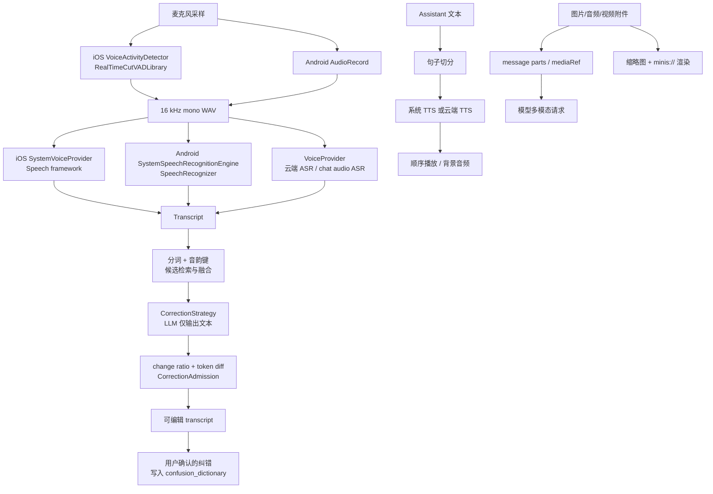

**读图要点**：纠错不改变原始 ASR 的安全边界；只要 LLM 超过变更比例或 admission 拒绝，输出仍是原 transcript。媒体渲染也不等同于模型输入：一个图片可以有 UI 缩略图、持久文件、`mediaRef` 和模型上下文中的 `imageData` 四种表现。

---

### 14.3 语音输入：系统 recognizer 与 provider ASR

#### 14.3.1 iOS 旧的系统直连路径

`SpeechRecognitionManager` 是一个 `@MainActor` 单例，状态只有 `idle` 和 `recording`；当前 `SpeechProvider` 枚举实际只有 `system`。初始化时从 `SFSpeechRecognizer.supportedLocales()` 恢复并排序 locale，保存用户选择到 `UserDefaults`（`src/ios/Agent/Speech/SpeechRecognitionManager.swift:5-44,103-140`）。这条路径直接使用 Apple Speech framework，不经过云 provider。

来源：`src/ios/Agent/Speech/SpeechRecognitionManager.swift:212-229`

```swift
let audioSession = AVAudioSession.sharedInstance()
try audioSession.setCategory(.record, mode: .measurement)
try audioSession.setActive(true, options: .notifyOthersOnDeactivation)

let request = SFSpeechAudioBufferRecognitionRequest()
request.shouldReportPartialResults = true
if speechRecognizer?.supportsOnDeviceRecognition == true {
    request.requiresOnDeviceRecognition = true
}
recognitionRequest = request
```

随后在 `AVAudioEngine.inputNode` 安装 tap，把 buffer append 到 `SFSpeechAudioBufferRecognitionRequest`，并计算 RMS 更新 40 个 waveform level；识别 callback 持续回写 `recognizedText`，遇到 error 或 `result.isFinal` 就 teardown（`src/ios/Agent/Speech/SpeechRecognitionManager.swift:231-239,251-298,307-340`）。这一路的用途是系统级、实时 partial transcription；它并不使用 RealTimeCutVADLibrary。

一个重要的工程保护是 Obj-C 异常：`installTap` 或 `audioEngine.start()` 在音频路由错误时可能抛 `NSException`，不是 Swift `Error`。实现用 `noff_try_objc` 包住安装和启动，失败时停止 engine、移除 tap、清空 request，再抛普通 NSError（`src/ios/Agent/Speech/SpeechRecognitionManager.swift:241-281`）。

#### 14.3.2 iOS 生产语音面板：VAD 先切段，再选 ASR

聊天中的新入口是 `VoiceInputViewModel`，注释明确说明 shared VAD + ASR 状态机驱动 inline voice input，并从 `VoiceProviderResolver` 解析 ASR（`src/ios/Views/Chat/Voice/VoiceInputPanel.swift:6-20`）。状态为 `waiting → recording → processing → result`；`prepare()` 创建默认 Voice Input/Output group、解析候选、检查权限并预热系统识别器（`src/ios/Views/Chat/Voice/VoiceInputPanel.swift:184-249`）。

真正启动时，`startVAD()` 会先停止云端朗读，标记 `VoiceModePreference.shared.isCapturing`，再根据当前 provider 设置段长：系统 ASR 使用 59 秒安全上限，云 provider 放宽到总录音上限；之后调用 `vad.start()`（`src/ios/Views/Chat/Voice/VoiceInputPanel.swift:342-369`）。这意味着“系统 ASR”在生产面板中仍然经过 VAD，而不是直接用 `SpeechRecognitionManager` 的实时 tap。

`VoiceActivityDetector` 接入 `RealTimeCutVADLibrary`、Silero VAD v5 和 WebRTC APM；库回调 `voiceStarted`、`voiceEnded(withWavData:)`、`voiceDidContinue`（`src/ios/Providers/Voice/VoiceActivityDetector.swift:1-12,41-53`）。实现有噪声 floor、AGC、speech start/end frame 阈值和原始采样备份；默认 start 需要约 10 帧确认，end 为 156 帧，后者约等于 5 秒尾部静音（`src/ios/Providers/Voice/VoiceActivityDetector.swift:55-126`）。

VAD 确认开始时，会从 `rawAudioBuffer` 回填最多 1.5 秒，避免确认延迟截掉汉字首音；结束时从自己的 `captureSamples` 生成带前导的 WAV，而不是盲信库返回的缓冲区（`src/ios/Providers/Voice/VoiceActivityDetector.swift:73-107,599-649`）。因此链路是：

```text
AVAudioEngine tap
  → VADWrapper（后台 vadQueue）
  → voiceStarted（UI recording）
  → voiceEnded（16 kHz WAV）
  → VoiceInputViewModel.transcribeSegment
  → VoiceProviderResolver 选出的 VoiceInputCapable
  → transcript 追加/替换
```

VAD 没有公开 flush API，所以 detector 保留自己的采样；用户点击暂停时，面板先 `vad.flush()`，若运行超过 1 秒但 VAD 从未判定 speaking，则 `flushRawFallback()`，再停止录音（`src/ios/Views/Chat/Voice/VoiceInputPanel.swift:263-307`）。这是“安静说话不丢首句”和“从未触发 VAD 仍可提交音频”两个非显然补丁。

#### 14.3.3 Android：系统流式与 provider 一次性两种 engine

Android 把后端抽象成 `SpeechRecognitionEngine`：有稳定 `id`、可用性、是否支持 partial、locale 列表，以及 `start/stop/cancel` 和 listener 回调（`src/android/app/src/main/java/com/openminis/app/speech/SpeechRecognitionEngine.kt:5-83`）。`RecognitionError` 将无结果、网络、权限、无 OEM 服务、忙、语言不支持、音频错误分开，`RecognitionState` 还显式包含 `STARTING`、`FINISHING`（同文件 `86-131`）。

`SpeechRecognitionManager.init()` 注册 `SystemSpeechRecognitionEngine` 和 `ProviderSpeechRecognitionEngine`，从 SharedPreferences 恢复 engineId/locale，刷新 availability 和 supported locales（`src/android/app/src/main/java/com/openminis/app/speech/SpeechRecognitionManager.kt:25-112`）。默认选择第一个可用 engine；系统 engine 的语言枚举通过 `ACTION_GET_LANGUAGE_DETAILS` 广播，并以 2.5 秒 fallback list 保证回调只触发一次（`src/android/app/src/main/java/com/openminis/app/speech/SystemSpeechRecognitionEngine.kt:48-110`）。

系统 engine 是 streaming/live transcript：`supportsPartialResults=true`，调用 Android `SpeechRecognizer`；API 31+ 只有在用户选择 offline 且有 `allowOnDeviceRetry` 时才创建 on-device recognizer，语言包不可用时重启一次普通 recognizer（`src/android/app/src/main/java/com/openminis/app/speech/SystemSpeechRecognitionEngine.kt:32-42,146-200`）。这是 Android 与 iOS `requiresOnDeviceRecognition` 的差异：Android 把 offline 作为显式偏好，并对 SODA 语言包错误降级。

provider engine 用 `AudioRecord` 捕获 16 kHz、mono、PCM16，单次最多 60 秒；没有 partial 结果，停止后再包装 WAV 并调用云端 provider（`src/android/app/src/main/java/com/openminis/app/speech/ProviderSpeechRecognitionEngine.kt:34-55,81-161`）。它根据 Voice Input group 取完整候选链，成功模型成为 sticky candidate，失败才尝试下一个；空文本是 `NO_MATCH`，不会误判为 provider 故障（同文件 `64-72,163-223`）。

Android 这里没有可验证的 RealTimeCutVADLibrary 接入点；provider engine 采用录音停止和时长上限，系统 engine 由 `SpeechRecognizer` 自己处理听音和 partial。故不要把 iOS 的 silence segmentation 直接移植成 Android 现状。

---

### 14.4 provider 协议：ASR 的请求形状与路由

#### 14.4.1 共同数据模型

两端都把输入抽象为“音频 bytes + model + language + response format + optional prompt”。iOS 的 `VoiceInputRequest` 注释声明它通常是 VAD 生成的 16 kHz mono WAV，Android 的 `VoiceInputRequest` 有同样约定（`src/ios/Providers/Voice/VoiceInputModels.swift:1-35`；`src/android/app/src/main/java/com/openminis/app/provider/voice/VoiceModels.kt:12-38`）。

默认 OpenAI-compatible ASR 请求是 `POST /v1/audio/transcriptions` 的 multipart：字段 `file=voice.wav`、`model`、ISO-639-1 两字母 `language`、`response_format` 和可选 prompt；响应先解析 `{text, language, duration}`，失败再接受纯文本（`src/ios/Providers/Voice/VoiceProvider.swift:39-52,69-136,288-316`；Android 同逻辑在 `src/android/app/src/main/java/com/openminis/app/provider/voice/VoiceProvider.kt:78-174`）。区域 locale 如 `zh-CN` 会在请求前折叠为 `zh`，避免 Whisper 端返回 unsupported language。

#### 14.4.2 chat-based ASR 是按模型名选择的

`VoiceProvider.transcribe` 先检查 `usesChatBasedASR(model:)`；模型 id 包含 `omni`，或同时包含 `audio` 与 `gpt/qwen` 时，才走 `/v1/chat/completions`，把 WAV base64 放在 `input_audio` content 中，并要求模型“只输出逐字转写”。普通 Whisper、SenseVoice、Paraformer 等仍走 transcriptions endpoint（`src/ios/Providers/Voice/VoiceProvider.swift:39-51,197-285`；Android `src/android/app/src/main/java/com/openminis/app/provider/voice/VoiceProvider.kt:80-100,218-293`）。

这个选择故意不依据“模型 modality 是否包含 text”：用户可能手工给 Whisper 标记了 text，但第三方 ASR 服务器并没有 chat completions；用模型族名可避免 `/v1/chat/completions` 404（iOS `VoiceProvider.usesChatBasedASR` 注释与实现 `223-228`）。

#### 14.4.3 厂商适配与 sticky failover

`VoiceProviderFactory` 从 provider type 和 custom base URL 识别 Groq、Alibaba、MiniMax、Doubao、Xunfei、Mimo、ElevenLabs、Azure、Deepgram、Gemini 等；需要多凭据的厂商使用单字段分号字符串拆解（`src/ios/Providers/Voice/VoiceProviderFactory.swift:5-16,22-145`；Android `src/android/app/src/main/java/com/openminis/app/provider/voice/VoiceProviderFactory.kt:7-115`）。具体 vendor 类只覆盖 endpoint、auth、请求/响应 envelope，例如 Android Doubao 使用 `X-Api-Key` 和 JSON/base64，MiniMax 使用嵌套 `audio.audio` base64（`src/android/app/src/main/java/com/openminis/app/provider/voice/VoiceProviderVendors.kt:60-133,136-234`）。

iOS 面板按 `resolvedInputCandidates` 解析 group，sticky 成功项置于下一段首位；Android provider engine 也按 group candidate chain 排序，并以随机 seed 做 load balance，失败才推进（`src/ios/Views/Chat/Voice/VoiceInputPanel.swift:189-221`；`src/android/app/src/main/java/com/openminis/app/speech/ProviderSpeechRecognitionEngine.kt:81-100,163-221`）。

---

### 14.5 语音纠错：从候选证据到安全应用

#### 14.5.1 目标与不变量

纠错引擎的输入是 ASR transcript，不是原始音频；它尝试修复同音字、近音英文、缩写展开、数字规范化，而不是替用户重写内容。iOS `VoiceCorrectionEngine.correct` 与 Android `VoiceCorrectionEngine.correct` 都保证“不抛出到 UI”：空输入、LLM 超时、策略异常、过大改写都返回原文和 `rejectedReason`（`src/ios/Agent/Speech/VoiceCorrectionEngine.swift:142-207`；`src/android/app/src/main/java/com/openminis/app/speech/correction/VoiceCorrectionEngine.kt:24-31,49-113`）。

核心不变量如下：

- 模型返回原文：不是失败，`hasChange=false`、reason 为 null。
- 变更比例超过 `MAX_CHAR_CHANGE_RATIO`（测试验证为 0.5 上限）：拒绝 wholesale rewrite。
- LLM/网络/策略异常：保留用户原 transcript。
- 只有实际替换操作才产生可学习 pair；纯插入、纯删除不代表“听成了另一个词”。
- 收集学习数据需要 consent；纠错运行本身不因 consent 关闭而失效。

#### 14.5.2 候选检索：分词、音韵键、并发融合、缓存

iOS `retrieveCandidates` 先为 locale 找 normalizer，把分词结果中过短 token（单字符）丢弃，生成去重 phonetic keys；命中内存缓存的候选直接复用，miss 则对 `sources` 并发查询，最后按 `sourceWeight × confidence` 去重并截断 top-N（`src/ios/Agent/Speech/VoiceCorrectionEngine.swift:73-138`）。Android 逻辑等价，但缓存 key 显式加 locale，避免不同语言共享同一音韵键（`src/android/app/src/main/java/com/openminis/app/speech/correction/VoiceCorrectionEngine.kt:138-192,194-235`）。

默认 object graph 同时挂入两个 source：`ConfusionDictionarySource` 和 `TypedVocabularySource`；iOS 在 engine 初始化处创建同类 source，Android `VoiceCorrection.ensureInitialized` 将它们与 LLM strategy 装配（`src/ios/Agent/Speech/VoiceCorrectionEngine.swift:1-58`；`src/android/app/src/main/java/com/openminis/app/speech/correction/VoiceCorrection.kt:41-87`）。source 故障在 Android `retrieveCandidates` 中 `runCatching` 降级为 empty list；单元测试明确要求数据库 down 时不抛异常（`src/android/app/src/test/java/com/openminis/app/speech/correction/CorrectionEngineTest.kt:158-172`）。

#### 14.5.3 LLM 后处理：证据有预算、输出无解释

iOS `LLMCorrectionStrategy` 只走 sub model，解析不到时 fallback primary；system prompt 要求只输出 corrected text，关闭 reasoning，并将 output budget 设为 `max(512, ceil(1.2 × transcriptChars))` 再服从模型 cap（`src/ios/Providers/Voice/CorrectionStrategy.swift:40-104,208-235`）。Android `LlmCorrectionStrategy` 复刻同一 prompt、model group fallback、`ThinkingLevel.OFF` 和 max token 规则（`src/android/app/src/main/java/com/openminis/app/speech/correction/CorrectionStrategy.kt:38-109`）。

Prompt 证据分为 typed vocabulary、confusion history、rare-term digest、近期对话 excerpts，各自有字符预算：400、800、200、4800，消息上下文总上限 5000；上下文明确标注为“供理解，不是待处理文本”（`src/ios/Agent/Speech/CorrectionContextBuilder.swift:5-43`；策略拼装在 `src/ios/Providers/Voice/CorrectionStrategy.swift:113-180`）。Android `CorrectionContextBuilder.build` 只扫描最近最多 12 条、每条最多 2000 字，按罕见词分数挑 excerpt，并保持时间顺序（`src/android/app/src/main/java/com/openminis/app/speech/correction/CorrectionContextBuilder.kt:118-169,191-245`）。

上下文来源不是所有 UI rows：Android `VoiceCorrection.toSourceMessages` 只保留 user/assistant，assistant 优先取 text blocks，排除 thinking/tool_use，并剥除 `<user-attached-files>`；7 个测试中的 `CorrectionContextWiringTest` 将这些规则锁死（`src/android/app/src/main/java/com/openminis/app/speech/correction/VoiceCorrection.kt:106-158`；`src/android/app/src/test/java/com/openminis/app/speech/correction/CorrectionContextWiringTest.kt:31-114`）。

#### 14.5.4 Diff 算法：为什么不是简单字符串 replace

当前 iOS `VoiceCorrectionDiff.tokenPairs` 对两侧重新分词，运行 `LCSDiff.diff`，只取 `.replace`，将 token 拼回可读 span，并丢弃长度比超过 8 的 pathological replacement（`src/ios/Agent/Speech/VoiceCorrectionDiff.swift:20-89`）。`LCSDiff` 是后缀动态规划表，时间复杂度 O(n·m)，连续 equal/replace/insert/delete 合并（同文件 `113-180`）。

Android 文件保留了“字符级 LCS + 原文词边界 widening”设计：先把 `from/to` 拆成字符，LCS 得到最小 replace；再根据原文 token span 扩大 old side，并对 new side 做同量 padding，长度比超过 2 的 replace 丢弃（`src/android/app/src/main/java/com/openminis/app/speech/correction/VoiceCorrectionDiff.kt:3-21,39-105`）。这与 iOS 当前 token-level 版本是一个必须记录的跨端差异，不应假设两侧 diff 输出完全一致。

Android 单测给出了最有用的契约：

| 测试行为 | 契约 |
|---|---|
| `widens a minimal char replace out to the whole word` | `张山→张三` 必须是一个 pair，不能只显示 `山→三`。|
| `handles multiple corrections in one sentence` | 一句中可产生 `石塘→食堂` 与 `张山→张三` 两个 pair。|
| `identical text yields no pairs` | 相同字符串返回空。|
| `empty input yields no pairs` | 任一侧为空返回空。|
| `pure insertion/deletion produces no pair` | 加词/删词不是误听证据。|
| `length-imbalanced replacements are dropped as rewrites` | 1→8 字符的替换丢弃。|
| `charChangeRatio` tests | 精准修复低于 0.5，全句重写高于 0.5，相同文本为 0。|
| `lcs detects a replace` | `张山,说` → `张三,说` 产出 replace，而不是 delete+insert。|

这些行为分别见 `src/android/app/src/test/java/com/openminis/app/speech/correction/VoiceCorrectionDiffTest.kt:45-135`。iOS 同类测试位于 `src/ios/MinisTests/VoiceCorrectionTests.swift`，实现的纯函数拆分也让测试不必加载 provider stack（`src/ios/Agent/Speech/VoiceCorrectionDiff.swift:3-9`）。

#### 14.5.5 CorrectionAdmission：从单一相似度到多信号准入

`CorrectionAdmission.judge` 的顺序是 load-bearing：先 locality，再 pure reorder，再 phonetic similarity，再 digit normalization，最后 acronym relation（`src/ios/Agent/Speech/CorrectionAdmission.swift:66-113`；Android 同样在 `src/android/app/src/main/java/com/openminis/app/speech/correction/CorrectionAdmission.kt:90-138`）。

- **locality**：`max(from.count,to.count) / sentenceLength > 0.6`，即使音韵相似也认为是全局改写。
- **reorder**：去空白后的字符 multiset 相同但顺序不同，拒绝；否则用户只是重排内容。
- **homophone**：音韵 key 的 Levenshtein similarity ≥ 0.6，接受。
- **digitNorm**：一侧有中文数字、另一侧有 ASCII 数字，接受 `十七→17`、`二V三→v3`。
- **acronym**：短 key 是长 key 的有序子序列，短边/长边必须小于 0.9，接受 `MediaS→Media Server`、`上帝→上`。
- 其他情况是 `rejectedReword`，不写 confusion row。

Android `CorrectionAdmissionTest` 进一步规定了真实矩阵：`审推→闪退`、`绘画→会话`、`cloud→claude`、`worker→work on`、`MediaS→Media Server`、中文数字到阿拉伯数字应收集；`挂载→规则`、`secure→SSH key`、纯 reorder 应拒绝；同一 pair 在 sentence length=20 时可收集，在 length=2 时因 too-global 拒绝（`src/android/app/src/test/java/com/openminis/app/speech/correction/CorrectionAdmissionTest.kt:61-126,168-205`）。

这组测试还锁定两个安全边界：9/10 的近等长字符串不能靠 acronym 进入；`RTU→Retry` 不做特殊放行，以免引入语义误报（同文件 `138-165`）。

#### 14.5.6 Recorder：学习前还要 sentence-align

iOS recorder 在 before/after 都切句；句子数量相同只 diff 改变的句子，否则整段 diff，给每个 pair 附上 sentence length，再运行 admission 和 consent gate，写入 `confusion_dictionary`（`src/ios/Agent/Speech/VoiceCorrectionRecorder.swift:36-107`）。Android `VoiceCorrectionRecorder` 同样在 `alignedCandidates` 中优先逐句对齐，shape 不同才 fallback 全文，并将 `contextSample` 截断后保存（`src/android/app/src/main/java/com/openminis/app/speech/correction/VoiceCorrectionRecorder.kt:58-159`）。

两种来源共用一条规则：ASR transcript 手改使用 `SOURCE_VOICE`，普通文本框 select-and-replace 使用 `SOURCE_TEXT`；Android `VoiceCorrection` 将两个入口放到 IO scope fire-and-forget，不能阻塞输入或录音（`src/android/app/src/main/java/com/openminis/app/speech/correction/VoiceCorrection.kt:160-221`）。

AI 建议被用户接受时只写 metrics event，不把模型自己的输出重新写入 confusion dictionary；否则模型会从自己生成的结果中自激学习。用户拒绝建议时只记录 negative feedback，降低 pair confidence（`src/ios/Agent/Speech/VoiceCorrectionRecorder.swift:110-145`；Android 同逻辑 `src/android/app/src/main/java/com/openminis/app/speech/correction/VoiceCorrectionRecorder.kt:162-197`）。

---

### 14.6 用户词表：typed vocabulary 与过滤器

#### 14.6.1 为什么使用已发送文字

`TypedVocabularyBuilder` 不读 draft，而扫描已经发送的 user messages：发送行为是隐式确认，草稿可能被放弃；它补上 cold start 时 confusion dictionary 为空的问题（`src/ios/Agent/Speech/TypedVocabularyBuilder.swift:5-16`；Android `src/android/app/src/main/java/com/openminis/app/speech/correction/TypedVocabularyBuilder.kt:12-20`）。两端都保存 cursor，只扫描新消息；至少间隔一小时，iOS 还要求新消息达到 20 条才运行，构建在后台 actor/IO scope 中完成（iOS `src/ios/Agent/Speech/TypedVocabularyBuilder.swift:17-61`；Android `src/android/app/src/main/java/com/openminis/app/speech/correction/TypedVocabularyBuilder.kt:21-70,147-159`）。

只取 `.text` parts，并删除 `<user-attached-files>…</user-attached-files>`；工具名、文件名、base64、mediaRef 不应该污染用户词表（iOS `src/ios/Agent/Speech/TypedVocabularyBuilder.swift:108-141`；Android `src/android/app/src/main/java/com/openminis/app/speech/correction/TypedVocabularyBuilder.kt:129-172`）。

#### 14.6.2 VocabularyFilter 的分数

过滤器先做绝对拒绝：中文/英文 stopwords、长度小于 2、大于 12、纯 ASCII 数字或标点。之后正向计分：不在常用词表 +2，proper-noun POS（`nr/ns/nz/nt`）+2，包含 ASCII 字母或数字 +1，长度 2–6 +1；达到 `VOCAB_MIN_SCORE` 才接受（`src/ios/Agent/Speech/VocabularyFilter.swift:15-74`；Android `src/android/app/src/main/java/com/openminis/app/speech/correction/VocabularyFilter.kt:17-78`）。

ASCII guard 是必须保留的行为：Swift/Java 的通用 `isLetter` 对汉字也为真，通用 `isDigit` 对 `一二三` 也可能为真；无 guard 会让每个中文词虚增 Latin 分，或把 `三星` 当作数字-only。Android 测试直接锁定 `张三` 和 `三星` 的 `hasLatinOrDigit=0`（`src/android/app/src/test/java/com/openminis/app/speech/correction/VocabularyFilterTest.kt:60-76`）。

候选生成优先 POS tagging，重复 token 累加 occurrences；非中文、jieba 不可用或 POS 为空时退回普通 segmentation，并将 posTag 置 null（`src/ios/Agent/Speech/VocabularyFilter.swift:76-92`；Android `src/android/app/src/main/java/com/openminis/app/speech/correction/VocabularyFilter.kt:80-105`）。测试还要求频率文件忽略注释、空行和 malformed rank（`src/android/app/src/test/java/com/openminis/app/speech/correction/VocabularyFilterTest.kt:123-163`）。

#### 14.6.3 iOS 与 Android 的实现差异

| 抽象 | iOS | Android | 原因/影响 |
|---|---|---|---|
| 分词 | `TextSegmenter.shared`，cppjieba/NL 路径 | `TextSegmenter.getInstance(context)`，jieba JNI/资源 | 资源初始化方式不同，规则契约相同。|
| 执行模型 | `actor TypedVocabularyBuilder` | `Mutex` + `Dispatchers.IO` | Swift actor 与 Kotlin 协程隔离相同目标：不阻塞发送。|
| 增量游标 | DB meta `vocab_last_built_at` | DB meta 同名 key，另有 max 500 条/批 | Android 首次历史扫描有显式批量上限。|
| 常用词表 | bundle `zh_background_wordfreq.txt` | `res/raw/zh_background_wordfreq.txt` | 两端都把“存在=普通词”作为负信号。|
| 过滤测试 | iOS MinisTests + debug RPC | JVM `VocabularyFilterTest` 可注入 rank/segment | Android 将纯逻辑依赖注入，避免 JVM 缺少 android.icu。|
| 同意开关 | `VoiceCorrectionCollectionConsent.collectionEnabled` | `VoiceCorrectionConsent.isEnabled(context)` | 运行和收集分离；关闭后仍可纠错。|

---

### 14.7 TTS、朗读队列与后台音频

#### 14.7.1 iOS：系统朗读与 cloud VoiceOutputPlayer

iOS `VoiceOutputPlayer` 是云端 TTS 的 `@MainActor` ordered queue：文本按句子/标题/tool announcement 入队，最多两个 synthesize prefetch，但 playback 严格按 sequence；失败会在候选模型间 sticky failover（`src/ios/Providers/Voice/VoiceOutputPlayer.swift:65-105,119-170`）。动态窗口根据每字符音频时长、合成耗时和已缓冲秒数计算下一批字符数，避免 underrun，又不把批次拉得过大（同文件 `145-213`）。

`enqueueSegmented` 复用 `AIChatViewModel.splitIntoSpeechSegments` 和 `VoiceTextSanitizer`，所以流式回复与“长按朗读”边界一致（`src/ios/Providers/Voice/VoiceOutputPlayer.swift:229-257`）。系统 provider 不在该云端 player 中：iOS 的 `AIChatViewModel` 保留 `AVSpeechSynthesizer` 路径，带 voice/rate/pitch/volume 和 background keep-alive；这一点由 player 的注释直接声明（`src/ios/Providers/Voice/VoiceOutputPlayer.swift:67-75`）。

系统和云 TTS 共享 global `VoiceOutputState`，它保存 enabled、speed、muted 等偏好并向 chat/home capsule 镜像 reading/paused 状态；`AudioTogglePlaybackIntent` 是 Siri/Live Activity 的系统入口（`src/ios/Providers/Voice/VoiceOutputPlayer.swift:4-35`；`src/ios/Shared/AudioTogglePlaybackIntent.swift:1-53`）。

#### 14.7.2 Android：TextToSpeechManager 与 ReadAloudPlayer

`TextToSpeechManager` 初始化 Android `TextToSpeech`，按汉字检测自动在 zh-CN 与 en-US 间切换；`QUEUE_FLUSH` 立即讲话，`QUEUE_ADD` 追加句子，`UtteranceProgressListener` 维护 speaking 状态（`src/android/app/src/main/java/com/openminis/app/speech/TextToSpeechManager.kt:13-25,61-115,225-271`）。Android TTS 没有原生 pause，`togglePause()` 通过 stop + pendingTexts/pausedAtIndex 记录位置，再重播剩余 utterances（同文件 `175-199`）。

`ReadAloudPlayer` 是聊天朗读统一入口：每个句子经过 sanitizer，再由单 worker `Channel` 串行处理，解析到 voice output provider 就 synthesize，否则 fallback 到系统 TTS；任意 provider 合成失败也按句 fallback，不丢整段回复（`src/android/app/src/main/java/com/openminis/app/speech/ReadAloudPlayer.kt:26-58,100-189`）。provider 音频先写 cache 文件，再交给 `MediaPlayer` 完整播放；stop 先调用 finisher 解开挂起的 continuation，再 release player，防止队列永久 wedge（同文件 `191-256`）。

两端都抽出了数字内标点保护：`SpeechSentenceSplitter.isIntraNumberSeparator` 不把 `3.14`、`1,000` 切句，streaming buffer 末尾的 `28.` 也等待下一 delta；`TextToSpeechManager` 与 `ReadAloudPlayer` 共享它（`src/android/app/src/main/java/com/openminis/app/speech/SpeechSentenceSplitter.kt:12-80`）。

#### 14.7.3 音频会话与后台

iOS 附件播放与 TTS 分别声明 intent。`GlobalAudioPlayer.play` 在加载文件后 `AudioSessionCoordinator.begin(.mediaAttachment)`，暂停/自然结束/stop 时释放 intent，并在媒体播放期间 suspend silent audio keep-alive（`src/ios/Views/Chat/Media/AudioPlayback.swift:70-117,173-217`）。它监听 AVAudioSession interruption，至少记录 call/Siri/其他播放器打断，后台真正是否恢复由上层状态决定（`src/ios/Views/Chat/Media/AudioPlayback.swift:18-43`）。

Android 本章可验证的后台策略是生命周期内 coroutine worker + MediaPlayer cache file；`ReadAloudPlayer.shutdown()` 负责停队列、取消 worker、关闭 channel 和系统 TTS（`src/android/app/src/main/java/com/openminis/app/speech/ReadAloudPlayer.kt:149-170`）。不要把 iOS 的 silent-audio keep-alive 假设成 Android 行为。

---

### 14.8 FFmpeg/LAME：依赖边界与 LGPL 约束

#### 14.8.1 仓库中真正的构建入口

`deps/build_lame.sh` 将 LAME 3.100 交叉编译为 iOS arm64 静态 `libmp3lame.a`，关闭 shared、frontend、decoder，只保留给 FFmpeg 的编码库（`deps/build_lame.sh:4-15,64-89`）。`deps/build_ffmpeg.sh` 将 FFmpeg 6.1.2 打成多个动态 framework 和 umbrella `FFmpeg.framework`，并将 `ffmpeg.c` 的 `main` 改名为 `ffmpeg_main`，避免与 app 入口冲突（`deps/build_ffmpeg.sh:4-15,274-341`）。

FFmpeg configure 的可验证事实：

- 找到 `deps/lame-build/lib/libmp3lame.a` 才加 `--enable-libmp3lame`；否则 MP3 encoding unavailable。
- 开启 shared、VideoToolbox、HLS/network/file/pipe/http/https 等必要能力。
- `--disable-programs`、`--disable-devices`、`--disable-protocols` 后逐项开放协议，缩小 iOS 包。
- 没有 `--enable-gpl` 或 `--enable-nonfree`；这是 LGPL 约束的一部分。

上述开关位于 `deps/build_ffmpeg.sh:194-254`，构建顺序与“LAME 必须先于 FFmpeg”写在 `BUILDING.md:86-107`。当前源码搜索中，FFmpeg/LAME 的直接可验证入口就是这些 build/package 脚本；语音输入和朗读运行时使用的是 Swift/Kotlin provider 与系统播放器，而不是一个已暴露给聊天层的 `ffmpeg()` Swift/Kotlin API。

#### 14.8.2 它们解决什么问题

LAME 提供 MP3 编码，FFmpeg 提供媒体 demux/decode/encode/转封装能力；在本仓库配置里能确定的产品关联是：LAME 编进 FFmpeg 的 `libmp3lame`，provider TTS 请求默认可以要求 MP3，Android voice model 也将 MP3 作为默认 output format（`src/android/app/src/main/java/com/openminis/app/provider/voice/VoiceModels.kt:40-52`；`deps/build_ffmpeg.sh:204-216`）。不能从当前 Swift/Kotlin 文件推断所有附件都会经过本地 FFmpeg 转码。

#### 14.8.3 合规清单

| 检查项 | 仓库证据 | 开发含义 |
|---|---|---|
| FFmpeg license | LGPL-2.1-or-later，且 built without GPL/nonfree | 不得为方便加入 `--enable-gpl` 或 `--enable-nonfree`。|
| LAME license | LGPL-2.0-or-later | 保留 LAME LICENSE，维持独立构建产物和归属。|
| 动态链接 | FFmpeg 各 `.framework` 为 dynamic bundles | 变更链接方式时重新审 LGPL 义务。|
| 许可证清单 | `THIRD_PARTY_LICENSES.md:5-15` | 发布包保留第三方 LICENSE 文件。|
| 构建顺序 | `BUILDING.md:88-103` | 先 LAME 后 FFmpeg，否则 MP3 编码会缺失。|
| 总体产品 license | `BUILDING.md:230-235` | OpenMinis 自身因 iSH/PRoot 为 GPLv3；不要把它误写成 FFmpeg GPL。|

---

### 14.9 多模态媒体：从附件到模型、缩略图和 `minis://`

#### 14.9.1 iOS 输入附件

图片、视频和普通文件先写入 Caches 下 `InputAttachments`，再加入 `InputAttachment`；相机图片会 downsample + JPEG 以把 12MP 原图从 15–25 MB 降到约 1–3 MB，PhotosPicker 原始 bytes 则尽量原样保存，以保留 PNG alpha、HEIC 或 GIF（`src/ios/Agent/Chat/AIChatViewModel+Attachments.swift:11-80`）。picker 先插入 loading placeholders，后台加载完成后 in-place flip 为 ready，发送按钮以 `hasLoadingAttachments` 防止半成品进入请求（同文件 `82-167`）。

发送时 attachment 与 text 一起进入 queued prompt 和 user ChatMessage；这保证 UI 先显示 queued bubble，实际 agent loop 随后消费同一份 attachment 结构（`src/ios/Agent/Chat/AIChatViewModel+Compaction.swift:47-72`）。模型上下文中的 image bytes 有独立保留策略：历史最多保留限定图片数量；持久 `/var/minis/*` 路径只放可重新读取的 placeholder，volatile 或无原路径用户图像才 snapshot 到 offload（`src/ios/Agent/Chat/AIChatViewModel+Offloading.swift:169-187,219-273`）。

#### 14.9.2 iOS 工具媒体与 Minis URL

Agent 的 `read_image`、browser screenshot 等工具结果可以落成 `mediaRef`，持久文件位于 session attachments；`saveAttachment` 返回 `minis://attachments/<filename>`，bind mount 使 iSH 也能看到同一文件（`src/ios/Agent/Chat/AIChatViewModel+Offloading.swift:640-667,800-816`）。`minis://` 不是仅仅 UI 装饰：路径能被模型的 read tool、WKWebView scheme handler 和文件浏览器重新解析。

图片 gallery 的 source URL 可以是 `minis://` 或 http，点击 markdown 图片时用 sourceURL 选中初始页（`src/ios/Views/Chat/Media/MessageImageGallery.swift:1-15,291-313`）。音频附件由 `MinisAudioPreviewView` 加载全局 player，sheet 关闭后播放继续并显示 PiP capsule（`src/ios/Views/Chat/Media/AudioPreview.swift:14-63`）。视频先用 `AVAssetImageGenerator` 生成最多 400×400 缩略图，点击后进入 fullscreen AVPlayer（`src/ios/Views/Chat/Media/VideoPlayer.swift:15-159`）。

#### 14.9.3 Android `minis://` 渲染

Android 在 `MinisApp.newImageLoader()` 注册 Coil `MinisImageFetcher.Factory` 和 `UriFactory`；这两条入口分别覆盖原始 String model 与 Markdown renderer 转出的 `android.net.Uri`。fetcher 将 `minis://attachments/foo.jpg` 转为 `/var/minis/attachments/foo.jpg`，经 PRootKernel 找到 host file，再交给 Coil 解码（`src/android/app/src/main/java/com/openminis/app/ui/MinisImageFetcher.kt:16-60,63-85`）。

由于 Agent 可能覆盖同名文件，fetcher 的 `MtimeKeyer` 把 lastModified 加入 memory/disk cache key；否则 URI 不变时 Coil 会继续显示旧 bitmap（同文件 `89-135`）。

Android WebView 的 `BrowserUseManager.shouldInterceptRequest` 拦截 `minis` scheme，host/path 映射到 `/var/minis/<host><path>`，按扩展名返回 MIME；当前可验证映射包括 png/jpg/gif/svg/webp、mp4、mp3、pdf 等（`src/android/app/src/main/java/com/openminis/app/browser/BrowserUseManager.kt:386-427,457-475`）。HTML 还会在没有 viewport meta 时注入 session viewport，避免 minis HTML 用 WebView 默认 980 CSS px。

#### 14.9.4 平台对照

| 媒体环节 | iOS | Android |
|---|---|---|
| 用户图片缓存 | Caches/InputAttachments，图片可原始保存或相机 downsample | Android 侧本章目标代码未显示等价的 iOS attachment extension；模型/渲染路径依赖 app 的 URI/file storage。|
| 模型媒体引用 | `imageData`、toolResult `mediaRef`、持久 `/var/minis` | provider/agent 侧以本地文件和 URI 解析，Coil 用 PRootKernel。|
| 图片缩略图 | SwiftUI/UIKit `ImagePreview`、gallery、工具图片历史 trim | Coil 解码，mtime key 避免 stale bitmap。|
| 音频附件 | `AVAudioPlayer` + `GlobalAudioPlayer` + PiP | `MediaPlayer`/`ReadAloudPlayer` 主要负责朗读；附件播放器需区分于 TTS。|
| 视频 | `AVAssetImageGenerator` 缩略图 + AVPlayer fullscreen | WebView MIME 可直接提供 mp4；本章未发现与 iOS 同名的 Compose 视频 preview。|
| minis URL | WKWebView `MinisURLSchemeHandler` 与 `/var/minis` bind mount | Coil Fetcher、WebView `shouldInterceptRequest` 与 PRootKernel。|

---

### 14.10 平台对照

| 维度 | iOS | Android | 差异原因 |
|---|---|---|---|
| VAD 方案 | `VoiceActivityDetector` 接入 RealTimeCutVADLibrary，Silero/WebRTC，silence 切段并生成 WAV。 | 本章可验证代码没有 RealTimeCutVADLibrary；`AudioRecord` provider 在 stop 或 60 秒上限后提交整段，系统 recognizer 自己管理会话。 | iOS 生产面板需要连续听写和 silence segmentation；Android 先复用系统服务与简单录音后端。|
| ASR 路由 | 系统 `SpeechRecognitionManager` 走 Speech framework；生产面板由 `VoiceProviderResolver` 在 SystemVoiceProvider 与云 provider 间选择。 | `SpeechRecognitionManager` 注册 `SystemSpeechRecognitionEngine` 和 `ProviderSpeechRecognitionEngine`，分别提供 partial 与 one-shot。 | Android 将 backend 抽象成 engine，iOS 旧直连路径与新 VAD 面板并存。|
| TTS/朗读 | 系统 `AVSpeechSynthesizer` 与 cloud `VoiceOutputPlayer` 分开，cloud queue 支持 prefetch 和 sticky failover。 | `TextToSpeechManager` 为系统 fallback，`ReadAloudPlayer` 用单 worker 串行 provider TTS/MediaPlayer。 | iOS 已实现动态预取；Android 先用顺序性换取取消和 fallback 的确定性。|
| 后台音频 | `AudioSessionCoordinator` 区分 capture、TTS、media attachment；附件播放与 silent keep-alive 协调。 | `ReadAloudPlayer.shutdown` 释放 coroutine worker、Channel、MediaPlayer 和系统 TTS；没有 iOS silent-audio 等价证据。 | AVAudioSession 是 iOS 特有资源竞争点；Android 主要依靠生命周期清理。|
| 音频编解码 | LAME 先构建静态库，FFmpeg 再打 iOS dynamic frameworks；configure 保持 LGPL。当前语音运行时入口仍是 provider/system player。 | 本章目标代码没有对应 FFmpeg/LAME runtime wrapper；provider 返回 MP3/WAV/OPUS 等 bytes 给 Android 播放器。 | codec 构建产物是 iOS 依赖边界，不应推断两端附件都走本地转码。|
| 词表存储 | actor `TypedVocabularyBuilder` 增量扫描 ChatStore，写 `VoiceCorrectionDB`，bundle 背景词表参与过滤。 | `TypedVocabularyBuilder` 用 ChatDao/Room、Mutex 和 IO dispatcher，资源词表在 `res/raw`。 | 存储 API 不同，但发送文字、consent、cursor、score 契约一致。|
| 纠错落地 | 当前 iOS diff 为 token LCS；`CorrectionAdmission` 与 actor recorder 写 confusion rows。 | Android diff 为字符 LCS + 原文词边界 widening；JUnit 用注入 normalizer 锁定 admission 和 engine bailout。 | 两端要保持可学习 pair 和安全回退契约，不要求 diff 内部实现相同。|

代码依据：VAD/ASR 对照见 `src/ios/Providers/Voice/VoiceActivityDetector.swift:1-12,73-126`、`src/android/app/src/main/java/com/openminis/app/speech/ProviderSpeechRecognitionEngine.kt:34-55,134-161`；TTS 对照见 `src/ios/Providers/Voice/VoiceOutputPlayer.swift:65-75,145-170`、`src/android/app/src/main/java/com/openminis/app/speech/ReadAloudPlayer.kt:26-58,100-109`；词表和纠错差异见本章 14.6 与 14.5 的文件引用。
 
### 14.11 纠错测试契约

单元测试的价值不只是验证 helper，而是把“什么时候允许系统学习”定义成了可观察 API。`CorrectionEngineTest` 用 `FakeStrategy` 替代真实模型，因此每个断言都落在 `VoiceCorrectionEngine.correct` 的边界，而不是网络服务的偶然响应（`src/android/app/src/test/java/com/openminis/app/speech/correction/CorrectionEngineTest.kt:22-68`）。

输入为空时，strategy calls 必须为 0；这表示空输入应在检索和模型之前短路，不消耗网络或 token（同测试 `70-79`）。

strategy 返回原文时，`hasChange=false`、`rejectedReason=null`，并保留 strategy 返回的 `modelGroupUsed`；“没有修改”是成功观察，不是失败（同测试 `81-88`）。

strategy 返回完全不同的句子时，`rejectedReason=diff_too_large`，`corrected` 必须仍等于原文；因此 UI 永远有安全可提交文本（同测试 `90-97`）。

strategy 抛异常时，错误标签以 `llm_error:` 开头，原文不变且 `hasChange=false`；调用方可以显示提示而不需要 try/catch 包住发送流程（同测试 `99-105`）。

目标替换 `张山→张三` 必须 accepted，summary 必须包含 Unicode arrow `→`；这个箭头不是装饰，而是 metrics、debug 和负反馈定位 pair 的稳定格式（同测试 `107-114`）。

locale 不支持时，retrieval 返回空候选，而且 source lookup 次数必须为 0；纠错仍可以依赖 context 或 LLM，但不应把无法比较的语言硬塞进字典（同测试 `118-124`）。

fusion 对同一 `phoneticKey|term` 只保留一个候选，比较的是 source weight × confidence；confusion dictionary 的 0.9 乘 1.0 可以胜过 vocabulary 的 1.0 乘 0.6（同测试 `131-146`）。

候选 list 有 `MAX_CANDIDATES` 上限；source 抛异常时降级为空 list，整次 correction 不得因为单个 DB source 挂掉而失败（同测试 `148-172`）。

`CorrectionStrategyTest` 又把 output budget 固定为 floor、input scaling、model cap 三种情况：短文本不得低于 reasoning model 所需 floor，长文本按输入增长，显式 model cap 总是优先（`src/android/app/src/test/java/com/openminis/app/speech/correction/CorrectionEngineTest.kt:175-194`）。

这套测试意味着读者自己的最小实现应当拥有以下状态转移：

```text
blank ──(no model call)──> rejected(empty_input)
nonblank ──(strategy unchanged)──> unchanged(success)
nonblank ──(strategy exception/timeout)──> original + error
nonblank ──(ratio > cap)──> original + diff_too_large
nonblank ──(targeted replace)──> corrected + pairs + optional event
```

测试还故意没有把 Android instrumented path 假装成 JVM path：真正的 `android.icu` pinyin normalization 需要 instrumented test，JVM 只注入 normalizer；这提示工程实现要把平台依赖包在接口后，不要让纯算法不可测（`src/android/app/src/test/java/com/openminis/app/speech/correction/PhoneticNormalizerTest.kt:9-32`）。

`RecorderAdmissionTest` 则锁定 recorder 不区分“语音编辑”与“普通文本替换”的 admission：两者都接受同音 `石塘→食堂`，都拒绝语义重写 `吃饭→看电影`（`src/android/app/src/test/java/com/openminis/app/speech/correction/RecorderAdmissionTest.kt:33-75`）。同文件还规定 malformed attachment opener 保持原文，不因为清理器过度贪婪而截断消息（`src/android/app/src/test/java/com/openminis/app/speech/correction/RecorderAdmissionTest.kt:78-102`）。

因此，纠错测试的验收顺序应是：先测纯 diff，再测 admission，再测 engine bailout，最后才测真实 provider。先测试网络，会把“原文回退”和“模型没有变化”的语义错误隐藏在 mock response 里。

### 14.12 纠错上下文的预算执行

上下文 builder 不是简单的 `messages.takeLast(n)`。iOS 先对最近最多 12 条消息做扫描，并把每条扫描限制在 2000 字符；Android 同样保存 `newestIndex`，最新消息从 0 开始倒序扫描（`src/ios/Agent/Speech/CorrectionContextBuilder.swift:41-43,205-227`；`src/android/app/src/main/java/com/openminis/app/speech/correction/CorrectionContextBuilder.kt:126-155`）。

每个分词 term 会经过 `RareContentScorer`：背景词表中的 term 得分 0；混合 CJK/Latin、camelCase、ALL-CAPS、数字和连接符技术 token 得分高；普通 ASCII 单词得分较低（`src/ios/Agent/Speech/CorrectionContextBuilder.swift:45-140`）。这使 `WGHome`、`LiveActivity`、`dns-server` 等比“今天”更容易进入 correction prompt。

rare digest 按 score、occurrences、term length 排序，使用 `、` 拼接并严格控制 200 字；一个过长 term 会被跳过，而不是 break，以便后面的短 term 仍有机会进入（`src/ios/Agent/Speech/CorrectionContextBuilder.swift:258-273`；Android `CorrectionContextBuilder.kt:171-188`）。

excerpt 选择有非对称策略：最新两轮即使没有 rare hit 也提供 grounding，较旧消息只有包含 strong rare content 的句子才获得 slot；最后再按时间顺序还原给模型（`src/ios/Agent/Speech/CorrectionContextBuilder.swift:275-321`；Android `CorrectionContextBuilder.kt:191-245`）。

这解释了为什么 correction prompt 既能看到当前语境，又不会把整段聊天历史复制到每次 ASR 后处理请求：预算是 prompt contract，而不是日志中的建议值。

### 14.13 纠错事件与置信度的闭环

`VoiceCorrectionRecorder` 写入 confusion row 时保存 phoneticKey、originalVariant、correctedTerm、locale、contextSample、asrProvider、source；后续 source lookup 可以把“哪个识别器犯错”和“用户从哪里修正”区分开（`src/ios/Agent/Speech/VoiceCorrectionRecorder.swift:79-103`；Android `src/android/app/src/main/java/com/openminis/app/speech/correction/VoiceCorrectionRecorder.kt:94-114`）。

数据库的正/负反馈不应直接改变模型 prompt 文本，而应影响 candidate confidence；Android 测试规定 `confidence(3,0)=1.0`、`confidence(3,1)=0.6`、三次 reject 后低于 retrieval floor（`src/android/app/src/test/java/com/openminis/app/speech/correction/PhoneticNormalizerTest.kt:69-77`）。

因此，一个最小 confusion row 至少需要：key、wrong variant、correct term、locale、positive count、negative count、last seen、source。只存一个静态替换字典无法实现用户撤销、跨日期频率和 provider 归因。

录音修正的正反馈是“手工改过 transcript”，而不是“模型建议后用户点击接受”；后者的 suggestion 已经依赖现有 dictionary，回写会形成 echo。这个闭环设计允许收集真实 ASR 错误，同时避免 LLM 自己制造训练数据（`src/android/app/src/main/java/com/openminis/app/speech/correction/VoiceCorrectionRecorder.kt:162-197`）。

### 14.14 媒体的生命周期分层

一份媒体数据在 iOS 中至少可能有四个生命周期：picker 临时 URL、Caches 中的 attachment 文件、session persistent attachment、agentHistory 中的 imageData 或 placeholder。`AIChatViewModel+Attachments` 负责前两者，`AIChatViewModel+Offloading` 负责后两者；不要让 SwiftUI view 自己决定何时删除文件（`src/ios/Agent/Chat/AIChatViewModel+Attachments.swift:82-167`；`src/ios/Agent/Chat/AIChatViewModel+Offloading.swift:169-187`）。

发送前的 loading placeholder 解决的是 UI 顺序问题：用户可以一次选择多张图片，bytes 以并发速度返回，但 chips 必须保持 picked order；因此 finalize 通过 id 回找数组位置，而不是 append 到尾部（`src/ios/Agent/Chat/AIChatViewModel+Attachments.swift:84-126`）。

工具生成图片的持久化路径则由 `mediaRef` 指向 ChatStore 保存的数据；session reload 时通过 media resolver 把 ref 恢复成 file URL，模型 context 只对应该保留的图片 bytes（`src/ios/Agent/Chat/AIChatViewModel+Persistence.swift:860-905,1315-1320`）。

历史裁剪的关键不是“删除旧图片”，而是把旧 bytes 换成带 original path/snapshot path 的文字 placeholder；这样模型仍知道如何通过 `read_image` 重新取回持久 minis 文件（`src/ios/Agent/Chat/AIChatViewModel+Offloading.swift:169-187,239-272`）。

Android 的 `minis://` 则没有复制 bytes 的 fetcher 层：Coil 每次按 URI 映射到 PRoot host file，再用 mtime key 解决原地覆盖。这个差异说明两端都需要稳定路径，但缓存失效机制不同（`src/android/app/src/main/java/com/openminis/app/ui/MinisImageFetcher.kt:30-50,89-135`）。

多模态模型输入和 UI preview 也不必同一 MIME：模型 part 需要 bytes 或 provider 可访问的 URL，图片 preview 需要 bitmap，音频 preview 需要可 seek 的 AVAudioPlayer/MediaPlayer，视频 preview 需要 thumbnail + AVPlayer；四者共享 file identity，但不共享播放器实例（iOS `src/ios/Views/Chat/Media/AudioPlayback.swift:61-117`；iOS `src/ios/Views/Chat/Media/VideoPlayer.swift:40-159`）。

### 14.15 minis:// 的安全与可恢复性

`minis://` URL 的 host 是 namespace，例如 `attachments`、`workspace`、`browser`；路径需要 percent-decode 后再映射到 `/var/minis/<namespace>/...`。Android fetcher 先去 query、再 URL decode；iOS `saveAttachment` 在返回 URL 前对 filename 做 percent encoding（`src/android/app/src/main/java/com/openminis/app/ui/MinisImageFetcher.kt:30-36`；`src/ios/Agent/Chat/AIChatViewModel+Offloading.swift:803-815`）。

模型看到的 path 不能只依赖 Caches，因为 Caches 可被系统清理；iOS 持久 attachments 由 session 目录和 bind mount 映射到 iSH `/var/minis/attachments`，Android 由 PRootKernel 将同一 Linux path 解析到 app 文件（`src/ios/Agent/Chat/AIChatViewModel+Offloading.swift:640-667`；`src/android/app/src/main/java/com/openminis/app/ui/MinisImageFetcher.kt:23-40`）。

WebView 资源拦截还必须返回正确 MIME；mp4/mp3 若被当作 octet-stream，浏览器可能下载而不渲染。Android `guessMimeType` 明确列出 `video/mp4` 和 `audio/mpeg`；HTML 则额外处理 viewport（`src/android/app/src/main/java/com/openminis/app/browser/BrowserUseManager.kt:396-475`）。

恢复策略的验收应该是“关闭并重新打开 session 后，引用仍然能读”，而不是“当前页面显示过一次”。这也是为什么文件写入、mount、URL resolve、Coil/AVPlayer preview 被分成不同模块。

### 14.16 调试语音与媒体问题的观测点

iOS 对实际送往 ASR 的 payload 有 `CapturedVoiceInput` ring：它保留最多 5 条、WAV header 元数据、model/language、VAD segment count、end reason 和 running duration，并由 `debug.voiceInputs` 导出，可回答“VAD 是否把首音裁掉”而不是只看最终文字（`src/ios/Debug/VoiceInputCapture.swift:1-60,100-143`；`src/ios/Debug/DebugMethodRegistry.swift:309-316`）。

录音排查应按顺序看：权限状态、VAD start/end、WAV duration、provider candidate、HTTP status、最终 text。若 VAD running duration 大于 WAV duration，优先检查 segment flush/pre-roll，而不是先怀疑 LLM。

纠错排查应按顺序看：token count、phonetic keys、cache hit、source counts、admission verdict、ratio、model group 和 rejectedReason。iOS debug RPC 的 `simulateVocabularyFilter` 直接返回每个 term 的 score breakdown 和 background list version，避免 debug 层重新实现 scoring（`src/ios/Debug/VoiceCorrectionDebugRPC.swift:166-187`）。

Android 的 `CorrectionEngineTest` 把 strategy/source 做 fake，生产日志只记录长度、计数和 signal names，不打印原始用户文本；这同时满足可诊断性和隐私约束（`src/android/app/src/main/java/com/openminis/app/speech/correction/VoiceCorrectionRecorder.kt:75-123`）。

媒体排查则应分别检查：文件是否存在、namespace/path 是否 decode 正确、mime 是否匹配、mtime 是否改变、播放器是否持有 file descriptor。只检查 URL 字符串是不够的，因为 `minis://attachments/cat.jpg` 可能解析成功但 backing mount 尚未建立。

这套观测点也解释了为什么源码有专门的 capture ring、VAD end reason、cache keyer 和 dry-run API：语音问题往往发生在“模型请求之前”，只记录最终 transcript 会丢掉最有价值的证据。

### 14.17 一次完整请求的故障定位表

| 现象 | 最先检查 | 不要先做什么 | 证据位置 |
|---|---|---|---|
| 点击麦克风立即回到 waiting | mic permission、AVAudioSession、VAD engine start | 不要直接重试 LLM | `VoiceInputPanel.startVAD` 与 `VoiceActivityDetector.start`。|
| waveform 有波形但没有文字 | VAD end callback 是否触发、WAV byte count 是否非零 | 不要把空 transcript 写入 vocabulary | `VoiceActivityDetector.voiceEnded`、`CapturedVoiceInput`。|
| 云 ASR 404 | base URL 是否已经含 `/v1`、模型是否走 chat-based route | 不要盲目换 API key | `VoiceProvider.composedURLString` 与 `usesChatBasedASR`。|
| 云 ASR 空文本 | provider 请求成功但 response text 为空 | 不要推进 failover candidate | `ProviderSpeechRecognitionEngine` 的 `NO_MATCH` 分支。|
| 系统 Android 语言失败 | 语言 tag 是否含不被 recognizer 接受的 script、语言包是否存在 | 不要把 locale 永久标为 unavailable | `SystemSpeechRecognitionEngine.mapError` 与 fallback locale。|
| LLM 把整句改写 | change ratio、diff pairs、rejectedReason | 不要把 corrected 原文直接写回 | 两端 `VoiceCorrectionEngine.correct` 的 ratio guard。|
| 修复没有进入 confusion dictionary | consent、normalizer、admission verdict、sentence locality | 不要降低所有阈值 | 两端 `VoiceCorrectionRecorder.recordEdit`。|
| 词表出现 `the`/文件名 | stopword、attachment markup、parts type 过滤 | 不要只提高频率阈值 | `VocabularyFilter`、`TypedVocabularyBuilder`。|
| TTS 句子顺序颠倒 | queue worker 是否单消费者、seq/Channel 是否被绕过 | 不要让每个 sentence 启动独立 player | iOS `VoiceOutputPlayer`、Android `ReadAloudPlayer`。|
| `3.14` 被读成两句 | splitter 的 intra-number guard | 不要用简单 `split(".")` | `SpeechSentenceSplitter.isIntraNumberSeparator`。|
| minis 图片是旧图 | 文件 mtime、Coil key、同名文件覆盖 | 不要只清 UI state | `MinisImageFetcher.MtimeKeyer`。|
| minis 视频/音频下载而非播放 | MIME extension mapping、WebView interception | 不要把所有文件返回 octet-stream | `BrowserUseManager.guessMimeType`。|

这个表体现了管线的诊断顺序：先确认 bytes 和状态，再确认协议和 provider，最后才检查模型质量。每层都应有可观测的输入输出，避免把所有问题归因于“ASR 不准”。

### 14.18 可移植抽象的最小接口

从 iOS 与 Android 的差异可以提炼出一个跨桌面平台也可用的接口边界：

```text
AudioCapture.start(format, onFrame, onInterrupt)
Segmenter.accept(frame) -> Started | Continued | Ended(audio)
Recognizer.transcribe(audio, locale, model) -> text | typed error
Correction.correct(text, locale, context) -> original-safe suggestion
Synthesizer.synthesize(sentence, voice) -> encoded audio bytes
Playback.enqueue(bytes, owner) / stop(owner) / pause / resume
MediaResolver.resolve(minisURL) -> local readable file
```

Apple `AVAudioEngine`、Android `AudioRecord`、Windows WASAPI、Linux PipeWire 都可以实现 `AudioCapture`，而不会泄漏到 `Correction`。同样，`MediaResolver` 只需要把稳定 URL 解析成可读文件，UI 可以在各平台用 AVPlayer、MediaPlayer、WebView 或桌面播放器渲染。

必须保留的跨平台语义不是类名，而是错误和回退：no-match 与 network failure 分开；原文与 corrected 分开；媒体路径不存在与 MIME 不支持分开。Android `RecognitionError` 枚举和 iOS provider errors 已经展示了这种边界（`src/android/app/src/main/java/com/openminis/app/speech/SpeechRecognitionEngine.kt:86-113`；`src/ios/Providers/Voice/VoiceInputModels.swift:54-76`）。

### 14.19 内存与延迟预算

iOS VAD 同时保留 raw buffer、segment buffer 和可能送入 provider 的 WAV；因此 raw buffer 有五分钟 cap，segment 又有 59 秒 system ASR cap（`src/ios/Providers/Voice/VoiceActivityDetector.swift:73-107`；`src/ios/Views/Chat/Voice/VoiceInputPanel.swift:349-356`）。Android provider 以 `MAX_RECORD_SECONDS=60` 和约 1.9 MB PCM16 上限约束单次 take（`src/android/app/src/main/java/com/openminis/app/speech/ProviderSpeechRecognitionEngine.kt:39-43,134-145`）。

纠错也有三种预算：retrieval wall-clock budget、LLM correction timeout、prompt character budgets。retrieval 超预算目前只记录 warning，不强杀查询；LLM timeout 则必须回退原文。这种“不影响输入的 retrieval”与“不能阻塞 send 的 correction”分层可见于 iOS `VoiceCorrectionEngine.swift:111-118,257-269` 和 Android `VoiceCorrectionEngine.kt:65-93,167-172`。

TTS 的预算是音频缓冲秒数和并发 synthesis 数：iOS 根据每字符音频/合成耗时动态计算窗口，并限制 max prefetch=2；Android 先用单 worker 保证顺序，牺牲 prefetch 换取简单可靠（`src/ios/Providers/Voice/VoiceOutputPlayer.swift:145-170,198-213`；`src/android/app/src/main/java/com/openminis/app/speech/ReadAloudPlayer.kt:47-53,100-109`）。

如果向 macOS/Windows/Linux 扩展，先保留这些数字所代表的约束，再调整实际常数：麦克风采样不应无限增长，模型请求不应把发送卡住，TTS 不应让下一句跑到前面，媒体缓存不应因 URI 不变而显示旧内容。

### 14.20 跨端验收顺序

先验收可恢复性，再验收质量：录音失败能回 idle、provider 失败保留原文、媒体文件丢失有明确占位符，然后才比较识别字词或 TTS 音色。iOS 和 Android 都把状态、错误和 bytes 分开，因而可以在没有真实麦克风和模型的环境中验证绝大多数契约（`src/android/app/src/main/java/com/openminis/app/speech/SpeechRecognitionEngine.kt:68-83`；`src/ios/Agent/Speech/VoiceCorrectionDiff.swift:3-9`）。

系统 ASR、provider ASR、纠错、TTS、附件渲染应各有 fake boundary；端到端 smoke 只负责证明 wiring，没有必要把所有 diff 边界塞进一次网络测试。这个拆分也让未来桌面平台可以复用纯 correction/media resolver，而替换采集和播放后端。

完成这些验收后，用户才能看到一个可解释的结果：音频在哪一段结束、用了哪一个 provider、纠错为何接受或拒绝、媒体从哪个持久 URL 来。
实现时每个状态都应有唯一 owner：VAD owner 管采样，provider owner 管网络请求，correction engine owner 管原文回退，player owner 管播放资源。跨 owner 只传值或事件，不共享可变 audio buffer；这正是 iOS `@MainActor`/actor 与 Android coroutine scope/Channel 分工的实际意义（`src/ios/Agent/Speech/VoiceCorrectionRecorder.swift:18-27`；`src/android/app/src/main/java/com/openminis/app/speech/ReadAloudPlayer.kt:60-109`）。

当这条规则成立时，取消录音不会取消已经入队的另一条朗读，停止单个 session 也不会删除其他 session 的媒体；当它不成立时，最常见症状就是音频串台、队列卡死或 transcript 被旧 callback 覆盖。
跨平台时可以更换实现，但不能改变这些 owner 边界和回退契约。

### 14.21 设计取舍与踩坑

1. **VAD 与 ASR 的边界必须清晰。** iOS VAD 负责“何时结束一句”，ASR 负责“这句说了什么”；Android 系统 engine 让 SpeechRecognizer 自己管理会话，provider engine 则 stop 后一次性转写。把 Android `AudioRecord` 直接当成 iOS VAD 会造成错误的 silence 语义（iOS `src/ios/Providers/Voice/VoiceActivityDetector.swift:7-12`；Android `src/android/app/src/main/java/com/openminis/app/speech/ProviderSpeechRecognitionEngine.kt:34-55`）。
2. **权限是双重的。** iOS 系统 ASR 需要 speech authorization + microphone record permission；生产面板在开始前分别检查/请求；Android 需要 `RECORD_AUDIO`，系统服务和语言包又是另一层可用性（iOS `src/ios/Agent/Speech/SpeechRecognitionManager.swift:69-80,181-207`；Android `src/android/app/src/main/java/com/openminis/app/speech/SystemSpeechRecognitionEngine.kt:146-156`）。
3. **不要把“model returned empty”当 failover。** provider 成功请求但无语音是 `NO_MATCH`，推进候选会把一个语义结果误判为坏服务（Android `ProviderSpeechRecognitionEngine.kt:197-205`）。
4. **语言 tag 不要原样发给 Whisper。** UI 需要 `zh-Hans-CN` 区分 locale，OpenAI-compatible ASR 却要求 `zh`；两端 provider 都实现了 ISO-639-1 fold（iOS `VoiceProvider.swift:153-160,299-305`；Android `VoiceProvider.kt:43-50,130-133`）。
5. **纠错模型必须有 hard guard。** LLM 很容易“顺手润色”整句；ratio > 0.5、超时、exception 都应保留原文。不要用“模型更流畅”覆盖安全策略（iOS `VoiceCorrectionEngine.swift:175-205`；Android `VoiceCorrectionEngine.kt:104-135`）。
6. **diff 的对齐粒度会影响学习质量。** Android 的字符 LCS + 原文词 widening 专门解决分词邻接变化；iOS 当前版本使用 token LCS。跨端同步时要同步测试契约，不要只复制注释或旧实现（iOS `VoiceCorrectionDiff.swift:47-89`；Android `VoiceCorrectionDiff.kt:18-105`）。
7. **admission 的 locality 必须用句长。** 只看 from/to 长度会让“全句同音改写”进入词典；sentence-align 后以 changed-span/sentence 长度判断，测试明确覆盖同一 pair 在短句中拒绝（`src/android/app/src/test/java/com/openminis/app/speech/correction/CorrectionAdmissionTest.kt:111-126`）。
8. **学习必须 opt-in，debug 不得自喂。** debug RPC 的 dry run 要 `persistEvent=false`；accepted suggestion 只写 metrics，不能把 LLM 输出当 ground truth（iOS `VoiceCorrectionEngine.swift:142-150`、`VoiceCorrectionRecorder.swift:130-145`）。
9. **词表不要把文件名和工具调用学进去。** 只采 `.text` parts 并剥除 attachment envelope；Android wiring 测试把 assistant text block、system row、tool/thinking block 都写成可执行契约（`CorrectionContextWiringTest.kt:31-114`）。
10. **音频类别互斥。** 录音时先停 TTS 防回声；附件播放时声明 media intent 并 suspend silent keep-alive；否则 AVAudioSession category 会互相抢夺（iOS `VoiceInputPanel.swift:342-347`、`AudioPlayback.swift:82-114`）。
11. **流式 TTS 要防数字切句。** `.` 或 `,` 两侧都是数字时不能切；buffer 末尾的 `28.` 也要等下一 delta。这种错误通常只能在跨语言金额、版本号、IP 地址时暴露（Android `SpeechSentenceSplitter.kt:18-80`）。
12. **队列 stop 必须解除挂起。** Android `MediaPlayer.release()` 可能阻止 completion callback，ReadAloudPlayer 先调用 `playbackFinisher` 再 release；iOS 也要 stop/cancel 所有 cloud synthesis task（Android `ReadAloudPlayer.kt:69-78,149-160,223-255`；iOS `VoiceOutputPlayer.swift:260-297`）。
13. **缓存 key 必须带语义版本或 mtime。** Android minis 图片同 URI 覆盖时若不带 mtime，Coil 显示旧图；纠错候选则将空结果也缓存，避免每次重复查无结果 key（`MinisImageFetcher.kt:89-135`；`VoiceCorrectionEngine.kt:218-232`）。
14. **FFmpeg 合规不能靠“功能需要”绕过。** MP3 编码缺失应先检查 LAME 构建顺序，而不是加 GPL/nonfree flag；发布时保留动态 framework 与许可证（`deps/build_ffmpeg.sh:204-254`；`BUILDING.md:88-107,230-235`）。

---

### 14.22 从零实现清单

1. **先定义四个独立接口。** 建立 `SpeechRecognitionEngine`（start/stop/cancel/listener）、`VoiceInputProvider`（WAV→text）、`CorrectionStrategy`（text→text）和 `ReadAloudPlayer`（sentence queue）。验收：每个接口可注入 fake，UI 不直接依赖 SDK；对应仓库抽象见 `src/android/app/src/main/java/com/openminis/app/speech/SpeechRecognitionEngine.kt:20-83` 和 `src/ios/Providers/Voice/CorrectionStrategy.swift:11-16`。
2. **完成权限和可用性探测。** iOS 同时探测 speech 与 mic；Android 探测 `RECORD_AUDIO`、recognition service、语言列表。验收：拒绝权限、无 service、语言包缺失都变成可显示 error，而不是空白按钮（`SpeechRecognitionManager.swift:69-80,181-207`；`SystemSpeechRecognitionEngine.kt:48-110,343-379`）。
3. **实现最小系统 ASR。** iOS 用 `AVAudioEngine + SFSpeechAudioBufferRecognitionRequest`；Android 用 `SpeechRecognizer` partial callbacks。验收：partial 会更新 waveform/transcript，stop 后一定回到 idle，tap/recognizer error 能清理资源（`SpeechRecognitionManager.swift:212-317`；`SystemSpeechRecognitionEngine.kt:146-218`）。
4. **再加入 provider ASR。** 统一 16 kHz mono WAV，构造 multipart/JSON，ISO locale，解析 JSON/text fallback。验收：OpenAI-compatible、chat audio、至少一个 vendor envelope 都能被 fake HTTP 验证；失败候选链推进，空文本不推进（`VoiceProvider.swift:39-136,230-316`；`ProviderSpeechRecognitionEngine.kt:163-223`）。
5. **若需要连续听写，再实现 VAD。** iOS 接 VAD library、保留 raw buffer、处理 pre-roll、silence end 和 max segment；Android 第一版可先采用 stop/timeout，不要假装有 VAD。验收：首字不被切掉、静音自动结束、手动 flush 有 fallback（`VoiceActivityDetector.swift:73-126,599-649`）。
6. **实现纯 diff 函数并先写测试。** 锁定 identical/empty/insertion/deletion/word widening/imbalanced replacement/ratio。验收：`张山→张三` 产生一个可读 pair，全句重写 ratio 超阈值（`VoiceCorrectionDiffTest.kt:45-135`）。
7. **实现多信号 admission。** 顺序固定为 locality → reorder → homophone → digit → acronym；阈值集中在 Config。验收：Android admission 矩阵中的 collect/reject 全部通过，尤其 `十七→17` 与 `MediaS→Media Server` 不再被旧 lengthRatio 丢掉（`CorrectionAdmissionTest.kt:61-205`）。
8. **实现 recorder 与 consent gate。** 先 sentence-align，再 diff，再 admission，最后 upsert；ASR edit 与 text select-replace 共享规则。验收：DB 不可用或 consent off 时 UI 仍可输入，且不写任何学习行（`VoiceCorrectionRecorder.kt:58-124`；`VoiceCorrection.kt:160-221`）。
9. **实现候选 source 和 typed vocabulary。** 只从已发送 text parts 取词，stopword/length/ASCII guard/POS/频率分数后写入；cursor + throttle + background worker。验收：附件标签、tool blocks、英文 function words 不进入词表（`TypedVocabularyBuilder.kt:46-127,129-172`；`VocabularyFilterTest.kt:34-163`）。
10. **接入 LLM correction，但先做安全回退。** prompt 只要求输出文本；补充上下文预算、sub→primary fallback、timeout、cleanResponse。验收：空输入不调模型、异常返回原文、原文 unchanged 不是 failure、wholesale rewrite 被拒绝（`CorrectionEngineTest.kt:70-114`；`CorrectionStrategy.swift:43-104,183-203`）。
11. **实现系统 TTS。** 句子切分、QUEUE_FLUSH/ADD、语言检测、停止和伪 pause。验收：流式回复第一句遇到 terminator 就开始，3.14 不被切断（`TextToSpeechManager.kt:83-161`）。
12. **接云端 TTS 与顺序播放。** provider synthesize 返回 bytes；用单 worker/ordered queue 播放，provider 失败按句 fallback 系统 TTS。验收：句子不会乱序，stop 不会永久卡住队列（`ReadAloudPlayer.kt:100-189,223-263`）。
13. **加入音频会话策略。** iOS 为录音、reply TTS、media attachment 建立不同 intent；Android 在 lifecycle 中释放 player/TTS。验收：录音不把 TTS 录成回声，媒体 stop 后资源和状态都复位（`VoiceInputPanel.swift:342-369`；`AudioPlayback.swift:173-217`）。
14. **实现媒体 parts 和本地持久路径。** 图片、视频、音频先落文件，message 保存引用；历史上下文只保留有限图片，持久 `minis://` 路径可重新读取。验收：重启 session 后模型能通过 path 取回，volatile 图片有 snapshot（`AIChatViewModel+Offloading.swift:169-187,239-273`）。
15. **实现 `minis://` UI 渲染。** iOS scheme handler/WKWebView + image gallery；Android Coil Fetcher/Keyer + WebView interception。验收：中文和空格文件名能解码，覆盖同名文件会刷新缩略图，mp4/mp3 MIME 正确（`MinisImageFetcher.kt:30-60,89-135`；`BrowserUseManager.kt:396-475`）。
16. **最后再接本地 codec。** 先按 `build_lame.sh` → `build_ffmpeg.sh` 生成产物，保持 LGPL 配置，不为未验证的运行时场景添加调用。验收：MP3 能力存在时有 `libmp3lame.a`，FFmpeg frameworks 可链接，许可证文件随发布物保留（`deps/build_lame.sh:7-15,77-105`；`deps/build_ffmpeg.sh:218-254`）。

**可以砍掉的部分**：MVP 可以先砍 cloud ASR failover、VAD AGC、typed vocabulary、LLM correction、云 TTS prefetch、视频缩略图和 FFmpeg 本地转码；但不能砍原文回退、权限错误、媒体文件引用的生命周期和 stop/cancel 清理。先做“系统 ASR + 可编辑文本 + 系统 TTS + 图片文件引用”，再逐层增加 provider 与学习闭环。

---

### 14.23 关键文件索引

下表只列本章实际用于推导机制、契约或渲染路径的关键文件；行数为当前工作树的 `wc -l` 结果。

| 路径 | 行数 | 职责 |
|---|---:|---|
| `src/ios/Agent/Speech/SpeechRecognitionManager.swift` | 340 | Apple Speech framework 直连、partial transcript、RMS、权限。|
| `src/ios/Providers/Voice/VoiceActivityDetector.swift` | 695 | RealTimeCutVADLibrary、Silero/WebRTC、pre-roll、WAV segment。|
| `src/ios/Views/Chat/Voice/VoiceInputPanel.swift` | 1095 | 生产 VAD + ASR 状态机、provider candidates、生命周期。|
| `src/ios/Views/Chat/Voice/InlineVoiceInputView.swift` | 1448 | inline waveform、transcript 编辑和发送回填。|
| `src/ios/Providers/Voice/VoiceInputModels.swift` | 143 | ASR/TTS request/response value types。|
| `src/ios/Providers/Voice/VoiceProvider.swift` | 342 | OpenAI-compatible ASR/TTS、chat audio ASR、WAV multipart。|
| `src/ios/Providers/Voice/VoiceProviderFactory.swift` | 146 | provider type/base URL 到 voice vendor 的路由。|
| `src/ios/Providers/Voice/VoiceProvider+Vendors.swift` | 852 | 厂商 endpoint、鉴权和响应 envelope。|
| `src/ios/Providers/Voice/VoiceProviderResolver.swift` | 617 | voice input/output group、sticky selection、全局状态。|
| `src/ios/Providers/Voice/CorrectionStrategy.swift` | 245 | LLM prompt、上下文预算、模型 fallback、response clean。|
| `src/ios/Agent/Speech/VoiceCorrectionEngine.swift` | 277 | 候选检索、融合、cache、ratio guard、timeout。|
| `src/ios/Agent/Speech/VoiceCorrectionDiff.swift` | 183 | token LCS 与可读替换 pair。|
| `src/ios/Agent/Speech/CorrectionAdmission.swift` | 160 | locality/reorder/homophone/digit/acronym 准入。|
| `src/ios/Agent/Speech/VoiceCorrectionRecorder.swift` | 146 | sentence-align、学习写入、正负反馈。|
| `src/ios/Agent/Speech/TypedVocabularyBuilder.swift` | 158 | 已发送文字增量词表、cursor、consent、throttle。|
| `src/ios/Agent/Speech/VocabularyFilter.swift` | 188 | stopword、频率、POS、ASCII 分数。|
| `src/ios/Agent/Speech/CorrectionContextBuilder.swift` | 335 | rare digest 与 conversation excerpts 预算。|
| `src/ios/Agent/Speech/ConversationContextTruncator.swift` | 57 | soft limit、句末截断、hard ceiling。|
| `src/ios/Providers/Voice/VoiceCorrectionDB.swift` | 857 | confusion/vocabulary/event 数据存储和 confidence。|
| `src/ios/Providers/Voice/VoiceOutputPlayer.swift` | 616 | cloud TTS ordered queue、prefetch、sticky failover。|
| `src/ios/Providers/Voice/VoiceTextSanitizer.swift` | 161 | Markdown/URL/emoji 朗读前清洗。|
| `src/ios/Views/Chat/Media/AudioPlayback.swift` | 479 | 音频附件 `AVAudioPlayer`、PiP、seek、media intent。|
| `src/ios/Views/Chat/Media/AudioPreview.swift` | 455 | `minis://` 音频预览、保存、分享。|
| `src/ios/Views/Chat/Media/ImagePreview.swift` | 582 | 图片缩放、全屏预览。|
| `src/ios/Views/Chat/Media/MessageImageGallery.swift` | 336 | 附件/markdown 图片分页 gallery。|
| `src/ios/Views/Chat/Media/VideoPlayer.swift` | 492 | AVAsset 缩略图、fullscreen AVPlayer。|
| `src/ios/Agent/Chat/AIChatViewModel+Attachments.swift` | 453 | 图片/视频/文件缓存、placeholder、发送附件。|
| `src/ios/Agent/Chat/AIChatViewModel+Offloading.swift` | 819 | image history trim、snapshot、`minis://attachments` 持久化。|
| `src/ios/Shared/AudioTogglePlaybackIntent.swift` | 53 | 系统播放切换 intent。|
| `src/android/app/src/main/java/com/openminis/app/speech/SpeechRecognitionEngine.kt` | 131 | Android ASR backend interface、error/state contract。|
| `src/android/app/src/main/java/com/openminis/app/speech/SpeechRecognitionManager.kt` | 260 | engine 注册、选择、locale、waveform state。|
| `src/android/app/src/main/java/com/openminis/app/speech/SystemSpeechRecognitionEngine.kt` | 381 | Android `SpeechRecognizer`、语言广播、offline retry。|
| `src/android/app/src/main/java/com/openminis/app/speech/ProviderSpeechRecognitionEngine.kt` | 257 | AudioRecord 16 kHz capture、WAV、provider failover。|
| `src/android/app/src/main/java/com/openminis/app/provider/voice/VoiceModels.kt` | 87 | ASR/TTS models、formats、provider errors。|
| `src/android/app/src/main/java/com/openminis/app/provider/voice/VoiceProvider.kt` | 295 | multipart/JSON voice protocol、chat audio ASR。|
| `src/android/app/src/main/java/com/openminis/app/provider/voice/VoiceProviderFactory.kt` | 115 | provider voice vendor factory。|
| `src/android/app/src/main/java/com/openminis/app/provider/voice/VoiceProviderVendors.kt` | 723 | Groq/MiniMax/Doubao/Xunfei 等厂商实现。|
| `src/android/app/src/main/java/com/openminis/app/speech/correction/VoiceCorrectionEngine.kt` | 275 | retrieve/fuse/correct/timeout/cache。|
| `src/android/app/src/main/java/com/openminis/app/speech/correction/VoiceCorrectionDiff.kt` | 198 | 字符 LCS、原文词边界 widening、pair。|
| `src/android/app/src/main/java/com/openminis/app/speech/correction/CorrectionAdmission.kt` | 199 | 多信号准入纯逻辑。|
| `src/android/app/src/main/java/com/openminis/app/speech/correction/VoiceCorrectionRecorder.kt` | 203 | ASR/text 两来源学习、sentence alignment。|
| `src/android/app/src/main/java/com/openminis/app/speech/correction/TypedVocabularyBuilder.kt` | 174 | Room/ChatDao 增量挖掘。|
| `src/android/app/src/main/java/com/openminis/app/speech/correction/VocabularyFilter.kt` | 208 | stopword、ASCII guard、rank/POS 计分。|
| `src/android/app/src/main/java/com/openminis/app/speech/correction/CorrectionContextBuilder.kt` | 246 | 最近消息、rare digest、excerpt budget。|
| `src/android/app/src/main/java/com/openminis/app/speech/correction/CorrectionStrategy.kt` | 249 | Android LLM correction protocol、model fallback。|
| `src/android/app/src/main/java/com/openminis/app/speech/correction/VoiceCorrection.kt` | 238 | object graph、UI message wiring、fire-and-forget capture。|
| `src/android/app/src/main/java/com/openminis/app/speech/TextToSpeechManager.kt` | 271 | 系统 TTS、streaming sentence buffer、伪 pause。|
| `src/android/app/src/main/java/com/openminis/app/speech/ReadAloudPlayer.kt` | 294 | provider TTS、system fallback、MediaPlayer queue。|
| `src/android/app/src/main/java/com/openminis/app/speech/SpeechSentenceSplitter.kt` | 82 | 数字安全句子边界。|
| `src/android/app/src/main/java/com/openminis/app/ui/MinisImageFetcher.kt` | 138 | Coil `minis://` fetcher、mtime cache key。|
| `src/android/app/src/main/java/com/openminis/app/browser/BrowserUseManager.kt` | 1727 | WebView `minis://` interception 与 MIME。|
| `src/android/app/src/test/java/com/openminis/app/speech/correction/CorrectionEngineTest.kt` | 369 | empty/unchanged/rewrite/error/targeted fix、fusion、timeout。|
| `src/android/app/src/test/java/com/openminis/app/speech/correction/VoiceCorrectionDiffTest.kt` | 135 | diff 行为契约。|
| `src/android/app/src/test/java/com/openminis/app/speech/correction/CorrectionAdmissionTest.kt` | 208 | 多信号 admission 真实矩阵。|
| `src/android/app/src/test/java/com/openminis/app/speech/correction/RecorderAdmissionTest.kt` | 102 | 两种 capture source 共用准入、attachment strip。|
| `src/android/app/src/test/java/com/openminis/app/speech/correction/VocabularyFilterTest.kt` | 163 | stopword/length/ASCII/POS/rank/candidates 契约。|
| `src/android/app/src/test/java/com/openminis/app/speech/correction/CorrectionContextWiringTest.kt` | 115 | UI message 到 correction context 的过滤契约。|
| `src/android/app/src/test/java/com/openminis/app/speech/correction/PhoneticNormalizerTest.kt` | 86 | locale folding、Levenshtein、similarity、confidence。|
| `deps/build_lame.sh` | 105 | LAME 3.100 arm64 静态库构建。|
| `deps/build_ffmpeg.sh` | 626 | FFmpeg 6.1.2 iOS framework、LGPL configure、LAME link。|
| `BUILDING.md` | 235 | 构建顺序、架构、LGPL 与 MP3 troubleshooting。|
| `THIRD_PARTY_LICENSES.md` | 55 | FFmpeg/LAME/iSH/PRoot 等许可证与版本。|

---

本章的实现边界可以用一句工程规则收束：**让 SDK 负责采样/编解码，让 provider 负责协议，让纯函数负责 diff/admission，让数据库只保存经过 consent 和准入的数据；媒体则始终把“模型可重新读取的路径”和“用户眼前的预览”分开。**


## 15. 工程化：构建、调试、可观测与质量保障

### 15.1 这一章解决什么问题

AI Agent 应用的“能运行”不等于“可交付”：它同时包含 Swift/Kotlin UI、模型网络、真实 Linux guest、音视频原生库、持久化和后台生命周期。构建链如果没有明确的输入、输出和顺序，最常见的结果不是编译器报错，而是功能静默缺失（例如 FFmpeg 找不到 LAME 时仍然能编译，却没有 MP3 编码）。调试、日志和崩溃记录必须从 App 内部就可访问，否则用户设备上的卡顿无法复现，AI 辅助开发也无法观察 UI 和 Agent 状态。测试则要覆盖“纯函数”和“真实沙箱”两个世界，iOS/Android 的本地化还要把界面语言与 Agent 回复语言分开管理。

本章按一条可复用的工程闭环展开：可重建的原生依赖 → 构建期配置 → App 内 DEBUG RPC → 运行时日志/崩溃/卡顿 → 单元、UI、真机沙箱测试 → 本地化和质量门禁。

---

### 15.2 先画出工程边界：源码、构建产物和调试入口

仓库明确不提交原生二进制。`BUILDING.md:1-8` 说明 iSH、PRoot、FFmpeg、LAME 与 Alpine rootfs 由 `deps/` 脚本从源码/发行版生成，并且首次构建预计 30–60 分钟；缓存留在本机，后续构建才快。这个策略同时解决许可证、架构和可重复性问题：二进制不会把某台机器的 SDK、签名或 CPU 架构偷偷带进提交历史。

两端产物边界不同：

|边界|iOS|Android|
|---|---|---|
|Guest|`deps/ish` 的 iSH-ARM64 用户态 Linux 模拟|`deps/proot` + Alpine aarch64 rootfs|
|编解码|FFmpeg per-library frameworks，依赖静态 LAME|本章目标脚本不构建 FFmpeg；JNI/CMake 随 Gradle 构建|
|资源安装|`deps/libs/`、`include/`、`frameworks/`、`resources/`，Xcode 相对路径直接引用|`src/android/app/src/main/assets/` 与 `jniLibs/arm64-v8a/`，由 APK 打包|
|默认架构|脚本用 iPhoneOS arm64，模拟器不能直接复用|`build.gradle.kts:52-54` 只保留 `arm64-v8a`|
|质量入口|Xcode targets 含 `MinisTests`/`MinisUITests`（`BUILDING.md:137-140`）|Gradle JVM unit + connected instrumentation（`BUILDING.md:193-198`）|

从零设计时应先写出同样的边界表。它比“把所有依赖放到项目里”更容易维护，也让桌面端扩展变成替换 guest/backend 的问题，而不是重写 Agent 层。[推断]

---

### 15.3 原生依赖流水线：LAME → FFmpeg 的顺序不是装饰

#### 15.3.1 共同规则和脚本的输入输出

`BUILDING.md:15-31` 要求 clone 时递归初始化 `deps/ish`、`deps/proot` 子模块；子模块为空时，native build 直接失败。所有脚本都使用 `set -e`（例如 `deps/build_lame.sh:1-2`），因此中间步骤出错会停止，而不是产生半成品继续链接。

**LAME。** `deps/build_lame.sh:18-24` 固定版本 3.100，并把源码放到 `deps/lame-3.100`、安装前缀放到 `deps/lame-build`。`deps/build_lame.sh:49-60` 首次运行下载 SourceForge tarball、解压并删除压缩包；`deps/build_lame.sh:68-85` 通过 `xcrun --sdk iphoneos` 取得 SDK/clang，以 arm64、iOS 14.0、静态库和 PIC 选项配置，禁用 frontend/decoder。`deps/build_lame.sh:87-104` 执行 `make`/`make install`，验收 `deps/lame-build/lib/libmp3lame.a` 与 `include/lame/lame.h`。

精简的真实配置片段如下（来源：`deps/build_lame.sh:68-89`）：

```sh
IOS_SDK=$(xcrun --sdk iphoneos --show-sdk-path)
CC="$(xcrun --sdk iphoneos -f clang)"
export CFLAGS="-arch arm64 -miphoneos-version-min=$IOS_DEPLOYMENT_TARGET ..."
./configure \
  --prefix="$LAME_BUILD_DIR" --host=aarch64-apple-darwin \
  --disable-shared --enable-static --disable-frontend --disable-decoder \
  --with-pic
make -j$(sysctl -n hw.ncpu)
make install
```

**FFmpeg。** `deps/build_ffmpeg.sh:29-35` 把源码和 iOS 构建目录分别放到 `deps/ffmpeg-6.1.2` 与 `deps/ffmpeg-6.1.2/build-ios`；脚本注释 `deps/build_ffmpeg.sh:5-26` 声明最终输出是多个 per-library framework 和一个 umbrella `FFmpeg.framework`。关键依赖探测在 `deps/build_ffmpeg.sh:204-216`：只有检测到 `deps/lame-build/lib/libmp3lame.a` 才追加 `--enable-libmp3lame`，否则只是警告并继续。这就是顺序坑：先运行 FFmpeg 不会必然失败，但 MP3 编码会被静默省掉；`BUILDING.md:86-107` 和 `BUILDING.md:207-215` 将此作为显式故障排查项。

FFmpeg 配置在 `deps/build_ffmpeg.sh:218-254`：iOS arm64、VideoToolbox 硬件编解码、`--enable-shared`、禁用静态库/程序/文档，并限定协议和 demuxer；没有 `--enable-gpl`/`--enable-nonfree`，与 `BUILDING.md:100-103` 的 LGPL 约束一致。`deps/build_ffmpeg.sh:263-271` 先 `make` 再 `make install`，`deps/build_ffmpeg.sh:346-372` 从 install 目录收集六个 dylib，`deps/build_ffmpeg.sh:374-436` 逐个生成 `libavcodec.framework` 等 framework，修正 `@rpath` 和 inter-library 引用。`

最终 umbrella 的链接与符号修正位于 `deps/build_ffmpeg.sh:439-475`：用 `-force_load` 把 `libfftools.a` 纳入，re-export 六个库，并链接 VideoToolbox/CoreMedia 等系统框架；`deps/build_ffmpeg.sh:486-520` 生成头文件，明确把原始 `main` 改成 `ffmpeg_main`，另提供 `ffmpeg_reset_statics`，避免 App 入口符号冲突且支持多次调用。产物目录由 `deps/build_ffmpeg.sh:24-26` 固定为 `deps/frameworks/`。

**iSH。** `deps/build_ish.sh:29-38` 以 `deps/ish` 为源，以 `deps/libs`、`deps/include`、`deps/resources` 为公开输出。`deps/build_ish.sh:112-125` 初始化 iSH 内层 submodules；`deps/build_ish.sh:144-177` 生成 Meson cross file，固定 Darwin/aarch64、iPhoneOS SDK 与 `needs_exe_wrapper`。`deps/build_ish.sh:185-223` 配置 Meson/Ninja，构建 `libish.a`、`libish_emu.a`、`libfakefs.a` 及 ARM64 guest VDSO。`deps/build_ish.sh:231-321` 拷贝静态库、VDSO、头文件和 `RootfsPatch.bundle`；`deps/build_ish.sh:327-377` 生成 umbrella `deps/include/ish/ish.h`。这些输出由 Xcode 项目相对引用，`BUILDING.md:109-111` 明确无需手工复制。

**iSH rootfs。** `deps/prepare_alpine_rootfs.sh:24-33` 默认 Alpine 3.21/aarch64，将下载缓存放在 `deps/.cache`，输出放在 `deps/resources`。`deps/prepare_alpine_rootfs.sh:96-117` 下载 minirootfs；`deps/prepare_alpine_rootfs.sh:122-157` 用 iSH 原生 Meson 工具构建 `fakefsify`；`deps/prepare_alpine_rootfs.sh:162-187` 把 tar.gz 转成 `deps/resources/alpine-rootfs/data` 与 `meta.db`；`deps/prepare_alpine_rootfs.sh:192-269` 写入 `/etc/passwd`、profile、inittab、DNS、APK 源；`deps/prepare_alpine_rootfs.sh:274-297` 生成 `alpine-rootfs.zip`。这不是普通 tar：fakefs 的数据目录与元数据库必须一起存在，脚本在 `deps/prepare_alpine_rootfs.sh:182-184` 做了最低验收。

**Android PRoot。** `deps/build_proot.sh:28-48` 固定 NDK API 26/ABI arm64-v8a，输出一份 `assets/proot-aarch64` 和一份 `jniLibs/arm64-v8a/libproot.so`。`deps/build_proot.sh:204-234` 直接编译 vendored talloc.c 为 `libtalloc.a`；`deps/build_proot.sh:239-287` 在 `deps/proot/src` 原地 make，链接 `-ltalloc`，strip 后用 objdump 检查 aarch64；`deps/build_proot.sh:292-309` 同步安装两份产物。主顺序在 `deps/build_proot.sh:329-343`：toolchain → talloc → proot → assets。

Android 的另一条资产脚本是 `scripts/prepare_android_sandbox.sh:13-28`：固定 Alpine 3.21.3 与 Termux PRoot 5.1.107-70，目标是 `src/android/app/src/main/assets/alpine-minirootfs.tar.gz` 和 `proot-aarch64`；`scripts/prepare_android_sandbox.sh:30-82` 按文件存在性缓存，下载 `.deb` 后解出 `data.tar.*`，找到 proot 并设置可执行位。需要注意它是“下载预构建 PRoot”的便捷路径，而 `deps/build_proot.sh` 是从 `deps/proot` 源码构建的可重建路径；二者不能在一次流水线中随意混用。[推断]

**QEMU 备用 rootfs 工具。** `scripts/prepare_rootfs.sh:9-21` 使用 `build/` 与 `deps/alpine/` 配置 Alpine aarch64 qcow2；`scripts/prepare_rootfs.sh:66-168` 下载 minirootfs/virt ISO 并创建磁盘；`scripts/install_alpine.sh:29-40` 检查 ISO 和 qcow2 是否存在，`scripts/install_alpine.sh:69-90` 用 QEMU 启动交互式 `setup-alpine`。`scripts/optimize_rootfs.sh:14-19` 约定 qcow2、备份文件和 `/tmp/alpine-rootfs`，`scripts/optimize_rootfs.sh:153-250` 负责禁用服务和优化启动，退出 trap 在 `scripts/optimize_rootfs.sh:252-286` 负责卸载与清理。这套脚本是 QEMU 镜像路径，不应误当成 iSH fakefs 生成器。

依赖关系可画成下面的可执行心智模型：

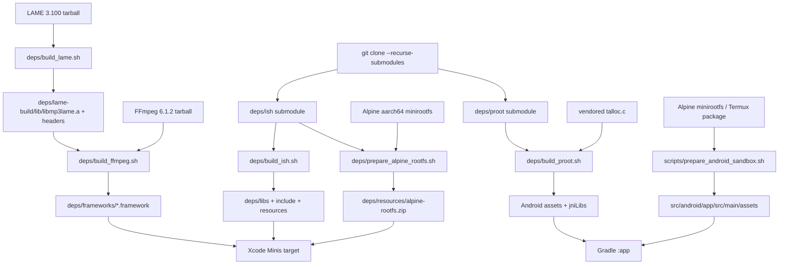

#### 15.3.2 为什么不提交二进制

iOS 目标架构和模拟器不同：`BUILDING.md:131-135` 明确脚本产出的是 device arm64，直接拿来链接 simulator 会得到架构错误。Android 也在 `BUILDING.md:159-160` 限定 arm64-v8a。把产物提交进仓库会掩盖这些差异，且难以审计 FFmpeg 的 LGPL 配置；`BUILDING.md:230-235` 还要求保留第三方 LICENSE。正确做法是提交版本固定、下载地址、配置参数和验收步骤，把二进制视为缓存。

---

### 15.4 构建期定制：公开模板，不公开实际值

iOS 模板 `src/ios/Configs/ProviderCustomization.xcconfig.example:1-18` 要求复制为同目录的 `ProviderCustomization.xcconfig`，再把 target 的 base configuration 指向它；唯一示例字段是 `ANTHROPIC_OAUTH_IDENTIFIER_PROMPT`。模板说明空值允许编译，但对应功能运行时才失败（`ProviderCustomization.xcconfig.example:8-18`）。Android 对应模板 `src/android/app/provider-customization.properties.example:1-15`，同样只提交空字段。

Android 的加载过程在 `src/android/app/build.gradle.kts:11-23`：读取 `app/provider-customization.properties`（存在才加载），缺失键值变成空字符串，并转义双引号；`src/android/app/build.gradle.kts:44-50` 通过 `buildConfigField` 注入 `BuildConfig.ANTHROPIC_OAUTH_IDENTIFIER_PROMPT`。这是一条“构建时生成常量”的路径，不是运行时从网络拉配置。

公开仓库不带真实值有三层理由：

1. API key/OAuth prompt 可能属于私有发行配置，提交会造成泄漏；
2. 空值仍可构建，只有使用 Claude OAuth 时才需要该 prompt（`BUILDING.md:51-68`）；
3. 定制文件可按开发者/发行渠道切换，不把私有 provider 策略硬编码进开源镜像。

这不是安全保险箱：生成到 binary 的值仍可能被逆向；它只解决“不要把秘密放进 Git”和“不同构建注入不同值”。从零实现时还应配合 CI secret store、签名环境和产物扫描。[推断]

Gradle 还承担两项构建期资源定制：`src/android/app/build.gradle.kts:119-131` 每次 asset merge 前从共享目录复制 bashism 规则；`src/android/app/build.gradle.kts:133-151` 仅在 Debug asset merge 前执行 `scripts/gen_debug_skill_android.sh`。后者把 debug skill 放到 `src/debug/assets`，而不是 `src/main/assets`，因此发布 APK 不会携带调试手册；脚本的理由见 `scripts/gen_debug_skill_android.sh:1-18`。

iOS 对应的 `scripts/gen_debug_skill.sh:1-9` 在 Xcode build phase 生成 `src/ios/Generated/DebugSkillGenerated.swift`，`scripts/gen_debug_skill.sh:27-45` 将 SKILL.md 和三个客户端 base64 编码并包在 `#if DEBUG` 中，只在内容变化时替换，避免无意义重编译。两端的共同抽象是“单一 skill 来源 + Debug-only 资产”，落地差异是 iOS 生成 Swift 常量，Android 复制纯文本文件。

---

### 15.5 App 内 Debug JSON-RPC：把开发工具放进运行时

#### 15.5.1 传输和安全边界

规范 `docs/specs/debug-server-api.md:1-20` 定义 JSON-RPC 2.0 请求形状，并说明 iOS DEBUG build 监听 `http://localhost:8321`、只接受 POST JSON。iOS `src/ios/Debug/DebugServer.swift:1-55` 用 BSD socket bind `0.0.0.0`，默认端口 8321；accept loop 之后用 detached Task 处理连接（`DebugServer.swift:96-135`）。这意味着“localhost”是常用客户端入口，不代表 socket 只绑定 loopback；开发设备上还要考虑局域网暴露。

Android 为了避免与 iOS 工具冲突，实际端口是 5321：`src/android/app/src/main/java/com/openminis/app/debug/DebugServer.kt:16-25` 写明 debug-only 和默认端口 5321，`scripts/gen_debug_skill_android.sh:112-127` 的 curl 示例也明确“Android 5321，iOS 8321”。Android 监听所有接口，但非 loopback 客户端需要 token；`DebugServer.kt:63-77` 将 per-install token 持久化到 `files/debug_server_token`，可用 `adb shell run-as ... cat` 读取。

iOS 的安全隔离由两层构成。第一层是编译隔离：`DebugServer.swift:1`、`DebugAuth.swift:1` 和 `DebugJSONRPC.swift:1` 都在 `#if DEBUG` 内，Release target 根本不应链接/启动。第二层是协议认证：`src/ios/Debug/DebugAuth.swift:6-16` 规定 `/pair`、用户批准、32-byte token、X25519 LAN 包装、HMAC-SHA256-CTR envelope、时间窗和 nonce replay；`DebugAuth.swift:45-49` 给出 30 天 idle TTL、±120 秒时间窗、1024 nonce LRU。服务器先允许无敏感数据的 `/schema` 和 skill GET（`DebugServer.swift:151-199`），再对 `/pair` 或加密 envelope 做认证（`DebugServer.swift:216-258`）。

Android 的认证契约由 `src/android/app/src/test/java/com/openminis/app/debug/DebugServerAuthTest.kt:7-51` 覆盖：loopback 无论 token 正误都放行，远端无 token/错误 token 拒绝，正确 token 放行，空 expected token 也不能意外打开。Android dispatch 对 Shizuku、model-use、sessions、minis-config 方法再次检查 `BuildConfig.DEBUG`，见 `src/android/app/src/main/java/com/openminis/app/debug/DebugRPCHandler.kt:160-198`。这说明“DEBUG-only”必须同时落实在编译源集、server 启动和高风险方法，而不是只靠 UI 隐藏。

#### 15.5.2 请求解析、注册表和扩展方式

iOS `DebugJSONRPC.handle(json:)` 在 `src/ios/Debug/DebugJSONRPC.swift:119-147` 做 JSON parse、`jsonrpc == 2.0`、method 校验和统一错误 envelope；`dispatch` 在 `DebugJSONRPC.swift:152-223` 通过 switch 将名字映射到处理函数。Android 完全对应：`DebugRPCHandler.kt:40-68` 解析和错误转换，`DebugRPCHandler.kt:70-200` 的 `when` 是真实 dispatch 表。

方法注册表不是外部静态文档，而是可查询的运行时 schema。iOS `src/ios/Debug/DebugMethodRegistry.swift:4-25` 定义 `ParamSpec`/`MethodSpec`；`DebugMethodRegistry.swift:27-119` 以 `debug.viewTree`、`debug.search`、`debug.writeFile` 为例声明参数、默认值、返回形状和示例；`DebugMethodRegistry.swift:1100-1115` 的 `discover()` 返回 platform/version/build/methodCount/methods。Android `src/android/app/src/main/java/com/openminis/app/debug/DebugMethodRegistry.kt:17-43` 采用同一结构，`DebugMethodRegistry.kt:795-810` 序列化 discover，且 `methods` 在 `BuildConfig.DEBUG` 时追加 debug-only 方法（`DebugMethodRegistry.kt:39-83`）。

新增方法的最小步骤：

1. 先定义稳定的 namespace、参数和错误码；
2. 在 iOS `DebugJSONRPC.dispatch` 与 Android `DebugRPCHandler.dispatch` 加路由；
3. 在两端 `DebugMethodRegistry` 加 `MethodSpec`，让 `rpc.discover` 自描述；
4. 把 UI/业务逻辑放到 facade，而不是让 RPC 直接改数据库；规范对 provider facade 的约束见 `docs/specs/debug-server-api.md:442-455`；
5. 为危险写入加确认参数/DEBUG guard，并补认证测试；
6. 用同一客户端分别调用 iOS 8321 和 Android 5321，验证错误结构与返回字段。

#### 15.5.3 方法分类表

下表不是臆造的 API 清单，而是由两端 dispatch/registry 的实际分组压缩而来；iOS 注册表的 provider/chat 分组见 `DebugMethodRegistry.swift:590-930`，诊断方法见 `DebugMethodRegistry.swift:522-588`，Android 的对应分组见 `DebugRPCHandler.kt:70-158` 与 `DebugMethodRegistry.kt:318-482`。

|分类|代表方法|用途与教学意义|实现证据|
|---|---|---|---|
|能力发现|`rpc.discover`、`GET /schema`、`GET /skill`|客户端先发现平台、端口、认证和参数 schema；AI coding agent 可自适应版本|`DebugMethodRegistry.swift:1100-1115`；`DebugServer.swift:151-199`|
|视图树/可访问性|`debug.viewTree`、`debug.search`、`debug.inspect`、`debug.highlight`|观察 UIKit/SwiftUI 或 View/Compose semantics，解决“截图看不出层级”|`DebugViewInspector.swift:27-67`；`DebugMethodRegistry.kt:226-263`|
|UI 驱动|`debug.tap`、`debug.inputText`、`debug.scroll`|自动化回归；iOS 优先 accessibilityActivate，坐标点击兜底|`DebugJSONRPC.swift:2411-2530`；`DebugRPCHandler.kt:70-84`|
|截图/视觉诊断|`debug.screenshot`、`debug.screenshot.capture/list/get/clear`|取即时 PNG 或 ring buffer，与滚动视觉 diff 对齐|`DebugJSONRPC.swift:9-96`；`DebugMethodRegistry.kt:284-316`|
|Agent/模型观测|`debug.agentTrace`、`debug.llmRequests`、`debug.providers.quickTest`|看 prompt/tool/响应、token、时延和 provider modality|`DebugJSONRPC.swift:164-175,242-247`；`DebugJSONRPC.swift:2701-2771`|
|文件/guest|`debug.ls`、`debug.readFile`、`debug.writeFile`、`debug.shellExecute`|在真实 Linux guest 内布置 fixture、运行命令、回收 stdout/stderr|`DebugMethodRegistry.swift:84-118,146-156`|
|数据库只读|`debug.db.list/tables/schema/query`|直接检查 session/provider/rootfs 元数据；只读 SQL 限制降低误操作|`DebugMethodRegistry.swift:207-243`；`DebugJSONRPC.swift:222-229`|
|浏览器|`debug.browser.listTabs/pageInfo/executeJS/getReadable/getText/screenshot`|检查 agent 浏览器状态和网页抽取结果|`DebugJSONRPC.swift:230-241`；`DebugMethodRegistry.kt:318-372`|
|日志|`debug.logs.list/read/flush/setEnabled`|切换捕获、读取文件、在复现后强制落盘|`DebugMethodRegistry.swift:337-369`；`DebugRPCHandler.kt:623-627`|
|provider 管理|`provider.types`、`provider.instances.*`、`provider.models.*`、`provider.groups.*`|让自动化配置与 Settings UI 走同一 facade；credential 读操作不返回 key|`DebugMethodRegistry.swift:590-822`；`docs/specs/debug-server-api.md:450-455`|
|chat 管理|`chat.models.list`、`chat.sessions.*`、`chat.messages.list`、`chat.prompt`、`chat.retry`、`chat.compact.*`|自动创建 session、等待响应、取消、压缩与回滚|`DebugMethodRegistry.swift:824-972`；`DebugMethodRegistry.kt:659-772`|
|卡顿/性能|`debug.hangDetector.*`、`debug.perfTrace.*`、`debug.scrollMetrics`|分别定位主线程停顿、业务 span 慢、列表滚动布局漂移|`DebugMethodRegistry.swift:159-166,522-588`|
|专项快照|`debug.markdownSnapshot.*`、`debug.messageListSnapshot.*`、`debug.debugOverlay.*`|将 TextKit/UICollectionView 的几何和 PNG 留在 ring buffer|`DebugMethodRegistry.swift:973-1065`；`DebugJSONRPC.swift:452-552`|
|Android debug offload|`debug.shizuku.exec`、`debug.modelUse.exec`、`debug.sessions.exec`、`debug.minisConfig.exec`|不走交互 shell，直接验证 CLI/offload 端到端；只在 Debug 暴露|`DebugRPCHandler.kt:160-198`；`DebugMethodRegistry.kt:46-83`|

#### 15.5.4 为什么对 AI 辅助开发有价值

一个 AI coding agent 不应只拿截图猜测 UI。它可以先 `rpc.discover`，再 `debug.search` 找到稳定 accessibility id，`debug.inspect` 读取尺寸，`debug.tap` 驱动动作，`debug.screenshot.capture` 留下证据，最后读取 `debug.llmRequests` 或 `debug.agentTrace` 将 UI 失败与模型请求对齐。iOS `DebugViewInspector` 特别处理 SwiftUI accessibility-only 节点：`DebugViewInspector.swift:93-160` 把它们以 `AX.` 节点合并进 UIKit 树，避免纯 subviews walk 看不到 `Text/Button`；iOS tap 还会从 cell/ancestor 逐级选择，证据在 `DebugJSONRPC.swift:2439-2494`。这正是“语义驱动自动化”比盲点坐标可靠的原因。

会话模拟器进一步把网络不确定性拿掉。`src/ios/Debug/SessionDataSimulator.swift:5-35` 说明它把 Copy Session Data JSON 重放到 `AIChatViewModel`，按字符 tick 模拟 streaming；`SessionDataSimulator.swift:55-121` 解析 user/assistant、text/tool_use/tool_result 和 token usage；`SessionDataSimulator.swift:148-187` 提供 mixed、manyMessages、longContent、toolHeavy、streaming、travelPlanning、healthData 场景。这样 UI 测试可以稳定复现长 Markdown、工具块和流式滚动，不需要真实 API key。

---

### 15.6 崩溃、卡顿与符号化：把“死了”变成可行动证据

#### 15.6.1 iOS：launch marker + MetricKit + hang RPC

`src/ios/Diagnostics/CrashReporter.swift:8-33` 将 crash reports 放到 Library/Logs，与运行日志统一；同时在 Application Support 保存 `last_hang_snapshot.txt`、`last_crash_stack.txt`。`CrashReporter.swift:37-57` 保留 20 行 log ring；`CrashReporter.swift:86-103` 在启动安装 signal handler、检查 stale marker、注册 MetricKit subscriber，在正常终止时移除 marker。`CrashReporter.swift:105-185` 更新 marker 时记录内存、活跃 session、shell、后台任务、音频 keep-alive、最近 API 和 WebView tab，给“前景崩溃还是后台 Jetsam”提供上下文。

DEBUG 卡顿路径由 `DebugMethodRegistry.swift:522-546` 暴露：hang detector 默认阈值 100ms、ring buffer 64 个事件；dump 返回 timestamp、duration、runLoopActivity 和 frames。PerfTrace 则在 `DebugMethodRegistry.swift:557-588` 记录超过 16ms 的业务 span，并有 throttle window。二者的分工是“系统线程停在哪里”与“哪段业务 closure 把它拖慢”。

`scripts/symbolicate_hang.py:47-90` 自动从 `~/Library/Developer/Xcode/Archives` 找最新 `Minis.app.dSYM`，把 Minis image offset 批量交给 `atos -arch arm64`；`symbolicate_hang.py:93-132` 将每个事件按时间、持续时长和 frames 格式化；`symbolicate_hang.py:147-163` 可从 live debug server 拉 dump，默认端口是 5321（与 Android 默认相同）。`symbolicate_hang.py:166-220` 还支持 JSON 文件、`--dsym` 覆盖和没有 dSYM 时的明确警告。教程要强调 offset 必须匹配同一 build 的 dSYM，否则输出看似完整但符号错误。

#### 15.6.2 Android：ACRA 文件化、launch beacon 和频率降级

Gradle 只引入 `acra-core`，不引入 HTTP sender，见 `src/android/app/build.gradle.kts:216-219`。`src/android/app/src/main/java/com/openminis/app/crash/CrashFileReporter.kt:14-26` 说明 ACRA 只写本地文件；`CrashFileReporter.kt:27-54` 将 Java/Kotlin stack trace、版本、Android/device 和最近 200 行 logcat 写入 `filesDir/logs/crash-*.log`；`CrashFileReporter.kt:64-73` 通过 service loader 注册 sender，并运行在 ACRA reporter process。

`LaunchCycleBeacon` 的设计目标见 `src/android/app/src/main/java/com/openminis/app/diagnostics/LaunchCycleBeacon.kt:7-22`：每次启动写一小行 beacon，不滚动历史；下一次启动用“无 clean-exit、无 crash log、上次 tick 最近且在前台”区分 MIUI/LMK 清理和真正崩溃。这是 Android 特有的进程被系统回收观测补丁。

**CrashFrequencyDetector 的真实降级策略。** 不能把它简化成“弹窗分享日志”。源码 `src/android/app/src/main/java/com/openminis/app/crash/CrashFrequencyDetector.kt:32-73` 的参数是：扫描最近 1 小时内 `crash-*.log`/`native-crash-*.log`，阈值 `THRESHOLD=2`；达到阈值进入 safe mode，并设置 force-home grace 1 小时；用户 Not now 后抑制提示 24 小时。`CrashFrequencyDetector.kt:204-280` 在 Application 启动过滤 dismissed timestamp，达到 2 个 recent crash 后先 `setSafeMode(true)`，再持久化 `force_home_until`，避免 session restore 立刻重触发。

频率检测之后的降级是三件事：

1. **阻断危险恢复路径**：safe mode 在对话/重载初始化前打开，等分享对话结束才清除（`CrashFrequencyDetector.kt:283-353`）。
2. **改变下一次落点**：force-home grace 使启动解析器绕过“打开上次 session”偏好，避免把用户送回同一崩溃 session（`CrashFrequencyDetector.kt:157-178`）。
3. **分享而非上传**：crash 最近 24 小时最多 10 个，日常日志最近 3 天默认不勾选（`CrashFrequencyDetector.kt:355-425`）；之后 zip 到 cache，并走 Email/Share/Save（`CrashFrequencyDetector.kt:615-669,881-913`）。

此外，Android 的生产卡顿 circuit breaker 在 `src/android/app/src/main/java/com/openminis/app/diagnostics/HangDetector.kt:41-110`：heartbeat 每 1s，3s 未响应算 hang，3 次 force home，2 次就把 streaming Markdown 降级成 plain text，quiet 10s 后重置。`HangDetector.kt:201-260` 按 episode 计数，但每 3s 中途重采样；`HangDetector.kt:271-307` 将 main stack 写入 `stall-YYYY-MM-DD.log`；`HangDetector.kt:310-334` 持久化 count，并在 count=2 激活 render breaker、count=3 提供 launch breaker。这个“渲染降级早于回首页”是为防止系统在第 2～3 次之间直接杀进程的工程取舍，代码注释给出了历史 ANR-loop 依据（`HangDetector.kt:68-76`）。

---

### 15.7 日志：分级、落盘、限流、导出

#### 15.7.1 iOS 日志路径

`src/ios/Shared/AppLogger.swift:3-35` 提供 DEBUG、INFO、NOTICE、WARN、ERROR、CRIT、FAULT；DEBUG 在 Release 编译时完全不构造字符串（`@autoclosure`），INFO/WARN/ERROR 同时进入 `CrashReporter` 的 ring，NSLog 仍保留控制台可见性。`src/ios/Shared/LoggingManager.swift:3-22` 把日志放到 Library/Logs，并由 `UserDefaults(loggingEnabled)` 恢复开关。

捕获实现是 stdout/stderr pipe：`LoggingManager.swift:94-128` 保存 fd、重定向到 pipe、打开当天文件并启动 reader；`LoggingManager.swift:165-207` 以 4KB chunk 读，再异步交给 utility writer queue，不阻塞产生日志的主线程。高频 shell 输出可能堆积，因此 `LoggingManager.swift:43-63,178-206` 把待写 bytes 限制为 8MB，超出就丢磁盘 chunk、保留 console tee，并在恢复后写一行 dropped summary；这比因日志内存队列无限增长而导致 App abort 更安全。

落盘还要受大小和寿命约束：`LoggingManager.swift:316-348` 单文件超过 100MB 就保留后半段，日轮转时按 15 天清理；`LoggingManager.swift:396-420` 实现截断；`LoggingManager.swift:424-476` 按 running/crash/other 分类列出并以 2MB 上限读取尾部，避免用户打开巨型日志再次 OOM。用户删除当天文件后，`LoggingManager.swift:478-508` 关闭旧 fd，修复“unlink 后继续写 zombie file”的坑；`LoggingManager.swift:515-568` 提供 raw line 和 flush/flushSync，崩溃前可强制 fsync。

#### 15.7.2 Android 日志路径

`src/android/app/src/main/java/com/openminis/app/logging/AppLogger.kt:20-77` 使用 `files/logs/`、`minis-yyyy-MM-dd.log`、15 天保留，开关写入 SharedPreferences；`AppLogger.kt:79-120` 同时重定向 stdout/stderr 和启动 `LogcatTailer`，并可恢复原始 PrintStream。`AppLogger.kt:123-147` 过滤自身 `Minis.*` tag，避免 logcat tail 与直接写入重复；`AppLogger.kt:256-291` 以 INFO/WARN/ERROR/DEBUG 分级写 logcat 和文件。

Android 的用户导出由 Settings/Debug RPC 读取：`AppLogger.kt:293-353` 提供 capped metadata、按名字读取；`AppLogger.kt:357-386` 清空日志时关闭 writer，避免“删除了文件但 writer 仍写不可见 inode”。ACRA crash log 和 stall log 复用同一目录，因此 LogManagementScreen 能统一展示，`CrashFileReporter.kt:14-19` 明确这一约定。

日志脱敏不能靠“用户不会分享”。请求方法的注册表明确 credential 是 write-only，`docs/specs/debug-server-api.md:450-455`；LLM request 规范还要求 `requestHeaders` 排除 Authorization/x-api-key、SSE body 上限 64KB（`docs/specs/debug-server-api.md:360-405`）。实际导出前仍应检查 prompt、URL query、tool output、环境变量和文件内容；代码中已经存在“日志字段可含业务上下文”的事实，因此从零实现必须设计结构化 redactor，而不是只删 header。[推断]

---

### 15.8 测试策略：纯逻辑、UI 视觉、真机 guest 三层

#### 15.8.1 iOS

`src/ios/MinisTests/` 当前以 provider wire/OAuth、上下文策略、tool preflight/loop、文本分段、思考级别、语音输入与纠错为主；例如 `ToolPreflightTests.swift:3-109` 验证字段缺失、JSON null、空字符串白名单和未知工具；`TestSupport_AppLogger.swift:3-18` 说明测试 target 用轻量 AppLogger shim，避免把 MetricKit/后台依赖整棵树链接进单测。

`src/ios/MinisUITests/MessageListV3UITests.swift:180-192` 说明 UI 目标：长内容、多消息 lazy-load、streaming auto-scroll、fling deceleration。它没有只断言“页面存在”：`MessageListV3UITests.swift:31-178` 将截图转灰度、计算像素 diff、识别 diff velocity 突变和 freeze-then-jump stutter，作为视觉 jitter gate。`SessionDataSimulator.swift:150-187` 的内置场景使这些测试可重复。

明显空白也要写出来：当前公开测试清单没有证明每个 DEBUG RPC 方法、真实 iSH mount/guest command、iCloud/LAN sync、所有 native signal/MetricKit 报告都被自动化覆盖；`DebugJSONRPC` 的 codegraph 关系也显示 RPC 没有直接覆盖测试。[推断] 这些适合用 Debug RPC + device UI harness 补，而不是把 API key 测试塞进单测。

#### 15.8.2 Android

JVM `src/android/app/src/test/` 覆盖 provider（Anthropic/Gemini/OpenAI）、speech/correction、UI 文本/表格、tool preflight、配置确认、ChatRepository、OAuth、bashism、debug auth 等；`DebugServerAuthTest.kt:7-51` 是协议安全的边界测试。它们不需要设备，适合快速回归 parser、状态机和纯策略。

`src/android/app/src/androidTest/` 的 `sandbox/` 五个测试明确是真机/模拟器路径：`PRootKernelInstrumentedTest.kt:14-20` 测 boot、command building、bind mount、path resolution；`ExecutionCoordinatorInstrumentedTest.kt:16-21` 测 session mount switching、command serialization、lifecycle；`RootfsManagerInstrumentedTest.kt:17-22` 测 rootfs 安装、目录/session dirs、reset；另有 `TerminalSanitizerInstrumentedTest.kt` 和 `ShellExecutorInstrumentedTest.kt`。因此 Android 沙箱不是只 mock PRoot，而是被 connected instrumentation 作为设备级 contract 测过。

Android 的测试空白包括：真实不同 OEM 的后台回收、真实 NDK signal handler、ACRA reporter process 交接、网络切换下长 SSE、Release 混淆后 Debug RPC 不可见，以及 i18n 全部语种的视觉布局。[推断] 从零项目应把这些列为 device farm/发行 smoke，而不是只增加 JVM case 数量。

最小测试金字塔：

|层级|iOS|Android|验收|
|---|---|---|---|
|纯函数/协议|XCTest provider、token、文本、preflight|JUnit provider、auth、sanitizer、bashism|无设备、快速、错误输入有明确断言|
|UI/渲染|XCUITest + SessionDataSimulator + screenshot diff|Compose/UI instrumentation + screenshot/semantics|长消息、流式、旋转/语言切换不抖动|
|真实沙箱|[当前清单未见等价 iOS connected sandbox suite，需补]|PRoot/Rootfs/ExecutionCoordinator instrumentation|能 boot guest、写文件、执行命令、reset 后重装|
|诊断回归|DEBUG hang/perf/snapshot RPC|Debug RPC + ACRA/HangDetector log path|能拉到日志/栈，不影响 Release|

---

### 15.9 i18n：七种界面语言，不等于强制 Agent 七种输出

iOS bundle 的 `Info.plist` 声明 `en、zh-Hans、zh-Hant、ja、ko、fr、de`（`src/ios/Info.plist:7-12`），目录也实际存在这七个 `.lproj`。权限文案示例位于 `src/ios/en.lproj/InfoPlist.strings:1-21`，包括 HealthKit、Calendar、Contacts、HomeKit、相机、照片和麦克风；这些是系统授权弹窗所需的 UI/审核文案，不是发给模型的 prompt。

Android 用 `res/values*/strings.xml` 资源覆盖：基础 `values/strings.xml:1-43` 是中文，`values-zh/strings.xml:1-83` 是英文 fallback（仓库命名与内容需要在维护时保持一致），并存在 `values-de`、`values-fr`、`values-ja`、`values-ko`、`values-zh-rTW`、`values-ru`。因此“七种语言”是 iOS 的已核实 bundle 集合；Android 资源目录还多出俄语，不能把两端语言数量擅自写成相同。[推断]

Android 13+ 交给 `LocaleManager.applicationLocales`；Android 12 及以下由 `LocaleWrap.wrap` 在 `Activity.attachBaseContext` 改写 Configuration（`src/android/app/src/main/java/com/openminis/app/i18n/LocaleWrap.kt:11-29,30-60`）。这解决系统 ActionMode 的 Cut/Copy/Paste 不跟随应用语言的问题，而不是只替换 Compose 文本。`MainActivity.kt:110-117` 负责在旧版本调用 wrapper，`MainActivity.kt:526-532` 在新版本同步 applicationLocales。

Agent 输出语言是另一条合同：iOS system prompt 在 `src/ios/Agent/Chat/AIChatViewModel.swift:1799-1801` 要求默认使用用户输入语言；工具标题 schema 也要求跟随用户语言（`src/ios/Agent/Chat/AIChatViewModel+ToolDefinitions.swift:21-24`）。标题生成进一步读取显式 `appLanguage`，再 fallback 到 bundle locale/系统 locale，并把界面语言注入双语 prompt，证据在 `src/ios/Agent/Chat/AIChatViewModel+TitleGeneration.swift:402-434`。如果 SOUL.md 的 style 指定回复语言，它优先于“匹配用户输入”默认规则（`src/ios/Agent/Session/SoulStore.swift:445-450`；Android 对应 `src/android/app/src/main/java/com/openminis/app/agent/SoulStore.kt:481-484`）。

教学要点是：

- UI string 用平台资源系统；
- Agent 回复由输入语言、用户 style、标题注入和 provider 能力共同决定；
- 不要把 `String(localized:)` 或 `R.string` 的翻译自动拼到 system prompt；
- TTS/ASR 语言还另有 `SpeechRecognitionManager`/Voice provider 解析，不能用 UI locale 代替。

---

### 15.10 CI 现实：镜像仓库缺少 workflow，质量门禁要主动补

本仓库 `.github/` 实际只有 `pull_request_template.md` 与 `ISSUE_TEMPLATE/bug_report.md`，不存在 `.github/workflows/` 文件；因此不能声称已有 GitHub Actions 构建、测试或发布流水线。当前可见质量门禁分散在源码和脚本：Android 的 `src/android/app/src/test`、`src/android/app/src/androidTest`，iOS 的 `MinisTests`/`MinisUITests`，以及共享 bashism 的独立规则/向量（复制任务在 `src/android/app/build.gradle.kts:119-131`）。

这是一项工程风险：没有 workflow 就没有自动执行的“依赖脚本可重建、Debug RPC 不进 Release、两端单测通过、资源完整”的门槛。仓库文档仍给出本地命令：Android `./gradlew :app:testDebugUnitTest` 与 `connectedAndroidTest`（`BUILDING.md:193-198`），iOS 目标/测试 target 列于 `BUILDING.md:137-140`；但本地命令不是 CI 证据。

从零实现时，第一版 CI 至少应拆成：

1. 静态检查：shell `bash -n`、Python `py_compile`、Gradle configuration、Swift/Kotlin 编译；
2. 快速单测：iOS XCTest 与 Android JVM test；
3. 设备/模拟器 job：Android connected instrumentation、iOS UI smoke；
4. 构建产物审计：Release 中没有 debug server/debug skill，APK 只有 arm64，framework 列表和 license 文件齐全；
5. 可选 native cache：cache 只缓存版本化产物，cache miss 必须仍能从脚本重建；
6. 失败上传：保存 ACRA/stall/log、XCTest screenshot 和 symbolication 输入，而非只留下 exit code。

这部分是本章唯一明确的“需要读者补齐”的平台工程，不应伪装成仓库现状。

---

### 15.11 设计取舍与踩坑

#### 15.11.1 构建与依赖

- **静态/动态边界要显式。** LAME 是静态库给 FFmpeg configure 探测；FFmpeg 最终包装为动态 framework；iSH 三个静态库直接给 Xcode link。混用输出目录或手工 copy 会让 linker 错误难以定位（`deps/build_lame.sh:77-89`、`deps/build_ffmpeg.sh:374-395`、`deps/build_ish.sh:248-261`）。
- **设备 arm64 与 simulator 分开。** 不要把 `iphoneos` 产物添加到 simulator scheme（`BUILDING.md:131-135`）。扩展 macOS/Windows/Linux 时应为每个平台提供独立 toolchain/output namespace。[推断]
- **rootfs 有格式契约。** iSH 需要 fakefs `data + meta.db`（`deps/prepare_alpine_rootfs.sh:178-184`）；Android PRoot 只需要 tar.gz，不能把两种资源互换。
- **脚本缓存不是依赖管理。** LAME/Alpine cache 通过文件存在性判断（`deps/build_lame.sh:49-61`、`deps/prepare_alpine_rootfs.sh:99-114`），实际生产应再校验版本、哈希、架构和签名。[推断]

#### 15.11.2 Debug RPC

- **绑定所有接口但必须认证。** iOS `INADDR_ANY`（`DebugServer.swift:22-45`）和 Android all-interface 设计方便 LAN/adb，但把 RELEASE 误启动会成为远程任意 shell/UI/配置入口；必须由 `#if DEBUG`、`BuildConfig.DEBUG`、启动调用三重保护。
- **地址不是稳定 ID。** iOS registry 说明 view address 来自上一轮 tree/search，SwiftUI 重绘后会失效（`DebugMethodRegistry.swift:55-61`）；自动化应优先 accessibilityIdentifier/label/text，再使用 address。
- **避免大响应 OOM。** iOS RPC serializer 对 ObjC exception 做兜底（`DebugJSONRPC.swift:2558-2580`）；readFile 设 limit，规范建议 512KB 默认（`DebugMethodRegistry.swift:95-104`）。截图和 markdown snapshot 都用 ring buffer（`DebugJSONRPC.swift:9-60`、`DebugMethodRegistry.swift:973-1005`）。
- **写方法要确认和 facade。** provider delete、session delete 等 registry 都要求 confirm；RPC 不应直接碰 Keychain/SQLite，规范要求 facade 保持 UI 与自动化同语义（`docs/specs/debug-server-api.md:442-455`）。
- **跨平台不要假装完全相同。** iOS 是加密 envelope + 8321；Android 是 plaintext + loopback exemption/token + 5321。共享客户端必须先读 schema/skill，而不是写死一个端口/协议（`DebugServer.swift:151-159`、`DebugServer.kt:257-270`、`gen_debug_skill_android.sh:11-15`）。

#### 15.11.3 崩溃与日志

- **观测系统本身不能制造卡顿。** iOS writer queue 有 8MB backpressure（`LoggingManager.swift:43-63`），Android logger flush 与 logcat tail 也包围 I/O（`AppLogger.kt:90-120,205-220`）。
- **降级要可恢复。** Android hang count quiet 10s 清零，手动 reset 也恢复 Markdown（`HangDetector.kt:144-186`）；CrashFrequencyDetector 的 24h suppress 只抑制提示，force-home 仍有 1h grace（`CrashFrequencyDetector.kt:51-73,157-178`）。
- **导出是用户动作。** ACRA 不上传网络，用户勾选 crash/daily logs 后 zip/share（`CrashFileReporter.kt:21-26`、`CrashFrequencyDetector.kt:381-425`）；这符合隐私和无额外网络权限取舍，但也意味着没有自动云端 crash 聚合。[推断]
- **符号化需要 build 对应物。** `symbolicate_hang.py` 找 dSYM 失败时只输出 raw offset 警告（`symbolicate_hang.py:201-211`）；发行流程必须保存 dSYM 与版本/Build number。

#### 15.11.4 测试与本地化

- **真沙箱必须有 instrumentation。** PRoot/Rootfs 测试的 `@RunWith(AndroidJUnit4::class)` 和 connected 命令注释（`PRootKernelInstrumentedTest.kt:14-20`）是与 JVM mock 的边界。
- **测试代码也要隔离依赖。** iOS AppLogger shim（`TestSupport_AppLogger.swift:3-18`）避免测试 target 因生产 CrashReporter 依赖链无法编译。
- **字符串翻译不是 Agent policy。** UI locale 由资源和 Configuration 管，Agent 语言由 system prompt/SOUL/输入推导，证据见 `AIChatViewModel.swift:1799-1801` 和 `SoulStore.kt:481-484`。

---

#### 15.11.5 从脚本到可交付产物的验收矩阵

把脚本“运行结束”当成成功是不够的。每个阶段都需要可观察的验收点，否则上游缓存可能把损坏产物继续传给下游。下面的矩阵只使用仓库中脚本已经暴露的路径和检查动作。

|阶段|输入|脚本动作|输出|验收信号|常见误判|
|---|---|---|---|---|---|
|LAME|版本 tarball、iPhoneOS SDK|`configure` 静态/PIC、`make install`|`deps/lame-build/lib/libmp3lame.a`、header|`build_lame.sh:96-104` 检查文件并执行 `file`|以 tarball 存在误认为库已安装|
|FFmpeg 配置|FFmpeg 源码、LAME 输出|探测 `libmp3lame.a`，配置 VideoToolbox/LGPL|`ffmpeg-6.1.2/build-ios`|`build_ffmpeg.sh:204-216` 明确打印 MP3 enabled/unavailable|FFmpeg 能编译但无 MP3 encoder|
|FFmpeg 打包|install 下六个 dylib、fftools archive|复制 dylib、修 install name、re-export|`deps/frameworks/lib*.framework` 和 umbrella|`build_ffmpeg.sh:364-372` 找到每个 dylib，`346-355` 清理旧输出|只看到 umbrella，漏掉被 re-export 的 per-library|
|iSH 库|`deps/ish` 子模块、Meson cross file|Ninja 构建三个 `.a` 和 VDSO|`deps/libs`、`include`、`resources`|`build_ish.sh:248-261` 复制库/VDSO|忘记内层 `libapps` submodule|
|iSH rootfs|Alpine minirootfs、native fakefsify|转换、配置 passwd/profile/inittab、压缩|`deps/resources/alpine-rootfs` + zip|`prepare_alpine_rootfs.sh:182-184` 检查 `data`/`meta.db`|把 zip 当作普通 Linux rootfs 解压|
|PRoot|NDK、talloc.c、`deps/proot`|编译静态 talloc、make proot、strip/objdump|assets 与 `libproot.so`|`build_proot.sh:273-285` 检查 built 文件和 aarch64|只安装 assets，不同步 jniLibs|
|Android Alpine|Alpine URL、Termux `.deb`|下载、ar 解包、提取 data archive|`src/android/app/src/main/assets`|`prepare_android_sandbox.sh:69-81` 检查 proot 并 chmod|把下载版和源码版 PRoot 的版本混用|

建议给每个输出增加 manifest（版本、架构、来源 URL、SHA-256），并让 App 启动时在 DEBUG RPC `debug.appInfo` 返回 manifest。仓库当前 `debug.appInfo` 已返回路径、磁盘用量和 guest 状态：Android 实现在 `src/android/app/src/main/java/com/openminis/app/debug/DebugRPCHandler.kt:202-220`，iOS 由 registry 在 `src/ios/Debug/DebugMethodRegistry.swift:168-173` 描述。manifest 是在此基础上扩展可诊断性，而不是另起一套版本系统。[推断]

#### 15.11.6 架构选择如何影响桌面扩展

桌面平台扩展的核心不是复制 iOS/Android 的文件，而是保持上层契约。当前 Agent 层只需要一个能执行 shell、读写 `/var/minis`、提供浏览器/设备工具的 backend；guest backend 可以替换为原生 Linux、WSL、VM 或容器。[推断] 现有代码已经把边界显式化：iOS `debug.shellExecute` 的 registry 参数说明 `stdinScript`、`sessionId` 和 fs_context 路由（`src/ios/Debug/DebugMethodRegistry.swift:146-156`），Android 方法也把 PRoot guest 作为实现细节（`src/android/app/src/main/java/com/openminis/app/debug/DebugMethodRegistry.kt:109-130`）。

扩展桌面端时至少保留四个不变量：

1. 每个 session 的工作目录不能泄露到另一个 session；
2. debug shell 的 stdout/stderr 必须有超时和大小上限；
3. `debug.writeFile` 的 host path 映射必须经过 allowlist，不能把 RPC 变成任意宿主机文件写入；
4. Provider credential 仍只写入 secret store，`provider.instances.list` 只返回 `hasCredential` 等摘要。

这些不变量在 iOS 的 `debug.writeFile` schema（`DebugMethodRegistry.swift:107-118`）、shell timeout（`DebugMethodRegistry.swift:146-156`）和 provider write-only 约束（`docs/specs/debug-server-api.md:450-455`）中已有可迁移的文字契约。迁移到桌面时应先复用 schema 和错误码，再替换 transport 与 sandbox。[推断]

#### 15.11.7 网络可观测性与日志隐私

网络问题在 Agent 中往往表现为“模型不回话”，但根因可能是 DNS、VPN、代理或连接池里的死 HTTP/2 socket。iOS `src/ios/Shared/NetworkMonitor.swift:17-35` 在第一次 callback 之前立即 `ISHKernel.shared.refreshDns()`，避免 guest 启动早期拿到空 resolv.conf；`NetworkMonitor.swift:45-78` 对每次 NWPath 更新刷新 DNS，但只有 interface set 变化才 evict LLM connection pools，防止信号强度抖动打断流式请求。这个判断应出现在故障手册中，而不是让用户反复重试。

同一个监视器还会 dump CFNetwork proxy/PAC 信息（`NetworkMonitor.swift:81-129`），包括 HTTP/HTTPS/SOCKS host、port、PAC URL 和对 Anthropic URL 的实际代理探测。这里存在隐私风险：代理 host、URL 以及可能的 VPN 字段会进入日志；导出前应做 host/query redaction。[推断] Android 的 `debug.fetch` 则可以并行做 DNS、HttpURLConnection、OkHttp 和 proxy selector 探测，注册表说明见 `src/android/app/src/main/java/com/openminis/app/debug/DebugMethodRegistry.kt:207-224`。

网络诊断的最小实验顺序：

1. 调 `debug.appInfo`，确认 guest 已 boot、日志路径可写；
2. 调 `debug.fetch`/读取 iOS network log，区分 DNS、代理、HTTP status；
3. 读取 `debug.llmRequests`，确认 request 已发出还是在本地 session 阶段阻塞；
4. 仅当 interface set 变化时重试，避免用无效重试掩盖连接池失效；
5. 导出时删 Authorization、API key、Cookie、代理 credential 和用户 prompt 中的秘密。

---

### 15.11.8 质量工程中的“可观察验收”

每个功能都应有一个从外部可观察的验收动作，而不是只检查内部函数返回值：

|功能|外部动作|应观察到的结果|失败时读取|
|---|---|---|---|
|native build|执行脚本后查看产物目录|版本/架构正确、下游能找到|脚本 stdout、`file`/objdump、`debug.appInfo`|
|provider 注入|空配置构建、调用需要 OAuth 的功能|编译成功，运行时明确报缺值|BuildConfig/运行日志|
|视图树|`rpc.discover` → `debug.search`|返回语义节点和稳定 identifier|截图、viewTree、inspect|
|UI action|按 identifier tap，再读 session|状态改变而非只有坐标事件|agentTrace、message snapshot|
|流式 UI|SessionDataSimulator streaming|内容逐步增长、滚动不跳|截图 diff、scrollMetrics、PerfTrace|
|guest shell|write fixture → shellExecute → read|host/guest 看到同一个文件|shell stdout/stderr、rootfs meta|
|崩溃降级|模拟两份近期 crash log 后冷启动|safe mode、force home、可分享|CrashFrequencyDetector logs|
|卡顿降级|触发 hang episode|stall log、render breaker 或 home|`stall-*`、HangDetector count|
|日志导出|开启 logging、生成输出、读取/分享|按天文件可读且不重复|`debug.logs.list/read/flush`|
|语言切换|切换 app locale 后重建 Activity|UI 资源切换，Agent 回复规则仍独立|LocaleWrap、title prompt、session|

这个表可直接转成 acceptance test 的名字。它也暴露当前仓库的空白：iOS 真实 guest shell 与 Android Release 不暴露 debug RPC 的 end-to-end 验收没有出现在已列测试文件中。[推断]

---

### 15.11.9 调试服务器的生命周期坑

iOS 不能只在 App 首次启动时 bind 一次。`src/ios/Debug/DebugServer.swift:65-92` 说明长期后台后 accept queue 可能被系统拆掉，TCP connect probe 甚至会在 backlog 中完成而误报健康；实现选择 foreground transition 时无条件 close + re-bind。`DebugServer.swift:107-124` 还区分 EBADF/EINVAL/ENOTSOCK 等永久错误和 ECONNABORTED 等临时错误，避免 accept 失败时 100% CPU busy-spin。`DebugServer.swift:126-135` 把连接交给 Task，避免 async RPC 堵住 GCD worker。

这三个细节是从零实现时最容易遗漏的验收：

- 从 background 回 foreground 后，客户端重新 GET `/schema` 能成功；
- 反复发 malformed HTTP 不会让 accept loop 占满 CPU；
- 同时发多个慢 `chat.prompt` 时，新连接仍能进入 dispatch。

Android 也需在 Activity 生命周期保持 `currentActivity` 的弱引用，否则 screenshot 会持有旧 Activity 或在无前景 Activity 时崩溃；`DebugRPCHandler.kt:35-38` 将它定义为 `WeakReference<Activity>`，`DebugRPCHandler.kt:230-250` 在没有 active Activity 时返回明确 RPC error。

---

### 15.11.10 版本化协议和向后兼容

`rpc.discover` 同时返回 platform/version/build/methodCount（iOS `DebugMethodRegistry.swift:1100-1109`，Android `DebugMethodRegistry.kt:795-805`），这让客户端能够根据能力而不是 OS 版本选择方法。方法新增应采用 additive change：保留旧字段、对可选参数给默认值、未知方法返回 `-32601` 并提示调用 discover（iOS `DebugJSONRPC.swift:447-449`，Android `DebugRPCHandler.kt:198-200`）。删除或改变返回字段则需要更新 skill、两端 registry 和测试。

安全协议也要版本化。iOS envelope 以 `v=1` 判断（`DebugAuth.swift:127-133`），Android 使用 schema 中的 `auth=token-lan` 描述 plaintext + token（`DebugServer.kt:257-270`）。不要让客户端猜测“看到 JSON 就是同一种协议”；应先读 schema，再按 auth 字段走 pairing/token。这样未来把桌面端接入同一学习手册时，可以新增 `auth` scheme 而不破坏 iOS/Android 客户端。[推断]

---

### 15.11.11 失败证据的最小保留集

一个可靠的 bug report 至少应包含：App version/build、设备/OS、最近 20 行 ring、对应 daily log 尾部、session id（必要时脱敏）、最近一次 provider/model、guest 状态、截图或 viewTree，以及 native/Java/Swift stack。iOS launch marker 已记录这些上下文中的大部分（`CrashReporter.swift:105-185`）；Android `debug.appInfo` 返回 SDK/device/proot/log size（`DebugRPCHandler.kt:204-220`），ACRA sender 记录版本/device/stack/logcat（`CrashFileReporter.kt:34-51`）。

不应默认保留完整 API body 或用户文件。规范只允许 LLM request 中保留去掉 Authorization/x-api-key 的 header，并把响应 body 限到 64KB（`docs/specs/debug-server-api.md:401-405`）；其余字段应在导出流程明确提示用户并支持逐项勾选。CrashFrequencyDetector 的 crash 默认勾选、daily run log 默认不勾选是一个可复用的隐私 UX（`CrashFrequencyDetector.kt:381-423`）。

---

### 15.11.12 本章代码阅读路线

如果读者要在陌生仓库复刻这套工程，可按以下顺序阅读：

1. 先读 `BUILDING.md:1-111`，得到平台依赖图和输出目录；
2. 读 `build_lame.sh:68-104` 与 `build_ffmpeg.sh:204-271`，理解可选依赖“警告但继续”的顺序坑；
3. 读 `build_ish.sh:144-226`、`prepare_alpine_rootfs.sh:122-187`，区分 guest 库和 guest 文件系统；
4. 读 `build_proot.sh:204-309`、`prepare_android_sandbox.sh:30-82`，比较源码构建与发行包提取；
5. 读 `DebugServer.swift:12-55`、`DebugJSONRPC.swift:119-173`、`DebugMethodRegistry.swift:27-43`，建立 transport/dispatch/schema 三层模型；
6. 读 Android `DebugServer.kt:63-77`、`DebugRPCHandler.kt:40-100`、`DebugMethodRegistry.kt:39-83`，看端口、认证和 DEBUG-only 方法如何落地；
7. 读 `LoggingManager.swift:94-207` 和 `AppLogger.kt:59-147`，比较 pipe/logcat 与 backpressure；
8. 读 `CrashFrequencyDetector.kt:204-280` 和 `HangDetector.kt:201-334`，区分 crash burst 与 hang episode；
9. 读 UI 测试与 sandbox instrumentation 的头部注释，确定哪些测试真的需要设备；
10. 最后读 i18n 的 LocaleWrap、titleLanguageInjection 和 system prompt，防止把 UI locale 当作 Agent policy。

这条路线的价值在于每一步都有一个可执行的观测动作，读者可以在实现下一步前先验证上一层，而不会一次性面对数千行 Agent 业务代码。

---

#### 15.11.13 Debug RPC 与自动化测试的组合协议

最实用的自动化不是“每个 RPC 方法单独测一次”，而是把方法组合成可回放脚本。一个 provider/聊天 UI 回归可以遵循：

```text
rpc.discover
  -> debug.appInfo
  -> provider.types / provider.instances.list
  -> chat.models.list
  -> chat.prompt(wait=false)
  -> chat.session.status（轮询）
  -> debug.screenshot.capture(label=after-reply)
  -> debug.llmRequests(last=1)
  -> debug.logs.flush + debug.logs.read
```

每个箭头代表一个可定位的失败层：discover 失败是 server/认证，provider 失败是配置，prompt 失败是 Agent/provider，screenshot 失败是 UI 生命周期，logs 失败是落盘。iOS registry 的 `chat.prompt` 返回字段和 waitTimeout 见 `src/ios/Debug/DebugMethodRegistry.swift:869-882`；Android 同名方法的 dispatch 在 `src/android/app/src/main/java/com/openminis/app/debug/DebugRPCHandler.kt:145-158`，因此客户端可保持相同流程。

回放脚本必须保存 request、response、timestamp 和 build，而不是只保存“成功/失败”。iOS 每个响应额外放 `_meta`（`src/ios/Debug/DebugJSONRPC.swift:2535-2555`）；Android `rpc.discover` 返回 version/build（`DebugMethodRegistry.kt:795-805`）。保存 build 是为了把截图、hang offset、provider 请求和 dSYM 对齐。

对 UI 操作要采用“查找 → 操作 → 再查找”的闭环：

1. 用 `debug.search` 的 identifier/text 找元素；
2. `debug.tap` 返回 strategy/via；
3. 等待状态变化；
4. 再次 search 或读取 session，而不是假设 tap 一定成功；
5. 失败时抓 screenshot 和 viewTree。

iOS 的 tap 返回 `via`，并把 SwiftUI cell 的 accessibilityActivate 放在 coordinate fallback 前（`src/ios/Debug/DebugJSONRPC.swift:2451-2494`）；Android registry 也明确 `debug.tap` 是 Activity-space 坐标（`src/android/app/src/main/java/com/openminis/app/debug/DebugMethodRegistry.kt:150-180`）。如果只写坐标，屏幕密度、键盘、滚动偏移会使回归 flaky。

#### 15.11.14 真实代码片段：RPC 错误必须可诊断

两端都把协议错误与内部异常分开。iOS `DebugJSONRPC.handle` 捕获 `RPCError`/`DebugRPCErr` 后保持 code/message，未知异常使用 `-32000`（`src/ios/Debug/DebugJSONRPC.swift:138-147`）；Android `DebugRPCHandler.handle` 对应捕获 `RPCException`，未知异常也变成 `-32000`（`src/android/app/src/main/java/com/openminis/app/debug/DebugRPCHandler.kt:60-68`）。最小实现可以保持下面的语义：

```swift
do {
    let result = try await dispatch(method: method, params: params)
    return successResponse(result: result, id: id)
} catch let error as RPCError {
    return errorResponse(code: error.code, message: error.message, id: id)
} catch {
    return errorResponse(code: -32000, message: error.localizedDescription, id: id)
}
```

来源：`src/ios/Debug/DebugJSONRPC.swift:138-147`。关键不是 Swift 语法，而是客户端可以据 `-32600` 修正请求、据 `-32601` 重新 discover、据 `-32602` 修参数，而不是把所有异常都显示成“网络错误”。

危险写操作还应返回可审计字段。iOS provider group delete 先检查 `confirm`，并返回 `wasDefault`、`affectedSessionBindings`（`src/ios/Debug/DebugRPCProviderChat.swift:447-467`）；Android `debug.minisConfig.exec` 明确 actor=`debug-rpc` 并复用 production ConfigBridge（`src/android/app/src/main/java/com/openminis/app/debug/DebugRPCHandler.kt:1142-1185`）。这为审计日志和测试回滚提供了语义，而不是只返回 `{ok:true}`。

#### 15.11.15 资源和构建脚本的安全边界

脚本本身也是供应链代码。`scripts/update_models_dev.sh:1-35` 从 models.dev 下载 JSON，先写 `.tmp`、用 `python3 -m json.tool` 验证，再 `mv` 到 iOS 目标并复制 Android asset；这比直接覆盖线上文件更安全，但没有签名校验，生产流水线仍应加入 HTTPS pinning/hash review。[推断]

`scripts/gen_debug_skill.sh:18-45` 用 base64 处理任意 markdown/code，避免 Swift literal 转义错误；生成文件放在 `Generated` 且被 gitignore。Android 生成器 `scripts/gen_debug_skill_android.sh:26-31,33-110` 在源文件缺失时写入“skill unavailable”占位文本。这个 fallback 适合开发者看到明确缺失，但不应让发布构建静默把它当作完整功能；Gradle 的 task `onlyIf { script.exists() }` 和 DEBUG asset source set（`src/android/app/build.gradle.kts:141-151`）应在 CI 中加断言。[推断]

Android `build.gradle.kts:96-98` 对 `tar.gz` 和 `proot-aarch64` 设置 `noCompress`，让 APK 中的 rootfs/proot 以可直接读取的形式存在；这不是性能装饰，压缩后启动时还要额外解压并可能破坏执行权限。iOS rootfs 则必须作为 bundle resource，再在首次启动解压（`deps/prepare_alpine_rootfs.sh:320-324`）。

#### 15.11.16 测试空白如何转成回归用例

“明显空白”只有变成具体用例，才会在质量门禁里消失。建议新增以下行为测试，而非测试源代码文本：

|空白|回归用例|可观察断言|
|---|---|---|
|iOS RPC 未覆盖|启动 DEBUG App，GET `/schema`，发 malformed/unknown method|HTTP 200/400、JSON-RPC code 正确、Release 无 listener|
|iOS guest 未覆盖|写入 fakefs fixture，调用 `debug.shellExecute`，读取 stdout|退出码、stdout、stderr、timeout 与 guest 路径一致|
|Android Release surface|安装 release APK，扫描 assets/class graph，尝试 5321|端口不监听、debug skill 不在 `src/main/assets`|
|ACRA reporter|在测试进程抛异常，等待 reporter process|出现 `crash-*.log`，内容不上传网络|
|native crash|调用受控 native fault 测试入口|出现 `native-crash-*.log` 且默认 signal handler 恢复|
|频率降级|准备两份一小时内 crash 文件，冷启动两次|safe mode、force-home grace、关闭后能恢复|
|日志洪峰|并发 shell 输出超过 8MB/Android daily log|iOS 有 dropped summary 且 App 不 abort；Android writer 不重复自身 log|
|语言切换|Android 12 与 13 各切换语言，重建 Activity|系统 ActionMode 和 app strings 采用所选 locale|
|符号化|用同一 archive 生成 dump，执行 `--dsym`|Minis frames 解析到函数；无 dSYM 明确 warning|

测试输入应控制在本地 fixture，不把真实 API key、用户联系人或 Health 数据带入 CI。Android rootfs instrumentation 现有测试已经采用 `InstrumentationRegistry` context 和临时目录风格（例如 `PRootKernelInstrumentedTest.kt:1-20`），可沿用这个隔离方式。

#### 15.11.17 本地化资源的维护规则

本地化最容易出现“基准字符串更新了，某个语言漏翻”的漂移。iOS 使用 `.lproj` + `String(localized:)`，Android 使用 `values-*` XML；两端都应把默认资源作为 schema，CI 用脚本比较 name/key 集合，允许翻译文本不同但不允许 key 丢失。[推断]

带参数字符串必须保持占位符数量/类型，例如 Android `memory_revoke_result_removed` 使用 `%1$s`（`src/android/app/src/main/res/values/strings.xml:32-38`），翻译检查需要验证 `%1$s` 没被删除。系统权限描述则要按平台审核要求逐项保留，iOS 英文清单示例在 `src/ios/en.lproj/InfoPlist.strings:3-21`。

Agent-facing 文本不应被资源扫描误判为 UI 缺翻译。iOS system prompt 明确“reply in language matching user's input”（`src/ios/Agent/Chat/AIChatViewModel.swift:1799-1801`），Android Soul style 同样只是 prompt block（`src/android/app/src/main/java/com/openminis/app/agent/SoulStore.kt:481-484`）；这些应由 Agent prompt contract 测试，而不是逐语言翻译检查。标题 prompt 才读取 appLanguage（`src/ios/Agent/Chat/AIChatViewModel+TitleGeneration.swift:402-434`），说明“界面语言影响标题”是显式规则，不是所有回答的隐式规则。

#### 15.11.18 给维护者的变更清单

修改本章涉及的任意文件时，按变更类型执行：

- 改依赖版本：更新脚本常量、下载 URL、manifest、LICENSE、`BUILDING.md` 产物和对应 device smoke；
- 改 RPC 方法：更新两端 dispatch、两端 registry、skill、认证/错误测试和方法分类表；
- 改日志字段：检查敏感字段、导出 ZIP、日志大小/retention、Debug read limit；
- 改 crash/hang 阈值：同时检查 safe mode、render breaker、force home、用户恢复路径；
- 改 UI string：更新所有 locale key、系统权限文案和 screenshot baseline；
- 改 Agent 语言策略：更新 iOS/Android system prompt、SOUL precedence、title/TTS 测试，不要只改翻译 XML；
- 改 CI：必须证明 clean checkout 能重建 native artifact，并把 instrumentation 设备要求写进 workflow。

最后的验收不是“改动文件没有编译错误”，而是能从构建脚本的输出一路追到 App 内 debug/日志，再从失败日志回到对应源码符号和测试。这个闭环才是可扩展到 macOS/Windows/Linux 的工程基础。[推断]

---

#### 15.11.19 一个完整故障的时间线示例

以“Android 用户打开上次 session 后 UI 卡死”为例，工程系统应该产生一条可拼接的时间线：

1. `HangDetector` heartbeat 每秒更新；超过 3 秒没有主线程 tick，`recordHang` 写 `stall-YYYY-MM-DD.log` 并增加持久化 hang count（`src/android/app/src/main/java/com/openminis/app/diagnostics/HangDetector.kt:194-199,310-333`）。
2. 第 2 次 episode 触发 `renderBreakerActive`，streaming Markdown 改为 plain text；这比等待第 3 次才 force home 早（`HangDetector.kt:68-76,324-329`）。
3. 进程被系统杀掉时，ACRA 或 native handler 可能写 `crash-*.log`/`native-crash-*.log`；如果没有 crash 文件，`LaunchCycleBeacon` 在下一次启动帮助判断 LMK/MIUI 清理（`LaunchCycleBeacon.kt:7-22`）。
4. 下一次 `CrashFrequencyDetector.checkAtLaunch` 扫描最近一小时文件；两份以上进入 safe mode 和 force-home grace（`CrashFrequencyDetector.kt:227-277`）。
5. Activity resume 弹出文件选择器；crash 默认勾选，日常运行日志默认不勾选，用户可 Share/Email/Save（`CrashFrequencyDetector.kt:373-425,531-589`）。
6. 开发者拿到 zip 后，用版本/build、stall log、crash log 和 session id 对齐；若需要 UI 几何，则通过 Debug RPC 取 viewTree/screenshot。

同一故障若发生在 iOS，则从 launch marker、CrashReporter ring、MetricKit 或 DEBUG hang dump 起步，再用对应 archive dSYM 运行 `symbolicate_hang.py`。差异在于 Android 的频率策略在生产包自愈，iOS 当前 hang detector 主要是 DEBUG RPC（`src/android/app/src/main/java/com/openminis/app/diagnostics/HangDetector.kt:37-39`），不能把 Android 阈值直接移植到 iOS。[推断]

这个时间线也是测试设计的模板：每一步都可以用 fixture、instrumentation 或 DEBUG-only action 触发，并验证下一步留下了正确证据；不应只测最终弹窗。

#### 15.11.20 章节验收自检

提交章节或实现对应工程功能前，逐项确认：

- 依赖图包含 LAME → FFmpeg，并解释 FFmpeg 没有 LAME 时“能编译但无 MP3”；
- iSH fakefs 与 Android PRoot tar 的输入输出没有混淆；
- xcconfig 和 properties 都说明模板复制、空值编译、运行时失败和不入库理由；
- iOS 8321 与 Android 5321 的端口/认证差异有明确表格；
- RPC 方法分类覆盖 UI、guest、provider、chat、browser、日志、性能和 DEBUG offload；
- `rpc.discover`、registry、dispatch 和 DEBUG guard 的扩展步骤可操作；
- CrashFrequencyDetector 的阈值、窗口、safe mode、force-home、render breaker 和 suppress 行为都有来源；
- iOS/Android 日志的等级、落盘、轮转、限流、导出和敏感字段边界都有来源；
- iOS XCTest/XCUITest、Android JVM/instrumentation 和 sandbox 真机覆盖面/空白都列出；
- iOS 七个 `.lproj` 与 Android `values-*` 的现实差异不被误写成同一集合；
- Agent 回复语言与 UI 翻译、标题语言、SOUL style 的关系被分开解释；
- 明确 `.github/workflows` 缺位，并将补 CI 放进从零实现清单；
- 至少一个流程图能从依赖输入走到 App target，且节点 id 是 ASCII。

如果其中一项只能给出“应该如此”而没有路径、符号和行号，就把它标成 `[推断]` 或继续调查；不要用惯例替代仓库事实。

---

### 15.12 平台对照

|抽象|iOS 实现|Android 实现|差异原因|
|---|---|---|---|
|Native sandbox|iSH ARM64 + fakefs|PRoot + Alpine tar|iOS 无普通 Linux process/ptrace；Android 可用用户态路径重写，权限模型不同|
|依赖构建|bash + Xcode SDK/Meson/Ninja|bash + NDK/make 或下载 Termux 包|工具链和 ABI 不同；两端都只保留 arm64|
|Provider 注入|xcconfig → target build settings|Properties → `customizationValue` → `buildConfigField`|Xcode 与 Gradle 的构建配置模型不同|
|Debug server|DEBUG、8321、X25519/HMAC envelope、iOS UIKit/SwiftUI AX|DEBUG、5321、loopback 豁免 + LAN token、View/Compose semantics|Android skill 明确不复用 iOS 加密客户端（`gen_debug_skill_android.sh:11-15`）|
|方法注册|Swift `MethodSpec` + `[String:Any]`|Kotlin `MethodSpec` + `JSONObject`|保持 `rpc.discover` 形状一致，贴合语言 JSON API|
|UI 驱动|accessibilityActivate → cell delegate → coordinate|Activity 坐标/Compose semantics shallow tree|SwiftUI List activation 需要 ancestor escalation（`DebugJSONRPC.swift:2439-2473`）|
|运行日志|NSLog → pipe → utility writer，100MB 截断，15d|logcat/stdout/stderr tail，daily writer，15d|平台日志 API 和 fd 模型不同，但共享 daily log/导出抽象|
|崩溃|MetricKit + signal handler + launch marker + dSYM|ACRA file sender + native crash log + launch beacon|iOS 有 MetricKit/dSYM；Android 以本地报告和 reporter process 为主|
|卡顿|DEBUG hang detector 100ms + PerfTrace|生产 HangDetector 3s、2 次 plain-text degrade、3 次 force home|Android 生产环境更容易被 ANR/系统回收，需自愈；iOS 目前 production counterpart 未见（`HangDetector.kt:37-39`）|
|UI 本地化|七个 `.lproj`，`String(localized:)`|`values-*`、LocaleManager/LocaleWrap|系统资源机制不同；Agent output policy 另行注入|
|质量门禁|XCTest/XCUITest；仓库无 workflow|JUnit/connectedAndroidTest；仓库无 workflow|镜像仓库缺 CI，需从零补设备 job|

---

### 15.13 从零实现清单

1. **写平台矩阵。** 列目标 ABI、最低 OS、guest 方案、产物目录和许可证；验收是新开发者能回答“哪个脚本产出什么、被哪个 target 引用”。可砍掉桌面端初期的 native codec，但不能砍掉架构/许可证记录。
2. **实现可重建 LAME/FFmpeg。** 先下载固定版本，交叉编译 LAME，检查静态库和 header，再让 FFmpeg 探测它；验收 `ffmpeg -buildconf`/产物中存在 MP3 encoder，且没有 GPL/nonfree flag。可砍掉 fftools umbrella，但必须同步修改 App 调用边界。
3. **实现 guest 依赖。** iOS 构建 iSH static libs、fakefs rootfs；Android 构建 PRoot/talloc、准备 Alpine asset；验收是冷启动后 guest 能执行 `echo`、读写文件。可砍掉 QEMU 备用脚本，不可把 fakefs 当 tar 直接使用。
4. **把产物接入 target。** iOS 配置 library/header/framework/resource search path；Android 配置 assets、jniLibs、CMake 和 ABI filter；验收 clean checkout + script 能得到相同目录结构。可砍掉 release signing 的自动化，但不能手工 copy 未记录。
5. **加构建期配置模板。** 提交 `.example`，真实文件 gitignore/secret store；将 key/prompt 通过 xcconfig 或 `buildConfigField` 注入；验收空值也能编译，使用缺值功能有明确 runtime error。可砍掉 provider 定制字段，但不能提交秘密。
6. **定义 JSON-RPC 2.0。** 先做 parse、error envelope、`rpc.discover`、schema GET；验收错误 JSON 的 code/id 稳定，客户端能发现方法和端口。可砍掉 provider mutation，不能砍掉 discovery。
7. **实现安全隔离。** iOS 使用 DEBUG source guard + pairing/envelope，Android 使用 DEBUG guard + loopback/token；验收 Release 中端口未启动、远端无 token 失败、loopback 测试通过。可砍掉 LAN 功能，不能默认暴露未认证写接口。
8. **实现只读诊断。** 加 viewTree/search/inspect、appInfo、logs、LLM trace、DB read-only query；验收 AI/脚本可以定位控件、取截图、读日志而不接触 API key。可砍掉浏览器和数据库 namespace，不能让日志读取无上限。
9. **实现 UI 驱动与模拟数据。** 语义定位优先，坐标兜底；加入 SessionDataSimulator 的 mixed/long/streaming/toolHeavy fixture；验收不联网也能跑一轮 UI regression。可砍掉复杂 provider mock，不能只用固定坐标。
10. **实现崩溃文件化。** iOS launch marker/MetricKit/signal snapshot + dSYM 工具，Android ACRA file sender/native log/launch beacon；验收故障后下一次启动能解释 crash、LMK、后台终止，且用户可导出。可砍掉自动上传，但要保留本地隐私友好路径。
11. **实现频率降级。** Android 至少有 rolling window、safe mode、force-home 和可恢复 render degradation；iOS 至少有 stale marker 与启动上下文；验收重复 crash 不会把用户送回同一 session，quiet/manual reset 能恢复。可砍掉复杂分享 UI，不可砍掉恢复出口。
12. **实现日志预算。** 分级、daily rotation、15d retention、单文件上限、backpressure、flush、导出前 redaction；验收 shell 输出洪峰不导致 App 崩溃，日志开关关闭后不写盘。可砍掉 logcat tail，但需说明丢失范围。
13. **建立测试金字塔。** 纯逻辑先覆盖 provider/auth/preflight；UI 覆盖长消息/streaming/语言；Android connected 覆盖 PRoot/Rootfs/ExecutionCoordinator；验收真机能 boot guest 并 reset。可砍掉截图 diff 的复杂统计，不能只测 ViewModel。
14. **接入本地化。** 先完成资源 fallback、权限文案、Android 旧版本 LocaleWrap；再在 system prompt 中明确“跟随用户输入/尊重 SOUL style”；验收切换 UI 语言不强迫 Agent 改写用户内容，title/TTS 按各自规则工作。可砍掉未支持语言，不可把 UI 翻译字符串直接塞入 prompt。
15. **补齐 CI（本仓库现状缺位）。** 新增 workflow 执行静态检查、JVM/XCTest、instrumentation、Release debug-surface 审计、native cache miss 重建和失败日志上传；验收 pull request 能阻止“Release 暴露 RPC、Android 沙箱未测、LAME 顺序错误”。这一步是读者必须自己补的工程门禁。

---

### 15.14 关键文件索引

|路径|行数|职责|
|---|---:|---|
|`BUILDING.md`|235|构建顺序、产物、架构、测试和故障排查|
|`deps/build_lame.sh`|105|LAME 3.100 iOS arm64 静态库|
|`deps/build_ffmpeg.sh`|626|FFmpeg 6.1.2、LAME 探测、framework 打包|
|`deps/build_ish.sh`|433|iSH Meson 交叉编译、静态库/头文件/VDSO|
|`deps/prepare_alpine_rootfs.sh`|383|Alpine fakefs 转换、iSH rootfs zip|
|`deps/build_proot.sh`|346|talloc + PRoot NDK 构建与 Android 安装|
|`scripts/prepare_android_sandbox.sh`|86|Android Alpine/Termux PRoot 资产下载|
|`scripts/prepare_rootfs.sh`|380|QEMU Alpine qcow2 备用路径|
|`scripts/install_alpine.sh`|90|QEMU 交互安装 Alpine|
|`scripts/optimize_rootfs.sh`|308|qcow2 挂载、服务优化与清理|
|`scripts/gen_debug_skill.sh`|45|iOS Debug skill base64 Swift 生成|
|`scripts/gen_debug_skill_android.sh`|139|Android Debug-only skill/client 资产|
|`scripts/update_models_dev.sh`|34|校验 models.dev JSON 并同步两端 assets|
|`scripts/symbolicate_hang.py`|224|dSYM/atos 批量符号化 hang dump|
|`src/ios/Configs/ProviderCustomization.xcconfig.example`|17|iOS 构建期 provider 模板|
|`src/android/app/provider-customization.properties.example`|15|Android 构建期 provider 模板|
|`src/android/app/build.gradle.kts`|252|ABI、BuildConfig、assets、ACRA、测试依赖和 Debug skill task|
|`src/ios/Debug/DebugServer.swift`|395|iOS DEBUG socket、HTTP、认证 envelope 路由|
|`src/ios/Debug/DebugAuth.swift`|438|pair、token、HMAC/X25519、replay/TTL|
|`src/ios/Debug/DebugJSONRPC.swift`|2972|JSON-RPC parse/dispatch/诊断处理器|
|`src/ios/Debug/DebugMethodRegistry.swift`|1117|iOS 方法 schema 与 discover|
|`src/ios/Debug/DebugViewInspector.swift`|965|UIKit + SwiftUI AX 视图树和语义查找|
|`src/ios/Debug/SessionDataSimulator.swift`|1076|离线 session/streaming 场景重放|
|`src/android/app/src/main/java/com/openminis/app/debug/DebugServer.kt`|355|Android 5321 server、token、skill GET|
|`src/android/app/src/main/java/com/openminis/app/debug/DebugRPCHandler.kt`|1190|Android JSON-RPC dispatch 与 handler|
|`src/android/app/src/main/java/com/openminis/app/debug/DebugMethodRegistry.kt`|810|Android method schema、DEBUG-only catalogue|
|`src/ios/Shared/AppLogger.swift`|36|iOS 分级 logger 与 CrashReporter ring|
|`src/ios/Shared/LoggingManager.swift`|571|pipe 捕获、writer queue、限流、轮转、导出|
|`src/ios/Shared/NetworkMonitor.swift`|140|网络路径、DNS refresh、连接池 eviction|
|`src/ios/Diagnostics/CrashReporter.swift`|672|MetricKit、signal、launch marker、上下文快照|
|`src/android/app/src/main/java/com/openminis/app/logging/AppLogger.kt`|388|Android logcat/stdout 文件化与 retention|
|`src/android/app/src/main/java/com/openminis/app/crash/CrashFileReporter.kt`|73|ACRA 本地 crash sender|
|`src/android/app/src/main/java/com/openminis/app/crash/CrashFrequencyDetector.kt`|920|1h crash burst、safe mode、force-home、用户导出|
|`src/android/app/src/main/java/com/openminis/app/diagnostics/HangDetector.kt`|335|heartbeat、stall stack、render/launch breaker|
|`src/android/app/src/main/java/com/openminis/app/diagnostics/LaunchCycleBeacon.kt`|257|无 crash 文件时识别 LMK/MIUI 清理|
|`src/ios/MinisTests/ToolPreflightTests.swift`|109|tool 参数边界和空字符串策略|
|`src/ios/MinisTests/TestSupport_AppLogger.swift`|35|测试 target logger shim|
|`src/ios/MinisUITests/MessageListV3UITests.swift`|748|长消息、streaming、截图视觉 jitter|
|`src/android/app/src/test/java/com/openminis/app/debug/DebugServerAuthTest.kt`|52|loopback/LAN token 认证边界|
|`src/android/app/src/androidTest/java/com/openminis/app/sandbox/PRootKernelInstrumentedTest.kt`|285|真机 PRoot boot、bind、path、command|
|`src/android/app/src/androidTest/java/com/openminis/app/sandbox/ExecutionCoordinatorInstrumentedTest.kt`|371|真机 session mount、并发和生命周期|
|`src/android/app/src/androidTest/java/com/openminis/app/sandbox/RootfsManagerInstrumentedTest.kt`|401|真机 rootfs 安装、目录和 reset|
|`src/android/app/src/main/java/com/openminis/app/i18n/LocaleWrap.kt`|75|Android 12 及以下 locale override|
|`src/ios/Info.plist`|约40|iOS 支持语言声明|
|`src/ios/en.lproj/InfoPlist.strings`|20|英文权限/系统文案示例|
|`docs/specs/debug-server-api.md`|1809|JSON-RPC 协议、方法和 provider 约束|
|`.github/`|目录|当前无 workflows，仅 PR/issue 模板；CI 需补齐|


## 16. 跨平台移植：从 iOS/Android 抽到 macOS/Windows/Linux

### 16.1 这一章解决什么问题

前 15 章讲的是"这个 iOS/Android 应用是怎么造的"。这一章回答倒过来的问题：**这套架构里有多少是平台无关的，多少是被移动端强行塑形的，把它挪到桌面端要重写什么、能白拿什么。**

不做这个分析，读者从零开发时最容易犯的错误是两个极端之一：要么一上来就上跨平台框架，结果沙箱、后台执行、系统集成三层全部烂在抽象漏洞里；要么两端各写一遍且不做任何契约固化，半年后两端行为漂移到无法互相验证。OpenMinis 自己选的是第二条路的一个变体——**不共享代码，共享数据与测试向量**——这一章要说清楚它为什么这么选、代价是什么、桌面端该怎么走。

### 16.2 事实先行：这个项目实际共享了多少

`src/shared/` 全部内容：

```
src/shared/bashism/bashism_rules.json          （规则表）
src/shared/bashism/bashism_test_vectors.json   （68 行测试向量）
src/shared/bashism/validate_detector.swift     （70 行独立校验脚本）
```

合计 298 行。对照 iOS 186,750 行 Swift + Android 154,146 行 Kotlin —— **共享率约 0.087%**。

两端**同名文件**（按 basename 匹配 `.swift` 与 `.kt`）有 82 个，占 iOS 唯一文件名 362 个的 22.7%、Android 453 个的 18.1%。这 82 个名字就是"同一概念在两端各实现一遍"的清单：

```
AnthropicProvider  BPETokenizer  BashismDetector  BashismReminder
BrowserHistory  BrowserTabPool  BrowserUseManager  BrowserWebView
ChatModels  ClaudeOAuthManager  ConfigAuditEntry  ConfigAuditLog
ConfigCollection  ConfigConfirmationGate  ConfigError  ConfigField
ConfigRegistry  ContextPolicy  CorrectionAdmission  CorrectionContextBuilder
CorrectionSignalSource  CorrectionStrategy  DebugMethodRegistry  DebugServer
DeepLinkCoordinator  DeviceIdentity  EnvVarPrivacyStore  EnvVarRedactor
FileMentionIndex  GeminiProvider  LLMError  LLMProvider
MCPOAuthController  MinisConfigPermissionStore  MountedFolderCoordinator
NetworkMonitor  OffloadPermissionManager  OnDemandBash  OpenAIProvider
PendingShare  PhoneticNormalizer  RootfsManager  SentenceSplitter
SessionBadgeStore  SessionForkManager  ShareCoordinator  SoulStore
SpeechRecognitionManager  TerminalBuffer  TerminalCanvasView  TerminalEmulator
TerminalInputView  TerminalTypes  TextSegmenter  ThinkingLevelCatalog
ToolLoopDetector  TypedVocabularyBuilder  VocabularyFilter  VoiceCorrectionDiff
VoiceCorrectionEngine  VoiceCorrectionRecorder  VoiceProvider
VoiceProviderFactory  VoiceTextSanitizer  WebAppPathResolver  XAIOAuthManager
…（共 82）
```

（完整清单可用 `comm -12 <(find src/ios -name '*.swift' -exec basename {} .swift \; | sort -u) <(find src/android -name '*.kt' -exec basename {} .kt \; | sort -u)` 复现。）

**这 82 个名字，就是"平台无关核心"的天然候选集。** 注意它们的分布：Provider 层、上下文策略、配置系统、语音纠错、终端模拟器、bashism、OAuth 管理器——全是纯逻辑。缺席的是：所有 `Views/`、`ui/`、`NativeOffloads/`、`offload/` 下的东西。

### 16.3 三个层次的可移植性

把整个系统按"移植成本"切成三层：

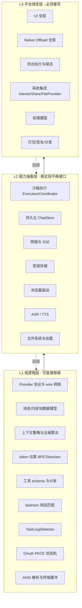

#### L1 — 纯逻辑层，可直接移植

判据：只依赖标准库 + JSON + 正则 + 字符串处理，不 import 任何平台框架。

iOS 侧的框架依赖统计（`grep -rhoE "^import [A-Za-z]+" src/ios --include="*.swift" | sort | uniq -c | sort -rn`）：

| import | 次数 | 性质 |
|---|---|---|
| `Foundation` | 237 | 跨平台（swift-corelibs-foundation 在 Linux 可用） |
| `SwiftUI` | 103 | Apple 专有 |
| `UIKit` | 84 | iOS 专有（macOS 需换 AppKit） |
| `os` / `OSLog` | 46 | Apple 专有，易替换 |
| `Combine` | 24 | Apple 专有 |
| `CryptoKit` | 20 | Apple 专有，有 swift-crypto 对应 |
| `AVFoundation` | 20 | Apple 专有 |
| `WebKit` | 16 | Apple 专有 |
| `SQLite`(SQLite3) | 13 | 跨平台 |
| `AppIntents` | 14 | Apple 专有 |

**只 import `Foundation`（+可选 `SQLite3`）的文件就是 L1 候选。** 237 处 `Foundation` 与 103 处 `SwiftUI` 的差值给出一个粗略量级：约 130 个文件不碰 UI 框架。

Android 侧同理（`androidx.compose` 5,900 次 import 集中在 `ui/`，`kotlinx.coroutines` 646 次则遍布全层）。Kotlin 侧的 L1 迁移路径更顺——`kotlinx.serialization` + `kotlinx.coroutines` + OkHttp 本就是 JVM 库，`android.*` 才是绑定点。

L1 层最典型的例子是 Provider 协议本身。iOS 的 `src/ios/Providers/LLMProvider.swift` 只有 20 行：

```swift
import Foundation

protocol LLMProvider {
    var name: String { get }
    var model: LLMModel { get set }

    func sendMessage(
        messages: [LLMMessage], systemPrompt: String?,
        maxTokens: Int, temperature: Double?
    ) async throws -> LLMResponse

    func streamMessage(
        messages: [LLMMessage], systemPrompt: String?,
        maxTokens: Int, temperature: Double?
    ) async throws -> AsyncThrowingStream<LLMStreamChunk, Error>
}
```

Android 的 `provider/LLMProvider.kt:13-118` 是同一概念的更成熟版本（多了 `imageParts`、`tools`、`thinkingLevel`、能力位与结构化钳制）。**两者唯一的平台耦合是流类型：`AsyncThrowingStream` vs `Flow`。** 换成任何语言的异步流原语（Rust `Stream`、TS `AsyncIterable`、Go channel）语义都成立。

#### L2 — 能力抽象层，换实现不换接口

判据：接口是平台无关的，实现全是平台特定的。这层的质量决定移植成本。

以沙箱执行协调器为例，两端接口高度收敛：

`src/ios/Agent/ISH/ISHExecutionCoordinator.swift`（852 行，`actor`）：

| 成员 | 行 |
|---|---|
| `struct ISHCommandResult` | 8 |
| `enum ISHCoordinatorError` | 14 |
| `actor ISHExecutionCoordinator` | 39 |
| `func execute(…)` | 93 |
| `func mountForSession(_:)` | 141 |
| `func ensureMounted(for:)` | 159 |
| `func hostURL(for:sessionId:)` | 191 |
| `func stopCurrentCommand()` | 210 |
| `func stopCurrentCommand(sessionId:)` | 221 |
| `func sessionDidTerminate(sessionId:)` | 232 |

`src/android/app/src/main/java/com/openminis/app/sandbox/ExecutionCoordinator.kt`（300 行，`object`）：

| 成员 | 行 |
|---|---|
| `object ExecutionCoordinator` | 26 |
| `data class CommandResult` | 30 |
| `fun init(context)` | 59 |
| `suspend fun execute(…)` | 72 |
| `private suspend fun getOrCreateShell(sessionId)` | 132 |
| `private fun buildSessionBindMounts(sessionId)` | 170 |
| `fun sessionDidTerminate(sessionId)` | 229 |
| `fun stopCurrentCommand(sessionId)` | 244 |
| `fun stopCurrentCommand()` | 261 |
| `suspend fun broadcastTimezoneChange()` | 274 |
| `suspend fun broadcastProxyChange()` | 292 |

**接口对齐得几乎可以逐行对照**：`execute` / `stopCurrentCommand`（含带 sessionId 与不带的两个重载）/ `sessionDidTerminate` / 会话级挂载。差异在实现深度：iOS 852 行里有 ~450 行在处理 fakefs 元数据（`ensureFakefsMetadata:726`、`batchEnsureFakefsMetadata:784`、`makeStatBlob:811`），因为 iSH 的虚拟文件系统需要 App 侧直接写 SQLite 元数据表；Android 300 行不需要，因为 PRoot 是原生执行，宿主文件系统就是真文件系统。

这正是 L2 的定义：**同一个接口，一边 852 行一边 300 行，差的全是平台税。**

移植到桌面时，L2 的 `ExecutionCoordinator` 接口原样保留，实现替换为：

| 平台 | 沙箱实现 | 成本 |
|---|---|---|
| Linux | 直接 `fork/exec` + namespaces/bubblewrap，或什么都不做直接跑 | 最低，很多约束消失 |
| macOS | `sandbox-exec` / 直接子进程 / Docker | 低 |
| Windows | WSL2 / 直接子进程 + 路径转换 | 中，路径语义差异大 |

#### L3 — 平台绑定层，必须重写

这层没有捷径。iOS 的 `NativeOffloads/` 有 64 个文件 24,259 行，其中 `HealthKitOffload.m` 3,773 行、`NFCOffload.m` 2,152 行、`PhotosOffload.m` 1,378 行、`CalendarOffload.m` 1,179 行、`BluetoothOffload.m` 1,061 行——**这些在桌面端根本没有对应物**，不是"难移植"，是"概念不存在"。

反过来，桌面端有移动端没有的能力面：任意进程管理、多窗口、全局快捷键、系统托盘、无沙箱的文件系统访问、真正的后台常驻。**L3 不是移植，是替换。**

### 16.4 移动端强加的约束，桌面端会消失哪些

这是从零开发时最值得先想清楚的一张表。左列是本书前 15 章里被反复提到的移动端难点，右列是它在桌面端的命运。

| 移动端约束 | 本书章节 | 桌面端 |
|---|---|---|
| 无法 fork/exec 任意二进制（iOS） | 6 | 消失。直接起进程 |
| 无 W^X，JIT 受限（iOS） | 6 | 消失。iSH 整层不需要 |
| 必须自带 rootfs 并从源码构建 | 6/7/15 | 消失。用宿主 shell 或系统容器 |
| exec 位在 app 数据目录被禁（Android） | 7 | 消失 |
| 后台执行有硬时间预算 | 13 | 消失。进程想跑多久跑多久 |
| Doze / 前台服务 / Live Activity 保活 | 13 | 消失。换成托盘 + 通知 |
| 应用商店审核对"执行任意代码"的敏感 | 6/15 | 大幅缓解 |
| 内存上限与 OOM kill | 6/12 | 大幅缓解 |
| 长对话渲染必须回落到 UICollectionView | 12 | 缓解但不消失（虚拟化仍需要） |
| 权限必须逐项动态申请 | 5/8 | 大部分消失，少数（麦克风/屏幕录制/辅助功能）保留 |
| Scoped storage / SAF 挂载 | 7 | 消失 |
| 键盘遮挡、安全区、动态字号 | 12 | 消失，换成窗口管理问题 |

**结论：桌面端能砍掉的是第 6、7 章的绝大部分和第 13 章的大部分。** 一个 Linux/macOS 版的 OpenMinis，L3 层的工作量大约是移动端的三分之一，但 L1+L2 可以近乎完整继承。

反向的新增成本：多窗口状态管理、自动更新、跨平台打包签名（三套）、系统托盘与全局热键、以及桌面用户对"文件到底存在哪"的更高期待。

### 16.5 为什么这个项目不用跨平台框架

代码里没有直接写明理由，但从依赖与实现选择可以反推出四条硬约束。以下每条都有代码证据，推论部分标注 `[推断]`。

**（1）沙箱层根本无法共享。** iOS 走 iSH（用户态 ARM64 指令模拟，`deps/build_ish.sh` 产出 `libish.a`/`libish_emu.a`/`libfakefs.a`），Android 走 PRoot（ptrace 路径重写，`deps/build_proot.sh`）。这两者的本质区别是"模拟执行"与"原生执行"——不是 API 差异，是执行模型差异。任何跨平台框架都抹不平。这是**事实**，见 `BUILDING.md:86-108` 与 `BUILDING.md:162-180`。

**（2）UI 是性能瓶颈所在，不能交给抽象层。** iOS 的消息列表专门回落到了 UIKit 的 `CollectionViewMessageListV3.swift`（4,290 行）而不是用 SwiftUI List；Android 自己实现了 `MinisTextKitSelection.kt`（1,152 行）与 `MinisTextKitGesture.kt`（935 行）来做文本选择而不是用现成组件。**两端都在各自平台上打穿到了原生层去解决性能与交互问题。** 一个跨平台 UI 框架会把这条路堵死。（第 12 章展开。）

**（3）设备能力面完全不重叠。** iOS 独有 HealthKit / HomeKit / EventKit / NFC / WeatherKit / AppIntents；Android 独有 AccessibilityService / Shizuku / SAF。`NativeOffloads/` 与 `sandbox/offload/` 的文件名对照会发现两边各有一半对方没有。（第 8 章展开。）

**（4）`[推断]` 团队规模与迭代速度。** README 明确写"这是私有开发树的镜像，不接受 PR"，且 662 个 `[T-xxx]` 标签显示大量设计决策由用户报告直接驱动。在这种"快速响应真实反馈"的模式下，跨平台框架的抽象层每次都要多改一处，反而拖慢。这条是推断，代码里没有直接说。

### 16.6 它选的替代方案：共享数据与测试向量

不共享代码，那怎么防止两端行为漂移？答案是 bashism 检测器的做法，值得完整看一遍，因为这是可以直接照搬的模式。

**共享的是规则表，不是代码。** iOS 侧（`src/ios/Agent/Shell/BashismDetector.swift:7-9`）：

```swift
/// (T-bash-on-demand). Rules and their fix hints live in the shared JSON
/// (`bashism_rules.json`, also loaded by Android) — this type is only the
/// matching engine.
```

Android 侧（`src/android/app/src/main/java/com/openminis/app/agent/shell/BashismDetector.kt:10-13`）：

```kotlin
 * switch to bash only when needed (T-bash-on-demand). The rule table and its
 * fix hints are the SHARED JSON (assets/bashism/bashism_rules.json, generated
 * from src/shared/bashism — the same file iOS loads), so the two platforms can
 * never drift.
```

**分发靠各自的构建系统指向同一物理文件**，而不是拷贝。Android（`src/android/app/build.gradle.kts:124-128`）：

```kotlin
from(rootProject.file("../shared/bashism")) {
    include("bashism_rules.json", "bashism_test_vectors.json")
}
into(layout.projectDirectory.dir("src/main/assets/bashism"))
```

iOS 用 `sourceTree = SOURCE_ROOT` 相对引用（`src/ios/Minis.xcodeproj/project.pbxproj:716-717`）：

```
E5BSH0014 /* bashism_rules.json */ = {isa = PBXFileReference;
  name = bashism_rules.json;
  path = ../shared/bashism/bashism_rules.json;
  sourceTree = SOURCE_ROOT; };
```

**共享的第二样东西是测试向量。** `src/shared/bashism/bashism_test_vectors.json`（68 行）被两端的测试各自加载：

Android（`src/android/app/src/test/java/com/openminis/app/agent/shell/BashismDetectorTest.kt:28-34`）：

```kotlin
@Before fun loadRules() {
    val rulesJson = File(sharedDir, "bashism_rules.json").readText()
    BashismDetector.loadRulesForTest(rulesJson)
}
private fun vectors(): JSONObject =
    JSONObject(File(sharedDir, "bashism_test_vectors.json").readText())
```

iOS 侧因为项目结构限制走了独立脚本（`src/shared/bashism/validate_detector.swift:2-6`）：

```swift
// Runs the iOS detector algorithm (Foundation NSRegularExpression, the same
// engine the app uses) against bashism_rules.json + bashism_test_vectors.json.
// The Xcode MinisTests host target can't link the iSH static libs in this
// project, so this standalone harness is the canonical iOS-side regression
// gate. Run: `swift src/shared/bashism/validate_detector.swift`
```

注意最后这条注释暴露的真实约束：**iOS 测试目标链不动 iSH 静态库，所以整个 `MinisTests` target 跑不了依赖沙箱的测试**，只能用一个 300 行不到的独立 Swift 脚本当回归门。这是移动端工程的典型妥协，桌面端不会有。

**共享的第三样东西是设计追踪码。** 35 个 `[T-xxx]` 标签同时出现在两端（见 §0.3），它们标记的就是"两端必须一致"的行为契约。`[T-bash-on-demand]` 在 iOS 的 `AIChatViewModel+ISHCommand.swift:27`、`OnDemandBash.swift:6`、`BashismReminder.swift:5`、`BashismDetector.swift:7` 与 Android 的 `ChatViewModel.kt:7171`、`BashismDetectorTest.kt:16` 都出现，形成一条可 grep 的横切索引。

### 16.7 桌面端移植的具体建议

假设读者要写 macOS/Windows/Linux 版，按 L1/L2/L3 分层的落地路径：

**L1 — 抽成独立库。** 语言选择上，如果目标是"三桌面 + 两移动"，Kotlin Multiplatform 或 Rust core 是现实选项；如果只做桌面，随便什么都行。要抽出来的具体内容（对照 §16.2 那 82 个名字）：

| 模块 | iOS 参照 | Android 参照 |
|---|---|---|
| Provider 协议 + 各家 wire 转换 | `src/ios/Providers/LLMProvider.swift` + `Providers/*/` | `provider/LLMProvider.kt` + `provider/*/` |
| 消息数据模型 | `src/ios/Agent/Chat/ChatModels.swift` | `data/model/` |
| 上下文策略 | `src/ios/Agent/Chat/ContextPolicy.swift` | ChatViewModel 内相应逻辑 |
| token 估算 | `src/ios/Shared/BPETokenizer.swift` | `BPETokenizer.kt` |
| 工具循环检测 | `src/ios/Agent/ToolLoopDetector.swift` | `agent/ToolLoopDetector.kt` |
| bashism | `src/ios/Agent/Shell/BashismDetector.swift` | `agent/shell/BashismDetector.kt` |
| OAuth 管理器 | `src/ios/Providers/*/OAuth/` | `auth/` |
| 终端模拟 | `src/ios/iSH/Terminal/{ANSIParser,TerminalBuffer,TerminalTypes}.swift` | `ui/terminal/emulator/` |
| 配置系统 | `src/ios/Shared/Config/` | `config/` |
| 语音纠错 | `src/ios/Agent/Speech/` | `speech/correction/` |

**L2 — 定义接口，桌面各写一份实现。** 优先级从高到低：

1. `ExecutionCoordinator`（沙箱执行）——桌面端最简单，直接子进程
2. `ChatStore`（持久化）——SQLite 三平台通用，iOS 已经是裸 `SQLite3`（13 个文件 `import SQLite3`，`ChatStore.swift:433` 直接 `sqlite3_open`），移植无痛
3. 密钥存储——macOS Keychain / Windows DPAPI / Linux Secret Service
4. HTTP + SSE——任何平台都有
5. 浏览器驱动——桌面可以用 CDP 直连真 Chrome，比移动端的 WKWebView/WebView 注入方案强得多

**L3 — 从零写。** 桌面 UI 建议直接用原生（SwiftUI on macOS / WinUI / GTK）或 Tauri 这类"原生外壳 + Web 内容"，但**消息列表的虚拟化必须自己做**——第 12 章的教训在桌面同样成立，只是阈值更高。

**砍掉清单：** iSH 整层、PRoot 整层、rootfs 构建流水线、后台保活、Live Activity、App Intents、Share Extension、FileProvider、SAF 挂载、Shizuku、AccessibilityService、HealthKit/HomeKit/NFC 系列 offload。这些加起来是移动端代码量的一大块。

### 16.8 平台对照

| 维度 | iOS | Android | macOS | Windows | Linux |
|---|---|---|---|---|---|
| 沙箱执行 | iSH 指令模拟 | PRoot ptrace 重写 | 直接子进程 / sandbox-exec | WSL2 / 子进程 | 直接子进程 / bwrap |
| 二进制来源 | 必须自带 rootfs | 必须自带 rootfs | 可用系统 | 需 WSL 或自带 | 用系统 |
| UI 框架 | SwiftUI + UIKit 回落 | Compose + 自研文本层 | SwiftUI/AppKit | WinUI/WPF | GTK/Qt |
| 长列表虚拟化 | 必须（UICollectionView） | 必须（LazyColumn + 自研） | 建议 | 建议 | 建议 |
| 后台执行 | BGTask + 音频 + Live Activity | 前台服务 + Doze 白名单 | 无限制 | 无限制 | 无限制 |
| 密钥存储 | Keychain | EncryptedSharedPreferences | Keychain | DPAPI/CredMan | Secret Service |
| 持久化 | 裸 SQLite3 | Room | SQLite | SQLite | SQLite |
| 浏览器 | WKWebView + JS 注入 | WebView + JS 注入 | CDP 直连 | CDP 直连 | CDP 直连 |
| 设备能力 | 极丰富（HealthKit 等） | 丰富（+ Shizuku/无障碍） | 中等 | 中等 | 少 |
| 分发 | App Store 审核 | APK 直装 / Play | 公证 | 签名 | 包管理器 |
| 「执行任意代码」政策风险 | 高 | 低 | 低 | 低 | 无 |

### 16.9 设计取舍与踩坑

**取舍一：两端各写一遍，用数据与测试向量对齐。** 收益是每端都能打穿到原生层解决性能问题（第 12 章的两个例子）、能各自吃满平台独有能力（第 8 章）。代价是 82 个概念要维护两份实现，且**只有 bashism 这一个子系统真正做了共享校验**——其余 81 个概念的两端一致性靠人的纪律，没有机械门禁。这是这个方案最脆弱的地方。

**踩坑一：iOS 测试目标链不动沙箱静态库。** `validate_detector.swift:4-6` 明确写了 `MinisTests` host target 无法链接 iSH 静态库，所以沙箱相关的 iOS 测试实际上不存在，只能靠独立脚本。Android 侧有 `src/android/app/src/androidTest/java/com/openminis/app/sandbox/`（5 个 instrumented 测试：`ExecutionCoordinatorInstrumentedTest.kt`、`PRootKernelInstrumentedTest.kt`、`RootfsManagerInstrumentedTest.kt`、`ShellExecutorInstrumentedTest.kt`、`TerminalSanitizerInstrumentedTest.kt`）做真机验证。**两端的测试能力不对等，是 iOS 侧的结构性缺陷**，桌面端不会遇到，但从零开发时要提前设计好测试宿主。

**踩坑二：iOS 部署目标不统一。** `project.pbxproj` 里出现三个不同的 `IPHONEOS_DEPLOYMENT_TARGET`：`16.0`、`16.2`、`26.2`，`SWIFT_VERSION` 也有 `5.0` 与 `6.0` 两种。主 App 按 `BUILDING.md:79` 是 iOS 26.2 + Swift 6.0，较低的值应属扩展目标或依赖包。`[推断]` 这是扩展 target（Share/Widget/FileProvider）为了兼容性单独下调所致。从零开发时要意识到**多 target 的部署目标会分叉**，共享代码必须按最低的那个写。

**踩坑三：共享 JSON 的构建期搬运是单向的。** Android 用 Gradle copy 到 `assets/`，iOS 用相对路径引用源文件。这意味着**改了 `src/shared/bashism/bashism_rules.json` 后，Android 必须重跑那个 copy task 才生效，iOS 立即生效**。两端的生效时机不一致，容易在本地调试时误判。从零开发时建议两端都用符号链接或都用构建期拷贝，不要混。

**踩坑四：`.github/` 没有 workflow。** 共享测试向量存在，但没有任何自动化在每次提交时跑 `validate_detector.swift` 和 Android 的 `BashismDetectorTest`。**共享数据的价值有一半浪费掉了**——它防住了规则漂移，但没防住实现漂移。这是读者从零开发时最该补上的一环，成本极低（两条命令）。

### 16.10 从零实现清单

如果读者的目标是"一套核心，五个平台"，按这个顺序做：

1. **先只做一个平台，做到能用。** 不要一上来就抽象。参照第 17 章的路线图，先在你最熟的平台上把 agent 循环 + 一个 provider + 三个文件工具跑通。
   - *验收*：能多轮对话，能让模型读写文件，能中途取消。

2. **第二个平台开始前，把 L1 划出来。** 判据就是 §16.3 给的：只依赖标准库与 JSON/正则的文件。此时你已经知道哪些是纯逻辑了，不会过度抽象。
   - *验收*：L1 部分能在没有任何 UI 框架的环境下编译并通过单测。

3. **为 L1 里每个「行为契约」写测试向量文件，而不是测试代码。** 照抄 bashism 的做法：规则/期望输入输出放 JSON，每端只写加载器与断言。
   - *验收*：同一份 `*_test_vectors.json` 被两端测试各自加载并全绿。

4. **定义 L2 接口，写第一个平台的实现。** 优先做 `ExecutionCoordinator`（或你的等价物）与 `ChatStore`，接口签名照 §16.3 的对照表来——`execute` / `stopCurrentCommand()` / `stopCurrentCommand(sessionId)` / `sessionDidTerminate(sessionId)` 这四件套是被两个真实实现验证过的最小集。
   - *验收*：接口里不出现任何平台类型（`Context`、`UIViewController`、`Activity`）。

5. **加 CI，哪怕只有两行。** 每次提交跑 L1 单测 + 共享向量校验。这是 OpenMinis 缺失的一环，而它几乎免费。
   - *验收*：改坏 L1 逻辑会导致 CI 红。

6. **第二个平台：只实现 L2 + L3，L1 直接链过来（或按 §16.6 的方式共享数据）。**
   - *验收*：第二平台的代码量里 L1 占比为 0。

7. **桌面端：从第二平台的 L2 实现 fork，把移动端的约束一条条删掉。** 对照 §16.4 的表，删一条验证一条。
   - *验收*：桌面版的沙箱层代码量显著小于移动端（参照：iOS 852 行 vs Android 300 行的差距，桌面应更少）。

8. **建立横切索引。** 采用 `[T-xxx]` 式的追踪码，凡是「两端必须一致」的决策都打同一个标签。这样 `grep` 一次就能找齐所有相关实现点。
   - *验收*：随机抽一个跨端行为，能在 30 秒内用一次 grep 定位到两端全部实现点。

可以砍掉的：第 2 步之前的任何抽象努力；跨平台 UI 框架；把 L3 也塞进抽象层的尝试。

### 16.11 关键文件索引

| 路径 | 行数 | 职责 |
|---|---|---|
| `src/shared/bashism/bashism_rules.json` | — | 两端共享的 bashism 规则表，唯一真源 |
| `src/shared/bashism/bashism_test_vectors.json` | 68 | 两端共享的测试向量 |
| `src/shared/bashism/validate_detector.swift` | 70 | iOS 侧独立回归门（MinisTests 链不动 iSH 时的替代） |
| `src/ios/Providers/LLMProvider.swift` | 20 | iOS provider 协议，L1 的最小样本 |
| `src/android/.../provider/LLMProvider.kt` | 162 | Android provider 接口 + 结构化钳制 + 空流检测 |
| `src/ios/Agent/ISH/ISHExecutionCoordinator.swift` | 852 | iOS 沙箱执行协调（含 fakefs 元数据写入） |
| `src/android/.../sandbox/ExecutionCoordinator.kt` | 300 | Android 沙箱执行协调，同接口不同实现 |
| `src/ios/Agent/Shell/BashismDetector.swift` | — | iOS 匹配引擎（规则来自共享 JSON） |
| `src/android/.../agent/shell/BashismDetector.kt` | — | Android 匹配引擎（同一份规则） |
| `src/android/.../agent/shell/BashismDetectorTest.kt` | — | 加载共享向量的 Android 单测 |
| `src/android/app/build.gradle.kts` | — | 第 124-128 行把共享 JSON 拷进 assets |
| `src/ios/Minis.xcodeproj/project.pbxproj` | — | 第 716-717 行以相对路径引用同一份共享 JSON |
| `BUILDING.md` | 236 | 两端原生依赖与部署目标的权威说明 |


## 17. 从零开始的实施路线图

### 17.1 这一章解决什么问题

前 16 章拆的是一个 34 万行、已上架、迭代过多轮真实用户反馈的成熟产品。直接照着它写，第一天就会淹死在 iSH 编译、Live Activity 保活和 fakefs 元数据里。

这一章把它压回成一条**按"每一步都能跑起来"排序的实施路径**：每个阶段给出交付物、验收标准（一个可以亲手执行的动作）、对应的正文章节、以及**明确允许砍掉的东西**。目标是让读者在第 3 天就有一个能多轮对话+调用工具的东西，而不是在第 3 周还在配 NDK。

排序原则只有一条：**先建立反馈闭环，再加能力面。** 一个能对话、能调一个工具、能看到结果的最小系统，比一个功能齐全但跑不起来的骨架有价值一百倍。

### 17.2 全景：七个阶段

```mermaid
flowchart LR
  S0["S0 决策<br/>0.5 天"] --> S1["S1 对话骨架<br/>2-3 天"]
  S1 --> S2["S2 工具循环<br/>3-5 天"]
  S2 --> S3["S3 持久化与上下文<br/>3-5 天"]
  S3 --> S4["S4 沙箱<br/>1-3 周"]
  S3 --> S5["S5 设备能力<br/>1-2 周"]
  S4 --> S6["S6 体验硬化<br/>持续"]
  S5 --> S6
  S6 --> S7["S7 生态与扩展<br/>持续"]
  S2 -.->|"可跳过 S4/S5<br/>直达可用产品"| S6
```

| 阶段 | 交付物 | 主要章节 | 可否跳过 |
|---|---|---|---|
| S0 | 技术选型与边界决策 | 1, 16 | 否 |
| S1 | 能流式对话的 App | 2, 4, 12 | 否 |
| S2 | 能调工具的 agent | 2, 5 | 否 |
| S3 | 会话不丢、上下文不炸 | 3, 11 | 否 |
| S4 | 真 Linux 沙箱 | 6, 7 | **可以**，见 §17.7 |
| S5 | 设备能力接入 | 8 | 可以，按需 |
| S6 | 性能、后台、错误处理 | 12, 13, 15 | 否（决定能否上线） |
| S7 | Skills / MCP / 浏览器 / 同步 | 9, 10, 11 | 可以，按需 |

### 17.3 S0 — 决策阶段（半天）

在写第一行代码前必须定的五件事。每一条都给出 OpenMinis 的选择与它的代价，读者不必照抄，但必须做出选择。

| 决策 | OpenMinis 的选择 | 代价 | 何时该换 |
|---|---|---|---|
| 跨平台策略 | 两端各写一遍，共享 298 行数据（第 16 章） | 82 个概念维护两份 | 团队 < 3 人 → 考虑 KMP/Rust core |
| 工具能力来源 | 给模型真 Linux shell（`sandbox/` 14,900 行 vs `tools/` 881 行） | 首次构建 30–60 分钟，审核风险 | 只做垂直场景 → 手写工具就够 |
| 模型接入 | 自带 Key，多 provider（`Providers/` 27,378 行） | 认证复杂度高 | 单一模型 → 直接写死 |
| 持久化 | iOS 裸 SQLite3 / Android Room | 两端 schema 手工对齐 | 需要同步 → 先设计可移植记录格式 |
| UI 框架 | 各自原生，性能点打穿到 UIKit/自研文本层 | UI 代码占近一半 | 不追求长对话流畅 → 用现成组件 |

**S0 的验收标准**：把上表五行填成你自己的答案，写进一个 `DECISIONS.md`。后面每次想加抽象层时回来看一眼。

一条建议：**S0 阶段不要选跨平台 UI 框架**。第 12 章会展示 OpenMinis 两端都被迫打穿到原生层（iOS 用 UICollectionView，Android 自研文本选择）来解决长对话的性能与交互——这两个点是 agent 应用的必经之路，跨平台 UI 框架在这里会变成阻碍而不是加速。

### 17.4 S1 — 对话骨架（2–3 天）

**目标**：一个能选模型、能流式看到回复、能中途停的对话界面。没有工具，没有持久化，重启清空。

步骤：

1. **定义消息数据模型。** 参照第 2 章的 `ChatModels`。关键点：消息不是字符串，是**内容块（content block）数组**——文本块、思考块、工具调用块、工具结果块、媒体块。一开始就按块建模，后面加 thinking 和多模态才不用重写。
   - *验收*：能构造一个包含「文本 + 工具调用 + 工具结果」三块的消息并序列化成 JSON。

2. **写 Provider 协议。** 照第 4 章。最小签名就是 iOS 那 20 行（`src/ios/Providers/LLMProvider.swift`）：`name`、`model`、`sendMessage`、`streamMessage`。
   - *验收*：协议里不出现任何具体 provider 的名字或字段。

3. **实现第一个 provider。** 建议从 Anthropic Messages API 或 OpenAI Chat Completions 起步——它们的 SSE 格式文档最全。**只做流式**，非流式后面再补（agent 应用 99% 的请求是流式）。
   - *验收*：命令行或单测里能收到逐块到达的文本 delta。

4. **接上最朴素的 UI。** 此时用 `List`/`LazyColumn` 就行，性能问题留给 S6。
   - *验收*：输入一句话，文字逐字出现。

5. **实现取消。** 这一步很多人推迟，是错的——取消路径会影响后面每一层的接口设计（第 2 章会展示取消要同时清理在途请求、在途工具、在途 shell 进程）。现在只有请求这一层，接口最容易定。
   - *验收*：流式过程中点停止，网络请求真的断开（抓包或看日志确认，不是 UI 假装停了）。

**允许砍掉**：多 provider、OAuth（先只支持 API Key）、模型列表拉取、thinking 块渲染、错误重试。

**这一步最容易踩的坑**：SSE 解析写得太随意。`src/android/.../provider/LLMProvider.kt:120-162` 的 `failOnSilentEmptyCompletion` 就是补丁——上游断流时 SSE 会"正常结束"但没有任何内容和 finish reason，界面会静悄悄停住，用户完全不知道发生了什么。**从一开始就区分「正常结束」「有内容的结束」「空结束」三种状态**：

```kotlin
// 来源 src/android/.../provider/LLMProvider.kt:138-161（精简）
fun Flow<LLMStreamChunk>.failOnSilentEmptyCompletion(providerName: String) = flow {
    var sawContent = false; var sawFinishReason = false
    collect { chunk ->
        when (chunk) {
            is LLMStreamChunk.Text -> if (chunk.text.isNotEmpty()) sawContent = true
            is LLMStreamChunk.ToolUseStart, is LLMStreamChunk.ToolCallComplete -> sawContent = true
            is LLMStreamChunk.Finished -> if (chunk.stopReason != null) sawFinishReason = true
            else -> {}
        }
        emit(chunk)
    }
    if (!sawContent && !sawFinishReason) {
        throw LLMError.TransientError("Server returned an empty response")
    }
}
```

### 17.5 S2 — 工具循环（3–5 天）

**目标**：模型能调用工具，结果回灌后继续推理，直到给出最终答案。这是"聊天应用"变成"agent"的分界线。

步骤：

1. **定义工具 schema 与执行结果类型。** 参照第 5 章。结果类型至少要能表达：成功+文本、成功+媒体、失败+错误信息、被用户拒绝。
   - *验收*：一个工具执行失败时，模型收到的是结构化错误而不是异常堆栈。

2. **实现三个文件工具：read / write / edit。** 第 5 章会详细讲这三个的实现细节——行号、偏移限制、字符串替换的唯一性校验、大文件截断。**这三个工具的质量直接决定 agent 可用性**，值得花时间。
   - *验收*：让模型读一个 500 行文件的第 100–150 行、改其中一行、再读回来确认。

3. **写主循环状态机。** 第 2 章的核心。最小状态集：`idle → streaming → toolPending → toolRunning → streaming → … → done`，加上 `error` 和 `cancelled` 两个终态。
   - *验收*：画出你的状态图，每条边都能在代码里指出触发点。

4. **串行执行工具先。** 并发（第 2 章的 `+ConcurrentTools`）是优化，不是必需。
   - *验收*：模型一次返回两个工具调用时，按顺序执行、按顺序回灌。

5. **加轮数上限与循环检测。** 参照 `src/ios/Agent/ToolLoopDetector.swift` / `agent/ToolLoopDetector.kt`。没有这个，模型陷入重复调用时会烧光你的额度。
   - *验收*：人为构造一个必然循环的场景（比如让模型读一个不存在的文件并要求它重试），确认在 N 轮后被拦下。

6. **加工具预检门。** 第 5 章。参数校验和危险操作确认都在分发层做一次，不在每个工具里重复。
   - *验收*：新增一个工具时，不需要写任何权限或校验代码。

**允许砍掉**：并发工具执行、工具结果的 `minis://` URL 化、图片结果回传、工具卡片 UI（先用纯文本展示）。

**这一步的关键判断**：工具数量要克制。OpenMinis 的 `tools/` 只有 881 行 8 个文件，能力靠的是沙箱和 offload。**如果你在 S2 阶段写到第 15 个工具，说明方向错了**——要么该上沙箱（S4），要么该用 MCP（S7）。

### 17.6 S3 — 持久化与上下文（3–5 天）

**目标**：关掉 App 再打开，对话还在；聊到 100 轮不会因为超上下文而崩。

步骤：

1. **设计会话存储。** 第 11 章。三层：会话元信息表、消息表（内容块序列化成 JSON 存一列）、附件走文件系统。**不要把附件塞进数据库。**
   - *验收*：一个带 3 张图的 50 条消息会话，冷启动加载 < 300ms。

2. **实现 token 估算。** 第 3 章的 `BPETokenizer`。本地估算不需要精确，需要的是**保守**——宁可高估。
   - *验收*：对一段已知 token 数的文本，估算误差在 ±15% 内且偏向高估。

3. **定义上下文策略。** 第 3 章的 `ContextPolicy`。每个模型的窗口大小、触发压缩的水位线、保留多少最近消息。
   - *验收*：切换到一个小窗口模型时，水位线自动跟着变。

4. **实现压缩。** 第 3 章的重点。最小版本：超水位时，把最老的一批消息交给模型做摘要，用摘要替换它们，保留最近 N 轮完整。
   - *验收*：一个必然超限的长对话能自动压缩并继续，且压缩后模型仍记得早期的关键信息（人工验证一次）。

5. **加持久 memory 工具。** 第 3/9 章。让模型能主动写下跨会话的事实。
   - *验收*：在会话 A 里让模型记住一件事，新建会话 B 后它还知道。

**允许砍掉**：跨设备同步（S7）、会话搜索、附件缩略图、压缩失败的降级路径（先直接报错）。

**这一步最容易低估的**：压缩不是"截断"。截断会让模型突然失忆并开始重复已经做过的工作。压缩必须产出**可用的摘要**，且摘要要用和用户相同的语言——OpenMinis 两端都在 compaction prompt 里显式要求这一点（第 3 章会给出具体位置）。

### 17.7 S4 — 沙箱（1–3 周）· 这一步可以完全跳过

**先说跳过的条件。** 如果满足以下任一条，S4 应该跳过或推迟：

- 你的场景是垂直的（记账、笔记、翻译），模型不需要执行任意代码
- 你在做桌面端（第 16 章：桌面端根本不需要 iSH/PRoot，直接起子进程）
- 你还没验证过产品价值

**跳过 S4 的替代方案**：把 S2 的工具集扩展到 8–12 个覆盖你的场景，加上 MCP（S7）接外部能力。这条路能到达一个完全可用的产品。

**如果要做 S4**，按平台分岔：

**Android 路径（更容易，建议先做）**：

1. 拿到 Alpine aarch64 minirootfs，解压到应用私有目录（参照 `scripts/prepare_android_sandbox.sh`）
   - *验收*：`RootfsManager` 等价物能幂等地完成解压，重复调用不重复解压
2. 交叉编译 PRoot（参照 `deps/build_proot.sh`，需 NDK r28+），**放进 `jniLibs/arm64-v8a/`**——第 7 章会解释为什么不能放 `assets/` 后 chmod +x（Android 禁止从应用数据目录 exec）
   - *验收*：能通过 JNI 或 `ProcessBuilder` 启动 proot 并执行 `echo hello`
3. 写 PTY 桥（参照 `src/android/app/src/main/cpp/pty_bridge.c`）
   - *验收*：能跑一个交互式命令（如 `python3 -i`）并逐行读到输出
4. 实现 `ExecutionCoordinator`（参照 `sandbox/ExecutionCoordinator.kt`，300 行）——接口就四件套：`execute` / `stopCurrentCommand()` / `stopCurrentCommand(sessionId)` / `sessionDidTerminate(sessionId)`
   - *验收*：并发两个会话的命令互不干扰，取消只杀目标会话

**iOS 路径（困难得多）**：

1. 构建 iSH fork（参照 `deps/build_ish.sh`，产出 `libish.a`/`libish_emu.a`/`libfakefs.a`）
   - *验收*：能链接进一个空 App 并跑通 init
2. 准备 fakefs 格式 rootfs（`deps/prepare_alpine_rootfs.sh`）
   - *验收*：首启解压后 `ls /` 能列出 Alpine 标准目录
3. 实现执行协调器 + fakefs 元数据写入（参照 `ISHExecutionCoordinator.swift`，852 行，其中约 450 行是 fakefs 元数据）
   - *验收*：宿主写入的文件能被 guest `ls -l` 看到正确权限

**两端共同的最后一步**：

5. **bashism 检测。** Alpine 默认 shell 是 busybox ash 不是 bash，模型生成的脚本会大量用 bash 语法然后失败。照抄 `[T-bash-on-demand]` 的方案：规则表放共享 JSON，两端只写匹配引擎，检测到就提示模型或按需引导安装 bash。
   - *验收*：一段含 `[[ ]]`、数组、`local` 的脚本被检出并给出可执行的修复建议

**允许砍掉**：终端 UI（agent 用不着，人才用）、外部目录挂载、多会话并发 shell（先单会话）。

**iOS 侧的一个结构性坑要提前知道**（第 16 章已提到）：`src/shared/bashism/validate_detector.swift:4-6` 注明 `MinisTests` host target **链不动 iSH 静态库**，所以 iOS 侧沙箱相关的单元测试实际上写不了，只能用独立 Swift 脚本当回归门。如果你要在 iOS 上做沙箱，**S4 开始时就设计好测试宿主**，否则后面补不上。

### 17.8 S5 — 设备能力（1–2 周，按需）

**目标**：让 agent 能读日历、写健康数据、发通知、控制媒体。

如果做了 S4，这一步是"给沙箱开一扇门"（第 8 章的 native offload）；如果跳过了 S4，这一步就是"多写几个 S2 式的工具"，简单得多。

步骤（假设做了 S4）：

1. **定一个 IPC 协议。** 沙箱里的进程怎么把请求送到宿主。第 8 章会给出 OpenMinis 的实际做法。
   - *验收*：guest 里执行一条命令，宿主日志里能看到解析后的结构化请求
2. **写统一闸门。** 参照 `sandbox/offload/OffloadGate.kt`。权限检查、参数校验、路径逃逸防护都在这里做一次。
   - *验收*：guest 传一个 `../../../etc/passwd` 被闸门拒绝
3. **实现第一个 handler：剪贴板。** 最简单，无权限，能立刻验证链路。
   - *验收*：`minis-offload clipboard read` 能拿到宿主剪贴板内容
4. **实现第二个 handler：需要权限的（通知或日历）。** 验证权限申请、拒绝后的降级。
   - *验收*：首次调用弹权限、拒绝后返回结构化错误而不是崩溃
5. **按需扩展。**

**允许砍掉**：绝大多数 handler。OpenMinis 有 20+ 个是因为它在做通用产品。你只需要你场景里的那几个。

**一个值得单独考虑的能力**：让沙箱里的脚本**反过来调用 LLM**（第 8 章的 ModelUse offload，两端各 2,074 / 1,815 行）。这个能力让 skill 作者能写出"批量处理 100 个文件，每个都让模型判断一下"这类脚本，扩展性极强。但它也意味着预算控制要下沉一层——脚本可能失控烧钱。

### 17.9 S6 — 体验硬化（持续）· 决定能否上线

前五步做完是个"能跑的 demo"。这一步把它变成"能用的产品"。**这一步的工作量往往超过前五步之和**——回看 §0.2 的统计，UI 层占了近一半代码。

按优先级：

1. **长对话渲染性能。** 第 12 章。原生 List 组件在几百条含代码块和表格的消息面前会跪。iOS 的答案是回落到 `UICollectionView`（`CollectionViewMessageListV3.swift` 4,290 行），Android 是 `LazyColumn` + 自研文本层。
   - *验收*：300 条消息的会话，快速滑动全程不掉帧（真机实测，不是模拟器）

2. **流式增量渲染。** 第 12 章。token 逐字到达时不能每帧重解析整篇 markdown。
   - *验收*：流式输出时 CPU 占用不随已输出长度线性增长

3. **后台执行。** 第 13 章。这是移动端最难的工程点，没有之一。iOS 要组合 BGTask + 后台音频 + Live Activity（`BackgroundKeepAliveManager.swift` 1,643 行在跟这件事斗），Android 要前台服务 + Doze 白名单。
   - *验收*：锁屏后一个跑了 3 分钟的 agent 任务能完成并通知用户

4. **错误处理与重试。** 第 2 章的 `+Fallback`。限流、超时、模型不可用、上游静默断流（§17.4 那个坑）各自的处理路径。
   - *验收*：拔掉网络再插回来，进行中的对话能恢复或给出明确的可重试提示

5. **崩溃与卡顿可观测。** 第 15 章。至少要有崩溃日志落盘 + 用户可导出。
   - *验收*：人为制造一次崩溃，重启后能拿到带堆栈的日志文件

6. **日志脱敏。** 第 15 章会指出 OpenMinis 在这块的缺口——诊断日志与崩溃报告不经过环境变量脱敏器，导出时可能带出敏感值。**这是从零开发时应当从第一天就做对的事**，后补极难。
   - *验收*：把一个 API Key 存进环境变量，触发一次崩溃报告，确认 Key 不在报告里

**允许砍掉**：Live Activity / 灵动岛、多语言（先只做一种）、无障碍适配（但别砍太久）。

### 17.10 S7 — 生态与扩展（持续，按需）

四个方向，互相独立，按你的产品定位挑：

| 方向 | 章节 | 什么时候值得做 | 最小版本 |
|---|---|---|---|
| Skills | 9 | 用户开始重复同一类任务 | 认 `SKILL.md` frontmatter，metadata 进 prompt，body 按需加载 |
| MCP | 9 | 需要接外部服务而不想自己写工具 | 只支持 stdio transport，不做 OAuth |
| 浏览器自动化 | 10 | 场景涉及无 API 的网站 | 只做 navigate + extract + click 三个动作 |
| 多端同步 | 11 | 用户有多台设备 | 先做导出/导入，再做自动同步 |

**Skills 的性价比最高**，因为它把"加能力"从"改代码发版"变成了"用户放一个文件夹"。第 9 章的渐进式加载（metadata 常驻、body 按需）是关键设计——没有它，10 个 skill 就能吃掉半个上下文窗口。

**同步最贵**。第 11 章会展示 OpenMinis 的 Sync V2 有 16 个文件，`ICloudSharedZoneTransport.swift` 单文件 1,817 行，还有一整套 V1→V2 迁移引擎。**在有真实需求前不要碰**，先做导出/导入满足 90% 的诉求。

### 17.11 三条常见的错误路线

**错误一：先造沙箱。** 因为它最酷、最有技术含量。结果是两周后还没有一个能对话的界面，无法验证任何产品假设。**沙箱是 S4 不是 S1 是有原因的**：它是能力放大器，不是能力本身。

**错误二：一开始就抽跨平台核心。** 在只写过一个平台的时候，你不知道哪些是平台无关的。第 16 章的建议是：**先把一个平台做到能用，第二个平台开始前再划 L1**。此时那 82 个"两端同名"的概念会自己浮现出来。

**错误三：把工具当成主要能力面。** 表现是工具数量线性增长，每个新场景加两三个工具。OpenMinis 的比例（`tools/` 881 行 vs `sandbox/` 14,900 行）说明了另一种可能：**给模型一个通用执行环境，让它自己组合**。即使不做完整沙箱，"一个能执行脚本的工具 + 一个包管理器"也比 20 个专用工具走得远。

### 17.12 各阶段的最小验收动作汇总

一张可以打勾的表。每一行都是一个**能亲手执行**的动作，不是"实现了 XX 功能"这种无法证伪的描述。

| 阶段 | 验收动作 |
|---|---|
| S1 | 输入一句话，文字逐字出现；点停止，抓包确认连接真的断了 |
| S2 | 让模型读一个 500 行文件的第 100–150 行、改一行、读回来确认 |
| S2 | 构造必然循环的场景，确认 N 轮后被拦下 |
| S3 | 杀掉 App 重开，对话还在；聊到超窗口，自动压缩并继续 |
| S3 | 会话 A 让模型记住一件事，会话 B 里它还知道 |
| S4 | guest 里 `echo hello` 有输出；并发两会话互不干扰 |
| S4 | 含 `[[ ]]` 的脚本被 bashism 检出并给出修复建议 |
| S5 | guest 传 `../../../etc/passwd` 被闸门拒绝 |
| S5 | 首次调用需权限的能力会弹窗，拒绝后返回结构化错误 |
| S6 | 300 条消息真机快速滑动不掉帧 |
| S6 | 锁屏后 3 分钟的任务能完成并通知 |
| S6 | 环境变量里的 API Key 不出现在崩溃报告里 |
| S7 | 放一个 `SKILL.md` 文件夹进去，不改代码，模型学会新技能 |

### 17.13 关键文件索引

本章引用到的、可作为各阶段参照实现的文件：

| 路径 | 行数 | 对应阶段 |
|---|---|---|
| `src/ios/Providers/LLMProvider.swift` | 20 | S1 · provider 协议最小样本 |
| `src/android/.../provider/LLMProvider.kt` | 162 | S1 · 成熟版协议 + 空流检测（120-162） |
| `src/ios/Agent/Chat/ChatModels.swift` | — | S1 · 消息与内容块模型 |
| `src/ios/Agent/Chat/AIChatViewModel.swift` | 5,830 | S2 · 主循环（拆分在 `+*.swift` 各扩展） |
| `src/android/.../ui/chat/ChatViewModel.kt` | 9,844 | S2 · Android 主循环 |
| `src/ios/Agent/ToolLoopDetector.swift` | — | S2 · 循环检测 |
| `src/android/.../agent/ToolLoopDetector.kt` | — | S2 · 循环检测 |
| `src/android/.../tools/` | 881（8 文件） | S2 · 工具实现，注意其克制的规模 |
| `src/ios/Agent/Chat/ContextPolicy.swift` | — | S3 · 上下文策略 |
| `src/ios/Agent/Chat/AIChatViewModel+Compaction.swift` | 1,054 | S3 · 压缩算法 |
| `src/ios/Shared/BPETokenizer.swift` | — | S3 · token 估算 |
| `src/ios/Agent/Chat/ChatStore.swift` | 6,211 | S3 · 持久化（裸 SQLite3，`sqlite3_open` 在 433 行） |
| `src/android/.../data/db/` | 16 文件 | S3 · Room 持久化 |
| `deps/build_proot.sh` | — | S4 · Android 沙箱构建 |
| `scripts/prepare_android_sandbox.sh` | — | S4 · rootfs 准备 |
| `src/android/.../sandbox/ExecutionCoordinator.kt` | 300 | S4 · 执行协调器（接口四件套） |
| `src/android/app/src/main/cpp/pty_bridge.c` | — | S4 · PTY 桥 |
| `deps/build_ish.sh` | — | S4 · iOS 沙箱构建 |
| `src/ios/Agent/ISH/ISHExecutionCoordinator.swift` | 852 | S4 · iOS 执行协调器 |
| `src/shared/bashism/bashism_rules.json` | — | S4 · bashism 规则（两端共享） |
| `src/shared/bashism/validate_detector.swift` | 70 | S4 · iOS 侧回归门（注意 4-6 行说明的测试宿主限制） |
| `src/android/.../sandbox/offload/OffloadGate.kt` | — | S5 · offload 统一闸门 |
| `src/ios/NativeOffloads/ModelUseOffloadBridge.swift` | 2,074 | S5 · 让沙箱反调 LLM |
| `src/ios/Agent/MessageList/CollectionViewMessageListV3.swift` | 4,290 | S6 · 长列表性能 |
| `src/android/.../ui/chat/StreamingMarkdownText.kt` | 3,542 | S6 · 流式增量渲染 |
| `src/ios/Agent/Background/BackgroundKeepAliveManager.swift` | 1,643 | S6 · iOS 后台保活 |
| `src/android/.../service/AgentForegroundService.kt` | 900 | S6 · Android 前台服务 |
| `src/ios/Agent/Session/SkillStore.swift` | 2,459 | S7 · Skills |
| `src/android/.../data/repository/SkillRepository.kt` | 1,536 | S7 · Skills |
| `src/ios/Agent/Sync/V2/` | 16 文件 | S7 · 同步（谨慎评估成本） |
| `BUILDING.md` | 236 | S0/S4 · 构建前置条件 |


