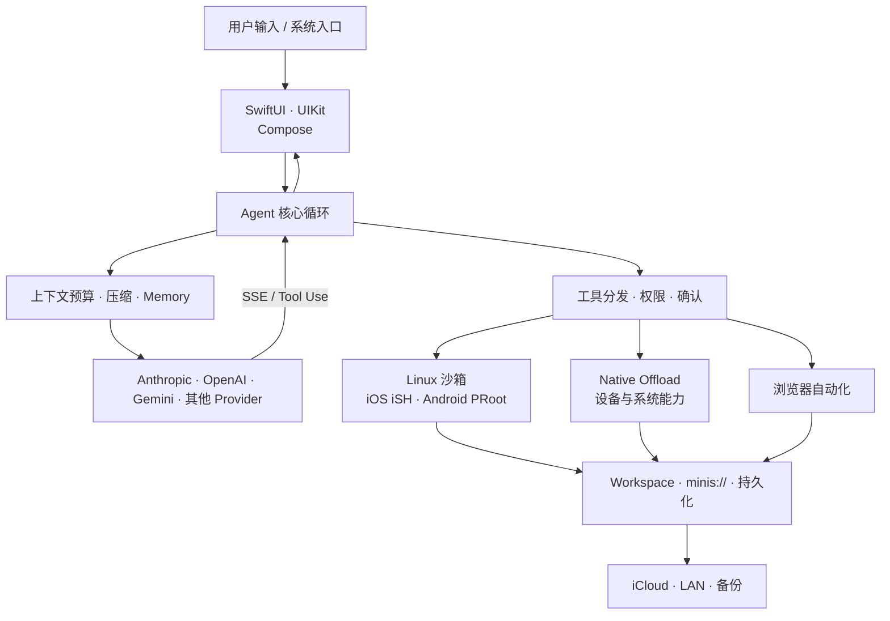

# 从零构建一个 AI Agent 应用

> 以 OpenMinis 为样本的 iOS / Android 原生 Agent 工程手册
>
> 18 章，覆盖 Agent 循环、上下文工程、多模型 Provider、Linux 沙箱、Native Offload、浏览器自动化、持久化同步、流式 UI，以及 macOS / Windows / Linux 移植路线。

[开始阅读](parts/00-preface.md) · [直接看从零路线图](parts/17-roadmap-from-scratch.md) · [下载完整单文件归档](OpenMinis-Agent-App-Engineering-full.md)

> **阅读方式**：在线预览请按章节阅读。完整归档约 1.25 MB，超过部分代码托管平台的 Markdown 渲染阈值，只适合下载、全文搜索或交给本地 Markdown 阅读器。

---

## 先选一条阅读路线

| 目标 | 推荐路线 | 预计重点 |
|---|---|---|
| 尽快做出可运行的 Agent | [0 序章](parts/00-preface.md) → [1 架构](parts/01-architecture-overview.md) → [2 核心循环](parts/02-agent-loop.md) → [4 Provider](parts/04-provider-layer.md) → [5 工具](parts/05-tool-system.md) → [17 路线图](parts/17-roadmap-from-scratch.md) | 先形成「模型请求—工具调用—结果回灌」闭环 |
| 理解移动端 Agent 的核心壁垒 | [1 架构](parts/01-architecture-overview.md) → [6 iSH](parts/06-sandbox-ios-ish.md) / [7 PRoot](parts/07-sandbox-android-proot.md) → [8 Offload](parts/08-native-offload.md) → [13 系统集成](parts/13-system-integration.md) | 沙箱、设备能力与后台保活 |
| 重点研究交互与性能 | [2 核心循环](parts/02-agent-loop.md) → [3 上下文](parts/03-context-engineering.md) → [12 流式 UI](parts/12-ui-and-streaming-render.md) → [14 语音](parts/14-voice-and-media.md) | 长对话、增量渲染、语音纠错 |
| 扩展到桌面平台 | [1 架构](parts/01-architecture-overview.md) → [16 跨平台移植](parts/16-cross-platform-portability.md) → [17 路线图](parts/17-roadmap-from-scratch.md) | 哪些层可复用、哪些层必须替换 |

---

## 系统全景

核心判断不是「接一个聊天 API」，而是建立五个稳定边界：

1. **内部消息模型与 Provider wire format 分离**
2. **Agent 循环与具体工具实现分离**
3. **工具协议与平台权限分离**
4. **Linux 沙箱与宿主设备能力分离**
5. **纯逻辑核心与平台生命周期分离**

---

## 第一部分：理解系统骨架

| 章 | 内容 | 读完能回答的问题 |
|---|---|---|
| [0. 序章：这本手册怎么用](parts/00-preface.md) | 规模、设计追踪码、阅读路径 | 34 万行代码该从哪里进入？ |
| [1. 整体架构与分层设计](parts/01-architecture-overview.md) | 双端启动链路、七层架构、端到端数据流 | 一条用户消息穿过了哪些模块？ |
| [2. Agent 核心循环](parts/02-agent-loop.md) | SSE、工具编排、取消、fallback、循环检测 | 如何让模型连续调用工具而不失控？ |
| [3. 上下文工程](parts/03-context-engineering.md) | token 预算、压缩、Memory、system prompt | 长会话如何不断片、不超窗？ |
| [4. 多模型 Provider 抽象层与认证](parts/04-provider-layer.md) | wire format、SSE 差异、API Key、OAuth | 如何抹平 Anthropic、OpenAI、Gemini 的差异？ |

## 第二部分：构建 Agent 的能力面

| 章 | 内容 | 读完能回答的问题 |
|---|---|---|
| [5. 工具系统](parts/05-tool-system.md) | JSON Schema、文件工具、权限门、结果回灌 | 工具如何定义、校验、执行并安全返回？ |
| [6. iOS 沙箱：iSH](parts/06-sandbox-ios-ish.md) | ARM64 模拟、fakefs、rootfs、PTY | iOS 禁止任意进程时，怎样跑完整 Linux？ |
| [7. Android 沙箱：PRoot](parts/07-sandbox-android-proot.md) | ptrace、PTY JNI、持久 shell、挂载 | Android 如何用原生 ARM64 执行 Alpine？ |
| [8. Native Offload](parts/08-native-offload.md) | IPC、handler 分发、设备权限、ModelUse | 沙箱里的命令如何调用日历、相册和系统能力？ |
| [9. Skills、Soul、Memory 与 MCP](parts/09-skills-memory-mcp.md) | 渐进加载、人格、持久记忆、MCP OAuth | 能力如何不发版也能扩展？ |
| [10. 浏览器自动化](parts/10-browser-automation.md) | 动作集、DOM 表示、Tab 池、Cookie | Agent 如何使用用户登录态操作网页？ |

## 第三部分：把 Demo 做成产品

| 章 | 内容 | 读完能回答的问题 |
|---|---|---|
| [11. 持久化与多端同步](parts/11-persistence-and-sync.md) | SQLite / Room、LWW、墓碑、iCloud / LAN | 会话、附件和删除如何在多设备间一致？ |
| [12. UI 层与流式渲染](parts/12-ui-and-streaming-render.md) | 列表虚拟化、增量 Markdown、数学、文本选择 | 为什么默认 List / LazyColumn 不够？ |
| [13. 系统集成](parts/13-system-integration.md) | `minis://`、后台执行、Intents、分享、定时任务 | Agent 如何在离开聊天页后继续工作？ |
| [14. 语音与多媒体管线](parts/14-voice-and-media.md) | VAD / ASR、纠错、TTS、FFmpeg | 语音输入怎样兼顾实时性与准确性？ |
| [15. 工程化与可观测](parts/15-engineering-and-observability.md) | 依赖构建、Debug RPC、崩溃、日志、测试 | 复杂移动端 Agent 怎样定位线上故障？ |

## 第四部分：自己开始做

| 章 | 内容 | 读完能回答的问题 |
|---|---|---|
| [16. 跨平台移植](parts/16-cross-platform-portability.md) | L1 / L2 / L3 可移植性、桌面替代方案 | 扩到 macOS、Windows、Linux 时重写哪些层？ |
| [17. 从零开始的实施路线图](parts/17-roadmap-from-scratch.md) | 七阶段交付、验收动作、可删范围 | 第一周、第一月分别应该完成什么？ |

---

## 文档证据标准

- 技术论断落到真实的源码路径、符号与行号区间。
- 未经源码直接证实的结论标记为 `[推断]`。
- iOS 与 Android 同一抽象尽量并排对照。
- 每章包含平台对照、设计取舍、从零实现清单和关键文件索引。
- 全书包含 21 张 Mermaid 架构图或流程图。

验证结果：

| 检查 | 结果 |
|---|---|
| 源码路径引用 | 4,033 处引用，0 个缺失 |
| Mermaid 图 | 21 张，结构检查全部通过 |
| 文件行数声明 | 727 处，全部与当前源码一致 |
| 目录链接 | 18 个章节链接全部存在 |

验证脚本及维护方式见 [`README.md`](README.md)。

---

## 阅读与下载

- **在线阅读**：从上方目录进入 `parts/` 下的独立章节；单章约 23–91 KB，可正常渲染。
- **离线全文**：下载 [`OpenMinis-Agent-App-Engineering-full.md`](OpenMinis-Agent-App-Engineering-full.md)，用 Obsidian、Typora、VS Code 等本地工具打开。
- **重新生成归档**：执行 `sh docs/learning/assemble.sh`。
