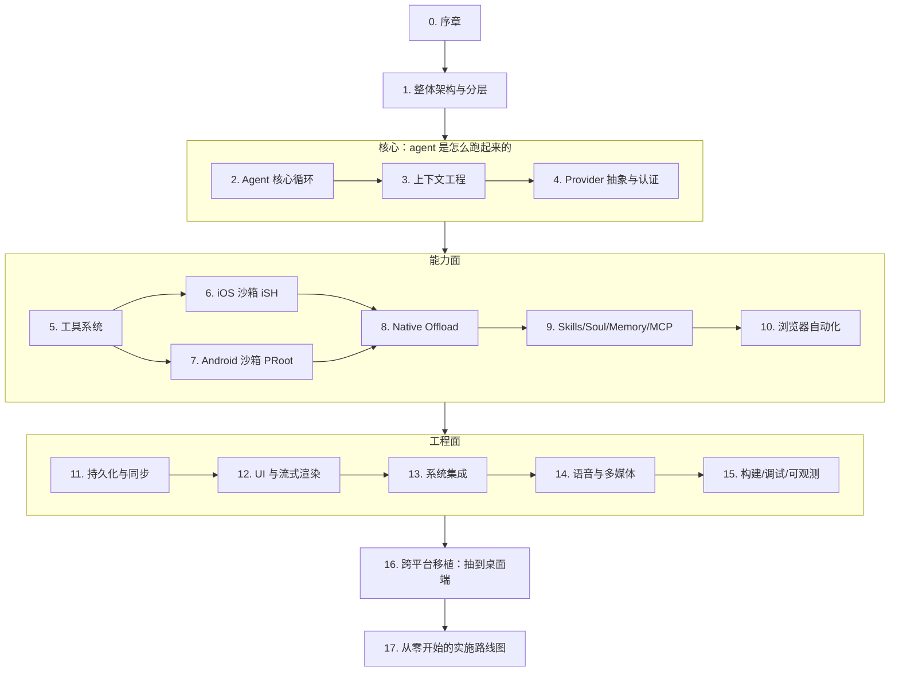

## 0. 序章：这本手册怎么用

### 0.1 这份文档是什么

这是对 **OpenMinis** 这一个真实、已上架、开源的移动端 AI Agent 应用的**逆向工程教学文档**。它不是 API 参考，也不是产品说明书；它回答的是一个工程问题：

> 如果我要从零写一个"能在手机上跑、能真正干活"的 AI Agent 应用，需要造哪些零件、每个零件的最小可用版本长什么样、哪些坑是平台强加的、哪些是设计者主动选择的？

素材全部来自仓库 `/Users/shenxt/Dev/PI/OpenMinis` 的源码本身。每一条技术论断都标注了文件路径与行号区间；凡是从代码推导而非直接观察到的结论，都显式标注 `[推断]`。

### 0.2 被研究的对象有多大

按 2026-07-26 仓库快照统计（`find` + `wc -l` 实测）：

| 平台 | 语言 | 文件数 | 行数 |
|---|---|---|---|
| iOS | Swift | 362 个唯一文件名 | 186,750 |
| iOS | Objective-C (`.m`/`.h`，几乎全在 `NativeOffloads/`) | 64 | 24,259（含头文件） |
| Android | Kotlin | 453 个唯一文件名 | 154,146 |
| Android | C/C++ (`src/main/cpp/`) | 3 个自研 + vendored cppjieba | — |
| 共享资产 | JSON + 校验脚本 | 3 | 298 |

分层规模（iOS，`src/ios/<dir>` 下 `.swift`+`.m`+`.h` 合计）：

| 目录 | 文件 | 行数 | 层 |
|---|---|---|---|
| `Agent/` | 103 | 65,966 | Agent 核心 |
| `Views/` | 79 | 55,947 | UI |
| `Providers/` | 63 | 27,378 | 模型接入 |
| `NativeOffloads/` | 64 | 24,259 | 设备能力桥 |
| `Debug/` | 27 | 13,478 | 调试基建 |
| `Shared/` | 53 | 8,188 | 跨模块工具 |
| `iSH/` | 14 | 6,586 | 沙箱内核集成 |
| `MinisTests/` + `MinisUITests/` | 16 | 3,009 | 测试 |

分层规模（Android，`com/openminis/app/<pkg>`）：

| 包 | 文件 | 行数 | 层 |
|---|---|---|---|
| `ui/` | 146 | 74,379 | UI |
| `sandbox/` | 36 | 14,900 | 沙箱 + offload handler |
| `data/` | 54 | 11,136 | 持久化 |
| `provider/` | 23 | 8,133 | 模型接入 |
| `debug/` | 12 | 5,310 | 调试基建 |
| `speech/` | 22 | 4,893 | 语音 |
| `config/` | 19 | 4,545 | 配置即工具 |
| `browser/` | 8 | 3,900 | 浏览器自动化 |
| `auth/` | 11 | 2,968 | 认证 |
| `service/` | 8 | 2,702 | 前台服务/后台执行 |
| `offload/` | 13 | 2,207 | offload 客户端侧 |
| `agent/` | 5 | 1,317 | 循环辅助（bashism、loop detector、soul） |
| `tools/` | 8 | 881 | 工具实现 |

值得注意的两个比例：

1. **UI 占比接近一半**（iOS 55,947 / Android 74,379）。Agent 应用的"难"不在调模型，在把流式、可中断、带富媒体与工具卡片的对话渲染得不掉帧。第 12 章专门讲这件事。
2. **`tools/` 只有 881 行，`sandbox/` 有 14,900 行**。这不是笔误：这个产品的工具能力主要不是靠一个个手写工具函数堆出来的，而是靠**给模型一个真实 Linux shell**，再用 native offload 把设备能力挂进去。这是全书最重要的架构判断，第 5–8 章围绕它展开。

### 0.3 代码里的设计追踪码：`[T-xxx]`

仓库里散落着 **662 个不同的 `[T-xxx]` 标签，共 2,566 处引用**（`grep -rhoE "\[T-[a-z0-9-]+\]"` 实测）。它们看起来像这样：

来源 `src/android/app/src/main/java/com/openminis/app/provider/LLMProvider.kt:28-42`：

```kotlin
/**
 * [T-android-tool-splits-reply-fix] True when the streamed assistant text
 * is one monolithic `content` string per response (OpenAI Chat
 * Completions): text deltas carry NO positional relationship to
 * tool_calls deltas … Some endpoints (qwen) flush trailing content chunks
 * after tool_calls deltas purely as a chunking artifact; reconstructing
 * those chronologically fabricates an order the wire format cannot express.
 */
val streamTextIsMonolithic: Boolean get() = false
```

这是一条**从线上 bug 反推出的协议语义结论**，被固化成了一个 provider 能力位。类似的还有：

| 标签 | 出现次数 | 讲的是什么 |
|---|---|---|
| `[T-android-thinking-level-arch]` | 41 | 思考等级的结构化钳制，见 §0.5 的例子 |
| `[T-android-provider-voice]` | 40 | 语音 provider 抽象 |
| `[T-android-voice-correction]` | 34 | 语音识别后处理纠错 |
| `[T-oauth-refresh-race]` | 20 | OAuth token 刷新竞态 |
| `[T-icloud-provider-sync-consistency]` | 21 | iCloud 同步一致性 |
| `[T-bash-on-demand]` | 跨双端 | Alpine 默认 ash 不是 bash，按需引导 |
| `[T-android-empty-stream-retry]` | — | 上游静默断流的检测（`LLMProvider.kt:120-162`） |

其中 **35 个标签同时出现在 iOS 与 Android 两侧**，372 个仅 iOS，255 个仅 Android。同时出现的那 35 个，就是"两端必须保持行为一致"的契约清单——第 16 章会用它来论证哪些逻辑值得抽成平台无关核心。

**读这份文档时，遇到 `[T-xxx]` 请当成"此处有一个非显然的、被真实用户报告驱动的设计决策"。** 它们是这个仓库最有价值的部分，因为教科书不会告诉你 qwen 端点会在 tool_calls 之后补发 content chunk。

### 0.4 章节地图与阅读路径



三条推荐路径：

- **想尽快跑通一个能用的 agent** → 0 → 1 → 2 → 4 → 5 → 17。跳过沙箱，工具先用纯原生实现。
- **想理解"给模型一台真电脑"这件事** → 0 → 1 → 6/7 → 8 → 5 → 9。
- **想把它移植到桌面** → 0 → 1 → 16 → 17，再按 16 章点名的章节回查。

### 0.5 一个贯穿全书的设计范式：结构化约束优于纪律约束

读代码时会反复看到同一种手法：**把"每个实现都必须记得做的事"变成类型系统或默认实现层面的强制**，而不是靠注释和 code review。

来源 `src/android/app/src/main/java/com/openminis/app/provider/LLMProvider.kt:44-106`：

```kotlin
/**
 * [T-android-thinking-level-arch] PUBLIC entry — this is what every caller
 * invokes. It is NOT overridden by providers: the default implementation
 * clamps the requested thinking level to the current [model]'s ceiling ONCE,
 * then delegates to [sendMessageClamped]. Making the clamp structural
 * (rather than a call each impl must remember) means no code path can send
 * an over-range level — a fallback that swapped [model] mid-flight clamps to
 * the NEW model's limit automatically. Mirrors iOS
 * AgentProvider.streamAgentMessage → …Clamped.
 */
suspend fun sendMessage(…): LLMResponse = sendMessageClamped(
    messages, systemPrompt, maxTokens, temperature, imageParts, tools,
    clampThinkingLevel(thinkingLevel),
)

/** Provider implementations override THIS (not [sendMessage]). The
 *  `thinkingLevel` received here has already been clamped … implementations
 *  must NOT re-clamp. */
fun streamMessageClamped(…): Flow<LLMStreamChunk>
```

模式是：**公开入口 = final + 做校验 → 委派给受保护的、由实现覆写的 `…Clamped` 变体**。注释里点名了它防住的具体事故：模型 fallback 中途换了 `model`，如果钳制写在调用点，换模型后就会用旧上限。

同样的范式在本书其它地方出现：

- 工具执行前的 preflight 门（第 5 章）——权限与参数校验不在每个工具里写，而在分发层拦一次。
- offload 的 `OffloadGate`（第 8 章）——沙箱进程发来的请求先过一道统一闸门。
- bashism 规则表（第 6/7 章）——iOS 与 Android 加载**同一份 JSON** (`src/shared/bashism/bashism_rules.json`)，两端只写匹配引擎，规则不可能漂移。

来源 `src/ios/Agent/Shell/BashismDetector.swift:7-9`：

```swift
/// (T-bash-on-demand). Rules and their fix hints live in the shared JSON
/// (`bashism_rules.json`, also loaded by Android) — this type is only the
/// matching engine.
```

来源 `src/android/app/src/main/java/com/openminis/app/agent/shell/BashismDetector.kt:10-13`：

```kotlin
 * switch to bash only when needed (T-bash-on-demand). The rule table and its
 * fix hints are the SHARED JSON (assets/bashism/bashism_rules.json, generated
 * from src/shared/bashism — the same file iOS loads), so the two platforms can
 * never drift.
```

Gradle 侧的搬运（`src/android/app/build.gradle.kts:124-128`）：

```kotlin
from(rootProject.file("../shared/bashism")) {
    include("bashism_rules.json", "bashism_test_vectors.json")
}
into(layout.projectDirectory.dir("src/main/assets/bashism"))
```

Xcode 侧则直接以 `path = ../shared/bashism/bashism_rules.json` 引用同一物理文件（`src/ios/Minis.xcodeproj/project.pbxproj:716-717`）。

这就是整个仓库在"共享代码"这件事上的实际立场：**不共享代码，共享数据与测试向量**。第 16 章会详细论证这个选择的得失。

### 0.6 需要先摆正的三个期待

1. **这不是一个 Kotlin Multiplatform / Flutter 项目。** 两端各写一遍，共享的只有 3 个文件、298 行。这是刻意的，理由见第 16 章。
2. **没有 CI。** `.github/` 下只有 `pull_request_template.md` 和 `ISSUE_TEMPLATE/bug_report.md`，**没有任何 workflow**。README 也说明这是私有开发树的镜像，不接受 PR。质量门禁靠 `src/shared/bashism/validate_detector.swift` 这类独立回归脚本、Android 单测与 instrumented 测试承担。第 15 章会指出这块的空白与读者应当补什么。
3. **首次构建重。** 原生依赖（iSH、PRoot、FFmpeg、LAME）与 Alpine rootfs 都从源码构建，`BUILDING.md` 给的预算是 30–60 分钟。第 15 章拆解这条流水线。

### 0.7 术语约定

| 本文用词 | 英文 / 代码中的名字 | 含义 |
|---|---|---|
| 沙箱 | sandbox | 跑在 App 进程内的 Linux 环境（iSH 或 PRoot + Alpine） |
| 原生卸载 | native offload | 沙箱内进程调用宿主 App 原生能力的机制 |
| 提供方 | provider | 一个模型服务接入点（Anthropic / OpenAI / Gemini / …） |
| 技能 | skill | 含 `SKILL.md` 的文件夹，按需加载的能力包 |
| 灵魂 | soul | 用户可编辑的人格/长期指令预设（`[T-soul-md]`） |
| 压缩 | compaction | 上下文超限时对历史做摘要与裁剪 |
| 工具循环 | agent loop | 「请求 → 工具调用 → 结果回灌 → 再请求」的多轮编排 |
| 会话 | session | 一个独立对话及其附属文件、工作区、锁 |
| 工作区 | workspace | 会话绑定的可读写目录，`minis://workspace/` 寻址 |
