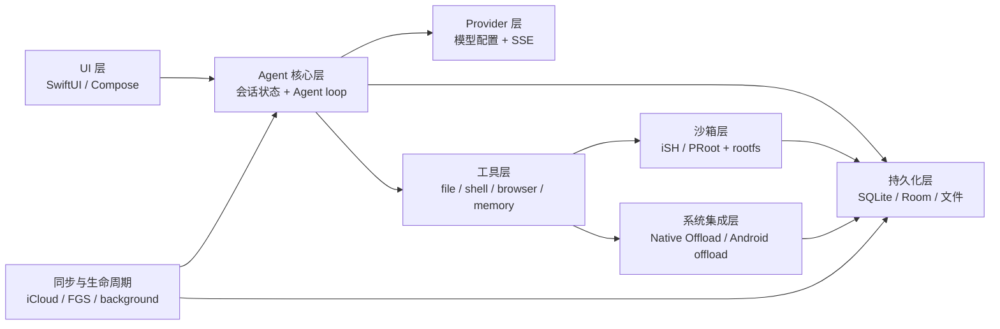
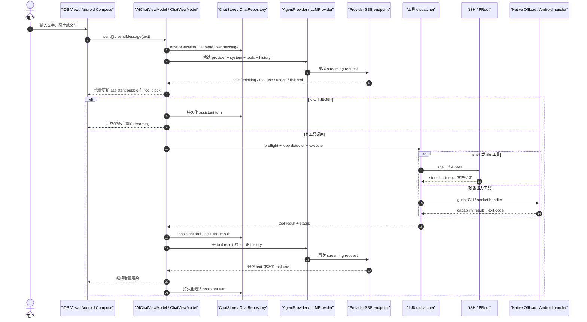

## 1. 整体架构与分层设计

### 1.1 这一章解决什么问题

OpenMinis 不是“聊天页面直接调用一个 HTTP 接口”，而是把 UI、Agent loop、模型 Provider、工具分发、Linux 用户态环境、原生能力和持久化拼成一个可恢复的请求系统；iOS 的主入口是 `MinisApp`，Agent 入口是 `AIChatViewModel`，Android 的主入口是 `MinisApp`/`MainActivity`，Agent 入口是 `ChatViewModel`（`src/ios/MinisApp.swift:75-151`、`src/ios/Agent/Chat/AIChatViewModel.swift:14-15`、`src/android/app/src/main/java/com/openminis/app/MinisApp.kt:60-94`、`src/android/app/src/main/java/com/openminis/app/ui/chat/ChatViewModel.kt:85-93`）。

这一章要解决的是“从哪里启动、状态放在哪里、请求经过哪些边界、每个目录为什么存在”，而不是解释某一个 Provider 的 JSON 字段或某个工具的参数；启动阶段可见的依赖关系分别集中在 iOS `MinisApp.body` 和 Android `MinisApp.onCreate`（`src/ios/MinisApp.swift:148-326`、`src/android/app/src/main/java/com/openminis/app/MinisApp.kt:153-482`）。

读者应当能用本章的目录地图定位后续专题：比如“模型配置”落在 `Providers/` 或 `provider/`，“消息循环”落在 `Agent/Chat/` 或 `ui/chat/`，“真实 Linux”落在 `iSH/` 或 `sandbox/`（`src/ios/Agent/Chat/AIChatViewModel.swift:4207-4267`、`src/android/app/src/main/java/com/openminis/app/ui/chat/ChatViewModel.kt:5779-6030`、`src/ios/iSH/ISHKernel.m:334-450`、`src/android/app/src/main/java/com/openminis/app/sandbox/PRootKernel.kt:53-179`）。

同一个抽象在两端并不总是同一个技术实现：iOS 以 SwiftUI `@MainActor`/`ObservableObject` 和 actor 为主，Android 以 Compose、`ViewModel`、`StateFlow`、Room 和 Application 作用域对象为主（`src/ios/Agent/Chat/AIChatViewModel.swift:14-15`、`src/ios/Agent/Chat/ChatStore.swift:352-357`、`src/android/app/src/main/java/com/openminis/app/ui/chat/ChatViewModel.kt:85-93`、`src/android/app/src/main/java/com/openminis/app/data/db/AppDatabase.kt:20-26`）。

### 1.2 先建立一张架构地图

可以把仓库先压缩成七层。下面的箭头表达数据依赖，不表示每一层只有一个目录：Agent 核心会同时依赖 Provider、工具和持久化，工具又可能进入沙箱或系统集成边界（`src/ios/Agent/Chat/AIChatViewModel+ToolDefinitions.swift:9-20`、`src/android/app/src/main/java/com/openminis/app/tools/AgentTools.kt:7-36`）。



这张图有三个容易被忽略的事实。

1. UI 只负责把会话和输入交给 ViewModel，并观察渲染状态；Android `ChatScreen` 通过 `viewModel(...)` 获取会话 VM，iOS `AIChatView` 通过 `CachedViewModel` 包住缓存 VM（`src/android/app/src/main/java/com/openminis/app/ui/chat/ChatScreen.kt:380-429`、`src/ios/Views/Chat/AIChatView.swift:15-65`）。
2. Provider 不是 Agent loop。Provider 只提供统一的流式接口；工具循环、重试、fallback、tool result 回灌仍在 VM 内（`src/ios/Providers/AgentProvider.swift:174-208`、`src/android/app/src/main/java/com/openminis/app/provider/LLMProvider.kt:13-118`、`src/ios/Agent/Chat/AIChatViewModel.swift:4701-4788`、`src/android/app/src/main/java/com/openminis/app/ui/chat/ChatViewModel.kt:6006-6030`）。
3. “本地能力”不是直接塞进 Provider。工具层先决定语义，再由 iSH/PRoot 的 guest 命令或 native-offload IPC 进入系统边界（`src/ios/iSH/ISHKernel.m:413-445`、`src/android/app/src/main/java/com/openminis/app/sandbox/NativeOffload.kt:15-26`）。

目录关系可以先记成如下两组平行树：

| 抽象层 | iOS 主要目录 | Android 主要目录 | 关键边界 |
|---|---|---|---|
| UI | `src/ios/Views/ContentView.swift:322-399`、`src/ios/MinisApp.swift:148-214` | `src/android/app/src/main/java/com/openminis/app/ui/navigation/AppNavigation.kt:488-532`、`src/android/app/src/main/java/com/openminis/app/MainActivity.kt:346-443` | UI 观察 VM，不直接持有网络流 |
| Agent 核心 | `src/ios/Agent/Chat/AIChatViewModel.swift:4207-4267`、`src/ios/Agent/ToolLoopDetector.swift:61-83` | `src/android/app/src/main/java/com/openminis/app/ui/chat/ChatViewModel.kt:5779-6030`、`src/android/app/src/main/java/com/openminis/app/agent/ToolLoopDetector.kt:62-88` | 一个用户 turn 可能包含多轮模型→工具→模型 |
| Provider | `src/ios/Providers/AgentProvider.swift:176-208`、`src/ios/Providers/ProviderConfigStore.swift:132-159` | `src/android/app/src/main/java/com/openminis/app/provider/LLMProvider.kt:13-118`、`src/android/app/src/main/java/com/openminis/app/data/repository/ProviderRepository.kt:148-210` | provider-specific wire format 收敛到统一事件 |
| 工具 | `src/ios/Agent/Chat/AIChatViewModel+ToolDefinitions.swift:9-20`、`src/ios/Agent/Chat/AIChatViewModel.swift:5209-5294` | `src/android/app/src/main/java/com/openminis/app/tools/AgentTools.kt:14-36`、`src/android/app/src/main/java/com/openminis/app/ui/chat/ChatViewModel.kt:7101-7152` | 定义与执行分离；执行结果要变成 tool result |
| 沙箱 | `src/ios/iSH/ISHKernel.h:18-49`、`src/ios/Agent/ISH/ISHExecutionCoordinator.swift:87-134` | `src/android/app/src/main/java/com/openminis/app/sandbox/PRootKernel.kt:53-179`、`src/android/app/src/main/java/com/openminis/app/sandbox/ExecutionCoordinator.kt:72-115` | guest 路径与 host 路径隔离 |
| 持久化 | `src/ios/Agent/Chat/ChatStore.swift:352-397`、`src/ios/Providers/ProviderConfigStore.swift:153-159` | `src/android/app/src/main/java/com/openminis/app/data/db/AppDatabase.kt:20-22`、`src/android/app/src/main/java/com/openminis/app/data/repository/ChatRepository.kt:222-255` | UI 内存状态可重建，SQLite/Room 是恢复依据 |
| 系统集成 | `src/ios/NativeOffloads/CalendarOffload.m:1171-1178`、`src/ios/Agent/Offload/OffloadPermissionManager.swift:6-23`、`src/ios/Agent/Intents/SendPromptIntent.swift:30-51` | `src/android/app/src/main/java/com/openminis/app/sandbox/NativeOffload.kt:72-103`、`src/android/app/src/main/java/com/openminis/app/offload/OffloadPermissionManager.kt:13-43`、`src/android/app/src/main/java/com/openminis/app/service/SessionActivityTracker.kt:24-45` | 权限、后台、通知、Health/Calendar 等越过平台边界 |

### 1.3 iOS：从进程启动到首个聊天页面

#### 1.3.1 启动入口的四个阶段

iOS 同时使用 SwiftUI App 生命周期和一个很小的 UIKit Delegate 适配器。`AppDelegate` 的存在不是为了接管整个应用，而是为了接收 Home Screen Quick Action；其余 URL、scenePhase 和根视图仍由 SwiftUI `App` 管理（`src/ios/AppDelegate.swift:5-15`、`src/ios/MinisApp.swift:83-92`）。

| 阶段 | 入口 | 主要动作 | 依赖关系 |
|---|---|---|---|
| A. App 实例化 | `MinisApp.init` | 锁定进程启动时间；DEBUG 启动 DebugServer；安装 TextKit 防护；设置语言；预热 SOUL、KaTeX、生物识别、Live Activity 和屏幕常亮 | 不依赖 `ContentView` 已渲染；这些动作必须早于首个 UIKit/SwiftUI 子树 |
| B. UIKit 冷启动 | `AppDelegate.application(_:didFinishLaunchingWithOptions:)` | 失效旧的 `CLBackgroundActivitySession`；注册通知 delegate；刷新快捷操作 | 冷启动通知必须在 `didFinishLaunching` 返回前注册 |
| C. Scene 连接 | `SceneDelegate.scene(_:willConnectTo:options:)` | 消费冷启动快捷操作和冷启动 URL；暖启动快捷操作走 `windowScene` | 自定义 SceneDelegate 后，URL 必须显式转发到共享导入管线 |
| D. SwiftUI 根场景 | `MinisApp.body` | 挂载 `ContentView`、全局语音控制、锁屏层、环境对象、URL 路由和根级确认 sheet | `ContentView` 共享同一 `ShareCoordinator` |
| E. 根视图出现 | `MinisApp.body.onAppear` | 配置注册、日志、Provider 迁移/模型刷新、分享缓冲、后台管理、网络监控、iSH 目录监视、同步引擎 | 这些大多是幂等或后台 Task；不能假定只调用一次 |
| F. 聊天页出现 | `AIChatView.onAppear` | 获取/加载指定 session VM，并触发 `ensureKernelBooted` | Linux kernel 延迟到聊天页或发送路径，而不是 App 冷启动 |

表中 A→F 是根据 SwiftUI `App`、`UIApplicationDelegate`、`UIWindowSceneDelegate` 和 SwiftUI `onAppear` 的入口关系整理出的启动顺序，属于 `[推断]`；每个动作本身和依赖关系都由右侧代表符号与行号直接验证，不能把 `[推断]` 误读为一个单一函数调用栈。

阶段 A 的真实初始化代码如下。这里的“单例”多数通过 `shared` 访问；`debugServer` 只有 DEBUG 构建存在（`src/ios/MinisApp.swift:99-145`）。

```swift
@main
struct MinisApp: App {
    @UIApplicationDelegateAdaptor(AppDelegate.self) private var appDelegate
    @StateObject private var shareCoordinator = ShareCoordinator.shared

    init() {
        _ = Self.processLaunchedAt
        #if DEBUG
        try? debugServer.start(port: 8321)
        #endif
        NSTextContainerSetSizeGuard.install()
        AttributeQueryRecorder.install()
        Bundle.enableLanguageOverride()
        let lang = UserDefaults.standard.string(forKey: "appLanguage") ?? ""
        Bundle.setLanguage(lang.isEmpty ? nil : lang)
        SoulStore.refreshCache()
        KaTeXRenderer.shared.warmUp()
        BiometricAuth.prewarm()
        AgentLiveActivityManager.shared.cleanupStaleActivities(source: "MinisApp.init")
        Task { @MainActor in KeepScreenAwakeController.shared.start() }
    }
}
```

代码位置：`src/ios/MinisApp.swift:75-145`。

这里有一个启动顺序约束：`Bundle.enableLanguageOverride()` 必须先于 `Bundle.setLanguage`，而 `SoulStore.refreshCache()` 必须早于 `ContentView` 读取自己的 `@State soulName`；后者是从初始化代码和注释直接可见的依赖（`src/ios/MinisApp.swift:122-132`）。

#### 1.3.2 AppDelegate 只补 UIKit 缺口

`AppDelegate.application(_:didFinishLaunchingWithOptions:)` 在 iOS 17 可用时清理背景活动，随后调用 `ShortcutNotificationDelegate.shared.register()`，并异步刷新快捷操作（`src/ios/AppDelegate.swift:23-56`）。它还返回一个配置了 `SceneDelegate` 的 `UISceneConfiguration`，因此冷启动和暖启动快捷操作都能落到 SceneDelegate（`src/ios/AppDelegate.swift:59-71`）。

```swift
func application(
    _ application: UIApplication,
    didFinishLaunchingWithOptions launchOptions: [UIApplication.LaunchOptionsKey: Any]? = nil
) -> Bool {
    if #available(iOS 17.0, *) {
        CLBackgroundActivitySession().invalidate()
    }
    ShortcutNotificationDelegate.shared.register()
    Task { @MainActor in
        QuickActionRouter.registerShortcutItems()
    }
    return true
}

func application(
    _ application: UIApplication,
    configurationForConnecting connectingSceneSession: UISceneSession,
    options: UIScene.ConnectionOptions
) -> UISceneConfiguration {
    let config = UISceneConfiguration(name: nil, sessionRole: connectingSceneSession.role)
    config.delegateClass = SceneDelegate.self
    return config
}
```

代码位置：`src/ios/AppDelegate.swift:25-71`。

SceneDelegate 有两条快捷操作路径：冷启动从 `connectionOptions.shortcutItem` 消费，暖启动从 `windowScene(_:performActionFor:completionHandler:)` 消费；两者都转发给 `QuickActionRouter.shared.handle`（`src/ios/AppDelegate.swift:74-133`）。自定义 scene delegate 还会截住 URL，因此冷启动 `connectionOptions.urlContexts` 和暖启动 `scene(_:openURLContexts:)` 都必须调用 `handleURLContexts`（`src/ios/AppDelegate.swift:109-161`）。

#### 1.3.3 根 WindowGroup 如何注入全局对象

根场景把 `ContentView` 和三个全局覆盖层放进同一个 `ZStack`：后台中断横幅、语音播放器控制、应用锁层（`src/ios/MinisApp.swift:148-162`）。`shareCoordinator` 作为 `EnvironmentObject` 注入，因此 `ContentView`、`AIChatView` 和 scene URL 处理共享同一个实例（`src/ios/MinisApp.swift:196-214`、`src/ios/Views/ContentView.swift:112-114`、`src/ios/Views/Chat/AIChatView.swift:169-184`）。

```swift
WindowGroup {
    ZStack {
        ContentView()
            .overlay(alignment: .top) {
                BackgroundInterruptionBanner()
            }
        AudioPiPCapsule()
        SpeechPlayerControl()
        AppLockOverlay()
    }
    .environmentObject(shareCoordinator)
    .preferredColorScheme(
        appearanceMode == 1 ? .light : appearanceMode == 2 ? .dark : nil
    )
    .environment(\.locale, appLanguage.isEmpty ? .current : Locale(identifier: appLanguage))
    .onOpenURL { url in
        guard !SessionLockStore.shared.appIsLocked else {
            pendingURLWhileLocked = url
            return
        }
        if ExternalFileImporter.canIngest(url) {
            ExternalFileImporter.ingest(url, into: shareCoordinator)
            return
        }
        DeepLinkRouter.handle(url: url, shareCoordinator: shareCoordinator)
    }
}
```

代码位置：`src/ios/MinisApp.swift:148-214`。

根 `onAppear` 再进行一次应用级 bootstrap：配置字段注册、通知 delegate、日志、Provider 配置迁移和模型刷新、分享缓冲、后台管理、网络监控、FileProvider、外部目录 security scope、挂载目录和 iCloud sync（`src/ios/MinisApp.swift:247-312`）。它的顺序很重要：网络监控在 iSH DNS 同步之前启动，外部目录激活在 `AIChatViewModel.refreshMountedFolderSymlinks()` 之前，Sync v2 先启动并决定是否暂停 v1（`src/ios/MinisApp.swift:280-312`）。

#### 1.3.4 ContentView 负责“选中哪个 session”，不负责 Agent loop

`ContentView.body` 根据设备宽度选择 `NavigationSplitView` 或 `NavigationStack`，再监听快捷操作、分享和 session 更新（`src/ios/Views/ContentView.swift:322-399`）。进入窄屏导航时，草稿 ID 以 `__new__` 前缀标记；真正的 `AIChatView` 接收 `nil` sessionId，让 VM 在第一次发送时创建数据库 session（`src/ios/Views/ContentView.swift:917-955`）。

```swift
private var stackLayout: some View {
    NavigationStack(path: $navigationPath) {
        sessionList(useNavigationLinks: true)
            .navigationDestination(for: String.self) { id in
                AIChatView(
                    sessionId: Self.isNewSessionId(id) ? nil : id,
                    draftId: Self.isNewSessionId(id) ? id : nil,
                    initialGroupId: Self.extractGroupId(from: id)
                )
                .id(id)
            }
    }
}
```

代码位置：`src/ios/Views/ContentView.swift:915-955`。

`AIChatView` 的 `CachedViewModel` 从 `ViewModelCache` 获取按 session ID 缓存的 VM，并转发 `objectWillChange`；因此返回列表再进入同一 session 不会必然取消仍在运行的 Agent loop（`src/ios/Views/Chat/AIChatView.swift:15-65`、`src/ios/Agent/Chat/ChatLifecycleSupport.swift:334-405`）。聊天页再把 `vm.sessionId` 注入自定义环境键，并把 VM 注入 `EnvironmentObject`，深层工具面板无需逐层传递 VM（`src/ios/Views/Chat/AIChatView.swift:601-603`、`src/ios/Views/Chat/AIChatView.swift:1360-1364`）。

#### 1.3.5 iOS 首个请求之前，Linux 仍然可能没有启动

`AIChatView.onAppear` 会调用 `vm.ensureKernelBooted()`；该方法先安装 rootfs，再调用 `ISHKernel.shared.boot(withRootPath:)`，启动成功后安装 fakefs 变更追踪器和 per-session path-translate hook（`src/ios/Views/Chat/AIChatView.swift:1079-1116`、`src/ios/Agent/Chat/AIChatViewModel+Misc.swift:12-50`）。因此“应用已打开”不等于“Linux 已经可执行”。

### 1.4 Android：Application 先建骨架，Activity 再挂 UI

#### 1.4.1 `MinisApp` 的初始化顺序

Android 把跨 Activity 的依赖放在 `Application`。`MinisApp` 持有 `AppDatabase`、Chat/Provider/EnvVar/Skill/MCP/Memory 等 repository，以及后台设置、通知器和挂载目录 store（`src/android/app/src/main/java/com/openminis/app/MinisApp.kt:60-82`）。它还提供进程级网络监控和浏览器池（`src/android/app/src/main/java/com/openminis/app/MinisApp.kt:110-124`）。

| 阶段 | `MinisApp` 动作 | 为什么必须在这个位置 |
|---|---|---|
| A. `attachBaseContext` | ACRA 初始化 | 在任何 app-level singleton 前捕获后续崩溃（`src/android/app/src/main/java/com/openminis/app/MinisApp.kt:126-150`） |
| B. `onCreate` 前置保护 | ACRA reporter process 直接返回；prime Fast Mode；安装 native crash handler、FGS exception handler、crash frequency detector | `:acra` 进程不能重复打开 DB、socket 和 offload；safe mode 要阻断重型子系统（`src/android/app/src/main/java/com/openminis/app/MinisApp.kt:153-255`） |
| C. 诊断与数据库 | AppLogger、LaunchCycleBeacon、HangDetector；构造 `AppDatabase` 和 repositories | 后续启动日志、冷启动熔断和 UI 依赖这些对象（`src/android/app/src/main/java/com/openminis/app/MinisApp.kt:257-294`） |
| D. 配置与模型 | SOUL、配置权限/审计、ConfigRegistry、ModelsDevApi | Agent 和设置 UI 需要统一的配置读写面（`src/android/app/src/main/java/com/openminis/app/MinisApp.kt:295-315`） |
| E. 沙箱准备 | RootfsManager、ExecutionCoordinator、EnvVar redactor、network monitor、全局 bind mount、MountedFoldersStore | shell 工具必须能读到 `/var/minis` 的全局目录，执行器必须能拿到 env repository（`src/android/app/src/main/java/com/openminis/app/MinisApp.kt:316-365`） |
| F. Native offload | 注册每个 handler，启动 `NativeOffloadServer` | Handler 注册必须先于 server start；PRoot 后续会为 handler 安装 guest stub（`src/android/app/src/main/java/com/openminis/app/MinisApp.kt:367-429`） |
| G. 生命周期与服务 | SessionActivityTracker、SessionBadgeStore、后台 notifier、ActivityLifecycleCallbacks、权限 manager、speech manager、模型刷新 | Activity 创建前后都可能触发后台任务或权限请求（`src/android/app/src/main/java/com/openminis/app/MinisApp.kt:431-601`） |

数据库和 repository 的依赖顺序是源码中的连续赋值：先拿 singleton `AppDatabase`，再把 DAO 交给 `ChatRepository`，之后才构造其它 repository（`src/android/app/src/main/java/com/openminis/app/MinisApp.kt:286-294`）。沙箱依赖关系同样显式：`ExecutionCoordinator.init(this)` 之后把 `envVarRepository` 写入 coordinator；`NativeOffloadServer.start` 使用 `RootfsManager.getInstance(this).rootfsDir`（`src/android/app/src/main/java/com/openminis/app/MinisApp.kt:316-319`、`src/android/app/src/main/java/com/openminis/app/MinisApp.kt:429-430`）。

```kotlin
database = AppDatabase.getInstance(this)
chatRepository = ChatRepository(database.chatDao())
providerRepository = ProviderRepository(this)
envVarRepository = EnvVarRepository(this)
skillRepository = SkillRepository(this)
mcpRepository = MCPRepository(this)
memoryRepository = MemoryRepository(File(filesDir, "minis-global/memory"))

RootfsManager.getInstance(this)
ExecutionCoordinator.init(this)
ExecutionCoordinator.envVarRepository = envVarRepository
EnvVarPrivacyStore.init(this)
EnvVarRedactor.envVarRepository = envVarRepository
networkMonitor.start(this)
PRootKernel.registerGlobalBindMounts(this)
```

代码位置：`src/android/app/src/main/java/com/openminis/app/MinisApp.kt:286-335`。

Provider 配置在 Android 构造时不进行大块同步读盘，而是先以空 `ProviderConfig` 初始化 `MutableStateFlow`，再在 `Dispatchers.IO` 读取并发出真实配置（`src/android/app/src/main/java/com/openminis/app/data/repository/ProviderRepository.kt:148-210`）。这使 Application 的启动依赖图不会被大 JSON 的首次反序列化阻塞，但也意味着第一帧 UI 必须区分“尚未加载”和“确实没有 provider”（`src/android/app/src/main/java/com/openminis/app/data/repository/ProviderRepository.kt:158-170`）。

#### 1.4.2 Native offload 的注册顺序

`MinisApp.onCreate` 注册 alarm、calendar、clipboard、contacts、device、location、notification、photos、speech、browser、sessions、scheduled、Shizuku 等 handler，然后再调用 `NativeOffloadServer.start`（`src/android/app/src/main/java/com/openminis/app/MinisApp.kt:367-429`）。Server 的协议注释说明 guest 通过 `execve(handler-name)` 进入抽象 Unix socket，host handler 把结果写入 guest `/tmp` 并返回退出码和路径（`src/android/app/src/main/java/com/openminis/app/sandbox/NativeOffload.kt:15-26`）。

```kotlin
fun register(name: String, handler: NativeOffloadHandler) {
    require(name.isNotEmpty())
    handlers[name] = handler
}

@Synchronized
fun start(rootfsDir: File) {
    rootfsTmpDir = File(rootfsDir, "tmp")
    if (serverSocket != null) return
    val s = bindWithRetry() ?: throw IOException("failed to bind abstract socket")
    serverSocket = s
    acceptThread = thread(name = "native-offload-accept", isDaemon = true) {
        runAcceptLoop(s)
    }
}
```

代码位置：`src/android/app/src/main/java/com/openminis/app/sandbox/NativeOffload.kt:72-103`。

#### 1.4.3 MainActivity 把系统桥和 Compose 根挂上去

`MainActivity.onCreate` 先注册 Activity Result launcher，再处理 safe mode；safe mode 下不调用 `setContent`，避免引用 Application 中未初始化的重型依赖（`src/android/app/src/main/java/com/openminis/app/MainActivity.kt:120-201`）。随后恢复 session ID、启动权限流和 settings gate 流，把分享缓冲处理在首个 `ChatScreen` compose 之前（`src/android/app/src/main/java/com/openminis/app/MainActivity.kt:203-309`）。

```kotlin
val app = application as MinisApp
val explicitDeepLink = DeepLinkHandler.parse(intent?.data)
val launchDeepLink = if (explicitDeepLink !is DeepLinkAction.Unknown) {
    explicitDeepLink
} else {
    restoredChatSessionId?.let { DeepLinkAction.OpenSession(it) }
        ?: DeepLinkAction.Unknown
}

setContent {
    MinisTheme(darkTheme = darkTheme, fontScale = fontScale) {
        val navController = rememberNavController().also { this.navController = it }
        AppNavigation(
            chatRepository = app.chatRepository,
            providerRepository = app.providerRepository,
            envVarRepository = app.envVarRepository,
            skillRepository = app.skillRepository,
            mcpRepository = app.mcpRepository,
            memoryRepository = app.memoryRepository,
            navController = navController,
            initialDeepLink = launchDeepLink,
        )
        ConfigConfirmDialogHost()
    }
}
```

代码位置：`src/android/app/src/main/java/com/openminis/app/MainActivity.kt:329-443`。

`AppNavigation` 接收 Application 作用域 repository，并从 `MinisApp` 取同一个 `mountedFoldersStore`；注释明确指出重新 `remember` 一个 store 会使 UI 和 PRootKernel 看到不同实例（`src/android/app/src/main/java/com/openminis/app/ui/navigation/AppNavigation.kt:210-231`）。

#### 1.4.4 启动目标、深链和 NavHost

导航先处理 initial deep link，再解析 Launch Session 偏好和 crash/hang 熔断，最后决定 `SESSION_LIST`、旧 session 或草稿 chat。启动过程使用 `navController.navigate`，而不是等待普通点击安全门，因为第一次 composition 时 start destination 还未进入 RESUMED（`src/android/app/src/main/java/com/openminis/app/ui/navigation/AppNavigation.kt:233-371`）。

HTML shortcut 或 quick action 会在 NavHost 挂载前把 pending 状态写入 coordinator，然后直接把 `startDestination` 设为目标 chat，从而不出现 session list 闪烁（`src/android/app/src/main/java/com/openminis/app/ui/navigation/AppNavigation.kt:391-434`）。`NavHost` 的 session list route 把 repository 和点击回调注入 `SessionListScreen`，chat route 再把多个 repository 注入 `ChatScreen`（`src/android/app/src/main/java/com/openminis/app/ui/navigation/AppNavigation.kt:488-532`）。

### 1.5 分层机制与目录职责

下面的映射不是按“文件名像什么”推断，而是按实际调用点划分：入口负责组装，ViewModel 负责 turn 状态，Provider 负责流，工具负责动作，沙箱负责 Linux 进程和路径，持久化负责恢复，系统集成负责权限/后台/设备 API（`src/ios/MinisApp.swift:247-312`、`src/android/app/src/main/java/com/openminis/app/MinisApp.kt:286-429`）。

#### 1.5.1 UI 层

| 平台 | 目录与代表符号 | 责任边界 |
|---|---|---|
| iOS 根 UI | `src/ios/Views/ContentView.swift:322-399` `ContentView.body` | 选择宽屏/窄屏导航，接收 quick action 和 session 更新 |
| iOS 聊天 UI | `src/ios/Views/Chat/AIChatView.swift:169-232` `AIChatView` | 创建稳定的 `CachedViewModel`，绑定输入和全局观察对象 |
| iOS 消息渲染 | `src/ios/Agent/MessageList/CollectionViewMessageListV3.swift:14-48` `CollectionViewMessageListV3` | SwiftUI/UICollectionView 桥、块级消息、滚动和高度缓存 |
| iOS 设置/Provider | `src/ios/Views/Settings/StorageManagementView.swift:3-48`、`src/ios/Views/Providers/ProviderInstancesView.swift:4-15` | 通过 `@Published` store 展示配置和存储，不执行 Agent loop |
| iOS Linux 页面 | `src/ios/Views/Rootfs/ISHTerminalView.swift:308-378` `startShell` | 终端 UI 只负责启动/挂载/输入输出呈现 |
| Android 根导航 | `src/android/app/src/main/java/com/openminis/app/ui/navigation/AppNavigation.kt:210-231` `AppNavigation` | 把 Application repository 注入导航图，消费 deep link |
| Android 聊天 UI | `src/android/app/src/main/java/com/openminis/app/ui/chat/ChatScreen.kt:378-429` `ChatScreen` | 获取 session-scoped VM，`collectAsState` 订阅 UI 状态 |
| Android 会话列表 | `src/android/app/src/main/java/com/openminis/app/ui/sessions/SessionListScreen.kt:1-58` `SessionListScreen` | LazyColumn 列表和用户导航动作 |
| Android 设置/终端/浏览器 | `src/android/app/src/main/java/com/openminis/app/ui/settings/SettingsScreen.kt:1-58`、`ui/terminal/TerminalScreen.kt:1-48`、`ui/browser/BrowserSheet.kt:1-48` | Compose 页面与页面级状态，调用 VM/manager |
| Android rootfs 页面 | `src/android/app/src/main/java/com/openminis/app/ui/sandbox/RootfsManagementViewModel.kt:28-48` `RootfsManagementViewModel` | 以 StateFlow 呈现 rootfs 安装进度，不直接构造 PRoot 命令 |

UI 层的关键原则是“状态订阅而不是跨层查询”。Android `ChatScreen` 通过多个 `collectAsState` 获取 messages、isStreaming、modelName、attachments 等；iOS `AIChatView` 通过 `@StateObject` 包装 cache 并把 VM 的 `objectWillChange` 转发给 SwiftUI（`src/android/app/src/main/java/com/openminis/app/ui/chat/ChatScreen.kt:413-452`、`src/ios/Views/Chat/AIChatView.swift:19-65`）。

#### 1.5.2 Agent 核心层

| 平台 | 目录与代表符号 | 责任 |
|---|---|---|
| iOS | `src/ios/Agent/Chat/AIChatViewModel.swift:14-18` `AIChatViewModel` | `@MainActor` UI 状态、session history、send、Agent loop |
| iOS | `src/ios/Agent/Chat/AIChatViewModel+SSEStream.swift:214-327` `processStreamEvents` | 把统一 stream event 转成 assistant blocks 和 UI 更新 |
| iOS | `src/ios/Agent/Chat/AIChatViewModel+ToolDefinitions.swift:9-20` `makeAgentTools` | 生成 provider-agnostic 工具 schema |
| iOS | `src/ios/Agent/ToolLoopDetector.swift:61-83` `ToolLoopDetector.check` | 识别重复/危险工具循环；调用点见 `src/ios/Agent/Chat/AIChatViewModel.swift:5260-5294` |
| Android | `src/android/app/src/main/java/com/openminis/app/ui/chat/ChatViewModel.kt:85-93` `ChatViewModel` | ViewModel 作用域、StateFlow、history、stream job |
| Android | `src/android/app/src/main/java/com/openminis/app/ui/chat/ChatViewModel.kt:5779-5891` `runAgentLoop` | 轮次上限、assistant 占位、上下文卸载和循环控制 |
| Android | `src/android/app/src/main/java/com/openminis/app/ui/chat/ChatViewModel.kt:6006-6030` | 调 Provider stream，并收集 chunk |
| Android | `src/android/app/src/main/java/com/openminis/app/agent/ToolLoopDetector.kt:62-88` `ToolLoopDetector` | 工具执行前检查和执行后记录 |

两端 Agent 核心都把“一个用户输入”视为可重复的 turn：无工具调用时结束，有工具调用时持久化 assistant tool_use、执行工具、持久化 tool_result，再次请求模型（`src/ios/Agent/Chat/AIChatViewModel.swift:5054-5185`、`src/ios/Agent/Chat/AIChatViewModel.swift:5209-5456`、`src/android/app/src/main/java/com/openminis/app/ui/chat/ChatViewModel.kt:6615-6693`、`src/android/app/src/main/java/com/openminis/app/ui/chat/ChatViewModel.kt:6716-7029`）。

#### 1.5.3 Provider 层

| 平台 | 目录与代表符号 | 责任 |
|---|---|---|
| iOS Provider 协议 | `src/ios/Providers/AgentProvider.swift:174-208` `AgentProvider` | 统一 `AsyncThrowingStream<AgentStreamEvent, Error>` 接口和思考级别 clamp |
| iOS Provider 工厂 | `src/ios/Agent/Chat/AIChatViewModel+ProviderFactory.swift:11-46` `makeAgentProvider` | 从 `ModelEntry` 找 instance、凭证和具体 provider |
| iOS Provider 状态 | `src/ios/Providers/ProviderConfigStore.swift:132-159` `ProviderConfigStore` | `@MainActor` 单一配置源、实例/模型/group/binding |
| iOS 具体实现 | `src/ios/Providers/Anthropic/AnthropicAgentProvider.swift:8-15`、`:47-60` | 把 canonical message/tool 转成 SDK 请求，产生 stream |
| Android Provider 协议 | `src/android/app/src/main/java/com/openminis/app/provider/LLMProvider.kt:13-118` `LLMProvider` | 统一 `Flow<LLMStreamChunk>`，提供 max token 和 thinking clamp |
| Android Provider 工厂 | `src/android/app/src/main/java/com/openminis/app/provider/ProviderFactory.kt:13-41` `ProviderFactory.create` | 从 instance/credential/model 构造 Anthropic/Gemini/OpenAI provider |
| Android Provider 状态 | `src/android/app/src/main/java/com/openminis/app/data/repository/ProviderRepository.kt:57-86`、`:148-210` | Room/SharedPreferences 配置、异步 StateFlow 加载和模型刷新 |
| Android 具体实现 | `src/android/app/src/main/java/com/openminis/app/provider/openai/OpenAIProvider.kt:23-58` | OkHttp/callbackFlow 方向的 OpenAI-compatible Provider |

Provider 层的稳定契约不是某一种 API 的 JSON，而是“输入 messages + system + tools，输出文本/思考/工具/usage/finished 事件”。iOS 的事件枚举在 `AgentProvider.swift` 中统一，Android 的 `LLMStreamChunk` 在 `LLMProvider` 中统一使用（`src/ios/Providers/AgentProvider.swift:124-153`、`src/android/app/src/main/java/com/openminis/app/provider/LLMProvider.kt:3-11`）。

#### 1.5.4 工具层

iOS 的 canonical 工具定义集中在 `AIChatViewModel+ToolDefinitions.swift`；`shell_execute`、`file_read`、`file_write` 和 `browser_use` 都以 `AgentToolDefinition` 进入模型请求（`src/ios/Agent/Chat/AIChatViewModel+ToolDefinitions.swift:9-77`）。Android 用 `AgentTools.makeAgentTools()` 返回 provider-agnostic 列表，并按 memory 开关裁剪 `memory_write`/`memory_get`（`src/android/app/src/main/java/com/openminis/app/tools/AgentTools.kt:7-36`）。

执行层仍在 VM 中，因为 VM 需要把 tool block 状态和结果对齐到本次 assistant turn。iOS 的 `executeSingleToolUse` 由 loop 的 TaskGroup 调用，Android 的 `executeTool` 按工具名路由到 file/browser/memory/shell（`src/ios/Agent/Chat/AIChatViewModel.swift:5260-5294`、`src/android/app/src/main/java/com/openminis/app/ui/chat/ChatViewModel.kt:7101-7152`）。

#### 1.5.5 沙箱层

| 平台 | 路径 | 关键抽象 |
|---|---|---|
| iOS | `src/ios/iSH/ISHKernel.h:18-49` | `ISHKernel.shared`、rootfs boot、命令执行和 stdin |
| iOS | `src/ios/iSH/ISHKernel.m:334-450` | mount root、PID 1、proc/devpts、DNS、native binding 注册 |
| iOS | `src/ios/Agent/ISH/ISHExecutionCoordinator.swift:26-40`、`:87-134` | 按 session 生成 fs context，fork 独立 `/bin/sh` |
| iOS | `src/ios/Agent/ISH/MinisFsRouter.swift:16-76` | 将 `/var/minis/{offloads,attachments,workspace,browser}` 映射到 session host 目录 |
| Android | `src/android/app/src/main/java/com/openminis/app/sandbox/PRootKernel.kt:23-53`、`:59-78` | rootfs/proot 配置 holder，按需 boot |
| Android | `src/android/app/src/main/java/com/openminis/app/sandbox/PRootKernel.kt:150-178` | 启动 native offload server、安装 handler stub、应用 bind mounts |
| Android | `src/android/app/src/main/java/com/openminis/app/sandbox/ExecutionCoordinator.kt:63-115` | 按 session 管理 PersistentShell、注入 env、执行与 sanitize |
| Android | `src/android/app/src/main/java/com/openminis/app/sandbox/PersistentShell.kt:16-23` | 长驻 PRoot shell，跨命令保留 cwd/env/已安装包 |

iOS 的当前命令执行是每次 fork 新进程并使用 `fs_context` 路由，Android 的 `PersistentShell` 则显式保存长驻 shell；这不是 API 命名差异，而是两端底层实现的真正差异（`src/ios/Agent/ISH/ISHExecutionCoordinator.swift:26-38`、`src/android/app/src/main/java/com/openminis/app/sandbox/PersistentShell.kt:16-23`）。

#### 1.5.6 持久化层

| 平台 | 路径与符号 | 责任 |
|---|---|---|
| iOS | `src/ios/Agent/Chat/ChatStore.swift:352-397` `ChatStore` | actor 保护的 SQLite chat/session/media 根目录 |
| iOS | `src/ios/Agent/Chat/ChatStore.swift:1909-2020` `appendMessages` | 单事务写入多条 message、dirty mark 和 session 通知 |
| iOS | `src/ios/Agent/Chat/AIChatViewModel+Persistence.swift:1676-1691` | 将 AgentMessage 编码成 RawMessage 再交给 ChatStore |
| iOS | `src/ios/Providers/ProviderConfigStore.swift:153-159` | provider-config SQLite/JSON mirror |
| Android | `src/android/app/src/main/java/com/openminis/app/data/db/AppDatabase.kt:10-22` | Room database 与 DAO 接口 |
| Android | `src/android/app/src/main/java/com/openminis/app/data/db/AppDatabase.kt:196-207` | Application-scoped singleton 和 migrations |
| Android | `src/android/app/src/main/java/com/openminis/app/data/db/ChatDao.kt:56-109` | session/message 查询、观察和写入 |
| Android | `src/android/app/src/main/java/com/openminis/app/data/repository/ChatRepository.kt:10-37`、`:222-255` | DAO 上的 session/message 语义封装 |

持久化层是恢复边界：iOS Agent loop 在 assistant/tool result 之后调用 `ChatStore.appendMessages`，Android 在 turn 边界调用 `persistAssistantTurn`/`persistToolResultMessage`，UI 内存状态只用于即时渲染（`src/ios/Agent/Chat/AIChatViewModel.swift:5333-5366`、`src/android/app/src/main/java/com/openminis/app/ui/chat/ChatViewModel.kt:6941-6963`）。

#### 1.5.7 系统集成层

| 平台 | 目录 | 责任与代表符号 |
|---|---|---|
| iOS | `src/ios/NativeOffloads/` | C/ObjC handler 注册到 iSH 的 `native_offload`；例如 `calendar_offload_register`（`src/ios/NativeOffloads/CalendarOffload.m:1171-1178`） |
| iOS | `src/ios/Agent/Offload/` | Agent-facing permission state；`OffloadPermissionLevel` 三态定义（`src/ios/Agent/Offload/OffloadPermissionManager.swift:6-23`） |
| iOS | `src/ios/Agent/Intents/` | App Intents/Shortcuts 后台入口；`SendPromptIntent.perform` 先 setup keep-alive（`src/ios/Agent/Intents/SendPromptIntent.swift:6-18`、`:30-51`） |
| iOS | `src/ios/Agent/Background/` | `BackgroundKeepAliveManager`、Live Activity、TTS 等后台存活策略（`src/ios/Agent/Background/BackgroundKeepAliveManager.swift:14-46`） |
| iOS | `src/ios/Shared/` | NetworkMonitor、URL/deep link、share、日志、跨端同步公共状态；`LLMSessionRegistry` 维护长连接（`src/ios/Shared/LLMSessionRegistry.swift:23-57`） |
| Android | `src/android/app/src/main/java/com/openminis/app/sandbox/offload/` | PRoot guest stub 对应的 handler，由 `NativeOffloadServer.handleClient` 接收并分发（`src/android/app/src/main/java/com/openminis/app/sandbox/NativeOffload.kt:148-217`） |
| Android | `src/android/app/src/main/java/com/openminis/app/offload/` | 权限 manager、Health/Calendar/Alarm/Media/Shizuku 等平台管理器；权限三态见 `OffloadPermissionManager`（`src/android/app/src/main/java/com/openminis/app/offload/OffloadPermissionManager.kt:13-43`） |
| Android | `src/android/app/src/main/java/com/openminis/app/service/` | Foreground service 相关生命周期；`SessionActivityTracker` 区分 streaming 和 present session（`src/android/app/src/main/java/com/openminis/app/service/SessionActivityTracker.kt:9-22`） |
| Android | `src/android/app/src/main/java/com/openminis/app/deeplink/` | `minis://` URI 到 navigation action 的解析（`src/android/app/src/main/java/com/openminis/app/deeplink/DeepLinkHandler.kt:6-45`） |
| Android | `src/android/app/src/main/java/com/openminis/app/network/`、`notification/`、`share/` | 网络变化、完成通知、分享接收和跨 Activity 缓冲；启动桥见 `MainActivity.onCreate`（`src/android/app/src/main/java/com/openminis/app/MainActivity.kt:300-309`） |

Native offload 的共同原则是“guest 只看到命令，host 才拥有敏感 API”。iOS 在 `ISHKernel.bootWithRootPath` 中集中注册 native binding，Android 在 Application 中注册 Kotlin handler、由 PRoot server 通过 socket 回答（`src/ios/iSH/ISHKernel.m:413-445`、`src/android/app/src/main/java/com/openminis/app/MinisApp.kt:367-429`）。

#### 1.5.8 横向目录补全

下表把前面七层没有展开的目录也列出来，便于把“功能名”反查到代码位置。表中每一行都给出一个已核对的代表符号；同一目录下的其它文件遵循同一职责边界。

| 平台 | 目录 | 代表符号与行号 | 地图职责 |
|---|---|---|---|
| iOS | `src/ios/Agent/Session/` | `SkillStore`（`src/ios/Agent/Session/SkillStore.swift:5-9`） | Skills、SOUL、MCP、session lock/fork 等会话级能力 |
| iOS | `src/ios/Agent/Sync/` | `CloudSyncEngine`（`src/ios/Agent/Sync/CloudSyncEngine.swift:223-250`、`:453-470`） | iCloud/LAN 同步 engine、dirty record 和恢复 |
| iOS | `src/ios/Agent/Speech/` | `SpeechRecognitionManager`（`src/ios/Agent/Speech/SpeechRecognitionManager.swift:5-43`） | 系统语音识别、录音状态和输入模式 |
| iOS | `src/ios/Agent/Shell/` | `OnDemandBash`（`src/ios/Agent/Shell/OnDemandBash.swift:5-18`、`:46-58`） | bash 按需检测/安装和失败退避 |
| iOS | `src/ios/Agent/Markdown/` | `BlockNode`（`src/ios/Agent/Markdown/MinisMarkdownParser.swift:5-19`） | Markdown、代码块、表格、数学块解析 |
| iOS | `src/ios/Agent/BrowserUse/` | `BrowserUseManager`（`src/ios/Agent/BrowserUse/BrowserUseManager.swift:8-26`、`:71-90`） | WKWebView、tab、浏览器状态和下载 |
| iOS | `src/ios/Views/Sync/` | `CloudSyncSettingsV2View`（`src/ios/Views/Sync/CloudSyncSettingsV2View.swift:3-18`、`:31-48`） | 同步开关、设备与上传类别设置 |
| iOS | `src/ios/Views/Skills/` | `SkillsManagementView`（`src/ios/Views/Skills/SkillsManagementView.swift:28-48`） | Skills 列表、导入、搜索和排序 |
| iOS | `src/ios/Views/MCP/` | `MCPIntegrationsView`（`src/ios/Views/MCP/MCPIntegrationsView.swift:12-28`、`:40-48`） | MCP server 列表和工具刷新入口 |
| iOS | `src/ios/Views/Alarms/` | `AlarmItem`（`src/ios/Views/Alarms/AlarmListView.swift:3-38`） | 闹钟/定时器结果的原生展示 |
| iOS | `src/ios/Views/Backup/` | `ICloudBackupView`（`src/ios/Views/Backup/ICloudBackupView.swift:4-12`、`:38-48`） | DEBUG iCloud 备份/恢复界面 |
| Android | `src/android/app/src/main/java/com/openminis/app/ui/scheduled/` | `ScheduledTasksViewModel`（`src/android/app/src/main/java/com/openminis/app/ui/scheduled/ScheduledTasksViewModel.kt:18-33`） | 定时 Agent task 的编辑、列表和 Provider 选择 |
| Android | `src/android/app/src/main/java/com/openminis/app/ui/onboarding/` | `OnboardingScreen`（`src/android/app/src/main/java/com/openminis/app/ui/onboarding/OnboardingScreen.kt:31-48`） | 首次 provider/model 选择 |
| Android | `src/android/app/src/main/java/com/openminis/app/ui/preview/` | `WebPreviewShortcut`（`src/android/app/src/main/java/com/openminis/app/ui/preview/WebPreviewShortcut.kt:14-22`） | HTML 预览快捷方式与 deep link |
| Android | `src/android/app/src/main/java/com/openminis/app/ui/markdown/` | `MarkdownParser.Block`（`src/android/app/src/main/java/com/openminis/app/ui/markdown/MarkdownParser.kt:3-18`） | Compose Markdown block AST 和媒体/math 节点 |
| Android | `src/android/app/src/main/java/com/openminis/app/data/model/` | `AgentStreamEvent`（`src/android/app/src/main/java/com/openminis/app/data/model/AgentTypes.kt:5-35`） | Provider/Agent loop 共用的消息、工具、停止原因模型 |
| Android | `src/android/app/src/main/java/com/openminis/app/data/repository/` | `ProviderRepository.config`（`src/android/app/src/main/java/com/openminis/app/data/repository/ProviderRepository.kt:148-170`） | 配置、记忆、Skills、MCP 和 session repository |
| Android | `src/android/app/src/main/java/com/openminis/app/data/db/` | `AppDatabase.chatDao`（`src/android/app/src/main/java/com/openminis/app/data/db/AppDatabase.kt:10-22`） | Room entity、DAO、migration |
| Android | `src/android/app/src/main/java/com/openminis/app/share/` | `ShareCoordinator`（`src/android/app/src/main/java/com/openminis/app/share/ShareCoordinator.kt:9-33`、`:35-57`） | 跨 Activity 分享缓冲和 StateFlow 版本号 |
| Android | `src/android/app/src/main/java/com/openminis/app/webapp/` | `WebAppPathResolver`（`src/android/app/src/main/java/com/openminis/app/webapp/WebAppPathResolver.kt:9-32`） | minis HTML shortcut 到 host 文件的解析 |
| Android | `src/android/app/src/main/java/com/openminis/app/config/` | `ConfigRegistry`（`src/android/app/src/main/java/com/openminis/app/config/ConfigRegistry.kt:9-26`、`:36-48`） | minis-config 字段、集合、审计/确认的统一注册表 |
| Android | `src/android/app/src/main/java/com/openminis/app/speech/` | `SpeechRecognitionManager`（由 `MinisApp` 初始化，`src/android/app/src/main/java/com/openminis/app/MinisApp.kt:557-567`） | 系统/Provider 语音识别适配 |
| Android | `src/android/app/src/main/java/com/openminis/app/auth/` | `OAuthManager.forInstance`（工厂使用点，`src/android/app/src/main/java/com/openminis/app/provider/ProviderFactory.kt:55-68`） | token refresh、OAuth 登录和凭证选择 |


### 1.6 一次完整用户请求的端到端数据流

#### 1.6.1 时序图

下面的参与者同时表示两端的同一抽象。iOS 路径使用 `AsyncThrowingStream`，Android 路径使用 Kotlin `Flow`；工具和持久化的阶段相同，但沙箱实现不同（`src/ios/Providers/AgentProvider.swift:176-192`、`src/android/app/src/main/java/com/openminis/app/provider/LLMProvider.kt:68-106`）。



图中各跳的真实入口如下：用户发送入口是 iOS `send` 和 Android `sendMessage`，Provider 流入口是 `streamAgentMessage`/`streamMessage`，工具执行入口是 `executeSingleToolUse`/`executeTool`（`src/ios/Agent/Chat/AIChatViewModel.swift:2050-2070`、`src/android/app/src/main/java/com/openminis/app/ui/chat/ChatViewModel.kt:4794-4844`、`src/ios/Providers/AgentProvider.swift:195-208`、`src/android/app/src/main/java/com/openminis/app/provider/LLMProvider.kt:68-106`、`src/ios/Agent/Chat/AIChatViewModel.swift:5291-5294`、`src/android/app/src/main/java/com/openminis/app/ui/chat/ChatViewModel.kt:7101-7152`）。

#### 1.6.2 第一步：UI 到 ViewModel，并建立 session

iOS `send()` 先清理非 ready attachment、裁剪空输入、检查是否正在 processing，然后把 user message 放入内存；随后在 `Task` 中 `ensureSession`、复制附件并写入 agent history（`src/ios/Agent/Chat/AIChatViewModel.swift:2050-2070`、`src/ios/Agent/Chat/AIChatViewModel.swift:2226-2262`、`src/ios/Agent/Chat/AIChatViewModel.swift:2421-2432`）。

Android `sendMessage` 在 `_isStreaming` 时把输入进入 prompt queue；否则同步设置 `_isStreaming=true`，在 `viewModelScope` 中 `ensureSession`、准备附件、通过 `ChatRepository.appendMessage` 写 user row，再构造 `LLMMessage`（`src/android/app/src/main/java/com/openminis/app/ui/chat/ChatViewModel.kt:4794-4844`、`src/android/app/src/main/java/com/openminis/app/ui/chat/ChatViewModel.kt:4869-4921`）。

```kotlin
fun sendMessage(text: String) {
    val trimmed = text.trim()
    if (_isStreaming.value) {
        enqueuePrompt(text)
        return
    }
    if (trimmed.isBlank() && _attachments.value.isEmpty()) return
    val initialProvider = currentProvider ?: return
    _isStreaming.value = true
    viewModelScope.launch {
        val activeSessionId = ensureSession()
        val prepared = prepareUserAttachments(currentAttachments, activeSessionId)
        val persistedUser = chatRepository.appendMessage(
            activeSessionId, "user", userPartsJson
        )
        _messages.value = _messages.value + userMsg
        agentHistory.add(LLMMessage(role = LLMMessage.Role.USER, ...))
    }
}
```

代码位置：`src/android/app/src/main/java/com/openminis/app/ui/chat/ChatViewModel.kt:4794-4921`；上片段只保留真实控制流骨架，省略了附件字段展开。

#### 1.6.3 第二步：解析当前模型并构造 Provider

iOS Agent loop 从 `ProviderConfigStore` 解析当前 `ModelEntry`，调用 `makeAgentProvider`，再把 capability、behavior、skills、MCP 和 memory 片段拼入 system prompt，工具列表由 `makeAgentTools()` 生成（`src/ios/Agent/Chat/AIChatViewModel.swift:4223-4267`、`src/ios/Agent/Chat/AIChatViewModel.swift:4269-4310`）。工厂依据 provider type 构造 Anthropic/Gemini/OpenAI 等 AgentProvider（`src/ios/Agent/Chat/AIChatViewModel+ProviderFactory.swift:20-46`）。

Android 在 `sendMessage` 中读取当前 Provider，构造 system prompt，刷新 OAuth token（需要时），然后创建 fallback provider 列表并调用 `runAgentLoop`（`src/android/app/src/main/java/com/openminis/app/ui/chat/ChatViewModel.kt:4923-4986`）。`ProviderFactory.create` 根据 `ProviderType` 和 credential 分派到具体实现（`src/android/app/src/main/java/com/openminis/app/provider/ProviderFactory.kt:18-41`、`:46-92`）。

#### 1.6.4 第三步：SSE 流进入统一事件模型

iOS `AgentProvider` 的协议扩展在真正调用实现前把 thinking level clamp 到模型上限；Anthropic 实现把 canonical messages/tools 转成 SDK 参数并调用 `provider.service.streamMessage`，最后包装为 `AsyncThrowingStream`（`src/ios/Providers/AgentProvider.swift:195-207`、`src/ios/Providers/Anthropic/AnthropicAgentProvider.swift:47-60`、`src/ios/Providers/Anthropic/AnthropicAgentProvider.swift:172-243`）。

Android `LLMProvider.streamMessage` 返回 `Flow<LLMStreamChunk>`，默认实现同样先 clamp；OpenAI provider 依赖 OkHttp 和 `callbackFlow`（`src/android/app/src/main/java/com/openminis/app/provider/LLMProvider.kt:68-106`、`src/android/app/src/main/java/com/openminis/app/provider/openai/OpenAIProvider.kt:17-50`）。

`processStreamEvents` 在 iOS 的非 MainActor 上解析流，只在需要更新 UI 时 `MainActor.run`；Android `runAgentLoop` 收集 Flow，文本 delta 按时间阈值批量回到 Main，工具事件则更新 `allToolBlocks`（`src/ios/Agent/Chat/AIChatViewModel+SSEStream.swift:214-287`、`src/android/app/src/main/java/com/openminis/app/ui/chat/ChatViewModel.kt:5808-5849`、`src/android/app/src/main/java/com/openminis/app/ui/chat/ChatViewModel.kt:6024-6030`）。

#### 1.6.5 第四步：工具调用、沙箱和 offload

模型发出 tool-use 时，iOS 先 flush 前置文本，再追加 tool block；工具输入 JSON 的增量事件只更新预览，完成事件才把状态置为 running 并记录最终参数（`src/ios/Agent/Chat/AIChatViewModel+SSEStream.swift:327-415`、`src/ios/Agent/Chat/AIChatViewModel+SSEStream.swift:516-631`）。Android 也将 `ToolUseStart`、`ToolInputDelta`、`ToolCallComplete` 映射到 PENDING/RUNNING 状态（`src/android/app/src/main/java/com/openminis/app/ui/chat/ChatViewModel.kt:6151-6217`、`:6218-6301`）。

执行前要经过 JSON repair、loop detector 和 preflight；执行函数再根据名字选择 file、image、shell、browser 或 memory（`src/android/app/src/main/java/com/openminis/app/ui/chat/ChatViewModel.kt:6728-6846`、`src/android/app/src/main/java/com/openminis/app/ui/chat/ChatViewModel.kt:7101-7152`）。iOS 同样在 TaskGroup 中执行工具，并按原始 tool-use 顺序重新拼接结果（`src/ios/Agent/Chat/AIChatViewModel.swift:5260-5310`）。

`shell_execute` 的路径在 iOS 进入 `ISHExecutionCoordinator.execute`，拿到 session-specific `fsContext` 再运行 guest `/bin/sh`；Android 进入 `ExecutionCoordinator.execute`，必要时自动 boot PRoot 并获取 session 的 `PersistentShell`（`src/ios/Agent/ISH/ISHExecutionCoordinator.swift:87-134`、`src/android/app/src/main/java/com/openminis/app/sandbox/ExecutionCoordinator.kt:63-115`）。

设备能力工具不是从 VM 直接调用 HealthKit/Calendar，而是通过 guest command/native offload。iOS 在 kernel boot 时注册 `native_offload` binding，Android 的 PRoot extension 通过 `NativeOffloadServer` 的 abstract socket 找到 handler（`src/ios/iSH/ISHKernel.m:413-445`、`src/android/app/src/main/java/com/openminis/app/sandbox/NativeOffload.kt:148-217`）。

#### 1.6.6 第五步：结果回灌并发起下一轮

工具结果先更新 UI tool block 的成功/失败/超时状态，再变成 `AgentContentPart.toolResult` 或 Android `AgentContentPart.ToolResult` 写入 history；随后 loop 带着 assistant tool-use 和 user/tool-result 进入下一次 Provider 请求（`src/ios/Agent/Chat/AIChatViewModel.swift:5305-5378`、`src/android/app/src/main/java/com/openminis/app/ui/chat/ChatViewModel.kt:6845-6959`）。

当下一轮没有 tool call 时，两端都把 assistant message 标成非 streaming、持久化并结束本次 turn；如果仍有 tool call，就继续循环，直到自然结束或达到 max turns（`src/ios/Agent/Chat/AIChatViewModel.swift:5054-5185`、`src/android/app/src/main/java/com/openminis/app/ui/chat/ChatViewModel.kt:6615-6691`、`src/android/app/src/main/java/com/openminis/app/ui/chat/ChatViewModel.kt:7030-7049`）。

### 1.7 全局状态管理与生命周期

#### 1.7.1 iOS：MainActor ObservableObject、Environment 和 cache

iOS 的 UI 可观察状态分三类。

1. `@MainActor` 的 per-session VM：`AIChatViewModel` 遵守 `ObservableObject`，所有 UI-facing 变更在 MainActor 上发生（`src/ios/Agent/Chat/AIChatViewModel.swift:14-15`）。
2. `shared` 的全局 ObservableObject：例如 `ProviderConfigStore`、`BackgroundKeepAliveManager`、`SpeechRecognitionManager`，通过 `@ObservedObject`/`@StateObject` 订阅（`src/ios/Providers/ProviderConfigStore.swift:132-144`、`src/ios/Agent/Background/BackgroundKeepAliveManager.swift:14-20`、`src/ios/Agent/Speech/SpeechRecognitionManager.swift:5-8`）。
3. Environment：根 `MinisApp` 注入 `ShareCoordinator`，`AIChatView` 继续注入 VM 和 `chatSessionId`；Environment key 只传递 session 上下文，不负责存储消息（`src/ios/MinisApp.swift:196-201`、`src/ios/Views/Chat/AIChatView.swift:601-603`、`src/ios/Views/Chat/AIChatView.swift:1360-1364`、`src/ios/Shared/Environment/ChatSessionIdEnvironment.swift:12-20`）。

`ViewModelCache` 是 iOS 侧“离开页面但不取消任务”的关键：按 session ID 缓存 VM，软上限为 6，内存警告只驱逐非 processing VM（`src/ios/Agent/Chat/ChatLifecycleSupport.swift:334-368`、`:380-405`）。这让 session list 可以显示仍在运行的任务，同时在内存压力下允许重建并从 SQLite reload。

`LLMSessionRegistry` 不属于 SwiftUI UI 状态。它是一个线程安全的长连接注册表，用 `NSLock` 维护 `URLSession`，网络接口变化时调用 `URLSession.reset` 清空连接池而不销毁 session（`src/ios/Shared/LLMSessionRegistry.swift:23-57`）。因此不要把它当作 `@EnvironmentObject`；它服务于 Provider 网络连接复用。

#### 1.7.2 Android：ViewModel、StateFlow 和 Application 作用域

Android 的 `ChatViewModel` 是普通 `ViewModel`，通过 `MutableStateFlow` 持有 `_messages`、`_streamingById`、`_inputText` 等私有状态，再暴露只读 `StateFlow`（`src/android/app/src/main/java/com/openminis/app/ui/chat/ChatViewModel.kt:318-321`、`:436-437`、`:497-503`）。`uiMessages` 是由 `_messages` 和可见窗口 cap 派生的 `stateIn(viewModelScope)`，Compose 只收集派生流（`src/android/app/src/main/java/com/openminis/app/ui/chat/ChatViewModel.kt:360-385`）。

`ChatViewModelStore` 是进程级的 session VM store：每个 canonical session ID 对应一个 `ViewModelStore`，离开 chat route 不会自动清除 stream job，只有显式 `release` 才 clear（`src/android/app/src/main/java/com/openminis/app/ui/chat/ChatViewModelStore.kt:7-26`、`:39-64`）。`ChatScreen` 用 `ChatViewModelStore.ownerFor(sessionId)` 作为 ViewModelStoreOwner（`src/android/app/src/main/java/com/openminis/app/ui/chat/ChatScreen.kt:413-429`）。

`MinisApp` 持有 Room/repository/store，Activity 通过 `application as MinisApp` 读取；`AppDatabase.INSTANCE` 只在 `getInstance` 中同步创建一次（`src/android/app/src/main/java/com/openminis/app/MinisApp.kt:60-82`、`src/android/app/src/main/java/com/openminis/app/data/db/AppDatabase.kt:196-207`）。ProviderRepository 的配置则以 StateFlow 异步加载，避免 Application 构造时阻塞（`src/android/app/src/main/java/com/openminis/app/data/repository/ProviderRepository.kt:148-185`）。

#### 1.7.3 状态所有权对照

| 状态 | iOS 所有者 | Android 所有者 | 页面离开后是否保留 |
|---|---|---|---|
| 当前 session 消息 | `ViewModelCache` → `AIChatViewModel.messages` | `ChatViewModelStore` → `ChatViewModel.messages` | 保留到 cache/store 被驱逐或 release |
| Provider 配置 | `ProviderConfigStore.shared` 的 `@Published config` | Application 注入的 `ProviderRepository.config` StateFlow | 进程内保留，磁盘配置可重建 |
| session/message DB | `ChatStore.shared` actor | `AppDatabase` singleton + `ChatRepository` | 持久保留 |
| 当前 session 上下文 | `EnvironmentValues.chatSessionId` | `ChatViewModelStore.activeSessionId` | 只在当前页面有效 |
| LLM 连接池 | `LLMSessionRegistry.shared` | Provider/OkHttp 网络层，网络变化由 app monitor 处理 | 连接可被 reset/evict |
| 运行/在场状态 | `SessionActivityTracker.shared`、Background manager | `SessionActivityTracker.activeSessions/presentSessions` | 任务和页面分别统计 |
| 系统权限请求 | `OffloadPermissionManager` + SwiftUI continuation | `OffloadPermissionManager` StateFlow + ActivityResult launcher | 请求完成即清理，策略持久化 |

### 1.8 平台对照

这张表是从零实现时的“同一抽象两种落地”清单。每一行都对应前文实际调用点，而不是把 SwiftUI 和 Compose 当成可互换语法。

| 抽象 | iOS 落地 | Android 落地 | 差异原因 |
|---|---|---|---|
| 应用入口 | `@main MinisApp` + `@UIApplicationDelegateAdaptor`（`src/ios/MinisApp.swift:75-92`） | `Application MinisApp` + `MainActivity`（`src/android/app/src/main/java/com/openminis/app/MinisApp.kt:60-94`、`src/android/app/src/main/java/com/openminis/app/MainActivity.kt:54-72`） | iOS SwiftUI 需要 UIKit delegate 补 Quick Action；Android Application/Activity 是平台固有生命周期 |
| 根导航 | `ContentView` 的 `NavigationSplitView`/`NavigationStack`（`src/ios/Views/ContentView.swift:906-955`） | `AppNavigation` 的 Compose `NavHost`（`src/android/app/src/main/java/com/openminis/app/ui/navigation/AppNavigation.kt:418-434`） | iPad/窄屏列布局与 Android back stack API 不同 |
| 聊天 VM | `@MainActor ObservableObject` + `ViewModelCache`（`src/ios/Agent/Chat/AIChatViewModel.swift:14-15`、`src/ios/Agent/Chat/ChatLifecycleSupport.swift:334-405`） | `ViewModel` + `ChatViewModelStore`（`src/android/app/src/main/java/com/openminis/app/ui/chat/ChatViewModel.kt:85-93`、`src/android/app/src/main/java/com/openminis/app/ui/chat/ChatViewModelStore.kt:16-49`） | SwiftUI 的状态发布和 Android Lifecycle/ViewModelStore 机制不同 |
| UI 状态流 | Combine `objectWillChange`、`@Published`（`src/ios/Views/Chat/AIChatView.swift:19-65`） | `StateFlow`、`collectAsState`（`src/android/app/src/main/java/com/openminis/app/ui/chat/ChatViewModel.kt:320-321`、`src/android/app/src/main/java/com/openminis/app/ui/chat/ChatScreen.kt:437-452`） | Compose 直接消费 Kotlin Flow；SwiftUI 通过 ObservableObject 触发 body 重算 |
| Provider 流 | `AsyncThrowingStream<AgentStreamEvent, Error>`（`src/ios/Providers/AgentProvider.swift:176-192`） | `Flow<LLMStreamChunk>`（`src/android/app/src/main/java/com/openminis/app/provider/LLMProvider.kt:68-106`） | 两端并发/取消模型不同，但都以统一 chunk/event 屏蔽 provider JSON |
| Provider 配置 | `ProviderConfigStore.shared`，SQLite/JSON mirror（`src/ios/Providers/ProviderConfigStore.swift:132-159`） | `ProviderRepository`，Room + SharedPreferences mirror + IO StateFlow（`src/android/app/src/main/java/com/openminis/app/data/repository/ProviderRepository.kt:78-86`、`:148-210`） | Android 冷启动需规避同步 JSON 解析，iOS 首帧先 JSON seed 再异步 DB authoritative load |
| Agent loop 并发 | Swift concurrency + `withTaskGroup` 工具 fan-out（`src/ios/Agent/Chat/AIChatViewModel.swift:5260-5303`） | coroutine `streamJob` + sequential tool loop（`src/android/app/src/main/java/com/openminis/app/ui/chat/ChatViewModel.kt:4961-5013`、`:6716-6928`） | 当前代码在工具批处理并发策略上不同，结果都必须按 tool-use 顺序回灌 |
| Linux 用户态 | iSH fakefs + C kernel（`src/ios/iSH/ISHKernel.m:349-411`） | PRoot + Alpine rootfs（`src/android/app/src/main/java/com/openminis/app/sandbox/PRootKernel.kt:59-78`） | iOS 嵌入 iSH 用户态模拟；Android 使用 PRoot loader 和 rootfs |
| session 文件路由 | `MinisFsRouter` 的 `fs_context` hook（`src/ios/Agent/ISH/MinisFsRouter.swift:42-76`） | PRoot bindMount + `PersistentShell` session map（`src/android/app/src/main/java/com/openminis/app/sandbox/PRootKernel.kt:47-48`、`src/android/app/src/main/java/com/openminis/app/sandbox/PersistentShell.kt:25-29`） | iSH fakefs 能在 C path hook 上带 context，PRoot 以 bind mount 和启动参数实现 |
| Native offload | C handler 直接 `native_offload_add_handler`（`src/ios/NativeOffloads/CalendarOffload.m:1171-1178`） | Kotlin handler + abstract socket server（`src/android/app/src/main/java/com/openminis/app/sandbox/NativeOffload.kt:72-103`、`:148-217`） | iOS handler 与嵌入式 C 扩展同进程；Android 需要 host/server 与 PRoot extension 协议 |
| 持久化 | actor + SQLite 手写 schema/事务（`src/ios/Agent/Chat/ChatStore.swift:356-397`、`:1913-2010`） | Room DAO + Repository（`src/android/app/src/main/java/com/openminis/app/data/db/AppDatabase.kt:20-22`、`src/android/app/src/main/java/com/openminis/app/data/repository/ChatRepository.kt:222-255`） | 平台数据库生态不同，恢复边界相同 |
| 后台存活 | Location/audio/Live Activity manager（`src/ios/Agent/Background/BackgroundKeepAliveManager.swift:14-46`） | Foreground service + `SessionActivityTracker`（`src/android/app/src/main/java/com/openminis/app/service/SessionActivityTracker.kt:9-22`） | iOS 后台执行受系统 capability/审核约束，Android 需要 FGS 与通知 |
| deep link | `SceneDelegate` 转发 URL + `DeepLinkRouter`（`src/ios/AppDelegate.swift:109-161`、`src/ios/MinisApp.swift:202-214`） | Intent → `DeepLinkHandler` → `AppNavigation`（`src/android/app/src/main/java/com/openminis/app/MainActivity.kt:331-344`、`src/android/app/src/main/java/com/openminis/app/ui/navigation/AppNavigation.kt:233-291`） | URL 进入点和导航恢复 API 不同 |
| 权限桥 | `CheckedContinuation` + SwiftUI sheet（`src/ios/Agent/Offload/OffloadPermissionManager.swift:20-33`） | StateFlow 请求 + ActivityResult launcher（`src/android/app/src/main/java/com/openminis/app/offload/OffloadPermissionManager.kt:19-32`、`src/android/app/src/main/java/com/openminis/app/MainActivity.kt:222-257`） | Android 系统权限只能由 ActivityResult 触发；iOS 用主线程 continuation 等待 sheet 决策 |

### 1.9 模块规模统计

统计口径是仓库当前工作树上的 `wc -l`：iOS `Agent/Providers/Views` 统计 Swift，`Shared/NativeOffloads/iSH` 统计 Swift/Objective-C 头实现文件；Android 统计目录下递归的 Kotlin 文件。Android `sandbox/` 行包含其 `sandbox/offload/` handlers，另列的 `offload/` 是顶层 package，不能把两者误认为同一目录。统计命令使用 `wc -l`，不是估算或 IDE 行数。

| 平台 | 子系统目录 | 文件数 | 行数 | 统计范围说明 |
|---|---|---:|---:|---|
| iOS | `src/ios/Agent/` | 103 | 65,966 | `**/*.swift` |
| iOS | `src/ios/Providers/` | 63 | 27,378 | `**/*.swift` |
| iOS | `src/ios/Views/` | 79 | 55,947 | `**/*.swift` |
| iOS | `src/ios/Shared/` | 53 | 8,188 | <code>**/*.(swift&#124;h&#124;m)</code> |
| iOS | `src/ios/NativeOffloads/` | 64 | 24,259 | <code>**/*.(swift&#124;h&#124;m)</code> |
| iOS | `src/ios/iSH/` | 14 | 6,586 | <code>**/*.(swift&#124;h&#124;m)</code> |
| Android | `.../app/ui/` | 146 | 74,379 | `**/*.kt` |
| Android | `.../app/provider/` | 23 | 8,133 | `**/*.kt` |
| Android | `.../app/tools/` | 8 | 881 | `**/*.kt` |
| Android | `.../app/sandbox/` | 36 | 14,900 | 含 `sandbox/offload/` |
| Android | `.../app/offload/` | 13 | 2,207 | 顶层 offload manager |
| Android | `.../app/data/` | 54 | 11,136 | `**/*.kt` |

启动链路文件本身另外是：iOS `MinisApp.swift` 951 行、`AppDelegate.swift` 174 行、`ContentView.swift` 5,413 行；Android `MinisApp.kt` 726 行、`MainActivity.kt` 624 行、`AppNavigation.kt` 1,252 行（`wc -l` 直接统计这些真实文件）。`ContentView.swift` 和 Android `AppNavigation.kt` 的大行数不意味着它们应当承载 Agent 业务；实际 Agent loop 仍在 VM 文件中（`src/ios/Views/ContentView.swift:322-399`、`src/android/app/src/main/java/com/openminis/app/ui/navigation/AppNavigation.kt:488-532`、`src/ios/Agent/Chat/AIChatViewModel.swift:4207-4216`、`src/android/app/src/main/java/com/openminis/app/ui/chat/ChatViewModel.kt:5779-5785`）。

### 1.10 设计取舍与踩坑

#### 1.10.1 不要把所有初始化塞进冷启动

iOS 只在 App 初始化预热必要对象，Linux rootfs 延迟到聊天/发送路径；Android 虽然在 Application 中启动 offload server，但 PRoot 的实际 rootfs 安装和 boot 仍由 `PRootKernel.boot` 在首次执行时完成（`src/ios/Agent/Chat/AIChatViewModel+Misc.swift:12-50`、`src/android/app/src/main/java/com/openminis/app/sandbox/ExecutionCoordinator.kt:84-95`、`src/android/app/src/main/java/com/openminis/app/sandbox/PRootKernel.kt:53-66`）。

**坑：** 如果冷启动同步读取大 Provider 配置，Android 注释记录过构造期间的长时间停顿；正确做法是 placeholder StateFlow + IO load，而不是把所有 `loadConfig()` 放回 Application 主线程（`src/android/app/src/main/java/com/openminis/app/data/repository/ProviderRepository.kt:148-158`）。

#### 1.10.2 单例必须有唯一所有者

Android 的 `MountedFoldersStore` 必须由 `MinisApp` 持有，再由 `AppNavigation` 取 Application 实例；UI 自己 `remember` 第二个对象会导致 UI 列表和 PRootKernel 状态分裂（`src/android/app/src/main/java/com/openminis/app/ui/navigation/AppNavigation.kt:223-231`）。iOS 的 `ShareCoordinator` 也必须从根注入同一实例，AppDelegate URL 处理明确取 `ShareCoordinator.shared`（`src/ios/MinisApp.swift:196-214`、`src/ios/AppDelegate.swift:144-160`）。

#### 1.10.3 “流式 UI”不能每个 token 触发整棵树

iOS 把 SSE 解析放在非 MainActor，并按 block 更新；Android 为文本 delta 设 throttle，并用 `_streamingById` side channel 限制 Compose 重组范围（`src/ios/Agent/Chat/AIChatViewModel+SSEStream.swift:214-225`、`src/android/app/src/main/java/com/openminis/app/ui/chat/ChatViewModel.kt:418-437`、`src/android/app/src/main/java/com/openminis/app/ui/chat/ChatViewModel.kt:6122-6148`）。

**坑：** 如果只更新内存文本而不在 stream end flush，最后一小段文本可能不进 UI 或 DB；两端都在流结束处显式 flush，再构造持久化 parts（`src/ios/Agent/Chat/AIChatViewModel.swift:4937-4967`、`src/android/app/src/main/java/com/openminis/app/ui/chat/ChatViewModel.kt:6347-6369`）。

#### 1.10.4 工具结果必须保持 tool-use 配对

模型下一轮看到的 history 必须包含对应的 assistant tool-use 和 user/tool-result；iOS 会按原始索引拼接并批量写入，Android 在 `persistAssistantTurn` 后写 `persistToolResultMessage`，然后才继续 loop（`src/ios/Agent/Chat/AIChatViewModel.swift:5305-5366`、`src/android/app/src/main/java/com/openminis/app/ui/chat/ChatViewModel.kt:6941-6963`）。

**坑：** 取消发生在工具执行中间时，不能只取消 coroutine 而留下半个 tool-use；iOS 会写取消结果并停止，Android 的 tool loop detector/preflight 会为阻断调用合成 error tool result（`src/ios/Agent/Chat/AIChatViewModel.swift:5373-5385`、`src/android/app/src/main/java/com/openminis/app/ui/chat/ChatViewModel.kt:6762-6842`）。

#### 1.10.5 沙箱路径必须带 session 语义

iOS 将 per-session bucket 通过 `fs_context` 路由到 `Library/MinisChat/minis/<sid>/...`，而 memory/skills/shared 保持 global；Android 用 bind mount 和 `sessionBindMounts` 初始化 PersistentShell（`src/ios/Agent/ISH/MinisFsRouter.swift:19-28`、`:81-110`、`src/android/app/src/main/java/com/openminis/app/sandbox/PersistentShell.kt:25-29`）。

**坑：** 直接使用全局 `/var/minis` host path 会把一个 session 的 attachment/browser/offload 暴露给另一个 session；Android `ReadImageTool` 的执行调用显式传入 `activeSessionId`，iOS 同样在 coordinator 中取得 session context（`src/android/app/src/main/java/com/openminis/app/ui/chat/ChatViewModel.kt:7141-7146`、`src/ios/Agent/ISH/ISHExecutionCoordinator.swift:112-134`）。

#### 1.10.6 系统 API 要隔离在 offload 边界

iOS native handler 注册发生在 iSH kernel boot 的集中阶段，Android handler 在 Application 注册后由 socket server 统一分发；这样 Agent loop 不必知道 HealthKit、Calendar、权限弹窗或 binder 的具体 API（`src/ios/iSH/ISHKernel.m:413-445`、`src/android/app/src/main/java/com/openminis/app/sandbox/NativeOffload.kt:179-200`）。

**坑：** Android 权限请求不能从后台 handler 直接弹系统对话框，`MainActivity` 通过 `pendingAndroidPermission` 收到请求、调用 launcher，再把结果回复给 manager（`src/android/app/src/main/java/com/openminis/app/MainActivity.kt:222-257`）。

#### 1.10.7 后台存活是“任务状态”和“页面在场”两个维度

Android `SessionActivityTracker` 分离 `activeSessions`（正在 LLM/tool）和 `presentSessions`（用户仍在 chat 页面），Foreground Service 在任一非空时保持运行（`src/android/app/src/main/java/com/openminis/app/service/SessionActivityTracker.kt:9-22`）。iOS `BackgroundKeepAliveManager` 用 capability tier 表示 location/audio 是否足以延长后台执行（`src/ios/Agent/Background/BackgroundKeepAliveManager.swift:22-46`）。

**坑：** 只在 stream 运行时保活会导致用户离开/返回页面时 session VM 或进程被回收；Android Activity 的 nav back stack observer 因此在 chat route 时调用 `setPresent`（`src/android/app/src/main/java/com/openminis/app/MainActivity.kt:395-420`）。

#### 1.10.8 启动熔断比“自动重试所有初始化”更安全

Android safe mode 在 crash frequency detector 触发后跳过 DB、repository、offload server 和 PRoot bind mounts，MainActivity 只显示 crash share dialog；这是为了避免启动环再次触发同一 native crash（`src/android/app/src/main/java/com/openminis/app/MinisApp.kt:244-255`、`src/android/app/src/main/java/com/openminis/app/MainActivity.kt:166-200`）。iOS 的启动逻辑也把 DebugServer、TextKit guard、缓存预热等拆成可独立失败的动作，而不是把所有失败升级为无法显示首页（`src/ios/MinisApp.swift:106-145`）。

### 1.11 从零实现清单

下面是从零写一个可扩展到 iOS/Android/macOS/Windows/Linux 的最小实现顺序。每一步都给出可验收结果；不需要第一版就复制 OpenMinis 的所有工具。

1. **定义平台无关的会话模型。**
   - 最少字段：`sessionId`、`role`、`parts`、`createdAt`、`sortOrder`。
   - 验收：关闭并重新打开进程后，能从 SQLite/Room 重建同一对话。
   - 对照 `RawMessage` 和 `MessageEntity` 的持久化形状（`src/ios/Agent/Chat/ChatStore.swift:286-349`、`src/android/app/src/main/java/com/openminis/app/data/db/ChatDao.kt:101-109`）。
   - 可砍掉：分类、pin、usage、sync dirty mark；不能砍掉 role 和顺序。

2. **建立一条 UI→VM 的单向数据流。**
   - iOS 用 `ObservableObject`，Android 用 `ViewModel + StateFlow`。
   - 验收：输入框只写 VM，消息列表只读 VM，返回列表再进入不会丢草稿。
   - 参考 `AIChatView` 的 stable wrapper 和 `ChatScreen` 的 factory（`src/ios/Views/Chat/AIChatView.swift:15-65`、`src/android/app/src/main/java/com/openminis/app/ui/chat/ChatScreen.kt:413-429`）。
   - 可砍掉：iPad split view；保留一个 stack/navigation host。

3. **实现 Provider 抽象。**
   - 统一方法接收 history/system/tools，返回文本 delta、tool-use、finished。
   - 验收：替换一个 mock Provider 不改 VM 的 turn 状态机。
   - 参考 `AgentProvider.streamAgentMessage` 和 `LLMProvider.streamMessage`（`src/ios/Providers/AgentProvider.swift:176-208`、`src/android/app/src/main/java/com/openminis/app/provider/LLMProvider.kt:68-106`）。
   - 可砍掉：OAuth、thinking、model groups；保留 API key 和一个模型。

4. **让一个 Provider 真正产生可取消的 SSE 流。**
   - 先只支持 `textDelta` 和 `done`，再加 tool events。
   - 验收：网络断开能结束 stream job，不阻塞 UI；完成时一定有终止事件或明确错误。
   - iOS 可从 `AnthropicAgentProvider` 的 `AsyncThrowingStream` 开始，Android 从 `OpenAIProvider` 的 callbackFlow 方向开始（`src/ios/Providers/Anthropic/AnthropicAgentProvider.swift:203-243`、`src/android/app/src/main/java/com/openminis/app/provider/openai/OpenAIProvider.kt:17-50`）。

5. **实现最小 Agent loop。**
   - 流结束且无 tool call：保存 assistant，结束。
   - 有 tool call：执行工具，把 result 加入 history，重新请求模型。
   - 验收：一个“列目录”请求能产生 user→assistant(tool_use)→tool_result→assistant(text) 四段历史。
   - 参考两端的 no-tool break 和 tool-result append（`src/ios/Agent/Chat/AIChatViewModel.swift:5054-5185`、`src/android/app/src/main/java/com/openminis/app/ui/chat/ChatViewModel.kt:6615-6691`、`:6941-6963`）。
   - 可砍掉：fallback、自动 compact、并行工具；保留 max-turns 防死循环。

6. **把工具定义和工具执行分离。**
   - schema 只描述能力；dispatcher 根据 name 调 helper。
   - 验收：模型看得到工具，非法参数在执行前得到 tool error，不会启动 shell。
   - 参考 `AgentTools.makeAgentTools` 和 Android `executeTool`（`src/android/app/src/main/java/com/openminis/app/tools/AgentTools.kt:14-36`、`src/android/app/src/main/java/com/openminis/app/ui/chat/ChatViewModel.kt:6793-6842`）。
   - 可砍掉：browser/memory；至少保留 `shell_execute` 或 `file_read` 一个。

7. **先实现 host 文件工具，再接 Linux 沙箱。**
   - 文件读写必须有 session root，不能任意访问 App container。
   - 验收：两个 session 的同名 attachment 不互相覆盖。
   - iOS 参考 `MinisFsRouter`，Android 参考 bind mount/PersistentShell（`src/ios/Agent/ISH/MinisFsRouter.swift:19-28`、`src/android/app/src/main/java/com/openminis/app/sandbox/PersistentShell.kt:25-29`）。

8. **增加真实 Linux 用户态。**
   - iOS：rootfs install→ISH boot→mount→`/bin/sh`；Android：rootfs install→PRoot boot→PersistentShell。
   - 验收：同一个 session 内 `cd`/环境变量/包安装的行为符合目标平台策略。
   - 参考 `ensureKernelBooted` 和 `PRootKernel.boot`（`src/ios/Agent/Chat/AIChatViewModel+Misc.swift:19-48`、`src/android/app/src/main/java/com/openminis/app/sandbox/PRootKernel.kt:53-179`）。
   - 可砍掉：交互式终端 UI；不能砍掉 agent command executor。

9. **建立 native offload 适配器。**
   - guest 只执行稳定 CLI 名称，host handler 负责系统 API 和权限。
   - 验收：一次 calendar/device 查询能返回文本和退出码；权限拒绝能变成可见 tool error。
   - 参考 iOS `*_offload_register` 和 Android `NativeOffloadServer`（`src/ios/NativeOffloads/CalendarOffload.m:1171-1178`、`src/android/app/src/main/java/com/openminis/app/sandbox/NativeOffload.kt:49-103`）。
   - 可砍掉：所有具体系统能力，只保留一个 fake `device-info` handler 验证协议。

10. **把权限请求桥接到前台 UI。**
    - 后台工具只能发 request，不能自己操作系统 dialog。
    - 验收：app 在前台时出现一次 dialog，结果回到原 tool；app 在后台时请求有超时/通知策略。
    - 参考 Android ActivityResult 和 iOS continuation 类型（`src/android/app/src/main/java/com/openminis/app/MainActivity.kt:222-298`、`src/ios/Agent/Offload/OffloadPermissionManager.swift:20-33`）。

11. **补 deep link 和 process-death 恢复。**
    - 保存当前 session ID；启动时显式 deep link 优先于恢复链接。
    - 验收：点击 `minis://session/<id>` 直达目标 chat；系统杀进程后回到上次 chat。
    - 参考 `DeepLinkHandler`、`MainActivity` 的 `launchDeepLink` 和 `AppNavigation` 的初始处理（`src/android/app/src/main/java/com/openminis/app/deeplink/DeepLinkHandler.kt:6-45`、`src/android/app/src/main/java/com/openminis/app/MainActivity.kt:331-344`、`src/android/app/src/main/java/com/openminis/app/ui/navigation/AppNavigation.kt:233-256`）。
    - 可砍掉：所有快捷操作，只保留一个 URL scheme。

12. **最后接后台、同步和模型 fallback。**
    - 这些都是在基本 turn 可用后扩展的横切能力。
    - 验收：后台任务能继续或被明确标记 interrupted；回前台能从 DB 恢复；网络切换不会永久复用坏连接。
    - 参考 iOS `BackgroundKeepAliveManager`/`LLMSessionRegistry` 和 Android `SessionActivityTracker`（`src/ios/Agent/Background/BackgroundKeepAliveManager.swift:14-46`、`src/ios/Shared/LLMSessionRegistry.swift:44-57`、`src/android/app/src/main/java/com/openminis/app/service/SessionActivityTracker.kt:24-45`）。
    - 可砍掉：iCloud/LAN 同步、Live Activity、多个 Provider；保留本地持久化和明确的取消状态。

13. **为桌面端保留替换点。**
    - UI、Provider、Agent loop、tool schema 和 persistence 之间必须通过接口/协议交互，不能把 UIKit/Android Context 传入 Provider。
    - 验收：同一份 tool/agent history 能在 macOS/Windows/Linux 使用另一套 shell executor；系统 offload 缺失时返回 capability unavailable，而不是编译期耦合。
    - 现有证据是 Provider 协议、iOS `ISHExecutionCoordinator` 和 Android `ExecutionCoordinator` 已将这三层分开（`src/ios/Providers/AgentProvider.swift:176-192`、`src/ios/Agent/ISH/ISHExecutionCoordinator.swift:87-134`、`src/android/app/src/main/java/com/openminis/app/sandbox/ExecutionCoordinator.kt:72-115`）。

### 1.12 关键文件索引

行数由 `wc -l` 取得；职责栏只描述本章所需的骨架，不替代后续专题章节。

| 路径 | 行数 | 职责 |
|---|---:|---|
| `src/ios/MinisApp.swift` | 951 | SwiftUI App 入口、根 WindowGroup、全局 bootstrap |
| `src/ios/AppDelegate.swift` | 174 | UIKit delegate、SceneDelegate、快捷操作和 URL 转发 |
| `src/ios/Views/ContentView.swift` | 5,413 | session list、split/stack 导航和根页面状态 |
| `src/ios/Views/Chat/AIChatView.swift` | 5,818 | 聊天页面、CachedViewModel、环境注入 |
| `src/ios/Agent/Chat/AIChatViewModel.swift` | 5,830 | iOS Agent VM、send、runAgentLoop、tool 结果回灌 |
| `src/ios/Agent/Chat/AIChatViewModel+SSEStream.swift` | 1,243 | SSE 事件处理、assistant block 增量更新 |
| `src/ios/Agent/Chat/AIChatViewModel+ProviderFactory.swift` | 459 | ModelEntry 到 AgentProvider 的工厂 |
| `src/ios/Agent/Chat/ChatStore.swift` | 6,211 | SQLite chat/session/message/media store |
| `src/ios/Agent/Chat/ChatLifecycleSupport.swift` | 562 | ViewModelCache、并发/生命周期辅助 |
| `src/ios/Agent/ISH/ISHExecutionCoordinator.swift` | 852 | iSH 命令执行、session fs context |
| `src/ios/Agent/ISH/MinisFsRouter.swift` | 147 | per-session guest→host 路径路由 |
| `src/ios/iSH/ISHKernel.h` | 176 | iSH kernel 公共 API |
| `src/ios/iSH/ISHKernel.m` | 1,305 | rootfs boot、fakefs、native binding 注册 |
| `src/ios/Providers/AgentProvider.swift` | 220 | iOS provider-agnostic agent stream 协议 |
| `src/ios/Providers/Anthropic/AnthropicAgentProvider.swift` | 971 | Anthropic 请求转换和 SSE 适配 |
| `src/ios/Providers/ProviderConfigStore.swift` | 2,926 | provider/model/group/binding 配置源 |
| `src/ios/Shared/LLMSessionRegistry.swift` | 59 | 长连接 URLSession 注册与网络切换 reset |
| `src/ios/Shared/Environment/ChatSessionIdEnvironment.swift` | 21 | SwiftUI `chatSessionId` EnvironmentKey |
| `src/ios/NativeOffloads/CalendarOffload.m` | 1,179 | 代表性系统能力 native handler 注册 |
| `src/android/app/src/main/java/com/openminis/app/MinisApp.kt` | 726 | Application 依赖组装、repositories、sandbox、offload |
| `src/android/app/src/main/java/com/openminis/app/MainActivity.kt` | 624 | Activity 权限桥、deep link、Compose 根 |
| `src/android/app/src/main/java/com/openminis/app/ui/navigation/AppNavigation.kt` | 1,252 | routes、start destination、NavHost、页面依赖注入 |
| `src/android/app/src/main/java/com/openminis/app/ui/chat/ChatScreen.kt` | 5,867 | Compose chat 页面、VM 创建和 StateFlow 收集 |
| `src/android/app/src/main/java/com/openminis/app/ui/chat/ChatViewModel.kt` | 9,844 | Android Agent VM、send、runAgentLoop、工具执行 |
| `src/android/app/src/main/java/com/openminis/app/ui/chat/ChatViewModelStore.kt` | 130 | 进程级 session ViewModelStore |
| `src/android/app/src/main/java/com/openminis/app/provider/LLMProvider.kt` | 162 | Android provider stream/response 抽象 |
| `src/android/app/src/main/java/com/openminis/app/provider/ProviderFactory.kt` | 176 | instance/credential 到具体 Provider |
| `src/android/app/src/main/java/com/openminis/app/provider/openai/OpenAIProvider.kt` | 3,037 | OpenAI-compatible OkHttp/SSE Provider |
| `src/android/app/src/main/java/com/openminis/app/tools/AgentTools.kt` | 132 | canonical 工具清单和 memory gate |
| `src/android/app/src/main/java/com/openminis/app/sandbox/PRootKernel.kt` | 920 | Alpine rootfs/PRoot boot、环境和 bind mounts |
| `src/android/app/src/main/java/com/openminis/app/sandbox/ExecutionCoordinator.kt` | 301 | session shell 执行、环境注入、输出清理 |
| `src/android/app/src/main/java/com/openminis/app/sandbox/PersistentShell.kt` | 372 | session 长驻 shell 和命令 marker |
| `src/android/app/src/main/java/com/openminis/app/sandbox/NativeOffload.kt` | 246 | PRoot native-offload socket server |
| `src/android/app/src/main/java/com/openminis/app/offload/OffloadPermissionManager.kt` | 415 | native tool 权限策略与请求流 |
| `src/android/app/src/main/java/com/openminis/app/service/SessionActivityTracker.kt` | 572 | streaming/present session 和后台服务状态 |
| `src/android/app/src/main/java/com/openminis/app/data/db/AppDatabase.kt` | 209 | Room singleton、实体和 migrations |
| `src/android/app/src/main/java/com/openminis/app/data/db/ChatDao.kt` | 301 | sessions/messages DAO 查询和 Flow |
| `src/android/app/src/main/java/com/openminis/app/data/repository/ChatRepository.kt` | 754 | Chat DAO 语义封装和消息写入 |
| `src/android/app/src/main/java/com/openminis/app/data/repository/ProviderRepository.kt` | 2,161 | provider config、异步 StateFlow 和模型缓存 |
| `src/android/app/src/main/java/com/openminis/app/deeplink/DeepLinkHandler.kt` | 227 | `minis://` 导航 action 解析 |

读者从索引开始阅读时，推荐顺序是：先看两端入口和导航，再看两端聊天 VM 的 send/loop，再看 Provider 协议，最后看持久化、沙箱和 offload。这个顺序与真实依赖方向一致：入口组装对象，UI 选择 session，VM 驱动 turn，Provider/工具执行，结果回到 history 和 DB（`src/android/app/src/main/java/com/openminis/app/MainActivity.kt:423-443`、`src/android/app/src/main/java/com/openminis/app/ui/chat/ChatViewModel.kt:4959-5013`、`src/ios/Agent/Chat/AIChatViewModel.swift:2243-2461`）。
