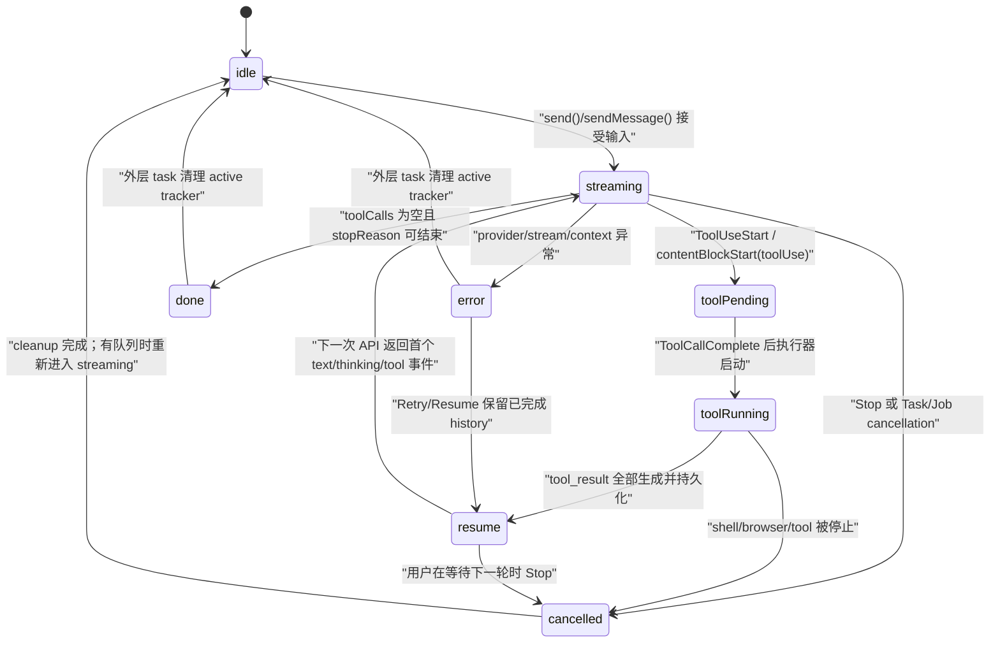

## 2. Agent 核心循环：从一条消息到多轮工具调用

### 2.1 这一章解决什么问题

一个 Agent（智能体）应用不是“请求模型一次并显示文本”，而是要把模型输出解释为文本、思考片段或工具调用，再把工具结果作为下一轮输入，直到模型给出终止回答。OpenMinis 把这条链路拆成 provider-neutral 的消息/事件模型、平台侧的流式状态与工具调度、以及持久化和恢复三个层面；iOS 主要由 `AIChatViewModel` 及其 extensions 承担，Android 主要由 `ChatViewModel` 承担。`send()`/`sendMessage()` 入口还要处理上下文压力、会话并发、附件、取消、模型回退和后台生命周期；如果只实现“发请求—收字符串”，就会在并发工具、断流恢复、重试和 tool_use/tool_result 配对处产生不可恢复的协议错误。本章以真实代码为依据，给出一套可以从零实现、再逐步扩展到桌面端的循环设计。

---

### 2.2 先建立正确的状态模型

#### 2.2.1 代码里没有一个名为 `AgentState` 的总枚举

iOS 的主状态不是单一 enum，而是由 `AIChatViewModel.isProcessing`、`ChatMessage.isAwaitingModelResponse`、每个 `AssistantBlock.toolStatus` 和 `canResume` 组合出来的状态；`ToolBlockStatus` 的真实 case 是 `.streaming(bytes:)`、`.running`、`.success`、`.failed(message:)`、`.cancelled`，见 `src/ios/Agent/Chat/ChatModels.swift:152-168`。Android 也没有总状态 enum，`ChatMessage.isStreaming`、`isAwaitingModelResponse` 和 `ToolBlockStatus` 共同表达循环状态；Android 额外有 `PENDING` 与 `TIMEOUT`，见 `src/android/app/src/main/java/com/openminis/app/ui/chat/ChatModels.kt:104-150` 与 `223-225`。

| 教学状态 | iOS 的真实证据 | Android 的真实证据 | 进入条件 |
|---|---|---|---|
| `idle` | `isProcessing == false`；send 的入口拒绝处理中重复发送，`src/ios/Agent/Chat/AIChatViewModel.swift:2050-2069` | `_isStreaming == false`；中途发送转入队列，`src/android/app/src/main/java/com/openminis/app/ui/chat/ChatViewModel.kt:4794-4804` | 没有当前 stream job |
| `streaming` | `isProcessing = true`，之后 `AgentStreamEvent.textDelta`/thinking/tool start 写入 assistant block，`src/ios/Agent/Chat/AIChatViewModel.swift:2235-2243`、`src/ios/Agent/Chat/AIChatViewModel+SSEStream.swift:289-417` | `_isStreaming = true`，`LLMStreamChunk.Text`/`ThinkingDelta` 更新 Compose 状态，`src/android/app/src/main/java/com/openminis/app/ui/chat/ChatViewModel.kt:4841-4844`、`5779-5874`、`6031-6057` | 发送首个模型请求并收到流事件 |
| `toolPending` | iOS 没有 `pending` case；`contentBlockStart(.toolUse)` 先创建 `.streaming(bytes: 0)` block，`toolCallComplete` 时改为 `.running`，`src/ios/Agent/Chat/AIChatViewModel+SSEStream.swift:327-415`、`631-680` | `ToolUseStart` 创建 `STREAMING`，`ToolCallComplete` 改 `PENDING`，`src/android/app/src/main/java/com/openminis/app/ui/chat/ChatViewModel.kt:6151-6216`、`6278-6301` | 工具 JSON 已开始/完成，但执行器尚未实际运行 |
| `toolRunning` | `.running` 表示工具调用已解析并进入执行；`executeSingleToolUse` 在检查和 repair 后执行，`src/ios/Agent/Chat/AIChatViewModel+SSEStream.swift:631-680`、`src/ios/Agent/Chat/AIChatViewModel+ConcurrentTools.swift:84-206` | `PENDING → RUNNING` 在 `executeTool` 调度前发生，`src/android/app/src/main/java/com/openminis/app/ui/chat/ChatViewModel.kt:6750-6759` | preflight 通过，执行器开始工作 |
| `resume` | 工具结果作为 user-role `AgentMessage` 追加，并将 `isAwaitingModelResponse = true`，`src/ios/Agent/Chat/AIChatViewModel.swift:5333-5379` | `resultParts` 持久化为 tool-result 消息、追加到 `agentHistory`，并在下一次 for-loop 请求，`src/android/app/src/main/java/com/openminis/app/ui/chat/ChatViewModel.kt:6930-6963` | 当前批次工具全部有结果 |
| `done` | 无 tool call 时持久化 assistant message、清除 `canResume`，`src/ios/Agent/Chat/AIChatViewModel.swift:5054-5185` | 无 tool call 时 `updateAssistantMessage(..., false, ...)`，持久化并 break，`src/android/app/src/main/java/com/openminis/app/ui/chat/ChatViewModel.kt:6615-6691` | stop reason 是正常结束或正常空响应已处理 |
| `error` | 非取消异常附着到最后 assistant message；取消走另外的 cleanup，`src/ios/Agent/Chat/AIChatViewModel.swift:2460-2498` | `setInlineError` 同时清除 `isStreaming` 与 `isAwaitingModelResponse`，`src/android/app/src/main/java/com/openminis/app/ui/chat/ChatViewModel.kt:5038-5067` | stream、provider、工具或上下文不可恢复 |
| `cancelled` | `cancel()` 先取消 task、shell/browser，再由 cleanup 把未完成 block 变成可恢复状态，`src/ios/Agent/Chat/AIChatViewModel.swift:3434-3503` | `cancelStream()` 取消 `streamJob`、停止 shell、清理 tracker，`src/android/app/src/main/java/com/openminis/app/ui/chat/ChatViewModel.kt:8872-8905` | 用户 Stop、任务/进程取消或后台终止 |

#### 2.2.2 状态迁移图

下面是把上述多个字段投影成教学状态机后的图；箭头条件都对应后面的真实代码。图中的 `resume` 不是一个仓库 enum，而是“工具结果已经写入 history、等待下一次模型请求”的派生状态。



#### 2.2.3 一次 send 的真实入口

iOS 入口先拒绝只读会话、清理未 ready 附件、检查空输入和已有处理状态，再根据上下文策略决定发送、先压缩或展示提示；真正把 `isProcessing` 置为 `true` 后才创建异步 task，见 `src/ios/Agent/Chat/AIChatViewModel.swift:2050-2158`。任务会确保 session、持久化 user message、等待 kernel、获取 session concurrency slot，最后调用 `runAgentLoop()`，见 `src/ios/Agent/Chat/AIChatViewModel.swift:2243-2458`。

```swift
// 来源：src/ios/Agent/Chat/AIChatViewModel.swift:2060-2069, 2235-2243
let text = inputText.trimmingCharacters(in: .whitespacesAndNewlines)
let pendingAttachments = attachments
 guard !text.isEmpty || !pendingAttachments.isEmpty, !isProcessing else {
    return
}
// …上下文检查、编辑截断、用户消息准备…
messages.append(userMsg)
isProcessing = true
ensureKernelBooted()
beginBackgroundProcessing()
currentTask = Task { [weak self] in
    guard let self else { return }
    await self.ensureSession()
    // …持久化 AgentMessage、取得并发槽位…
    try await self.runAgentLoop()
}
```

Android 入口的同步部分有意先把 `_isStreaming` 置为 `true`，再把 DB、OAuth 和 system prompt 准备放到 coroutine；这避免快速双击在 setup 阶段创建两个 stream job，见 `src/android/app/src/main/java/com/openminis/app/ui/chat/ChatViewModel.kt:4794-4844`。`streamJob` 的 finally 还用 job identity 检查，旧 job 的晚到 finally 不能把新 job 的 `_isStreaming` 错误清零，见 `src/android/app/src/main/java/com/openminis/app/ui/chat/ChatViewModel.kt:5019-5027`。

#### 2.2.4 “后台仍在跑”不是 UI 页面是否可见

iOS 的 `SessionActivityTracker` 用 `activeSessions` 保存正在 streaming/running tools 的 session；它允许用户离开聊天页面后，首页仍显示运行标记，且用 draft alias 将临时会话映射到真实 session，见 `src/ios/Agent/Chat/ChatLifecycleSupport.swift:7-26`、`134-169`。`isProcessing` 变为 true 时还会延迟 iCloud sync，变为 false 时进入 post-stop hold，防止刚完成的候选被同步 reload 覆盖，见 `src/ios/Agent/Chat/AIChatViewModel.swift:559-589`。Android 的 tracker 同样独立于 Compose 页面，首次 `setActive` 启动 foreground service，`setInactive` 在没有活跃 session 时停服务，见 `src/android/app/src/main/java/com/openminis/app/service/SessionActivityTracker.kt:255-318`。

---

### 2.3 主循环：把一个模型 turn 变成多轮交互

#### 2.3.1 循环边界与启动前修复

iOS `runAgentLoop` 每次由 send、retry 或 resume 调用；开始时重置“一次 run 只注入一次空响应提醒”的 guard，解析 provider、拼接能力/行为/skill/MCP/memory prompt，并为新回复创建 assistant message，见 `src/ios/Agent/Chat/AIChatViewModel.swift:4207-4340`。在第一轮 API 前，它扫描 assistant 的 tool_use 与 user 的 tool_result，删除 orphan result、为未完成 tool_use 注入错误 placeholder；但标记为 `isInterrupted` 的最后 assistant 会直接丢弃，避免给半截 JSON 伪造 tool_result，见 `src/ios/Agent/Chat/AIChatViewModel.swift:4345-4459`。

```swift
// 来源：src/ios/Agent/Chat/AIChatViewModel.swift:4462-4481
var turnCount = 0
var hitTurnLimit = true
var compactionsThisLoop = 0
loopLabel: while turnCount < Self.maxAgentTurns {
    defer { turnCount += 1 }
    try Task.checkCancellation()
    if let sid = self.sessionId {
        SessionActivityTracker.shared.updateLoopIteration(sid, iteration: turnCount + 1)
    }
    // trimOldImages、offloadContext、上下文检查
    // …
}
```

Android 在每个 turn 的 API call 前调用 `sanitizeAgentHistory()`，然后按实时 context window 执行 tool-output offload；`for (turn in 0 until MAX_AGENT_TURNS)` 是硬上限，见 `src/android/app/src/main/java/com/openminis/app/ui/chat/ChatViewModel.kt:5891-5911`。这说明“轮数”是保护循环的上限，而不是 provider 的 `max_tokens`：一轮仍然可能包含一次流式 assistant 输出和多个工具。

#### 2.3.2 请求、提交和继续

iOS 每轮先拿 `effectiveAgentHistory()`，再通过 `streamWithGroupFallback` 获取当前 provider 的 stream；它把最新 `turnUsage.latestContextTokens` 传入动态 token 计算，见 `src/ios/Agent/Chat/AIChatViewModel.swift:4610-4627`。解析完成后，循环把本轮新 text block 和 tool entries 转为一个 assistant `AgentMessage`，记录 reasoning echo；没有 tool entries 就结束，否则把所有 tool result 组成 user-role message，持久化 assistant + results，再回到下一轮，见 `src/ios/Agent/Chat/AIChatViewModel.swift:5003-5055`、`5188-5375`。

Android 的相同边界更直观：本轮 `turnTextSb` 和 `toolCalls` 在 stream 结束时一次性物化，追加 `LLMMessage.Role.ASSISTANT`；无 tool call 时 break，有 tool call 时先执行、持久化 assistant/tool result，再追加 `LLMMessage.Role.USER` 的 result parts，见 `src/android/app/src/main/java/com/openminis/app/ui/chat/ChatViewModel.kt:6567-6600`、`6615-6691`、`6941-6963`。

```kotlin
// 来源：src/android/app/src/main/java/com/openminis/app/ui/chat/ChatViewModel.kt:6571-6600
val turnText = turnTextSb.toString()
accumulatedText += turnText
val assistantParts = mutableListOf<AgentContentPart>()
if (turnText.isNotEmpty()) assistantParts.add(AgentContentPart.Text(turnText))
for ((id, name, args) in toolCalls) {
    assistantParts.add(AgentContentPart.ToolUse(id, name, args))
}
agentHistory.add(LLMMessage(
    role = LLMMessage.Role.ASSISTANT,
    content = turnText,
    contentParts = assistantParts,
    reasoningContent = turnReasoningContent,
))
```

#### 2.3.3 为什么必须持久化“assistant tool_use → user tool_result”配对

工具调用不是 UI 卡片，而是下一次 provider 请求必须能复现的协议历史。iOS 会在工具批次完成后把 assistant 原始消息和 user tool-result 消息一起写入 SQLite transaction，见 `src/ios/Agent/Chat/AIChatViewModel.swift:5333-5369`；Android 也先 `persistAssistantTurn`，再 `persistToolResultMessage` 并把结果追加到 `agentHistory`，见 `src/android/app/src/main/java/com/openminis/app/ui/chat/ChatViewModel.kt:6941-6963`。任何只更新 UI、不更新 history 的实现，下一轮会缺 tool_result，或在恢复时留下永久 spinner。

#### 2.3.4 循环之外的几个 extension 边界

主循环不应把所有副作用实现塞进一个 ViewModel 方法。iOS 的 `executeCommand` 是 ISH 执行器适配层：它接收 timeout/lineCallback，按 session 调用 `ISHExecutionCoordinator`，并在检测到 bashism 时按需安装或切换 bash，见 `src/ios/Agent/Chat/AIChatViewModel+ISHCommand.swift:17-55`。这样主循环只关心 `CommandResult`，不需要知道 shell 输出清洗、bash wrapper 或 PID callback。

上下文 offload 也被拆成独立 extension：`estimateContextTokens` 对真正发给模型的 `effectiveAgentHistory()` 做字符、tool JSON 和图片 token 估算，`offloadContextIfNeeded` 从旧消息中挑选大型 tool result，并保护最近四条消息，见 `src/ios/Agent/Chat/AIChatViewModel+Offloading.swift:295-367`、`399-468`。主循环只在每轮前调用它，见 `src/ios/Agent/Chat/AIChatViewModel.swift:4492-4501`。

Slash command/Skill/MCP 入口是“提示词准备”，不是第二条 Agent loop。技能行点击只把 `/<name>` 填入 composer，真正的 SKILL.md 读取和调用由发送后的 `skillPromptFragment`/模型工具完成，见 `src/ios/Agent/Chat/AIChatViewModel+SlashCommands.swift:7-23`、`335-351`。这避免 UI 菜单直接绕过 canonical history。

标题生成则是 loop 的旁路任务：主循环在收到本轮 text/tool 后调用 `generateSessionTitleIfNeeded`，该函数最多允许三次尝试，失败时从首条 user message 生成 fallback title，见 `src/ios/Agent/Chat/AIChatViewModel.swift:4988-4989`、`src/ios/Agent/Chat/AIChatViewModel+TitleGeneration.swift:38-53`、`93-169`。它不应阻塞 tool result 的下一轮请求，也不应把标题请求计入主 Agent turn。

---

### 2.4 SSE/Flow 流式解析：delta 不是完整消息

#### 2.4.1 先定义平台无关事件

iOS 的 `AgentStreamEvent` 将 provider 差异压成 `contentBlockStart`、`textDelta`、`toolInputDelta(accumulated:)`、`toolCallComplete`、usage、thinking/reasoning、done 等事件，见 `src/ios/Providers/AgentProvider.swift:124-170`。Android 的 `LLMStreamChunk` 对应 `Text`、`ThinkingDelta`、`ReasoningContent`、`ToolUseStart`、`ToolInputDelta`、`ToolCallComplete`、`Usage`、`Finished`，见 `src/android/app/src/main/java/com/openminis/app/data/model/LLMStreamChunk.kt:5-31`。

| 语义 | iOS 事件 | Android chunk | 累积位置 |
|---|---|---|---|
| 可见文字 | `.textDelta(String)` | `Text(text)` | iOS `StreamResult.assistantText`；Android `turnTextSb` |
| 可见思考 | `.thinkingDelta(String)` | `ThinkingDelta(text)` | iOS `thinkingText` + thinking block；Android `turnThinking` + block |
| 需要回传的 opaque reasoning | `.reasoningContent(String)` / `.reasoningEcho` | `ReasoningContent(content)` | `AgentMessage.reasoningContent` / `LLMMessage.reasoningContent` |
| 工具开始 | `.contentBlockStart(.toolUse(id,name))` | `ToolUseStart(id,name)` | UI block + 当前 tool id |
| 工具参数增量 | `.toolInputDelta(name, accumulated)` | `ToolInputDelta(id, accumulated)` | 每个 tool id 的 JSON snapshot ring |
| 工具完成 | `.toolCallComplete(id,name,args,metadata)` | `ToolCallComplete(id,name,args)` | `ToolEntry` / `toolCalls` |
| 终止与用量 | `.done(stopReason)`、`.usage` | `Finished(stopReason)`、`Usage` | `StreamResult.stopReason` / `lastUsage` |

#### 2.4.2 provider 侧如何把 SSE partial JSON 变成 accumulated

以 iOS Anthropic 为例，provider 按 `contentBlockStart` 保存当前 tool id/name 和 JSON chunk 数组，遇到 `input_json_delta` 就 append `partialJson`；只有在 yield 时才 join，避免每个 delta 都做全量字符串复制，见 `src/ios/Providers/Anthropic/AnthropicAgentProvider.swift:243-329`。`contentBlockStop` 时才对完整 joined JSON 做 parse，并发出 `toolCallComplete`；parse 失败会得到空 dict，交给下游 repair/preflight，见 `src/ios/Providers/Anthropic/AnthropicAgentProvider.swift:334-379`。

```swift
// 来源：src/ios/Providers/Anthropic/AnthropicAgentProvider.swift:308-329, 334-352
if isThinkingBlock {
    let thinkText = delta.thinking ?? delta.text ?? ""
    if !thinkText.isEmpty { continuation.yield(.thinkingDelta(thinkText)) }
} else if let partialJson = delta.partialJson {
    currentToolJsonChunks.append(partialJson)
    if let name = currentToolName {
        continuation.yield(.toolInputDelta(
            name: name,
            accumulated: currentToolJsonJoined()
        ))
    }
}
// contentBlockStop
let finalJson = currentToolJsonJoined()
let args = Self.parseJsonToDict(finalJson)
continuation.yield(.toolCallComplete(
    id: toolId, name: toolName, args: args, metadata: nil
))
```

Android Anthropic 的 `callbackFlow` 直接读取 `data:` 行；`input_json_delta` 追加到 `StringBuilder` 并发出 accumulated，`content_block_stop` 用 `JSONObject` 解析，异常时使用 `{}`，见 `src/android/app/src/main/java/com/openminis/app/provider/anthropic/AnthropicProvider.kt:189-260`。因此空对象不代表“模型明确想传空参数”，也可能代表流截断、JSON 不完整或上游发送了 literal `{}`；这一点必须留给 repair/preflight 判断。

#### 2.4.3 iOS 在后台解析、主线程批量更新

`processStreamEvents` 是 `nonisolated`，用 120 秒 stall timeout 竞争 `iterator.next()`；解析和 Markdown 准备不占 MainActor，只有 block mutation 通过 `MainActor.run`，见 `src/ios/Agent/Chat/AIChatViewModel+SSEStream.swift:214-287`。收到 text delta 后，先把文字追加到 `StreamResult.assistantText`，再按长度/时间分级节流，最后将 prepared Markdown 一次写入 UI，见 `src/ios/Agent/Chat/AIChatViewModel+SSEStream.swift:417-513`。

```swift
// 来源：src/ios/Agent/Chat/AIChatViewModel+SSEStream.swift:465-513
let len = result.assistantText.count
let throttle: TimeInterval = len < 500 ? 0.20
    : len < 2000 ? 0.30
    : len < 32_000 ? 0.50
    : len < 64_000 ? 1.00
    : len < 128_000 ? 1.50 : 2.00
if elapsed >= throttle || newlineFlush {
    let snapshot = result.assistantText
    let parsed = MarkdownContent(prepareMarkdownForRender(snapshot))
    await MainActor.run {
        self.setStreamingTextBlockContent(
            msgIdx: msgIdx, blockIdx: blockIdx,
            text: snapshot, parsedMarkdown: parsed,
            cacheAttributedString: false, requestScroll: true
        )
    }
}
```

Android 用 `StringBuilder` 避免每个 delta 的 `String +=` 造成 O(n²) 分配；短文本约 150 ms、长文本逐级到 2 s 才发 Compose 更新，并在流结束强制 flush，见 `src/android/app/src/main/java/com/openminis/app/ui/chat/ChatViewModel.kt:5808-5849`、`6122-6148`、`6347-6369`。Android OpenAI Chat Completions 还标记 `streamTextIsMonolithic`：wire 上 content 与 tool_calls 没有可依赖的时间顺序，后到的 content delta 仍合并进本轮唯一 text block，见 `src/android/app/src/main/java/com/openminis/app/provider/LLMProvider.kt:29-42`、`src/android/app/src/main/java/com/openminis/app/ui/chat/ChatViewModel.kt:6064-6119`。

#### 2.4.4 thinking 与 reasoning 必须分两条线

UI thinking 是可见的增量块；opaque reasoning 是为下一轮协议回放而保留的字符串/原生 payload。iOS 在收到 thinking delta 时追加非 published buffer，按 adaptive interval flush；在 `.reasoningContent` 时仅更新 `StreamResult.reasoningContent`，在 `.reasoningEcho` 时保存原生 payload，见 `src/ios/Agent/Chat/AIChatViewModel+SSEStream.swift:784-858`。Android 同样把 `ThinkingDelta` 追加到 `turnThinking`，把 `ReasoningContent` 单独存入 `turnReasoningBlob`，并优先回放 blob（即使它是合法空字符串），见 `src/android/app/src/main/java/com/openminis/app/ui/chat/ChatViewModel.kt:6031-6047`、`6324-6331`、`6587-6599`。

#### 2.4.5 partial JSON 的 UI 预览与真实参数要分离

iOS 的 `toolInputDelta` 只在 200 ms（普通工具）或 1 s（`file_write`/`file_edit`）窗口开放时扫描 accumulated；如果只有 `tool_title` 而主参数还没到，`toolInputPreview` 返回 nil，UI 保留旧 preview，不把 `{"tool_title":...}` 原样显示出来，见 `src/ios/Agent/Chat/AIChatViewModel+SSEStream.swift:516-565`、`987-1057`。字符串提取器支持未闭合引号、转义和 Unicode，见 `src/ios/Agent/Chat/AIChatViewModel+SSEStream.swift:1060-1168`。

Android 在每个 `ToolInputDelta` 中保留原始 `toolArgs`，只早取 `tool_title`，并用同样的 200 ms/1 s gate 更新 UI，见 `src/android/app/src/main/java/com/openminis/app/ui/chat/ChatViewModel.kt:6218-6275`。完成事件将 block 从 `PENDING` 改为等待执行，清空 UI 中的 JSON 文本，见 `src/android/app/src/main/java/com/openminis/app/ui/chat/ChatViewModel.kt:6278-6301`。

#### 2.4.6 tool id 去重是协议修复，不是展示优化

部分 OpenAI-compatible relay 可能给并行调用返回相同 id。iOS 在 start 与 complete 两类事件分别计数，第二个 id 改成 `raw-2`，并把重写值持久化到 block，见 `src/ios/Agent/Chat/AIChatViewModel+SSEStream.swift:243-269`、`327-332`、`631-636`。Android 同样维护 start/complete/in-flight 三张 map，见 `src/android/app/src/main/java/com/openminis/app/ui/chat/ChatViewModel.kt:5965-6004`。如果不在 stream 时修复，下一次请求的 tool_calls 可能被 provider 以 duplicate id 拒绝。

---

### 2.5 工具调用编排：并发执行，顺序提交

#### 2.5.1 iOS：TaskGroup + 10 个 in-flight 上限

iOS 的并发上限是 `AIChatViewModel.maxConcurrentTools = 10`，代码注释明确指出 iSH 可以继续 fork，但超过 10 个会争用模拟器调度，见 `src/ios/Agent/Chat/AIChatViewModel+ConcurrentTools.swift:19-25`。主循环为每个 `toolEntry` 建 child task；当 `added - harvested` 达到 10 时先等待一个完成，所有 child 最终都 drain，见 `src/ios/Agent/Chat/AIChatViewModel.swift:5260-5303`。

```swift
// 来源：src/ios/Agent/Chat/AIChatViewModel.swift:5260-5303
var outcomesByIndex: [Int: ToolExecOutcome] = [:]
await withTaskGroup(of: (Int, ToolExecOutcome).self) { group in
    var added = 0
    var harvested = 0
    for (idx, tu) in toolEntries.enumerated() {
        while added - harvested >= Self.maxConcurrentTools {
            if let pair = await group.next() {
                outcomesByIndex[pair.0] = pair.1
                harvested += 1
            }
        }
        group.addTask {
            let outcome = await self.executeSingleToolUse(
                tu: tu, msgIdx: msgIdx,
                tools: toolsSnapshot, batchBudget: imageBudgetActor
            )
            return (idx, outcome)
        }
        added += 1
    }
    for await pair in group {
        outcomesByIndex[pair.0] = pair.1
        harvested += 1
    }
}
```

执行完成后不能按完成时间追加 tool_result。Anthropic 要求同一 assistant message 的结果顺序对应原始 tool_use，代码用 `for idx in 0..<toolEntries.count` 重新拼接；并发图片通过 actor 竞争一个 batch budget，见 `src/ios/Agent/Chat/AIChatViewModel.swift:5305-5329`、`src/ios/Agent/Chat/AIChatViewModel+ConcurrentTools.swift:43-65`。

#### 2.5.2 Android：当前工具批次是串行 for-loop

Android 的会话级并发槽位限制的是多个 chat session，不是一个 session 内的 tool calls；send job 在进入 loop 前调用 `SessionConcurrencyManager.acquireSlot`，见 `src/android/app/src/main/java/com/openminis/app/ui/chat/ChatViewModel.kt:4961-4967`。本轮工具实际使用 `for ((id, name, args) in toolCalls)`，一个 `executeTool` 返回后才处理下一个，见 `src/android/app/src/main/java/com/openminis/app/ui/chat/ChatViewModel.kt:6716-6928`。因此 Android 的 `PENDING` 主要表达“已收到完整参数、等待串行 dispatcher”，不能被误读为已经并行。

| 维度 | iOS | Android |
|---|---|---|
| 工具并发 | 每批最多 10 个 `TaskGroup` child | 单 session 内按 `toolCalls` 顺序串行 |
| session 并发 | `SessionConcurrencyManager.acquireSlot(sessionId)` | `SessionConcurrencyManager.acquireSlot(activeSessionId)` |
| 结果顺序 | `outcomesByIndex` 按原始 index stitch | for-loop 天然保持顺序 |
| cancel 信号 | `userDidCancel` + `Task.isCancelled` | coroutine cancellation + `ExecutionCoordinator.stopCurrentCommand` |
| 图片预算 | `BatchImageBudget` actor | `ImageBudget` 请求级规划 + provider boundary |
| tool 状态 | 无 `PENDING`，start=`streaming`、complete=`running` | `STREAMING → PENDING → RUNNING` |

#### 2.5.3 单工具结果必须自洽

iOS `ToolExecOutcome` 同时携带 `resultPart`、snapshot、`cancelled`，使 child task 不必依赖完成时的全局数组；取消任务也要返回 synthetic tool_result，见 `src/ios/Agent/Chat/AIChatViewModel+ConcurrentTools.swift:67-112`。Android `ToolExecutionResult` 除 output/success 外还携带图片 bytes、mime、页面 URL、截图路径和 `timedOut`，见 `src/android/app/src/main/java/com/openminis/app/tools/ToolExecutionResult.kt:3-29`；主循环据此将状态区分为 SUCCESS、TIMEOUT 或 FAILED，见 `src/android/app/src/main/java/com/openminis/app/ui/chat/ChatViewModel.kt:6888-6927`。

#### 2.5.4 工具完成后的下一轮边界

工具全部完成后，iOS 设置 `messages[msgIdx].isAwaitingModelResponse = true`，并在用户取消时仍先提交已生成的结果，见 `src/ios/Agent/Chat/AIChatViewModel.swift:5372-5385`。Android 同样在结果写入后把 `isAwaitingModelResponse = true`，见 `src/android/app/src/main/java/com/openminis/app/ui/chat/ChatViewModel.kt:6930-6939`。这一区分很重要：`isStreaming = true` 表示整个 agent run 还没有结束，而 `isAwaitingModelResponse = true` 表示此刻不是工具在跑，而是在等下一次模型首 chunk。

---

### 2.6 Tool preflight：在副作用前修复、校验、拦截

#### 2.6.1 三层顺序

一条工具调用通常经历三层：先修复模型生成的 JSON，再检查 loop detector，再做必填参数 preflight，最后才进入 shell、文件、浏览器或 native offload。iOS `executeSingleToolUse` 的顺序是 cancel pre-check → loop detector → JSON repair → preflight → tool switch，见 `src/ios/Agent/Chat/AIChatViewModel+ConcurrentTools.swift:92-206`。Android 主循环先做 `ToolJsonRepair.repair`，随后将 block 置为 RUNNING，再做 loop check 和 preflight，见 `src/android/app/src/main/java/com/openminis/app/ui/chat/ChatViewModel.kt:6734-6800`；因此 Android 注释中“preflight 前不翻转 RUNNING”的文字与当前执行顺序不一致，实际状态以 6752-6759 为准。

#### 2.6.2 JSON repair 的真实策略

iOS `repairToolArgs` 只对已知 tool definition 工作，按顺序执行：空 dict + raw tail 尝试补 `"`、`}`、`]}` 等闭合符；必填标量做安全字符串 coercion；缺失字段再寻找 Levenshtein 距离不超过 1 的 typo key，例如 `comand → command`，见 `src/ios/Agent/Chat/AIChatViewModel+ToolPreflight.swift:32-163`。数组和字典不会被粗暴 stringify，因为可能把结构参数误当成路径/命令；`tool_title` 虽在 schema required 中，但在 preflight 中列为 non-blocking，见 `src/ios/Agent/Chat/AIChatViewModel+ToolPreflight.swift:203-223`。

```swift
// 来源：src/ios/Agent/Chat/AIChatViewModel+ToolPreflight.swift:63-82, 137-163
if working.isEmpty, let tail = rawTail?.trimmingCharacters(in: .whitespacesAndNewlines), !tail.isEmpty {
    let suffixes = ["", "\"", "\"}", "\"]}", "}", "}}", "]}", "]}}", "]", "]]" ]
    for suffix in suffixes {
        if let data = (tail + suffix).data(using: .utf8),
           let parsed = try? JSONSerialization.jsonObject(with: data) as? [String: Any] {
            working = parsed
            repairs.append("truncation+\(suffix.isEmpty ? "noop" : suffix)")
            break
        }
    }
}
// …type coercion…
// …fuzzy field-name match…
return ToolArgsRepairOutcome(args: working, repairs: repairs)
```

#### 2.6.3 required 字段校验不是完整 JSON Schema 校验

iOS `preflightValidateToolCall` 对未知 tool 返回 nil，让既有 dispatch 分支产生 Unknown tool；对已知 tool 过滤 `tool_title` 后，空 args 会被拒绝；缺 key、JSON null 和真正空字符串会被拒绝，但 `file_edit.new_string == ""` 是合法的删除语义，见 `src/ios/Agent/Chat/AIChatViewModel+ToolPreflight.swift:229-281`。代码明确把 enum、regex、整数范围等更丰富的 schema 约束留给各工具 helper，不应在通用 preflight 中擅自增加规则。

Android companion 中的 `preflightValidateToolCallImpl` 具有同样的语义：`JSONObject.NULL` 视为缺失，空白字符串不再被 trim 后拒绝，`file_edit.new_string` 的空串放行，见 `src/android/app/src/main/java/com/openminis/app/ui/chat/ChatViewModel.kt:129-199`。失败后两端都生成 error `tool_result`，这样 assistant tool_use 与结果仍然配对，模型下一轮可以自我修正；Android 具体组装与 `record` 发生在 `src/android/app/src/main/java/com/openminis/app/ui/chat/ChatViewModel.kt:6793-6843`。

```swift
// 来源：src/ios/Agent/Chat/AIChatViewModel+ToolPreflight.swift:238-281
let enforced = toolDef.required.filter {
    !Self.preflightNonBlockingFields.contains($0)
}
if args.isEmpty && !enforced.isEmpty {
    return "Tool '\(name)' was called with empty arguments {} but requires: \(enforced.joined(separator: ", "))."
}
for field in enforced {
    guard let raw = args[field], !(raw is NSNull) else {
        missing.append(field)
        continue
    }
    if let s = raw as? String, s.isEmpty,
       !Self.preflightEmptyStringAllowed(tool: name, field: field) {
        missing.append(field)
    }
}
```

这里的 `file_edit.new_string == ""` 例外不是“放宽所有空字符串”，而是由 `(tool, field)` 白名单精确表达；其他工具仍按 required 字段返回错误，见 `src/ios/Agent/Chat/AIChatViewModel+ToolPreflight.swift:212-227`。

#### 2.6.4 权限与危险操作不属于“字段校验”

iOS 对 shell 命令提取 offload tool 后调用 `OffloadPermissionManager.checkPermission`；拒绝则不启动命令，直接把拒绝文字写入 tool output，见 `src/ios/Agent/Chat/AIChatViewModel+ConcurrentTools.swift:216-248`。Android 的 native offload CLI 在统一入口 `OffloadGate` 通过 `BYPASS / ASK_ONCE / NOT_ALLOWED` 策略；ASK_ONCE 以 `runBlocking` 桥接到用户授权结果，并按 session id 隔离 grant，见 `src/android/app/src/main/java/com/openminis/app/sandbox/offload/OffloadGate.kt:9-45`。因此从零实现时应把“参数合法”与“用户是否允许副作用”设计成两个独立 gate，不能用一个 `isValid` 布尔值覆盖权限流程。

---

### 2.7 取消、中断与进程清理

#### 2.7.1 iOS Stop 是多资源取消漏斗

iOS `cancel()` 不只调用 `currentTask?.cancel()`：它先取消 session concurrency 等待、调用 `stopCurrentCommand()`、唤醒 foreground/browser takeover continuation、设置 `userDidCancel`、清零 retry UI，然后把 `isProcessing` 立即置 false；若有队列，再启动新的 drain task，见 `src/ios/Agent/Chat/AIChatViewModel.swift:3434-3511`。

```swift
// 来源：src/ios/Agent/Chat/AIChatViewModel.swift:3447-3509
if let sid = sessionId {
    SessionConcurrencyManager.shared.cancelWait(sessionId: sid)
}
stopCurrentCommand()
backgroundSuspended = false
foregroundContinuation?.resume()
browserTakeoverActive = false
takeoverContinuation?.resume()
midActionTakeoverContinuation?.resume()
userDidCancel = true
currentTask?.cancel()
currentTask = nil
autoRetryAttempt = 0
autoRetryCountdown = 0
isProcessing = false
endBackgroundProcessing()
if !promptQueue.isEmpty && !isCompacting {
    resumeQueueAfterCancel()
}
```

`stopCurrentCommand()` 将三个真实可取消对象合并：运行中的 iSH PID、尚未启动 shell 的 delay countdown、正在导航的 browser tab；browser 通过 `stopAllLoading()` 解开 navigation continuation，shell 通过 `ISHExecutionCoordinator.stopCurrentCommand()` kill process group，见 `src/ios/Agent/Chat/AIChatViewModel+BackgroundTask.swift:475-507` 与 `src/ios/Agent/ISH/ISHExecutionCoordinator.swift:208-227`。并发工具目前仍受单一 `runningCommandPid` 兼容字段限制，`runningCommandPids` 是它的 Set view，见 `src/ios/Agent/Chat/AIChatViewModel+ConcurrentTools.swift:27-40`；这正是扩展真正 per-task PID tracking 时必须优先修复的边界。

工具 child 在开始前检查 `Task.isCancelled || userDidCancel`，若已停止则写入统一 `<system-reminder>` cancellation result；delay 期间每 100 ms 同时检查 flag 和 task cancellation，见 `src/ios/Agent/Chat/AIChatViewModel+ConcurrentTools.swift:92-112`、`252-291`。流处理在取消时还会先 flush 尚未推送的 text，再抛出 CancellationError，保证 cleanup 看到完整候选，见 `src/ios/Agent/Chat/AIChatViewModel+SSEStream.swift:861-881`。

#### 2.7.2 Android Stop 的对应路径

Android `cancelStream()` 取消 `streamJob` 并立即 `_isStreaming = false`，先 flush streaming side-channel，再清除 foreground activity、标记取消 outcome，最后按“当前是 draft 还是已迁移 real session”停止对应 `ExecutionCoordinator` command，见 `src/android/app/src/main/java/com/openminis/app/ui/chat/ChatViewModel.kt:8872-8905`。如果用户在运行中排队消息，取消后等待 200 ms，再启动独立 drain，见 `src/android/app/src/main/java/com/openminis/app/ui/chat/ChatViewModel.kt:8907-8938`。

Android tool 结果的取消/超时可以保留结构化状态：`ToolExecutionResult.timedOut` 不等于 `!success`，主循环据此将 UI status 设为 TIMEOUT 或 FAILED，见 `src/android/app/src/main/java/com/openminis/app/tools/ToolExecutionResult.kt:23-29`、`src/android/app/src/main/java/com/openminis/app/ui/chat/ChatViewModel.kt:6888-6916`。

#### 2.7.3 取消后为什么不能简单删除半截 assistant

如果 assistant 已经产生 tool_use，直接删除 UI block 会让 history 只剩 tool_use 或只剩 tool_result，下一次 Anthropic/OpenAI 请求会因 unmatched id 报 400。iOS 在工具执行取消时先提交所有已形成的 tool_result，再停止 loop，见 `src/ios/Agent/Chat/AIChatViewModel.swift:5372-5385`；Android 也把每个结果加入 `resultParts` 并持久化，见 `src/android/app/src/main/java/com/openminis/app/ui/chat/ChatViewModel.kt:6919-6963`。恢复时只应清理“没有对应结果的 in-flight tail”，而不是抹掉已经配对的工具历史。

---

### 2.8 错误处理、重试与模型回退

#### 2.8.1 iOS 的两级策略

iOS `streamWithAutoRetry` 的 schedule 是 `[3, 5, 10, 15, 30]` 秒；仅对 `LLMError.isRetryable` 在同一 provider 上等待并重试，倒计时期间把错误附着到 message，且会重新读取当前 model binding，见 `src/ios/Agent/Chat/AIChatViewModel+Fallback.swift:9-78`。`streamWithGroupFallback` 先直接请求当前 entry，以区分 provider-level fallbackable error 与网络错误；rate limit、invalid key、provider rejection 立即切换 group 下一个 entry，网络/5xx 则先走 auto-retry，见 `src/ios/Agent/Chat/AIChatViewModel+Fallback.swift:81-143`、`172-222`。

```swift
// 来源：src/ios/Agent/Chat/AIChatViewModel+Fallback.swift:21-40, 68-77
for attempt in 0...Self.retryDelays.count {
    if attempt > 0 {
        let delay = Self.retryDelays[attempt - 1]
        self.autoRetryAttempt = attempt
        for remaining in stride(from: delay, through: 1, by: -1) {
            self.autoRetryCountdown = remaining
            try await Task.sleep(nanoseconds: 1_000_000_000)
            try Task.checkCancellation()
        }
        self.autoRetryCountdown = 0
    }
    do {
        let stream = try await currentProvider.streamAgentMessage(/* … */)
        self.autoRetryAttempt = 0
        return stream
    } catch let error as LLMError where error.isRetryable {
        lastError = error
        continue
    }
}
throw lastError!
```

fallback 切换后会重建 provider 和 system prompt，并更新 session binding；如果是同一 model 的另一个 endpoint，则只视为透明恢复，不应误闪 model capsule，见 `src/ios/Agent/Chat/AIChatViewModel+Fallback.swift:144-171` 与 `src/ios/Agent/Chat/AIChatViewModel.swift:4629-4698`。所有 fallback 耗尽时，代码保留 tried/skipped trail，再抛出 provider error，而不是悄悄使用一个未配置的模型，见 `src/ios/Agent/Chat/AIChatViewModel+Fallback.swift:195-204`。

#### 2.8.2 Android 的对应策略

Android 同 provider 自动 retry 的 schedule 是 `[1, 2, 4]` 秒，网络错误、transient error 和 5xx 进入 retry；rate limit 不在同 provider 重试，而是直接尝试 fallback provider，见 `src/android/app/src/main/java/com/openminis/app/ui/chat/ChatViewModel.kt:6375-6451`。fallback list 从 primary 后一个 group member 开始循环，跳过 disabled、无 credential 或创建失败的 entry，见 `src/android/app/src/main/java/com/openminis/app/ui/chat/ChatViewModel.kt:3680-3709`；切换时将原因写入 info block，并且只有真实 model id 变化才递增 fallback trigger，见 `src/android/app/src/main/java/com/openminis/app/ui/chat/ChatViewModel.kt:6466-6547`。

#### 2.8.3 空响应不能一律重试

iOS 把“无 text、无 tool、无 reasoning 且没有 maxTokens/refusal”认定为 empty response；如果紧接在 tool result 后，只注入一次 `<system-reminder>` 并重试，第二次仍空就抛明确错误，见 `src/ios/Agent/Chat/AIChatViewModel.swift:4701-4775`。`stopReason == .refusal` 被视为确定性拒答，不走 transient retry，见 `src/ios/Agent/Chat/AIChatViewModel.swift:5096-5107`。Android 对 tool result 后的空 turn 使用 `didInjectEmptyToolReminder` one-shot guard，见 `src/android/app/src/main/java/com/openminis/app/ui/chat/ChatViewModel.kt:6635-6686`；provider 层还会把“无内容且无 finish reason”的 silent completion 转为 `LLMError.TransientError`，见 `src/android/app/src/main/java/com/openminis/app/provider/LLMProvider.kt:120-161`。

---

### 2.9 请求预算：token、轮数、图像和时间

#### 2.9.1 token budget 是“剩余上下文”而不是简单常量

iOS `dynamicMaxTokens` 的上限是 `min(globalMaxTokensCeiling, model.maxOutputTokens 或 provider.defaultMaxTokens)`；当前全局 ceiling 为 128,000，再按实时 context window 减去上一次 API 的 input tokens，最后至少保留 1024（但不会超过用户刻意设置的小上限），见 `src/ios/Agent/Chat/AIChatViewModel+Misc.swift:263-324`。Android 完全对应：`GLOBAL_MAX_TOKENS_CEILING = 128_000`、`MIN_MAX_TOKENS = 1024`，按 `contextWindowTokens - lastContextTokens` 计算，见 `src/android/app/src/main/java/com/openminis/app/ui/chat/ChatViewModel.kt:230-255`、`5465-5494`。

```kotlin
// 来源：src/android/app/src/main/java/com/openminis/app/ui/chat/ChatViewModel.kt:5473-5493
val maxOutputCeiling = minOf(
    GLOBAL_MAX_TOKENS_CEILING,
    provider.effectiveMaxOutputTokens(model)
)
val contextWindow = model.contextWindowTokens
val inputTokens = if (lastContextTokens > 0) lastContextTokens else 0
val remaining = contextWindow - inputTokens
val clamped = maxOf(remaining, MIN_MAX_TOKENS)
return minOf(maxOutputCeiling, clamped)
```

#### 2.9.2 context offload 是 lossless budget

当历史中大型 tool output 逼近窗口时，两端都把旧 tool 内容写到 session 文件并在 history 里留下可 `file_read` 的 path stub，而不是静默删除。Android 每轮 API 前调用 `offloadContextIfNeeded`，代码注释明确说明原内容仍在 `filesDir/minis-sessions/<sid>/offloads/tools/`，见 `src/android/app/src/main/java/com/openminis/app/ui/chat/ChatViewModel.kt:5496-5513`、`5895-5911`；iOS 则在每个 loop iteration 先 `offloadContextIfNeeded`，见 `src/ios/Agent/Chat/AIChatViewModel.swift:4492-4501`。

#### 2.9.3 图像预算保护最近内容

iOS 请求级 image budget 上限为 `kRequestImageMaxBytes = 25 * 1024 * 1024`；规划器从最新图片向最旧图片倒走，超出的旧图替换为带 Linux path 的 `[image elided… read_image]` 文本，见 `src/ios/Agent/Chat/AIChatViewModel+RequestBudget.swift:36-70`、`113-186`。Android `ImageBudget.MAX_REQUEST_BYTES` 同为 25 MB，`planRequestBudget` 反向遍历并在超出后记录 dropped identity，由各 provider 发 placeholder，见 `src/android/app/src/main/java/com/openminis/app/provider/ImageBudget.kt:194-307`。

#### 2.9.4 轮数预算与时间预算

两端都以 200 个 agent turns 作为循环硬上限；iOS 是 `maxAgentTurns = 200`，在 while 条件失败时设置错误并 `canResume = true`，见 `src/ios/Agent/Chat/AIChatViewModel.swift:66-77`、`5460-5475`；Android 是 `MAX_AGENT_TURNS = 200`，for-loop 耗尽时 `finalizeAtTurnLimit`，见 `src/android/app/src/main/java/com/openminis/app/ui/chat/ChatViewModel.kt:230-239`、`7030-7088`。

仓库没有一个“单次会话总墙钟时长”字段；时间约束分散为 stream stall timeout、工具自身 timeout、shell delay 和移动端后台生命周期。[推断] 从代码可验证的最明确网络时间预算是 iOS `processStreamEvents` 的 120 秒无事件 stall timeout，见 `src/ios/Agent/Chat/AIChatViewModel+SSEStream.swift:271-287`；Android 的每个工具结果显式携带 `timedOut`，但全局 agent elapsed deadline 并不存在于这些循环符号中，见 `src/android/app/src/main/java/com/openminis/app/tools/ToolExecutionResult.kt:23-29`。从零实现时应分别设计“单请求 stall”“单工具 timeout”“整轮/整会话 deadline”，不要误把 200 轮当作时间限制。

---

### 2.10 ToolLoopDetector：识别“重复但没有进展”

#### 2.10.1 四种策略和优先级

iOS `ToolLoopDetector` 的 `check` 在执行前运行，策略顺序是 unknown-tool repeat、global circuit breaker、known polling no-progress、generic repeat；`record` 在工具结束后写入滑动窗口并返回 warning，见 `src/ios/Agent/ToolLoopDetector.swift:61-184`。默认阈值是 history 30、warning 10、unknown 10、critical 20、global circuit breaker 30；iOS 构造器会自动纠正阈值排序并扩展 history，见 `src/ios/Agent/ToolLoopDetector.swift:31-56`。

Android 的策略顺序和默认阈值相同，但 `ToolLoopConfig.init` 使用 `require` 拒绝错误配置，而不是自动修正，见 `src/android/app/src/main/java/com/openminis/app/agent/ToolLoopDetector.kt:35-59`。两端都把 `command_status`、以及 `process` 的 `poll`/`log` 识别为 poll tool，见 `src/ios/Agent/ToolLoopDetector.swift:322-330`、`src/android/app/src/main/java/com/openminis/app/agent/ToolLoopDetector.kt:260-267`。

| 策略 | 判定 | 结果 |
|---|---|---|
| unknown_tool_repeat | 从 history 尾部倒数，同一个 hallucinated tool 的 unknown error 连续达到 10 | `CRITICAL`，不执行本次调用 |
| global_circuit_breaker | 同 `(toolName,argsHash)` 且同 `resultHash` 的 no-progress 达到 30 | `CRITICAL` |
| known_poll_no_progress | poll tool 的同参数、同结果 streak 达到 10 warning 或 20 critical | warning 文字提示停止 poll；20 次阻断 |
| generic_repeat | 非 poll tool 在窗口中同参数总次数达到 10 | warning，不立即阻断 |

#### 2.10.2 参数和结果如何 hash

iOS 对参数做 stable JSON（递归排序 keys），剔除 UI-only `tool_title`，再 SHA-256；结果 hash 会去掉时间戳、duration、request/call/trace id 和空白差异，见 `src/ios/Agent/ToolLoopDetector.swift:218-300`、`254-275`。Android 同样递归排序 Map/JSONObject/JSONArray 并剔除 `tool_title`，见 `src/android/app/src/main/java/com/openminis/app/agent/ToolLoopDetector.kt:284-355`；Android 的 result hash 把 `err=` 与 `out=` 的完整字符串合并，代码注释说明当前工具层没有 volatile 字段需要清洗，见 `src/android/app/src/main/java/com/openminis/app/agent/ToolLoopDetector.kt:357-373`。

`getNoProgressStreak` 从最新往旧扫描，跳过其他工具；目标 tool 的结果 hash 变化即认为观察到进展并停止 streak，见 `src/ios/Agent/ToolLoopDetector.swift:333-355`、`src/android/app/src/main/java/com/openminis/app/agent/ToolLoopDetector.kt:236-257`。warning 用 bucket 节流，因此 30 次重复通常只在 10、20、30 桶发 warning，不会每次都把相同告警塞进模型上下文，见 `src/ios/Agent/ToolLoopDetector.swift:209-216`、`src/android/app/src/main/java/com/openminis/app/agent/ToolLoopDetector.kt:269-280`。

#### 2.10.3 调用时序和一个容易漏掉的点

两端都必须在执行前 `check`，critical 时跳过副作用但仍合成 error tool_result；正常执行后再 `record`，warning 追加到 tool result 让模型看到。iOS critical 分支位于单工具执行器，见 `src/ios/Agent/Chat/AIChatViewModel+ConcurrentTools.swift:123-148`；Android 主循环 critical 分支记录并 `continue`，见 `src/android/app/src/main/java/com/openminis/app/ui/chat/ChatViewModel.kt:6762-6790`。正常 Android 结果则在 `executeTool` 后 `record`，并把 warning 拼到 output，见 `src/android/app/src/main/java/com/openminis/app/ui/chat/ChatViewModel.kt:6845-6866`。

从零实现时不要只按“连续相同 tool name”计数：generic repeat 是非连续窗口计数，poll 是同参数/同结果 streak，unknown 是同名错误尾部 streak；三者必须保留不同语义。

---

### 2.11 消息数据模型与 provider wire 格式

#### 2.11.1 iOS 的 canonical model

iOS `AgentContentPart` 有 `.text`、`.toolUse(id,name,input)`、`.toolResult(id,name,content,isError,image...)` 和 `.imageData`；`AgentMessage` 记录 role、parts、`isInterrupted`、`reasoningContent`、`reasoningEcho` 与 DB id，见 `src/ios/Providers/AgentProvider.swift:53-122`。UI 层 `ChatMessage` 把一个 assistant turn 映射为有序 `AssistantBlock` 数组，并将 tool 状态和 awaiting flag 作为 UI 事实源，见 `src/ios/Agent/Chat/ChatModels.swift:38-68`、`161-175`。

```swift
// 来源：src/ios/Providers/AgentProvider.swift:55-70, 100-122
case text(String)
case toolUse(id: String, name: String, input: [String: Any])
case toolResult(id: String, name: String, content: String,
                isError: Bool, imageData: Data? = nil,
                imageMimeType: String? = nil, pageURL: String? = nil,
                imageLinuxPath: String? = nil)
case imageData(data: Data, mimeType: String, linuxPath: String? = nil)

struct AgentMessage {
    enum Role: String { case user, assistant }
    let role: Role
    var parts: [AgentContentPart]
    var isInterrupted: Bool = false
    var reasoningContent: String?
    var reasoningEcho: ReasoningEcho?
    var dbMessageId: String? = nil
}
```

`TokenUsage.add` 用 max 而不是 sum，因为 provider 可能在每个 SSE chunk 发送 cumulative usage；context size取最新 API call，见 `src/ios/Agent/Chat/ChatModels.swift:120-149`。这一点决定了 agent loop 统计不能直接对每个 usage event `+=`。

#### 2.11.2 Android 的 canonical model

Android `AgentContentPart` 是 sealed class：`Text`、`ToolUse(JSONObject)`、`ToolResult(content,isError,image...)`、`ImageData`，见 `src/android/app/src/main/java/com/openminis/app/data/model/AgentContentPart.kt:10-75`。`LLMMessage` 同时保留 plain `content`、legacy image/audio parts、structured contentParts、reasoningContent 和 DB id，见 `src/android/app/src/main/java/com/openminis/app/data/model/LLMMessage.kt:3-61`。工具定义是 provider-agnostic，字段是 name/description/parameters/required/propertyOrdering，见 `src/android/app/src/main/java/com/openminis/app/data/model/AgentToolDefinition.kt:6-17`。

#### 2.11.3 wire 转换不是把 JSON 原样发给所有 provider

| provider 协议 | assistant tool call | tool result | thinking/reasoning | 代码位置 |
|---|---|---|---|---|
| Anthropic | `content[].type=tool_use`、`id/name/input` | user content `type=tool_result`、`tool_use_id/content` | thinking block 必须位于 assistant 开头；compat proxy 需要 echo | iOS `src/ios/Providers/Anthropic/AnthropicAgentProvider.swift:100-169`；Android `src/android/app/src/main/java/com/openminis/app/provider/anthropic/AnthropicProvider.kt:534-599` |
| OpenAI Chat Completions | assistant `tool_calls[]`，arguments 是 JSON string | 独立 `role=tool` + `tool_call_id` | `reasoning_content` 按模型能力回传 | iOS `src/ios/Providers/OpenAI/OpenAIAgentProvider.swift:1081-1168`；Android `src/android/app/src/main/java/com/openminis/app/provider/openai/OpenAIProvider.kt:1511-1569` |
| Gemini | `functionCall(name,args)` | `functionResponse(name,response)` | thought/reasoning metadata按 Gemini provider 保存 | iOS `src/ios/Providers/Gemini/GeminiAgentProvider.swift:1-223`；Android `src/android/app/src/main/java/com/openminis/app/provider/gemini/GeminiProvider.kt:198-231` |

OpenAI Chat Completions 的 iOS 转换先找 tool_result，生成 `role=tool`；tool_use 则把 `[String: Any]` 序列化为 function arguments 字符串并将 text parts 放到 assistant content，见 `src/ios/Providers/OpenAI/OpenAIAgentProvider.swift:1086-1136`。Android structured branch 与之对应：assistant tool use 变成 `tool_calls`，user tool results 变成多个 `role=tool` message，见 `src/android/app/src/main/java/com/openminis/app/provider/openai/OpenAIProvider.kt:1511-1569`。

```kotlin
// 来源：src/android/app/src/main/java/com/openminis/app/provider/openai/OpenAIProvider.kt:1541-1569
for (tu in toolUseParts) {
    toolCallsArr.put(JSONObject().apply {
        put("id", capChatToolCallId(tu.id))
        put("type", "function")
        put("function", JSONObject().apply {
            put("name", tu.name)
            put("arguments", tu.input.toString())
        })
    })
}
obj.put("tool_calls", toolCallsArr)
// user ToolResult
put("role", "tool")
put("tool_call_id", capChatToolCallId(tr.id))
put("content", tr.content)
```

Anthropic 还要求 message role 交替、assistant 的 text/image 在 tool_use 前；Android `mergeConsecutiveSameRole` 负责合并连续同 role 并整理 block，见 `src/android/app/src/main/java/com/openminis/app/provider/anthropic/AnthropicProvider.kt:675-725`。这也是 queued prompt 不能直接插到 tool-result user message 后的原因：代码会插入 bridge，使 wire 顺序合法，见 `src/android/app/src/main/java/com/openminis/app/ui/chat/ChatViewModel.kt:6970-7024`。

Gemini 的 function response 不是 OpenAI 的 role=tool；Android 将 result 包装为 `functionResponse.response.result`，空内容补一个空格避免 oneof 错误，见 `src/android/app/src/main/java/com/openminis/app/provider/gemini/GeminiProvider.kt:198-231`。工具定义同样按 provider 转换：Anthropic 用 `input_schema`、Gemini 用大写 `OBJECT` + propertyOrdering、OpenAI 用 `type=function`，见 `src/android/app/src/main/java/com/openminis/app/data/model/AgentToolDefinition.kt:18-73`。

#### 2.11.4 reasoning echo 的跨模型隔离

iOS 的 `ReasoningEcho` 绑定 provider family 和 model id，Responses API encrypted reasoning item 只能在同 family、同 model 回放，见 `src/ios/Providers/AgentProvider.swift:72-98`。OpenAI converter 对 assistant history 会在 thinking 开启或 model always reasons 时补/回传 `reasoning_content`，见 `src/ios/Providers/OpenAI/OpenAIAgentProvider.swift:1449-1510`；Android OpenAI converter 也对缺失值发送空字符串，防止 DeepSeek/Kimi 类 endpoint 在多轮 tool history 上 400，见 `src/android/app/src/main/java/com/openminis/app/provider/openai/OpenAIProvider.kt:1485-1535`。

---

### 2.12 平台对照

| 抽象层 | iOS | Android | 为什么不同 |
|---|---|---|---|
| 主循环协程 | Swift `async` + `Task`，`AIChatViewModel` 为 `@MainActor`，SSE parser `nonisolated` | Kotlin coroutine，stream job 在 `Dispatchers.IO`，UI 用 `withContext(Dispatchers.Main)` | SwiftUI 对引用对象的主线程约束与 Compose StateFlow 的更新模型不同 |
| 输入状态 | `send()`，`isProcessing` 同步防重入，`promptQueue` 支持排队 | `sendMessage()`，`_isStreaming` 同步防重入，`enqueuePrompt` 支持排队 | 两端都把“新输入”从“当前 turn”隔离为队列 |
| stream 事件 | `AgentStreamEvent`，provider 产出 AsyncThrowingStream | `LLMStreamChunk`，provider 产出 Flow | 事件语义相同，底层异步原语不同 |
| text buffer | `StreamResult.assistantText`，按 tier throttle + Markdown cache | `StringBuilder`，按 tier throttle + streaming side-channel | Android 避免 Pixel heap 的 O(n²)；iOS 避免 MainActor Markdown parse |
| thinking | AssistantBlock 的非 published buffer，adaptive flush | `turnThinking` 与 thinking block 在 Compose snapshot 更新 | UI 性能瓶颈不同，协议 reasoning 单独存储 |
| tool 并发 | 每批最多 10 个 TaskGroup child，完成后按 index 排序 | 单 session 内 serial for-loop | iOS 先实现并发 shell fan-out；Android 保持执行顺序更简单 |
| tool 状态 | `.streaming/.running/.success/.failed/.cancelled` | `STREAMING/PENDING/RUNNING/SUCCESS/FAILED/CANCELLED/TIMEOUT` | Android 用 PENDING/TIMEOUT 表达 dispatcher 与工具超时细节 |
| preflight | repair → detector → required 字段校验 → 权限/工具 helper | repair → block RUNNING → detector → required 字段校验 → execute | Android 当前 UI 状态切换早于 preflight，应在重构时保持测试覆盖 |
| cancellation | Task + continuation + iSH process group + browser loading | Job + ExecutionCoordinator + foreground service tracker | 移动 OS 后台执行模型与 shell 集成不同 |
| fallback | 5 档 3/5/10/15/30 秒，group router 动态解析 | 3 档 1/2/4 秒，预构造 fallback provider list | Android provider list 需在 send setup 阶段创建，iOS 每次路由动态 resolve |
| context/token | `dynamicMaxTokens`、image 25 MB、in-loop compact/offload | 同 128K/1024 ceiling、ImageBudget、offload | 算法刻意保持跨平台一致 |
| loop detector | `NSLock` 保护，配置错误自动纠正 | loop 主线程串行使用，配置错误 `require` 失败 | 并发/配置风格不同，阈值契约相同 |
| wire 模型 | `[String: Any]` + enum，provider 自己做 JSON | `JSONObject` sealed parts，provider 自己做 JSON | Swift 与 Kotlin JSON 类型系统不同，但都保持 canonical history |

---

### 2.13 设计取舍与踩坑

1. **不要寻找不存在的总状态 enum。** 真正的状态是 `isProcessing/isStreaming`、`isAwaitingModelResponse`、tool status 和 `canResume` 的组合；教学代码可以定义自己的 `AgentState`，但必须由这些字段驱动，而不是另造一个可能漂移的真相源，见 `src/ios/Agent/Chat/ChatModels.swift:152-168`、`src/android/app/src/main/java/com/openminis/app/ui/chat/ChatModels.kt:104-150`。

2. **不要以“收到 tool call”作为循环终点。** iOS 只有 `toolEntries.isEmpty` 才结束当前 run，见 `src/ios/Agent/Chat/AIChatViewModel.swift:5054-5056`；Android 只有 `toolCalls.isEmpty()` 才 break，见 `src/android/app/src/main/java/com/openminis/app/ui/chat/ChatViewModel.kt:6615-6623`。

3. **结果顺序必须独立于完成顺序。** iOS 并发 child 可能先完成后发起的工具，但结果仍按 `toolEntries` index stitch，见 `src/ios/Agent/Chat/AIChatViewModel.swift:5305-5320`。桌面端如果也并行工具，必须复用这一原则。

4. **半截 JSON 不能直接执行。** provider 在 parse 失败时可产生 `{}`；repair 只尝试有限闭合和有限字段纠错，最终仍由 preflight 拒绝，见 `src/ios/Providers/Anthropic/AnthropicAgentProvider.swift:334-352`、`src/ios/Agent/Chat/AIChatViewModel+ToolPreflight.swift:63-163`。

5. **UI preview 不是 tool args。** partial JSON 可以展示友好摘要，但真实执行必须使用完整 parsed args；iOS 明确在主参数未到时保留旧 preview，见 `src/ios/Agent/Chat/AIChatViewModel+SSEStream.swift:987-1057`。

6. **`tool_title` 不应阻断工具。** 它是 UI label，缺失不影响执行；两端都在 required schema 保留它，但 preflight 跳过它，见 `src/ios/Agent/Chat/AIChatViewModel+ToolPreflight.swift:203-210`、`src/android/app/src/main/java/com/openminis/app/ui/chat/ChatViewModel.kt:159-166`。

7. **安全确认不是 schema validation。** offload/native permission 可能需要系统授权、设置页或 ASK_ONCE dialog；应在真正有副作用的 helper 或 native handler 处再 gate，见 `src/ios/Agent/Chat/AIChatViewModel+ConcurrentTools.swift:231-248`、`src/android/app/src/main/java/com/openminis/app/sandbox/offload/OffloadGate.kt:9-45`。

8. **取消要先配对再退出。** 不要把正在运行的 tool block 直接删掉；返回 synthetic error tool_result，使下次请求仍是合法 assistant/tool-result pair，见 `src/ios/Agent/Chat/AIChatViewModel+ConcurrentTools.swift:92-112`、`src/android/app/src/main/java/com/openminis/app/ui/chat/ChatViewModel.kt:6781-6789`。

9. **`isStreaming=false` 不等于所有清理完成。** Android 仍需 flush side-channel、停止 ExecutionCoordinator、更新 tracker；iOS 仍需结束 background task、恢复 continuation、kill PID，见 `src/android/app/src/main/java/com/openminis/app/ui/chat/ChatViewModel.kt:8872-8905`、`src/ios/Agent/Chat/AIChatViewModel.swift:3434-3503`。

10. **空响应要区分“上游断流”和“模型拒答”。** 无 finish reason 的静默流可 retry；`refusal` 是确定性结果，不应盲目重试，见 `src/android/app/src/main/java/com/openminis/app/provider/LLMProvider.kt:120-161`、`src/ios/Agent/Chat/AIChatViewModel.swift:5096-5107`。

11. **请求 token 上限要随上下文变化。** 固定 `max_tokens` 会在多轮 tool history 中撞 context window；动态计算必须使用上一次 API usage 和实时 group limit，见 `src/ios/Agent/Chat/AIChatViewModel+Misc.swift:245-324`、`src/android/app/src/main/java/com/openminis/app/ui/chat/ChatViewModel.kt:1138-1164`。

12. **最近图像优先，旧图可重取。** 25 MB request cap 的实现反向遍历并用 Linux path placeholder，避免新截图被历史大图挤掉，见 `src/ios/Agent/Chat/AIChatViewModel+RequestBudget.swift:47-70`、`src/android/app/src/main/java/com/openminis/app/provider/ImageBudget.kt:244-307`。

13. **不要把 reasoning 当普通 text。** reasoning 可能需要原样回放，且 encrypted payload 绑定 model id；跨模型 fallback 必须隔离，见 `src/ios/Providers/AgentProvider.swift:72-98`。

14. **Android 当前 serial 工具执行并不意味着不能扩展并发。** 若改成 coroutine `async`，必须增加与 iOS 相同的 in-flight cap、按原始 index stitch、每任务 PID/取消映射和 batch image budget；否则当前 `PENDING` 状态与 tool-result 顺序都会失真。[推断] 这是从现有 Android for-loop 与 iOS TaskGroup 合同得出的扩展约束，代码证据分别为 `src/android/app/src/main/java/com/openminis/app/ui/chat/ChatViewModel.kt:6716-6928` 与 `src/ios/Agent/Chat/AIChatViewModel.swift:5260-5320`。

---

### 2.14 从零实现清单

1. **定义 canonical message parts。**
   - 实现 `Text`、`ToolUse(id,name,args)`、`ToolResult(id,name,content,isError)`、可选 `ImageData` 和 `reasoningContent`。
   - 验收：一条 assistant tool_use 后能构造一条 user tool_result；序列化前后 id/name/args 不变。
   - 可以砍掉：图片、音频、native reasoning echo；不能砍掉 tool id 和 isError。
   - 对照实现：`src/ios/Providers/AgentProvider.swift:53-122`、`src/android/app/src/main/java/com/openminis/app/data/model/AgentContentPart.kt:10-75`。

2. **实现 provider-neutral stream event。**
   - 定义 text delta、thinking delta、tool start、tool input accumulated、tool complete、usage、done。
   - 验收：fake provider 能发送“text → tool start → 3 个 input delta → complete → done”。
   - 可以砍掉：TTS 和 reasoning echo；不能砍掉 accumulated 与 complete 的区分。
   - 对照实现：`src/ios/Providers/AgentProvider.swift:124-170`、`src/android/app/src/main/java/com/openminis/app/data/model/LLMStreamChunk.kt:5-31`。

3. **做一个最小 UI 状态容器。**
   - 至少保存 `isStreaming`、assistant text、tool blocks、`isAwaitingModelResponse`、error。
   - 验收：首 chunk 清除 awaiting；tool result 后下一 API 前显示 awaiting；结束后清除 streaming。
   - 可以砍掉：Markdown cache、Live Activity/foreground service；不能把 stream delta 直接写到不可变 UI snapshot 而不 flush。
   - 对照实现：`src/ios/Agent/Chat/ChatModels.swift:38-68`、`src/android/app/src/main/java/com/openminis/app/ui/chat/ChatModels.kt:98-150`。

4. **实现单轮流式累积。**
   - 文本用 StringBuilder/累积字符串；partial tool JSON 按 tool id 保存；完成时 parse。
   - 验收：分片 `{"command":"ec`、`ho hi"}` 能得到完整 command；断流时不把半截 tool 当成功调用。
   - 可以砍掉：实时 partial preview；不能每个 delta 都全量 Markdown parse。
   - 对照实现：`src/ios/Providers/Anthropic/AnthropicAgentProvider.swift:243-379`、`src/android/app/src/main/java/com/openminis/app/provider/anthropic/AnthropicProvider.kt:219-260`。

5. **加入 preflight 和 JSON repair。**
   - 先有限 repair，再检查 unknown tool、空 args、null、必填空字符串；为拒绝生成 error tool_result。
   - 验收：`{}` 不启动 shell；`comand` 能按约束修复或明确返回错误；`file_edit.new_string=""` 仍可删除。
   - 可以砍掉：Levenshtein repair；不能砍掉 required 字段与 synthetic result 配对。
   - 对照实现：`src/ios/Agent/Chat/AIChatViewModel+ToolPreflight.swift:32-163`、`229-281`。

6. **实现一个串行工具 dispatcher。**
   - 逐个执行 tool，返回结构化 output/success/error/image；执行前更新 RUNNING，执行后写 SUCCESS/FAILED。
   - 验收：两个工具都得到 result，第二个工具不会覆盖第一个 tool id。
   - 可以砍掉：截图、页面 URL、timeout 分类；不能砍掉结果顺序。
   - 对照实现：`src/android/app/src/main/java/com/openminis/app/ui/chat/ChatViewModel.kt:6716-6928`。

7. **把工具结果作为下一轮 user message。**
   - 完成所有工具后 append `ToolResult` parts，持久化 assistant/tool result，再调用 provider。
   - 验收：fake provider 第二轮能读到第一轮每个 tool result，且 API payload 没有 orphan id。
   - 可以砍掉：SQLite transaction；不能砍掉 history 中的 assistant/tool-result pairing。
   - 对照实现：`src/ios/Agent/Chat/AIChatViewModel.swift:5333-5379`、`src/android/app/src/main/java/com/openminis/app/ui/chat/ChatViewModel.kt:6941-6963`。

8. **添加循环上限与 loop detector。**
   - 至少实现 200 轮上限、同参数 repeat warning、同参数同结果 circuit breaker。
   - 验收：模型持续重复工具时得到 warning，达到 critical 后不再启动副作用，并可 Resume。
   - 可以砍掉：unknown tool 专门阈值；不能砍掉 global hard cap。
   - 对照实现：`src/ios/Agent/ToolLoopDetector.swift:72-184`、`src/android/app/src/main/java/com/openminis/app/agent/ToolLoopDetector.kt:91-217`。

9. **实现同 provider retry 与 group fallback。**
   - transient/network/5xx 采用有限 backoff；rate-limit/credential/provider rejection 跳到下一个 provider；记录原因。
   - 验收：fake provider 第一次抛 network 时同 provider 重试；抛 rate limit 时不重复打同一 endpoint；全部耗尽显示 trail。
   - 可以砍掉：模型切换 UI 动画；不能让 fallback 无限循环。
   - 对照实现：`src/ios/Agent/Chat/AIChatViewModel+Fallback.swift:9-204`、`src/android/app/src/main/java/com/openminis/app/ui/chat/ChatViewModel.kt:6375-6563`。

10. **实现取消漏斗。**
    - cancel stream job/task、取消等待中的 concurrency slot、停止 shell/browser、清理 awaiting/streaming UI、保留合法 tool_result。
    - 验收：在 text streaming、tool delay、shell running、browser navigation 四个时点 Stop，均不留下运行进程或永久 spinner。
    - 可以砍掉：后台通知；不能砍掉进程组 kill 和 cancellation result。
    - 对照实现：`src/ios/Agent/Chat/AIChatViewModel+BackgroundTask.swift:475-507`、`src/android/app/src/main/java/com/openminis/app/ui/chat/ChatViewModel.kt:8872-8905`。

11. **实现 token/context/image budget。**
    - 动态算 max output；按 request image cap 保护最新图；旧 tool output 写文件并留下可检索路径。
    - 验收：输入逼近 context 时 max output 不超过剩余窗口；多图超过 cap 时模型收到 read_image placeholder；offload 后原文仍可取回。
    - 可以砍掉：图像压缩梯；不能砍掉总 request cap 和 context guard。
    - 对照实现：`src/ios/Agent/Chat/AIChatViewModel+Misc.swift:263-324`、`src/ios/Agent/Chat/AIChatViewModel+RequestBudget.swift:113-189`。

12. **最后接入平台生命周期。**
    - iOS 注册 SessionActivityTracker、background task、foreground/browser continuation；Android 注册 SessionActivityTracker foreground service。
    - 验收：离开页面/旋转/进入后台后仍能显示运行状态；回来时最终 assistant/tool blocks 能 reload。
    - 可以砍掉：Live Activity/Dynamic Island；不能让 UI 生命周期直接决定 agent task 是否存在。
    - 对照实现：`src/ios/Agent/Chat/ChatLifecycleSupport.swift:7-26`、`src/ios/Agent/Chat/AIChatViewModel.swift:559-666`、`src/android/app/src/main/java/com/openminis/app/service/SessionActivityTracker.kt:255-318`。

---

### 2.15 关键文件索引

| 路径 | 行数 | 职责 |
|---|---:|---|
| `src/ios/Agent/Chat/AIChatViewModel.swift` | 5830 | send、runAgentLoop、取消、持久化边界、200 轮上限 |
| `src/ios/Agent/Chat/AIChatViewModel+SSEStream.swift` | 1243 | SSE 事件消费、文本/thinking/tool delta 累积、stall timeout |
| `src/ios/Agent/Chat/AIChatViewModel+ConcurrentTools.swift` | 815 | 单工具执行、10 路 TaskGroup、权限、取消结果 |
| `src/ios/Agent/Chat/AIChatViewModel+ToolPreflight.swift` | 284 | JSON repair、必填字段与空值规则 |
| `src/ios/Agent/Chat/AIChatViewModel+Fallback.swift` | 489 | 同 provider retry、group fallback、模型切换 |
| `src/ios/Agent/Chat/AIChatViewModel+RequestBudget.swift` | 363 | 25 MB request image budget、placeholder、spillover |
| `src/ios/Agent/Chat/AIChatViewModel+Misc.swift` | 327 | context window 与 dynamicMaxTokens |
| `src/ios/Agent/Chat/AIChatViewModel+ISHCommand.swift` | 251 | ISH shell 命令适配、bash 按需安装、输出清洗 |
| `src/ios/Agent/Chat/AIChatViewModel+Offloading.swift` | 818 | context token 估算、tool/image offload |
| `src/ios/Agent/Chat/AIChatViewModel+SlashCommands.swift` | 416 | slash、Skill、MCP composer 入口 |
| `src/ios/Agent/Chat/AIChatViewModel+TitleGeneration.swift` | 437 | 首轮旁路标题生成与 fallback title |
| `src/ios/Agent/Chat/AIChatViewModel+BackgroundTask.swift` | 528 | browser takeover、后台暂停、shell/browser stop |
| `src/ios/Agent/Chat/ChatModels.swift` | 422 | ChatMessage、AssistantBlock、ToolBlockStatus、TokenUsage |
| `src/ios/Agent/Chat/ChatLifecycleSupport.swift` | 562 | SessionActivityTracker、处理状态、同步/后台生命周期 |
| `src/ios/Agent/ToolLoopDetector.swift` | 370 | loop hash、warning、critical circuit breaker |
| `src/ios/Providers/AgentProvider.swift` | 220 | canonical tools/messages/stream events/reasoning echo |
| `src/ios/Providers/Anthropic/AnthropicAgentProvider.swift` | 971 | Anthropic wire conversion 与 SSE partial JSON |
| `src/ios/Providers/OpenAI/OpenAIAgentProvider.swift` | 1938 | Chat Completions/Responses wire conversion |
| `src/ios/Providers/Gemini/GeminiAgentProvider.swift` | 266 | Gemini function call/result 映射 |
| `src/ios/Agent/ISH/ISHExecutionCoordinator.swift` | 852 | 按 session/全局停止 iSH process group |
| `src/android/app/src/main/java/com/openminis/app/ui/chat/ChatViewModel.kt` | 9844 | sendMessage、runAgentLoop、stream、tool dispatch、取消、fallback |
| `src/android/app/src/main/java/com/openminis/app/ui/chat/ChatModels.kt` | 269 | ChatMessage、AssistantBlock、ToolBlockStatus、StreamingDelta |
| `src/android/app/src/main/java/com/openminis/app/agent/ToolLoopDetector.kt` | 418 | Android loop detector 与滑动窗口 |
| `src/android/app/src/main/java/com/openminis/app/data/model/AgentContentPart.kt` | 75 | structured text/tool/image parts |
| `src/android/app/src/main/java/com/openminis/app/data/model/LLMMessage.kt` | 81 | provider 输入消息、图片/音频/reasoning |
| `src/android/app/src/main/java/com/openminis/app/data/model/AgentToolDefinition.kt` | 93 | 三种 provider tool schema |
| `src/android/app/src/main/java/com/openminis/app/data/model/LLMStreamChunk.kt` | 32 | Flow stream event 类型 |
| `src/android/app/src/main/java/com/openminis/app/provider/LLMProvider.kt` | 162 | provider 接口、thinking clamp、silent-empty 检测 |
| `src/android/app/src/main/java/com/openminis/app/provider/anthropic/AnthropicProvider.kt` | 1037 | Anthropic SSE 与 wire messages |
| `src/android/app/src/main/java/com/openminis/app/provider/openai/OpenAIProvider.kt` | 3036 | OpenAI Chat/Responses wire 与 streaming |
| `src/android/app/src/main/java/com/openminis/app/provider/gemini/GeminiProvider.kt` | 485 | Gemini contents/functionResponse |
| `src/android/app/src/main/java/com/openminis/app/provider/ImageBudget.kt` | 367 | 最新图优先的 25 MB request budget |
| `src/android/app/src/main/java/com/openminis/app/tools/ToolExecutionResult.kt` | 54 | 工具输出、图片、页面 URL、TIMEOUT 结果模型 |
| `src/android/app/src/main/java/com/openminis/app/service/SessionActivityTracker.kt` | 571 | foreground service 与跨页面活动状态 |
| `src/android/app/src/main/java/com/openminis/app/sandbox/offload/OffloadGate.kt` | 71 | native offload 权限 gate |
| `src/android/app/src/main/java/com/openminis/app/sandbox/ExecutionCoordinator.kt` | 300 | Android shell 进程停止与会话协调 |

这些路径构成了一个可移植的最小架构：将 `AgentMessage/ContentPart`、`AgentStreamEvent`、loop detector 和预算策略放入 shared/core；在 iOS/Android 分别替换异步流、UI snapshot、shell/browser/native permission 与后台生命周期；provider wire converter 保持在平台或网络层。这样扩展到 macOS/Windows/Linux 时，主循环的“请求—解析—预检—执行—配对—继续”合同不变，变化只集中在执行器、权限 UI、进程生命周期和 provider SDK 适配层。
