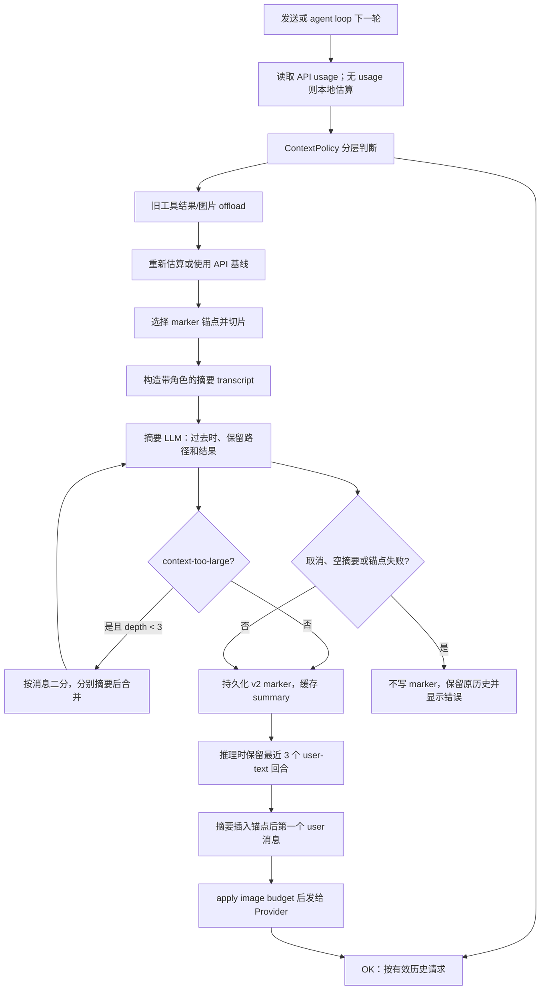

## 3. 上下文工程：压缩、预算与记忆

### 3.1 这一章解决什么问题

AI Agent 的上下文不是“把聊天记录全部塞进 `messages`”这么简单，而是系统提示词、工具定义、模型历史、工具 I/O、图片字节和本轮用户输入的共同预算。OpenMinis 必须在真正发起网络请求前做一次本地判断，否则用户只能等 Provider 返回 `context length` 错误后再补救；同时，模型的输出又会在一个用户回合内触发多轮工具调用，使上下文在发送入口之后继续增长。压缩（compaction）负责把已经完成的旧回合变成可追溯的摘要，offload 负责把大块工具数据移到沙箱文件而不是丢掉，memory 和 mention 则负责把跨会话知识及文件引用以受控方式带回当前上下文。读完本章后，读者应能复现一次“计数 → 分层预算 → 工具结果外置 → 摘要 → marker → 推理时重建”的完整链路。

本章引用的“历史”有两个含义：

- **原始历史（raw history）**：iOS 的 `agentHistory`、Android 的 `agentHistory`，保留数据库可审计的完整消息。
- **有效历史（effective history）**：真正交给 Provider 的消息切片；压缩后它可能包含最近几轮原文、一个内联摘要以及锚点之后的新消息，而不是原始数组的简单前缀。

这个区分是关键：iOS 明确在压缩后不修改 `agentHistory`，而是每次推理由 `effectiveAgentHistory()` 合成上下文；Android 也把 `_compactSummary` 和 marker 留在内存中，在 `effectiveAgentHistory()` 中重建发送列表。见 `src/ios/Agent/Chat/AIChatViewModel+Persistence.swift:1406-1415`、`src/android/app/src/main/java/com/openminis/app/ui/chat/ChatViewModel.kt:2046-2050`。

---

### 3.2 先建立预算模型：上下文里到底有哪些字节

在这套实现里，消息内容不是单一字符串，而是文本、工具调用、工具结果和图片等 part。iOS 的估算循环逐个处理 `effectiveAgentHistory()` 的 part：文本按字符数累计，`toolUse` 把 JSON 序列化后的字节数计入，`toolResult` 把结果文本与图片 token 分开计入，`imageData` 只计图片 token；这说明“图片大小”和“图片 token”是两种不同的预算。见 `src/ios/Agent/Chat/AIChatViewModel+Offloading.swift:309-366`。

Android 使用同样的四种 `AgentContentPart`：文本、`ToolUse`、`ToolResult`、`ImageData`。Android 的 `estimateContextTokens()` 对前两类累加字符数，对后两类累加文本并调用图片 token 估算。见 `src/android/app/src/main/java/com/openminis/app/ui/chat/ChatViewModel.kt:5525-5544`。

一个实用的最小模型可以写成：

```text
总压力 ≈ systemPrompt + tool schemas + 有效历史文本/JSON
         + 图片 token + 本轮输入 + 预留输出空间
```

但代码中的快速估算函数只遍历有效历史，并没有把完整 system prompt 和工具 schema 重新编码进去；这是从 `estimateContextTokens()` 的循环范围和 `runAgentLoop` 分开构建 prompt、tools 的代码可以直接看出的。因此，在实现自己的客户端时，应把本地估算当作“触发提前保护”的信号，不应当把它当作 Provider 最终账单。此处“system prompt 未纳入该函数”是对代码结构的观察，结论属于**[推断]**；对应代码位置为 `src/ios/Agent/Chat/AIChatViewModel+Offloading.swift:309-366`、`src/ios/Agent/Chat/AIChatViewModel.swift:4267-4310`。

预算还有两个维度：

1. **token 窗口**：约束文本、JSON、工具 I/O 和模型输出。
2. **图片字节窗口**：约束图片在 HTTP body 中的原始/压缩字节，避免 Provider 的 413 或空 SSE。

iOS 把单图上限设为 5 MiB、单次请求内联图片总上限设为 25 MiB，并把图片上下文保留数设为 20；这些是 `AIChatViewModel` 的静态约束。见 `src/ios/Agent/Chat/AIChatViewModel.swift:21-64`。Android 的 `ImageBudget` 采用相同的 5 MiB 单图和 25 MiB 请求总量，并另外保留每条用户消息的 25 MiB 预算。见 `src/android/app/src/main/java/com/openminis/app/provider/ImageBudget.kt:32-55`。

---

### 3.3 token 计数：本地 BPE、图片网格与误差兜底

#### 3.3.1 iOS：bundle 内的 `cl100k_base` 与 BPE 合并

iOS 的 `BPETokenizer` 是进程级单例，使用 `NSLock` 保护懒加载的 `encoder` 字典；字典的 key 是 UTF-8 byte sequence，value 是 token rank。第一次调用 `countTokens` 时加载 bundle 中的 `cl100k_base.tiktoken`，每行解析为“Base64 字节 + rank”，并预留约 100,300 个条目。见 `src/ios/Shared/BPETokenizer.swift:5-21`、`src/ios/Shared/BPETokenizer.swift:75-110`。

“本地计数”不是简单的 `text.count / 4`：

1. `splitIntoPieces` 先用接近 `cl100k_base` 的正则把缩写、字母串、数字、标点和空白拆成 piece。
2. 每个 piece 先尝试整体查表；整体存在时直接加入一个 rank。
3. 整体不存在时，以 UTF-8 的每个 byte 为初始 segment，反复选择 rank 最小且存在于词表的相邻 pair 合并。
4. 合并完成后，按 segment 重新查表，得到 token rank 数组。

对应实现位于 `src/ios/Shared/BPETokenizer.swift:112-155` 和 `src/ios/Shared/BPETokenizer.swift:157-269`。下面片段保留了“整体命中，否则 BPE”的关键语义：

**来源：`src/ios/Shared/BPETokenizer.swift:114-135`**

```swift
private func encode(_ text: String) -> [Int] {
    guard !text.isEmpty else { return [] }
    let pieces = splitIntoPieces(text)
    var tokens = [Int]()

    for piece in pieces {
        let bytes = Array(piece.utf8)
        if let rank = encoder[bytes] {
            tokens.append(rank)
            continue
        }
        let merged = bytePairEncode(bytes)
        tokens.append(contentsOf: merged)
    }
    return tokens
}
```

BPE 的相邻 pair rank 会缓存到并行数组中；每次合并后只刷新合并点左右最多两个邻居，而不是重新分配全部 pair key。这是针对大工具输出的性能修补，避免 token 估算本身在后台拖慢 UI。见 `src/ios/Shared/BPETokenizer.swift:157-166`、`src/ios/Shared/BPETokenizer.swift:203-257`。

消息 part 的计数还显式加入结构开销：普通文本按 BPE 数，`toolUse` 计算工具名和 JSON input 后加 4，`toolResult` 计算工具名、文本和图片后加 4。见 `src/ios/Shared/BPETokenizer.swift:33-72`。

**来源：`src/ios/Shared/BPETokenizer.swift:52-72`**

```swift
func countPartTokens(_ part: AgentContentPart) -> Int {
    switch part {
    case .text(let text):
        return countTokens(text)
    case .toolUse(_, let name, let input):
        var total = countTokens(name)
        if let data = try? JSONSerialization.data(withJSONObject: input),
           let json = String(data: data, encoding: .utf8) {
            total += countTokens(json)
        }
        return total + 4
    case .toolResult(_, let name, let content, _, let imageData, _, _, _):
        var total = countTokens(name) + countTokens(content)
        if let imgData = imageData { total += countImageTokens(imgData) }
        return total + 4
    case .imageData(let data, _, _):
        return countImageTokens(data)
    }
}
```

图片不是把 Base64 字符串送进 BPE，而是按像素网格估算：解码出宽高，长边缩到 2048，使用 `ceil(width / 32) * ceil(height / 32)`，最低 85 token；无法解码时使用保守的 1,000 token。见 `src/ios/Shared/BPETokenizer.swift:33-50`。

#### 3.3.2 Android：默认轻量估算，可选真实词表

Android 的实现有意分成两条路径。默认不携带约 2 MiB 的完整词表，`countTokens` 对 Unicode code point 采用 `max(1, codepointCount / 3)`；如果调用者通过 `loadVocabularyFromAssets` 加载 `cl100k_base.tiktoken`，才走 byte-level BPE。代码注释明确把默认值定位为约 ±15% 的启发式，而不是 Provider 的精确计数。见 `src/android/app/src/main/java/com/openminis/app/data/BPETokenizer.kt:8-24`、`src/android/app/src/main/java/com/openminis/app/data/BPETokenizer.kt:36-45`、`src/android/app/src/main/java/com/openminis/app/data/BPETokenizer.kt:68-97`。

Android 的可选词表格式与 iOS 一致：每行 Base64 byte sequence 加 rank，加载成功后写入 `@Volatile encoder`。其 `bpeEncode` 同样以 byte segment 开始，选择最低 rank 的相邻 pair 合并。见 `src/android/app/src/main/java/com/openminis/app/data/BPETokenizer.kt:99-138`。

Android 图片 token 也按 32×32 网格、长边 2048 和最低 85 token 计算，解码失败返回 1,000。见 `src/android/app/src/main/java/com/openminis/app/data/BPETokenizer.kt:47-65`。

#### 3.3.3 为什么必须先在设备上算

本地计数有四个工程原因：

1. **发送前必须决定**：iOS `checkContextBeforeSend()` 在进入 Provider 前先读取模型窗口、本地 estimate 和 `ContextPolicy`；Android 同样在 `checkContextBeforeSend()` 中使用最近一次 API usage。见 `src/ios/Agent/Chat/AIChatViewModel+Compaction.swift:20-36`、`src/android/app/src/main/java/com/openminis/app/ui/chat/ChatViewModel.kt:2491-2521`。
2. **offload 需要定位具体 part**：只有客户端持有 `agentHistory` 的 part 和文件路径，才能按 token 数排序候选并把原内容写入本地沙箱；服务器只会返回“太长”，无法替客户端决定哪个旧工具结果可以外置。见 `src/ios/Agent/Chat/AIChatViewModel+Offloading.swift:430-490`、`src/android/app/src/main/java/com/openminis/app/ui/chat/ChatViewModel.kt:5561-5596`。
3. **Provider 口径不统一**：流式 usage 可能是累计值、fresh-only 值，也可能缺少 `latestContextTokens`；本地逻辑必须能够在没有 usage 的第一轮先保护。Android 在缺少 latest 值时把 `inputTokens + cacheRead + cacheCreation` 重新合成上下文大小。见 `src/android/app/src/main/java/com/openminis/app/ui/chat/ChatViewModel.kt:6303-6322`。
4. **图片和本地文件不属于服务端计数**：图片是否被压缩、是否已在 `/var/minis` 有可取路径、是否需要 spillover，都是设备状态。见 `src/ios/Agent/Chat/AIChatViewModel+RequestBudget.swift:119-189`、`src/android/app/src/main/java/com/openminis/app/ui/chat/ChatViewModel.kt:1943-2043`。

服务端 usage 仍然是校准基线，而不是可省略的细节。iOS 的 `TokenUsage.add` 使用 `max` 处理某些 SSE chunk 发送累计 usage 的 Provider，避免 `0+1+2+...+N` 被错误累加；同时记录最近一次 API 的输入和 cache token。见 `src/ios/Agent/Chat/ChatModels.swift:126-149`。

#### 3.3.4 估算误差如何兜底

OpenMinis 采用“便宜估算触发、精确计数排序、真实 usage 纠偏、失败后拆分”的四层防线：

- 没有 API baseline 时，iOS 按约 3.5 字符/token 估算文本，图片额外按像素网格计 token；Android 同样用 3.5 的混合文本估算。见 `src/ios/Agent/Chat/AIChatViewModel+Offloading.swift:295-366`、`src/android/app/src/main/java/com/openminis/app/ui/chat/ChatViewModel.kt:5515-5544`。
- 真正挑选 offload 候选时，iOS 逐 part 调用 `BPETokenizer.countPartTokens`，Android 调用本地 `BPETokenizer`，因此候选排序比整段字符估算更精细。见 `src/ios/Agent/Chat/AIChatViewModel+Offloading.swift:448-481`、`src/android/app/src/main/java/com/openminis/app/ui/chat/ChatViewModel.kt:5546-5559`。
- 第一轮请求之后优先使用 API 报告的 `latestContextTokens`；Android 缺失该字段时把 cache token 加回，避免 cache 命中导致压力被低报。见 `src/android/app/src/main/java/com/openminis/app/ui/chat/ChatViewModel.kt:6303-6322`。
- 摘要输入的输出预算还会使用 `conversationText.count / 4 + 600`（iOS）或 `userMessage.length / 4`（Android），并把 summary 输出限制在 1,024 到 8,192 token；这不是精确计数，而是给摘要请求留下余量。见 `src/ios/Agent/Chat/AIChatViewModel+Compaction.swift:987-993`、`src/android/app/src/main/java/com/openminis/app/ui/chat/ChatViewModel.kt:2447-2467`。
- 如果 Provider 明确返回 context-too-large，摘要函数把消息按数量二分，递归摘要后再合并，深度上限为 3；如果仍失败，错误向上交给 compaction 的失败路径。见 `src/ios/Agent/Chat/AIChatViewModel+Compaction.swift:872-943`、`src/android/app/src/main/java/com/openminis/app/ui/chat/ChatViewModel.kt:2363-2420`。

因此，不能用“本地数字恰好等于服务端数字”作为正确性标准。正确性标准是：本地判断不要晚于服务端拒绝，offload 后保留可检索路径，压缩失败时不破坏原历史，并在 API usage 到达后修正下一轮的预算。

---

### 3.4 上下文窗口策略：四档阈值与触发时机

#### 3.4.1 `ContextPolicy` 只判断状态，不实现摘要

iOS 的 `ContextPolicy` 是纯值对象，构造时只根据 `contextWindow` 设置四个阈值和两个开关；它不读数据库、不生成摘要。Android 的注释同样强调“策略只回答现在处于什么状态，实际 compact/offload 在 agent loop”。见 `src/ios/Agent/Chat/ContextPolicy.swift:3-21`、`src/android/app/src/main/java/com/openminis/app/data/ContextPolicy.kt:3-15`。

四档配置如下：

| 模型上下文窗口 | offload 触发 | offload 目标 | 自动 compact | exhausted 行为 | 手动 compact |
|---|---:|---:|---:|---|---|
| `< 32K` | 关闭 | 0 | 关闭 | 达到 90% 即 exhausted | 关闭 |
| `32K–64K` | `window - 10K` | `window - 15K` | 关闭 | 达到 offload 线即 exhausted | 允许 |
| `64K–128K` | `window - 20K` | `window - 30K` | `window - 10K` | 不走 exhausted-only | 允许 |
| `≥ 128K` | `window - 40K` | `window - 60K` | `window - 20K` | 不走 exhausted-only | 允许 |

表中数值直接来自 iOS `ContextPolicy.init(contextWindow:)` 的四个分支（`src/ios/Agent/Chat/ContextPolicy.swift:23-52`）以及 Android `ContextPolicy.forContextWindow`（`src/android/app/src/main/java/com/openminis/app/data/ContextPolicy.kt:52-90`）。两端阈值相同，但 API 形式不同：iOS 由 `init` 构造，Android 用 companion factory 返回 data class。

检查顺序很重要：先检查 `compactThreshold`，再检查小窗口的 exhausted 线；所以支持自动压缩的 64K+ 模型不会因为同一 token 数先被判 exhausted。见 `src/ios/Agent/Chat/ContextPolicy.swift:55-90`、`src/android/app/src/main/java/com/openminis/app/data/ContextPolicy.kt:28-50`。

**来源：`src/ios/Agent/Chat/ContextPolicy.swift:67-90`**

```swift
func check(estimatedTokens: Int, contextWindow: Int) -> CheckResult {
    if compactThreshold > 0, estimatedTokens >= compactThreshold {
        return .needsCompact
    }
    if exhaustedOnly {
        let exhaustedThreshold = offloadThreshold > 0
            ? offloadThreshold
            : Int(Double(contextWindow) * 0.90)
        if estimatedTokens >= exhaustedThreshold { return .exhausted }
    }
    return .ok
}
```

#### 3.4.2 窗口大小从哪里来

iOS 的 effective window 优先读取当前 session 绑定的 model group limit；如果 group 使用“Unlimited”哨兵 `Int.max`，则回退到模型声明的 `contextWindowTokens`。见 `src/ios/Agent/Chat/AIChatViewModel+Misc.swift:231-260`。Android 每次判断都从当前配置重新解析活动 model，再把 group `contextLimitTokens` 与模型窗口取较小值，避免配置修改后必须重新选择模型。见 `src/android/app/src/main/java/com/openminis/app/ui/chat/ChatViewModel.kt:1138-1164`。

输出预算不能等到窗口完全用满才处理。iOS 的 `dynamicMaxTokens` 取模型或 Provider 的上限、全局 128K 上限和 `contextWindow - inputTokens` 的最小值，并保留至少 1,024 token（但不会超过用户刻意设置的小上限）。见 `src/ios/Agent/Chat/AIChatViewModel+Misc.swift:263-324`。Android 采用同样的全局 128K ceiling，使用 `max(remaining, 1024)` 后再与 Provider 上限取最小值。见 `src/android/app/src/main/java/com/openminis/app/ui/chat/ChatViewModel.kt:5465-5494`。

#### 3.4.3 发送入口与 agent loop 内的触发差异

iOS 的普通 `send()` 在真正追加用户消息前执行 `checkContextBeforeSend()`：

- `.ok`：继续发送。
- `.needsCompact`：普通会话显示“压缩后发送”的 UI；shortcut 或开启 `autoCompactEnabled` 时，保存待发文本和附件，先 `compactAndSend()`。
- `.exhausted`：普通会话显示“新建会话/清空”提示；shortcut 无法弹窗时直接追加错误。

见 `src/ios/Agent/Chat/AIChatViewModel.swift:2106-2148`。

单个用户回合可能连续触发很多工具迭代，所以 iOS 在 `runAgentLoop` 的每轮开始又做一次检查。它先 trim 图片、再 offload 工具结果；若仍是 `.needsCompact`，且本轮 compact 次数未超过上限，则允许处理中的 `compactBefore` 并 `continue`；本轮压缩次数达到上限仍接近窗口时，转为 exhausted 停止。压缩步骤不消耗 agent turn，但不重置总体 `maxAgentTurns`。见 `src/ios/Agent/Chat/AIChatViewModel.swift:4462-4545`。

Android 当前入口只警告而不阻塞发送：`checkContextBeforeSend()` 在 `.NEEDS_COMPACT` 或 `.EXHAUSTED` 时追加 system-info，仍返回 `true`，让用户主动执行 `/compact`。见 `src/android/app/src/main/java/com/openminis/app/ui/chat/ChatViewModel.kt:2491-2521`；它在发送入口被调用的位置为 `src/android/app/src/main/java/com/openminis/app/ui/chat/ChatViewModel.kt:4812-4815`。Android agent loop 每轮会自动 offload，但从本章所查代码看，自动 compact 仍由 `/compact`/debug entrypoint 发起，而不是像 iOS 一样在 loop 中调用 `compactBefore`；这是两端当前行为差异的代码事实。

---

### 3.5 压缩算法：从锚点到推理时摘要

这是本章的核心。下面步骤可以作为一个可复现的实现协议，先描述公共语义，再列出 iOS/Android 的落点。



图中 `summary` 的循环来自 iOS `generateCompactSummaryWithSplitting`（`src/ios/Agent/Chat/AIChatViewModel+Compaction.swift:872-929`）和 Android 同名 helper（`src/android/app/src/main/java/com/openminis/app/ui/chat/ChatViewModel.kt:2374-2420`）；“最近 3 回合 + 内联摘要”来自 iOS `effectiveAgentHistoryUncounted`（`src/ios/Agent/Chat/AIChatViewModel+Persistence.swift:1417-1488`）和 Android `effectiveAgentHistory`（`src/android/app/src/main/java/com/openminis/app/ui/chat/ChatViewModel.kt:2058-2202`）。

#### 3.5.1 步骤 0：触发与并发门

iOS 的 `/compact` 通过 `compactAll()` 选取最后一个 active UI message 作为 anchor，过滤 compact divider、system info 和已经标灰的历史；消息不足或正在处理时直接显示提示。见 `src/ios/Agent/Chat/AIChatViewModel+Compaction.swift:200-223`。`compactBefore` 还允许长按某条消息压缩到该点，并在 agent loop 中以 `allowDuringProcessing` 调用。见 `src/ios/Agent/Chat/AIChatViewModel+Compaction.swift:446-465`。

Android 的 `compactBefore(dbMessageId)` 把给定 DB id 映射到 `agentHistory`，找不到时退回 `compactAll()`；`compactAll` 在 streaming 或已有 compact 时拒绝重入。见 `src/android/app/src/main/java/com/openminis/app/ui/chat/ChatViewModel.kt:1490-1522`、`src/android/app/src/main/java/com/openminis/app/ui/chat/ChatViewModel.kt:1524-1545`。

#### 3.5.2 步骤 1：确定范围和持久化锚点

v2 marker 的语义不是“第一条保留消息”，而是“最后一条已折叠消息”：

- 本次 anchor 是用户指定边界，或 `compactAll` 的最后 active 消息。
- 没有旧 marker 时，范围是 `[0, anchorIdx]`。
- v2 有旧 marker 时，范围从 `prevAnchorIdx + 1` 开始，避免新摘要重复把同一增量当作新历史；v1 兼容路径从 `firstKeptMessageId` 开始。
- 写 marker 前必须找到已持久化的 `dbMessageId`；iOS 还确认该 id 存在于当前 raw DB。找不到就不写 marker。

iOS 的范围计算与 v1/v2 起点见 `src/ios/Agent/Chat/AIChatViewModel+Compaction.swift:601-645`，anchor 和 `endExclusive` 见 `src/ios/Agent/Chat/AIChatViewModel+Compaction.swift:529-555`。iOS 从 `allRaw` 向前寻找已持久化 id，避免 marker 指向尚未落库的 transient row，见 `src/ios/Agent/Chat/AIChatViewModel+Compaction.swift:682-705`。

Android 的 v2 起点和 DB id 验证见 `src/android/app/src/main/java/com/openminis/app/ui/chat/ChatViewModel.kt:1595-1623`、`src/android/app/src/main/java/com/openminis/app/ui/chat/ChatViewModel.kt:1656-1687`。它在 IO coroutine 中读取 raw DB id 集合，并从原 anchor 向前走到最近的已落库 entry。

**来源：`src/ios/Agent/Chat/AIChatViewModel+Compaction.swift:717-738`**

```swift
let marker = CompactMarker(
    id: UUID().uuidString,
    sessionId: sessionId,
    summary: summary,
    firstKeptSortOrder: legacyPastEndSortOrder,
    compactedCount: historyCount,
    createdAt: Date(),
    uiBoundarySortOrder: legacyPastEndSortOrder,
    boundaryMessageId: nil,
    firstKeptMessageId: nil,
    lastCompactedMessageId: lastCompactedMessageId,
    version: 2
)
await ChatStore.shared.insertCompactMarker(marker)
self.cachedLatestMarker = marker
// agentHistory 不修改；下一次推理由 effectiveAgentHistory 合成
```

写 marker 成功后，iOS 删除旧 divider、插入新 divider，并把 anchor 之前的 UI 行标为 `isCompactedHistory`；Android 做同样的 cutoff graying，再追加带 summary payload 的 system info。见 `src/ios/Agent/Chat/AIChatViewModel+Compaction.swift:740-800`、`src/android/app/src/main/java/com/openminis/app/ui/chat/ChatViewModel.kt:1725-1783`。

#### 3.5.3 步骤 2：把原消息变成摘要输入

iOS `buildConversationTextForSummary` 保持角色前缀：普通 text 原样加入；`toolUse` 只挑 `path/file_path`、`command`、`directory` 或 content 前 200 字符；`toolResult` 只取前 500 字符；图片变成 `[Image attached]`。见 `src/ios/Agent/Chat/AIChatViewModel+Compaction.swift:833-870`。

Android 的 transcript 更激进：消息 `content` 前 500 字符，文本 part 前 500，tool input 前 200，tool result 前 500，图片只写 MIME 标记。见 `src/android/app/src/main/java/com/openminis/app/ui/chat/ChatViewModel.kt:2328-2361`。

这一步有两个不显然的保护：

- 摘要模型无需看到每个 shell 输出的全部原文，原文仍在 DB 或 offload 文件。
- 路径、命令、工具名、错误结果必须留在摘要输入，否则摘要即使语言流畅，也不能指导下一轮 `file_read` 或继续修复。

#### 3.5.4 步骤 3：摘要 prompt 的约束

摘要请求本身使用当前会话的 Provider，但不带工具列表；iOS 使用单条 user message 调 `streamMessage`，Android 使用非流式 `sendMessage`，两端都将 temperature 交给模型默认值。见 `src/ios/Agent/Chat/AIChatViewModel+Compaction.swift:945-1014`、`src/android/app/src/main/java/com/openminis/app/ui/chat/ChatViewModel.kt:2428-2469`。

摘要 system prompt 的约束是实现的一部分，而不是普通文案：

- 先用用户语言写一句过去时概述。
- 保留路径、目录、URL、UUID、identifier 原文。
- 保留执行过的命令及成功/失败/输出。
- 保留请求、已完成动作、决定及理由、错误和修复、约束与偏好、影响状态的工具调用。
- 结尾写 `What had been done so far`，禁止写会重新激活旧任务的 todo/pending 列表。
- 用户的下一条消息优先于摘要。

**来源：`src/ios/Agent/Chat/AIChatViewModel+Compaction.swift:957-985`**

```swift
let systemPrompt = """
You are a context compaction engine. Your summary will REPLACE the original messages in the conversation context window. The agent will read your summary as past context, then proceed based on the user's NEXT message — your summary is background, not a standing work order. Write the summary in the same language the user used in the conversation.

MUST PRESERVE (never omit or shorten):
- All file paths, directory names, URLs, UUIDs, and identifiers — copy verbatim
- Commands executed and their outcomes (success/failure/output)
- What was requested and what was done (record as past events, not as ongoing goals)
- Key decisions made and their rationale
- Errors encountered and how they were resolved
- Important constraints, rules, or user preferences mentioned
- Any tool calls and their results that affect current state
"""
```

Android 的 `compactSummarySystemPrompt` 与 iOS 对齐，源码位于 `src/android/app/src/main/java/com/openminis/app/ui/chat/ChatViewModel.kt:2523-2547`。发送给摘要模型的 user message 还包裹 `BEGIN/END`，明确“不要继续对话，只总结”，防止模型把 transcript 的最后一条用户请求当成新问题回答。见 `src/ios/Agent/Chat/AIChatViewModel+Compaction.swift:996-1014`、`src/android/app/src/main/java/com/openminis/app/ui/chat/ChatViewModel.kt:2428-2446`。

#### 3.5.5 步骤 4：context-too-large 时二分摘要

如果摘要请求失败且错误字符串匹配 `too many tokens`、`context length`、`max_tokens`、`request too large`、`prompt is too long`、`token limit` 等，且消息数不少于 2、递归深度小于 3，则按消息数量一分为二。两半分别摘要，再调用一次 merge prompt 合并；Part 2（较新）在空间不足时优先。见 `src/ios/Agent/Chat/AIChatViewModel+Compaction.swift:889-943`。

Android 的实现完全复刻这条协议：先递归摘要两半，再用“过去事件、保留路径/identifier/URL/决定/约束、不要 pending/todo、较新 Part 2 优先”的 merge input；递归深度同样上限 3。见 `src/android/app/src/main/java/com/openminis/app/ui/chat/ChatViewModel.kt:2386-2420`。

注意 previous summary 的合并：首层会把旧 marker summary 放在 `Previous context summary` 中，再放本次新增 transcript；发生二分时，子调用摘要各自的消息，最终由 merge prompt 合并。iOS 的拼接在 `src/ios/Agent/Chat/AIChatViewModel+Compaction.swift:879-884`，Android 的拼接在 `src/android/app/src/main/java/com/openminis/app/ui/chat/ChatViewModel.kt:2379-2385`。

#### 3.5.6 步骤 5：压缩后的“保留哪些消息”

v2 有效历史不是“summary + 全量 history”，而是以下布局：

1. 从 anchor 向前走，保留最近 `compactKeepRecentUserTurns = 3` 个有可见文本的 user 回合；每个 user 回合后面的 assistant、tool_use、tool_result 都属于同一回合。
2. 走回最多 100 条 message；只在 user 边界决定是否继续向前，不能把 tool_use 与其 tool_result 拆开。
3. 摘要不作为普通独立 user turn 插在中间，而是插入 anchor 之后第一个 user message 的第一个 text part，保持 API 所需的 user/assistant 交替。
4. anchor 之后的所有新消息保持 active，仍按原顺序发送。
5. 如果 anchor 后没有 user 消息，才在尾部追加一个独立 summary user message。

iOS 的注释和 anchor 解析见 `src/ios/Agent/Chat/AIChatViewModel+Persistence.swift:1417-1440`；最近 3 回合和 100 条上限见 `src/ios/Agent/Chat/AIChatViewModel+Persistence.swift:1452-1488`。Android 的同等逻辑见 `src/android/app/src/main/java/com/openminis/app/ui/chat/ChatViewModel.kt:2058-2072`、`src/android/app/src/main/java/com/openminis/app/ui/chat/ChatViewModel.kt:2083-2114`。

下面是 iOS 的核心插入片段；Android 采用 `target.copy(content = summaryWrappedText + "\\n\\n" + target.content)`，位置为 `src/android/app/src/main/java/com/openminis/app/ui/chat/ChatViewModel.kt:2177-2201`。

**来源：`src/ios/Agent/Chat/AIChatViewModel+Persistence.swift:1559-1582`**

```swift
if let firstUserOffset = postAnchor.firstIndex(where: { $0.role == .user }) {
    if firstUserOffset > 0 {
        result.append(contentsOf: postAnchor[0..<firstUserOffset])
    }
    var injected = postAnchor[firstUserOffset]
    injected.parts.insert(.text(summaryText), at: 0)
    result.append(injected)
    if firstUserOffset + 1 < postAnchor.count {
        result.append(contentsOf: postAnchor[(firstUserOffset + 1)...])
    }
} else {
    result.append(contentsOf: postAnchor)
    result.append(AgentMessage(role: .user, parts: [.text(summaryText)]))
}
return result
```

`summaryText` 使用 `<context-summary>` envelope，并且明确摘要是 background context、最新用户消息优先。见 `src/ios/Agent/Chat/AIChatViewModel+Compaction.swift:337-348`、`src/android/app/src/main/java/com/openminis/app/ui/chat/ChatViewModel.kt:2052-2056`。

#### 3.5.7 步骤 6：pre-anchor 工具结果裁剪与角色对齐

最近 3 个 user-text 回合之间可能塞进上百条工具消息。如果原工具结果已经被摘要覆盖，继续原样带入会让“保留最近回合”变成另一个上下文炸弹。因此 v2 在 pre-anchor slice 中查找长度大于 1,000 字符的 `toolResult`，收集其 id，同时从对应 assistant message 删除同 id 的 `toolUse`；删除后为空的壳 message 丢弃。这样不会产生只有 tool_use 没有 tool_result、或只有 tool_result 没有 tool_use 的孤儿配对。见 `src/ios/Agent/Chat/AIChatViewModel+Persistence.swift:1480-1519`、`src/android/app/src/main/java/com/openminis/app/ui/chat/ChatViewModel.kt:2104-2147`。

裁剪后还会剥掉开头所有非 user message，保证发送列表以 user 开始；如果裁剪把头部 user 清空，摘要就注入第一个 post-anchor user。见 `src/ios/Agent/Chat/AIChatViewModel+Persistence.swift:1522-1530`、`src/android/app/src/main/java/com/openminis/app/ui/chat/ChatViewModel.kt:2149-2155`。

#### 3.5.8 步骤 7：工具结果 offload 是压缩前后的另一条无损路径

offload 与摘要不同：它不让模型“记住大概内容”，而是把原文或图片写入 session 的 `offloads/tools`，再把消息 part 替换成一个可执行的检索提示。iOS 的触发入口：

1. 有 API baseline 就使用 `lastContextTokens`，否则使用字符估算。
2. 达到 policy 的 offload threshold 后，保护 `agentHistory` 最后 4 条 message。
3. 候选包括：tool result 文本超过 500 字符、图片超过 1 KiB、`file_write/file_edit` 的 content 超过 500 字符、裸图片超过 1 KiB。
4. 以 part token 数降序排序，逐个写文件，直到 current token 降到 offload target。
5. 已带 `[CONTEXT OFFLOADED]` 前缀的 part 跳过。

见 `src/ios/Agent/Chat/AIChatViewModel+Offloading.swift:295-428`、`src/ios/Agent/Chat/AIChatViewModel+Offloading.swift:430-503`。Android 的 threshold、最后 4 条保护、候选规则和排序见 `src/android/app/src/main/java/com/openminis/app/ui/chat/ChatViewModel.kt:5575-5596`、`src/android/app/src/main/java/com/openminis/app/ui/chat/ChatViewModel.kt:5598-5692`。

文本 tool result 会变成如下语义的 stub：

```text
[CONTEXT OFFLOADED] Content (~N tokens, B bytes) saved to: /var/minis/offloads/tools/...
Use file_read tool to retrieve if needed.
```

iOS 对 tool result、file_write/file_edit input、裸 ImageData 的替换分别位于 `src/ios/Agent/Chat/AIChatViewModel+Offloading.swift:514-548`；Android 对应替换位于 `src/android/app/src/main/java/com/openminis/app/ui/chat/ChatViewModel.kt:5700-5756`。原文件仍位于 session 的持久目录，因此这是**可逆的上下文减肥**，不是摘要式丢失。

另外，shell 执行器在输出本身过长时会先保留头尾各半，再附加 `[OUTPUT TRUNCATED]` 和 `file_read` 指引；这发生在 offload 之前，避免把进度噪声直接写入 history。见 `src/ios/Agent/Chat/AIChatViewModel+ISHCommand.swift:170-182`。

#### 3.5.9 步骤 8：图片、附件和 25 MiB 请求预算

图片有三道保护，不能只做 token 计数：

**第一道：历史图片数量。** iOS 每轮 API 前调用 `trimOldImagesFromHistory()`，只保留最近 20 张；更老的 tool result image 或 standalone image 被替换为文字 placeholder。若原路径在持久 `/var/minis/workspace`、`browser`、`attachments`、`offloads`，不重复快照；若来自 `/tmp`、没有路径或路径未知，则写到 offloads/tools 后在 placeholder 中给出 snapshot path。见 `src/ios/Agent/Chat/AIChatViewModel+Offloading.swift:112-187`、`src/ios/Agent/Chat/AIChatViewModel+Offloading.swift:188-293`。

placeholder 会携带像素尺寸、字节大小和原路径/快照路径，让模型知道“有一张图被省略”以及如何用 `read_image` 重新读取。见 `src/ios/Agent/Chat/AIChatViewModel+Offloading.swift:81-110`。

**第二道：本轮/请求级图片字节。** iOS `applyRequestImageBudget` 收集历史中所有 `imageData` 和带 image 的 `toolResult`，从最新到最旧反向规划；每张的有效大小先按 5 MiB clamp，累计超过 25 MiB 的旧图被替换为文字。没有 linuxPath 时，按 SHA-1 写入 `attachments/spillover`，再在 placeholder 中给出 `/var/minis/attachments/spillover/...`。见 `src/ios/Agent/Chat/AIChatViewModel+RequestBudget.swift:36-71`、`src/ios/Agent/Chat/AIChatViewModel+RequestBudget.swift:73-110`、`src/ios/Agent/Chat/AIChatViewModel+RequestBudget.swift:119-189`。

Android 在 `applyRequestImageBudget` 中采用同样的“最新优先”规划；没有路径的图片写入 `filesDir/minis-sessions/<sid>/attachments/spillover`，最后把裸图换成 text 或把 placeholder 追加到 tool result content。见 `src/android/app/src/main/java/com/openminis/app/ui/chat/ChatViewModel.kt:1927-2043`。其规划器和 placeholder 细节见 `src/android/app/src/main/java/com/openminis/app/provider/ImageBudget.kt:244-318`。

**第三道：Provider 边界压缩。** Android Provider 对恢复历史中绕过 composer 的图片再次调用 `compressUnderBudget`，在 2,000、1,600、1,280、1,024、896、768、640 像素梯度中尝试，最小化 JPEG 后再发送；即使无法达到目标，也保留最小候选而不是直接让整次请求失败。见 `src/android/app/src/main/java/com/openminis/app/provider/ImageBudget.kt:59-145`、`src/android/app/src/main/java/com/openminis/app/provider/anthropic/AnthropicProvider.kt:582-633`。iOS 的附件发送路径也先复制到持久 uploads，再只把图片字节加载进内存，非图片附件不 materialize 到 RAM，见 `src/ios/Agent/Chat/AIChatViewModel.swift:2254-2329`。

#### 3.5.10 步骤 9：失败、取消和安全降级

iOS compaction 在摘要前设置 `isCompacting/isProcessing`，插入 loading system-info；`Task.checkCancellation()` 抛出时显示 `Compaction cancelled.`，其他错误显示 `Compaction failed: ...`，并且在任何失败分支不写 marker。`defer` 最终清理状态。见 `src/ios/Agent/Chat/AIChatViewModel+Compaction.swift:573-599`、`src/ios/Agent/Chat/AIChatViewModel+Compaction.swift:651-671`。

如果摘要成功但找不到能落库的 anchor，iOS 明确报“could not anchor marker”并停止，不会用一个无法定位的 summary 覆盖历史。见 `src/ios/Agent/Chat/AIChatViewModel+Compaction.swift:686-705`。Android 在 summary 为空、anchor 验证失败、Provider 抛错时追加失败 system-info，最后把 `_isCompacting` 复位；只有成功才排队 drain。见 `src/android/app/src/main/java/com/openminis/app/ui/chat/ChatViewModel.kt:1642-1647`、`src/android/app/src/main/java/com/openminis/app/ui/chat/ChatViewModel.kt:1681-1701`、`src/android/app/src/main/java/com/openminis/app/ui/chat/ChatViewModel.kt:1783-1811`。

marker 在有效历史中无法解析时，两个平台都选择“回退到完整 history”，而不是只发送孤零零的 summary。原因是 summary-only 加上热工具列表可能让模型反复调用 `memory_get`/工具来找回状态；代码明确把“过度提供信息”当作安全网。见 `src/ios/Agent/Chat/AIChatViewModel+Persistence.swift:1441-1449`、`src/android/app/src/main/java/com/openminis/app/ui/chat/ChatViewModel.kt:2070-2080`。

---

### 3.6 持久记忆：工具接口、文件布局与 system prompt 注入

#### 3.6.1 存储位置和权限语义

iOS 的 memory 目录在 App Group 的 `MinisFileProvider/memory` 下，允许主 App 与 FileProvider 访问；这个目录是跨 session 的 global storage。见 `src/ios/Agent/Chat/AIChatViewModel+RequestBudget.swift:244-274`。`SOUL.md` 也在同一 memory 目录旁边，但它属于 persona，不是 memory tool 写入的 daily log。见 `src/ios/Agent/Session/SoulStore.swift:136-142`。

Android 的 `MemoryRepository` 使用 `<filesDir>/minis-global/memory/`，初始化时创建目录；`GLOBAL.md` 是用户维护、agent 只读的全局文件，`YYYY-MM-DD.md` 是 agent 通过 `memory_write` 写入的 daily log。见 `src/android/app/src/main/java/com/openminis/app/data/repository/MemoryRepository.kt:9-18`、`src/android/app/src/main/java/com/openminis/app/data/repository/MemoryRepository.kt:45-47`。

#### 3.6.2 `memory_write`：追加语义其实是“头插”

iOS 的 `executeMemoryWrite` 要求 JSON 有 `content` 且当前 session `memoryEnabled`；它生成当天 `yyyy-MM-dd.md`，把 `<!-- yyyy-MM-dd HH:mm:ss -->` 加到正文前，再把新 entry prepend 到现有文件。写成功后注册 fakefs metadata、标记 iCloud dirty、广播 `.memoryFilesDidChange`。见 `src/ios/Agent/Chat/AIChatViewModel+MemoryTools.swift:63-119`。

Android `MemoryTools.executeMemoryWrite` 解析 `content/tool_title` 后委托 `MemoryRepository.writeMemory`；Repository 同样生成时间戳注释并头插，返回 `Memory saved to ...` 或错误文本。见 `src/android/app/src/main/java/com/openminis/app/tools/MemoryTools.kt:98-121`、`src/android/app/src/main/java/com/openminis/app/data/repository/MemoryRepository.kt:49-77`。

工具 schema 也限制了用途：`memory_write` 要求 `tool_title` 和 `content`，描述中要求保存偏好、事实、项目约定，避免密码、API key 和 token；`memory_get` 要求 `tool_title`，可选 `scope`（`daily`/`all`）和空格分隔 keywords。见 `src/ios/Agent/Chat/AIChatViewModel+ToolDefinitions.swift:104-123`、`src/android/app/src/main/java/com/openminis/app/tools/MemoryTools.kt:15-71`。

#### 3.6.3 `memory_get`：两端搜索粒度不同

iOS `executeMemoryGet`：

1. `scope=all` 时把 `GLOBAL.md` 加入搜索，否则只查 daily 文件。
2. daily 文件按文件名倒序；有 keywords 时按 `<!-- timestamp -->` marker 拆成 entry。
3. 每个 entry 统计命中关键词数，使用 50% confidence + 50% recency 综合分排序。
4. 无关键词时最多返回 500 行；有关键词时最多返回 60 条 entry、约 30 KiB UTF-8，并且 append-then-break，触发上限的 entry 保持完整。

见 `src/ios/Agent/Chat/AIChatViewModel+MemoryTools.swift:144-201`、`src/ios/Agent/Chat/AIChatViewModel+MemoryTools.swift:204-229`、`src/ios/Agent/Chat/AIChatViewModel+MemoryTools.swift:270-365`。

Android `MemoryRepository.getMemory` 的关键词搜索是行级窗口：每个命中行带前后各 2 行上下文，所有关键词必须在窗口内出现；无关键词最多 500 行，有关键词最多 60 行，另有 30 KiB byte cap。见 `src/android/app/src/main/java/com/openminis/app/data/repository/MemoryRepository.kt:80-133`、`src/android/app/src/main/java/com/openminis/app/data/repository/MemoryRepository.kt:141-231`。

所以不能把 Android 的“60”解释为 iOS 的“60 entries”：Android 是约 60 行预算，iOS 是最多 60 个 timestamp-delimited entry。两端都把 tool result 限制在上下文友好的大小，避免一次 `memory_get` 重新制造 context bloat。

#### 3.6.4 何时注入 system prompt

iOS 在 `runAgentLoop` 的 prompt setup 中按以下顺序拼接：

1. `baseSystemPrompt`：SOUL identity/personality、Linux 行为约束、Available tools、环境和 `/var/minis` 说明。
2. 当前 model 的 capability fragment。
3. 当前 model 的 agent behavior fragment。
4. 当前 session 启用的 skills fragment。
5. MCP metadata fragment。
6. `GLOBAL.md` 全文（若存在且非空）。
7. 最近 30 天内最多 3 个有内容的 daily log，每个最多 200 行。
8. memory status footer。

见 `src/ios/Agent/Chat/AIChatViewModel.swift:4267-4310`。只有 `memoryEnabled` 为真时才读取 global/daily；关闭时注入一个权威 footer，说明文件和两个 memory tools 都不可见，见 `src/ios/Agent/Chat/AIChatViewModel.swift:1872-1895`。这意味着 memory 是**每次构建 system prompt 时注入的背景材料**，而不是把 memory 文件永久追加进 `agentHistory`。

Android 的 `buildSystemPrompt()` 也在每次调用时读取当前 memory toggle；base 中先放 identity、工具说明、环境变量和 memory system guidance，然后按 `skills → MCP → GLOBAL.md → recent daily logs → Runtime context` 的顺序 append。见 `src/android/app/src/main/java/com/openminis/app/ui/chat/ChatViewModel.kt:7920-7988`、`src/android/app/src/main/java/com/openminis/app/ui/chat/ChatViewModel.kt:8081-8132`。

Android 的 memory toggle 同时影响 prompt 与工具 schema：`agentTools` 每次读取都会调用 `AgentTools.makeAgentTools(memoryEnabled = ...)`，关闭时不注册 `memory_write` 和 `memory_get`。见 `src/android/app/src/main/java/com/openminis/app/ui/chat/ChatViewModel.kt:736-744`、`src/android/app/src/main/java/com/openminis/app/tools/AgentTools.kt:14-36`。iOS 也在关闭时从工具列表删除两个 definition，并在 execute 层做 defense-in-depth，见 `src/ios/Agent/Chat/AIChatViewModel+ToolDefinitions.swift:9-16`、`src/ios/Agent/Chat/AIChatViewModel+MemoryTools.swift:122-134`。

需要区分“自动注入”和“主动检索”：GLOBAL.md 与最近 daily log 是自动注入；更老的 daily 内容、关键词搜索结果只会在模型显式调用 `memory_get` 后以 tool result 回到下一轮 history。iOS 的注入数量限制和 `memory_get` 搜索路径分别见 `src/ios/Agent/Chat/AIChatViewModel+MemoryTools.swift:19-60`、`src/ios/Agent/Chat/AIChatViewModel+MemoryTools.swift:122-365`；Android 对应见 `src/android/app/src/main/java/com/openminis/app/data/repository/MemoryRepository.kt:234-301`。

---

### 3.7 文件 mention、索引和“注入文件内容”的真实语义

#### 3.7.1 索引构建：三层扫描、缓存和预算

iOS `FileMentionIndex` 是 `@MainActor` 单例，默认缓存 600 秒，单次全局扫描最多收集 5,000 个 entry，mount 目录最大递归深度为 3，匹配结果默认上限 100。见 `src/ios/Agent/Chat/FileMentionIndex.swift:81-126`。

每次 `@` 触发时，`refreshIfNeeded` 先检查 cache TTL 与 session id；命中缓存且 entries 非空则不扫描，否则生成 UUID token 并异步扫描：

1. session roots：workspace、attachments，先发布。
2. shared roots：shared、skills、memory，再发布。
3. 每个 external mount 单独扫描和发布；即使预算耗尽，也至少发布 mount 根目录。

见 `src/ios/Agent/Chat/FileMentionIndex.swift:130-146`、`src/ios/Agent/Chat/FileMentionIndex.swift:148-239`。扫描会跳过 `.git`、`node_modules`、`.venv`、build cache 等目录，见 `src/ios/Agent/Chat/FileMentionIndex.swift:433-495`；publish 阶段按 `linuxPath` 去重，并用 token 丢弃过期扫描结果，见 `src/ios/Agent/Chat/FileMentionIndex.swift:526-560`。

Android 的 FileMentionIndex 采用同样的三层和 10 分钟缓存，但在 CoroutineScope/StateFlow 中实现；session roots、shared roots、mount roots 按层发布，mount 根总是可引用，见 `src/android/app/src/main/java/com/openminis/app/data/FileMentionIndex.kt:15-45`、`src/android/app/src/main/java/com/openminis/app/data/FileMentionIndex.kt:94-181`。Android 的全局预算 5,000、mount 深度 3、结果上限 100 定义于 `src/android/app/src/main/java/com/openminis/app/data/FileMentionIndex.kt:391-404`。

#### 3.7.2 匹配评分与 @ 菜单

iOS 匹配不是全文内容检索，而是对 basename/path 做可预测的字符串分级：完整 basename 10,000、stem 9,000、前缀 7,000、basename word boundary 6,000、basename contains 4,000、祖先路径组件 2,000、全路径 1,000；scope、顶层目录和最近修改时间只作为次级加分。相邻 name tier 间隔为 1,000，而所有次级信号之和最多 730，所以弱 name match 不会因 scope 优先级逆袭强 match。见 `src/ios/Agent/Chat/FileMentionIndex.swift:241-342`。

Android 采用同一套 10,000 到 1,000 的 tier、scope boost、顶层 root bonus 和 recency bonus，见 `src/android/app/src/main/java/com/openminis/app/data/FileMentionIndex.kt:261-330`。

iOS 的 `updateMentionMenuState` 从 caret 向左寻找当前 token 中的 `@`，要求 `@` 位于文本开头或 whitespace 后，以避免 `foo@bar.com` 误触发；遇到 whitespace 就停止。见 `src/ios/Agent/Chat/AIChatViewModel+MentionMenu.swift:25-87`。索引扫描尚未结束时，UI 最多等待 250ms 或 scan finish 再显示，避免弹窗动画和列表 refill 同时发生，见 `src/ios/Agent/Chat/AIChatViewModel+MentionMenu.swift:87-157`。

Android 的扩展方法同时接受 ASCII `@` 和全角 `＠`，同样拒绝 email-like token，并在菜单打开时刷新 session index，见 `src/android/app/src/main/java/com/openminis/app/ui/chat/ChatViewModelMentionExt.kt:81-142`。

#### 3.7.3 选择 mention 后到底发生什么

选择 entry 时，iOS 只把 active `@<token>` 替换为 `@<entry.linuxPath> `，并把 caret 放到尾随空格后；Android 做同样的文本替换，见 `src/ios/Agent/Chat/AIChatViewModel+MentionMenu.swift:207-243`、`src/android/app/src/main/java/com/openminis/app/ui/chat/ChatViewModelMentionExt.kt:171-224`。

因此，当前实现的“文件 mention 注入”是**路径引用注入，不是文件内容自动注入**：

- `FileMentionIndex` 不打开文件、不读取文件正文。
- 发送时 iOS 把 input text 作为 `.text(text)` 追加到 user `AgentMessage`；路径仍是一段普通用户文本，见 `src/ios/Agent/Chat/AIChatViewModel.swift:2421-2431`。
- system prompt 和 `file_read` 工具定义告诉模型怎样读取 `/var/minis/...`；iOS 的工具说明见 `src/ios/Agent/Chat/AIChatViewModel+ToolDefinitions.swift:31-44`，Android 的 file-read 行为说明见 `src/android/app/src/main/java/com/openminis/app/ui/chat/ChatViewModel.kt:7991-7997`。
- 模型若需要正文，应调用 `file_read` 或 shell；工具结果才在下一轮进入有效历史。

这是一条重要的隐私与预算边界：键入 `@large.csv` 不会在用户尚未确认时把整个文件复制进 prompt。若从零实现时希望“选择即注入正文”，必须另加读取、大小上限、二进制检测、权限失败和 byte/token budget，而不能把它误认为当前代码已有能力。

#### 3.7.4 中文分词（cppjieba）在这里的真实作用

当前 `FileMentionIndex.swift` 只导入 `Foundation` 与 `Combine`，`matches(for:)` 也只做 lowercase、substring、word-boundary 和 path-component 判断；没有调用 `TextSegmenter` 或 `JiebaWrapper`。见 `src/ios/Agent/Chat/FileMentionIndex.swift:10-11`、`src/ios/Agent/Chat/FileMentionIndex.swift:254-342`。因此，**cppjieba 目前不参与文件 mention 的查询分词**；mention 查询 `@数据集` 是否命中，取决于文件名/path 的字符串包含关系。

`TextSegmenter` 是独立的统一文本分词 facade：前 200 个字符中，非空白 Han 字符占比至少 50% 时走 Jieba，否则走 `NLTokenizer`；含 Hiragana/Katakana 时优先按日文路径走 `NLTokenizer`。见 `src/ios/Shared/TextSegmenter.swift:1-31`、`src/ios/Shared/TextSegmenter.swift:52-88`。

`JiebaWrapper` 通过 Objective-C++ 持有一次加载的 DictTrie、HMMModel、MixSegment 和 QuerySegment；普通 segmentation 用 MixSegment，搜索细分用 QuerySegment，资源缺失或加载异常则由 Swift facade 回退到 `NLTokenizer`。见 `src/ios/Shared/JiebaWrapper.h:5-43`、`src/ios/Shared/JiebaWrapper.mm:34-105`、`src/ios/Shared/JiebaWrapper.mm:107-148`。

CppJieba vendor 本身是 header-only 组件；wrapper 特意不实例化完整 `cppjieba::Jieba` facade，以免 KeywordExtractor 强制加载未打包的 IDF/stop-word 资源。见 `src/ios/Shared/JiebaWrapper.mm:5-13`、`src/ios/Vendor/cppjieba/include/Jieba.hpp:9-25`。

`SentenceSplitter` 和 `MarkdownStripper` 也不是 BPE：前者只按 CJK/ASCII 终止符切句，并保留尾部标点，见 `src/ios/Shared/SentenceSplitter.swift:3-40`；后者去掉 fenced code、图片语法、Markdown 强调、链接包装、表格分隔线、标题/列表标记，得到用于摘要展示或通知的 plain text，见 `src/ios/Shared/MarkdownStripper.swift:3-80`。把它们拿来代替 token counter 会改变语义，尤其会把代码和图片引用从上下文中抹掉。

---

### 3.8 system prompt 组装：soul、skills、memory、环境与工具的顺序

#### 3.8.1 iOS 组装顺序

iOS 的 `baseSystemPrompt` 第一段由 `SystemPromptBuilder.identitySection()` 提供。它读取 memory 目录中的 `SOUL.md`，把稳定的 identity sentence 与可选 personality body 组合；body 超出 2,000 token 时不静默截断，而是回退 identity-only，见 `src/ios/Agent/Session/SoulStore.swift:136-187`、`src/ios/Agent/Session/SoulStore.swift:373-463`。

随后 `baseSystemPrompt` 按静态文本拼接：运行 Linux 的行为原则、`Available tools`（shell/file/browser/memory）、当前时间和设备语言、`/var/minis` 各目录、`minis://` 规则、环境变量保密约束和 Apple native CLI。关键落点见 `src/ios/Agent/Chat/AIChatViewModel.swift:1701-1749`、`src/ios/Agent/Chat/AIChatViewModel.swift:1846-1869`。

每个 agent loop 再把动态片段按这个顺序加到 base 后面：

| 顺序 | 片段 | 作用 | 代码位置 |
|---:|---|---|---|
| 1 | `SystemPromptBuilder.identitySection()` | SOUL name/personality/风格 | `src/ios/Agent/Session/SoulStore.swift:413-463` |
| 2 | base runtime + Available tools | Linux 能力、工具意图、目录/URL 规则 | `src/ios/Agent/Chat/AIChatViewModel.swift:1701-1772` |
| 3 | model capability | 当前模型支持的模态/能力 | `src/ios/Agent/Chat/AIChatViewModel.swift:4269-4276` |
| 4 | model behavior | 当前 model 的 agent 行为片段 | `src/ios/Agent/Chat/AIChatViewModel.swift:4273-4276` |
| 5 | enabled skills | 只注入可发现的 skill metadata，正文由模型读 SKILL.md | `src/ios/Agent/Chat/AIChatViewModel.swift:4278-4282` |
| 6 | MCP snippet | Top-20 enabled MCP metadata | `src/ios/Agent/Chat/AIChatViewModel.swift:4284-4287` |
| 7 | `GLOBAL.md` | 全局背景记忆 | `src/ios/Agent/Chat/AIChatViewModel.swift:4300-4303` |
| 8 | recent daily logs | 最近 3 个 daily 文件的前 200 行 | `src/ios/Agent/Chat/AIChatViewModel.swift:4304-4306` |
| 9 | memory status footer | 对 toggle 状态作权威覆盖 | `src/ios/Agent/Chat/AIChatViewModel.swift:4308-4310` |

**来源：`src/ios/Agent/Chat/AIChatViewModel.swift:4267-4310`**

```swift
let tools = makeAgentTools()
var userSystemPrompt = baseSystemPrompt
if let capFragment = activeModel.capabilityPromptFragment {
    userSystemPrompt += "\n\n" + capFragment
}
if let behaviorFragment = activeModel.agentBehaviorPromptFragment {
    userSystemPrompt += "\n\n" + behaviorFragment
}
if let sid = sessionId,
   let skillFragment = SkillStore.shared.skillPromptFragment(for: sid) {
    userSystemPrompt += "\n\n" + skillFragment
}
if memoryEnabled {
    if let memoryFragment = Self.loadGlobalMemoryFragment() {
        userSystemPrompt += "\n\n" + memoryFragment
    }
    if let dailyFragment = Self.loadRecentDailyMemoryFragment() {
        userSystemPrompt += "\n\n" + dailyFragment
    }
}
userSystemPrompt += memoryStatusFragment
```

这里 tools 与 prompt 是两个并行表面：`makeAgentTools()` 决定 Provider 收到的 schema，prompt 的 Available tools 只是模型可读说明。memory toggle 关闭时必须同时处理两边；否则模型会尝试调用不存在的工具。

#### 3.8.2 Android 组装顺序和缓存友好布局

Android `buildSystemPrompt()` 先把日期、时区、语言和 `minis-model-use` 数量从稳定 base 中移出，最后放入 `Runtime context`，以保留 prompt cache 的静态前缀。见 `src/android/app/src/main/java/com/openminis/app/ui/chat/ChatViewModel.kt:7920-7936`。

base 内容由 Android `SystemPromptBuilder.identitySection(context)` 开始，接着是 Linux/PRoot runtime、Available tools、`/var/minis`、环境变量约束；memory 开启时包括 Memory system guidance，关闭时改为明确 DISABLED 段落。见 `src/android/app/src/main/java/com/openminis/app/ui/chat/ChatViewModel.kt:7938-7988`。最后按 `skills → MCP → global memory → daily memory → Runtime context` append，见 `src/android/app/src/main/java/com/openminis/app/ui/chat/ChatViewModel.kt:8081-8132`。

Android skills fragment 会优先选择 bundled、近 7 天更新和高使用次数的 skill，最多注入固定数量的 name/description/path，提醒模型先读 `/var/minis/skills/<id>/SKILL.md`；它并不把每个 SKILL.md 正文都塞进 system prompt。见 `src/android/app/src/main/java/com/openminis/app/data/repository/SkillRepository.kt:223-295`。

#### 3.8.3 为什么顺序不能随便换

- identity/personality 需要在行为指导之前，模型才把后续 runtime 解释为“这个 agent 的执行能力”。iOS/Android 的 `SystemPromptBuilder` 都固定 identity sentence，并把 personality body 放在 labeled block，见 `src/ios/Agent/Session/SoulStore.swift:388-413`、`src/android/app/src/main/java/com/openminis/app/agent/SoulStore.kt:414-447`。
- skills 只暴露发现元数据，正文由模型按需 `file_read`，这是渐进式加载，避免所有 skill 同时消耗窗口；Android 的 XML fragment 明确写了 path 和“read SKILL.md”，见 `src/android/app/src/main/java/com/openminis/app/data/repository/SkillRepository.kt:266-295`。
- memory 放在 skills/MCP 后面，并由 footer 明确其“背景而非 standing instruction”语义；global/daily fragment 的文字本身包含最新用户消息优先规则，见 `src/ios/Agent/Chat/AIChatViewModel+MemoryTools.swift:9-16`、`src/ios/Agent/Chat/AIChatViewModel+MemoryTools.swift:57-60`。
- runtime context 末尾化是 Android 明确实现的 cache 优化：日期变化不再使整段 static prefix 失效，见 `src/android/app/src/main/java/com/openminis/app/ui/chat/ChatViewModel.kt:7920-7936`、`src/android/app/src/main/java/com/openminis/app/ui/chat/ChatViewModel.kt:8125-8132`。

---

### 3.9 平台对照

| 抽象 | iOS 落地 | Android 落地 | 差异与原因 |
|---|---|---|---|
| 文本 token | bundle `cl100k_base`，完整 BPE rank；`BPETokenizer` 懒加载词表 | 默认 codepoint/3；可选从 assets 加载词表再 BPE | iOS 已随 App 资源携带词表；Android 默认以 APK 体积换启动轻量，详见 `src/ios/Shared/BPETokenizer.swift:75-135`、`src/android/app/src/main/java/com/openminis/app/data/BPETokenizer.kt:8-17` |
| 图片 token | 2048 长边、32 网格、最低 85、失败 1000 | 同样的 2048/32/85/1000 | 两端刻意保持 context bar 可比，见 `src/ios/Shared/BPETokenizer.swift:33-50`、`src/android/app/src/main/java/com/openminis/app/data/BPETokenizer.kt:47-65` |
| 无 usage 估算 | effective history 的文本字符/3.5 + 图片 token | agentHistory 文本字符/3.5 + 图片 token | 都是保护线，不是最终账单，见 `src/ios/Agent/Chat/AIChatViewModel+Offloading.swift:304-366`、`src/android/app/src/main/java/com/openminis/app/ui/chat/ChatViewModel.kt:5515-5544` |
| 窗口策略 | `ContextPolicy(contextWindow:)` | `ContextPolicy.forContextWindow(window)` | 四档数值完全一致，见 `src/ios/Agent/Chat/ContextPolicy.swift:23-52`、`src/android/app/src/main/java/com/openminis/app/data/ContextPolicy.kt:60-89` |
| 发送前 compact | 普通会话可弹窗；shortcut/autoCompact 可自动 compact | 只追加 warning，用户执行 `/compact` | iOS UI 有 modal 状态；Android 当前路径不阻塞发送，见 `src/ios/Agent/Chat/AIChatViewModel.swift:2106-2148`、`src/android/app/src/main/java/com/openminis/app/ui/chat/ChatViewModel.kt:2491-2521` |
| loop 内 compact | 每轮 policy 检查，最多若干次，失败后 exhausted | 每轮先 offload；本章所查路径没有同等自动 compact | Android compact 是显式入口；两端都使用有效历史，见 `src/ios/Agent/Chat/AIChatViewModel.swift:4492-4545`、`src/android/app/src/main/java/com/openminis/app/ui/chat/ChatViewModel.kt:5891-5912` |
| 摘要 API | 当前 Provider 流式 `streamMessage` | 当前 Provider 非流式 `sendMessage` | 输出消费方式不同，prompt/拆分协议对齐，见 `src/ios/Agent/Chat/AIChatViewModel+Compaction.swift:1009-1044`、`src/android/app/src/main/java/com/openminis/app/ui/chat/ChatViewModel.kt:2451-2469` |
| compaction 保留 | marker anchor 前最近 3 user-text 回合，最多 100 message；summary 内联到 post-anchor user | 相同的 3/100/内联规则 | v2 语义跨平台一致，见 `src/ios/Agent/Chat/AIChatViewModel+Persistence.swift:1452-1582`、`src/android/app/src/main/java/com/openminis/app/ui/chat/ChatViewModel.kt:2083-2202` |
| offload | 最后 4 条保护，候选按 BPE token 降序，写 iSH 可见 offloads | 最后 4 条保护，写 `filesDir/minis-sessions/<sid>/offloads` | 路径介质不同，stub 协议一致，见 `src/ios/Agent/Chat/AIChatViewModel+Offloading.swift:425-555`、`src/android/app/src/main/java/com/openminis/app/ui/chat/ChatViewModel.kt:5638-5765` |
| 图片请求预算 | 5 MiB/图、25 MiB/请求、历史最多 20 图、spillover | 5 MiB/图、25 MiB/请求、spillover，Provider 端再压缩 | Android 明确提供 JPEG ladder；iOS 另有历史 image trim，见 `src/ios/Agent/Chat/AIChatViewModel+Offloading.swift:169-293`、`src/android/app/src/main/java/com/openminis/app/provider/ImageBudget.kt:59-145` |
| memory 写入 | App Group `memory/YYYY-MM-DD.md`，iCloud dirty + fakefs metadata | `filesDir/minis-global/memory/YYYY-MM-DD.md` | storage backend 不同，daily 格式和 GLOBAL 语义一致，见 `src/ios/Agent/Chat/AIChatViewModel+MemoryTools.swift:74-117`、`src/android/app/src/main/java/com/openminis/app/data/repository/MemoryRepository.kt:49-77` |
| memory 检索 | timestamp entry + confidence/recency，60 entries/30 KiB | 行级 ±2 context，60 lines/30 KiB | 搜索粒度不同，注入片段相同，见 `src/ios/Agent/Chat/AIChatViewModel+MemoryTools.swift:204-365`、`src/android/app/src/main/java/com/openminis/app/data/repository/MemoryRepository.kt:141-231` |
| mention 索引 | `@MainActor` + Combine、三层渐进 publish | Coroutine + StateFlow、三层渐进 publish | 并发原语不同，scope/score/预算对齐，见 `src/ios/Agent/Chat/FileMentionIndex.swift:94-239`、`src/android/app/src/main/java/com/openminis/app/data/FileMentionIndex.kt:83-181` |
| mention 内容 | 只插入 `@/var/minis/...` path，不读正文 | 同样只插入 path | 文件正文需模型调用 file_read，避免选择大文件即膨胀上下文，见 `src/ios/Agent/Chat/AIChatViewModel+MentionMenu.swift:219-243`、`src/android/app/src/main/java/com/openminis/app/ui/chat/ChatViewModelMentionExt.kt:189-224` |
| 中文分词 | `TextSegmenter`/Jieba 独立服务；FileMentionIndex 当前不调用 | FileMentionIndex 使用字符串 scoring；未见 cppjieba 对应路径 | 不能误称 mention 已做中文分词，见 `src/ios/Shared/TextSegmenter.swift:16-31`、`src/ios/Agent/Chat/FileMentionIndex.swift:254-342` |
| prompt 顺序 | soul → base/tools/env → capability/behavior → skills → MCP → memory → status | soul → base/tools/env/memory guidance → skills → MCP → memory → runtime | 两端保持技能/记忆渐进注入；Android runtime suffix 末尾化，见 `src/ios/Agent/Chat/AIChatViewModel.swift:4267-4310`、`src/android/app/src/main/java/com/openminis/app/ui/chat/ChatViewModel.kt:8081-8132` |

---

### 3.10 设计取舍与踩坑

#### 3.10.1 本地 token 数不应被当作“真值”

iOS BPE 词表比字符除法准确，但 Provider 仍可能采用不同 tokenizer、工具 schema overhead、cache 计费口径和图片计费口径；Android 默认路径更明确是 heuristic。正确做法是给 policy 留 10K/20K/40K headroom，使用 API `latestContextTokens` 校准，超大工具内容采用候选级 BPE 计数。阈值和 API baseline 位置见 `src/ios/Agent/Chat/ContextPolicy.swift:23-52`、`src/ios/Agent/Chat/AIChatViewModel+Offloading.swift:295-309`。

#### 3.10.2 system prompt 也会吃窗口

`estimateContextTokens` 只遍历有效历史 part，而 `runAgentLoop` 在另处组装 system prompt 和 tools；所以本地历史估算可能低于 wire request。这个风险通过策略 headroom、动态 max output、真实 usage 和 Provider 错误拆分兜底，但若从零实现，建议把 system prompt、tool schema 和预留输出明确计入同一个 `BudgetBreakdown`。现有代码证据见 `src/ios/Agent/Chat/AIChatViewModel+Offloading.swift:309-366`、`src/ios/Agent/Chat/AIChatViewModel.swift:4267-4310`、`src/android/app/src/main/java/com/openminis/app/ui/chat/ChatViewModel.kt:7920-8132`；“应合并计数”是**[推断]**的工程建议。

#### 3.10.3 不要把 compaction 做成 destructive truncate

iOS/Android 都保留 full `agentHistory`，marker 只记录 anchor 和 summary，推理时再 overlay。这样支持 revert、跨设备同步、DB 审计以及 marker 自愈；直接删除旧消息会让 UI、CloudKit/Room、tool pair 和 retry 状态难以恢复。见 `src/ios/Agent/Chat/AIChatViewModel+Compaction.swift:717-738`、`src/android/app/src/main/java/com/openminis/app/ui/chat/ChatViewModel.kt:1703-1724`。

#### 3.10.4 role alternation 与 tool pair 是硬约束

摘要不能简单插入一个 user summary，因为工具协议可能要求 user/assistant 交替；pre-anchor 也不能把 tool_use 与 tool_result 拆开。v2 的“summary 插入 post-anchor 第一个 user part”和“大于 1,000 字符结果连同对应 toolUse 一起删”正是为这两个约束服务。见 `src/ios/Agent/Chat/AIChatViewModel+Persistence.swift:1480-1530`、`src/ios/Agent/Chat/AIChatViewModel+Persistence.swift:1559-1580`。

#### 3.10.5 summary 必须是过去时，而不是新的任务列表

若摘要写成“当前目标/待办”，下一轮模型会把旧任务误认为 standing instruction，尤其在用户改变目标后。两端 prompt 都要求过去时、最近用户消息优先、结尾是已完成工作而非 todo/pending。见 `src/ios/Agent/Chat/AIChatViewModel+Compaction.swift:963-985`、`src/android/app/src/main/java/com/openminis/app/ui/chat/ChatViewModel.kt:2527-2547`。

#### 3.10.6 marker id 失效时不能 summary-only

iCloud sync、DB 删除、旧版本迁移或 transient row 都可能让 `lastCompactedMessageId` 无法映射。代码选择 full history fallback，并提供 createdAt self-heal 的辅助路径；summary-only 会丢掉工具状态。见 `src/ios/Agent/Chat/AIChatViewModel+Compaction.swift:142-197`、`src/ios/Agent/Chat/AIChatViewModel+Persistence.swift:1441-1449`。

#### 3.10.7 图片的真实风险是 RAM、HTTP bytes 和可重取性

iOS 特别避免把大型非图片附件读进 RAM，以降低后台 jetsam；图片则压缩后内联，旧图用路径或 snapshot placeholder。Android Provider 端也对 restored history 做压缩 backstop。见 `src/ios/Agent/Chat/AIChatViewModel.swift:2289-2329`、`src/ios/Agent/Chat/AIChatViewModel+Offloading.swift:239-273`、`src/android/app/src/main/java/com/openminis/app/provider/ImageBudget.kt:23-30`。

#### 3.10.8 memory 是 context source，不是永久 system instruction

GLOBAL/daily fragment 文本明确要求“背景 context、最新用户消息优先”，关闭 memory 时既不读文件也不注册工具。若把用户 memory 原样当 system instruction，历史偏好可能覆盖新任务；若每次无上限注入所有 daily 文件，又会抵消 compaction。见 `src/ios/Agent/Chat/AIChatViewModel+MemoryTools.swift:9-16`、`src/ios/Agent/Chat/AIChatViewModel.swift:1883-1895`。

#### 3.10.9 mention 要做“路径引用”，不要默认读取正文

索引是 UI 加速器，扫描有全局 5,000 条上限和 mount depth cap；它不是全文搜索器。选择 entry 只替换 token，正文由模型通过 file_read 获取，避免把大文件一次性注入。见 `src/ios/Agent/Chat/FileMentionIndex.swift:110-116`、`src/ios/Agent/Chat/AIChatViewModel+MentionMenu.swift:219-243`。

#### 3.10.10 cppjieba 误接入 mention 会带来错误预期

`TextSegmenter.segmentForSearch` 是可复用的中文搜索分词 API，但当前 mention scoring 没有调用它。若未来要支持“@自然语言关键词 → 多个文件”，必须定义 token 化、同义词、路径 basename 与内容索引的边界，不能只把 Jieba 输出拼回现在的 substring scoring。当前无调用证据见 `src/ios/Agent/Chat/FileMentionIndex.swift:254-342`，分词 API 见 `src/ios/Shared/TextSegmenter.swift:25-31`。

---

### 3.11 从零实现清单

以下顺序能先交付一个不会破坏历史的最小版本；每一步都给出验收标准，并标出可以砍掉的非核心项。

1. **定义消息 part 和稳定 id。**
   - 实现 `text/toolUse/toolResult/image`，每个 tool pair 有 id，每条已持久化 message 有 DB id。
   - 验收：可以序列化、reload，并在 assistant tool_use 与 user tool_result 之间保持 id 配对。
   - 可砍：reasoning、MCP、并发工具；不可砍稳定 id，因为 marker 需要它。参考 `src/ios/Agent/Chat/AIChatViewModel+Persistence.swift:1414-1444`。

2. **先实现本地的保守 token API。**
   - 最小版可用 `chars / 3.5 + imageTokens`，再提供 Provider usage 覆盖接口。
   - 验收：无 usage 的第一轮也能在发送前返回估计值，收到 usage 后下一轮使用真实值。
   - 可砍：Android 可选完整 BPE 词表；不能砍 image fallback 和 API baseline。参考 `src/android/app/src/main/java/com/openminis/app/ui/chat/ChatViewModel.kt:5515-5559`。

3. **实现窗口策略纯函数。**
   - 输入 `estimatedTokens/contextWindow`，输出 `OK/NEEDS_COMPACT/EXHAUSTED`；按 `<32K/32–64K/64–128K/≥128K` 四档配置 headroom。
   - 验收：阈值边界测试覆盖 `>=`，compact 优先于 exhausted。
   - 可砍：手动开关 UI；不能把策略和摘要代码耦合。参考 `src/ios/Agent/Chat/ContextPolicy.swift:23-90`。

4. **先做无损 offload，再做摘要。**
   - 大于 500 字符的 tool result、file_write/file_edit content、图片写到 session offloads，消息换成带路径 stub；保护最后 4 条。
   - 验收：`file_read` 能读回原文，第二次 offload 不重复写。
   - 可砍：候选详细日志；不能砍 path stub 和 id。参考 `src/ios/Agent/Chat/AIChatViewModel+Offloading.swift:425-555`。

5. **实现摘要 transcript。**
   - 角色前缀；tool input 只保留 path/command 等高价值字段；tool result 截断至 500；图片写 marker。
   - 验收：摘要输入不会把整块 shell 输出再次复制进内存，且路径/命令仍可见。
   - 可砍：recency 日志；不能砍 tool 名和错误结果。参考 `src/ios/Agent/Chat/AIChatViewModel+Compaction.swift:833-870`。

6. **实现 summary prompt 和拆分重试。**
   - 强制过去时、保留路径/URL/UUID/命令/结果/决定/约束；context-too-large 时二分，最大深度 3，再 merge。
   - 验收：大 transcript 的摘要请求可以逐级缩小；连续超过深度或非 context 错误会失败而不是死循环。
   - 可砍：流式摘要 UI；不能砍 BEGIN/END framing。参考 `src/android/app/src/main/java/com/openminis/app/ui/chat/ChatViewModel.kt:2374-2469`。

7. **写 v2 marker，原历史不动。**
   - marker 保存 `summary/sessionId/createdAt/compactedCount/lastCompactedMessageId/version=2`，确认 anchor id 已在 DB。
   - 验收：压缩后 reload 仍能定位 divider；revert 后 full history 恢复。
   - 可砍：v1 downgrade 字段；若要兼容旧数据则保留。参考 `src/ios/Agent/Chat/AIChatViewModel+Compaction.swift:682-738`。

8. **实现 effective history overlay。**
   - anchor 前走回最近 3 个 user-text 回合，最多 100 message；pre-anchor 大 tool result >1,000 时和匹配 tool_use 一起删除；summary 插入 post-anchor 第一个 user part。
   - 验收：wire history 首条为 user；不会发送孤儿 tool_use/tool_result；新用户消息落在 summary 之后。
   - 可砍：v1 marker；不能砍 marker 无法解析时 full-history fallback。参考 `src/ios/Agent/Chat/AIChatViewModel+Persistence.swift:1452-1582`。

9. **接入发送前与 loop 内检查。**
   - 入口按 policy 决定弹窗/自动 compact/warning；每轮 tool iteration 重新 offload 和估算。
   - 验收：一次用户回合内工具输出增长也能触发保护；compact 不无限循环。
   - 可砍：shortcut 特殊 UI；不能砍 turn cap。参考 `src/ios/Agent/Chat/AIChatViewModel.swift:4492-4545`。

10. **加图片三层预算。**
    - 单图压缩、请求总字节、旧图/历史图 placeholder；无路径图片先 spillover，再把 path 告诉模型。
    - 验收：25 MiB 超限时最新图片优先保留；placeholder 可用 `read_image` 取回。
    - 可砍：图片质量梯度的中间档；不能砍 provider boundary backstop。参考 `src/android/app/src/main/java/com/openminis/app/provider/ImageBudget.kt:128-145`、`src/android/app/src/main/java/com/openminis/app/provider/ImageBudget.kt:244-365`。

11. **实现 memory_write/get 和注入上限。**
    - daily 文件头插 timestamp；GLOBAL.md 只读；注入最多最近 3 个文件、每个 200 行；get 设行/entry 与 byte cap；toggle 同步 gating tools/prompt。
    - 验收：关闭 memory 时文件不进入 prompt、tools 不注册；开启时下一次 prompt build 可看到 global/recent fragments。
    - 可砍：confidence/recency 复杂排序；不能砍 30 KiB cap。参考 `src/android/app/src/main/java/com/openminis/app/data/repository/MemoryRepository.kt:234-301`。

12. **实现 mention 作为路径引用。**
    - 三层扫描 + TTL + 全局 entry budget；basename/path tier scoring；`@` 只插入 `/var/minis/...`，不自动读正文。
    - 验收：session 文件先出现、mount 慢时不阻塞 UI、选择后 caret 在尾随空格后、模型可通过 file_read 读到正文。
    - 可砍：recency bonus 和 fuzzy boundary；不能砍 scan token/去重。参考 `src/ios/Agent/Chat/FileMentionIndex.swift:130-146`、`src/ios/Agent/Chat/AIChatViewModel+MentionMenu.swift:219-243`。

13. **最后再加语言工具和平台优化。**
    - 中文 text segmentation 用 Jieba/`NLTokenizer` facade；通知/展示需要时用 SentenceSplitter/MarkdownStripper；Android 可选打包完整 BPE 词表。
    - 验收：中文分词不可用时回退，不影响文件 mention；摘要和 token 计数不互相替代。
    - 可砍：POS tagging、完整 CppJieba KeywordExtractor；不能把 cppjieba 假设成 mention 内容索引。参考 `src/ios/Shared/TextSegmenter.swift:16-48`、`src/ios/Shared/JiebaWrapper.mm:76-102`。

---

### 3.12 关键文件索引

| 路径 | 行数 | 职责 |
|---|---:|---|
| `src/ios/Agent/Chat/ContextPolicy.swift` | 92 | iOS 四档窗口策略、状态判定 |
| `src/ios/Agent/Chat/AIChatViewModel+Compaction.swift` | 1054 | 压缩入口、anchor、摘要 prompt、拆分、marker 写入、失败处理 |
| `src/ios/Agent/Chat/AIChatViewModel+Persistence.swift` | 1711 | v2 marker reload、effective history、summary overlay、pre-anchor prune |
| `src/ios/Agent/Chat/AIChatViewModel+Offloading.swift` | 818 | 工具结果/图片 offload、历史图片裁剪、3.5 字符估算 |
| `src/ios/Agent/Chat/AIChatViewModel+RequestBudget.swift` | 363 | 请求级图片 25 MiB 预算、spillover、minis 路径 |
| `src/ios/Shared/BPETokenizer.swift` | 270 | cl100k_base 词表、piece split、BPE、part/image token |
| `src/ios/Agent/Chat/AIChatViewModel.swift` | 5830 | send 入口、agent loop、system prompt、动态 max tokens |
| `src/ios/Agent/Chat/ChatModels.swift` | 422 | `TokenUsage` 累计规则与 ChatMessage 元数据 |
| `src/ios/Agent/Chat/AIChatViewModel+MemoryTools.swift` | 373 | memory_write/get、global/recent memory fragments |
| `src/ios/Agent/Chat/AIChatViewModel+ToolDefinitions.swift` | 144 | tools schema 与 memory tool gate |
| `src/ios/Agent/Chat/FileMentionIndex.swift` | 562 | 三层文件扫描、去重、排序和匹配评分 |
| `src/ios/Agent/Chat/AIChatViewModel+MentionMenu.swift` | 246 | caret/@ 检测、菜单异步显示、路径替换 |
| `src/ios/Shared/TextSegmenter.swift` | 104 | Jieba/NLTokenizer 语言路由 |
| `src/ios/Shared/SentenceSplitter.swift` | 42 | CJK/ASCII 终止符切句 |
| `src/ios/Shared/MarkdownStripper.swift` | 99 | Markdown 转 plain text |
| `src/ios/Shared/JiebaWrapper.h` | 47 | ObjC API、普通/搜索分词接口 |
| `src/ios/Shared/JiebaWrapper.mm` | 161 | CppJieba DictTrie/HMM/segmenter 生命周期和回退 |
| `src/ios/Vendor/cppjieba/include/Jieba.hpp` | 169 | CppJieba header-only facade 与 QuerySegment |
| `src/ios/Agent/Session/SoulStore.swift` | 530 | SOUL.md 存储、body 限制、identitySection |
| `src/android/app/src/main/java/com/openminis/app/data/ContextPolicy.kt` | 91 | Android 四档策略 factory 与 check |
| `src/android/app/src/main/java/com/openminis/app/ui/chat/ChatViewModel.kt` | 9844 | Android token、offload、compaction、effective history、prompt assembly、agent loop |
| `src/android/app/src/main/java/com/openminis/app/data/BPETokenizer.kt` | 139 | heuristic/可选 BPE、图片网格 token |
| `src/android/app/src/main/java/com/openminis/app/data/ContextOffload.kt` | 128 | Android 文本/图片 offload 文件与 stub |
| `src/android/app/src/main/java/com/openminis/app/provider/ImageBudget.kt` | 367 | 单图/请求图片字节预算、JPEG ladder、spillover |
| `src/android/app/src/main/java/com/openminis/app/tools/MemoryTools.kt` | 137 | memory_write/get schema 和执行适配 |
| `src/android/app/src/main/java/com/openminis/app/data/repository/MemoryRepository.kt` | 521 | memory 文件 I/O、entry/line 搜索、注入 fragment |
| `src/android/app/src/main/java/com/openminis/app/tools/AgentTools.kt` | 132 | provider-agnostic tools registry 与 memory gate |
| `src/android/app/src/main/java/com/openminis/app/agent/SoulStore.kt` | 530 | Android SOUL.md 与 system identity/personality |
| `src/android/app/src/main/java/com/openminis/app/data/repository/SkillRepository.kt` | 1536 | skills 选择、上限、XML prompt fragment |
| `src/android/app/src/main/java/com/openminis/app/data/FileMentionIndex.kt` | 404 | Android 三层文件扫描和 StateFlow 发布 |
| `src/android/app/src/main/java/com/openminis/app/ui/chat/ChatViewModelMentionExt.kt` | 224 | Android @ 检测、菜单导航和路径替换 |
| `src/android/app/src/main/java/com/openminis/app/data/model/LLMMessage.kt` | 81 | Android LLM message/content part 数据模型 |

这一索引也给出扩展到桌面端时的拆分边界：把 `ContextPolicy`、摘要 prompt/marker 协议、有效历史 overlay 和 memory 文件格式保持跨平台；把 token 词表加载、图片压缩、沙箱路径解析、UI 菜单和后台 I/O 换成 macOS/Windows/Linux 的实现。压缩协议的可移植核心是 marker anchor、摘要 envelope、tool pair 完整性和失败不破坏原历史，而不是 Swift/Kotlin 的具体类名。
