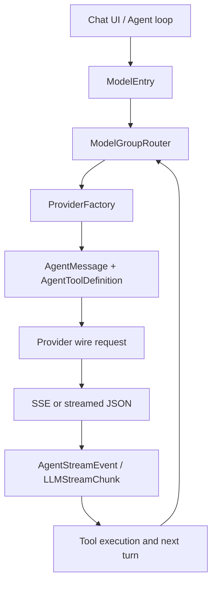

## 4. 多模型 Provider 抽象层与认证

本章以 OpenMinis 的 Provider 层为样本，解释一个原生移动端 Agent 如何同时接入 Anthropic、OpenAI 兼容端点、OpenAI Responses API 与 Gemini，而不让 Agent loop 直接依赖某一家 SDK。

### 4.1 这一章解决什么问题

Provider 层负责把“选择哪个模型、用什么凭证、如何构造请求、如何把流式响应交给 Agent loop”串成一个稳定边界。
如果没有这个边界，工具调用、图片、思维链摘要和错误重试都会在聊天 ViewModel 中散落成供应商特例，新增一个模型家族就会改动整个应用。
OpenMinis 把普通对话能力抽象为 `LLMProvider`，把带工具的 Agent 能力再抽象为 `AgentProvider`，并把模型能力元数据放在 `LLMModel`/`ModelEntry` 中，而不是把能力硬编码到 UI。
本章还解释 API Key、OAuth、配置数据库和 model group 如何共同决定一次请求的实际 Provider。
读者可以按“统一内部消息 → Provider-specific wire → 统一流事件 → fallback”这条链路，从零实现一个可扩展的 iOS/Android Provider 层。
代码位置：`src/ios/Providers/LLMProvider.swift:3-20`、`src/ios/Providers/AgentProvider.swift:174-207`、`src/ios/Providers/LLMProviderFactory.swift:14-40`。

### 4.2 两级协议：普通 LLM 与 Agent Provider

#### 4.2.1 `LLMProvider` 的最小公共面

iOS 的协议只有名称、当前模型、非流式发送和 `AsyncThrowingStream` 流式发送四个要点；它故意不把工具参数放入基础协议，因为工具属于 Agent 层。
代码位置：`src/ios/Providers/LLMProvider.swift:3-20`。

```swift
protocol LLMProvider {
    var name: String { get }
    var model: LLMModel { get set }

    func sendMessage(
        messages: [LLMMessage],
        systemPrompt: String?,
        maxTokens: Int,
        temperature: Double?
    ) async throws -> LLMResponse

    func streamMessage(
        messages: [LLMMessage],
        systemPrompt: String?,
        maxTokens: Int,
        temperature: Double?
    ) async throws -> AsyncThrowingStream<LLMStreamChunk, Error>
}
```

Android 的基础接口扩展了这个公共面：发送方法增加图片、工具和 `ThinkingLevel`，实现者实际覆盖已经完成 thinking clamp 的 `sendMessageClamped`/`streamMessageClamped`。
代码位置：`src/android/app/src/main/java/com/openminis/app/provider/LLMProvider.kt:13-18`、`src/android/app/src/main/java/com/openminis/app/provider/LLMProvider.kt:54-106`。

```kotlin
interface LLMProvider {
    val name: String
    var model: LLMModel

    suspend fun sendMessage(
        messages: List<LLMMessage>,
        systemPrompt: String?,
        maxTokens: Int,
        temperature: Double? = null,
        imageParts: List<LLMMessage.ImagePart> = emptyList(),
        tools: List<AgentToolDefinition> = emptyList(),
        thinkingLevel: ThinkingLevel = ThinkingLevel.OFF,
    ): LLMResponse = sendMessageClamped(
        messages, systemPrompt, maxTokens, temperature, imageParts, tools,
        clampThinkingLevel(thinkingLevel),
    )

    fun streamMessage(
        messages: List<LLMMessage>,
        systemPrompt: String?,
        maxTokens: Int,
        temperature: Double? = null,
        imageParts: List<LLMMessage.ImagePart> = emptyList(),
        tools: List<AgentToolDefinition> = emptyList(),
        thinkingLevel: ThinkingLevel = ThinkingLevel.OFF,
    ): Flow<LLMStreamChunk> = streamMessageClamped(
        messages, systemPrompt, maxTokens, temperature, imageParts, tools,
        clampThinkingLevel(thinkingLevel),
    )
}
```

Android 的额外 `streamTextIsMonolithic` 标志用来告诉上层：Chat Completions 的文本块在语义上是一个整体，不能把网络到达顺序误当作工具块顺序。
代码位置：`src/android/app/src/main/java/com/openminis/app/provider/LLMProvider.kt:28-42`。

#### 4.2.2 Agent 层的统一流事件

iOS 的 `AgentProvider` 接收 `AgentMessage`、工具定义、最大输出和已 clamp 的 thinking level，返回 `AgentStreamEvent` 流；Anthropic、Gemini、OpenAI 三种 wire 都要在这里翻译为同一组事件。
代码位置：`src/ios/Providers/AgentProvider.swift:174-207`。

```swift
protocol AgentProvider {
    var name: String { get }
    var model: LLMModel { get }
    var defaultMaxTokens: Int { get }

    func streamAgentMessageClamped(
        messages: [AgentMessage],
        systemPrompt: String?,
        tools: [AgentToolDefinition],
        maxTokens: Int,
        thinkingLevel: ThinkingLevel
    ) async throws -> AsyncThrowingStream<AgentStreamEvent, Error>
}

extension AgentProvider {
    func streamAgentMessage(
        messages: [AgentMessage],
        systemPrompt: String?,
        tools: [AgentToolDefinition],
        maxTokens: Int,
        thinkingLevel: ThinkingLevel
    ) async throws -> AsyncThrowingStream<AgentStreamEvent, Error> {
        let clamped = min(thinkingLevel, model.catalogMaxThinkingLevel)
        return try await streamAgentMessageClamped(
            messages: messages, systemPrompt: systemPrompt,
            tools: tools, maxTokens: maxTokens, thinkingLevel: clamped
        )
    }
}
```

`AgentStreamEvent` 至少表达文本 delta、工具开始、工具 JSON 累积、工具完成、thinking delta、reasoning 原文、usage 和终止原因。
代码位置：`src/ios/Providers/AgentProvider.swift:124-173`；Android 对应的 `LLMStreamChunk` 位于 `src/android/app/src/main/java/com/openminis/app/data/model/LLMStreamChunk.kt:5-31`。

Android 使用 `Flow<LLMStreamChunk>`，其中 `ToolUseStart`、`ToolInputDelta`、`ToolCallComplete` 与 iOS 的三个 Agent 事件一一对应。
代码位置：`src/android/app/src/main/java/com/openminis/app/data/model/LLMStreamChunk.kt:19-22`。

#### 4.2.3 Provider 工厂是协议边界的唯一入口

iOS `LLMProviderFactory.makeProvider` 先通过 `ModelEntry.providerInstanceId` 找到实例，再按 `ProviderType` 构造 Anthropic、Gemini、OpenAI、OpenRouter、xAI 和 Kimi 的具体实现。
代码位置：`src/ios/Providers/LLMProviderFactory.swift:3-40`。

Agent loop 需要的是 `AgentProvider`，因此 `AIChatViewModel+ProviderFactory` 在同一个 switch 中把 Anthropic 包成 `AnthropicAgentProvider`、Gemini 包成 `GeminiAgentProvider`，其余 OpenAI-compatible 类型包成 `OpenAIAgentProvider`。
代码位置：`src/ios/Agent/Chat/AIChatViewModel+ProviderFactory.swift:7-47`。

Android 的 `ProviderFactory.create` 采用同一分派原则；直接 OpenAI OAuth 且没有自定义 base URL 时进入 Codex Responses API，xAI/Kimi OAuth 则显式强制 OpenAI Chat Completions。
代码位置：`src/android/app/src/main/java/com/openminis/app/provider/ProviderFactory.kt:13-18`、`src/android/app/src/main/java/com/openminis/app/provider/ProviderFactory.kt:46-173`。

这一区分很关键：OAuth 不是一种 wire 协议。OpenAI Codex OAuth 要走 ChatGPT 后端的 Responses 形状，xAI 与 Kimi 的 OAuth bearer 仍然走各自的 OpenAI-compatible Chat Completions。
代码位置：`src/android/app/src/main/java/com/openminis/app/provider/ProviderFactory.kt:60-91`、`src/android/app/src/main/java/com/openminis/app/provider/ProviderFactory.kt:106-171`。

#### 4.2.4 能力位不放在 Provider 协议里

iOS 用 `ModelModality` OptionSet 表示输入/输出方向，位包括 text、image、PDF、audio、video；`ModelCapabilities` 还记录支持的认证方式。
代码位置：`src/ios/Providers/LLMTypes.swift:3-43`。

```swift
struct ModelModality: OptionSet, Sendable, Codable, Hashable {
    let rawValue: Int
    static let textInput  = ModelModality(rawValue: 1 << 0)
    static let textOutput = ModelModality(rawValue: 1 << 1)
    static let imageInput = ModelModality(rawValue: 1 << 2)
    static let pdfInput   = ModelModality(rawValue: 1 << 3)
    static let audioInput = ModelModality(rawValue: 1 << 4)
    static let videoInput = ModelModality(rawValue: 1 << 5)
    static let imageOutput = ModelModality(rawValue: 1 << 6)
    static let audioOutput = ModelModality(rawValue: 1 << 7)
    static let videoOutput = ModelModality(rawValue: 1 << 8)
}
```

Android 用 `inputModalities`/`outputModalities` 两个字符串列表表达同一个概念，并把 `supportsReasoning`、`contextWindow`、`maxOutputTokens` 放在 `LLMModel`。
代码位置：`src/android/app/src/main/java/com/openminis/app/data/model/LLMModel.kt:5-17`。

`ThinkingLevel` 是模型能力的另一个维度。iOS 在 `AgentProvider` 扩展中按 `catalogMaxThinkingLevel` clamp，Android 在 `LLMProvider.clampThinkingLevel` 中按模型 catalog ceiling clamp；这样 fallback 换到能力更低的模型时不会把旧模型的 thinking 档位原样发出去。
代码位置：`src/ios/Providers/AgentProvider.swift:195-207`、`src/android/app/src/main/java/com/openminis/app/provider/LLMProvider.kt:108-117`。

核心调用路径如下。



### 4.3 内部消息模型：先保留语义，再做 wire 映射

#### 4.3.1 普通消息与 Agent 消息

iOS 普通 `LLMMessage` 只有 user/assistant、文字、图片、音频；带工具的 `AgentMessage` 把内容拆成 `AgentContentPart`，并额外保留 `reasoningContent` 与 Responses API 的 `ReasoningEcho`。
代码位置：`src/ios/Providers/LLMTypes.swift:819-884`、`src/ios/Providers/AgentProvider.swift:53-122`。

Android `LLMMessage` 对应保存 `content`、`imageParts`、`audioParts`、结构化 `contentParts` 和跨轮 `reasoningContent`。
代码位置：`src/android/app/src/main/java/com/openminis/app/data/model/LLMMessage.kt:3-61`。

`AgentContentPart` 的四种语义是 Text、ToolUse、ToolResult 和 ImageData；图片在内部保持原始字节，直到 Provider 边界才按目标协议 base64 或压缩。
代码位置：`src/android/app/src/main/java/com/openminis/app/data/model/AgentContentPart.kt:5-75`；iOS 对应定义在 `src/ios/Providers/AgentProvider.swift:53-70`。

| 内部语义 | iOS 类型 | Android 类型 | 是否持久化/回传 |
|---|---|---|---|
| 文本 | `AgentContentPart.text` | `AgentContentPart.Text` | 直接回传 |
| 模型发起工具 | `toolUse(id,name,input)` | `ToolUse(id,name,input)` | 必须和结果按 id 配对 |
| 工具结果 | `toolResult(id,name,content,isError,...)` | `ToolResult(id,name,content,isError,...)` | 作为下一轮输入 |
| 图片输入/工具图片 | `imageData(Data, mimeType)` | `ImageData(ByteArray, mimeType)` | 进入目标协议前才压缩/base64 |
| 推理原文 | `AgentMessage.reasoningContent` | `LLMMessage.reasoningContent` | 仅对支持该字段的模型回传 |
| 原生 Responses 推理 | `ReasoningEcho` | Responses 解析器内部积累 | 只回传同 provider family + 同 model id |

#### 4.3.2 工具定义的三种 schema

工具注册只保存名字、描述、参数、required 和可选属性顺序；Android 的 helper 直接提供三种 JSON 构造，iOS 在各 Agent Provider 内构造 SDK schema。
代码位置：`src/android/app/src/main/java/com/openminis/app/data/model/AgentToolDefinition.kt:6-75`、`src/ios/Providers/AgentProvider.swift:14-45`。

```kotlin
/** Anthropic format: {name, description, input_schema: {type:object, properties, required}} */
fun toAnthropicJson(): JSONObject {
    val props = JSONObject()
    for ((key, param) in parameters) {
        props.put(key, param.toJson())
    }
    val schema = JSONObject().apply {
        put("type", "object")
        put("properties", props)
        if (required.isNotEmpty()) put("required", JSONArray(required))
    }
    return JSONObject().apply {
        put("name", name)
        put("description", description)
        put("input_schema", schema)
    }
}

/** Gemini format: {name, description, parameters: {type:OBJECT, properties, required}} */
fun toGeminiJson(): JSONObject {
    val props = JSONObject()
    for ((key, param) in parameters) {
        props.put(key, param.toGeminiJson())
    }
    val params = JSONObject().apply {
        put("type", "OBJECT")
        put("properties", props)
        if (required.isNotEmpty()) put("required", JSONArray(required))
        if (propertyOrdering != null) put("propertyOrdering", JSONArray(propertyOrdering))
    }
    return JSONObject().apply {
        put("name", name)
        put("description", description)
        put("parameters", params)
    }
}

/** OpenAI format: {type:function, function: {name, description, parameters: {type:object, ...}}} */
fun toOpenAIJson(): JSONObject {
    val props = JSONObject()
    for ((key, param) in parameters) {
        props.put(key, param.toJson())
    }
    val params = JSONObject().apply {
        put("type", "object")
        put("properties", props)
        if (required.isNotEmpty()) put("required", JSONArray(required))
    }
    return JSONObject().apply {
        put("type", "function")
        put("function", JSONObject().apply {
            put("name", name)
            put("description", description)
            put("parameters", params)
        })
    }
}
```

上面的三行注释对应真实实现中的字段形状，不能把工具定义统一成一份“看起来相似”的对象后直接发送；Anthropic 的 schema 键是 `input_schema`，Gemini 的参数类型是大写 `OBJECT`，OpenAI Chat 还要包一层 `function`。
代码位置：`src/android/app/src/main/java/com/openminis/app/data/model/AgentToolDefinition.kt:18-73`。

iOS 还会把 OpenAI Responses 的工具转换为扁平 `{type,name,description,parameters}`，这是 Responses API 与 Chat Completions 的一个非兼容点。
代码位置：`src/ios/Providers/OpenAI/OpenAIAgentProvider.swift:1547-1657`、`src/android/app/src/main/java/com/openminis/app/provider/openai/OpenAIProvider.kt:2488-2499`。

### 4.4 三家 wire 格式：同一语义的不同位置

#### 4.4.1 Anthropic Messages

Anthropic 的请求顶层是 `model`、`max_tokens`、`system`、`messages`、`tools`、`thinking` 和 `stream`。
系统提示词不进入 messages，而是作为 `system` 内容块；Claude Code OAuth 更要求第一个 system block 是构建时注入的标识文本，用户 prompt 作为第二个可缓存 block。
代码位置：`src/ios/Providers/Anthropic/AnthropicProvider.swift:186-220`、`src/android/app/src/main/java/com/openminis/app/provider/anthropic/AnthropicProvider.kt:274-320`。

工具定义用 `input_schema`，模型调用是 assistant 内容中的 `tool_use`，结果是紧随其后的 user 内容中的 `tool_result`，结果 id 使用 `tool_use_id`。
代码位置：`src/android/app/src/main/java/com/openminis/app/provider/anthropic/AnthropicProvider.kt:534-599`。

图片使用 `{"type":"image","source":{"type":"base64","media_type":...,"data":...}}`；Android 在 Provider 边界调用 `ImageBudget.compressUnderBudget`，iOS 在 Anthropic Agent 转换时缩放到可接受的长边和 JPEG 数据。
代码位置：`src/android/app/src/main/java/com/openminis/app/provider/anthropic/AnthropicProvider.kt:577-614`、`src/ios/Providers/Anthropic/AnthropicAgentProvider.swift:479-503`、`src/ios/Providers/Anthropic/AnthropicAgentProvider.swift:768-783`。

`cache_control` 不是系统提示词的独立顶层开关，而是挂在具体 system/tool/message 内容块上。OpenMinis 在最多四个位置设置 ephemeral breakpoint：最后一个工具、system、倒数第二个 user、最后一个 user。
代码位置：`src/ios/Providers/Anthropic/AnthropicAgentProvider.swift:814-826`。

Anthropic 的 thinking 有两种 wire 形状：Claude 4.6+ 使用 `thinking.type="adaptive"` 和 `output_config.effort`，旧模型使用 `thinking.type="enabled"` 和 `budget_tokens`；关闭时新模型必须显式发 `thinking.type="disabled"`，否则小 `max_tokens` 可能全部消耗在 thinking。
代码位置：`src/android/app/src/main/java/com/openminis/app/provider/anthropic/AnthropicProvider.kt:343-390`。

Anthropic 的消息还带有严格顺序约束。实现先注入缺失的 tool_result，再删除 orphan result，合并相邻同角色消息，并把 assistant 的 tool_use 排到文字后面、user 的 tool_result 排到其他内容前面。
代码位置：`src/ios/Providers/Anthropic/AnthropicAgentProvider.swift:455-514`、`src/ios/Providers/Anthropic/AnthropicAgentProvider.swift:516-639`、`src/ios/Providers/Anthropic/AnthropicAgentProvider.swift:641-727`。

一个最小的 Android 请求构造片段如下，字段顺序和语义均来自实现。

```kotlin
val body = JSONObject()
body.put("model", model.id)
body.put("max_tokens", maxTokens)
body.put("stream", stream)

val systemArray = resolveSystemPrompt(systemPrompt)
if (systemArray != null) body.put("system", systemArray)

if (tools.isNotEmpty()) {
    val toolsArray = JSONArray()
    for ((i, tool) in tools.withIndex()) {
        val toolJson = tool.toAnthropicJson()
        toolJson.put("eager_input_streaming", true)
        if (i == tools.lastIndex) {
            toolJson.put("cache_control", ephemeralCacheControl())
        }
        toolsArray.put(toolJson)
    }
    body.put("tools", toolsArray)
    body.put("tool_choice", JSONObject().put("type", "auto"))
}
body.put("messages", merged)
```

来源：`src/android/app/src/main/java/com/openminis/app/provider/anthropic/AnthropicProvider.kt:334-425`。

#### 4.4.2 OpenAI Chat Completions

OpenAI Chat Completions 的顶层是 `messages` 数组；system prompt 作为数组第一条 `role:system`，工具定义是 `{type:"function",function:{...}}`。
代码位置：`src/ios/Providers/OpenAI/OpenAIAgentProvider.swift:73-100`、`src/android/app/src/main/java/com/openminis/app/provider/openai/OpenAIProvider.kt:1426-1483`。

assistant 的工具调用放进 `tool_calls`，每个 function 的 arguments 是 JSON 字符串；工具结果不能继续作为 user content，而要成为单独的 `role:tool` 消息并携带 `tool_call_id`。
代码位置：`src/ios/Providers/OpenAI/OpenAIAgentProvider.swift:1081-1167`、`src/android/app/src/main/java/com/openminis/app/provider/openai/OpenAIProvider.kt:1511-1569`。

图片输入使用 Chat 的 `content` 数组，文字块是 `type:text`，图片块是 `type:image_url`，URL 可以是 `data:<mime>;base64,<bytes>`。
代码位置：`src/ios/Providers/OpenAI/OpenAIAgentProvider.swift:1137-1164`、`src/android/app/src/main/java/com/openminis/app/provider/openai/OpenAIProvider.kt:1571-1629`。

模型若不支持 image modality，OpenMinis 不把图片静默丢掉，而是发送明确的文字占位符，避免用户以为模型看到了图片。
代码位置：`src/ios/Providers/OpenAI/OpenAIAgentProvider.swift:1145-1154`、`src/android/app/src/main/java/com/openminis/app/provider/openai/OpenAIProvider.kt:1596-1615`。

Chat Completions 的 thinking 兼容性通过 `reasoning_content`、`reasoning` 或 `<think>` 文本协议处理。内部会记录字段是否出现，即使值是空字符串，因为 DeepSeek V4 等端点要求后续 assistant history 保持字段存在。
代码位置：`src/ios/Providers/OpenAI/OpenAIAgentProvider.swift:139-149`、`src/android/app/src/main/java/com/openminis/app/provider/openai/OpenAIProvider.kt:976-997`。

#### 4.4.3 OpenAI Responses API

Responses API 不使用 `messages`，而使用 `input`；system prompt 位于 `instructions`，工具定义是扁平的 function object。
代码位置：`src/ios/Providers/OpenAI/OpenAIAgentProvider.swift:390-469`、`src/android/app/src/main/java/com/openminis/app/provider/openai/OpenAIProvider.kt:2356-2499`。

模型工具调用是 input 中的 `type:function_call`，同时包含 `id`、`call_id`、`name` 和 JSON 字符串 `arguments`；结果是 `type:function_call_output`，带 `call_id` 和 `output`。
代码位置：`src/android/app/src/main/java/com/openminis/app/provider/openai/OpenAIProvider.kt:2501-2545`。

Responses 的 id 需要双 id 关系。OpenMinis 在流中把 `call_id|item_id` 组合为内部 id，下一轮再拆回 `call_id` 与 `fc_...` 的 `id`；Anthropic 又不接受 `|`，所以跨 Provider 时必须先通过 `sanitizeToolId`。
代码位置：`src/android/app/src/main/java/com/openminis/app/provider/openai/OpenAIProvider.kt:670-678`、`src/ios/Providers/AgentProvider.swift:3-12`。

Responses thinking 使用 `reasoning.effort`，可附带 `summary:"auto"` 让 `response.reasoning_summary_text.delta` 有可显示文本；若请求 reasoning，还会请求 `include:["reasoning.encrypted_content"]`，但 opaque encrypted item 只回传到同一模型。
代码位置：`src/ios/Providers/OpenAI/OpenAIAgentProvider.swift:410-449`、`src/ios/Providers/OpenAI/OpenAIAgentProvider.swift:655-736`。

#### 4.4.4 Gemini `generateContent`

Gemini 把对话放在 `contents`，user 对应 `role:"user"`，assistant 对应 `role:"model"`；系统提示词独立放在 `systemInstruction.parts`。
代码位置：`src/android/app/src/main/java/com/openminis/app/provider/gemini/GeminiProvider.kt:189-263`、`src/ios/Providers/Gemini/GeminiProvider.swift:378-409`。

文本是 `parts[].text`，图片是 `parts[].inlineData`；工具调用是 `functionCall:{name,args}`，工具返回是 `functionResponse:{name,response:{result:...}}`。
代码位置：`src/android/app/src/main/java/com/openminis/app/provider/gemini/GeminiProvider.kt:198-230`。

Gemini function call 默认没有统一的 Anthropic/OpenAI tool id。Android 流式解析用 `gemini_<nanoTime>` 生成内部 id；iOS 还保留 Gemini 3.x 的 `thoughtSignature`，缺少签名时把调用转成文字摘要以避免下一轮被拒绝。
代码位置：`src/android/app/src/main/java/com/openminis/app/provider/gemini/GeminiProvider.kt:140-155`、`src/ios/Providers/Gemini/GeminiAgentProvider.swift:103-161`。

Gemini 的 `contents[].parts[]` 是 protobuf oneof，空字符串不是一个有效 data 分支。因此 iOS 提供 `GeminiWireFormat.nonEmptyText`，Android 跳过空文本并在空 parts 时放入 `(empty)`。
代码位置：`src/ios/Providers/Gemini/GeminiWireFormat.swift:3-46`、`src/android/app/src/main/java/com/openminis/app/provider/gemini/GeminiProvider.kt:246-253`。

### 4.5 Wire 映射对照表

#### 4.5.1 消息、系统提示词和工具

| 语义 | Anthropic Messages | OpenAI Chat Completions | OpenAI Responses | Gemini generateContent |
|---|---|---|---|---|
| system prompt | 顶层 `system` 内容块 | `messages[0].role=system` | 顶层 `instructions` | 顶层 `systemInstruction.parts` |
| 普通文本 | `messages[].content[].text` | `content` 字符串或数组 | `input` 中 message/content | `contents[].parts[].text` |
| assistant role | `assistant` | `assistant` | `role=assistant` 或 output item | `model` |
| 工具声明 | `name/description/input_schema` | `type=function,function:{...}` | 扁平 `type/function/name/parameters` | `function_declarations` |
| 工具调用 | assistant `tool_use` | assistant `tool_calls[]` | `function_call` | `functionCall` |
| 工具结果 | user `tool_result` + `tool_use_id` | `role=tool` + `tool_call_id` | `function_call_output` + `call_id` | `functionResponse` + `name` |
| 图片 | `image.source.base64` | `image_url` data URL | `input_image` data URL | `inlineData` base64 |
| thinking 输入 | `thinking` 配置；兼容代理可回放 block | `reasoning_content`/`reasoning` | `reasoning.effort` + encrypted item | `thinkingConfig`/thought parts |
| cache | block 上 `cache_control` | 特定兼容端点的 `cache_control` | `prompt_cache_key` | 没有同形的 block cache |

上表中的 Anthropic/OpenAI/Gemini 具体字段分别由 `AnthropicProvider`、`OpenAIAgentProvider`、`GeminiAgentProvider` 构造，而不是由 Agent loop 拼接。
代码位置：`src/ios/Providers/Anthropic/AnthropicAgentProvider.swift:457-514`、`src/ios/Providers/OpenAI/OpenAIAgentProvider.swift:1079-1168`、`src/ios/Providers/Gemini/GeminiAgentProvider.swift:135-200`。

#### 4.5.2 常见兼容修复

| 问题 | Provider 边界的修复 | 依据 |
|---|---|---|
| Responses id 含 `|`，Anthropic 不接受 | 出站 Anthropic 统一 `sanitizeToolId` | `src/android/app/src/main/java/com/openminis/app/provider/anthropic/AnthropicProvider.kt:560-569`、`src/ios/Providers/AgentProvider.swift:5-12` |
| tool_use 没有结果 | 复制消息后注入 synthetic error tool_result | `src/ios/Providers/Anthropic/AnthropicAgentProvider.swift:535-587` |
| orphan tool_result | 仅保留最近 assistant 声明过的 id | `src/android/app/src/main/java/com/openminis/app/provider/anthropic/AnthropicProvider.kt:430-483` |
| Chat tool reply 顺序错误 | 收集所有 tool reply，再紧跟 assistant.tool_calls 重排 | `src/ios/Providers/OpenAI/OpenAIAgentProvider.swift:1377-1435` |
| 目标模型没有视觉能力 | 图片改为文字占位，而不是发送非法 image_url | `src/android/app/src/main/java/com/openminis/app/provider/openai/OpenAIProvider.kt:1436-1445` |
| Gemini 空 text | 跳过空 block 或放 `(empty)` | `src/ios/Providers/Gemini/GeminiWireFormat.swift:24-38` |
| 大图导致 413/维度错误 | Anthropic 缩放；Android 通用图片预算压缩 | `src/ios/Providers/Anthropic/AnthropicAgentProvider.swift:768-783`、`src/android/app/src/main/java/com/openminis/app/provider/anthropic/AnthropicProvider.kt:577-614` |

### 4.6 三家 SSE/流式事件对照

#### 4.6.1 事件表

| 阶段 | Anthropic Messages SSE | OpenAI Chat Completions SSE | OpenAI Responses SSE | Gemini SSE |
|---|---|---|---|---|
| 开始 | `message_start` | 首个 `choices[].delta` | `response.created`/首个 typed event | 首个 `data:` JSON，客户端补发 Started |
| 文本 | `content_block_start(text)` + `content_block_delta.text_delta` | `choices[].delta.content` | `response.output_text.delta` | `candidates[].content.parts[].text` |
| thinking | `content_block_start(thinking)` + `thinking_delta` | `delta.reasoning_content`/`reasoning` 或 `<think>` | `response.reasoning_text.delta` / `response.reasoning_summary_text.delta` | thought part 或 `thinkingConfig.includeThoughts` |
| 工具开始 | `content_block_start(tool_use)` | `delta.tool_calls[index]` 首次带 id/name | `response.output_item.added` item=function_call | `functionCall` 出现时生成内部 id |
| 工具参数 | `input_json_delta.partial_json` | `function.arguments` 增量 | `response.function_call_arguments.delta` | 一次性 functionCall args（实现直接 complete） |
| 工具结束 | `content_block_stop` | `finish_reason=tool_calls` 后 flush accumulator | `response.output_item.done` | 当前 chunk 解析后 complete |
| usage | `message_start.message.usage`、`message_delta.usage` | `stream_options.include_usage` 的 usage 块 | `response.completed.response.usage` | 每个 chunk 的 usageMetadata |
| 结束 | `message_delta.stop_reason`、`message_stop` | `[DONE]` + finish_reason | `response.completed`/`response.incomplete`/`response.failed` | 读完流后客户端补 `Finished` |

事件名称来自 iOS Anthropic switch、iOS OpenAI Responses switch、Android Anthropic/OpenAI/Gemini parser 的真实分支。
代码位置：`src/ios/Providers/Anthropic/AnthropicProvider.swift:286-320`、`src/ios/Providers/OpenAI/OpenAIAgentProvider.swift:510-765`、`src/android/app/src/main/java/com/openminis/app/provider/anthropic/AnthropicProvider.kt:184-272`、`src/android/app/src/main/java/com/openminis/app/provider/openai/OpenAIProvider.kt:786-1073`、`src/android/app/src/main/java/com/openminis/app/provider/gemini/GeminiProvider.kt:123-173`。

#### 4.6.2 Anthropic 的解析重点

Anthropic parser 把 `content_block_start` 的 `tool_use` 转成 ToolUseStart，把每个 `input_json_delta.partial_json` 追加到 buffer，在 `content_block_stop` 时 JSON parse 并发出 ToolCallComplete。
代码位置：`src/android/app/src/main/java/com/openminis/app/provider/anthropic/AnthropicProvider.kt:209-252`。

thinking delta 要单独进入 ThinkingDelta，不应混进可见文本；`message_delta` 同时提供 usage 和 stop reason。
代码位置：`src/android/app/src/main/java/com/openminis/app/provider/anthropic/AnthropicProvider.kt:219-262`。

#### 4.6.3 OpenAI 的解析重点

Chat Completions 的 tool calls 按 `index` 累积，因为每个 delta 可能只带 id、name 或 arguments 的一部分；不能按每个网络包直接视为完整调用。
代码位置：`src/android/app/src/main/java/com/openminis/app/provider/openai/OpenAIProvider.kt:1021-1061`。

Responses API 则按 `item_id` 累积，并在 `response.output_item.done` 使用服务端最终 `arguments`；这是“事件块”而不是“choice delta”的状态机。
代码位置：`src/android/app/src/main/java/com/openminis/app/provider/openai/OpenAIProvider.kt:814-866`。

Responses 的 `response.failed` 与 `response.incomplete` 必须显式转成错误，否则一个已经输出部分文本的失败响应会被错误当作正常完成。
代码位置：`src/ios/Providers/OpenAI/OpenAIAgentProvider.swift:620-653`、`src/android/app/src/main/java/com/openminis/app/provider/openai/OpenAIProvider.kt:868-911`。

#### 4.6.4 Android 与 iOS 的流式实现差异

iOS 使用 `AsyncThrowingStream` 与 `URLSession.bytes`/SDK stream；Android 使用 OkHttp `BufferedReader` + `callbackFlow`，两端最终都把事件转成统一内部 chunk。
代码位置：`src/ios/Providers/Gemini/GeminiProvider.swift:102-160`、`src/android/app/src/main/java/com/openminis/app/provider/gemini/GeminiProvider.kt:97-174`。

Android OpenAI parser 同时容忍 `data:` 和 `data: `，因为部分兼容端点省略冒号后的空格；iOS OpenAI parser通过 `ssePayload` 提取 payload 并识别 `[DONE]`。
代码位置：`src/android/app/src/main/java/com/openminis/app/provider/openai/OpenAIProvider.kt:711-746`、`src/ios/Providers/OpenAI/OpenAIAgentProvider.swift:510-518`。

iOS Anthropic 在 stream 建立阶段只对网络连接丢失做有限重试，已经产生 delta 后不透明重放，以免工具或文字重复；Android 的 silent-empty operator 会把无内容无 stop reason 的正常结束转成错误。
代码位置：`src/ios/Providers/Anthropic/AnthropicAgentProvider.swift:193-221`、`src/android/app/src/main/java/com/openminis/app/provider/LLMProvider.kt:121-162`。

### 4.7 认证：API Key、OAuth PKCE 与 device flow

#### 4.7.1 按 provider instance 隔离凭证

一个 `ProviderInstance` 是“供应商类型 + 凭证类型 + endpoint + label”的配置对象，同一 ProviderType 可以有多个实例，例如两个 Anthropic 账号或官方端点与代理端点并存。
代码位置：`src/ios/Providers/ProviderInstance.swift:14-79`。

iOS API key 使用 service `com.openminis.app.provider.<instanceId>`、account `api-key` 的 Keychain generic password，并尝试 synchronizable 项后回退 legacy 项；OAuth token 则用 account `oauth-token` 保存 Codable JSON blob。
代码位置：`src/ios/Providers/ProviderConfigStore.swift:2685-2745`、`src/ios/Providers/ProviderConfigStore.swift:2776-2835`。

iOS 保存后会设置 `kSecAttrAccessibleAfterFirstUnlock`、更新 API key 的本地时间戳并使认证缓存失效；这同时服务 iCloud Keychain 与 SwiftUI“已配置”状态刷新。
代码位置：`src/ios/Providers/ProviderConfigStore.swift:2697-2707`、`src/ios/Providers/ProviderConfigStore.swift:2767-2774`。

Android API key 使用 `EncryptedSharedPreferences` 中的 `apikey_<instanceId>`；OAuth 结构化 token 使用 `oauth_tokens_<instanceId>` JSON，辅助值使用 `oauth_<key>_<instanceId>`。
代码位置：`src/android/app/src/main/java/com/openminis/app/data/repository/ProviderRepository.kt:1748-1759`、`src/android/app/src/main/java/com/openminis/app/auth/OAuthManager.kt:283-305`。

Android 的 `EncryptedPrefsFactory.safeCreate` 用 AES-256-GCM master key 创建加密偏好；若 Android Keystore/Tink 解密失败，会清理加密文件和 alias 后重建一次，仍失败才落到带 `_plain_fallback` 后缀的普通偏好文件。
代码位置：`src/android/app/src/main/java/com/openminis/app/util/EncryptedPrefsFactory.kt:11-68`。

这个 fallback 是“先保证应用能启动、再要求用户重贴凭证”的灾备策略，不是把普通 SharedPreferences 当作正常安全存储；实现明确记录凭证会丢失。
代码位置：`src/android/app/src/main/java/com/openminis/app/util/EncryptedPrefsFactory.kt:23-35`、`src/android/app/src/main/java/com/openminis/app/util/EncryptedPrefsFactory.kt:49-55`。

| 项目 | iOS | Android |
|---|---|---|
| API Key | Keychain generic password，instanceId 在 service 中隔离 | `EncryptedSharedPreferences`，key 含 instanceId |
| OAuth bundle | Codable JSON，account=`oauth-token` | JSON 字符串，key=`oauth_tokens_<id>` |
| 辅助 OAuth 值 | Keychain account，如 `oauth-email`、`oauth-gcp-project` | `oauth_<name>_<id>` |
| 可用性缓存 | `ProviderCredentialCache` + `authRevision` | `StateFlow` 配置和 repository 读取 |
| 设备灾备 | legacy Keychain 查询回退 | Keystore/Tink 失败重建，最后 plain fallback |

#### 4.7.2 OAuth PKCE 通用时序

Claude OAuth 与 xAI OAuth 都是 loopback redirect + authorization code + PKCE；iOS 使用 `SFSafariViewController`，Android 使用 Chrome Custom Tab，回调由本地 HTTP callback server 接收。
代码位置：`src/ios/Providers/Anthropic/OAuth/ClaudeOAuthManager.swift:68-133`、`src/android/app/src/main/java/com/openminis/app/auth/ClaudeOAuthManager.kt:126-179`、`src/ios/Providers/xAI/OAuth/XAIOAuthManager.swift:67-156`。

```mermaid
sequenceDiagram
    participant App as "Minis App"
    participant Loop as "Local callback server"
    participant Browser as "Safari or Custom Tab"
    participant Auth as "Claude/xAI authorization"
    participant Token as "Token endpoint"
    participant Store as "Keychain or EncryptedPrefs"
    App->>App: "Generate verifier, S256 challenge, state"
    App->>Loop: "Bind fixed loopback port and callback"
    App->>Browser: "Open authorize URL with challenge and state"
    Browser->>Auth: "User signs in and approves"
    Auth-->>Browser: "Redirect code and state to loopback"
    Browser->>Loop: "GET /callback?code=...&state=..."
    Loop-->>App: "Resume callback continuation"
    App->>App: "Reject state mismatch"
    App->>Token: "POST code, redirect_uri, verifier"
    Token-->>App: "access_token, refresh_token, expires_in"
    App->>Store: "Persist per-instance token bundle"
    App->>App: "Provider request asks validAccessToken"
```

iOS Claude 的 verifier 由 96 个随机字节生成，challenge 是 verifier 的 SHA-256 base64url；授权 URL 包含 client_id、redirect_uri、scope、challenge 和 state，回调必须校验 state。
代码位置：`src/ios/Providers/Anthropic/OAuth/ClaudeOAuthManager.swift:82-124`、`src/ios/Providers/Anthropic/OAuth/ClaudeOAuthManager.swift:291-301`。

Android 基类把同样的 PKCE 流程抽成 `OAuthManager.buildAuthorizationUrl`，默认 verifier 使用 64 个随机字节；Claude 覆盖为 96 字节并将 verifier/state 保存到加密偏好，方便 JSON token exchange 读取。
代码位置：`src/android/app/src/main/java/com/openminis/app/auth/OAuthManager.kt:79-137`、`src/android/app/src/main/java/com/openminis/app/auth/ClaudeOAuthManager.kt:359-375`。

回调端口不是可以随意生成的普通参数。Claude 使用 54545，xAI 使用服务端 allow-list 固定的 56121；xAI 的 redirect URI 必须写 `127.0.0.1`，不能把它改成 `localhost`。
代码位置：`src/ios/Providers/Anthropic/OAuth/ClaudeOAuthManager.swift:16-21`、`src/ios/Providers/xAI/OAuth/XAIOAuthManager.swift:15-21`、`src/android/app/src/main/java/com/openminis/app/auth/XAIOAuthManager.kt:47-102`。

#### 4.7.3 Claude OAuth 的特殊 system prompt

Claude Code OAuth 请求不仅需要 bearer token，还需要 `anthropic-beta: oauth-2025-04-20`，并要求 system prompt 以 Claude Code 的识别行开头。
代码位置：`src/android/app/src/main/java/com/openminis/app/auth/ClaudeOAuthManager.kt:31-35`、`src/ios/Providers/Anthropic/AnthropicProvider.swift:164-183`。

`ANTHROPIC_OAUTH_IDENTIFIER_PROMPT` 不放在源码常量里，而由 build-time customization 注入：iOS 从 `ProviderCustomizationGenerated.anthropicOAuthIdentifierPrompt` 读取，Android 从 `BuildConfig.ANTHROPIC_OAUTH_IDENTIFIER_PROMPT` 读取；空值时第一次使用 Claude Code OAuth 会明确失败。
代码位置：`src/ios/Providers/Anthropic/AnthropicProvider.swift:43-66`、`src/android/app/src/main/java/com/openminis/app/auth/ClaudeOAuthManager.kt:42-61`。

`BUILDING.md` 解释了必要性：OAuth endpoint 检查 system prompt 的开头识别行，没有它请求会被拒绝；公开仓库不提供真实值，只提供 example 配置。
代码位置：`BUILDING.md:33-62`。

iOS 在 OAuth 模式把识别行作为第一个不带 cache 的 system block，用户 system prompt 作为第二个带 ephemeral cache 的 block；Android `resolveSystemPrompt` 同样先去重已嵌入的 prefix，再强制把 prefix 放在第一个 block。
代码位置：`src/ios/Providers/Anthropic/AnthropicProvider.swift:186-205`、`src/android/app/src/main/java/com/openminis/app/provider/anthropic/AnthropicProvider.kt:274-320`。

#### 4.7.4 xAI OAuth：OIDC discovery 与非标准 PKCE

xAI 先请求 `https://auth.x.ai/.well-known/openid-configuration`，读取 authorization/token endpoint，再限制 endpoint host 必须属于 `*.x.ai`；这样 discovery 文档不能把客户端重定向到任意域名。
代码位置：`src/ios/Providers/xAI/OAuth/XAIOAuthManager.swift:222-255`、`src/android/app/src/main/java/com/openminis/app/auth/XAIOAuthManager.kt:143-175`。

xAI verifier 使用 32 字节随机数据的 64 字符 hex 形式，授权 URL 除 challenge/state 外还带 nonce、`plan=generic` 和 `referrer=minis`。
代码位置：`src/ios/Providers/xAI/OAuth/XAIOAuthManager.swift:95-123`、`src/ios/Providers/xAI/OAuth/XAIOAuthManager.swift:258-273`。

xAI token exchange 除 verifier 外还回显 `code_challenge` 与 `code_challenge_method=S256`；这不是普通 OAuth 客户端可以省略的字段。
代码位置：`src/ios/Providers/xAI/OAuth/XAIOAuthManager.swift:277-297`、`src/android/app/src/main/java/com/openminis/app/auth/XAIOAuthManager.kt:221-234`。

xAI token 的 id_token payload 会被解析出 email、display name 和 account id；HTTP 403 代表订阅层级可能没有 API access，不应直接把 token bundle 当作 revoked 而删除。
代码位置：`src/ios/Providers/xAI/OAuth/XAIOAuthManager.swift:364-402`、`src/android/app/src/main/java/com/openminis/app/auth/XAIOAuthManager.kt:329-379`。

#### 4.7.5 Kimi Code：不是 PKCE，而是 RFC 8628 device authorization

Kimi Code 使用 RFC 8628 device authorization grant，不启动 callback server，也不需要 PKCE；客户端先 POST `client_id` 请求 device code，UI 展示 `user_code` 与 verification URL，然后按 interval 轮询 token endpoint。
代码位置：`src/ios/Providers/Kimi/OAuth/KimiDeviceFlow.swift:3-16`、`src/ios/Providers/Kimi/OAuth/KimiOAuthManager.swift:69-126`。

Kimi endpoint 只接受 `application/x-www-form-urlencoded`，并且该 client 禁止显式 `scope`；Android 与 iOS 都只发送 `client_id`。
代码位置：`src/ios/Providers/Kimi/OAuth/KimiOAuthManager.swift:107-126`、`src/android/app/src/main/java/com/openminis/app/auth/KimiOAuthManager.kt:105-145`。

轮询状态严格按 RFC 8628 分类：`authorization_pending` 继续，`slow_down` 把 interval 增加 5 秒，`access_denied`/`expired_token`/其他错误终止。
代码位置：`src/ios/Providers/Kimi/OAuth/KimiDeviceFlow.swift:59-97`、`src/android/app/src/main/java/com/openminis/app/auth/KimiDeviceFlow.kt:67-115`。

Kimi token 成功后保存 access/refresh/expireDate/deviceId；之后的 coding API base 是 `https://api.kimi.com/coding/v1`，缺少 `/v1` 会得到错误 endpoint。
代码位置：`src/ios/Providers/Kimi/OAuth/KimiOAuthManager.swift:89-104`、`src/android/app/src/main/java/com/openminis/app/auth/KimiOAuthManager.kt:196-209`、`src/android/app/src/main/java/com/openminis/app/auth/KimiDeviceFlow.kt:23-26`、`src/android/app/src/main/java/com/openminis/app/provider/ProviderFactory.kt:139-171`。

#### 4.7.6 其他 OAuth manager 的协议边界

OpenAI Codex OAuth 也是 loopback + PKCE，但它使用固定的 `auth.openai.com`、1455 端口和 `/auth/callback`，授权 URL 带 `codex_cli_simplified_flow`、`originator` 等客户端标识；完成后 ProviderFactory 将其送入 Responses API，而不是普通 Chat Completions。
代码位置：`src/ios/Providers/OpenAI/OAuth/CodexOAuthManager.swift:14-21`、`src/ios/Providers/OpenAI/OAuth/CodexOAuthManager.swift:60-121`、`src/android/app/src/main/java/com/openminis/app/auth/OpenAIOAuthManager.kt:111-136`。

Gemini OAuth 使用 Google authorization/token endpoint、PKCE 和 offline scope；登录后除了 token，还要获取用户邮箱并发现 Cloud Code Assist 的 GCP project，iOS 保存在 Keychain auxiliary account，Android 保存在 encrypted OAuth strings。
代码位置：`src/ios/Providers/Gemini/OAuth/GeminiOAuthManager.swift:70-139`、`src/android/app/src/main/java/com/openminis/app/auth/GeminiOAuthManager.kt:43-107`。

OpenRouter OAuth 的产物不是可刷新的 OAuth bundle，而是通过 PKCE code exchange 生成永久 API key；iOS/Android 都把结果保存到 API-key 存储，之后走 OpenRouter 的 OpenAI-compatible endpoint。
代码位置：`src/ios/Providers/OpenRouter/OAuth/OpenRouterOAuthManager.swift:45-97`、`src/android/app/src/main/java/com/openminis/app/auth/OpenRouterOAuthManager.kt:21-34`、`src/android/app/src/main/java/com/openminis/app/auth/OpenRouterOAuthManager.kt:98-105`。

Antigravity 复用 Google OAuth，但增加 Cloud Code Assist scopes，并在登录后发现 project/base URL；Android 源文件明确标注 request dispatch 尚未接线，因此不能把它当作已经可用的普通 Provider OAuth 实现。
代码位置：`src/ios/Providers/Antigravity/OAuth/AntigravityOAuthManager.swift:82-151`、`src/android/app/src/main/java/com/openminis/app/auth/AntigravityOAuthManager.kt:15-31`、`src/android/app/src/main/java/com/openminis/app/auth/AntigravityOAuthManager.kt:48-103`。

因此认证矩阵不能只写“支持 OAuth”一个布尔值：Codex 绑定 Responses API，Gemini/Antigravity 还绑定 project discovery，OpenRouter 变成 API key，Claude 绑定 system prefix，xAI 绑定 discovery/订阅能力，Kimi 则完全采用 device code。
代码位置：`src/ios/Providers/LLMProviderFactory.swift:81-131`、`src/ios/Agent/Chat/AIChatViewModel+ProviderFactory.swift:72-148`、`src/android/app/src/main/java/com/openminis/app/provider/ProviderFactory.kt:34-173`。

#### 4.7.7 token 刷新与并发 single-flight

iOS Claude 的 `validAccessToken` 在到期前 5 分钟触发刷新；每个 instance 有一个 in-flight Task，多个并发工具请求会 await 同一刷新，避免旋转 refresh token 被第二个请求以旧值重放。
代码位置：`src/ios/Providers/Anthropic/OAuth/ClaudeOAuthManager.swift:34-44`、`src/ios/Providers/Anthropic/OAuth/ClaudeOAuthManager.swift:141-213`。

Android 基础 OAuth 默认提前四小时刷新，但 Claude/Kimi 覆盖为五分钟；Android 使用每 instance 的 `Mutex`，刷新成功保留服务器没有返回的新 refresh token，网络/5xx 保留旧凭证，invalid grant 才清除。
代码位置：`src/android/app/src/main/java/com/openminis/app/auth/OAuthManager.kt:205-268`、`src/android/app/src/main/java/com/openminis/app/auth/ClaudeOAuthManager.kt:254-356`、`src/android/app/src/main/java/com/openminis/app/auth/KimiOAuthManager.kt:211-306`。

xAI 和 Anthropic 都有 compare-before-delete 逻辑：刷新失败时先比较当前持久化 refresh token 是否仍等于失败请求使用的旧 token；若另一个请求已经旋转成功，旧失败不能删除新凭证。
代码位置：`src/ios/Providers/xAI/OAuth/XAIOAuthManager.swift:194-219`、`src/android/app/src/main/java/com/openminis/app/auth/KimiDeviceFlow.kt:117-135`。

Android 的 `validAccessToken` 还允许 manual bearer 优先于动态 OAuth，并且不会触发 refresh；这满足自定义 proxy 用户手工粘贴 bearer 的场景。
代码位置：`src/android/app/src/main/java/com/openminis/app/auth/OAuthManager.kt:245-268`、`src/android/app/src/main/java/com/openminis/app/auth/OAuthManager.kt:307-323`。

### 4.8 配置存储、模型清单与 model groups

#### 4.8.1 三层数据模型

Provider 配置不是一个“当前模型字符串”，而是 `ProviderConfig = instances + modelEntries + modelGroups + 默认组/会话绑定/agent-loop 可用集合`。
代码位置：`src/ios/Providers/ProviderConfigStore.swift:18-46`、`src/android/app/src/main/java/com/openminis/app/data/model/ProviderConfig.kt:270-296`。

`ProviderInstance` 保存 endpoint 和 credential type；`ModelEntry` 保存具体实例上的模型，并把 API 返回的 `baseModel` 与用户可编辑 `overrides` 分离；刷新 models.dev 或 `/v1/models` 时只替换 baseModel，不抹掉用户 override。
代码位置：`src/ios/Providers/ProviderInstance.swift:14-45`、`src/ios/Providers/ModelEntry.swift:3-29`、`src/ios/Providers/ModelEntry.swift:84-133`。

Android 的 `ModelEntry.model` 是计算属性，逐项将 override 覆盖 base model；其稳定 id 是 `{providerInstanceId}/{modelId}`，而不是首次安装时随机 UUID。
代码位置：`src/android/app/src/main/java/com/openminis/app/data/model/ProviderConfig.kt:241-268`。

#### 4.8.2 自定义 endpoint 与多实例

同一 `ProviderType` 允许多个 instance；每个 instance 可设置 custom base URL、是否追加 `/v1`、custom User-Agent、Azure mode 和图片 endpoint mode。
代码位置：`src/ios/Providers/ProviderInstance.swift:23-45`、`src/ios/Providers/ProviderInstance.swift:171-215`。

iOS `resolvedBaseURL` 会清理末尾斜杠，并根据 `appendV1Suffix` 决定是否自动补 `/v1`；这避免代理 endpoint 生成 `/v1//v1`。
代码位置：`src/ios/Providers/ProviderInstance.swift:171-199`。

Android `ProviderInstance.effectiveBaseURL` 在 `ProviderFactory` 统一使用；OpenAI-compatible 的 xAI、Kimi、OpenRouter 和自定义 OpenAI 都能共享 `OpenAIProvider`，但仍保留 endpoint-specific auth/wire 选择。
代码位置：`src/android/app/src/main/java/com/openminis/app/provider/ProviderFactory.kt:19-34`、`src/android/app/src/main/java/com/openminis/app/provider/ProviderFactory.kt:94-171`。

#### 4.8.3 iOS SQLite 与 JSON downgrade mirror

iOS `ProviderConfigDB` 是 actor，按 instance、entry、group 分行存储，启用 WAL、foreign keys 和每行 CloudKit 同步；SQLite 是 v3 架构的权威源，旁边保留 `provider-config.json` 作为降级镜像。
代码位置：`src/ios/Providers/ProviderConfigDB.swift:6-23`、`src/ios/Providers/ProviderConfigDB.swift:43-64`。

表结构的关键关系是 `provider_model_entries.provider_instance_id` 外键级联到 `provider_instances`，group 用 `member_entry_ids_json` 保留顺序，local-only 表保存 session binding 和 agent loop id。
代码位置：`src/ios/Providers/ProviderConfigDB.swift:106-203`。

group 成员同步不是简单覆盖数组。`addedMembers`/`removedMembers` 记录每个 entry 的时间戳，合并时按每个成员最新意图决定保留或删除，避免两台设备同时添加不同模型时互相覆盖。
代码位置：`src/ios/Providers/ModelGroup.swift:40-52`、`src/ios/Providers/ProviderConfigDB.swift:206-229`。

删除也不能只从数组移除，否则旧设备的快照会把对象复活；`ProviderConfig` 保存 instance/entry/group tombstone。
代码位置：`src/ios/Providers/ProviderConfigStore.swift:8-16`、`src/ios/Providers/ProviderConfigStore.swift:40-46`。

#### 4.8.4 Android Room + JSON mirror

Android 使用独立 `provider.db` Room 数据库，故意不把 Provider 表放入 `minis.db`，这样降级到不认识新表的旧版本不会导致主数据库打开失败。
代码位置：`src/android/app/src/main/java/com/openminis/app/data/db/ProviderDatabase.kt:10-39`。

Room entity 与 iOS 表对齐：`provider_instances`、`provider_model_entries`、`provider_model_groups`、agent-loop ids 和 meta；entry 的主键是跨平台复合 key，baseModel/overrides 以 JSON 字符串保存。
代码位置：`src/android/app/src/main/java/com/openminis/app/data/db/ProviderInstanceEntity.kt:7-37`、`src/android/app/src/main/java/com/openminis/app/data/db/ProviderModelEntryEntity.kt:9-39`。

`ProviderRepository.loadConfigSuspending` 先读 Room，再用 JSON mirror 的 SHA-256 hash 判断 DB 是否与旧版本写入的 mirror 同步；hash 不同则从 JSON 导回 Room，双者损坏时保留 DB 而不是用空配置覆盖。
代码位置：`src/android/app/src/main/java/com/openminis/app/data/repository/ProviderRepository.kt:231-355`。

每次保存先计算 mirror hash，再 Room replaceAll，最后用 `commit()` 写 SharedPreferences mirror；同步写入的目的是让崩溃时 DB hash 与磁盘 mirror 不会错配。
代码位置：`src/android/app/src/main/java/com/openminis/app/data/repository/ProviderRepository.kt:374-426`。

#### 4.8.5 models.dev 是能力元数据回退

`scripts/update_models_dev.sh` 从 `https://models.dev/api.json` 下载并校验 JSON，然后同时更新 iOS resource 与 Android assets。
代码位置：`scripts/update_models_dev.sh:1-34`。

运行时 iOS/Android 都优先按 base URL 精确匹配，随后按 hostname 匹配；models.dev 返回 model id、context window、max output、reasoning、interleaved reasoning field 和 modality。
代码位置：`src/ios/Providers/ModelsDevAPI.swift:25-85`、`src/android/app/src/main/java/com/openminis/app/provider/ModelsDevApi.kt:52-159`。

iOS cache TTL 为 48 小时并采用内存/磁盘/bundle 回退；Android 同样是内存、磁盘、bundled asset 的三层 cache。
代码位置：`src/ios/Providers/ModelsDevAPI.swift:8-11`、`src/ios/Providers/ModelsDevAPI.swift:194-213`、`src/android/app/src/main/java/com/openminis/app/provider/ModelsDevApi.kt:16-26`、`src/android/app/src/main/java/com/openminis/app/provider/ModelsDevApi.kt:189-203`。

### 4.9 Model group 与 fallback 编排

#### 4.9.1 两种路由策略

`ModelGroup` 的 `memberEntryIds` 是有序模型入口；`fallback` 先使用第一项，失败后按顺序前进；`loadBalance` 以 sessionId hash 确定成员，保证同一会话的选择稳定。
代码位置：`src/ios/Providers/ModelGroup.swift:3-38`、`src/ios/Providers/ModelGroupRouter.swift:10-69`。

`FallbackStrategy.limited` 只在 provider-level error、rate limit、invalid key 或明确拒绝时切换；网络/瞬时 5xx 先在当前模型重试，`always` 才把这些错误也立即交给下一成员。
代码位置：`src/ios/Providers/ModelGroup.swift:11-19`。

路由器在选择前过滤隐藏 entry、禁用 instance、找不到 instance 和没有任何可用 credential 的 instance；这避免 iCloud 只同步了配置元数据而没有本机 token 时，空 OAuth instance 抢占 fallback 首选。
代码位置：`src/ios/Providers/ModelGroupRouter.swift:71-125`。

```swift
static func resolve(group: ModelGroup, sessionId: String, store: ProviderConfigStore) -> String? {
    let available = availableEntryIds(group: group, store: store)
    guard !available.isEmpty else { return nil }
    switch group.strategy {
    case .fallback:
        return available.first
    case .loadBalance:
        let index = abs(sessionId.hashValue) % available.count
        return available[index]
    }
}
```

来源：`src/ios/Providers/ModelGroupRouter.swift:10-33`。

#### 4.9.2 一轮请求的失败边界

Provider 先把 HTTP/SSE 错误映射为统一 `LLMError`，Agent loop 再依据错误分类决定“同模型重试”还是“请求 `nextFallback`”。
代码位置：`src/ios/Providers/Anthropic/AnthropicProvider.swift:464-500`、`src/ios/Providers/ModelGroupRouter.swift:36-69`。

Anthropic 的连接建立阶段可有限重试，但已经产生内容的中途断流不能透明重试；否则第二次请求会重复工具调用或重复可见文本。
代码位置：`src/ios/Providers/Anthropic/AnthropicAgentProvider.swift:193-221`、`src/ios/Providers/Anthropic/AnthropicAgentProvider.swift:392-400`。

切换 Provider 时，内部历史必须经过目标 Provider 的转换器重新清洗：Anthropic 的 tool_result adjacency、OpenAI 的 tool call adjacency、不同模型的 reasoning field 和图片能力都不能直接复用上一次 wire JSON。
代码位置：`src/ios/Providers/Anthropic/AnthropicAgentProvider.swift:509-639`、`src/ios/Providers/OpenAI/OpenAIAgentProvider.swift:1377-1435`。

#### 4.9.3 fallback 不是单纯的“换 model id”

fallback 需要同时替换 `ProviderInstance`、credential provider、base URL、协议形状、thinking ceiling 和可用能力；因此路由保存的是 `ModelEntry` id，而不是裸模型字符串。
代码位置：`src/ios/Providers/ModelEntry.swift:84-133`、`src/ios/Providers/LLMProviderFactory.swift:14-40`。

当 fallback 到没有 image input 的模型时，图片改成文字占位；当 fallback 到严格 Anthropic endpoint 时，不能把兼容代理的 unsigned thinking block 直接带过去。
代码位置：`src/android/app/src/main/java/com/openminis/app/provider/openai/OpenAIProvider.kt:1436-1445`、`src/android/app/src/main/java/com/openminis/app/provider/anthropic/AnthropicProvider.kt:487-516`。

### 4.10 iOS 与 Android 平台对照

| 抽象 | iOS 落地 | Android 落地 | 差异原因 |
|---|---|---|---|
| 普通 Provider 协议 | `LLMProvider` + `AsyncThrowingStream` | `LLMProvider` + `Flow` | Swift structured concurrency 对应 Kotlin coroutine stream |
| Agent Provider | `AgentProvider` 返回 `AgentStreamEvent` | 普通 provider 返回 `LLMStreamChunk`，ChatViewModel 组装 Agent 语义 | Android 复用了较薄的 provider chunk 层 |
| Provider factory | `LLMProviderFactory` 与 `AIChatViewModel+ProviderFactory` 两个入口 | `ProviderFactory.create` 单入口 | iOS 的 sub-task 与 Agent loop 都直接构造 provider |
| HTTP | `URLSession`、SwiftAnthropic、URLProtocol patcher | OkHttp、BufferedReader、callbackFlow | SDK/原生 streaming 生态不同 |
| Anthropic system | SDK `MessageParameter.System.list` | `JSONArray` 内容块 | 字段语义相同，序列化工具不同 |
| OpenAI OAuth | Codex OAuth 通常走 Responses API | `OpenAIOAuthManager` + Responses API | ChatGPT/Codex backend 不是普通 OpenAI key endpoint |
| xAI/Kimi OAuth | OAuth token provider 注入 OpenAI-compatible provider | `oauthOpenAICompat` 强制 Chat Completions | 防止 bearer 被误送到 Codex backend |
| Claude prefix | build-generated Swift customization | `BuildConfig` property | 两端均禁止把 identifier 写入公共源码 |
| API key | synchronizable Keychain，legacy fallback | `EncryptedSharedPreferences` | Apple Keychain 与 Android Keystore API 不同 |
| 配置结构化存储 | actor SQLite + JSON downgrade mirror | 独立 Room `provider.db` + JSON SharedPreferences mirror | 两端都需降级安全，但数据库栈不同 |
| model entry id | `{instanceId}/{modelId}` compositeKey，保留 legacy uuid | 同样的 composite key | iCloud/LAN/跨平台导入需要稳定身份 |
| 模型能力 | `ModelModality` OptionSet | input/output modality string lists | bit layout 通过 export/import 对齐 |
| SSE | SDK 事件枚举或 `URLSession.bytes` | OkHttp line reader | Android 需手工兼容 `data:` 变体 |
| 回调 OAuth | `SFSafariViewController` + localhost server | Chrome Custom Tab + callback Activity/server | 移动系统浏览器返回栈和生命周期 API 不同 |
| Kimi | RFC 8628 纯 Swift parser + Keychain manager | 纯 Kotlin parser + coroutine poll | 都不走 PKCE，设备码更适合无 loopback redirect |

对照表中的接口、存储和路由差异分别可在 `src/ios/Providers/LLMProvider.swift:3-20`、`src/android/app/src/main/java/com/openminis/app/provider/LLMProvider.kt:13-118`、`src/ios/Providers/ProviderConfigDB.swift:6-23`、`src/android/app/src/main/java/com/openminis/app/data/db/ProviderDatabase.kt:10-39` 看到。

### 4.11 设计取舍与踩坑

#### 4.11.1 不把 vendor JSON 泄漏到 Agent loop

Agent loop 只处理 `AgentContentPart`/`AgentStreamEvent`，这样工具执行器不需要知道 Anthropic 的 `tool_use`、OpenAI 的 `tool_calls`、Gemini 的 `functionCall` 三种名字。
代码位置：`src/ios/Providers/AgentProvider.swift:53-70`、`src/ios/Providers/AgentProvider.swift:124-148`。

代价是每个 Provider 都必须维护一套可逆映射和 history 修复；这是必要复杂度，因为三家 API 对 tool 结果位置和 id 约束不同。
代码位置：`src/ios/Providers/Anthropic/AnthropicAgentProvider.swift:516-639`、`src/android/app/src/main/java/com/openminis/app/provider/openai/OpenAIProvider.kt:2501-2545`。

#### 4.11.2 thinking 既是 UI 能力也是 wire contract

`supportsReasoning` 不能只控制“是否显示 Thinking 按钮”，它还决定是否发送 `reasoning_effort`、`thinkingConfig`、`thinking`，以及下一轮是否回放 reasoning 字段。
代码位置：`src/ios/Providers/LLMTypes.swift:57-61`、`src/android/app/src/main/java/com/openminis/app/data/model/LLMModel.kt:10-17`。

未识别的模型不能粗暴当作不支持 reasoning。iOS OpenAI converter 把 `supportsReasoning == nil` 作为允许用户显式打开的未知态，只有明确 `false` 才阻断。
代码位置：`src/ios/Providers/OpenAI/OpenAIAgentProvider.swift:1006-1032`。

#### 4.11.3 空内容是协议错误，不是普通空字符串

Gemini oneof 会拒绝空 text，Anthropic 的 tool result 需要非空内容，OpenAI 某些中继会在空 SSE 完成时静默断流；实现宁愿发最小占位或抛出 transient error，也不让“空成功”污染会话状态。
代码位置：`src/ios/Providers/Gemini/GeminiWireFormat.swift:13-31`、`src/android/app/src/main/java/com/openminis/app/provider/LLMProvider.kt:121-162`。

#### 4.11.4 OAuth refresh 必须按 instance single-flight

一个 provider instance 可能在同一 Agent turn 中并行执行多个工具，若每个请求都发现 token 即将过期并各自 refresh，旋转 refresh token 会产生 invalid_grant，甚至把刚成功的凭证删除。
代码位置：`src/ios/Providers/Anthropic/OAuth/ClaudeOAuthManager.swift:34-44`、`src/android/app/src/main/java/com/openminis/app/auth/ClaudeOAuthManager.kt:73-84`。

#### 4.11.5 缓存 breakpoints 要绑定具体内容块

Anthropic cache_control 不能放到一个抽象的“启用缓存”布尔值中，必须在 system/tool/user 内容块上放置且不能超过服务端允许的数量；因此 system prefix 要与用户 prompt 分块，OAuth prefix 不缓存。
代码位置：`src/ios/Providers/Anthropic/AnthropicProvider.swift:186-205`、`src/ios/Providers/Anthropic/AnthropicAgentProvider.swift:816-846`。

#### 4.11.6 降级镜像不是可选清理项

Provider 配置属于用户资产。iOS 保留 JSON 让旧版本可读，Android 保留 SharedPreferences JSON 并用 hash 发现旧版本写入；删除 mirror 会把数据库迁移与降级路径变成不可逆破坏。
代码位置：`src/ios/Providers/ProviderConfigDB.swift:6-18`、`src/android/app/src/main/java/com/openminis/app/data/db/ProviderDatabase.kt:10-28`、`src/android/app/src/main/java/com/openminis/app/data/repository/ProviderRepository.kt:231-247`。

#### 4.11.7 自定义 endpoint 需要完整的 URL 语义

自定义 base URL 不只是字符串替换：是否含 `/v1`、Azure query、User-Agent、OpenRouter headers、Anthropic OAuth UA 和图片 endpoint 都可能改变请求是否被接受。
代码位置：`src/ios/Providers/ProviderInstance.swift:23-45`、`src/ios/Providers/LLMProviderFactory.swift:42-77`、`src/android/app/src/main/java/com/openminis/app/provider/ProviderFactory.kt:19-34`。

### 4.12 从零实现清单

1. **定义内部模型。** 建立 `Model`、`ProviderInstance`、`ModelEntry` 和 `AgentMessage`；验收标准是同一条消息可以同时表达文字、图片、工具调用、工具结果和 reasoning。可砍掉音频、视频和 Responses 原生 reasoning，但不能砍掉 tool id。
   依据：`src/ios/Providers/AgentProvider.swift:53-122`、`src/android/app/src/main/java/com/openminis/app/data/model/LLMMessage.kt:3-61`。

2. **实现基础 Provider 接口。** 提供非流式与流式 API，所有实现都返回统一响应/事件；验收标准是一个 fake Provider 可以被聊天层调用而不暴露 vendor JSON。可先只实现 `text` 与 `finished`。
   依据：`src/ios/Providers/LLMProvider.swift:3-20`、`src/android/app/src/main/java/com/openminis/app/provider/LLMProvider.kt:54-106`。

3. **实现能力元数据和 clamp。** 保存 modality、context、max output、reasoning 和 thinking ceiling；验收标准是切换到低能力模型时 thinking 不越界。可先固定模型表，之后接 models.dev。
   依据：`src/ios/Providers/LLMTypes.swift:3-61`、`src/android/app/src/main/java/com/openminis/app/provider/LLMProvider.kt:108-117`。

4. **先接 Anthropic Messages。** 完成 system、messages、图片、tool schema、tool_use/tool_result 和 SSE parser；验收标准是文字流、工具流、工具结果下一轮都成功。可先不做 prompt cache 与 thinking。
   依据：`src/android/app/src/main/java/com/openminis/app/provider/anthropic/AnthropicProvider.kt:322-425`、`src/android/app/src/main/java/com/openminis/app/provider/anthropic/AnthropicProvider.kt:184-272`。

5. **实现 OpenAI Chat Completions。** 完成 system message、Chat tool schema、`role:tool`、图片 data URL、按 index 累积工具 arguments；验收标准是并行工具调用不丢参数。可先不接 `<think>` 与 provider-specific reasoning。
   依据：`src/android/app/src/main/java/com/openminis/app/provider/openai/OpenAIProvider.kt:1426-1569`、`src/android/app/src/main/java/com/openminis/app/provider/openai/OpenAIProvider.kt:1021-1061`。

6. **实现 OpenAI Responses 作为独立 wire。** 完成 `input/instructions`、function_call/function_call_output、双 id、typed SSE；验收标准是 Codex OAuth 与 API-key Responses relay 都能完成工具回合。可先不实现 encrypted reasoning replay。
   依据：`src/android/app/src/main/java/com/openminis/app/provider/openai/OpenAIProvider.kt:2356-2545`、`src/android/app/src/main/java/com/openminis/app/provider/openai/OpenAIProvider.kt:786-961`。

7. **实现 Gemini generateContent。** 完成 user/model role、systemInstruction、inlineData、functionCall/functionResponse 和空 parts 修复；验收标准是图片输入与工具回合都不触发 oneof 400。可先只实现 Gemini 2.5 Flash 的 thinkingBudget。
   依据：`src/android/app/src/main/java/com/openminis/app/provider/gemini/GeminiProvider.kt:176-300`。

8. **加入凭证存储。** iOS 使用 Keychain，Android 使用 EncryptedSharedPreferences；验收标准是重启后每个 instance 仍能读取自己的 key，删除一个 instance 不影响另一个。可先不做 synchronizable/Room mirror，但生产版本不能把 key 放普通配置 JSON。
   依据：`src/ios/Providers/ProviderConfigStore.swift:2685-2835`、`src/android/app/src/main/java/com/openminis/app/data/repository/ProviderRepository.kt:1748-1759`。

9. **先做普通 OAuth PKCE。** 生成 verifier/challenge/state，启动固定 loopback callback，打开系统浏览器，校验 state，exchange code；验收标准是 Claude-like OAuth 取消、超时、state mismatch 都能结束等待，不会卡住登录 UI。
   依据：`src/ios/Providers/Anthropic/OAuth/ClaudeOAuthManager.swift:68-133`、`src/android/app/src/main/java/com/openminis/app/auth/OAuthManager.kt:126-183`。

10. **加入刷新 single-flight。** 以 instance 为 key 合并并发 refresh，按 invalid grant/transient 分类；验收标准是两路并发 refresh 只产生一次网络请求，旧请求失败不能删除新 token。可先没有 compare-before-delete，但不能在旋转 refresh token 的 Provider 上省略它。
    依据：`src/ios/Providers/Anthropic/OAuth/ClaudeOAuthManager.swift:167-249`、`src/android/app/src/main/java/com/openminis/app/auth/ClaudeOAuthManager.kt:254-356`。

11. **接入 Claude build-time prompt。** 在私有构建配置注入 `ANTHROPIC_OAUTH_IDENTIFIER_PROMPT`，并把它作为第一个 system block；验收标准是 OAuth request 不因缺少识别行被拒绝。可砍掉 Claude OAuth，只保留 API key，但不能声称 OAuth 已支持。
    依据：`BUILDING.md:33-62`、`src/ios/Providers/Anthropic/AnthropicProvider.swift:43-66`。

12. **实现 xAI discovery 与 Kimi device flow。** xAI 要验证 discovery host、固定 56121/127.0.0.1 和额外 challenge；Kimi 要实现 RFC 8628 polling；验收标准是两者都能返回 refresh-aware bearer，并分别走 Chat-compatible coding/grok endpoint。
    依据：`src/android/app/src/main/java/com/openminis/app/auth/XAIOAuthManager.kt:143-234`、`src/android/app/src/main/java/com/openminis/app/auth/KimiOAuthManager.kt:125-193`。

13. **持久化 instance/entry/group。** 先使用 JSON 也可以，但每个 entry 必须稳定关联 instance，group 必须保存有序成员；生产版补上 SQLite/Room 与 downgrade mirror。验收标准是两个同类型账号、两个同名模型仍能在 UI 和 fallback 中区分。
    依据：`src/ios/Providers/ProviderConfigDB.swift:106-203`、`src/android/app/src/main/java/com/openminis/app/data/db/ProviderModelEntryEntity.kt:9-39`。

14. **实现 fallback router。** 过滤 disabled/hidden/no-credential，按 fallback 或 session hash 选 entry，按错误类型决定 retry 或 next fallback；验收标准是坏 key 跳到下一实例，网络短断不会立刻造成重复工具调用。
    依据：`src/ios/Providers/ModelGroupRouter.swift:16-125`、`src/ios/Providers/ModelGroup.swift:11-19`。

15. **接入 models.dev 及 Provider UI。** models.dev 只作为能力和模型清单回退，UI 修改 instance/entry/group 后走同一 store；验收标准是网络不可用时 bundle catalog 仍可建立 provider。可先不做 iCloud/LAN sync，但不能让 UI 自己保存凭证或拼 endpoint。
    依据：`scripts/update_models_dev.sh:1-34`、`src/ios/Providers/ModelsDevAPI.swift:25-85`、`src/android/app/src/main/java/com/openminis/app/provider/ModelsDevApi.kt:52-159`。

### 4.13 关键文件索引

| 路径 | 行数 | 职责 |
|---|---:|---|
| `src/ios/Providers/LLMProvider.swift` | 20 | iOS 普通 Provider 协议 |
| `src/ios/Providers/AgentProvider.swift` | 221 | Agent 协议、内部消息、统一流事件、工具定义 |
| `src/ios/Providers/LLMTypes.swift` | 927 | 模型能力、消息、响应、thinking 类型 |
| `src/ios/Providers/ProviderTypes.swift` | 115 | ProviderType、credential type、内建模型选择 |
| `src/ios/Providers/LLMProviderFactory.swift` | 287 | instance/credential 到具体 Provider 的工厂 |
| `src/ios/Agent/Chat/AIChatViewModel+ProviderFactory.swift` | 459 | Agent loop 使用的 provider factory 入口 |
| `src/ios/Providers/ProviderInstance.swift` | 363 | 多实例、endpoint、UA、Azure/image endpoint 配置 |
| `src/ios/Providers/ModelEntry.swift` | 223 | base model 与用户 override 的叠加 |
| `src/ios/Providers/ModelGroup.swift` | 100 | fallback/load-balance group 与 CRDT member intent |
| `src/ios/Providers/ModelGroupRouter.swift` | 126 | 可用成员过滤、初选、next fallback |
| `src/ios/Providers/ProviderConfigStore.swift` | 2926 | 配置状态、Keychain helper、JSON/sync bridge |
| `src/ios/Providers/ProviderConfigDB.swift` | 1447 | SQLite per-row store、WAL、迁移和组成员时间戳 |
| `src/ios/Providers/ModelsDevAPI.swift` | 402 | models.dev catalog/cache/capability enrichment |
| `src/ios/Providers/Anthropic/AnthropicProvider.swift` | 600 | Anthropic Messages 基础请求、system、SDK stream、错误 |
| `src/ios/Providers/Anthropic/AnthropicAgentProvider.swift` | 971 | Anthropic tools、图片、thinking、tool history healing、cache |
| `src/ios/Providers/Anthropic/OAuth/ClaudeOAuthManager.swift` | 702 | Claude PKCE、loopback callback、refresh single-flight |
| `src/ios/Providers/OpenAI/OAuth/CodexOAuthManager.swift` | 407 | Codex OAuth PKCE 与 Responses token |
| `src/ios/Providers/Gemini/OAuth/GeminiOAuthManager.swift` | 595 | Google OAuth、邮箱和 Cloud Code project |
| `src/ios/Providers/OpenRouter/OAuth/OpenRouterOAuthManager.swift` | 190 | PKCE 换取永久 OpenRouter API key |
| `src/ios/Providers/Antigravity/OAuth/AntigravityOAuthManager.swift` | 515 | Google OAuth、Cloud Code project/base URL |
| `src/ios/Providers/OpenAI/OpenAIProvider.swift` | 1686 | OpenAI/兼容 endpoint、认证、底层 HTTP/body |
| `src/ios/Providers/OpenAI/OpenAIAgentProvider.swift` | 1938 | Chat/Responses 转换与双 SSE parser |
| `src/ios/Providers/Gemini/GeminiProvider.swift` | 938 | Gemini URLSession、generateContent、stream 与 thinking |
| `src/ios/Providers/Gemini/GeminiAgentProvider.swift` | 266 | Gemini tools、thoughtSignature、内部消息转换 |
| `src/ios/Providers/Gemini/GeminiWireFormat.swift` | 46 | Gemini 非空 oneof wire invariant |
| `src/ios/Providers/Kimi/OAuth/KimiDeviceFlow.swift` | 98 | RFC 8628 parsing/poll classification |
| `src/ios/Providers/Kimi/OAuth/KimiOAuthManager.swift` | 254 | Kimi device login 与 refresh |
| `src/ios/Providers/xAI/OAuth/XAIOAuthManager.swift` | 457 | xAI discovery、PKCE、token/refresh |
| `src/android/app/src/main/java/com/openminis/app/provider/LLMProvider.kt` | 162 | Android Provider 接口、Flow、thinking clamp、silent-empty |
| `src/android/app/src/main/java/com/openminis/app/provider/ProviderFactory.kt` | 176 | Android provider/credential/wire 分派 |
| `src/android/app/src/main/java/com/openminis/app/provider/anthropic/AnthropicProvider.kt` | 1037 | Anthropic body、cache、tool/message/SSE |
| `src/android/app/src/main/java/com/openminis/app/provider/openai/OpenAIProvider.kt` | 3036 | Chat/Responses body、图片、tool、SSE |
| `src/android/app/src/main/java/com/openminis/app/provider/gemini/GeminiProvider.kt` | 485 | Gemini body、tool、inlineData、SSE |
| `src/android/app/src/main/java/com/openminis/app/provider/ModelsDevApi.kt` | 420 | Android models.dev 三层 cache 与 enrichment |
| `src/android/app/src/main/java/com/openminis/app/data/model/LLMModel.kt` | 309 | Android 模型 catalog 与能力字段 |
| `src/android/app/src/main/java/com/openminis/app/data/model/LLMMessage.kt` | 81 | Android 普通消息、图片、音频、reasoning |
| `src/android/app/src/main/java/com/openminis/app/data/model/AgentContentPart.kt` | 75 | Android 结构化 Agent 内容块 |
| `src/android/app/src/main/java/com/openminis/app/data/model/AgentToolDefinition.kt` | 93 | 三种工具 schema 转换 |
| `src/android/app/src/main/java/com/openminis/app/data/model/ProviderConfig.kt` | 296 | Android instance/entry/group 配置模型 |
| `src/android/app/src/main/java/com/openminis/app/data/db/ProviderDatabase.kt` | 90 | 独立 Room provider.db 与迁移 |
| `src/android/app/src/main/java/com/openminis/app/data/db/ProviderInstanceEntity.kt` | 37 | Room instance 行 |
| `src/android/app/src/main/java/com/openminis/app/data/db/ProviderModelEntryEntity.kt` | 39 | Room model entry 行与 FK |
| `src/android/app/src/main/java/com/openminis/app/data/db/ProviderModelGroupEntity.kt` | 25 | Room group 行与有序成员 JSON |
| `src/android/app/src/main/java/com/openminis/app/data/repository/ProviderRepository.kt` | 2161 | DB/mirror reconciliation、model refresh、API key |
| `src/android/app/src/main/java/com/openminis/app/util/EncryptedPrefsFactory.kt` | 87 | Android Keystore 加密偏好 self-healing |
| `src/android/app/src/main/java/com/openminis/app/auth/OAuthManager.kt` | 401 | Android OAuth 基类、PKCE、token refresh/storage |
| `src/android/app/src/main/java/com/openminis/app/auth/ClaudeOAuthManager.kt` | 376 | Claude JSON exchange、build prompt、refresh 分类 |
| `src/android/app/src/main/java/com/openminis/app/auth/XAIOAuthManager.kt` | 576 | xAI OIDC discovery、非标准 PKCE、订阅 403 |
| `src/android/app/src/main/java/com/openminis/app/auth/OpenAIOAuthManager.kt` | 323 | Codex OAuth PKCE 与 JSON token exchange |
| `src/android/app/src/main/java/com/openminis/app/auth/GeminiOAuthManager.kt` | 291 | Google OAuth、邮箱、Cloud Code project |
| `src/android/app/src/main/java/com/openminis/app/auth/OpenRouterOAuthManager.kt` | 182 | PKCE 换取永久 API key |
| `src/android/app/src/main/java/com/openminis/app/auth/AntigravityOAuthManager.kt` | 161 | Antigravity OAuth 常量与 project discovery（源码标注未接线） |
| `src/android/app/src/main/java/com/openminis/app/auth/KimiDeviceFlow.kt` | 136 | Kimi RFC 8628 parser 与 compare-before-delete |
| `src/android/app/src/main/java/com/openminis/app/auth/KimiOAuthManager.kt` | 308 | Kimi device polling、token persistence、refresh |
| `scripts/update_models_dev.sh` | 34 | 同步 iOS/Android models.dev bundle |
| `BUILDING.md` | 235 | build-time customization 与 Claude OAuth prompt 说明 |

---

本章的最小可迁移原则是：**内部消息保留语义，Provider 边界负责 wire 细节；凭证按 instance 隔离，token 刷新按 instance single-flight；model group 只选择 entry，不直接拼请求；每个 fallback 都重新走工厂和目标 Provider 的转换器。**
代码依据：`src/ios/Providers/AgentProvider.swift:174-207`、`src/ios/Providers/LLMProviderFactory.swift:14-40`、`src/ios/Providers/ModelGroupRouter.swift:16-125`。
