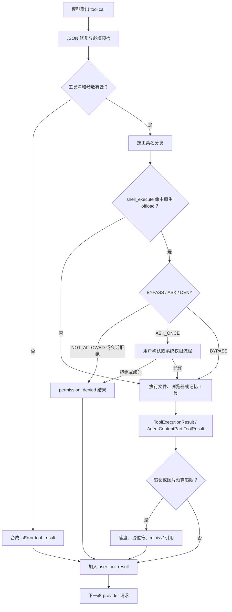

## 5. 工具系统：定义、分发、权限与结果回灌

### 5.1 这一章解决什么问题

AI Agent 的“工具”不是一个函数表，而是一条从模型可见 schema、参数流、权限判断、设备执行，到下一次模型请求的闭环。OpenMinis 把 Linux 沙箱文件能力、浏览器、持久记忆和原生 offload 都接入同一条 agent loop；如果只实现“调用函数”，就会遗漏 session 隔离、用户确认、图片大小、tool_use/tool_result 配对等决定可用性的约束。iOS 与 Android 共享工具名和大部分参数，但 provider wire format、并发策略和原生权限落点不同。本章沿着真实代码把这条链拆开，并把配置读写作为一种“由 shell 暴露的应用内工具”单独说明。

代码位置：`src/ios/Agent/Chat/AIChatViewModel+ToolDefinitions.swift:9-142`、`src/android/app/src/main/java/com/openminis/app/tools/AgentTools.kt:14-36`、`src/ios/Agent/Chat/AIChatViewModel+ConcurrentTools.swift:67-89`、`src/android/app/src/main/java/com/openminis/app/ui/chat/ChatViewModel.kt:7101-7152`。

本章先给一个可执行的心智模型：模型只知道工具声明；真正的安全边界必须在执行器前再次判断，真正的上下文边界必须在回灌前处理。iOS 把一次 assistant 消息内的多个工具并发执行后按原顺序拼回；Android 当前 `runAgentLoop` 对 `toolCalls` 顺序执行。两端都把工具结果以 user-role 的 `tool_result` 消息加入 history，避免下一轮请求缺少模型所要求的配对块。



图中“会话拒绝”和“配置确认”是两个不同的门：前者针对设备能力命令，后者针对 `minis-config` 写入；不要用一个全局 Boolean 替代它们。iOS 设备 offload 的检查在 `shell_execute` 分支中发生，Android 则把检查下沉到 `OffloadGate`，因此命名工具调用和原始 shell 命令能共享同一策略。

代码位置：`src/ios/Agent/Chat/AIChatViewModel+ConcurrentTools.swift:216-250`、`src/android/app/src/main/java/com/openminis/app/sandbox/offload/OffloadGate.kt:9-24`。

### 5.2 工具清单：模型究竟拿到什么

#### 5.2.1 顶层 AgentToolDefinition 清单

下面表格只列模型通过 `tools` 参数直接看到的顶层工具。它不是根据文档猜出来的：iOS 的 `makeAgentTools()` 和 Android 的 `AgentTools.makeAgentTools()` 都逐项注册了这些名字。`read_image` 还受模型图片输入能力控制，`memory_*` 受每个会话 memory 开关控制。

代码位置：`src/ios/Agent/Chat/AIChatViewModel+ToolDefinitions.swift:16-29`、`:30-69`、`:70-100`、`:103-138`；`src/android/app/src/main/java/com/openminis/app/tools/AgentTools.kt:14-36`。

| 工具名 | 参数 schema 摘要（必填 / 可选） | 归属子系统 | 是否需要权限 |
|---|---|---|---|
| `shell_execute` | 必填 `tool_title:string`、`command:string`；可选 `timeout:integer`（默认 900 秒）、`delay:integer`（默认 0） | iSH（iOS）或 Alpine/PRoot（Android）的隔离 Linux 进程；同时是原生 offload CLI 的统一入口 | 普通 Linux 命令不走设备隐私权限；若 command 的首 token 是已注册 native offload，则按命令级权限检查 |
| `file_read` | 必填 `tool_title:string`、`path:string`；可选 `offset:integer`（1-based）、`lines:integer`、`max_length:integer`、`direction:string`（`head`/`tail`） | 沙箱文件只读 | 不需要原生权限；路径解析仍必须通过 session resolver 和 `..` 防护 |
| `file_write` | 必填 `tool_title:string`、`path:string`、`content:string`；可选 `append:boolean`、`create_dirs:boolean` | 沙箱文件写入、iSH `meta.db` 可见性维护 | 不需要原生隐私权限；只读外部 mount 会被拒绝 |
| `file_edit` | 必填 `tool_title:string`、`path:string`、`old_string:string`、`new_string:string`；可选 `replace_all:boolean` | 沙箱文件定点编辑 | 不需要原生隐私权限；只读外部 mount 会被拒绝，`old_string` 为空始终拒绝 |
| `browser_use` | 必填 `tool_title:string`、`action:string`；`action` 为 22 个枚举值；可选 URL、CSS selector、文本、坐标、滚动参数、JS、UA、tab、cookie、viewport、超时等 | 原生 WebView/WKWebView 浏览器 tab pool | 不经过 `OffloadPermissionManager`；cookie 读写本身是高风险业务动作，应在产品层继续保留用户可见状态与站点限制 |
| `memory_write` | 必填 `tool_title:string`、`content:string`；内容写入当天 `YYYY-MM-DD.md` | 持久 memory daily log | 只有 `memoryEnabled` 为真时才注册；关闭时模型根本看不到该工具，执行器仍有防御性拒绝 |
| `memory_get` | 必填仅 `tool_title:string`；可选 `scope:string`（`daily`/`all`）、`keywords:string` | 持久 memory 搜索 | 只有 `memoryEnabled` 为真时才注册；关闭时执行器同样拒绝 |
| `read_image` | 必填 `tool_title:string`、`path:string`，路径可为 Linux path 或 `minis://` | 图片读取、缩放、作为多模态输入回传 | 只有模型声明支持 `.imageInput` 时注册；不是系统照片权限，它读的是沙箱文件 |

`tool_title` 被放进 required 的原因不是执行语义，而是 UI 的工具胶囊需要一个简短标题。iOS/Android 预检都把它列入“非阻塞 required 字段”：缺少标题仍执行工具，缺少真正的 `path`、`command` 或 `content` 才合成错误结果。这个处理避免了把展示字段误当作业务必填字段。

代码位置：`src/ios/Agent/Chat/AIChatViewModel+ToolPreflight.swift:203-223`、`:229-281`；`src/android/app/src/main/java/com/openminis/app/ui/chat/ChatViewModel.kt:121-198`。

#### 5.2.2 `browser_use` 的 action 枚举

两端 action 名相同：`navigate`、`screenshot`、`click`、`type`、`get_text`、`scroll`、`get_page_info`、`execute_js`、`find_elements`、`hover`、`get_readable`、`set_user_agent`、`set_viewport`、`get_backbone`、`fetch`、`new_tab`、`close_tab`、`list_tabs`、`get_cookies`、`set_cookies`、`scroll_and_collect`、`wait_for_dom_stable`。iOS 的枚举是 canonical parser；Android 的 `BrowserAction.allValues` 同样由 enum entries 产生。

代码位置：`src/ios/Agent/BrowserUse/BrowserUseActions.swift:5-28`、`:70-110`；`src/android/app/src/main/java/com/openminis/app/browser/BrowserAction.kt:6-28`、`:39-70`。

参数分组应按 action 解释，而不是为每个 action 复制一份工具：

| 分组 | 关键参数 | 约束来源 |
|---|---|---|
| 导航/下载 | `url`、`new_tab`、`fetch` | iOS schema 对 `url` 的描述和 `BrowserActionInput.parse`；Android 同一字段在 `AgentTools` 中声明 |
| DOM 交互 | `selector`、`text`、`coordinate_x`、`coordinate_y` | selector 与坐标二选一的语义由 browser executor 决定，schema 只描述可选输入 |
| 滚动采集 | `direction`、`amount`、`scroll_count`、`item_selector` | `scroll_count` 默认 10、上限 20 的约束写在 schema 描述中 |
| 脚本/结构 | `script`、`max_depth`、`timeout` | `execute_js` 在 async wrapper 中运行；`get_backbone` 使用深度；DOM stable 使用超时 |
| 会话/显示 | `tab_id`、`user_agent`、`viewport_width`、`viewport_height`、`reset`、`full_page` | tab pool 负责 tab 生命周期；full-page screenshot 高度上限 32768 px |
| Cookie | `keywords`、`fuzzy`、`cookies` | `cookies` 因 schema 只声明为 string，iOS parser 同时接受真实数组或 JSON 编码字符串 |

Cookie 的“string schema + 运行时兼容数组”是一个实用的方言折中：模型可以发 JSON 字符串，浏览器导出的数组也不会被静默丢弃。不要把它误写成 `array<object>` 后只改 schema；parser 的兼容代码必须一起保留。

代码位置：`src/ios/Agent/Chat/AIChatViewModel+ToolDefinitions.swift:73-99`、`src/ios/Agent/BrowserUse/BrowserUseActions.swift:113-128`；`src/android/app/src/main/java/com/openminis/app/tools/AgentTools.kt:74-100`、`src/android/app/src/main/java/com/openminis/app/tools/BrowserUseTool.kt:26-107`。

#### 5.2.3 顶层工具之外的“shell 侧工具”

系统提示还告诉模型 `/usr/local/bin` 下的 native CLI。它们不是 `AgentToolDefinition` 数组中的额外 function；模型通过 `shell_execute(command=...)` 调用它们，因此权限检查必须从 shell 命令中提取首 token。iOS 系统提示列出 `apple-healthkit`、`apple-calendar`、`apple-reminders`、`apple-photos`、`apple-location`、`apple-homekit`、`apple-clipboard`、`apple-speak`、`apple-speech`、`apple-player`、`apple-media`、`apple-device`、`apple-notification`、`apple-alarm`、`apple-open`、`apple-maps`、`apple-weather`、`apple-nlp`、`apple-vision` 等；Android 系统提示列出 `android-calendar`、`android-clipboard`、`android-contacts`、`android-location`、`android-photos`、`android-notification`、`android-alarm`、`android-device`、`android-weather`、`android-speak`、`android-speech`、`android-player`、`android-open`、`android-shizuku-cli`、`android-a11y-cli` 等。

代码位置：`src/ios/Agent/Chat/AIChatViewModel.swift:1802-1815`；`src/android/app/src/main/java/com/openminis/app/ui/chat/ChatViewModel.kt:8049-8069`；iOS 权限命令表见 `src/ios/Agent/Offload/OffloadPermissionManager.swift:124-147`，Android 权限注册表见 `src/android/app/src/main/java/com/openminis/app/offload/OffloadPermissionManager.kt:68-91`。

| 平台 | 隐私/设备命令 | 权限表中的 key | 默认状态 |
|---|---|---|---|
| iOS | HealthKit、Calendar、Reminders、Photos、Location、HomeKit、Clipboard | 命令原名 `apple-*` | 未配置时 `.bypass`；用户可改为 `.askOnce` 或 `.notAllowed` |
| iOS | Speak、Speech、Player、Media；Device、Notification、Alarm、Open、Maps、Weather、NLP、Vision | 命令原名 `apple-*` | 代码标记为 media/system，不显示在设置权限列表，默认 bypass |
| Android | Calendar、Location、Clipboard、Contacts、Photos | 内部 key 为 `calendar`、`location`、`clipboard`、`contacts`、`photos` | 默认 BYPASS，设置页可降级 |
| Android | TTS、Media Player、Speech Recognition；Alarm、Weather、Notification、Device Info | `speak`、`media_player`、`speech_recognition`、`alarm`、`weather`、`notification`、`device_info` | 默认 BYPASS，隐藏于权限设置页 |
| Android | Accessibility、Shizuku | `a11y_cli`、`shizuku_cli` | 默认 NOT_ALLOWED；即便底层服务已授权也仍需 agent 权限门 |

Android 的 key 与 CLI 名不同是有意的：`AccessibilityOffloadHandler` 和 `ShizukuOffloadHandler` 分别以 `a11y_cli`、`shizuku_cli` 调用 `OffloadGate`，这样设置页名称与内部策略稳定，CLI 可以保持 `android-a11y-cli` / `android-shizuku-cli` 的用户可读命名。

代码位置：`src/android/app/src/main/java/com/openminis/app/sandbox/offload/AccessibilityOffloadHandler.kt:100-107`、`src/android/app/src/main/java/com/openminis/app/sandbox/offload/ShizukuOffloadHandler.kt:49-67`。

### 5.3 JSON Schema：声明一次，转换多个 Provider

#### 5.3.1 Provider-agnostic canonical schema

iOS 用 `AgentToolDefinition` 保存 name、description、参数字典、required 和可选的 property ordering；`AgentToolParam` 目前只有 string、integer、boolean 三种类型，enumValues 独立存储。Android 的 `AgentToolDefinition` 与 `AgentToolParam` 结构对齐，并直接提供 `toAnthropicJson()`、`toGeminiJson()`、`toOpenAIJson()` 三个转换函数。

代码位置：`src/ios/Providers/AgentProvider.swift:14-51`；`src/android/app/src/main/java/com/openminis/app/data/model/AgentToolDefinition.kt:6-93`。

```swift
// 来源：src/ios/Agent/Chat/AIChatViewModel+ToolDefinitions.swift:17-29
AgentToolDefinition(
    name: "shell_execute",
    description: "Execute a command in an isolated Linux process ...",
    parameters: [
        "tool_title": AgentToolParam(type: .string, description: "..."),
        "command": AgentToolParam(type: .string, description: "..."),
        "timeout": AgentToolParam(type: .integer, description: "..."),
        "delay": AgentToolParam(type: .integer, description: "..."),
    ],
    required: ["tool_title", "command"],
    propertyOrdering: ["tool_title", "command", "timeout", "delay"]
)
```

#### 5.3.2 三种主要 wire 方言

| Provider | 工具外层 | 参数对象 | enum / ordering 处理 | 结果配对要点 |
|---|---|---|---|---|
| Anthropic | `{name, description, input_schema}` | `type: object`、`properties`、`required` | iOS 用 SDK `JSONSchema.Property`；Android `param.toJson()` 直接保留 enum | `tool_use` 的 id 必须和 `tool_result.tool_use_id` 配对 |
| OpenAI Chat Completions | `{type:"function", function:{name,description,parameters}}` | `type: object`、`properties`、`required` | enum 作为 JSON Schema `enum`；不使用 `propertyOrdering` | 每个结果是 role=`tool`，带 `tool_call_id` |
| OpenAI Responses | `{type:"function", name, description, parameters}` | 与 Chat 相同的 object schema | 不能复用 Chat 的 `function:{...}` 包装 | 结果是 `function_call_output`，用 `call_id` 关联 |
| Gemini / Antigravity | `function_declarations` 数组 | `type: "OBJECT"`、`properties`、`required` | iOS 将 enum 文本并入 description；支持时加入 `propertyOrdering`；Android builder 直接输出大写 type 并保留 enum | `functionCall` / `functionResponse`，响应对象不能为空 |

Anthropic 转换把 canonical 类型映射到 SDK 的 JSON type，并保留 enum；Gemini 的关键差异是大写类型和值域兼容。OpenAI 的 Responses API 不能把 Chat Completions 的 function wrapper 原样发送，这也是 Android 单独定义 `toResponsesAPIJson()` 的原因。

代码位置：`src/ios/Providers/Anthropic/AnthropicAgentProvider.swift:787-811`、`src/ios/Providers/Gemini/GeminiAgentProvider.swift:205-234`、`src/ios/Providers/OpenAI/OpenAIAgentProvider.swift:1661-1715`；`src/android/app/src/main/java/com/openminis/app/data/model/AgentToolDefinition.kt:36-73`、`src/android/app/src/main/java/com/openminis/app/provider/openai/OpenAIProvider.kt:2744-2765`。

```swift
// 来源：src/ios/Providers/Gemini/GeminiAgentProvider.swift:205-231
var params: [String: Any] = [
    "type": "OBJECT",
    "properties": properties,
    "required": tool.required,
]
if let ordering = tool.propertyOrdering {
    params["propertyOrdering"] = ordering
}
return GeminiConversation.toolDefinition(
    name: tool.name,
    description: tool.description,
    parameters: params
)
```

```swift
// 来源：src/ios/Providers/OpenAI/OpenAIAgentProvider.swift:1690-1714
return [
    "type": "function",
    "name": tool.name,
    "description": tool.description,
    "parameters": [
        "type": "object",
        "properties": properties,
        "required": tool.required,
    ] as [String: Any],
]
```

Android 的三个 provider builder 会在外层再设置 provider-specific tool mode：Anthropic 设置 `eager_input_streaming`、最后一个工具的缓存控制和 `tool_choice:auto`；Gemini 使用 `function_declarations`；OpenAI Chat 使用 `tool_choice:auto`。这些字段不是工具业务 schema，应由 provider 层注入。

代码位置：`src/android/app/src/main/java/com/openminis/app/provider/anthropic/AnthropicProvider.kt:399-416`、`src/android/app/src/main/java/com/openminis/app/provider/gemini/GeminiProvider.kt:265-272`、`src/android/app/src/main/java/com/openminis/app/provider/openai/OpenAIProvider.kt:1467-1475`；iOS 对应 `src/ios/Providers/Gemini/GeminiProvider.swift:188-191`、`src/ios/Providers/OpenAI/OpenAIAgentProvider.swift:58-69`。

一个容易遗漏的差异是 enum：iOS `GeminiAgentProvider.convertTools` 明确写着 Gemini 并非所有场景都支持 enum，于是把值域拼到 description；Android `AgentToolParam.toGeminiJson()` 却在 `:88-92` 直接输出 `enum`。如果要新增复杂工具，应在目标模型矩阵上验证，而不是因为 canonical 中有 enum 就假定所有 Gemini endpoint 都接受它。

代码位置：`src/ios/Providers/Gemini/GeminiAgentProvider.swift:208-216`、`src/android/app/src/main/java/com/openminis/app/data/model/AgentToolDefinition.kt:77-92`。

#### 5.3.3 流式 JSON 修复与预检

工具参数在流式响应中可能被截断、类型错误或拼错键名。两端都采用相同的三步修复：对 raw tail 尝试补 `}`/`]`/引号；对 required scalar 做字符串化；对与 required 字段 Levenshtein 距离恰为 1（至多一处编辑）的错别字键做重命名。修复只是在预检前生成可用参数，不应替代工具自身的路径、枚举和范围验证。

代码位置：`src/ios/Agent/Chat/AIChatViewModel+ToolPreflight.swift:32-48`、`:63-163`；`src/android/app/src/main/java/com/openminis/app/provider/ToolJsonRepair.kt:14-90`。

```swift
// 来源：src/ios/Agent/Chat/AIChatViewModel+ToolPreflight.swift:229-281
nonisolated static func preflightValidateToolCall(
    name: String, args: [String: Any], tools: [AgentToolDefinition]
) -> String? {
    guard let toolDef = tools.first(where: { $0.name == name }) else { return nil }
    let enforced = toolDef.required.filter { !Self.preflightNonBlockingFields.contains($0) }
    if args.isEmpty && !enforced.isEmpty {
        return "Tool '\(name)' was called with empty arguments {} but requires: \(enforced.joined(separator: ", "))."
    }
    // 缺失、NSNull、真正空字符串按工具规则拒绝
    return nil
}
```

`file_edit.new_string == ""` 是唯一显式允许空字符串的字段，因为它代表删除匹配文本；这条白名单同时出现在 iOS 和 Android 预检中。实现新工具时，要先区分“空值合法”与“参数缺失”，否则模型无法完成删除操作。

代码位置：`src/ios/Agent/Chat/AIChatViewModel+ToolPreflight.swift:212-223`、`:256-275`；`src/android/app/src/main/java/com/openminis/app/ui/chat/ChatViewModel.kt:121-127`、`:179-192`。

### 5.4 分发与执行：从 tool call 到 ToolResult

#### 5.4.1 iOS：并发执行，但按原始顺序回灌

iOS 一次 assistant turn 最多同时运行 10 个工具。`withTaskGroup` 为每个 `toolEntries` 建立子任务，用索引收集 outcome；所有任务结束后再按索引拼接 `toolResultParts`。这是因为 Anthropic 要求同一 user message 内的 `tool_result` 顺序对应原始 `tool_use` 顺序，不能按完成时间直接 append。

代码位置：`src/ios/Agent/Chat/AIChatViewModel.swift:5209-5228`、`:5260-5309`、`src/ios/Agent/Chat/AIChatViewModel+ConcurrentTools.swift:67-89`。

```swift
// 来源：src/ios/Agent/Chat/AIChatViewModel.swift:5260-5309
var outcomesByIndex: [Int: ToolExecOutcome] = [:]
await withTaskGroup(of: (Int, ToolExecOutcome).self) { group in
    var added = 0
    var harvested = 0
    for (idx, tu) in toolEntries.enumerated() {
        while added - harvested >= Self.maxConcurrentTools {
            if let pair = await group.next() {
                outcomesByIndex[pair.0] = pair.1
                harvested += 1
            }
        }
        group.addTask {
            let outcome = await self.executeSingleToolUse(
                tu: tu, msgIdx: msgIdx, tools: toolsSnapshot,
                batchBudget: imageBudgetActor
            )
            return (idx, outcome)
        }
        added += 1
    }
    for await pair in group {
        outcomesByIndex[pair.0] = pair.1
        harvested += 1
    }
}
```

`ToolExecOutcome` 同时携带工具 id、name、`AgentContentPart.toolResult`、UI snapshot 和取消状态；这样执行任务不需要在完成顺序上直接修改历史。图片预算由 actor 保护，避免并发 `read_image` 竞争同一配额。

代码位置：`src/ios/Agent/Chat/AIChatViewModel+ConcurrentTools.swift:43-75`、`:763-813`。

#### 5.4.2 Android：顺序执行，结果块逐项收集

Android 的当前 loop 以 `for ((id, name, args) in toolCalls)` 逐项执行 `executeTool`，每次先做 JSON 修复、loop detector 和 preflight，再选择 `FileReadTool`、`FileWriteTool`、`FileEditTool`、`ReadImageTool`、shell、browser 或 memory executor。执行结果随即加入 `resultParts`，最后统一持久化 assistant turn 和 user-role tool-result message。

代码位置：`src/android/app/src/main/java/com/openminis/app/ui/chat/ChatViewModel.kt:6716-6749`、`:6793-6847`、`:6919-6963`。

```kotlin
// 来源：src/android/app/src/main/java/com/openminis/app/ui/chat/ChatViewModel.kt:7101-7152
return when (name) {
    FileReadTool.NAME -> FileReadTool.execute(argsJson, activeSessionId, context)
    FileWriteTool.NAME -> FileWriteTool.execute(argsJson, activeSessionId, context)
    FileEditTool.NAME -> FileEditTool.execute(argsJson, activeSessionId, context)
    ReadImageTool.NAME -> ReadImageTool.execute(argsJson, activeSessionId, context)
    "shell_execute" -> executeShellCommand(argsJson, toolId, toolBlocks, assistantId, currentText)
    "browser_use" -> executeBrowserUseTool(argsJson)
    "memory_write" -> executeMemoryWriteTool(argsJson)
    "memory_get" -> executeMemoryGetTool(argsJson)
    else -> ToolExecutionResult("Unknown tool: $name", false)
}
```

Android 的 `AgentContentPart.ToolResult` 保存 `id`、`name`、文本、错误标记、可选图片 bytes/MIME 和 Linux path；iOS 的 `AgentContentPart.toolResult` 保存同等信息并额外带 page URL。两端都必须保留 tool id，不能只把文本塞进 UI bubble，否则 provider 下一轮无法构造合法配对。

代码位置：`src/android/app/src/main/java/com/openminis/app/data/model/AgentContentPart.kt:13-51`；`src/ios/Providers/AgentProvider.swift:55-70`；`src/android/app/src/main/java/com/openminis/app/tools/ToolExecutionResult.kt:3-29`。

### 5.5 文件工具三件套：agent 可用性的核心

文件工具的共同原则是：模型用 Linux path，宿主用 session-specific host URL；直接 FileManager/File API 避免 shell quoting；写入后要让 sandbox 的 Linux 视图可见。iOS 额外维护 iSH fakefs 的 `meta.db`；Android 依赖 PRoot 的 per-session host resolver。

代码位置：`src/ios/Agent/Chat/AIChatViewModel+FileTools.swift:106-156`、`:158-229`；`src/android/app/src/main/java/com/openminis/app/tools/FileReadTool.kt:53-59`、`src/android/app/src/main/java/com/openminis/app/tools/FileWriteTool.kt:52-58`。

#### 5.5.1 路径解析、session 隔离与只读 mount

iOS 的 `resolveHostPath` 只接受以 `/` 开头且不含 `..` 的 Linux path；`/var/minis/` 优先查询 `ISHExecutionCoordinator` 当前 bind mount，找不到时再落到 session persistent URL。`resolveMinisPath` 把 `minis://namespace/path` 还原为 `/var/minis/namespace/path` 后复用同一 resolver。

代码位置：`src/ios/Agent/Chat/AIChatViewModel+FileTools.swift:66-104`、`:106-143`、`:146-155`。

Android 三个文件工具都调用 `PRootKernel.resolveSessionHostPath(sessionId, path, context)`，避免全局 bind map 的 last-writer-wins 导致 session A 读到 session B 文件。`ReadImageTool` 也被修正为传入 sessionId/context；不能因为图片只是输入就绕过同一隔离规则。

代码位置：`src/android/app/src/main/java/com/openminis/app/tools/FileReadTool.kt:28-59`、`src/android/app/src/main/java/com/openminis/app/tools/FileWriteTool.kt:26-58`、`src/android/app/src/main/java/com/openminis/app/tools/FileEditTool.kt:26-53`、`src/android/app/src/main/java/com/openminis/app/tools/ReadImageTool.kt:26-60`。

写入和编辑在解析前后都检查只读 external mount。iOS 同时检查 Linux prefix 与解析后的 host URL；Android 在 `FileWriteTool`/`FileEditTool` 中先调用 `PRootKernel.isLinuxPathUnderReadOnlyMount`。这不是普通文件系统错误，而是要返回告诉用户去 Settings → Mount External Folders 修改可写性。

代码位置：`src/ios/Agent/Chat/AIChatViewModel+FileTools.swift:341-350`、`:428-435`、`:536-555`；`src/android/app/src/main/java/com/openminis/app/tools/FileWriteTool.kt:39-49`、`src/android/app/src/main/java/com/openminis/app/tools/FileEditTool.kt:42-49`。

#### 5.5.2 `file_read`：行号、方向、限制与二进制

| 行为 | iOS | Android |
|---|---|---|
| 起始位置 | `offset` 至少为 1，默认 1；head 按 1-based 行号切片 | 同样 `coerceAtLeast(1)`，随后转为 0-based subList |
| tail | `direction == "tail"` 时忽略 offset，从末尾取 `lines` | 同样从末尾取 `requestedLines` |
| 行限制 | `lines` 可选；未给出则取剩余全部 | `lines` 可选；未给出则取全部 |
| 字符上限 | `min(requested, 80_000)`；默认 `kMaxToolResultChars`=15,000 | `optInt(max_length,15000).coerceAtMost(80_000)` |
| 二进制探测 | 读取全文件后检查前 512 bytes 是否有 NUL；返回前 64 bytes hex preview | 检查前最多 8192 bytes NUL；返回 binary 元数据，不展示内容 |
| 文本编码 | 必须 UTF-8；否则失败 | `File.readLines()` 读取文本，异常转为失败 |
| 元数据 | path、bytes、总行数、显示范围；`/var/minis/` 追加 `minis_url` | path、bytes、总行数、显示范围；当前 `file_read` 不追加 URL |

iOS 先把文件读入 `Data`，所以能够在二进制识别中准确报告 byte size；内容截断是在选定行之后进行，header 会声明 `truncated at N chars`。Android 在 `content.take(maxLength)` 后追加 `... (truncated)`，header 说明行范围但不额外报告字符上限。

代码位置：`src/ios/Agent/Chat/AIChatViewModel+FileTools.swift:243-325`；`src/android/app/src/main/java/com/openminis/app/tools/FileReadTool.kt:28-117`。

```swift
// 来源：src/ios/Agent/Chat/AIChatViewModel+FileTools.swift:261-325
let sampleSize = min(fileData.count, 512)
if fileData.prefix(sampleSize).contains(0) {
    let hexPreview = fileData.prefix(64)
        .map { String(format: "%02x", $0) }.joined(separator: " ")
    return FileToolResult(
        output: "[\(path) | \(fileData.count) bytes | binary file]\nHex preview: \(hexPreview)",
        success: true
    )
}
let allLines = fullText.components(separatedBy: "\n")
// 根据 offset / direction 选行，再按 maxLength 截断并附 metadata
```

```kotlin
// 来源：src/android/app/src/main/java/com/openminis/app/tools/FileReadTool.kt:67-113
val isBinary = file.inputStream().use { input ->
    val buf = ByteArray(minOf(8192, size.toInt()))
    val read = input.read(buf)
    if (read > 0) buf.take(read).any { it == 0.toByte() } else false
}
if (isBinary) {
    return ToolExecutionResult(
        "[$path | $size bytes | binary file — cannot display contents]",
        true, toolTitle = toolTitle
    )
}
var content = selectedLines.joinToString("\n")
if (content.length > maxLength) content = content.take(maxLength) + "\n... (truncated)"
```

#### 5.5.3 `file_write`：覆盖、追加、目录和 fakefs 元数据

iOS `executeFileWrite` 读取 `path/content`，解析 `append` 与 `create_dirs`，在 `/var/minis/mounts/` 场景先 prime 当前 session 的 mount table；若 mount lookup 失败且解析结果落到 fakefs shadow 或 session fallback，则拒绝写入，避免“成功但用户看不见”的孤儿文件。成功写入后按需创建父目录并调用 `ensureFakefsMetadata` 注册文件。

代码位置：`src/ios/Agent/Chat/AIChatViewModel+FileTools.swift:329-423`、`:438-486`、`:488-524`。

```swift
// 来源：src/ios/Agent/Chat/AIChatViewModel+FileTools.swift:438-455、:488-524
let appendMode = (dict["append"] as? Bool) ?? false
let createDirs = (dict["create_dirs"] as? Bool) ?? false
let parentDir = hostURL.deletingLastPathComponent()
if createDirs || !fm.fileExists(atPath: parentDir.path) {
    try fm.createDirectory(at: parentDir, withIntermediateDirectories: true)
}
if appendMode, fm.fileExists(atPath: hostURL.path) {
    let handle = try FileHandle(forWritingTo: hostURL)
    handle.seekToEndOfFile()
    handle.write(contentData)
    handle.closeFile()
} else {
    try contentData.write(to: hostURL)
}
if createDirs { ensureParentDirsInMetaDB(for: parentLinux) }
ensureFakefsMetadata(for: path, isDirectory: false)
```

`ensureFakefsMetadata` 会打开 rootfs `meta.db`，检查 `paths` 表，构造 regular-file 或 directory 的 16-byte `ish_stat` blob，再写入 `stats` 和 `paths`；这一步是 iSH 内核可见性的必要条件，不是可有可无的缓存。

代码位置：`src/ios/Agent/Chat/AIChatViewModel+FileTools.swift:158-215`、`:217-228`。

Android `file_write` 同样支持 overwrite/append，但实现会在 parent 不存在时自动 `mkdirs()`，所以 `create_dirs=false` 并不阻止新目录物化；这是 Android 对 per-session 子目录 lazy materialization 的补丁。写完后对 mounted folder 还会核对 `exists` 和长度，并记录 FUSE shadow write 的诊断日志。

代码位置：`src/android/app/src/main/java/com/openminis/app/tools/FileWriteTool.kt:67-105`。

两端的返回都应该包含可复用的 path 和 bytes；iOS 对 `/var/minis/` 立即追加 `minis_url`，Android 当前 `FileWriteTool` 返回 `Wrote to ...`，URL 由 browser artifact、shell scan 或上层 system contract 补充。设计新平台时应把“写入成功”和“模型可重新引用”视为同一验收项。

代码位置：`src/ios/Agent/Chat/AIChatViewModel+FileTools.swift:511-524`、`src/android/app/src/main/java/com/openminis/app/tools/FileWriteTool.kt:84-105`。

#### 5.5.4 `file_edit`：唯一性、不变索引和 fuzzy fallback

两端先要求文件存在、文本可读、`old_string` 非空，再统计匹配次数。默认必须恰好一次；多次匹配时返回错误并要求更多上下文，只有 `replace_all=true` 才允许全部替换。替换从最后一个 range 反向执行，保证前面的 String.Index 不因长度变化而失效。

代码位置：`src/ios/Agent/Chat/AIChatViewModel+FileTools.swift:527-568`、`:633-645`；`src/android/app/src/main/java/com/openminis/app/tools/FileEditTool.kt:55-90`。

```swift
// 来源：src/ios/Agent/Chat/AIChatViewModel+FileTools.swift:565-645
guard !oldString.isEmpty else {
    return FileToolResult(output: "Error: old_string must not be empty...", success: false)
}
let replaceAll = (dict["replace_all"] as? Bool) ?? false
let strictRanges = Self.findAllRanges(of: oldString, in: fileContent)
// strict 失败时，对两侧做 smart quote / 行尾空白 / inline space 归一化，
// 但把 normalized range 映射回原文件 range。
if editRanges.count > 1 && !replaceAll {
    return FileToolResult(
        output: "Error: old_string matches \(editRanges.count) locations...",
        success: false
    )
}
for range in editRanges.reversed() {
    updatedContent.replaceSubrange(range, with: newString)
}
```

iOS 的 fuzzy fallback 不是模糊替换整个文件：它只在 strict 没有任何命中时生效，把智能引号转 ASCII、删除每行尾部空格、折叠行内 ASCII 空格，同时保留行首缩进；随后通过 parallel index map 把 normalized range 映射回原始 `String.Index`。成功信息会标出 `fuzzy-matched`，让模型知道下次应重新读取精确字节。

代码位置：`src/ios/Agent/Chat/AIChatViewModel+FileTools.swift:572-631`、`:684-767`。

Android 目前是严格 `indexOf` 计数和 `replaceFirst`/`replace`，没有 iOS 的 smart quote、空白归一化或上下文 preview。因而 Android 模型若把空格或引号改写，工具会返回 not found；这是实现差异，不应在教学代码中声称两端同样支持 fuzzy edit。

代码位置：`src/android/app/src/main/java/com/openminis/app/tools/FileEditTool.kt:61-89`。

```kotlin
// 来源：src/android/app/src/main/java/com/openminis/app/tools/FileEditTool.kt:61-93
var count = 0
var searchFrom = 0
while (true) {
    val idx = content.indexOf(oldString, searchFrom)
    if (idx < 0) break
    count++
    searchFrom = idx + oldString.length
}
if (count > 1 && !replaceAll) {
    return ToolExecutionResult(
        "Error: old_string found $count times ...",
        false, toolTitle = toolTitle
    )
}
val newContent = if (replaceAll) content.replace(oldString, newString)
                 else content.replaceFirst(oldString, newString)
file.writeText(newContent)
```

#### 5.5.5 二进制与图片：`read_image` 不是 `file_read` 的特例分支

`file_read` 遇到 binary 时只返回元数据，不能把图片/压缩包当 UTF-8 文本塞进上下文；需要视觉分析时模型调用单独的 `read_image`。iOS 仅在 `selectedModel.capabilities.supportedModalities` 包含 image input 时注册该工具；执行器读取 Data、用 `UIImage` 解码、最长边缩到 2000，再以 JPEG（通常 quality 0.85）作为 inference bytes，同时保留原始 Linux path。

代码位置：`src/ios/Agent/Chat/AIChatViewModel+ToolDefinitions.swift:127-138`、`src/ios/Agent/Chat/AIChatViewModel+ConcurrentTools.swift:553-613`。

Android `ReadImageTool` 接受 `minis://`，先还原成 `/var/minis/` path，再走 session host resolver；`BitmapFactory.decodeFile` 解码，最长边超过 2000 就 `createScaledBitmap`，统一 JPEG quality 85，结果通过 `ToolExecutionResult.imageData/imageMimeType/imageFilePath` 返回。

代码位置：`src/android/app/src/main/java/com/openminis/app/tools/ReadImageTool.kt:41-100`、`src/android/app/src/main/java/com/openminis/app/tools/ToolExecutionResult.kt:3-29`。

需要注意一个资源生命周期坑：Android `ReadImageTool` 在第 83-84 行 recycle bitmap，却在第 86 行才读取 `original.width/height` 生成 metadata；这是潜在的 use-after-recycle 风险。若重写该逻辑，必须先缓存 width/height，再释放 bitmap。任何平台都应避免把原始 12MP 图片直接内联到下一次请求，而应在 provider boundary 再做一次压缩兜底。

代码位置：`src/android/app/src/main/java/com/openminis/app/tools/ReadImageTool.kt:66-86`；`src/android/app/src/main/java/com/openminis/app/provider/anthropic/AnthropicProvider.kt:577-615`。

#### 5.5.6 持久 memory 工具的结果边界

`memory_write` 不是通用 `file_write` 的别名：iOS 会创建当天文件、把带 timestamp comment 的 entry prepend 到旧内容，并通知同步层；Android 委托给 `MemoryRepository.writeMemory`，同样以当天文件、timestamp 和 newest-first 方式保存。`GLOBAL.md` 在两端都被描述为用户维护的只读背景，`memory_write` 不应修改它。

代码位置：`src/ios/Agent/Chat/AIChatViewModel+MemoryTools.swift:63-119`；`src/android/app/src/main/java/com/openminis/app/data/repository/MemoryRepository.kt:49-77`；工具 schema 见 `src/ios/Agent/Chat/AIChatViewModel+ToolDefinitions.swift:103-124`、`src/android/app/src/main/java/com/openminis/app/tools/MemoryTools.kt:13-71`。

memory 搜索必须有自己的预算。iOS 在无关键词时最多返回 500 行；有关键词时把 timestamp entry 按命中关键词数与 recency 各 50% 评分，最多 60 entries、至少 append 完整 entry 后在 30 KB UTF-8 处停止。Android 是 line-based fuzzy search：无关键词最多 500 行，有关键词最多 60 行，同时 30 KB bytes；匹配行带前后各两行上下文。

代码位置：`src/ios/Agent/Chat/AIChatViewModel+MemoryTools.swift:185-201`、`:300-364`；`src/android/app/src/main/java/com/openminis/app/data/repository/MemoryRepository.kt:20-42`、`:117-231`。

```swift
// 来源：src/ios/Agent/Chat/AIChatViewModel+MemoryTools.swift:300-364
let confScore = Double(entry.matchedCount) / Double(max(entry.totalKeywords, 1))
let recencyScore = tsRange > 0
    ? (entry.timestamp.timeIntervalSince1970 - minTs) / tsRange
    : 1.0
let combined = 0.5 * confScore + 0.5 * recencyScore
// sortedScored 后：最多 60 entries，累计 UTF-8 bytes 达 30 KB 即停止
```

### 5.6 权限、确认门与审计

#### 5.6.1 native offload 的三态权限

iOS `OffloadPermissionLevel` 是 `bypass`、`askOnce`、`notAllowed` 三态。权限 level 按 command name 存在 UserDefaults；没有存储值时 fallback 到 `.bypass`。shell 检查只看 command 的第一个 token，因此 `apple-healthkit query ... && ...` 的权限提示只代表首个 native command，而不是整条 shell pipeline。

代码位置：`src/ios/Agent/Offload/OffloadPermissionManager.swift:6-18`、`:154-190`；调用位置：`src/ios/Agent/Chat/AIChatViewModel+ConcurrentTools.swift:231-250`。

`askOnce` 的“once”是当前 session 的 grant：同一 session 再次使用同一个 command 不再弹窗；调用没有 session id 时进入固定的 `offload-global` bucket。用户拒绝或 30 秒超时都会返回 `PermissionResult.denied`，tool result 里会带设置页链接而不是让 agent 无限重试。会话结束时清掉该 session grant。

代码位置：`src/ios/Agent/Offload/OffloadPermissionManager.swift:114-118`、`:195-270`。

```swift
// 来源：src/ios/Agent/Offload/OffloadPermissionManager.swift:195-255
let level = permissionLevel(for: command)
switch level {
case .bypass:
    return .allowed
case .notAllowed:
    return .denied("Permission denied: the user has disabled '\(command)'...")
case .askOnce:
    if sessionGrants[sessionId]?.contains(command) == true { return .allowed }
    let allowed = await withCheckedContinuation { continuation in
        pendingRequest = PermissionRequest(..., continuation: continuation)
        Task { @MainActor in
            try? await Task.sleep(nanoseconds: 30_000_000_000)
            if pendingRequest?.id == request.id {
                pendingRequest = nil
                continuation.resume(returning: false)
            }
        }
    }
    if allowed { sessionGrants[sessionId, default: []].insert(command) }
}
```

Android 把同一策略拆成 `OffloadPermissionManager` 和 `OffloadGate`：前者保存 `PermissionLevel`、会话 grants/denials 和 UI StateFlow，后者位于每个 `android-*` handler 入口，把 suspend permission check 通过 `runBlocking` 接到同步 IPC 返回。`enforce` 失败时统一返回 exit code 126 和 JSON `permission_denied`。

代码位置：`src/android/app/src/main/java/com/openminis/app/offload/OffloadPermissionManager.kt:19-25`、`:68-116`、`:336-413`；`src/android/app/src/main/java/com/openminis/app/sandbox/offload/OffloadGate.kt:9-70`。

Android 的交互粒度比 iOS 更细：`ALLOW_SESSION` 写入本 session grant，`ALLOW_ONCE` 只放行当前调用，`DENY_SESSION` 写入 denial，后续同一 session 直接拒绝且不再骚扰用户。永久的 BYPASS/NOT_ALLOWED 仍由 Settings 的 level 控制，不由一次对话按钮偷偷升级。

代码位置：`src/android/app/src/main/java/com/openminis/app/offload/OffloadPermissionManager.kt:336-399`。

Android 还有第二层 Android runtime permission/settings gate。例如 Contacts 的 READ/WRITE、Photos 的 MediaStore、Notification Access 或 AccessibilityService 不是 agent level 本身；handler 先过 `OffloadGate`，再请求系统权限或跳转系统设置。系统权限请求有 120 秒 timeout，永久拒绝时可以转为“打开设置”流程。

代码位置：`src/android/app/src/main/java/com/openminis/app/offload/OffloadPermissionManager.kt:124-175`、`:190-263`；`src/android/app/src/main/java/com/openminis/app/sandbox/offload/CalendarOffloadHandler.kt:52-59`、`src/android/app/src/main/java/com/openminis/app/sandbox/offload/PhotosOffloadHandler.kt:64-68`。

#### 5.6.2 `minis-config` 总开关不是 offload command level

`minis-config` 有独立的 master switch。iOS 的 `MinisConfigPermissionStore` 用 `permissions.minisConfig.enabled`，关闭后在字段查找、确认入队和审计写入之前短路；Android 的 StateFlow/SharedPreferences store 有同样语义。该开关注册成 read-only（iOS `.readonly`，Android `READONLY`），agent 能读到当前状态但不能通过同一个通道自我授权。

代码位置：`src/ios/Shared/Config/MinisConfigPermissionStore.swift:4-17`、`src/ios/Shared/Config/ConfigRegistry+Builtins.swift:726-750`；`src/android/app/src/main/java/com/openminis/app/config/MinisConfigPermissionStore.kt:9-47`、`src/android/app/src/main/java/com/openminis/app/config/ConfigBuiltins.kt:83-103`。

因此权限判断应按层次理解：

| 层 | 保护对象 | 典型失败 | 记忆粒度 |
|---|---|---|---|
| 工具注册 | `memory_*`、`read_image` 是否让模型看到 | 工具缺席，不产生调用 | 会话 / 模型能力 |
| native offload level | Health、Contacts、Accessibility 等命令 | `permission_denied`，exit 126 | Settings 永久 level + session grant/denial |
| Android 系统权限 | READ_CONTACTS、POST_NOTIFICATIONS、Accessibility service | 系统拒绝或 settings gate timeout | Android OS / Settings |
| config master switch | 整个 `minis-config` CLI | permission_denied | 全局 UserDefaults/SharedPreferences |
| config confirmation gate | 每一次配置写入 batch | user_rejected / timeout | 单个待确认 request，不是永久授权 |

#### 5.6.3 ConfigRegistry：配置字段也是一个受控数据模型

ConfigRegistry 是配置 surface 的单一真相。iOS 注册 flat fields 和动态 collections；resolve 时既支持 `appearance.theme`，也支持 `models.<uuid>.<leaf>`。Android 用 `LinkedHashMap` 保存同样的 fields/collections，并在 Application 初始化时一次注册。新字段只需注册 ConfigField，bridge、help、确认 sheet、审计和 revert 都从 registry 派生。

代码位置：`src/ios/Shared/Config/ConfigRegistry.swift:3-57`；`src/android/app/src/main/java/com/openminis/app/config/ConfigRegistry.kt:9-49`、`:96-124`。

字段的 schema 不等于 LLM 工具 schema：`ConfigValueSchema`/`ConfigSchema` 支持 bool、带范围的 int/double、string 长度/regex、enum、path、optional、array、json；`ConfigAccess` 决定 hidden/readonly/readwrite，`ConfigRisk` 决定确认 UI 的风险样式，`revertable` 决定审计能否回滚。

代码位置：`src/ios/Shared/Config/ConfigField.swift:117-197`、`:200-255`；`src/android/app/src/main/java/com/openminis/app/config/ConfigSchema.kt:8-97`、`src/android/app/src/main/java/com/openminis/app/config/ConfigField.kt:9-50`。

动态 collection 解决 provider/model/group 这类运行时 id。它们可以列出 childIds、暴露 child fields，并提供 add/remove；collection add/remove 默认 sensitive，且不能简单把删除当成普通 field write，因为重新生成 UUID 会破坏依赖关系。

代码位置：`src/ios/Shared/Config/Fields/ConfigCollection.swift:3-56`；`src/android/app/src/main/java/com/openminis/app/config/ConfigCollection.kt:3-46`。

#### 5.6.4 ConfigBridge 的二次确认流程

`ConfigOffloadBridge.writeFields`/Android `ConfigBridge.writeFields` 接收 `{path,value_json}` 单项或 batch。bridge 先解析全部 path；任何 unknown、hidden、feature-unavailable、readonly 或 schema validation 失败都会在弹窗前整体拒绝。只有所有项都 resolve 成 `Resolved` 后，才建立 `PendingConfigChange` 并等待用户。

代码位置：`src/ios/NativeOffloads/ConfigOffloadBridge.swift:313-350`、`:351-497`；`src/android/app/src/main/java/com/openminis/app/config/ConfigBridge.kt:269-419`。

确认 sheet 是全局 FIFO 队列，同一时间最多一个 request；每个 request 120 秒超时，前后台都计时，后台时会发 local notification。一个 batch 可以在 sheet 中逐行取消，未勾选行记录 rejected，已勾选行才进入 writer。

代码位置：`src/ios/Shared/Config/Confirm/ConfigConfirmationGate.swift:8-19`、`:24-105`、`:110-161`；`src/android/app/src/main/java/com/openminis/app/config/confirm/ConfigConfirmationGate.kt:19-45`、`:90-156`；逐行模型见 `src/ios/Shared/Config/Confirm/PendingConfigChange.swift:3-50`。

```swift
// 来源：src/ios/NativeOffloads/ConfigOffloadBridge.swift:598-611
let outcome: PendingConfigChange.Outcome
if skipConfirmation {
    outcome = .approved(items: resolvedItems)
} else {
    let pending = PendingConfigChange(items: resolvedItems, caption: caption)
    outcome = await ConfigConfirmationGate.shared.requestConfirmation(pending)
}
```

`skipConfirmation` 只给用户已经在 Logs UI 本地确认过的 revert 使用；agent/CLI 发起的普通写入不能设置它。这样既避免 iOS sheet 嵌套，也避免 Android 端把“日志页上的本地确认”误认为 agent 已获得长期授权。

代码位置：`src/ios/NativeOffloads/ConfigOffloadBridge.swift:598-611`、`:951-963`；`src/android/app/src/main/java/com/openminis/app/config/ConfigBridge.kt:297-309`、`:531-539`。

#### 5.6.5 ConfigAuditLog：可回滚但不可由 agent 擦除

iOS 和 Android 都把审计存入独立的 `minis-config-audit.db`，避免混入聊天 sync dirty 查询；每次 insert 与 pruning 在同一事务内执行，最多保留最近 1000 行。状态包括 applied、rejected、timeout、reverted；clearAll 只从日志 UI 暴露，不能由 `minis-config` 调用，否则 agent 可以擦掉自己的痕迹。

代码位置：`src/ios/Shared/Config/Audit/ConfigAuditLog.swift:6-14`、`:21-65`、`:77-160`；`src/android/app/src/main/java/com/openminis/app/config/audit/ConfigAuditLog.kt:14-27`、`:42-94`、`:161-202`；状态定义见 `src/ios/Shared/Config/Audit/ConfigAuditEntry.swift:17-36`。

credential 的审计规则是“可写，不可读”：provider `apiKey` 的真实值进入 Keychain/加密 credential store，但 confirmation、response 和 audit 都使用 masked value；`$$ENV` 只是引用指针，可以显示，literal secret 则显示 `••• (hidden)`。OAuth token 整个字段保持 hidden，因为它来自交互登录流程。Provider remove 也被两端设为不可用，避免删掉仍被模型 group/session 引用的 provider。

代码位置：`src/ios/Shared/Config/ConfigField.swift:58-89`、`src/ios/Shared/Config/Collections/ProvidersCollection.swift:3-25`、`:46-57`、`:169-193`；`src/android/app/src/main/java/com/openminis/app/config/ConfigValue.kt:45-73`、`:107-114`、`src/android/app/src/main/java/com/openminis/app/config/collections/ProvidersCollection.kt:18-47`、`:75-148`。

回滚不是删除 audit row，而是用 old value 构造一条新的 write，再走同一确认和审计路径，成功后把原 row 标记 reverted。collection remove 需要保存 child snapshot，collection add 的逆操作则根据审计中的 entry id remove；若 field 不再注册或不可 revert，返回 `not_revertable`。

代码位置：`src/ios/NativeOffloads/ConfigOffloadBridge.swift:951-1011`；`src/android/app/src/main/java/com/openminis/app/config/ConfigBridge.kt:859-959`。

### 5.7 工具结果回灌：截断、落盘与 provider 配对

#### 5.7.1 文本结果的两级上限

iOS 对模型单个 tool result 的硬上限是 `AIChatViewModel.kMaxToolResultChars = 15_000`。`executeSingleToolUse` 在完成工具后统一处理：空输出变为 `(no output)`；超长文本先写入当前 session 的 `offloads` 持久目录，再把结果裁成正文和引用。shell/browser 采用 head + tail，各保留 7,500 字符；其他工具只取前 15,000 字符。结果同时写出 Linux path、`minis_url`（如果路径可转换）和“Use file_read tool...”提示。

代码位置：`src/ios/Agent/Chat/AIChatViewModel.swift:17-24`；`src/ios/Agent/Chat/AIChatViewModel+ConcurrentTools.swift:738-761`。

```swift
// 来源：src/ios/Agent/Chat/AIChatViewModel+ConcurrentTools.swift:738-758
if toolOutput.count > Self.kMaxToolResultChars {
    let offloadResult = offloadToolOutput(toolOutput, toolName: tu.name, toolId: tu.id)
    let offloadMinisURL = linuxPathToMinisURL(offloadResult.linuxPath)
    let truncatedBody = tu.name == "shell_execute" || tu.name == "browser_use"
        ? String(toolOutput.prefix(7_500)) + "\n\n...\n\n" + String(toolOutput.suffix(7_500))
        : String(toolOutput.prefix(Self.kMaxToolResultChars))
    finalOutput = truncatedBody
        + "\n\n[OUTPUT TRUNCATED] Full output (\(toolOutput.count) chars) saved to: \(offloadResult.linuxPath)"
        + (offloadMinisURL.map { "\nminis_url: \($0)" } ?? "")
        + "\nUse file_read tool to read the complete output."
}
```

shell 在更早阶段也做一次 head/tail 截断，用于终端输出和工具 UI；这一次不负责落盘。后面的统一 composer 仍可能再次 offload，因此新工具不能绕过 `executeSingleToolUse` 直接把巨大字符串写入 history。

代码位置：`src/ios/Agent/Chat/AIChatViewModel+ISHCommand.swift:163-184`；`src/ios/Agent/Chat/AIChatViewModel+ConcurrentTools.swift:738-761`。

Android 将同一职责拆为 `ContextOffload` 和 agent loop 的 context policy。`ContextOffload.offloadContent` 把内容写到 `filesDir/minis-sessions/<sid>/offloads/tools/`，返回 `/var/minis/offloads/tools/<file>`；history 中用 `[CONTEXT OFFLOADED]` stub 替换原 bytes。文件名用 tool name + tool id 尾部 12 字符，避免 Anthropic id 前缀恒定导致碰撞；写失败也必须留下 stub，防止原始超长 payload 被继续带入请求。

代码位置：`src/android/app/src/main/java/com/openminis/app/data/ContextOffload.kt:25-83`；`src/android/app/src/main/java/com/openminis/app/ui/chat/ChatViewModel.kt:6964-7190`；阈值策略见 `src/android/app/src/main/java/com/openminis/app/data/ContextPolicy.kt:4-85`。

Android 的 context policy 按模型 context window 分四档：小于 32K 关闭自动 offload/compact 并在接近耗尽时报告 exhausted；32K–64K 只 offload；64K–128K offload + compact；128K 以上留出更大的 compact headroom。这个阈值是上下文预算策略，不等于单个工具字符串可以无限大：文件工具、memory 和 provider 图片预算仍各自截断。

代码位置：`src/android/app/src/main/java/com/openminis/app/data/ContextPolicy.kt:48-85`。

`offloadContent` 返回的是 Linux path 而非 `minis://` URL；Android 的 agent prompt 已把 `/var/minis/offloads` 描述为可由 `file_read` 读取的目录。iOS 统一 composer 追加了 `minis_url`，而规范把“给 offload 结果追加 minis URL”列为 enhancement。实现跨平台一致性时必须以实际代码为准并在兼容层补 URL，不能把规范中的 `[ ]` checklist 当成已完成功能。

代码位置：`src/android/app/src/main/java/com/openminis/app/data/ContextOffload.kt:60-79`；`src/ios/Agent/Chat/AIChatViewModel+ConcurrentTools.swift:743-758`；`docs/specs/minis-url-scheme.md:245-258`、`:313-319`。

#### 5.7.2 `minis://` 是 session-relative 资源引用

规范定义 `minis://<namespace>/<path>`，URL 不携带 session id；解析始终以当前 active session 为隐式上下文。同一个字符串在两个 session 指向两个独立文件，session 删除后 URL 永久失效。Linux `/var/minis/` 是当前 session 的可见 mount，host app 负责 session 切换时 harvest → clear → mount → meta.db register。

代码位置：`docs/specs/minis-url-scheme.md:6-18`、`:43-71`、`:166-180`。

| namespace | Linux 目录 | 典型结果 | UI 处理 |
|---|---|---|---|
| `attachments` | `/var/minis/attachments/` | 用户图片、音频、视频 | Markdown image/audio/video 可直接内联 |
| `workspace` | `/var/minis/workspace/` | 脚本、CSV、JSON、配置 | Markdown text link / file chip |
| `offloads` | `/var/minis/offloads/` | 超长 shell/browser/tool output | 只给引用，调用 `file_read` 取全文 |
| `browser` | `/var/minis/browser/` | 浏览器截图、readable extract | 图片可内联，文字按链接读取 |

代码位置：`docs/specs/minis-url-scheme.md:73-135`、`:270-284`。

Linux path → URL 的转换应只接受已知 namespace、相对 path 不含 `..` 的路径；URL → Linux path 同样不能允许任意 host。规范中的安全条款要求 resolver 拒绝 path traversal 和未知 namespace；iOS `resolveHostPath` 的 `!linuxPath.contains("..")` 是代码层对应实现。

代码位置：`docs/specs/minis-url-scheme.md:137-164`、`:335-342`；`src/ios/Agent/Chat/AIChatViewModel+FileTools.swift:66-104`。

#### 5.7.3 图片结果需要同时保存“可见 bytes”和“可重新获取路径”

工具结果模型不是纯字符串。Android `AgentContentPart.ToolResult` 保存 `imageData`、`imageMimeType`、可选 `imageLinuxPath`；iOS `AgentMessage.Part.toolResult` 也保存 image data/ref 和 page URL。图片 bytes 用于当前 request，Linux path 用于预算超限后的文本 placeholder，以及模型下一次主动调用 `read_image`。

代码位置：`src/android/app/src/main/java/com/openminis/app/data/model/AgentContentPart.kt:13-51`；`src/ios/Providers/AgentProvider.swift:55-70`；`src/ios/Agent/Chat/AIChatViewModel.swift:20-24`。

iOS 的 image budget 有三个边界：单图压缩后最多 5 MB，单条 user message 的内联图片最多 25 MB，全 request 还会按 provider 上限留 headroom；历史最多保留 20 张，较老图片用尺寸、byte size 和持久路径的文字 placeholder 代替。并发工具执行通过 actor 原子 reserve slot，超过本批预算的图片变成 placeholder，而不是静默丢掉结果。

代码位置：`src/ios/Agent/Chat/AIChatViewModel.swift:20-58`；`src/ios/Agent/Chat/AIChatViewModel+ConcurrentTools.swift:763-778`。

#### 5.7.4 provider wire 层如何把图片回灌

Anthropic 接受 assistant `tool_use` 后紧邻 user `tool_result`。iOS conversion 把 image bytes 暂存在 `pendingToolResultImages[id]`，先发 text-only SDK block，再由 `RequestBodyPatcher` 将图片 source 注入；图片会降采样到 1568 px，并强制 MIME 与 JPEG bytes 对齐。Android 直接在 `tool_result.content` 中发 text block，若有图片追加 base64 image source，并在转换时再次执行 `ImageBudget.compressUnderBudget`。

代码位置：`src/ios/Providers/Anthropic/AnthropicAgentProvider.swift:457-506`、`:62-68`；`src/android/app/src/main/java/com/openminis/app/provider/anthropic/AnthropicProvider.kt:571-615`。

```kotlin
// 来源：src/android/app/src/main/java/com/openminis/app/provider/anthropic/AnthropicProvider.kt:571-599
is AgentContentPart.ToolResult -> {
    val resultContent = JSONArray()
    resultContent.put(JSONObject().apply {
        put("type", "text")
        put("text", part.content)
    })
    if (part.imageData != null && part.imageMimeType != null) {
        val safeBytes = ImageBudget.compressUnderBudget(part.imageData)
        val safeMime = if (safeBytes === part.imageData) part.imageMimeType else "image/jpeg"
        resultContent.put(JSONObject().apply {
            put("type", "image")
            put("source", JSONObject().apply {
                put("type", "base64")
                put("media_type", safeMime)
                put("data", Base64.encodeToString(safeBytes, Base64.NO_WRAP))
            })
        })
    }
    contentArray.put(JSONObject().apply {
        put("type", "tool_result")
        put("tool_use_id", sanitizeToolId(part.id))
        put("content", resultContent)
        if (part.isError) put("is_error", true)
    })
}
```

Gemini 的 `functionResponse.response.result` 不能是空字符串，因此 Android 用单个空格 placeholder；图片作为额外 `inlineData` part。iOS 的 `toGeminiParts` 把 tool result 放在 `functionResponse`，把 image ref 读成 `image_base64` 与 `image_mime_type` 字段。OpenAI Chat Completions 禁止把 `image_url` 放进 role=`tool`，所以 iOS 先发 text-only tool message，再紧邻附加一个临时 role=`user` image message；该 synthetic user 只存在 outbound HTTP body，不写回 history。

代码位置：`src/android/app/src/main/java/com/openminis/app/provider/gemini/GeminiProvider.kt:198-253`；`src/ios/Agent/Chat/ChatStore.swift:3773-3818`；`src/ios/Providers/OpenAI/OpenAIAgentProvider.swift:1206-1246`。

```swift
// 来源：src/ios/Providers/OpenAI/OpenAIAgentProvider.swift:1206-1233
if !toolResults.isEmpty {
    for tr in toolResults {
        result.append([
            "role": "tool",
            "tool_call_id": Self.capChatId(tr.id),
            "content": tr.content,
        ])
        // OpenAI 不允许 role=tool 携带 image_url；图片随后作为
        // synthetic role=user 发送，但不污染 agentHistory。
    }
}
```

#### 5.7.5 配对修复：宁可合成错误结果，也不要发非法 history

Anthropic provider 在 outbound conversion 前对 value-typed history 做两个互补修复：`injectMissingToolResults` 给未完成的 `tool_use` 插入 synthetic error result；`stripOrphanToolResults` 删除没有对应 `tool_use` 的结果；之后合并相邻同 role 消息并确保 tool result 紧邻 tool use。原始持久 history 不被修改，因此 UI 仍能显示中断状态，下一次请求却不会因 400 失败。

代码位置：`src/ios/Providers/Anthropic/AnthropicAgentProvider.swift:457-514`、`:516-638`；Android Anthropic 发送前使用 `stripOrphanToolResults`，位置 `src/android/app/src/main/java/com/openminis/app/provider/anthropic/AnthropicProvider.kt:519-526`、`:675-725`。

OpenAI 将 id 通过 `capChatId`/`sanitizeToolId` 转为 provider 允许的字符；Anthropic 要求 id 匹配 `[a-zA-Z0-9_-]+`，OpenAI Responses 可能产生带 `|` 的 id。清理只作用 wire id，不应覆盖 history 中原始 id，否则之后的 UI 点击、重试和数据库关联会断裂。

代码位置：`src/android/app/src/main/java/com/openminis/app/provider/anthropic/AnthropicProvider.kt:560-568`；`src/ios/Providers/Anthropic/AnthropicAgentProvider.swift:477-492`；`src/ios/Providers/OpenAI/OpenAIAgentProvider.swift:1094-1127`。

### 5.8 平台对照

| 抽象 | iOS 落地 | Android 落地 | 差异原因与工程影响 |
|---|---|---|---|
| canonical 工具定义 | `AgentToolDefinition` + `AgentToolParam`，由 ViewModel extensions 注册 | `AgentToolDefinition`/`AgentToolParam`，由 `AgentTools` 注册 | 结构相同，Swift 采用 value/SDK schema，Kotlin 采用 JSONObject builder；新增工具要同步两端注册与 provider converter |
| 文件路径 | `resolveHostPath` + iSH mount table + `meta.db` | `PRootKernel.resolveSessionHostPath` + per-session filesDir | iSH fakefs 需要显式 stat metadata；PRoot 依靠 host resolver；两端都必须拒绝 `..` 和 session 串读 |
| file_read | UTF-8 Data、512-byte NUL 检测、hex preview、80K 上限、`minis_url` | `readLines`、8192-byte NUL 检测、binary 元数据、80K 上限 | iOS 更重视 byte-preview 与 fakefs；Android 实现简洁，当前结果 URL 不完全对齐规范 |
| file_write | append/overwrite、可选父目录、fakefs `meta.db` 注册、mount 双重校验 | append/overwrite、parent `mkdirs`、PRoot mount 只读校验 | iOS 写入必须让 iSH 内核认识 inode；Android 的 PRoot host file 直接可见，目录策略更宽松 |
| file_edit | strict unique + reverse ranges + smart quote/空白 fuzzy fallback | strict unique + `indexOf` + `replaceFirst`/`replace` | iOS 兼容模型重排空白但保留缩进；Android 失败更早，模型应重新 `file_read` |
| shell 执行 | `ISHExecutionCoordinator` 运行 iSH；offload command 首 token 做权限 | `ExecutionCoordinator`/Alpine PRoot；handler 入口调用 `OffloadGate` | iOS 权限 manager 直接在 ViewModel 分支，Android 统一在 offload handler，便于 IPC/CLI 复用 |
| native offload 权限 | `.bypass`/`.askOnce`/`.notAllowed`；session grant；30 秒 dialog timeout | BYPASS/ALLOW_ONCE/ALLOW_SESSION/DENY_SESSION/NOT_ALLOWED；再叠 Android runtime/settings permission | Android 需要处理 OS permission 和 Accessibility/Shizuku 设置，故多一层 suspend gate |
| 配置写入 | `ConfigOffloadBridge` + MainActor `ConfigConfirmationGate` + SQLite audit | `ConfigBridge` + coroutine gate + synchronized SQLite audit | 两端都 batch 全量解析、逐行确认、masked secret、可审计 revert；线程模型不同 |
| tool loop | `withTaskGroup` 最多 10 个并发，按 input index 回灌 | `runAgentLoop` 当前按 tool call 顺序执行 | iOS 需控制并发图片预算和排序；Android 顺序更容易保持 provider 原始顺序，但延迟更高 |
| 文本结果 offload | 15K 上限；写 `/var/minis/offloads`，结果带 Linux path + `minis_url` | `ContextOffload` 写 `/var/minis/offloads/tools`，history 用 `[CONTEXT OFFLOADED]` stub | 两端持久目录形状近似但 URL 输出不完全一致；跨设备 sync 要以 Linux path + session context 解析 |
| 图片结果 | `UIImage`/JPEG、每图 5MB、message 25MB、history 20 张 | `Bitmap`/JPEG、`ToolExecutionResult` 保存 bytes/path、provider 再压缩 | Android 需要注意 Bitmap recycle 生命周期；两端都须 provider boundary 二次压缩 |
| Anthropic tool_result | SDK block + `RequestBodyPatcher` 注入 pending images | JSON `tool_result` content array 直接内联 text/image | iOS SDK 不支持部分图片形态，Android 直接构造 JSON；两端都 sanitize id 与补 orphan |
| Gemini functionResponse | `functionResponsePart`，结果可含 `image_base64` | `functionResponse.response.result`，空结果用空格，图片另成 `inlineData` | Gemini 对 oneof 空 part 严格，两端都要保证至少一个合法 text/part |
| OpenAI tool image | tool 文本 + synthetic user image | provider 实现应遵循同一协议，不能 image_url 塞 role=tool | Chat Completions 的 role 限制决定了 outbound payload 与 agent history 不完全相同 |

### 5.9 设计取舍与踩坑

#### 5.9.1 schema 是提示，不是安全边界

JSON Schema 主要帮助模型生成参数，不能替代执行器验证。`path` 即使声明 string，仍需检查绝对路径、session resolver、namespace 和 read-only mount；`timeout` 即使声明 integer，仍需在 shell executor 夹到最大范围；`browser_use.execute_js` 仍需由浏览器 tab pool 在正确线程执行。把 schema 当 ACL 会让模型经由 `shell_execute` 绕过同名 function 的前置条件。

代码位置：`src/ios/Agent/Chat/AIChatViewModel+FileTools.swift:66-104`、`:428-435`；`src/android/app/src/main/java/com/openminis/app/tools/BrowserUseTool.kt:26-107`；`src/android/app/src/main/java/com/openminis/app/sandbox/offload/OffloadGate.kt:9-70`。

#### 5.9.2 权限是“命令级 + 系统级”的组合

iOS 的 native CLI 复用 shell，会出现一条 command 同时含多个 shell operation 的边界问题；当前检查按首 token 判定，不会解释任意 shell AST。Android handler 可以从 `argv` 取得稳定 command，但实际数据访问仍由 OS permission 控制。实现新 offload 时，应把 agent level denial 映射为稳定的 exit 126/JSON envelope，再把系统 permission denial 的说明保留给用户；不要只返回空字符串，否则模型会认为设备能力没有数据。

代码位置：`src/ios/Agent/Offload/OffloadPermissionManager.swift:124-147`、`:195-270`；`src/android/app/src/main/java/com/openminis/app/sandbox/offload/OffloadGate.kt:53-70`；`src/android/app/src/main/java/com/openminis/app/sandbox/offload/OffloadOutput.kt:1-58`。

#### 5.9.3 “允许一次”不能变成永久授权

iOS `askOnce` 只向当前 session grant；Android 的 `ALLOW_ONCE` 和 `ALLOW_SESSION` 显式分开。配置确认更严格：每一个 write batch 都要走 FIFO gate，revert 也要用新 write 重新审计。若在执行器里缓存全局 `allowed=true`，会让不同 session、不同用户动作互相污染，是最危险的并发 bug 之一。

代码位置：`src/ios/Agent/Offload/OffloadPermissionManager.swift:114-118`、`:195-270`；`src/android/app/src/main/java/com/openminis/app/offload/OffloadPermissionManager.kt:336-399`；`src/ios/Shared/Config/Confirm/ConfigConfirmationGate.swift:24-161`。

#### 5.9.4 结果顺序和结果配对是协议约束

iOS 可以并发执行，但只能把 outcome 按原始 `toolEntries` index 排序后写入 user message。Anthropic 还要求每个 `tool_use` 的 result 紧邻下一条 user message；OpenAI 则要求每条 role=`tool` 带 `tool_call_id`。取消、超时、后台杀进程都必须产生错误结果或 outbound synthetic result，不能让 tool_use 永远悬挂。

代码位置：`src/ios/Agent/Chat/AIChatViewModel.swift:5260-5309`；`src/ios/Providers/Anthropic/AnthropicAgentProvider.swift:516-638`；`src/ios/Providers/OpenAI/OpenAIAgentProvider.swift:1094-1108`。

#### 5.9.5 图片不能只在工具执行端压缩一次

图片可能来自旧 history、数据库 restore、retry 或 browser screenshot，绕过本次 composer。因此 Anthropic/OpenAI/Gemini provider boundary 仍需压缩/转码；Android Anthropic 已在 `buildMessages` 对 tool result image 调 `ImageBudget.compressUnderBudget`，iOS Anthropic 在 `convertMessages` 降采样并放入 patcher。否则一次 session 恢复就可能发送原始 12MP PNG，引发 413 或 provider image dimension error。

代码位置：`src/android/app/src/main/java/com/openminis/app/provider/anthropic/AnthropicProvider.kt:577-615`；`src/ios/Providers/Anthropic/AnthropicAgentProvider.swift:479-503`；`src/ios/Providers/OpenAI/OpenAIAgentProvider.swift:1209-1246`。

#### 5.9.6 配置表面必须防止“自我提权”和 secret 泄漏

ConfigRegistry 的 hidden/readonly/risk/revertable 不是 UI 装饰，而是 bridge 的执行条件。master switch 自身只读；provider credential 的 audit 使用 masked JSON；remove provider 被拒绝；audit clear 只在本地日志 UI。动态 collection 的 `entry_id` 由 bridge 注入并在 revert 中用于定位，不能允许模型自由选择一个不存在或另一个 session 的 id。

代码位置：`src/ios/NativeOffloads/ConfigOffloadBridge.swift:313-497`、`:816-850`；`src/ios/Shared/Config/Audit/ConfigAuditLog.swift:77-160`；`src/android/app/src/main/java/com/openminis/app/config/ConfigBridge.kt:790-838`、`:859-959`。

#### 5.9.7 规范与实现的差异要显式处理

`docs/specs/minis-url-scheme.md` 将 `file_write`、shell scan、offload URL、browser namespace 等列为 Phase 1/2 checklist；实际 iOS composer 已对超长工具输出追加 `minis_url`，而 Android `ContextOffload` 仍返回 Linux path。规范也称 `file_read` 的 `/var/minis/` URL 为待办，但当前 iOS `executeFileRead` 已生成 URL。这种“实现先于规范”与“规范先于实现”并存时，教学代码应把两者分别标为“当前代码”和“目标 contract”，避免读者复制未完成项。

代码位置：`docs/specs/minis-url-scheme.md:313-342`；`src/ios/Agent/Chat/AIChatViewModel+FileTools.swift:306-325`；`src/android/app/src/main/java/com/openminis/app/data/ContextOffload.kt:60-79`。

### 5.10 从零实现清单

下面清单给出一个可从零落地、再扩展到 macOS/Windows/Linux 的最小实现。每一步都写验收标准；“可以砍掉”表示教学版为了先跑通 agent loop 可暂时移除，但不能把删掉的安全边界误当正式产品能力。

1. **定义 canonical 工具模型。** 实现 `ToolDefinition(name, description, properties, required)` 和 `ToolParam(type, description, enum)`，用同一份模型生成 Anthropic/OpenAI/Gemini schema。验收：打印三种 JSON，类型、required、enum 都能 round-trip；可以砍掉 `propertyOrdering`，但不能为每个 provider 重复维护工具清单。
2. **注册最小文件工具。** 先实现 `file_read`、`file_write`、`file_edit`，统一接收 `tool_title`、path 和业务参数。验收：能在 session A 写入并读回，切到 session B 读不到；可以砍掉 iOS fakefs `meta.db`（纯 host filesystem 教学版），但必须保留 path traversal 和只读 mount 检查。
3. **实现严格 file_edit。** 统计 `old_string` 次数；默认非零且恰好一次，`replace_all` 才允许多次；空 old_string 拒绝，空 new_string 允许删除。验收：0/1/2 次命中、replace_all、UTF-8 失败均返回确定性结果；可以砍掉 fuzzy fallback，不能砍掉唯一性校验。
4. **加入结果上限。** 为每次 tool result 设置 15K 字符 cap，超限保存 `/var/minis/offloads/`，回灌 head/tail 或 head 片段 + path。验收：模型能收到截断标记并用 `file_read` 取全文；可以砍掉 context compact，但不能把超长内容直接塞回 provider history。
5. **完成 tool loop 配对。** 持久化 assistant `tool_use`，执行后追加 user `tool_result`，保留 tool id；取消/超时也生成 error result。验收：Anthropic、OpenAI、Gemini 各能完成至少一轮 tool call → result → text；可以先顺序执行，不能省略 outbound orphan repair。
6. **加入图片输入。** `read_image` 只在模型支持视觉时注册，路径复用 session resolver，最长边缩放并重新编码；结果结构同时保存 bytes、MIME、Linux path。验收：视觉模型能看图，非视觉模型不会拿到原始 bytes；可以先只支持 JPEG/PNG，不能跳过 provider boundary 压缩。
7. **接入浏览器。** 用 action enum + tab pool 实现 navigate/get_text/screenshot 三个动作，再扩展交互动作。验收：tab id 在同一 session 可复用，截图保存到 `/var/minis/browser/` 并可被 `read_image` 引用；可以先砍掉 cookie/execute_js，但必须限制 action 和 tab 生命周期。
8. **建立 native offload registry。** 为每个命令注册 display name、权限 key、默认 level、是否显示设置；统一从 shell 首 token 或 handler argv 找到 entry。验收：普通 shell 不触发隐私权限，拒绝时稳定返回 permission_denied；可以先只有 BYPASS/DENY，不能让未知命令默认访问设备 API。
9. **实现 session grant。** iOS 使用 bypass/askOnce/notAllowed，Android 使用 BYPASS/ALLOW_ONCE/ALLOW_SESSION/DENY_SESSION/NOT_ALLOWED；超时和拒绝路径明确。验收：同一 session 的允许一次不影响另一 session，后台等待不会永久挂起；可以先不做漂亮 UI，但必须有可取消的 gate。
10. **将 OS permission 与 agent permission 分层。** 联系人、照片、日历等 handler 在 agent gate 后再请求系统权限；Accessibility/Shizuku 必须检查设置服务。验收：agent DENY 时不弹系统 dialog，OS DENY 时返回可操作的设置提示；可以砍掉某一设备能力，不能把系统权限结果默认为 agent grant。
11. **以 ConfigRegistry 驱动配置 CLI。** 注册 scalar field、dynamic collection、schema/access/risk/revertable；实现 read、write、batch、help。验收：未知/readonly/hidden/invalid path 在写入前整体失败；可以先只注册 appearance 和一个 provider collection，不能让 bridge 直接写 UserDefaults 任意 key。
12. **加入确认、mask 与审计。** 写 batch 经过 FIFO confirmation gate，secret 在 UI/response/audit 中 masked，成功写入与 revert 都有 audit row。验收：拒绝、超时、部分 batch、revert 均可观察且不可由 agent 清理；可以先只实现 applied/rejected 状态，不能允许 `skipConfirmation` 由模型传入。
13. **实现 minis URL 与持久目录。** 定义 namespace → Linux path → session storage 映射，session switch 时 clear-then-mount，并给可复用资源返回 URL。验收：相同 URL 在不同 session 隔离，session 删除后不可读；可以先实现 attachments/workspace/offloads，不能把 session id 拼进 URL。
14. **按 provider 做回灌适配。** Anthropic 用紧邻 `tool_result`，Gemini 用 `functionResponse`，OpenAI Chat 用 role=`tool`；图片按 provider 限制转换。验收：每种 provider 的 tool call id 配对、空 content placeholder、orphan 修复都通过真实 HTTP mock/录制请求检查；可以先不实现 reasoning echo，不能混用三种外层格式。
15. **最后再做并发和 context compact。** iOS 可用 task group + index map 并发，Android 可从顺序 loop 升级；加入 token window policy 与 compact。验收：并发结果顺序稳定、图片预算原子、context exhausted 有明确 UI；可以保持顺序执行作为第一版，不能在没有预算 actor 时并发图片工具。

### 5.11 关键文件索引

| 路径 | 行数 | 职责 |
|---|---:|---|
| `src/ios/Agent/Chat/AIChatViewModel+ToolDefinitions.swift` | 144 | iOS canonical 工具清单、参数 schema 与能力条件 |
| `src/ios/Agent/Chat/AIChatViewModel+FileTools.swift` | 812 | iOS file_read/write/edit、path resolver、fakefs metadata |
| `src/ios/Agent/Chat/AIChatViewModel+MemoryTools.swift` | 373 | iOS memory_write/get、关键词评分与结果 cap |
| `src/ios/Agent/Chat/AIChatViewModel+ToolPreflight.swift` | 284 | iOS JSON repair 后 required/空值预检 |
| `src/ios/Agent/Chat/AIChatViewModel+ConcurrentTools.swift` | 815 | iOS 并发执行、结果顺序、截断/offload、图片预算 |
| `src/ios/Agent/Chat/AIChatViewModel.swift` | 5830 | agent loop、全局结果/图片预算、tool history |
| `src/ios/Agent/Chat/AIChatViewModel+ISHCommand.swift` | 251 | iSH shell 执行与 terminal 输出截断 |
| `src/ios/Agent/Offload/OffloadPermissionManager.swift` | 271 | native offload 三态权限、session grant、dialog timeout |
| `src/ios/Shared/Config/ConfigRegistry.swift` | 107 | 配置字段/collection registry 与解析入口 |
| `src/ios/Shared/Config/ConfigRegistry+Builtins.swift` | 1142 | iOS 内置配置字段与动态 collections |
| `src/ios/Shared/Config/ConfigField.swift` | 266 | 字段 schema、access、risk、secret/revert 属性 |
| `src/ios/Shared/Config/Confirm/ConfigConfirmationGate.swift` | 236 | 配置写入 FIFO 确认队列与 timeout |
| `src/ios/Shared/Config/Confirm/PendingConfigChange.swift` | 51 | batch 确认请求与逐行 outcome |
| `src/ios/Shared/Config/Audit/ConfigAuditLog.swift` | 241 | SQLite 审计写入、查询、prune、revert 标记 |
| `src/ios/Shared/Config/Audit/ConfigAuditEntry.swift` | 66 | 审计 entry 字段与状态 |
| `src/ios/Shared/Config/MinisConfigPermissionStore.swift` | 39 | `minis-config` master switch |
| `src/ios/Shared/Config/Collections/ProvidersCollection.swift` | 355 | provider 动态 collection、credential masking 与 remove 约束 |
| `src/ios/NativeOffloads/ConfigOffloadBridge.swift` | 1018 | iOS config CLI read/write/batch/help/revert bridge |
| `src/ios/Providers/Anthropic/AnthropicAgentProvider.swift` | 971 | Anthropic schema、tool history 配对修复、图片回灌 |
| `src/ios/Providers/OpenAI/OpenAIAgentProvider.swift` | 1938 | OpenAI Chat/Responses schema 与 tool/image conversion |
| `src/ios/Providers/Gemini/GeminiAgentProvider.swift` | 266 | Gemini schema 方言与 enum/order 处理 |
| `src/ios/Agent/Chat/ChatStore.swift` | 6211 | history ContentPart 到 Anthropic/Gemini wire parts 的转换 |
| `src/android/app/src/main/java/com/openminis/app/tools/AgentTools.kt` | 132 | Android 顶层工具注册与 schema |
| `src/android/app/src/main/java/com/openminis/app/tools/FileReadTool.kt` | 118 | Android file_read、行切片、binary 探测 |
| `src/android/app/src/main/java/com/openminis/app/tools/FileWriteTool.kt` | 110 | Android file_write、append/目录/只读 mount |
| `src/android/app/src/main/java/com/openminis/app/tools/FileEditTool.kt` | 99 | Android file_edit 唯一性与 replaceAll |
| `src/android/app/src/main/java/com/openminis/app/tools/ReadImageTool.kt` | 101 | Android image resolve、Bitmap 解码/缩放/JPEG |
| `src/android/app/src/main/java/com/openminis/app/tools/BrowserUseTool.kt` | 130 | Android browser action 参数解析与执行桥接 |
| `src/android/app/src/main/java/com/openminis/app/tools/MemoryTools.kt` | 137 | Android memory tool wrapper |
| `src/android/app/src/main/java/com/openminis/app/tools/ToolExecutionResult.kt` | 54 | Android 文本/错误/图片结果统一类型 |
| `src/android/app/src/main/java/com/openminis/app/data/model/AgentToolDefinition.kt` | 93 | Android canonical schema 与三 provider JSON 转换 |
| `src/android/app/src/main/java/com/openminis/app/data/model/AgentContentPart.kt` | 75 | tool use/result/image 结构化 history part |
| `src/android/app/src/main/java/com/openminis/app/data/ContextOffload.kt` | 128 | Android 大结果/图片落盘与 history stub |
| `src/android/app/src/main/java/com/openminis/app/data/ContextPolicy.kt` | 91 | 按 context window 决定 offload/compact/exhausted |
| `src/android/app/src/main/java/com/openminis/app/data/repository/MemoryRepository.kt` | 521 | Android memory 持久化、搜索、30KB/行数 cap |
| `src/android/app/src/main/java/com/openminis/app/sandbox/offload/OffloadGate.kt` | 71 | Android handler 统一权限 gate 与 denial envelope |
| `src/android/app/src/main/java/com/openminis/app/offload/OffloadPermissionManager.kt` | 414 | Android agent 权限 registry、session grants、OS permissions |
| `src/android/app/src/main/java/com/openminis/app/sandbox/offload/OffloadArgs.kt` | 71 | Android offload CLI 参数解析 |
| `src/android/app/src/main/java/com/openminis/app/sandbox/offload/OffloadOutput.kt` | 102 | Android offload 输出/exit code/error envelope |
| `src/android/app/src/main/java/com/openminis/app/config/ConfigRegistry.kt` | 126 | Android 配置注册与解析 |
| `src/android/app/src/main/java/com/openminis/app/config/ConfigBuiltins.kt` | 995 | Android 内置配置字段/collections |
| `src/android/app/src/main/java/com/openminis/app/config/ConfigBridge.kt` | 961 | Android config CLI read/write/batch/revert |
| `src/android/app/src/main/java/com/openminis/app/config/ConfigSchema.kt` | 97 | Android 配置值 schema 验证 |
| `src/android/app/src/main/java/com/openminis/app/config/confirm/ConfigConfirmationGate.kt` | 186 | Android 配置确认队列与 suspend gate |
| `src/android/app/src/main/java/com/openminis/app/config/audit/ConfigAuditLog.kt` | 252 | Android 配置审计记录、查询、prune |
| `src/android/app/src/main/java/com/openminis/app/config/collections/ProvidersCollection.kt` | 386 | Android provider collection、secret mask、remove/revert |
| `src/android/app/src/main/java/com/openminis/app/provider/ToolJsonRepair.kt` | 136 | Android 流式工具 JSON 修复 |
| `src/android/app/src/main/java/com/openminis/app/provider/anthropic/AnthropicProvider.kt` | 1037 | Android Anthropic schema、tool_result/image wire 转换 |
| `src/android/app/src/main/java/com/openminis/app/provider/gemini/GeminiProvider.kt` | 485 | Android Gemini functionCall/functionResponse 转换 |
| `src/android/app/src/main/java/com/openminis/app/provider/openai/OpenAIProvider.kt` | 3036 | Android OpenAI schema、history 与响应工具转换 |
| `src/android/app/src/main/java/com/openminis/app/ui/chat/ChatViewModel.kt` | 9844 | Android agent loop、dispatch、context offload、config shell |
| `docs/specs/minis-url-scheme.md` | 342 | session-scoped URL、namespace、mount、tool result contract |

索引中的行数是本次研究时工作区文件的 `wc -l` 结果；代码位置引用的行区间以当前源码为准。规范文件中的 checklist 仍可能描述未完成增强项，阅读时应以 5.7.2 与 5.9.7 的“当前代码 / 目标 contract”区分为准。
