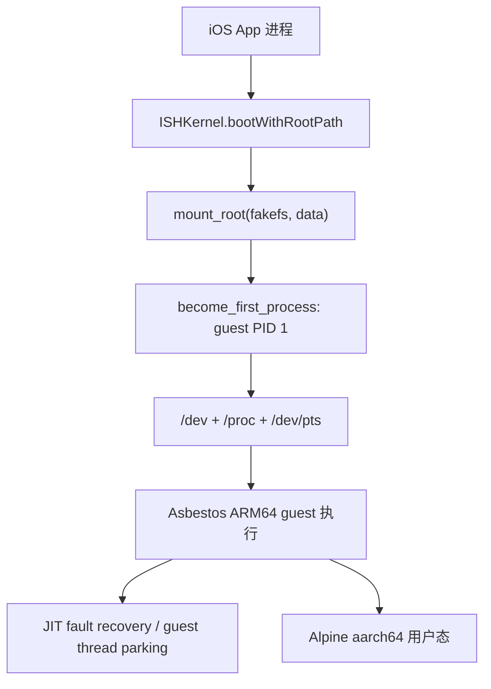
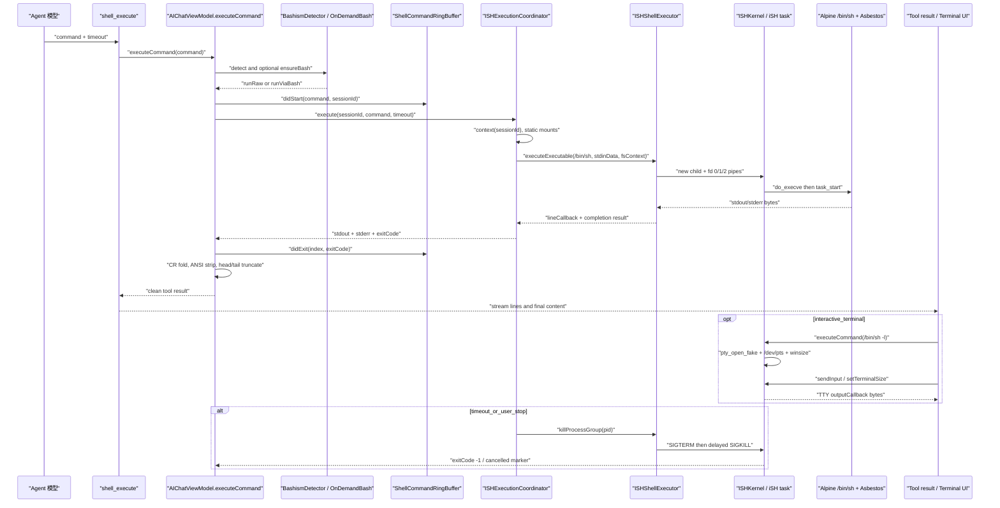

## 6. iOS 沙箱：把 Linux 塞进 App 进程（iSH）

### 6.1 这一章解决什么问题

iSH 解决的不是“在 iOS 上启动一个虚拟机”，而是让 App 进程拥有一个能执行 Alpine 用户态程序的 Linux 兼容层；这使 agent 可以调用 `sh`、`apk`、Python 和文件工具，而不依赖 iOS 的命令行环境（`README.md:168-175`）。本章解释从 ARM64 guest 指令、fakefs 文件系统、rootfs 安装，到 shell 工具回收输出的完整路径；其中最重要的结论是：交互式终端和 agent 的 `shell_execute` 不是同一条 I/O 路径。读者掌握这些边界后，才能在不破坏 iOS 线程、内存和生命周期约束的前提下，从零实现一个类似的嵌入式 Linux agent 沙箱。

本文以仓库当前源码为准。`docs/specs/ios-sandbox-ish-summary.md` 与 `deps/ISH_INTEGRATION.md` 是很好的接口骨架，但其中关于“所有命令 FIFO 串行”“命令都经 PTY”“输出 100KB”的描述与当前实现存在时间差；差异会在相应小节明确标出（`docs/specs/ios-sandbox-ish-summary.md:206-263`；`src/ios/Agent/ISH/ISHExecutionCoordinator.swift:26-38`）。

### 6.2 先建立正确的心智模型：不是 VM，而是进程内用户态 Linux

#### 6.2.1 四层结构

| 层 | 当前实现 | 读源码时应关注的边界 |
|---|---|---|
| iOS 宿主 | Swift/SwiftUI、Objective-C、Foundation、UIKit | 宿主线程不能直接执行可能阻塞的 guest 调用；UI 只接收回调（`src/ios/Views/Rootfs/ISHTerminalView.swift:408-422`）。 |
| iSH 兼容内核 | `libish.a`，负责 task、syscall、TTY、设备和进程生命周期 | `ISHKernel.bootWithRootPath` 先挂载 fakefs，再把当前 task 变成 guest PID 1（`src/ios/iSH/ISHKernel.m:334-381`）。 |
| 指令执行引擎 | Asbestos；构建时选择 `-Dengine=asbestos` 与 `-Dguest_arch=arm64` | 引擎代码位于 git submodule `deps/ish`；本 checkout 的该目录为空，因此不能把未显示的 C 函数名当作本仓库事实（`deps/build_ish.sh:109-124`；`deps/build_ish.sh:193-222`）。 |
| Alpine 用户态 | `aarch64` minirootfs，转换成 `data/` + `meta.db` | 由 `fakefsify` 生成，而不是把 ext4 镜像挂到 iOS（`deps/prepare_alpine_rootfs.sh:159-186`）。 |

仓库把 iSH 描述为 iOS 上的 Linux user-mode emulation，并明确使用 ARM64 fork（`README.md:168-175`）。这里的“用户态”意味着 guest 进程看到的是 iSH 实现的 Linux task、虚拟 syscall 和 fakefs；它不拥有 iOS 的真实 `fork(2)`、`mount(2)` 或 `/dev`。因此，`apk`、`busybox ash`、Python 等程序可以在 guest 语义下工作，但不能据此推断它们拥有一个可管理的真实 Darwin kernel。

#### 6.2.2 ARM64 guest 与 Asbestos

构建脚本把宿主静态库编译为 iOS `arm64`，并把 guest 设置为 `arm64`，同时生成 ARM64 guest VDSO（`deps/build_ish.sh:35-38`；`deps/build_ish.sh:203-222`）。rootfs 脚本下载的也是 Alpine `aarch64` 包（`deps/prepare_alpine_rootfs.sh:28-33`；`deps/prepare_alpine_rootfs.sh:96-116`）。这避免了“x86 guest + ARM64 二次翻译”的额外 ISA 组合；但仍然不是原生 Linux 执行，因为 guest syscall、地址转换和异常都要经过 iSH/Asbestos。[推断] 同 ISA 只能减少一种转换成本，不能把它等同于原生进程。

设计文档把 Asbestos 记作“threaded-code JIT interpreter”（`docs/specs/ios-sandbox-ish-summary.md:10-22`）。在当前 checkout 看不到 Asbestos 的实现文件，所以能严格核实的是两点：

1. iOS 构建确实选择了 Asbestos，并复制 `ish/asbestos` 头文件和 ARM64 gadget 头文件（`deps/build_ish.sh:203-210`；`deps/build_ish.sh:284-296`）。
2. 宿主 wrapper 为 JIT 执行线程安装了崩溃恢复路径：只在 thread-local `in_jit` 为真时接管 `SIGSEGV`/`SIGBUS`，把 guest fault 信息写回 `cpu_state`，把 PC 改到 `jit_crash_trampoline`；非 iSH 线程恢复默认 handler 并重新 raise（`src/ios/iSH/ISHKernel.m:71-178`）。

“iOS 没有传统 W^X 下可随意申请并同时写入、执行的代码页”是平台设计背景；本仓库没有展示 Asbestos 的页面分配实现，也没有能证明“某次 mmap 使用了某种权限”的源码。因此不要在产品文档中声称“我们绕过了 iOS W^X”。更稳妥的教学表述是：采用仓库选择的 Asbestos 路径，把 guest ARM64 指令解释/调度放在进程内，并把 JIT/异常失效隔离在 guest 线程；具体是否生成代码、如何满足权限策略必须回到 `deps/ish` 的完整源码和构建产物核对。[推断]

#### 6.2.3 性能量级应怎样描述

当前仓库没有基准测试、宿主/guest 指令吞吐或与原生 Linux 的倍数对比，因此本章不编造“慢多少倍”。源码能给出的可操作量级是：

- 单 agent turn 的并发工具上限是 10；注释明确指出继续增加并发会让 emulator scheduling 互相竞争（`src/ios/Agent/Chat/AIChatViewModel+ConcurrentTools.swift:21-25`）。
- Node guest 被注入 `--jitless`、`--no-lazy`、`--no-expose-wasm` 和 `--max-old-space-size=512`，说明运行时必须为模拟器和移动端内存做约束（`src/ios/iSH/ISHShellExecutor.m:290-320`）。
- 可选 CPU throttle 用 tick 统计实际工作时间，按目标 duty cycle 累积 `nanosleep` 债务，睡眠债务还被限制为 100ms（`src/ios/iSH/ISHKernel.m:1160-1225`）。

因此工程验收应采用工作负载指标，而不是宣传倍数：冷启动耗时、`apk add`、Python 小脚本、文件 I/O、并发 1/4/10 时的响应时间、后台被杀前的可恢复性。只有在真实设备上运行这些实验后，才可以写出数字。

#### 6.2.4 进程级安全护栏

iSH 初始化时覆盖 `die_handler`，guest 致命错误只停车当前 iSH 线程而不是调用 `abort()` 杀死整个 App；JIT handler 还刻意不接管 `SIGABRT`，避免掩盖 Swift runtime 或 malloc 的真实 OOM（`src/ios/iSH/ISHKernel.m:180-215`）。这是嵌入式内核和独立模拟器的关键区别：独立 iSH 可以退出进程，App 内的 iSH 只能尽量牺牲 guest worker。



图中每个节点都有源码锚点：挂载与 PID 1 在 `src/ios/iSH/ISHKernel.m:349-381`，设备和伪文件系统在 `src/ios/iSH/ISHKernel.m:383-411`，异常隔离在 `src/ios/iSH/ISHKernel.m:86-178`。

### 6.3 fakefs：为什么需要 SQLite 元数据和真实文件两层

#### 6.3.1 两层不是缓存，而是 guest 语义的组成部分

fakefs 的核心模型可以写成：

```text
host 文件内容:  Documents/alpine-rootfs/data/<guest-path>
                 或 bind symlink 指向 Library/MinisChat/minis/<sid>/...

guest inode/stat: Documents/alpine-rootfs/meta.db
                 ├─ paths(path -> inode)
                 └─ stats(inode -> ish_stat blob)
```

仓库的文件工具直接在 `data/` 下使用 `FileManager` 读写，再把路径注册进 `meta.db`；注释明确说内容在 `data/<linux-path>`，mode、uid、gid 在 `meta.db` 的 `paths`/`stats` 表（`src/ios/Agent/Chat/AIChatViewModel+FileTools.swift:11-19`）。这解释了一个常见故障：宿主目录里已经出现文件，并不意味着 iSH 的 `open`、`readdir` 或 `stat` 一定能看到它；没有 inode 元数据时，guest 视图仍可能认为路径不存在。

#### 6.3.2 构建阶段如何生成 fakefs

`deps/prepare_alpine_rootfs.sh` 的实际产物不是 tar.gz，而是：

1. 从 Alpine 镜像下载 `alpine-minirootfs-3.21.0-aarch64.tar.gz` 到 `deps/.cache/`（`deps/prepare_alpine_rootfs.sh:96-116`）。
2. 用 native Meson 构建 `deps/ish/build-native/tools/fakefsify`，同样选择 `kernel=ish`、`engine=asbestos`、`guest_arch=arm64`（`deps/prepare_alpine_rootfs.sh:119-156`）。
3. 执行 `fakefsify tar.gz output/alpine-rootfs`；脚本硬检查 `output/alpine-rootfs/data` 与 `output/alpine-rootfs/meta.db`（`deps/prepare_alpine_rootfs.sh:159-186`）。
4. 最终压缩为 `deps/resources/alpine-rootfs.zip`，排除 `*.db-shm` 和 `*.db-wal`，避免把 SQLite 临时 WAL 状态打进包（`deps/prepare_alpine_rootfs.sh:271-297`）。

```text
alpine-minirootfs-3.21.0-aarch64.tar.gz
        │ fakefsify
        ▼
deps/resources/alpine-rootfs/
        ├── data/       真实文件/目录/符号链接的宿主表示
        └── meta.db     guest inode、stat、路径索引
        │ zip -x '*.db-shm' -x '*.db-wal'
        ▼
deps/resources/alpine-rootfs.zip
```

#### 6.3.3 `meta.db` 的插入协议

下面是当前文件工具的精简真实片段。它先查 `paths`，为新路径插入 16 字节 `ish_stat` blob，再用 `last_insert_rowid()` 将路径与 inode 对上；权限默认区分普通文件 0644 和目录 0755（来源：`src/ios/Agent/Chat/AIChatViewModel+FileTools.swift:168-215`）。

```swift
/// Creates entries in both `stats` and `paths` tables if missing.
func ensureFakefsMetadata(for linuxPath: String, isDirectory: Bool) {
    let metaDBPath = RootfsManager.shared.rootfsPath.appendingPathComponent("meta.db").path
    var db: OpaquePointer?
    guard sqlite3_open_v2(metaDBPath, &db, SQLITE_OPEN_READWRITE, nil) == SQLITE_OK,
          let db else { return }
    defer { sqlite3_close(db) }

    // Check if path already exists
    var checkStmt: OpaquePointer?
    guard sqlite3_prepare_v2(db, "SELECT inode FROM paths WHERE path = ?", -1, &checkStmt, nil) == SQLITE_OK,
          let checkStmt else { return }
    defer { sqlite3_finalize(checkStmt) }

    bindPathBlob(checkStmt, index: 1, path: linuxPath)

    if sqlite3_step(checkStmt) == SQLITE_ROW {
        return // Already exists in meta.db
    }

    // Build 16-byte ish_stat blob: mode(u32) + uid(u32) + gid(u32) + rdev(u32)
    // Regular file: S_IFREG | 0644 = 0o100644
    // Directory:    S_IFDIR | 0755 = 0o040755
    let mode: UInt32 = isDirectory ? 0o040755 : 0o100644
    var statBytes: [UInt8] = Array(repeating: 0, count: 16)
    let leMode = mode.littleEndian
    withUnsafeBytes(of: leMode) { src in
        for i in 0..<4 { statBytes[i] = src[i] }
    }

    // Insert stat
    var insertStatStmt: OpaquePointer?
    guard sqlite3_prepare_v2(db, "INSERT INTO stats (stat) VALUES (?)", -1, &insertStatStmt, nil) == SQLITE_OK,
          let insertStatStmt else { return }
    defer { sqlite3_finalize(insertStatStmt) }

    sqlite3_bind_blob(insertStatStmt, 1, statBytes, Int32(statBytes.count), Self.SQLITE_TRANSIENT)
    guard sqlite3_step(insertStatStmt) == SQLITE_DONE else { return }

    // Insert path with last_insert_rowid() as inode
    var insertPathStmt: OpaquePointer?
    guard sqlite3_prepare_v2(db, "INSERT OR REPLACE INTO paths (path, inode) VALUES (?, last_insert_rowid())", -1, &insertPathStmt, nil) == SQLITE_OK,
          let insertPathStmt else { return }
    defer { sqlite3_finalize(insertPathStmt) }

    bindPathBlob(insertPathStmt, index: 1, path: linuxPath)
    sqlite3_step(insertPathStmt)
}
```

真正的实现还使用 `SQLITE_TRANSIENT` 绑定 UTF-8 blob，确保 SQLite 立即复制路径字节（`src/ios/Agent/Chat/AIChatViewModel+FileTools.swift:158-214`）。父目录必须从根向叶子补齐；`ensureParentDirsInMetaDB` 逐层调用同一 helper（`src/ios/Agent/Chat/AIChatViewModel+FileTools.swift:217-228`）。

`RootfsManager` 的版本更完整：如果路径已经存在，它会根据 inode 更新 `stats.stat`，可用于 app 更新后重新打权限；如果不存在才插入 `stats` 和 `paths`（`src/ios/iSH/RootfsManager.swift:299-349`）。这也是为什么 overlay 每次启动都能把脚本权限修正为 0755 或把内置 MCP Python 文件改成 0444。

#### 6.3.4 权限、符号链接和设备节点分别在哪里模拟

**权限。** `ensureFakefsMetadata` 的 stat blob 不是 APFS 文件属性的被动镜像，而是 guest 看见的 mode。default mount 代码会强制标准 `bin` 目录下的文件为 0755，并把 `/usr/local/lib/minis-mcp-cli` 文件设为 0444、目录设为 0555；这样 guest 内的 `access_check` 会拒绝修改内置 Python 库（`src/ios/iSH/RootfsManager.swift:215-261`）。外部文件夹的只读挂载则通过 top-level mode 0555 让 create/unlink/rename/rmdir 返回 `EACCES`，没有额外 VFS 分支（`src/ios/iSH/ISHKernel.h:64-80`）。

**符号链接和 bind mount。** session 目录先在 `data/var/minis` 下面创建或修正 symlink；真实目录若遗留在旧位置，会把内容迁移到持久目录后删除，再创建新的 symlink（`src/ios/Agent/Chat/AIChatViewModel+Offloading.swift:640-723`）。内核层 `bindMountPath` 调用 `fakefs_bind_mount`，卸载调用 `fakefs_bind_unmount`（`src/ios/iSH/ISHKernel.m:851-875`）。coordinator 在 bind 前用 `lstat` 判断旧 symlink/目录，迁移后只允许删除 `data/var/minis` 下的路径，防止路径 bug 误删 `/dev` 或其他 rootfs 数据（`src/ios/Agent/ISH/ISHExecutionCoordinator.swift:442-496`）。

**设备节点。** fakefs 不是把 iOS 的 `/dev/null` 映射给 guest；boot 时调用 `generic_mknodat` 生成 guest character device，并用 `dev_make` 写入 TTY、内存设备的 major/minor。当前实际创建 `/dev/tty1` 到 `/dev/tty7`、`/dev/console`、`/dev/ptmx`、`/dev/null`、`/dev/zero`、`/dev/full`、`/dev/random`、`/dev/urandom`（`src/ios/iSH/ISHKernel.m:453-477`）。`/proc` 和 `/dev/pts` 是 boot 后通过 iSH filesystem driver 挂载的虚拟文件系统，不来自 zip（`src/ios/iSH/ISHKernel.m:386-392`）。

#### 6.3.5 为什么外部目录不能全部预注册

session 的四个目录可以递归收集并在一个 SQLite transaction 中批量注册（`src/ios/Agent/ISH/ISHExecutionCoordinator.swift:525-540`；`src/ios/Agent/ISH/ISHExecutionCoordinator.swift:780-850`）。用户选取的外部 vault 则可能非常大，代码只写 top-level mount inode，依赖 fakefs 在 guest 真正触摸路径时按需创建 inode（`src/ios/Agent/ISH/ISHExecutionCoordinator.swift:688-692`）。这是内存、启动时间和 SQLite 写放大之间的取舍；若实现自己的 sandbox，也应为“静态小目录递归注册”和“动态大目录 lazy inode”设计两条策略。

### 6.4 rootfs 生命周期：从构建 zip 到 reset 后冷启动

#### 6.4.1 构建时的真实输出物

| 脚本阶段 | 实际输出 | 关键事实 |
|---|---|---|
| `deps/build_ish.sh` | `deps/libs/libish.a`、`libish_emu.a`、`libfakefs.a` | static libraries，不是动态 iOS framework（`deps/build_ish.sh:5-26`；`deps/build_ish.sh:216-225`）。 |
| `deps/build_ish.sh` | `deps/include/ish/...`、`deps/resources/libvdso.so.elf`（若 VDSO 成功） | 复制 Asbestos、ARM64 emu、kernel/fs header（`deps/build_ish.sh:231-319`）。 |
| `deps/prepare_alpine_rootfs.sh` | `deps/resources/alpine-rootfs/data/`、`meta.db` | `fakefsify` 的强制检查（`deps/prepare_alpine_rootfs.sh:162-186`）。 |
| `deps/prepare_alpine_rootfs.sh` | `deps/resources/alpine-rootfs.zip` | zip 排除 `*.db-shm`/`*.db-wal`（`deps/prepare_alpine_rootfs.sh:274-296`）。 |
| `scripts/prepare_rootfs.sh` | `deps/alpine/alpine-aarch64.qcow2`、`vmlinuz-virt`、`initramfs-virt` | 这是 QEMU/VM 开发路径，不是 iSH App 的 rootfs 产物（`scripts/prepare_rootfs.sh:1-10`；`scripts/prepare_rootfs.sh:299-352`）。 |

最后一行很容易被误读：`scripts/install_alpine.sh` 和 `scripts/optimize_rootfs.sh` 操作 qcow2、QEMU 和 ext4 挂载（`scripts/install_alpine.sh:1-90`；`scripts/optimize_rootfs.sh:1-80`），不能拿它们生成的 VM 磁盘直接替换 `alpine-rootfs.zip`。iOS 这章的生产链路必须走 `deps/prepare_alpine_rootfs.sh`。

#### 6.4.2 rootfs 构建阶段的配置

脚本在 fakefsify 后创建 `/dev`、`/proc`、`/sys`、`/tmp`、`/run`、`/root`、`/home`，将 root 的 shell 固定为 `/bin/sh`（`deps/prepare_alpine_rootfs.sh:192-211`）。它还写入 login profile：`PS1`、`TERM=xterm-256color`、`HOME=/root`、UTF-8 环境、标准 PATH 和 `ll/la/l` 别名（`deps/prepare_alpine_rootfs.sh:213-231`）。`/etc/inittab` 保留 OpenRC 生命周期，但注释说明 TTY 由 iSH 管理；DNS 初值和 APK main/community mirror 也在构建期写入（`deps/prepare_alpine_rootfs.sh:247-266`）。

#### 6.4.3 App 首次启动和 boot 顺序

`RootfsManager` 把安装位置固定为 `Documents/alpine-rootfs`，实际 guest data 是其 `data` 子目录（`src/ios/iSH/RootfsManager.swift:35-42`）。`isInstalled` 同时要求 `data/` 存在且 `.arch` 内容等于当前 `aarch64`；缺少 tag 也被视为未安装（`src/ios/iSH/RootfsManager.swift:44-56`）。安装时解压 bundle 中的 `alpine-rootfs.zip`，写 `.arch`，预创建 `/var/minis/{attachments,offloads,workspace,skills,shared}`，并设置 `rootfs.freshInstall`（`src/ios/iSH/RootfsManager.swift:58-103`）。

```swift
func installIfNeeded() throws {
    if FileManager.default.fileExists(atPath: rootfsPath.path) && !isInstalled {
        print("RootfsManager: Arch mismatch or missing tag, reinstalling \(currentArch) rootfs...")
        try FileManager.default.removeItem(at: rootfsPath)
    }

    guard !isInstalled else {
        print("RootfsManager: Already installed (\(currentArch)) at \(rootfsPath.path)")
        return
    }

    guard let zipURL = Bundle.main.url(forResource: "alpine-rootfs", withExtension: "zip") else {
        throw NSError(
            domain: "RootfsManager",
            code: 1,
            userInfo: [NSLocalizedDescriptionKey: "alpine-rootfs.zip not found in bundle"]
        )
    }

    print("RootfsManager: Installing rootfs from \(zipURL.path)...")

    // Create destination directory
    try FileManager.default.createDirectory(
        at: rootfsPath,
        withIntermediateDirectories: true,
        attributes: nil
    )

    // Unzip using custom ZIP reader
    try unzipFile(at: zipURL, to: rootfsPath)

    // Write architecture tag so we detect mismatches on future launches
    try currentArch.write(to: archTagPath, atomically: true, encoding: .utf8)

    // Pre-create /var/minis/ shared directory structure
    let minisSubdirs = ["var/minis/attachments", "var/minis/offloads", "var/minis/workspace", "var/minis/skills", "var/minis/shared"]
    for subdir in minisSubdirs {
        let dirPath = dataPath.appendingPathComponent(subdir)
        try? FileManager.default.createDirectory(at: dirPath, withIntermediateDirectories: true)
    }

    // Flag fresh install so first-boot tasks (e.g. mirror auto-detect) can trigger.
    UserDefaults.standard.set(true, forKey: "rootfs.freshInstall")

    print("RootfsManager: Installation complete (\(currentArch)) at \(rootfsPath.path)")
}
```

AI agent 的 boot call 是 `installIfNeeded → ISHKernel.boot → install fakefs change tracker → MinisFsRouter.installHook → applyDefaultMountOverlay`（`src/ios/Agent/Chat/AIChatViewModel+Misc.swift:12-50`）。内核内部顺序是：安装 JIT crash handler、覆盖 `die_handler`、`mount_root(&fakefs, data)`、登记 canonical data path 防止 self-containing bind mount、成为 guest PID 1、创建设备、应用 rootfs overlay、挂载 `/proc`/`/dev/pts`、挂 DNS、注册 exit hook 和 TTY（`src/ios/iSH/ISHKernel.m:334-411`）。

`unzipFile` 是 App 内置的轻量 ZIP reader：去掉 `alpine-rootfs/` 公共前缀，创建父目录，支持 store 方法 0 和 deflate 方法 8；deflate 通过 Compression 的 `compression_decode_buffer` 解压（`src/ios/iSH/RootfsManager.swift:474-516`；`src/ios/iSH/RootfsManager.swift:632-679`）。因此首启耗时和内存不只是“复制文件”：压缩条目数据会先读入 `Data` 再写入目标，不能在超低内存时假设它是零拷贝。

#### 6.4.4 每次 boot 的 default mount overlay

`applyDefaultMountOverlay` 在每次 boot 调用，而不只是首次安装（`src/ios/iSH/RootfsManager.swift:178-187`；`src/ios/Views/Rootfs/ISHTerminalView.swift:337-339`）。它从 bundle 遍历 `default_mount`，覆盖 guest `data/` 下的文件，按路径把 `bin` 目录文件强制 0755，并将 MCP Python 库设为 0444；随后把文件和父目录登记到 `meta.db`（`src/ios/iSH/RootfsManager.swift:197-261`）。它还删除 Python 的 `EXTERNALLY-MANAGED` marker，使内置环境能够直接 `pip install`（`src/ios/iSH/RootfsManager.swift:264-288`）。

当前 default mount 至少承担三类功能：

- `/etc/profile.d/minis.sh` 设置 `HISTFILE`、`HISTSIZE` 和 `ENV=$HOME/.ashrc`，让交互式 ash 获得历史和配置（`src/ios/default_mount/etc/profile.d/minis.sh:1-16`）。
- `/usr/local/bin/minis-open` 把 URL 或 `/var/minis/...` 资源编码成 OSC 1337 `MinisOpenURL` marker，宿主终端再交给 `WKWebView`/资源预览（`src/ios/default_mount/usr/local/bin/minis-open:1-24`；`src/ios/default_mount/usr/local/bin/minis-open:32-73`）。
- `/usr/local/bin/minis-mcp-cli` 只做 POSIX wrapper，确保 `python3` 和 `httpx` 后 `exec` 共享 Python 实现；日志写入 `/var/minis/mcp-servers/mcp-cli.log`，stdout 留给 agent JSON（`src/ios/default_mount/usr/local/bin/minis-mcp-cli:1-31`）。

#### 6.4.5 “升级/迁移”真实含义

这里必须区分三种迁移：

1. **guest 架构迁移。** `currentArch` 只有 `aarch64` 一个 tag。目录存在但 tag 缺失或不匹配时，`installIfNeeded` 直接删除整个 rootfs 再解压 bundle（`src/ios/iSH/RootfsManager.swift:44-67`）。
2. **App 默认文件升级。** rootfs 只要架构仍匹配就不会整体替换；新版本通过每次 boot 的 `applyDefaultMountOverlay` 覆盖 bundle 文件（`src/ios/iSH/RootfsManager.swift:178-273`）。源码没有一个按 rootfs 版本号运行 SQL migration 或逐包升级的流程，因此不能把 app 更新描述成“自动升级 Alpine rootfs”。
3. **历史数据路径迁移。** 例如旧 `Library/MinisChat/offloads/<sid>` 会被移动到 `Library/MinisChat/minis/<sid>/offloads`（`src/ios/Agent/Chat/AIChatViewModel+Offloading.swift:614-637`）；旧的 `data/var/minis/...` 真实目录也会迁移到持久目录后换成 symlink（`src/ios/Agent/Chat/AIChatViewModel+Offloading.swift:686-723`）。这些是应用数据迁移，不是 Alpine 包管理迁移。

#### 6.4.6 reset、备份与必须冷启动

`reset(keepUserData:)` 可选备份 `data/root` 到临时目录，再删除整个 `alpine-rootfs`；恢复时要求先重新安装并把备份复制回 `data/root`（`src/ios/iSH/RootfsManager.swift:105-176`）。如果 reset 发生在 kernel 已 boot 的同一进程，fakefs 仍指向已删除的 `data/`/`meta.db`；代码把 `didResetWhileBooted` 置为 true，并明确禁止在进程内重新 mount，因为 `become_first_process()` 不可逆（`src/ios/iSH/RootfsManager.swift:21-31`；`src/ios/iSH/RootfsManager.swift:139-149`）。终端随后拒绝启动并要求用户重启 App（`src/ios/Views/Rootfs/ISHTerminalView.swift:291-305`）。这不是 UX 细节，而是 rootfs reset 的生命周期不变量。

### 6.5 agent shell 执行链路：fresh process、pipe、PTY 两条路径

#### 6.5.1 先修正“持久 shell”的误解

工具定义明确写着：`shell_execute` 在隔离 Linux 进程中运行，每次调用都是 `/bin/sh -c` 风格、stdout/stderr 分开捕获、没有共享 terminal session，默认 timeout 是 15 分钟（`src/ios/Agent/Chat/AIChatViewModel+ToolDefinitions.swift:17-28`）。当前 coordinator 的注释进一步说明：跨 session 和同一 session 都可以并发，每次调用 fork 独立 `/bin/sh`、独立 PID、独立 stdin/stdout/stderr pipe 与 `fs_context`，没有共享 PTY（`src/ios/Agent/ISH/ISHExecutionCoordinator.swift:26-38`）。

所以“持久”的只是 rootfs 和 `/var/minis` 文件，不是 shell 的 cwd、变量或 shell history 进程：

- `shell_execute` 内部的 `runRaw` 先登记命令生命周期，再把 coordinator 返回的结果做终端输出清洗和截断（`src/ios/Agent/Chat/AIChatViewModel+ISHCommand.swift:125-184`）。
#### 6.5.2 从 agent 到 guest `/bin/sh`

`AIChatViewModel+ConcurrentTools` 在一个 turn 内以 `TaskGroup` 并发调度工具，但把 tool_result 按原始 tool_use 顺序合并；shell 工具本身的并发上限是 10（`src/ios/Agent/Chat/AIChatViewModel+ConcurrentTools.swift:1-25`）。调用进入 `executeCommand` 后，先做 bashism 检测；若命中并且 bash 可用，才走 `runViaBash`，否则走 `runWithReminder`/`runRaw`（`src/ios/Agent/Chat/AIChatViewModel+ISHCommand.swift:17-54`）。

`runRaw` 做三件事：调用 `ShellCommandRingBuffer.didStart`，将 session、command、timeout、逐行回调和 PID 回调交给 `ISHExecutionCoordinator.execute`，完成后调用 `didExit`（`src/ios/Agent/Chat/AIChatViewModel+ISHCommand.swift:125-161`）。这里的 ring buffer 记录的是命令生命周期，不是 stdout 字节；后文会专门拆开这个易混淆的命名。

coordinator 为每次命令取得稳定的 session context，生成脚本：

```swift
let fsContext = MinisFsRouter.shared.context(for: sessionId)
let scriptContent = "cd /root\n({ exec 0</dev/null; } 2>/dev/null || true; \(command)\n)\n"
let stdinData = scriptContent.data(using: .utf8)

let pid = ISHShellExecutor.executeExecutable(
    "/bin/sh",
    arguments: nil,
    environment: customEnv.isEmpty ? nil : customEnv,
    stdinData: stdinData,
    fsContext: fsContext,
    lineCallback: { line, _ in lineCallback(line) },
    completion: { result in /* 合并 stdout/stderr，恢复 continuation */ }
)
```

来源：`src/ios/Agent/ISH/ISHExecutionCoordinator.swift:112-135`、`src/ios/Agent/ISH/ISHExecutionCoordinator.swift:265-337`。这个包装有四个非显然约束：

1. 每次工具从 `/root` 开始，所以 `cd /var/minis/workspace` 不会自动影响下一次工具；持久化的是文件，而不是 shell 状态（`src/ios/Agent/ISH/ISHExecutionCoordinator.swift:280-300`）。
2. `exec 0</dev/null` 让 stdio MCP server 等子进程在 command stdin 用尽后收到 EOF，避免继承已经消费完的 pipe 而永久等待；命令自己创建的 pipe 仍然可以覆盖 fd 0（`src/ios/Agent/ISH/ISHExecutionCoordinator.swift:280-291`）。
3. 末尾强制换行是 heredoc 修复：没有换行时闭合 `)` 会粘到 `EOF`，BusyBox ash 会把 heredoc 解析成未结束（`src/ios/Agent/ISH/ISHExecutionCoordinator.swift:292-300`）。
4. 环境变量来自 `EnvVarStore.shared.allAsDict()`，由 coordinator 注入；不是把整个宿主 `ProcessInfo.environment` 暴露给 guest（`src/ios/Agent/ISH/ISHExecutionCoordinator.swift:274-310`）。

`ISHShellExecutor.executeExecutable` 的真实步骤是：检查 kernel 已 boot；创建 stdout/stderr pipe 并把读端设为 non-blocking；调用 `become_new_init_child`；把 `fs_context` 写入 task group；给 guest fd 0 绑定 stdin pipe 或 `/dev/null`，fd 1/2 绑定 realfs pipe；构造 NUL-separated argv/envp；执行 `do_execve`；最后 `task_start`（`src/ios/iSH/ISHShellExecutor.m:168-220`；`src/ios/iSH/ISHShellExecutor.m:223-288`；`src/ios/iSH/ISHShellExecutor.m:351-478`）。

#### 6.5.3 agent 命令不是 PTY：交互终端才是 PTY

这是本章最重要的源码纠偏。`ISHExecutionCoordinator` 和 `ISHShellExecutor` 当前对 agent 命令使用 stdout/stderr pipes；coordinator 注释明确写着“没有 shared PTY”（`src/ios/Agent/ISH/ISHExecutionCoordinator.swift:26-38`）。因此 agent 脚本不应依赖交互式 terminal 行为，例如 shell readline、`vi` 的光标控制或要求真实 controlling terminal 的 TUI。

另一条路径是用户打开 `minis://open_terminal` 后的交互终端：`ISHKernel.executeCommand` 在后台队列创建 guest child，调用 `pty_open_fake`，设置 `winsize`，把 stdio 接到 `/dev/pts/<n>`，再 `do_execve` 和 `task_start`（`src/ios/iSH/ISHKernel.m:639-685`；`src/ios/iSH/ISHKernel.m:808-821`）。这是 PTY、job control、光标控制所在的路径，不能和 shell_execute 的 pipe 结果混称。

下图把两条路径和取消分支放在同一张时序图中。它满足“从 agent tool 到 kernel 再到输出回收”的阅读顺序，同时明确 PTY 只属于 interactive 分支。



#### 6.5.4 输出回收：两套 buffer，三个截断点

**第一套是 pipe reader。** stdout 和 stderr 各有一个并发 reader；`poll` 每 500ms 检查 EOF/完成状态，按最长完整 UTF-8 前缀解码，保留不完整多字节序列到下一轮，然后按换行分发 line callback（`src/ios/iSH/ISHShellExecutor.m:693-846`）。进程 exit notification 到达后，代码仍等待约 200ms 让 reader drain，再在锁内复制 `NSMutableString`，最后回 completion（`src/ios/iSH/ISHShellExecutor.m:630-688`）。

**第二套是旧的 kernel prompt buffer。** `ISHKernel.executeCommandAndWait` 使用 `_commandOutputBuffer`，按 `$ `、`# `、`user@host:path$ 等正则判断 prompt，去掉第一行 echo 和尾部空白；没有 prompt 且超过 100000 字符时返回 `Output too large without prompt`（`src/ios/iSH/ISHKernel.m:877-1003`）。这条 API 与当前 agent coordinator 的 pipe completion 不同，不能把 100KB 当成 shell_execute 的模型输出上限。

**第三套是 agent result 清洗。** `runRaw` 在收到 coordinator 结果后先折叠 `\r`，把类似下载进度的同一行覆盖为最终片段，再剥离 CSI、OSC、ST 和单字符 ESC；清洗后的字符串超过 `AIChatViewModel.kMaxToolResultChars = 15000` 时保留一半头部和一半尾部，并要求模型用 `file_read` 读完整文件（`src/ios/Agent/Chat/AIChatViewModel.swift:14-24`；`src/ios/Agent/Chat/AIChatViewModel+ISHCommand.swift:161-249`）。

此外，实时 UI bubble 还有 30000 字符上限；最终 tool result 超过 15000 时会把完整输出写到 offloads，再把路径放入截断消息（`src/ios/Agent/Chat/AIChatViewModel+ConcurrentTools.swift:738-756`）。所以“100KB buffer”是 legacy prompt API，“15K”是模型结果，“30K”是实时聊天显示，三者不能混为一个限制。

`ShellCommandRingBuffer` 的实现很短，也很值得教学：它是 actor，容量只有 10，每条只保存 index、开始时间、命令（最多 500 字符）、session、exitCode、duration；静态锁快照供后台状态读取。它没有保存 stdout，也没有替代 pipe reader（`src/ios/Agent/ISH/ShellCommandRingBuffer.swift:3-69`）。

```swift
struct ShellCommandEntry {
    let index: Int
    let startedAt: Date
    let command: String
    let sessionId: String
    var exitCode: Int?
    var duration: TimeInterval?
    var exitedAt: Date?
}

actor ShellCommandRingBuffer {
    static let shared = ShellCommandRingBuffer()
    private let capacity = 10
    private var entries: [ShellCommandEntry] = []
    private var counter = 0

    private static let _lock = NSLock()
    nonisolated(unsafe) private static var _runningCount = 0
    nonisolated(unsafe) private static var _lastSnapshot: [ShellCommandEntry] = []

    nonisolated static var hasRunningCommand: Bool {
        _lock.lock(); defer { _lock.unlock() }
        return _runningCount > 0
    }

    nonisolated static var syncSnapshot: [ShellCommandEntry] {
        _lock.lock(); defer { _lock.unlock() }
        return _lastSnapshot
    }

    func didStart(command: String, sessionId: String) -> Int {
        let idx = counter
        counter += 1
        let trimmed = command.count > 500 ? String(command.prefix(500)) : command
        let entry = ShellCommandEntry(
            index: idx,
            startedAt: Date(),
            command: trimmed,
            sessionId: sessionId
        )
        entries.append(entry)
        if entries.count > capacity {
            entries.removeFirst(entries.count - capacity)
        }
        Self._lock.lock()
        Self._runningCount += 1
        Self._lastSnapshot = entries
        Self._lock.unlock()
        return idx
    }

    func didExit(index: Int, exitCode: Int) {
        guard let pos = entries.firstIndex(where: { $0.index == index }) else { return }
        let now = Date()
        entries[pos].exitCode = exitCode
        entries[pos].exitedAt = now
        entries[pos].duration = now.timeIntervalSince(entries[pos].startedAt)
        Self._lock.lock()
        Self._runningCount = max(0, Self._runningCount - 1)
        Self._lastSnapshot = entries
        Self._lock.unlock()
    }

    func snapshot() -> [ShellCommandEntry] {
        entries
    }
}
```
```swift
    /// Install the path-translate hook on ISHKernel. Idempotent; call once
    /// at boot before any session task is spawned. Installs both the
    /// forward hook (guest→host) and the reverse hook (host→guest) — the
    /// reverse hook is needed by readdir/getpath when fakefs has resolved
    /// a hook-routed path through F_GETPATH and needs to map it back so
    /// meta.db inode lookup works.
    func installHook() {
        ISHKernel.shared.installPathTranslateHandler { [weak self] guestPath, fsContext in
            return self?.translate(guestPath: guestPath, fsContext: fsContext)
        }
        ISHKernel.shared.installPathReverseHandler { [weak self] hostPath in
            return self?.reverse(hostPath: hostPath)
        }
    }

    // MARK: - Translation

    /// The hook itself. Called on iSH worker threads, on the fakefs hot path.
    /// MUST stay non-blocking — only a hash lookup + a few string ops.
    private func translate(guestPath: String, fsContext: UInt64) -> String? {
        guard fsContext != 0, let sid = sid(for: fsContext) else { return nil }
        return hostPath(forGuest: guestPath, sid: sid)
    }

    /// Resolve a guest path under one of the per-session buckets to its host
    /// URL for the given sid. Returns nil if the path is not under any
    /// per-session bucket (caller should fall back to the static mount table).
    /// Used by Swift call sites that need the host path without going through
    /// iSH (e.g. NSFileCoordinator on attachments).
    func hostURL(forGuest guestPath: String, sid: String) -> URL? {
        guard let path = hostPath(forGuest: guestPath, sid: sid) else { return nil }
        return URL(fileURLWithPath: path)
    }

    private func hostPath(forGuest guestPath: String, sid: String) -> String? {
        for bucket in perSessionBuckets {
            let prefix = bucket.linuxPrefix
            guard guestPath.hasPrefix(prefix) else { continue }
            let prefixEnd = guestPath.index(guestPath.startIndex, offsetBy: prefix.count)
            if prefixEnd != guestPath.endIndex && guestPath[prefixEnd] != "/" {
                continue
            }
            let tail = String(guestPath[prefixEnd...])
            return minisBaseURL
                .appendingPathComponent(sid, isDirectory: true)
                .appendingPathComponent(bucket.hostSubdir, isDirectory: true)
                .path + tail
        }
        return nil
    }
```
```swift
    static func shellLayerLines(_ script: String) -> [(line: Int, text: String?)] {
        let lines = script.components(separatedBy: "\n")
        var out: [(Int, String?)] = []
        var i = 0
        while i < lines.count {
            let line = lines[i]
            out.append((i + 1, line))  // opening line IS shell-layer
            // Collect every heredoc delimiter opened on this line, in order.
            let ns = line as NSString
            var delims: [String] = []
            for m in heredocOpen.matches(in: line, range: NSRange(location: 0, length: ns.length)) {
                if m.numberOfRanges > 1 {
                    delims.append(ns.substring(with: m.range(at: 1)))
                }
            }
            i += 1
            for delim in delims {
                while i < lines.count && lines[i].trimmingCharacters(in: .whitespaces) != delim {
                    out.append((i + 1, nil))  // body line — do not scan
                    i += 1
                }
                if i < lines.count {   // the delimiter line itself
                    out.append((i + 1, nil))
                    i += 1
                }
            }
        }
        return out
    }

    // MARK: - Detection

    static func detect(_ script: String, fuseMs: Double = 50) -> Result {
        guard !rules.isEmpty else { return Result(hits: []) }
        let start = Date()
        var hits: [Hit] = []
        for (lineNo, maybeText) in shellLayerLines(script) {
            guard let text = maybeText, !text.isEmpty else { continue }
            let scan = text.count > 4096 ? String(text.prefix(4096)) : text
            let ns = scan as NSString
            let range = NSRange(location: 0, length: ns.length)
            for rule in rules {
                if Date().timeIntervalSince(start) * 1000 > fuseMs {
                    logger.info("[Bashism] scan fuse tripped at \(hits.count) hits — fail-open")
                    return Result(hits: hits)
                }
                if rule.regex.firstMatch(in: scan, range: range) != nil {
                    hits.append(Hit(line: lineNo, ruleName: rule.name, tier: rule.tier,
                                    matchedText: scan.trimmingCharacters(in: .whitespaces),
                                    behaviorNote: rule.behaviorNote, fixHint: rule.fixHint))
                }
            }
        }
        return Result(hits: hits)
    }
}
```

来源：`src/ios/Agent/ISH/ShellCommandRingBuffer.swift:13-51`。后台 keep-alive 只使用 `hasRunningCommand` 和快照做生命周期诊断（`src/ios/Agent/Background/BackgroundKeepAliveManager.swift:271-283`）。

#### 6.5.5 超时、取消和子进程回收

工具层默认 timeout 是 900 秒（`src/ios/Agent/Chat/AIChatViewModel.swift:2017-2026`），coordinator 没有收到 timeout 时使用 300 秒默认值（`src/ios/Agent/ISH/ISHExecutionCoordinator.swift:265-276`）。实际 tool 调用通常会显式传入 900 秒，因此实现自己的 API 时要统一默认值，不能让上层和底层各有一个“默认五分钟/十五分钟”的隐性差异。

coordinator 启动后把 PID 回调给 `AIChatViewModel`，timeout work item 通过 `killProcessGroup` 杀整个进程组，并把 continuation 恢复为 `exitCode = -1` 的 timeout result（`src/ios/Agent/ISH/ISHExecutionCoordinator.swift:360-385`）。用户 stop 会枚举所有 in-flight shell，调用同一个 broad stop；并发工具时一次点击会杀整个 batch（`src/ios/Agent/Chat/AIChatViewModel+BackgroundTask.swift:475-507`）。

`killProcessGroup` 不只看 pgid，还沿 parent chain 找 root pid 的 descendants，因为 ash 子 shell 可能创建新 process group；先 SIGTERM，200ms 后重新验证 root task 指针，确认 PID 没有被回收复用才 SIGKILL（`src/ios/iSH/ISHShellExecutor.m:542-628`）。这套“进程组 + ancestry + pointer recheck”是避免 `sleep` 孙进程泄漏、误杀新命令和 guest 线程累计的关键。

### 6.6 持久文件、会话隔离与 `MinisFsRouter`

#### 6.6.1 `/var/minis` 的命名空间

`AIChatViewModel+Misc` 集中声明 guest 路径：per-session 的 `attachments`、`offloads`、`workspace`、`browser`，global 的 `memory`、`skills`、`shared`、`mcp-servers`，以及用户外部目录 `mounts`（`src/ios/Agent/Chat/AIChatViewModel+Misc.swift:99-127`）。session 持久目录是 `Library/MinisChat/minis/<sessionId>/...`，global 目录则由 app 的持久目录策略决定（`src/ios/Agent/Chat/AIChatViewModel+Misc.swift:107-140`）。

| guest 路径 | session 作用域 | 典型用途 | 当前路由 |
|---|---:|---|---|
| `/var/minis/attachments` | 是 | 图片、上传文件 | `MinisFsRouter` fs_context 路由（`src/ios/Agent/ISH/MinisFsRouter.swift:19-28`）。 |
| `/var/minis/offloads` | 是 | 大型 tool 输出、截图 | 同上。 |
| `/var/minis/workspace` | 是 | 脚本、数据和用户产物 | 同上。 |
| `/var/minis/browser` | 是 | 浏览器下载/中间文件 | 同上。 |
| `/var/minis/memory` | 否 | 跨 session memory | coordinator 静态 bind mount（`src/ios/Agent/ISH/ISHExecutionCoordinator.swift:419-429`）。 |
| `/var/minis/skills` | 否 | SKILL.md 等定义 | 静态 bind mount，文件变更仍需 meta.db/sync 更新。 |
| `/var/minis/shared` | 否 | 全局共享文件 | 静态 bind mount。 |
| `/var/minis/mcp-servers` | 否 | MCP server 配置和日志 | 静态 bind mount。 |

#### 6.6.2 为什么不再“切换 symlink”实现 session 隔离

旧路径仍由 `ensureMinisSymlinks` 创建，原因是 FileBrowser 在 kernel 尚未启动时也要能浏览文件（`src/ios/Agent/Chat/AIChatViewModel+Offloading.swift:640-651`）。但 agent 并发命令若依赖一个全局 symlink 来回替换，A session 的进程可能在 B session 切换后读到错误目录。当前核心命令路径改为 `fs_context`：每个 session 拿一个不会重复的 `UInt64` token，同一 sid 重复调用返回同一个 token（`src/ios/Agent/ISH/MinisFsRouter.swift:30-53`）。

`ISHShellExecutor` 在新 task group 上写入这个 token；fork 的子进程继承它，fakefs path hook 因而可按调用者上下文选择 host 目录（`src/ios/iSH/ISHShellExecutor.h:90-102`；`src/ios/iSH/ISHShellExecutor.m:204-221`）。这让同一时刻的两个 session 能分别访问自己的 `/var/minis/workspace`，同时共享 `/var/minis/memory`。

#### 6.6.3 forward/reverse hook 的职责

`MinisFsRouter.installHook` 同时安装 forward 和 reverse hook。forward 是 guest path 加 `fs_context` 到 host APFS path；reverse 是 host `F_GETPATH` 结果回到 canonical guest path。后者解决 `readdir`/getpath 已经解析 symlink 到 App Group 之外后，fakefs 无法用 guest `meta.db` inode 查回目录的问题（`src/ios/Agent/ISH/MinisFsRouter.swift:64-77`）。


来源：`src/ios/Agent/ISH/MinisFsRouter.swift:81-113`。hook 在 fakefs 热路径执行，源码要求它只做 hash lookup 和少量字符串操作，不做阻塞 I/O；这也是 `MinisFsRouter` 标成 `@unchecked Sendable` 且内部用 `NSLock` 的原因（`src/ios/Agent/ISH/MinisFsRouter.swift:16-18`；`src/ios/Agent/ISH/MinisFsRouter.swift:56-85`）。

reverse 还会处理 iOS 的 `/private/var` 与 `/var` 别名，且只反解已经发放 context 的 sid，避免把恰好位于同一 host base 下的陈旧目录错误映射成 guest bucket（`src/ios/Agent/ISH/MinisFsRouter.swift:115-146`）。

#### 6.6.4 静态 mount 与动态 hook 的分工

coordinator 的 `performMount` 只把 memory、skills、shared、mcp-servers 及 external folder 放进静态 bind table；per-session 四个 bucket 由 hook 动态路由，不再在 session 切换时 bind/unbind（`src/ios/Agent/ISH/ISHExecutionCoordinator.swift:168-175`；`src/ios/Agent/ISH/ISHExecutionCoordinator.swift:415-429`）。静态目录首次 mount 后记录 `staticMountsInitialized`，后续 session 只申请 context（`src/ios/Agent/ISH/ISHExecutionCoordinator.swift:157-176`）。

bind 时如果 `data/<linuxDir>` 还是旧真实目录，代码先把内容迁移到持久目录，再删除旧目录；绑定后对 session 小目录递归注册 meta.db；外部大目录只注册 top-level（`src/ios/Agent/ISH/ISHExecutionCoordinator.swift:439-540`；`src/ios/Agent/ISH/ISHExecutionCoordinator.swift:626-705`）。读路径时 coordinator 先查询静态 mount table，再 fallback 到 `MinisFsRouter.hostURL`（`src/ios/Agent/ISH/ISHExecutionCoordinator.swift:186-205`）。

#### 6.6.5 `minis://` 不是 guest 文件系统

`minis://workspace/a.txt` 是宿主 UI/工具层的 URL。`AIChatViewModel+FileTools` 先把 URL host 映射成 memory、skills、shared、mcp 或当前 session 的目录，再将 path 候选映射到 APFS；Linux `/var/minis/<namespace>/<file>` 也能转换为 `minis://<namespace>/<file>`（`src/ios/Agent/Chat/AIChatViewModel+FileTools.swift:66-104`）。这层解析不等于 fakefs 的 inode lookup：direct file read 会优先问 coordinator 的 mount table，发现 stale mount 后才 fallback 到 minis URL 或 rootfs data（`src/ios/Agent/Chat/AIChatViewModel+FileTools.swift:106-143`）。

因此建议把三种路径分开命名：

- guest path：给 `/bin/sh`、fakefs 和 native offload 使用，例如 `/var/minis/workspace/x.py`。
- host path：给 `FileManager`、`NSFileCoordinator`、FileProvider 使用，例如 `Library/MinisChat/minis/<sid>/workspace/x.py`。
- resource URL：给 chat markdown、浏览器和预览使用，例如 `minis://workspace/x.py`。

混用这三者会造成“shell 读得到但 FileBrowser 看不到”“预览链接落到错误 session”或“写入了 data shadow 而非真实持久目录”等问题；源码对 direct read 的 mount-table 优先和路径防御有明确实现（`src/ios/Agent/Chat/AIChatViewModel+FileTools.swift:106-130`）。

### 6.7 BusyBox ash 的 bashism 检测与按需安装

#### 6.7.1 先承认默认 shell 是 ash

rootfs 把 root shell 设置为 `/bin/sh`，系统 prompt 也明确告诉 agent 默认 shell 是 BusyBox ash（`deps/prepare_alpine_rootfs.sh:206-210`；`src/ios/Agent/Chat/AIChatViewModel.swift:1780-1787`）。ash 的问题不只是“某些命令报错”：`(( x > y ))`、`x+=1`、`{1..3}` 可能静默地产生错误分支或原样字符串。共享规则文件将其分为 S（silent-wrong）、E（loud error）、T1（脚本明确要求 bash），并要求逐行匹配、去掉 heredoc body、避免嵌套量词（`src/shared/bashism/bashism_rules.json:1-17`；`src/shared/bashism/bashism_rules.json:19-66`）。

#### 6.7.2 Detector 的算法

`BashismDetector` 不是 shell parser，而是有时间和输入上限的启发式匹配器：

1. `shellLayerLines` 找到 `<<EOF`、`<<-EOF` 等 delimiter，把 body 和 delimiter 行标为 nil；因此 Python/SQL/awk 内容中的 `((` 不会触发 bashism（`src/ios/Agent/Shell/BashismDetector.swift:81-114`）。
2. `detect` 逐行把输入限制在 4096 字符，逐规则 regex 匹配，并用 50ms wall-clock fuse fail-open；line number 保留原脚本的 1-based 行号（`src/ios/Agent/Shell/BashismDetector.swift:116-140`）。
3. 任意 hit 都是 `needsBash`；只有 S/E hit 会 `mustSwitchInterpreter`，T1 只负责确保 bash 已安装但不强制把外层 shell 换成 bash（`src/ios/Agent/Shell/BashismDetector.swift:28-45`）。


来源：`src/ios/Agent/Shell/BashismDetector.swift:118-140`。教学实现可以先做同样的 heredoc strip、4KB cap 和时间 fuse，再逐步增加规则；不要一开始用“完整 Bash grammar”阻塞每个命令。

#### 6.7.3 `OnDemandBash` 的状态机和网络预算

`OnDemandBash` 是 actor，availability 有 unknown、available、unavailable(until) 三态；unavailable TTL 是 10 分钟，进程内每次 launch 只允许一次安装尝试，失败计数用 UserDefaults 保留，24 小时 backoff 且三次失败后停止自动安装（`src/ios/Agent/Shell/OnDemandBash.swift:17-34`）。

执行顺序是：

1. 先跑 `command -v bash`，命中则缓存 available。
2. 若本次 launch 已尝试安装或持久 backoff 生效，直接返回 unavailable。
3. 先对 Alpine mirror 做 5 秒 host-side HEAD reachability；网络不可达不碰 `apk`。
4. 用独立 60 秒预算运行 `apk add bash`，再用 `command -v bash` 验证；失败记录 backoff，成功清零失败计数并把 guard 重新 armed（`src/ios/Agent/Shell/OnDemandBash.swift:46-103`）。

```swift
if await executor.run("command -v bash >/dev/null 2>&1", 15) == 0 {
    availability = .available
    return .available
}

if !(await networkReachable()) {
    recordFailure()
    availability = .unavailable(until: Date().addingTimeInterval(unavailableTTL))
    return .unavailable(reason: "network/apk mirror unreachable")
}

let rc = await executor.run("apk add bash", installBudget)
let verified = rc == 0
    ? (await executor.run("command -v bash >/dev/null 2>&1", 15) == 0)
    : false
```

来源：`src/ios/Agent/Shell/OnDemandBash.swift:58-102`。这个设计避免 agent 因离线而反复消耗 60 秒；同时允许用户后来手动 `apk add bash` 后由下一次 probe 自愈。

#### 6.7.4 透明切换、self-heal 和 reminder

当 detector 命中 S/E 且 OnDemandBash 返回 available，`AIChatViewModel` 不把脚本写到 host fakefs，而是把脚本 base64 编码，在 guest 内 `base64 -d > /tmp/.minis-exec-$$.sh`，运行 `bash file`，保存 rc，删除临时文件；这样绕过 host→fakefs 写入和 heredoc quoting（`src/ios/Agent/Chat/AIChatViewModel+ISHCommand.swift:72-90`）。

wrapper 先检查 bash。若 cache 认为 available 但用户刚执行 `apk del bash`，它返回 sentinel 119；代码兼容 raw 119 与 wait 编码 30464，调用 `markDisappeared`，最多重装并重跑一次，仍失败则降级回 ash（`src/ios/Agent/Chat/AIChatViewModel+ISHCommand.swift:92-110`）。

若安装失败，`BashismReminder` 把命中行、rule、行为说明和 fix hint 追加到结果；S 类 silent-wrong 即使 exit code 为 0 也会追加，E 类通常在非零退出时追加（`src/ios/Agent/Chat/AIChatViewModel+ISHCommand.swift:113-123`）。嵌入 reminder 前会把 `<`/`>` 换成 look-alike、移除控制字符、截断每行 120 字符，并最多展示 8 个去重 hit，避免用户脚本伪造 `</system-reminder>`（`src/ios/Agent/Shell/BashismReminder.swift:7-64`）。

这条纠正只覆盖 agent `shell_execute`；交互式 terminal 使用 `executeCommand(["/bin/sh", "-l"])`，源码明确写着 bashism path 不会改变它（`src/ios/Agent/Chat/AIChatViewModel+ISHCommand.swift:27-32`；`src/ios/Views/Rootfs/ISHTerminalView.swift:367-378`）。

### 6.8 终端 UI：从 TTY 字节到可选文本网格

#### 6.8.1 TTY 输出回到主线程

`ish_tty_write` 把 guest TTY bytes 转成 `NSData`/UTF-8 文本，在主队列调用等待中的 command buffer、outputCallback，并发布 `ISHTerminalOutputNotification`（`src/ios/iSH/ISHKernel.m:223-253`）。这是一条全局 callback 槽位，因此 `ISHTerminalViewModel` 用 generation token 防止旧 SwiftUI `@StateObject` 的 deinit 清掉新 terminal 的 callback（`src/ios/Views/Rootfs/ISHTerminalView.swift:192-230`）。

输出 callback 不会每个 4–24 字节都排一项主队列任务：view model 先在 lock 下 append 到 pending `Data`，只在 empty→non-empty 时 schedule 一次 `DispatchQueue.main.async`，主队列 drain 整个 burst 后交给 `emulator.feed`（`src/ios/Views/Rootfs/ISHTerminalView.swift:232-275`）。这既降低 SwiftUI redraw 数，也防止高输出命令饿死触摸和键盘事件。

#### 6.8.2 ANSIParser → TerminalEmulator → TerminalBuffer

`ANSIParser` 是简化 VT100/ECMA 状态机，维护 ground、escape、CSI、OSC 等状态；输入可按 `Data` 或 `[UInt8]` feed，输出 `printable`、C0 control、CSI、ESC、OSC action（`src/ios/iSH/Terminal/ANSIParser.swift:10-75`；`src/ios/iSH/Terminal/ANSIParser.swift:81-139`）。它自己不画 UI。

`TerminalEmulator` 把 parser action 分发给 active buffer，维护 primary/alternate screen、cursor style、origin/auto-wrap、bracketed paste、cursor shape 和 DSR response；vim/htop 等程序通过 DEC private mode 切到 alternate buffer（`src/ios/iSH/Terminal/TerminalEmulator.swift:11-85`；`src/ios/iSH/Terminal/TerminalEmulator.swift:153-171`；`src/ios/iSH/Terminal/TerminalEmulator.swift:360-412`）。OSC 1337 的 `MinisOpenURL` 会交给 `MinisOpenURLBroker`，因此 shell 中调用 `minis-open` 可以打开 app 内预览（`src/ios/iSH/Terminal/TerminalEmulator.swift:563-599`）。

`TerminalBuffer` 是 rows×cols 的 `TerminalCell` 网格，另有最多 2000 行 scrollback；wide character 写入两个 cell，scrollback 溢出时从头部裁剪（`src/ios/iSH/Terminal/TerminalBuffer.swift:10-69`；`src/ios/iSH/Terminal/TerminalBuffer.swift:126-174`；`src/ios/iSH/Terminal/TerminalBuffer.swift:203-218`）。cell 保存字符、前景/背景色、属性、宽度和 wide trailer；颜色支持 xterm 256 palette 与 RGB（`src/ios/iSH/Terminal/TerminalTypes.swift:12-17`；`src/ios/iSH/Terminal/TerminalTypes.swift:89-119`）。

#### 6.8.3 Canvas 的渲染和 resize

`TerminalCanvasView` 是 SwiftUI 到 UIKit 的 bridge；内部用 `UIScrollView` 承担 scroll，用不可编辑但可选择的 `UITextView` 承担 native copy/paste，再叠加 cursor overlay（`src/ios/iSH/Terminal/TerminalCanvasView.swift:51-87`；`src/ios/iSH/Terminal/TerminalCanvasView.swift:232-288`）。它订阅 `emulator.$version`，每次 feed 只 bump 一次 version；SwiftUI 兄弟视图重绘不会重复整份 attributed string（`src/ios/iSH/Terminal/TerminalCanvasView.swift:75-86`；`src/ios/iSH/Terminal/TerminalEmulator.swift:87-96`）。

大 scrollback 不能每次把整个文档重新排版：scrollback 达到 300 行后，renderer 冻结旧 prefix，只实时重建最近 200 行和当前 grid，并按 `scrollbackHeadIndex` 增量修剪缓存（`src/ios/iSH/Terminal/TerminalCanvasView.swift:171-205`；`src/ios/iSH/Terminal/TerminalCanvasView.swift:489-623`）。cell 被转换为 `NSAttributedString` 时，CoreText 测量真实 glyph advance，按 expected cell width 加 `kern`，避免 emoji/CJK 替换字体使 cursor 漂移（`src/ios/iSH/Terminal/TerminalCanvasView.swift:815-925`）。

窗口大小由 cell font metrics 换算成 cols/rows，经过 0.4 秒 debounce 后才把 resize 传给 `ISHTerminalViewModel`；后者同时 resize 两个 emulator buffer 和 `ISHKernel.setTerminalSize`，等价于给 guest TTY 发送稳定的 SIGWINCH 语义（`src/ios/iSH/Terminal/TerminalCanvasView.swift:329-371`；`src/ios/Views/Rootfs/ISHTerminalView.swift:434-437`）。

#### 6.8.4 输入、IME 和控制键

终端使用一个透明的 `TerminalKeyInputView`，实现 `UITextInput` 而不把可编辑文本放在屏幕上。`insertText` 把 committed UTF-8 送给 TTY；Ctrl 状态下把字母换算成 0x01–0x1A；IME marked text 只在 `unmarkText` 时提交，因而支持中文拼音等组合输入（`src/ios/iSH/Terminal/TerminalInputView.swift:76-168`）。

硬件键通过 `UIKeyCommand` 和 `pressesBegan` 处理：Ctrl+letter、Alt+letter、方向键、Home/End、F1–F12、Tab、Escape 变成 ANSI/VT bytes；application cursor mode 会在 `ESC [` 与 `ESC O` 之间切换（`src/ios/iSH/Terminal/TerminalInputView.swift:292-333`；`src/ios/iSH/Terminal/TerminalInputView.swift:335-467`）。

键盘 accessory 提供 Esc、Tab、真正的 CR Enter、sticky Ctrl、方向键、Ctrl-C/D/Z、Paste、Files、Rootfs；iPad Return 不直接依赖多行输入框的 newline，而是发送 0x0D（`src/ios/iSH/Terminal/TerminalKeyboardAccessory.swift:62-126`）。所有 `tty_input` 都走串行 background queue，因为 kernel 的 mutex 可能阻塞，不能从 main thread 调用（`src/ios/Views/Rootfs/ISHTerminalView.swift:408-422`）。

#### 6.8.5 FileBrowser 与 fakefs 的双向一致性

FileBrowser 浏览的是 host `data/` 和 symlink，而不一定启动 kernel；删除时同时删除 host 项和 `meta.db` path，并通知 FileProvider 重新枚举（`src/ios/Views/Rootfs/FileBrowserView.swift:1020-1054`）。复制、移动、导入后调用 `registerSubtreeInMetaDB`，否则 shell 可能看不到新文件（`src/ios/Views/Rootfs/FileBrowserView.swift:1180-1222`；`src/ios/Views/Rootfs/FileBrowserView.swift:1293-1319`）。

导航时故意保留 logical `currentPath`，不使用 symlink-resolved `item.url` 作为下一层路径；否则 bind-mounted `/var/minis/browser` 会被解析到 Library 外部，copy absolute path 会只剩文件名（`src/ios/Views/Rootfs/FileBrowserView.swift:1230-1274`；`src/ios/Views/Rootfs/FileBrowserView.swift:1335-1345`）。这是 host URL 和 guest logical path 必须分离的另一个实例。

### 6.9 平台对照（只做边界定位，不重复第 7 章）

本章是 iOS 专题，Android 的 PRoot/Alpine/PTY 细节请读第 7 章。下表只说明同一个抽象在两端为什么不同，避免把 Android 实现倒灌到 iOS 设计里。

| 抽象 | iOS 本章的落地 | Android 对应方向 | 差异原因 |
|---|---|---|---|
| guest Linux | iSH + Asbestos，进程内 user-mode emulation（`README.md:168-175`；`deps/build_ish.sh:203-222`） | PRoot + Alpine | iOS 不能依赖可执行 Linux binary 或真实 chroot；Android 走 PRoot 系统调用/路径拦截。 |
| 文件系统 | fakefs `data/` + `meta.db`，再叠加 bind symlink/hook（`src/ios/Agent/Chat/AIChatViewModel+FileTools.swift:11-19`） | PRoot bind 与 Android storage | iOS App sandbox 需要自定义 inode/stat 层，Android 可在 app uid 可达的 host storage 上做 PRoot 绑定。 |
| session 隔离 | `fs_context` token + `MinisFsRouter`（`src/ios/Agent/ISH/MinisFsRouter.swift:42-85`） | 见第 7 章的 session/mount 实现 | iOS shell 可并发 fork，不能靠一个全局 symlink 切换目录。 |
| 交互终端 | iSH `pty_open_fake`、自研 ANSI emulator、UIKit input（`src/ios/iSH/ISHKernel.m:661-685`；`src/ios/iSH/Terminal/TerminalEmulator.swift:11-30`） | Android PTY/Compose renderer | 两端 UI toolkit 和底层 guest PTY 接口不同。 |
| 后台 | 普通 iOS 约 30 秒 grace；location/audio 是 extended legs，但仍可能被系统终止（`src/ios/Agent/Background/BackgroundKeepAliveManager.swift:22-45`） | Android service/foreground service 策略 | 审核、后台模式和系统调度模型不同；不要照搬 iOS 的 audio/location 方案。 |

### 6.10 设计取舍与踩坑

#### 6.10.1 文档与源码不一致时，以哪一条为准

旧 spec 的 agent flow 把 coordinator 写成 FIFO、把 `/bin/sh` 写成 PTY，并以 100KB buffer 描述输出（`docs/specs/ios-sandbox-ish-summary.md:206-263`）。当前实现已经改成独立 pipe + 并发 fresh process，`ShellCommandRingBuffer` 也只是 10 条状态记录（`src/ios/Agent/ISH/ISHExecutionCoordinator.swift:26-38`；`src/ios/Agent/ISH/ShellCommandRingBuffer.swift:13-69`）。实现新功能时应以代码的 `executeExecutable(... stdinData: ... fsContext:)` 为契约，不要把 summary 中的历史架构复制回去。

#### 6.10.2 内存和并发不是“越多越快”

每个 shell 都有 guest task、pipe reader、stdout/stderr string、fakefs context 和潜在子进程；当前 agent turn 只允许 10 个并发 shell（`src/ios/Agent/Chat/AIChatViewModel+ConcurrentTools.swift:21-25`）。超时注释还记录过只杀 root pid 会留下 emu task threads、footprint 上升并触发 jetsam，因此必须杀整个 process group（`src/ios/Agent/ISH/ISHExecutionCoordinator.swift:364-378`）。[推断] 在低内存设备上，真正的并发上限应按 guest RSS、输出大小和工具类型动态压测，不能只看 Swift task 数。

agent 结果 15K、实时 bubble 30K、legacy prompt 100KB 三层上限共同避免模型上下文和 UI 字符串无限长；完整输出通过 offload 文件保留（`src/ios/Agent/Chat/AIChatViewModel.swift:17-18`；`src/ios/Agent/Chat/AIChatViewModel+ConcurrentTools.swift:738-756`；`src/ios/iSH/ISHKernel.m:995-1002`）。

#### 6.10.3 后台不是“线程继续跑”的保证

普通 iOS background 只有约 30 秒 grace；没有 long-lived leg 时，background task expiry handler 会标记 suspended、停止命令并结束 background task；启用 audio/location keep-alive 时才会重置有限 task 的时钟（`src/ios/Agent/Background/BackgroundKeepAliveManager.swift:22-45`；`src/ios/Agent/Chat/AIChatViewModel+BackgroundTask.swift:24-80`）。因此 shell 工具必须可取消、可重试、可从 `/var/minis/workspace` 恢复；不要把一次长 `apk add` 当成系统必定完成的事务。

#### 6.10.4 reset 的不可逆边界

kernel boot 后成为 PID 1 是一次性状态；reset 不能在同一进程重新 mount。若 UI 允许用户 reset 后立即点击 terminal，必须拒绝并要求 relaunch，否则 stale fakefs mount 会访问已删除的 tree（`src/ios/iSH/RootfsManager.swift:21-31`；`src/ios/Views/Rootfs/ISHTerminalView.swift:291-305`）。Rootfs 管理界面也把 reset、backup、restore 分成不同 action，并明确提示重启（`src/ios/Views/Rootfs/RootfsManagementView.swift:67-177`；`src/ios/Views/Rootfs/RootfsManagementView.swift:250-310`）。

#### 6.10.5 App Store、静态链接和许可证

仓库用 static `libish.a`、`libish_emu.a`、`libfakefs.a`，Build script 的 iOS deployment target 是 14.0（`deps/build_ish.sh:23-38`），而不是依赖私有虚拟化框架。第三方清单注明 iSH ARM64 fork 是 GPL-3.0，并带 App Store distribution exception；这也是产品整体 GPLv3 说明的一部分（`THIRD_PARTY_LICENSES.md:5-15`）。源码没有“绕过审核”的私有 API 或 entitlement 实现，因此教学实现应把合规重点放在许可证、静态库交付、公开 Foundation/UIKit API、资源大小和可解释的用户态 emulation 上。[推断] 不应把产品文案写成“获得 iOS root”或“运行真实 Linux kernel”，也不要引入动态下载可执行代码来替代 Asbestos 的构建路径。

#### 6.10.6 容易漏掉的 fakefs 一致性检查

- 直接 `FileManager` 写入 guest `data/` 后，必须 `ensureParentDirsInMetaDB` + `ensureFakefsMetadata`；否则只改变 host 层（`src/ios/Agent/Chat/AIChatViewModel+FileTools.swift:146-228`）。
- bind 目标要先 `lstat`，不要用会跟随 symlink 的 `attributesOfItem` 判断旧目录类型；coordinator 已经用 `lstat` 并做安全前缀检查（`src/ios/Agent/ISH/ISHExecutionCoordinator.swift:447-496`）。
- `MinisFsRouter` hook 热路径不能做磁盘 I/O；host URL 解析和 FileManager 访问放到非 hook 的调用侧（`src/ios/Agent/ISH/MinisFsRouter.swift:81-113`）。
- external vault 不要递归注册全树；只注册 mount 根，依赖按需 inode（`src/ios/Agent/ISH/ISHExecutionCoordinator.swift:688-692`）。
- FileBrowser 导入/复制/移动/删除要更新 `meta.db`，并维持 logical guest path，不要把 resolved APFS path 当成 `/var/minis` path（`src/ios/Views/Rootfs/FileBrowserView.swift:1180-1222`；`src/ios/Views/Rootfs/FileBrowserView.swift:1230-1274`）。

### 6.11 从零实现清单

下面是一个最小、可验收的 iOS iSH 子系统路线。每步都给出可观察的验收标准，并标注可以砍掉的功能；完整 agent 产品再逐步补回优化。

1. **固定 guest 架构和许可证。** 选择 ARM64 guest、Alpine aarch64，并记录 iSH fork 的 GPL/App Store 例外；验收是构建配置、NOTICE 和资源来源可追溯（`deps/build_ish.sh:5-26`；`THIRD_PARTY_LICENSES.md:5-15`）。可砍掉：多架构和动态 provider。
2. **构建三份静态库。** 让 Meson 选择 `kernel=ish`、`engine=asbestos`、`guest_arch=arm64`，产出 `libish.a`、`libish_emu.a`、`libfakefs.a`；验收是 Xcode 能链接且不依赖私有 framework（`deps/build_ish.sh:193-225`）。可砍掉：VDSO，先接受较慢的 guest fallback。
3. **生成 fakefs rootfs。** 下载 aarch64 minirootfs，构建 `fakefsify`，生成同时含 `data/` 和 `meta.db` 的目录；验收是脚本的两项存在性检查通过（`deps/prepare_alpine_rootfs.sh:96-186`）。可砍掉：OpenRC 多服务，只保留 `/bin/sh`。
4. **打包 zip。** 写 profile、`/etc/resolv.conf`、APK repositories，zip 时排除 SQLite WAL/SHM；验收是解压后仍有 data、meta.db，且 zip 不带临时数据库文件（`deps/prepare_alpine_rootfs.sh:192-297`）。可砍掉：motd、别名和 mirror auto-detect。
5. **实现安装标记。** 将 zip 解压到 `Documents/alpine-rootfs`，写 `.arch`，用 `data/` + `.arch` 判断已安装；验收是重复 launch 不重复解压，架构 tag 改变会安全重装（`src/ios/iSH/RootfsManager.swift:35-103`）。可砍掉：`rootfs.freshInstall`，但要提供可诊断的版本标记。
6. **实现一次性 kernel boot。** 按 `mount_root → PID 1 → device nodes → proc/devpts → DNS → TTY` 顺序启动；验收是 guest 能执行 `/bin/sh -l`，并且 `/dev/null`、`/dev/ptmx`、`/proc` 存在（`src/ios/iSH/ISHKernel.m:334-411`；`src/ios/iSH/ISHKernel.m:453-477`）。可砍掉：native offload，先不注册 Apple 工具。
7. **实现 fakefs metadata API。** 对每次 host 写入同步 `paths`、`stats` 和父目录；验收是 host `data/x` 写入后 guest `stat/open/readdir` 都能看到正确类型/权限（`src/ios/Agent/Chat/AIChatViewModel+FileTools.swift:158-228`）。可砍掉：uid/gid 的高级修改，但不要省略 mode 和 inode。
8. **实现最小 bind mount。** 先创建 host 目录，再在 guest path 下创建 symlink/bind，注册根 inode；验收是 guest 写入能在 host 持久目录看到，重启后仍能读（`src/ios/iSH/ISHKernel.m:851-875`；`src/ios/Agent/ISH/ISHExecutionCoordinator.swift:498-540`）。可砍掉：外部目录 read-only 和 lazy inode。
9. **实现 session context。** 为每个 session 分配稳定非零 token，把 token 写进 task group，hook 按 bucket 解析 host path；验收是两个并发命令分别写各自 workspace 且互不串读（`src/ios/Agent/ISH/MinisFsRouter.swift:42-110`；`src/ios/iSH/ISHShellExecutor.m:204-221`）。可砍掉：reverse hook，但必须接受 readdir/getpath 的限制。
10. **实现非交互 shell execute。** 为每次调用 fork fresh `/bin/sh`，stdin 通过 pipe 写脚本并关闭，stdout/stderr 用 non-blocking pipe 读取；验收是多行命令、stderr、退出码、EOF 都能返回（`src/ios/Agent/ISH/ISHExecutionCoordinator.swift:280-337`；`src/ios/iSH/ISHShellExecutor.m:191-478`）。可砍掉：并发，第一版每次一个 process，但不要伪造 persistent shell。
11. **实现超时和组取消。** timeout 要杀进程组和 descendants，停止后 continuation 只能恢复一次；验收是 `sleep` 的 child/grandchild 不再运行，取消不会误杀后续复用 PID 的命令（`src/ios/iSH/ISHShellExecutor.m:555-628`；`src/ios/Agent/ISH/ISHExecutionCoordinator.swift:364-385`）。可砍掉：10 分钟 preempt，但必须有用户 stop。
12. **实现 agent 结果策略。** 先 CR fold/ANSI strip，再对模型结果做 head+tail 截断，完整内容写 `/var/minis/offloads`；验收是进度条不膨胀、头尾可见、模型能拿到 file_read 路径（`src/ios/Agent/Chat/AIChatViewModel+ISHCommand.swift:187-249`；`src/ios/Agent/Chat/AIChatViewModel+ConcurrentTools.swift:738-756`）。可砍掉：实时 line streaming，不能砍掉 final output 上限。
13. **实现 bashism 最小规则。** 先支持 `(( ))`、数组、`{1..3}`、process substitution，并剥离 heredoc body；验收是 silent-wrong 命令能提示而不是悄悄错误（`src/shared/bashism/bashism_rules.json:19-66`；`src/ios/Agent/Shell/BashismDetector.swift:81-140`）。可砍掉：自动安装，先返回清晰 reminder。
14. **实现按需安装和 self-heal。** probe、5 秒网络检查、`apk add bash` 独立 60 秒预算、安装后 verify；验收是离线不反复安装，bash 被删除后下一次命令可恢复或明确降级（`src/ios/Agent/Shell/OnDemandBash.swift:46-149`；`src/ios/Agent/Chat/AIChatViewModel+ISHCommand.swift:72-110`）。可砍掉：persistent 24 小时 backoff，但生产版应保留。
15. **实现 interactive PTY。** 单独使用 `pty_open_fake`、winsize、TTY input/output，不能复用 pipe shell executor；验收是 `vi`/`htop` 至少能接收方向键、Ctrl-C、resize（`src/ios/iSH/ISHKernel.m:650-685`；`src/ios/Views/Rootfs/ISHTerminalView.swift:367-437`）。可砍掉：OSC 1337 预览、FileBrowser，但要保留基础 ANSI。
16. **实现 terminal emulator。** Parser 处理 UTF-8、CSI、OSC；Buffer 处理 alternate screen、scrollback、wide chars；renderer 处理 cursor 和 resize debounce（`src/ios/iSH/Terminal/ANSIParser.swift:31-139`；`src/ios/iSH/Terminal/TerminalBuffer.swift:10-218`；`src/ios/iSH/Terminal/TerminalCanvasView.swift:329-371`）。验收是普通 shell、CJK、颜色、复制粘贴都可用。
17. **实现 reset 的 cold-launch 语义。** 删除 rootfs 前可备份 `/root`，booted 后标记 poisoned，UI 要求 relaunch；验收是 reset 后不发生 stale mount crash，冷启动能重新解压并恢复备份（`src/ios/iSH/RootfsManager.swift:105-176`；`src/ios/Views/Rootfs/ISHTerminalView.swift:291-305`）。可砍掉：备份，不能砍掉冷启动门闩。
18. **最后做设备验收。** 不以 simulator 或构建成功代替运行证明；分别测试冷启动、并发 shell、large output、offline bash、后台、memory warning、reset/relaunch 和外部目录。仓库本身没有 Asbestos 吞吐 benchmark，因此把结果保存为设备型号、iOS 版本、rootfs 版本和命令耗时，避免把未测的数字写成保证（`src/ios/Agent/Chat/AIChatViewModel+ConcurrentTools.swift:21-25`；`src/ios/Agent/Background/BackgroundKeepAliveManager.swift:22-45`）。

### 6.12 关键文件索引

行数为当前 checkout 的文件总行数；行号引用以生成本章时源码为准。

| 路径 | 行数 | 职责 |
|---|---:|---|
| `src/ios/iSH/ISHKernel.m` | 1305 | boot、PID 1、JIT fault recovery、TTY、设备节点、DNS、PTY、bind、command prompt buffer、path hook。 |
| `src/ios/iSH/ISHKernel.h` | 175 | Objective-C API、TTY callback、bind mount、fakefs change/path hooks、CPU throttle。 |
| `src/ios/iSH/ISHShellExecutor.m` | 880 | fresh guest task、fs_context、stdin/stdout/stderr pipes、UTF-8 reader、completion、killProcessGroup。 |
| `src/ios/iSH/ISHShellExecutor.h` | 126 | 非交互执行、stdinData、fs_context、同步执行和终止 API。 |
| `src/ios/iSH/RootfsManager.swift` | 680 | zip 安装、`.arch`、reset/restore、default mount overlay、meta.db helper、ZIP reader。 |
| `src/ios/Agent/ISH/ISHExecutionCoordinator.swift` | 852 | session execute、mount 初始化、context、超时、取消、静态/外部 bind、batch meta.db。 |
| `src/ios/Agent/ISH/MinisFsRouter.swift` | 147 | fs_context↔sid、guest→host forward hook、host→guest reverse hook。 |
| `src/ios/Agent/ISH/ShellCommandRingBuffer.swift` | 69 | 最近 10 条命令状态、running 快照；不是输出 ring。 |
| `src/ios/Agent/Chat/AIChatViewModel+ISHCommand.swift` | 251 | bashism 分流、runViaBash、coordinator bridge、结果清洗和 15K 截断。 |
| `src/ios/Agent/Chat/AIChatViewModel+ConcurrentTools.swift` | 815 | turn 内并发 tool dispatch、shell line streaming、30K UI/15K final result 处理。 |
| `src/ios/Agent/Chat/AIChatViewModel.swift` | 5830 | `kMaxToolResultChars=15000`、默认 command timeout 900 秒和运行 PID 状态。 |
| `src/ios/Agent/Chat/AIChatViewModel+Misc.swift` | 327 | kernel boot orchestration、`/var/minis` 常量和持久 base URL。 |
| `src/ios/Agent/Chat/AIChatViewModel+Offloading.swift` | 818 | session symlink、offloads 历史迁移、`/var/minis` host 目录准备。 |
| `src/ios/Agent/Chat/AIChatViewModel+FileTools.swift` | 812 | host/guest/minis URL 解析、直接文件工具、fakefs metadata 注册。 |
| `src/ios/Agent/Shell/BashismDetector.swift` | 141 | heredoc stripping、规则匹配、50ms fuse、S/E/T1 结果分类。 |
| `src/ios/Agent/Shell/BashismReminder.swift` | 64 | 安全 reminder、hit 去重/限量和内容清洗。 |
| `src/ios/Agent/Shell/OnDemandBash.swift` | 150 | bash probe、网络 precheck、apk 安装、TTL/backoff/self-heal。 |
| `src/shared/bashism/bashism_rules.json` | 160 | iOS/Android 共用的 ash bashism 规则、行为说明和 POSIX 修复提示。 |
| `src/ios/Views/Rootfs/ISHTerminalView.swift` | 469 | SwiftUI terminal 生命周期、callback coalesce、session mount、输入队列、resize。 |
| `src/ios/iSH/Terminal/ANSIParser.swift` | 350 | VT100/xterm byte state machine。 |
| `src/ios/iSH/Terminal/TerminalEmulator.swift` | 631 | parser action、screen buffer、modes、OSC 1337、cursor response。 |
| `src/ios/iSH/Terminal/TerminalBuffer.swift` | 516 | cell grid、cursor、scroll region、scrollback、erase/insert/delete。 |
| `src/ios/iSH/Terminal/TerminalTypes.swift` | 154 | xterm palette、attributes、cell、cursor 和输入类型。 |
| `src/ios/iSH/Terminal/TerminalCanvasView.swift` | 1006 | UIKit renderer、UITextView selection、attributed string cache、cursor overlay、resize debounce。 |
| `src/ios/iSH/Terminal/TerminalInputView.swift` | 488 | UITextInput/IME、Ctrl/Alt、hardware key 到 ANSI bytes。 |
| `src/ios/iSH/Terminal/TerminalKeyboardAccessory.swift` | 145 | Esc/Tab/CR/Ctrl/arrow/Files/Rootfs 快捷键。 |
| `src/ios/Views/Rootfs/FileBrowserView.swift` | 1687 | rootfs 与 symlink 浏览、导入/复制/移动/删除后的 meta.db 同步。 |
| `src/ios/Views/Rootfs/RootfsManagementView.swift` | 318 | 安装、reset、backup、restore UI 和 relaunch 提示。 |
| `src/ios/Views/Rootfs/RootfsResetButton.swift` | 238 | 可复用 reset/backup 快捷按钮。 |
| `src/ios/default_mount/etc/profile.d/minis.sh` | 16 | ash history、`ENV` 和交互配置入口。 |
| `src/ios/default_mount/root/.ashrc` | 2 | ash 的 `ENV` 目标文件。 |
| `src/ios/default_mount/usr/local/bin/minis-open` | 86 | OSC 1337 URL/`minis://` 资源 marker wrapper。 |
| `src/ios/default_mount/usr/local/bin/minis-mcp-cli` | 31 | MCP Python CLI 的 POSIX 启动 wrapper。 |
| `deps/build_ish.sh` | 433 | iSH ARM64 iOS cross-build、静态库/header/VDSO 复制。 |
| `deps/prepare_alpine_rootfs.sh` | 383 | Alpine aarch64 下载、fakefsify、配置、zip 打包。 |
| `scripts/prepare_rootfs.sh` | 380 | QEMU qcow2/ISO 开发 rootfs，不是 iSH 生产包。 |
| `scripts/install_alpine.sh` | 90 | 通过 QEMU setup-alpine 安装 qcow2。 |
| `scripts/optimize_rootfs.sh` | 308 | qcow2 挂载、服务禁用和 QEMU 启动优化。 |
| `docs/specs/ios-sandbox-ish-summary.md` | 263 | iSH 能力、mount、offload、历史执行流骨架；需以源码纠偏。 |
| `deps/ISH_INTEGRATION.md` | 526 | 静态库、bridge header、TTY/初始化示例；示例代码不是当前所有实现。 |
| `README.md` | 217 | iSH/ARM64 fork、Alpine 和 Android PRoot 的项目定位。 |
| `THIRD_PARTY_LICENSES.md` | 55 | iSH GPL 与 App Store distribution exception 记录。 |

下一章再展开 Android 的 PRoot、rootfs 和 Compose terminal；本章只保留一个判断标准：iOS 的核心难题不是“把 Linux 文件复制进 App”，而是同时维持 guest inode 语义、进程内 ARM64 执行、PTY/pipe 两条 I/O 契约、session 路由和 iOS 生命周期。