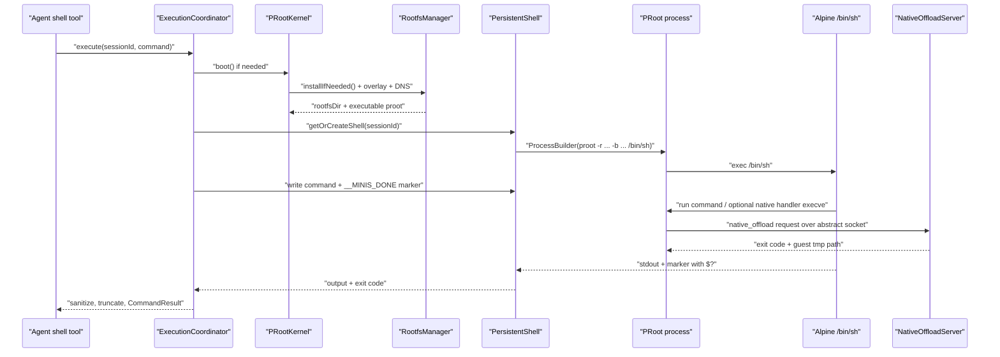

## 7. Android 沙箱：PRoot 用户态 chroot

### 7.1 这一章解决什么问题

Android 端需要在普通应用 UID 下提供一个可安装 Alpine 软件包、可保留工作目录、可运行脚本和交互式终端的 Linux 用户空间；本章解释这个用户空间怎样从资产变成可执行进程。核心不是“把命令包在 `Runtime.exec` 里”，而是把 PRoot、rootfs、PTY、持久 shell、SAF 挂载和终端渲染连成一个可恢复的执行链。没有 rootfs，`/bin/sh`、`/etc/resolv.conf` 和 `/var/minis` 不存在；没有 PRoot，应用 UID 不能把 Alpine 的 `/` 当成 guest 根目录；没有真实 PTY，readline、Ctrl+C、全屏程序和 ANSI 光标都会失真。Android 实现还必须面对 Doze、前台服务、scoped storage、SELinux/seccomp 和可执行文件路径等 iOS 不同的约束。上述组件的产品定位在 README 中被概括为“Android 使用 PRoot + Alpine”，而 iOS 使用 iSH；具体构建产物由 `BUILDING.md` 的 Android 小节规定。`README.md:119-140` `README.md:168-175` `BUILDING.md:159-180`

本章以仓库当前代码为准；涉及 PRoot 内部 syscall tracer 的部分，仓库中的 `deps/proot` 子模块在当前工作树没有源码，因此会明确标记 `[推断]`，不会把没有在本仓库验证的函数名写成事实。`BUILDING.md:202-205`

### 7.2 先建立正确模型：用户态 chroot，不是 Android 容器

#### 7.2.1 三个层次

可以把 Android 沙箱分成三层：

| 层 | 真实实现 | 负责什么 |
|---|---|---|
| host Android | 应用 UID、bionic、Android 文件系统、系统服务 | 运行 PRoot、提供 `/dev`、`/proc`、`/sys` 和设备能力 |
| PRoot 进程 | `libproot.so` 对应的 aarch64 PRoot 可执行文件 | 在不获取 root 的情况下重写 guest 路径、伪造 uid 0、绑定 host 目录 |
| guest Alpine | `filesDir/alpine-rootfs` 解压出来的用户空间 | `/bin/sh`、`apk`、Python、Node、用户脚本和 `/var/minis` |

`RootfsManager` 把 guest 根目录固定在 `context.filesDir/alpine-rootfs`，把真正执行的 PRoot 固定为 `applicationInfo.nativeLibraryDir/libproot.so`；这不是抽象描述，而是两个公开属性。`src/android/app/src/main/java/com/openminis/app/sandbox/RootfsManager.kt:40-49`

`PRootKernel` 也直接说明自己不是持久内核，而是“process-per-command”的配置持有者和命令构造器；持久性后来由 `PersistentShell` 以一个长生命周期的 PRoot 子进程实现。`src/android/app/src/main/java/com/openminis/app/sandbox/PRootKernel.kt:17-23` `src/android/app/src/main/java/com/openminis/app/sandbox/PersistentShell.kt:16-23`

#### 7.2.2 `-r`、`-b`、`-0` 到底做了什么

每一次一次性执行的命令都由 `buildProotCommand` 组装成下面的形状：

```text
<proot> -0 --link2symlink -r <rootfs>
        -b /dev -b /proc -b /sys -w /root
        [-b <host>:<linux> ...]
        [--native-offload=<socket>:<handlers>]
        /bin/sh -c <shellCommand>
```

来源：`src/android/app/src/main/java/com/openminis/app/sandbox/PRootKernel.kt:576-647`。

- `-r <rootfs>` 使 guest 看到的 `/` 解析到解压的 Alpine 树，而不是应用 UID 的真实 Android `/`。代码把 rootfs 的绝对路径作为参数传入。`src/android/app/src/main/java/com/openminis/app/sandbox/PRootKernel.kt:606-608`
- `-0` 只是在 PRoot 的用户态视图里把进程呈现为 uid 0；它不是 Android root，也不能绕过 Android 权限。代码只验证它被加入 argv，获得“真正 root 权限”是没有依据的说法。`src/android/app/src/main/java/com/openminis/app/sandbox/PRootKernel.kt:589-604`
- `/dev`、`/proc`、`/sys` 使用 bind 让 guest 工具能看到必要的伪文件系统；这不是把 Android 的所有目录暴露给 guest。`src/android/app/src/main/java/com/openminis/app/sandbox/PRootKernel.kt:610-616`
- `-w /root` 设定初始工作目录；会话启动后，带聊天 session 的交互终端另外发送 `cd /var/minis && clear`。`src/android/app/src/main/java/com/openminis/app/sandbox/PRootKernel.kt:618-620` `src/android/app/src/main/java/com/openminis/app/sandbox/TerminalSession.kt:163-166`
- `--link2symlink` 是 Android 上一个很关键的补丁：代码注释解释了 Android ext4/F2FS 对应用 UID 跨目录 hardlink 的拒绝，以及 Alpine `apk` 安装 busybox applet 时的失败场景，因此 PRoot 把 hardlink 转成 symlink。`src/android/app/src/main/java/com/openminis/app/sandbox/PRootKernel.kt:596-604`

#### 7.2.3 PRoot 的 ptrace 原理与本项目可验证边界

PRoot 的“用户态 chroot”通常依靠一个 tracer 进程跟踪 guest 子进程的系统调用：当 guest 发起 `openat`、`stat`、`execve`、`chdir`、`link` 等调用时，tracer 在用户态检查参数，把以 `/` 开始的 guest 路径重写到 `-r` 的 rootfs，或把 `-b host:linux` 的路径重写到 host 路径，再让 Android host kernel 执行。[推断] 本仓库没有 `deps/proot` 的源码来逐个核对 tracer 函数；仓库能直接验证的是 PRoot fork 的构建、`-r`/`-b`/`-0` 参数和运行时命令，而不是 ptrace 实现细节。`deps/build_proot.sh:4-12` `src/android/app/src/main/java/com/openminis/app/sandbox/PRootKernel.kt:576-647` `BUILDING.md:204-205`

这个差异决定了 PRoot 不是虚拟机，也不是 Android `chroot(2)` 的内核调用。应用没有声明 root 权限，命令依然是由 host kernel 调度的普通 aarch64 进程；guest 目录、伪 uid 和 bind 视图由 tracer 的路径/系统调用重写提供。[推断] 代码层面对应的是 PRoot 可执行文件由 `ProcessBuilder` 启动、再由它执行 `/bin/sh`，而不是由 Android 内核切换 namespace。`src/android/app/src/main/java/com/openminis/app/sandbox/ShellExecutor.kt:48-81` `src/android/app/src/main/java/com/openminis/app/sandbox/PersistentShell.kt:81-150`

与之相比，iOS 的 iSH 在应用进程中运行自己实现的 Linux kernel、fakefs 和 Asbestos threaded-code JIT interpreter；摘要明确列出 `GUEST_ARM64`、`ENGINE_ASBESTOS`、fakefs 及 guest syscall 层。`docs/specs/ios-sandbox-ish-summary.md:9-42`

因此两者的指令路径不同：Android 的 Alpine aarch64 用户程序在 ARM64 Android 设备上直接使用相同 ISA 执行，PRoot 主要在系统调用边界付出 tracer 开销；iOS 的 guest 指令由 Asbestos JIT/interpreter 转译/解释后再运行。[推断] 本仓库没有跨设备 benchmark，不能把“快几倍”写成结论；只能说 Android 避免了 guest ISA 翻译，而每次被跟踪的 syscall、路径查找和跨 host/guest bind 都增加额外工作。Android 的编译目标是 aarch64、API 26、仅 `arm64-v8a`，iOS 摘要则将 Asbestos 列为 engine。`src/android/app/build.gradle.kts:33-53` `deps/build_proot.sh:45-48` `docs/specs/ios-sandbox-ish-summary.md:13-20`

#### 7.2.4 PRoot 的性能与代价清单

1. 纯用户空间计算通常不需要 syscall 重写，因此更接近原生 ARM64 执行；文件、进程、网络和设备调用越多，ptrace 路径重写成本越明显。[推断] PRoot 的命令构造器明确把 `/dev`、`/proc`、`/sys` 和大量 bind mount 放进每次命令 argv，说明这些边界是热路径的一部分。`src/android/app/src/main/java/com/openminis/app/sandbox/PRootKernel.kt:610-638`
2. Android 版本和 ABI 不是自由组合：项目 `minSdk=26`、`targetSdk=35`、`abiFilters=arm64-v8a`，构建脚本以 Android API 26 的 NDK triple 编译；x86 模拟器不会得到本章这套 PRoot 二进制。[推断] 设备上仍可能受 ROM 的 ptrace、SELinux 或 seccomp 策略影响。`src/android/app/build.gradle.kts:25-60` `deps/build_proot.sh:45-48`
3. `crash_handler.cpp` 特意注册 `SIGSYS`，并在注释中把它与 seccomp violation 联系起来；这不是 PRoot 绕过 seccomp 的证明，而是一个明确的故障观测点。`src/android/app/src/main/cpp/crash_handler.cpp:120-148`
4. Android `/proc` 并不保证可遍历。代码安装 `top` wrapper，只列出当前 UID 实际可读的 `/proc/<pid>/stat`，以应对 `hidepid` 和 SELinux 阻拦。`src/android/app/src/main/java/com/openminis/app/sandbox/PRootKernel.kt:721-831`
5. 外部存储的 host 视图可能被 FUSE/Scoped Storage 过滤，即使 `File.canRead()` 为真，`list()` 仍可能返回 null；这会表现为 guest 中“挂载成功但目录为空”。`src/android/app/src/main/java/com/openminis/app/sandbox/RootfsManager.kt:403-431`

### 7.3 启动、rootfs 与增量更新

#### 7.3.1 构建时资产的两个来源

Android 沙箱资产不是普通 Kotlin 资源，而是两个构建脚本共同准备的产物：

```text
src/android/app/src/main/assets/alpine-minirootfs.tar.gz
src/android/app/src/main/assets/proot-aarch64
src/android/app/src/main/jniLibs/arm64-v8a/libproot.so
```

`prepare_android_sandbox.sh` 固定 Alpine 3.21.3 aarch64 下载地址，同时固定 Termux PRoot `.deb` 下载地址，最后将它们放入 `src/android/app/src/main/assets/`。`scripts/prepare_android_sandbox.sh:13-28` `scripts/prepare_android_sandbox.sh:30-81`

`deps/build_proot.sh` 是另一条“从源构建”路径：它指向 `deps/proot` fork，静态编译 talloc，再以 NDK 构建 PRoot，并把二进制同时安装到 `assets/proot-aarch64` 和 `jniLibs/arm64-v8a/libproot.so`。`deps/build_proot.sh:4-38` `deps/build_proot.sh:201-234` `deps/build_proot.sh:237-287` `deps/build_proot.sh:289-309`

`BUILDING.md` 把两步写成 Android 首次构建顺序，并说明输出被 gitignore；当前工作树也可能没有生成的 `alpine-minirootfs.tar.gz`、`proot-aarch64` 或 `jniLibs` 文件。不要把“资产不在 checkout”误判为运行时不需要资产。`BUILDING.md:162-180` `BUILDING.md:221-223`

Gradle 对 `tar.gz` 和 `proot-aarch64` 设置 `noCompress`，并只打包 `arm64-v8a`；这样 rootfs 的压缩流可由代码直接读取，native PRoot 只能供 arm64 变体使用。`src/android/app/build.gradle.kts:35-60` `src/android/app/build.gradle.kts:96-98`

#### 7.3.2 为什么 `jniLibs` 中放了一个可执行文件

这是 Android 端很容易被忽略的工程 trick。运行时属性不是 `assets/proot-aarch64`，而是 `File(applicationInfo.nativeLibraryDir, "libproot.so")`；`installProotIfNeeded` 检查该文件存在并且 `canExecute()`，错误信息也明确说它应当由 `jniLibs` 自动解包。`src/android/app/src/main/java/com/openminis/app/sandbox/RootfsManager.kt:159-178`

对应的构建脚本用 `install -m 0755` 把 PRoot 复制到 `jniLibs/arm64-v8a/libproot.so`，并明确注释“APK 也把 proot 当 native library 交付，安装时提取到 nativeLibraryDir”。`deps/build_proot.sh:28-38` `deps/build_proot.sh:292-308`

这样 Kotlin 可以直接把 native library extraction 目录下的文件绝对路径传给 `forkpty` 的 `execve`；`PtyBridge.forkExec` 的文档示例就是 `/data/data/.../libproot.so`。`src/android/app/src/main/java/com/openminis/app/sandbox/PtyBridge.kt:17-38`

Android 某些 ROM/挂载策略会让从普通 app data 目录复制出来的 ELF 不可执行（常见表现是 `noexec` 或权限被重置）。[平台约束背景，需在目标 ROM 实机验证] 本项目不在 `filesDir` 里手动拷贝 PRoot，而把它放入 `jniLibs` 让 APK 安装器负责 native library extraction，并在启动时验证 `canExecute()`；因此这是规避 app-data 执行不确定性的策略，而不是宣称 Android 所有版本都绝对禁止执行。`src/android/app/src/main/java/com/openminis/app/sandbox/RootfsManager.kt:42-49` `src/android/app/src/main/java/com/openminis/app/sandbox/RootfsManager.kt:165-170` `deps/build_proot.sh:35-38`

注意运行时还有一个非显然事实：`RootfsManager` 定义了 `PROOT_ASSET = "proot-aarch64"` 常量，但当前 `installProotIfNeeded` 只检查 nativeLibraryDir，并没有把 asset 拷贝到 filesDir；因此资产 PRoot 可能是构建/分发的兼容产物，真正执行路径以 `libproot.so` 为准。`src/android/app/src/main/java/com/openminis/app/sandbox/RootfsManager.kt:159-178` `src/android/app/src/main/java/com/openminis/app/sandbox/RootfsManager.kt:627-633`

#### 7.3.3 安装状态、手工 tar 解压与目录布局

`isInstalled` 不是单看目录是否存在，而是要求 `alpine-rootfs/.arch` 存在且内容为 `aarch64`；这是避免半解压目录或错误架构被误判为可启动。`src/android/app/src/main/java/com/openminis/app/sandbox/RootfsManager.kt:42-60`

安装流程在 IO dispatcher 中运行：先把状态置为 `Preparing`，删除残留目录并重建，然后尝试打开 `.tar.gz`，如果 AAPT 已把它处理成 tar，则回退到 `.tar`；压缩资产的长度用于进度流。`src/android/app/src/main/java/com/openminis/app/sandbox/RootfsManager.kt:61-104`

```kotlin
val assetName = try {
    context.assets.open(ROOTFS_ASSET).close()
    ROOTFS_ASSET
} catch (_: FileNotFoundException) {
    ROOTFS_ASSET_TAR
}

context.assets.open(assetName).use { rawAsset ->
    val progressStream = ProgressInputStream(rawAsset, assetTotal) { fraction ->
        _installState.value = RootfsInstallState.Extracting(fraction)
    }
    if (assetName.endsWith(".gz")) {
        GZIPInputStream(progressStream).use { extractTar(it, rootfsDir) }
    } else {
        extractTar(progressStream, rootfsDir)
    }
}
```

来源：`src/android/app/src/main/java/com/openminis/app/sandbox/RootfsManager.kt:85-117`。进度是“消费了多少 asset 字节”，不是网络下载百分比；rootfs 已经随 APK 打包。`src/android/app/src/main/java/com/openminis/app/sandbox/RootfsManager.kt:18-33` `src/android/app/src/main/java/com/openminis/app/sandbox/RootfsManager.kt:591-625`

`extractTar` 自己解析 512 字节 POSIX header，支持普通文件、目录、软链接、hard link 和 GNU/POSIX prefix；普通文件按 tar mode 恢复 execute bit，再跳过 512 字节对齐填充。`src/android/app/src/main/java/com/openminis/app/sandbox/RootfsManager.kt:464-552`

这段手工解析避免新增 archive 依赖，适合首启但也意味着输入必须是可信的应用资产；代码将 `fullName` 直接拼到 `File(targetDir, fullName)`，没有为外部不可信 tar 展示 canonical-path 防穿越检查。[审计提醒/推断] 若未来允许用户导入 rootfs，必须增加路径归一化和目标目录边界校验。`src/android/app/src/main/java/com/openminis/app/sandbox/RootfsManager.kt:474-490`

安装完成后写 `.arch`，预创建 `/var/minis/attachments`、`offloads`、`workspace`、`skills`、`memory`、`shared`、`mounts`，再创建 `/opt/bin` 和 DNS 文件；`mounts` 目标目录必须先存在，否则 PRoot 可能静默跳过 bind。`src/android/app/src/main/java/com/openminis/app/sandbox/RootfsManager.kt:120-148`

#### 7.3.4 “增量升级”实际是什么

当前代码没有 rootfs 版本号、tar 差分包或 SQLite migration；`.arch` 只表示架构，不表示 Alpine release 或 overlay 版本。`installIfNeeded` 只有在 `isInstalled` 为 false 时重新解压，若 rootfs 已安装则直接返回。`src/android/app/src/main/java/com/openminis/app/sandbox/RootfsManager.kt:47-73`

项目实际采用的是“完整 rootfs 一次安装 + 每次启动覆盖小型 default_mount”的增量路径。`PRootKernel.boot` 每次启动都调用 `applyDefaultMountOverlay`，用新 APK 的 profile、wrapper 和 `minis-mcp-cli` 覆盖 guest 中的对应文件。`src/android/app/src/main/java/com/openminis/app/sandbox/PRootKernel.kt:53-76` `src/android/app/src/main/java/com/openminis/app/sandbox/RootfsManager.kt:309-366`

覆盖层递归读取 `assets/default_mount`，在 `/bin`、`/sbin`、`/usr/bin`、`/usr/sbin`、`/usr/local/bin`、`/usr/local/sbin` 下重新设置 execute bit；覆盖前会把曾被锁成只读的目标重新设为可写，避免应用升级无法替换文件。`src/android/app/src/main/java/com/openminis/app/sandbox/RootfsManager.kt:417-455`

覆盖后还会删除 Python `EXTERNALLY-MANAGED` marker，并把 `/usr/local/lib/minis-mcp-cli` 锁为只读，但 wrapper 本身仍保持 app-managed。`src/android/app/src/main/java/com/openminis/app/sandbox/RootfsManager.kt:349-365` `src/android/app/src/main/java/com/openminis/app/sandbox/RootfsManager.kt:376-414`

从零实现时要把这两个概念分开：完整 rootfs 升级需要版本/哈希、临时目录、原子替换和失败恢复；本仓库目前只验证了“未安装时完整解压”和“每次 boot 覆盖 overlay”。[推断] 不应把 overlay 误称为 Alpine rootfs 的增量升级。`src/android/app/src/main/java/com/openminis/app/sandbox/RootfsManager.kt:68-157` `src/android/app/src/main/java/com/openminis/app/sandbox/RootfsManager.kt:321-366`

#### 7.3.5 boot 的顺序与环境

`PRootKernel.boot` 依次安装 rootfs、检查 PRoot、应用 overlay、重新应用镜像选择、刷新 DNS、配置 `LD_LIBRARY_PATH`/loader、设置 guest 默认环境、注册 bind mount、启动 native offload server、写 handler stub、物化外部 mount target，最后才把 `isBooted` 置为 true。`src/android/app/src/main/java/com/openminis/app/sandbox/PRootKernel.kt:50-179`

默认环境包括 `/usr/local/...:/opt/bin` 的 PATH、`HOME=/root`、`BROWSER=/usr/local/bin/minis-open`、`ENV=/etc/profile`、`CHARSET=UTF-8`、`NO_COLOR=1`、`PYTHONDONTWRITEBYTECODE=1`、`GOMAXPROCS=2`、`UV_LINK_MODE=symlink`。这些值由 `customEnvironment` 注入后，未来每个 PRoot 子进程都会继承。`src/android/app/src/main/java/com/openminis/app/sandbox/PRootKernel.kt:92-148`

时区使用 POSIX 反号格式，例如 UTC+8 变为 `LCL-8`，避免 musl 将 `GMT+8` 中的符号解释混乱；系统时区变化时再广播到 live shell。`src/android/app/src/main/java/com/openminis/app/sandbox/PRootKernel.kt:475-511` `src/android/app/src/main/java/com/openminis/app/sandbox/ExecutionCoordinator.kt:264-282`

DNS 通过 `ConnectivityManager.activeNetwork` 和 `LinkProperties` 读取 search domain/nameserver，写入 guest `/etc/resolv.conf`；没有系统 DNS 时回退到 `8.8.8.8` 和 `8.8.4.4`。网络监控在 Android 应用启动时立即刷新，并在网络切换时重复刷新。`src/android/app/src/main/java/com/openminis/app/sandbox/RootfsManager.kt:254-307` `src/android/app/src/main/java/com/openminis/app/MinisApp.kt:326-330`
#### 7.3.6 设置页如何暴露 rootfs 状态

`RootfsManagementViewModel` 订阅 `RootfsManager.installState`，把 `Preparing`、`Extracting(progress)`、`Finalizing`、`Installed`、`Failed` 映射为 UI 文案和进度条；它取消上一个 `progressJob`，避免用户重复点击安装/重置时留下多个 collector。`src/android/app/src/main/java/com/openminis/app/ui/sandbox/RootfsManagementViewModel.kt:36-70`

安装按钮调用 `manager.installIfNeeded()`，完成后刷新 rootfs 路径和大小；重置按钮调用 `manager.reset(keepUserData)`，可把 `/root` 备份到 cache，再由 restore 动作复制回去。`src/android/app/src/main/java/com/openminis/app/ui/sandbox/RootfsManagementViewModel.kt:72-119` `src/android/app/src/main/java/com/openminis/app/ui/sandbox/RootfsManagementViewModel.kt:121-197`

`RootfsManagementScreen` 不直接操作文件，而是显示 installed/path/size、浏览文件入口、镜像入口、安装/重置/备份恢复动作和进度 section；这使“删除 rootfs”成为显式用户操作，不会被 boot 流程静默触发。`src/android/app/src/main/java/com/openminis/app/ui/sandbox/RootfsManagementScreen.kt:59-180` `src/android/app/src/main/java/com/openminis/app/ui/sandbox/RootfsManagementScreen.kt:180-310`

终端还支持 guest wrapper 通过 OSC 1337 发起 URL：`TerminalEmulator.handleITermOsc` 把 `MinisOpenURL` payload 交给 `MinisOpenUrlBroker`，broker 再按 `http(s)/about/minis` scheme 交给 WebView 或 deep-link/file preview。`src/android/app/src/main/java/com/openminis/app/ui/terminal/emulator/TerminalEmulator.kt:378-392` `src/android/app/src/main/java/com/openminis/app/terminal/MinisOpenUrlBroker.kt:8-69`

`MinisUrlMarker` 仍保留一个文本流解析器，可以从文本中提取并移除 `ESC ] 1337 ; MinisOpenURL=... BEL`；完整 emulator 路径优先走 OSC action，二者不要同时对同一输出重复消费。`src/android/app/src/main/java/com/openminis/app/terminal/MinisUrlMarker.kt:3-55`
#### 7.3.7 rootfs 浏览器与镜像配置

`FileBrowserViewModel` 不是直接 `ls` PRoot，而是维护 host `File` listing，同时可用 `linuxRootPath` 将 `/var/minis/skills`、`memory`、`shared` 等路径交给 PRoot resolver；session browser 还保存 `sessionId`，避免全局 bind map 的 last-writer-wins 让聊天文件显示错 session。`src/android/app/src/main/java/com/openminis/app/ui/sandbox/FileBrowserViewModel.kt:163-220`

`FileBrowserScreen` 负责 breadcrumb、排序、隐藏文件、进入目录、预览和删除确认；用户退回初始目录时退出 screen，不继续爬到 rootfs 根目录。`src/android/app/src/main/java/com/openminis/app/ui/sandbox/FileBrowserScreen.kt:74-100` `src/android/app/src/main/java/com/openminis/app/ui/sandbox/FileBrowserScreen.kt:133-219`

`FilePreviewScreen` 对文本/图片等文件做 inline preview，并用 SAF `CreateDocument` 让用户把非图片文件 Save As 到系统可见位置；这条路径是 host 文件 IO，不应误称为 guest 命令执行。`src/android/app/src/main/java/com/openminis/app/ui/sandbox/FilePreviewScreen.kt:93-139` `src/android/app/src/main/java/com/openminis/app/ui/sandbox/FilePreviewScreen.kt:145-183`

镜像配置按 Alpine APK、pip、npm 三类记录目标配置文件；`PRootKernel.boot` 在 default overlay 后重新应用用户选择，避免 app update 把用户镜像恢复成 shipped stock。`src/android/app/src/main/java/com/openminis/app/ui/sandbox/MirrorSettingsScreen.kt:79-103` `src/android/app/src/main/java/com/openminis/app/sandbox/PRootKernel.kt:63-74`


### 7.4 JNI/PTY：让 `/bin/sh` 真的相信自己在终端里

#### 7.4.1 Kotlin 外部函数名是协议的一部分

`PtyBridge` 在 object 初始化时加载 `pty_bridge`，并声明七个 native 函数：`forkExec`、`readBytes`、`writeBytes`、`setWindowSize`、`closeFd`、`sendSignal`、`waitFor`。`forkExec` 返回 master fd，并通过单元素 `outPid` 返回 child pid。`src/android/app/src/main/java/com/openminis/app/sandbox/PtyBridge.kt:1-38` `src/android/app/src/main/java/com/openminis/app/sandbox/PtyBridge.kt:40-65`

JNI 的真实导出函数名不是猜测的 `nativeFork`，而是：

| Kotlin 声明 | C JNI 导出函数 |
|---|---|
| `PtyBridge.forkExec` | `Java_com_openminis_app_sandbox_PtyBridge_forkExec` |
| `PtyBridge.readBytes` | `Java_com_openminis_app_sandbox_PtyBridge_readBytes` |
| `PtyBridge.writeBytes` | `Java_com_openminis_app_sandbox_PtyBridge_writeBytes` |
| `PtyBridge.setWindowSize` | `Java_com_openminis_app_sandbox_PtyBridge_setWindowSize` |
| `PtyBridge.closeFd` | `Java_com_openminis_app_sandbox_PtyBridge_closeFd` |
| `PtyBridge.sendSignal` | `Java_com_openminis_app_sandbox_PtyBridge_sendSignal` |
| `PtyBridge.waitFor` | `Java_com_openminis_app_sandbox_PtyBridge_waitFor` |

C 文件中七个函数的定义分别位于 `src/android/app/src/main/cpp/pty_bridge.c:30-146`、`:148-160`、`:162-182`、`:184-196`、`:198-205`、`:207-214`、`:216-236`。

CMake 只把 `pty_bridge.c` 编译成 `pty_bridge` shared library；同一个 CMakeLists 还编译独立的 `minis_crash_handler` 和 `jieba_jni`，它们不是 PTY 数据路径。`src/android/app/src/main/cpp/CMakeLists.txt:1-25`

#### 7.4.2 `forkExec` 的真实动作

`forkExec` 先从 Java `String`/数组复制 command、argv、envp，再构造 winsize 和 termios。它调用的是 bionic 的 `forkpty(&masterFd, NULL, &tio, &ws)`，不是普通 `fork` 加 pipe。`src/android/app/src/main/cpp/pty_bridge.c:27-35` `src/android/app/src/main/cpp/pty_bridge.c:39-106`

初始化 termios 打开 `ICRNL`、`ISIG`、`ICANON`、`ECHO` 等能力，并设置 Ctrl+C、Ctrl+D、退格等控制字符；因此 shell 可以把 PTY 当作 TTY，内核负责把 VINTR 变成 SIGINT。`src/android/app/src/main/cpp/pty_bridge.c:75-103`

核心代码可缩减为：

```c
struct winsize ws = { .ws_col = cols > 0 ? cols : 80,
                      .ws_row = rows > 0 ? rows : 24 };
struct termios tio;
/* configure ICRNL, ISIG, ICANON, ECHO, VINTR ... */
int masterFd = -1;
pid_t pid = forkpty(&masterFd, NULL, &tio, &ws);
if (pid == 0) {
    if (cwd && *cwd) chdir(cwd);
    sigprocmask(SIG_SETMASK, &empty, NULL);
    for (int s = 1; s < NSIG; s++) signal(s, SIG_DFL);
    execve(cmd, argv, envp);
    _exit(127);
}
SetIntArrayRegion(env, outPid, 0, 1, &pid);
return masterFd;
```

来源：`src/android/app/src/main/cpp/pty_bridge.c:75-145`。子进程先切 cwd、清除 signal mask/handler，再 `execve` PRoot；父进程释放 Java 字符串的 native copy，并把 fd/pid 交回 Kotlin。`src/android/app/src/main/cpp/pty_bridge.c:119-145`

`readBytes` 对 master fd 调 `read` 并返回字节数、0 或负 errno；`writeBytes` 会循环处理 short write 和 EINTR，直到一个调用传入的 len 全部写完。`src/android/app/src/main/cpp/pty_bridge.c:148-182`

`setWindowSize` 使用 `ioctl(TIOCSWINSZ)`；`sendSignal` 使用 `kill`；`waitFor` 阻塞 `waitpid`，正常退出返回 `WEXITSTATUS`，信号退出返回 `-(128+signal)`。`src/android/app/src/main/cpp/pty_bridge.c:184-236`

#### 7.4.3 Kotlin 侧读、写、等待是三条协程路径

`TerminalSession.start` 在 `SupervisorJob + Dispatchers.IO` 上启动：先 boot PRoot，组装 `/bin/sh -l -i` 的 argv 和 envp，再调用 `PtyBridge.forkExec`；成功后进入 `RUNNING`，登记 weak reference。`src/android/app/src/main/java/com/openminis/app/sandbox/TerminalSession.kt:93-161`

随后有两条 sibling coroutine：`readerJob` 持续调用 `readBytes` 并把每次读到的原始 ByteArray emit 到 `outputBytes`；另一条直接 `waitFor(childPid)`，收到退出码后向 UI 发送 `[Process exited: ...]` 并改为 `STOPPED`。`src/android/app/src/main/java/com/openminis/app/sandbox/TerminalSession.kt:168-196`

```kotlin
readerJob = scope.launch { readLoop() }
scope.launch {
    val status = PtyBridge.waitFor(childPid)
    _outputBytes.emit("\r\n[Process exited: $status]\r\n".toByteArray())
    _state.value = State.STOPPED
}
```

来源：`src/android/app/src/main/java/com/openminis/app/sandbox/TerminalSession.kt:168-176`。这也是为什么不能只读 stdout：PTY master 同时承载回显、stdout、stderr、控制序列和程序输入输出。`src/android/app/src/main/java/com/openminis/app/sandbox/TerminalSession.kt:82-87` `src/android/app/src/main/cpp/pty_bridge.c:105-145`

写入端把 UTF-8 文本的 LF/CRLF 规范化为 CR，符合真实 TTY 的 Enter 语义；超过 2048 字节的粘贴分块写入，并在块之间 `yield`，避免大粘贴占满 PTY。`src/android/app/src/main/java/com/openminis/app/sandbox/TerminalSession.kt:205-249` `src/android/app/src/main/java/com/openminis/app/sandbox/TerminalSession.kt:320-343`

Ctrl+C 不走 shell 字符串，而是向 master 写入单字节 `0x03`，由 termios VINTR 触发 SIGINT；窗口变化调用 `setWindowSize`。`src/android/app/src/main/java/com/openminis/app/sandbox/TerminalSession.kt:258-273`

停止顺序是取消 reader、关闭 master fd、向 child 发 SIGTERM、更新状态并从 live session registry 删除；关闭 fd 能让阻塞 read 返回，signal 则让 child 收尾退出。`src/android/app/src/main/java/com/openminis/app/sandbox/TerminalSession.kt:276-287`

#### 7.4.4 交互 PTY 与 agent 一次性执行是两条路径

Agent 的 `ShellExecutor.execute` 仍然使用 `ProcessBuilder(prootCommand)`，合并 stderr/stdout，逐字符读取以保留 `\r`，在协程 timeout 时强杀当前 Process；它适合 run-to-completion，不提供 TTY prompt。`src/android/app/src/main/java/com/openminis/app/sandbox/ShellExecutor.kt:32-81` `src/android/app/src/main/java/com/openminis/app/sandbox/ShellExecutor.kt:83-145`

聊天 agent 默认由 `ExecutionCoordinator` 进入每 session 一个 `PersistentShell`，而全屏终端由 `TerminalSession + PtyBridge` 提供交互体验；不要用 `ShellExecutor` 替代 PTY，也不要用 PTY 输出来解析 agent 的命令结果边界。`src/android/app/src/main/java/com/openminis/app/sandbox/ExecutionCoordinator.kt:63-124` `src/android/app/src/main/java/com/openminis/app/sandbox/TerminalSession.kt:103-183`

### 7.5 持久 shell：哨兵、退出码与并发

#### 7.5.1 为什么需要一个长生命周期 `/bin/sh`

`PersistentShell` 的文档明确列出环境变量、工作目录、已安装包和运行中的服务都要在同一 session 的命令之间保留；它通过 stdin 写命令，通过唯一结束标记收集输出。`src/android/app/src/main/java/com/openminis/app/sandbox/PersistentShell.kt:16-23`

`startProcess` 手工构建 PRoot argv，区别于一次性命令的是末尾只有 `/bin/sh`，没有 `-c <command>`；后续命令都写入该 shell 的 stdin。debug 构建把 stderr 单独排到 logcat，避免 native offload stderr 污染 marker；release 仍合并 stderr。`src/android/app/src/main/java/com/openminis/app/sandbox/PersistentShell.kt:81-120` `src/android/app/src/main/java/com/openminis/app/sandbox/PersistentShell.kt:149-171`

shell 环境设置 `PROOT_TMP_DIR`、可选 `LD_LIBRARY_PATH`/loader、`TERM=dumb`、空 `PS1`、fresh `TZ`、聊天 session id，并叠加 `PRootKernel.customEnvironment`。`TERM=dumb` 是 agent 输出稳定性的取舍，交互 PTY 则由 `TerminalSession` 设置 `xterm-256color`。`src/android/app/src/main/java/com/openminis/app/sandbox/PersistentShell.kt:121-147` `src/android/app/src/main/java/com/openminis/app/sandbox/TerminalSession.kt:127-146`

#### 7.5.2 哨兵的真实做法

每次命令生成一个随机 UUID 的前 8 位，写入：

```sh
<command>
echo "__MINIS_DONE_<marker>_EXIT_$?__"
```

`readLoop` 在输出块中寻找 `__MINIS_DONE_<marker>_EXIT_`，先把 marker 之前的内容交给 output 和 line callback，再从 marker 中解析退出码，恢复挂起的 continuation。`src/android/app/src/main/java/com/openminis/app/sandbox/PersistentShell.kt:182-255`

对应 Kotlin 逻辑是：

```kotlin
val marker = UUID.randomUUID().toString().take(8)
val wrappedCommand = "$command\necho \"__MINIS_DONE_${marker}_EXIT_\$?__\"\n"
pendingCallback = cb
writer.write(wrappedCommand)
writer.flush()
```

来源：`src/android/app/src/main/java/com/openminis/app/sandbox/PersistentShell.kt:265-307`。shell 仍是同一个进程，所以 `$?` 表示用户命令的退出码，而不是 `echo` 的退出码。`src/android/app/src/main/java/com/openminis/app/sandbox/PersistentShell.kt:257-278`

标记协议比“等待 prompt”可靠，因为用户可以自定义 PS1，命令输出也可能包含 `$ ` 或 `# `；本实现通过不把 prompt 纳入返回数据来减少 agent 解析歧义。[推断] iOS 对照文档明确说 iOS 有 prompt detection，而 Android 这里使用 marker。`docs/specs/ios-sandbox-ish-summary.md:80-89` `src/android/app/src/main/java/com/openminis/app/sandbox/PersistentShell.kt:182-255`

#### 7.5.3 超时、死亡和哨兵边界

`executeCommand` 使用 `withTimeoutOrNull(timeout)`；超时会清空 `pendingCallback`，返回 exit code 124，但刻意不杀 shell，以保留 session 状态。`src/android/app/src/main/java/com/openminis/app/sandbox/PersistentShell.kt:280-317`

进程真的退出时，reader 会把 pending callback 以 exit `-1` 完成，然后清空 process/writer；下一次 `ExecutionCoordinator.execute` 发现 shell 不 alive，重新创建相同 session 的 shell。`src/android/app/src/main/java/com/openminis/app/sandbox/PersistentShell.kt:221-235` `src/android/app/src/main/java/com/openminis/app/sandbox/ExecutionCoordinator.kt:132-162`

这里有一个必须写进验收测试的边界：`readLoop` 在每个 `read()` 返回的 text chunk 内查 marker，没有显示的跨 chunk marker buffer；理论上 marker 可能被拆在两个 read 之间。[审计提醒/推断] 生产实现应把上一个 chunk 的尾部保留到下一次匹配，或者使用逐行缓冲，否则极低概率会把已完成命令等成超时。`src/android/app/src/main/java/com/openminis/app/sandbox/PersistentShell.kt:182-217`

另一个边界是 `pendingCallback` 明确标注“only one command at a time”；直接并发调用同一个 `PersistentShell` 会覆盖 callback，正确的串行保证不在类本身，而在上层 per-session `Mutex`。`src/android/app/src/main/java/com/openminis/app/sandbox/PersistentShell.kt:35-58` `src/android/app/src/main/java/com/openminis/app/sandbox/ExecutionCoordinator.kt:39-57`

#### 7.5.4 ExecutionCoordinator 的并发模型

`ExecutionCoordinator` 为每个 session 保存 `PersistentShell`、`Mutex` 和已注入环境 key 快照：同一 session 的命令在自己的 Mutex 内排队，不同 session 可以并发；shell 创建另有 `globalLock` 防止首个并发命令重复创建。`src/android/app/src/main/java/com/openminis/app/sandbox/ExecutionCoordinator.kt:11-57`

执行顺序是：获取 session Mutex；必要时 boot；get-or-create shell；把环境变量按完整 snapshot 注入；执行 marker 命令；用 `TerminalSanitizer` 清理并截断输出；非零退出码附加 `(exit code: N)`。`src/android/app/src/main/java/com/openminis/app/sandbox/ExecutionCoordinator.kt:63-124`

```kotlin
return mutex.withLock {
    if (!PRootKernel.isBooted) PRootKernel.boot(appContext)
    val shell = getOrCreateShell(sessionId)
    val envVars = envVarRepository?.allAsDict() ?: emptyMap()
    shell.applyEnvironment(envVars, previousKeys = previousKeys)
    val (rawOutput, exitCode) = shell.executeCommand(command, timeout, lineCallback)
    val sanitized = TerminalSanitizer.sanitize(rawOutput)
    CommandResult(...)
}
```

来源：`src/android/app/src/main/java/com/openminis/app/sandbox/ExecutionCoordinator.kt:72-124`。旧的环境 key 会被 `unset`，所以长期 shell 不会保留用户在设置页删除的变量；系统 TZ/proxy 广播则只覆盖指定 key，不清空用户 snapshot。`src/android/app/src/main/java/com/openminis/app/sandbox/ExecutionCoordinator.kt:45-51` `src/android/app/src/main/java/com/openminis/app/sandbox/PersistentShell.kt:320-355`

#### 7.5.5 `ShellTimeoutPolicy` 的现状

`ShellTimeoutPolicy` 定义 quick 60 秒、network 180 秒、install 600 秒、build 1200 秒、long-running 1800 秒和默认 600 秒，并按命令首段分类。`src/android/app/src/main/java/com/openminis/app/sandbox/ShellTimeoutPolicy.kt:23-81` `src/android/app/src/main/java/com/openminis/app/sandbox/ShellTimeoutPolicy.kt:83-116`

但文件注释明确写着“Not wired yet”；当前 `ExecutionCoordinator.execute` 和 `PersistentShell.executeCommand` 的默认值仍是 600000ms。实现者不能在教学代码里声称策略已经生效；要接入，必须在 call site 调 `forCommand` 后把结果传下去。`src/android/app/src/main/java/com/openminis/app/sandbox/ShellTimeoutPolicy.kt:18-21` `src/android/app/src/main/java/com/openminis/app/sandbox/ExecutionCoordinator.kt:72-76` `src/android/app/src/main/java/com/openminis/app/sandbox/PersistentShell.kt:265-268`

#### 7.5.6 PRoot 命令执行时序图



图中每个边都有真实实现：boot 流程在 `PRootKernel.boot`，shell 创建在 `ExecutionCoordinator.getOrCreateShell`，持久进程在 `PersistentShell.startProcess`，marker 在 `PersistentShell.executeCommand`，native socket 在 `NativeOffloadServer.handleClient`。`src/android/app/src/main/java/com/openminis/app/sandbox/PRootKernel.kt:50-179` `src/android/app/src/main/java/com/openminis/app/sandbox/ExecutionCoordinator.kt:132-162` `src/android/app/src/main/java/com/openminis/app/sandbox/PersistentShell.kt:81-150` `src/android/app/src/main/java/com/openminis/app/sandbox/PersistentShell.kt:257-317` `src/android/app/src/main/java/com/openminis/app/sandbox/NativeOffload.kt:127-217`

### 7.6 挂载与共享：SAF 路径如何进入 guest

#### 7.6.1 三种 `/var/minis` 目录

全局目录 `memory`、`skills`、`shared`、`mcp-servers` 位于 `filesDir/minis-global/<name>`，在启动时注册到 `PRootKernel.bindMounts`。`src/android/app/src/main/java/com/openminis/app/sandbox/PRootKernel.kt:185-200`

session 目录 `attachments`、`offloads`、`workspace`、`browser` 位于 `filesDir/minis-sessions/<sessionId>/<name>`，由 `ExecutionCoordinator.buildSessionBindMounts` 为每个持久 shell 建立自己的 host map。`src/android/app/src/main/java/com/openminis/app/sandbox/ExecutionCoordinator.kt:165-190` `src/android/app/src/main/java/com/openminis/app/sandbox/RootfsManager.kt:243-252`

用户选择的外部目录统一放到 guest `/var/minis/mounts/<name>`；它们不是复制到 rootfs，而是将 host POSIX path 作为 PRoot `-b host:linux` 参数。`src/android/app/src/main/java/com/openminis/app/sandbox/PRootKernel.kt:210-216` `src/android/app/src/main/java/com/openminis/app/sandbox/ExecutionCoordinator.kt:209-221`

#### 7.6.2 `MountedFolderCoordinator` 与实际执行路径

`MountedFolderCoordinator` 提供两个纯数据层接口：`requireWritable` 在写工具触碰锁定挂载时抛 `ReadOnlyMountException`，`bindMountSpecs` 将 `resolvedHostPath` 转成 `(linuxDir, hostPath)` pair。`src/android/app/src/main/java/com/openminis/app/sandbox/MountedFolderCoordinator.kt:19-70`

当前 live shell 的实际 argv 由 `ExecutionCoordinator.buildSessionBindMounts` 直接从 `MountedFoldersStore.Entry.resolvedHostPath` 组装；`PRootKernel.applyMountedFoldersSnapshot` 同时维护全局 map，供路径解析、debug 和索引使用。不要只更新全局 map 后期待已经运行的 PRoot 自动看到新增 mount。`src/android/app/src/main/java/com/openminis/app/sandbox/ExecutionCoordinator.kt:209-223` `src/android/app/src/main/java/com/openminis/app/sandbox/PRootKernel.kt:232-299`

应用层的 onChange 回调会先重做快照，再停止当前所有 shell，让下一条命令用新 bind 参数重建 shell；原因是 PRoot `-b` argv 在进程启动时冻结。`src/android/app/src/main/java/com/openminis/app/MinisApp.kt:337-365`

#### 7.6.3 SAF tree URI 到 POSIX path

Android 的 `ACTION_OPEN_DOCUMENT_TREE` 返回 `content://com.android.externalstorage.documents/tree/<volume>:<relative>`；当前实现只接受 authority `com.android.externalstorage.documents`，拆出 volume id 和相对路径，再映射 primary 或 removable volume 根目录。`src/android/app/src/main/java/com/openminis/app/sandbox/PRootKernel.kt:366-403` `src/android/app/src/main/java/com/openminis/app/sandbox/PRootKernel.kt:458-472`

Drive、Dropbox、OneDrive 等 cloud provider 没有 app 可直接传给 PRoot 的 POSIX path，因此解析返回 null；移除的 SD card、不可读目录也会跳过。`src/android/app/src/main/java/com/openminis/app/sandbox/PRootKernel.kt:375-387` `src/android/app/src/main/java/com/openminis/app/sandbox/PRootKernel.kt:424-437`

解析成功也不等于 guest 一定能读：代码显式调用 `candidate.list()`，若返回 null，则记录“readdir EACCES / scoped-storage filtered”诊断，但仍返回 path；这样 UI 能看到“路径存在但挂载后为空”的真实原因。`src/android/app/src/main/java/com/openminis/app/sandbox/PRootKernel.kt:403-431`

Manifest 申请了 `MANAGE_EXTERNAL_STORAGE`，并对 API 29 及以下声明 legacy `READ/WRITE_EXTERNAL_STORAGE`；注释解释 Android 11+ 的 FUSE 可能过滤其他包创建的文件，Android 10 某些 ROM 则需要 legacy storage 才能得到可遍历的 `/mnt/runtime/write` 视图。`src/android/app/src/main/AndroidManifest.xml:58-75`

`storageAccessDiag` 对 API 30+ 记录 `Environment.isExternalStorageManager()`，对旧版本记录 READ grant 和 legacy mode；这不是权限自动授予，用户仍需通过设置页/系统 picker 完成授权。`src/android/app/src/main/java/com/openminis/app/sandbox/PRootKernel.kt:439-455`

#### 7.6.4 只读挂载不是 PRoot 原生只读

`-b` 在当前命令构造器中没有 read-only modifier；因此 store 的 `effectiveWritable=false` 不能单独阻止 shell 的 `>`、`cp` 或 `rm`。代码同时在工具层调用 `isLinuxPathUnderReadOnlyMount`，并安装 `touch`、`tee`、`cp`、`mv`、`mkdir`、`rm`、`rmdir`、`ln`、`dd` wrappers，在 guest 中检查 `/var/minis/.mount-readonly-prefixes`。`src/android/app/src/main/java/com/openminis/app/sandbox/PRootKernel.kt:333-352` `src/android/app/src/main/java/com/openminis/app/sandbox/PRootKernel.kt:834-908`

纯 shell redirect 仍交给 host open(2) 返回 EACCES；wrapper 主要是让 agent 获得可读的“read-only mounted folder”错误，而不是 ROM 上的静默 no-op。`src/android/app/src/main/java/com/openminis/app/sandbox/PRootKernel.kt:834-851`

这是 defense-in-depth，而不是安全边界：如果新增一种写入工具没有纳入 wrapper，必须同时在 FileWrite/FileEdit 层使用 `MountedFolderCoordinator.requireWritable`。`src/android/app/src/main/java/com/openminis/app/sandbox/MountedFolderCoordinator.kt:24-33` `src/android/app/src/main/java/com/openminis/app/sandbox/PRootKernel.kt:274-284`

### 7.7 终端模拟器：raw bytes 到 ANSI canvas

#### 7.7.1 数据链路

`TerminalSession.outputBytes` 发出未经清洗的 PTY bytes；`TerminalScreen` 的 `LaunchedEffect` 收集 bytes 后调用 `TerminalEmulator.feed`，而不是先调用 `TerminalSanitizer`。这点保证 ANSI 光标、颜色和全屏程序不会在进入 emulator 前被删除。`src/android/app/src/main/java/com/openminis/app/sandbox/TerminalSession.kt:82-87` `src/android/app/src/main/java/com/openminis/app/ui/terminal/TerminalScreen.kt:90-105`

Agent run-to-completion 的输出才走 `TerminalSanitizer`：先 CR folding，再移除 ANSI，再过滤控制字符、去 null artifact 和折叠空行，并把过长返回截成 head/tail。`src/android/app/src/main/java/com/openminis/app/sandbox/TerminalSanitizer.kt:17-57`

因此要区分“交互终端显示”与“聊天工具结果清洗”：前者需要保留 ANSI 语义，后者需要稳定的纯文本。`src/android/app/src/main/java/com/openminis/app/ui/terminal/TerminalScreen.kt:95-105` `src/android/app/src/main/java/com/openminis/app/sandbox/ExecutionCoordinator.kt:108-123`

#### 7.7.2 ANSI parser 的状态机

当前 emulator 使用 `ui/terminal/emulator/AnsiParser.kt`，不是同包下较早的 Compose `ui/terminal/AnsiParser.kt`。前者输出 `Printable`、`ControlChar`、`CsiDispatch`、`EscDispatch`、`OscDispatch`，后者只把 SGR 颜色样式转成 `AnnotatedString`。`src/android/app/src/main/java/com/openminis/app/ui/terminal/emulator/AnsiParser.kt:3-20` `src/android/app/src/main/java/com/openminis/app/ui/terminal/AnsiParser.kt:41-272` `src/android/app/src/main/java/com/openminis/app/ui/terminal/AnsiParser.kt:10-14`

emulator parser 的状态有 `GROUND`、`ESCAPE`、`CSI_ENTRY`、`CSI_PARAM`、`CSI_INTERMEDIATE`、`OSC_PARAM`、`OSC_STRING`，能跨输入 chunk 保存 state 和 UTF-8 continuation。`src/android/app/src/main/java/com/openminis/app/ui/terminal/emulator/AnsiParser.kt:20-55` `src/android/app/src/main/java/com/openminis/app/ui/terminal/emulator/AnsiParser.kt:57-105`

CSI 参数按数字和分号累积，终结字节生成 `CsiDispatch(params, intermediate, finalByte)`；OSC 以 BEL 或 ESC 结束，生成 title/URL 等 payload。`src/android/app/src/main/java/com/openminis/app/ui/terminal/emulator/AnsiParser.kt:145-225` `src/android/app/src/main/java/com/openminis/app/ui/terminal/emulator/AnsiParser.kt:227-260`

#### 7.7.3 TerminalEmulator 与 TerminalBuffer

`TerminalEmulator` 为主屏和 alternate screen 各保留一个 `TerminalBuffer`；主屏有 2000 行 scrollback，alternate buffer 禁止 scrollback，匹配全屏程序的语义。每次 `feed` 批量处理后只 bump 一次 Compose `version`。`src/android/app/src/main/java/com/openminis/app/ui/terminal/emulator/TerminalEmulator.kt:12-67`

`handleAction` 将 Printable 写入 cell grid，将控制字符映射为光标后退、tab、换行、CR；CSI 支持光标移动、擦除、插删行列、滚动区、SGR、DSR/DA 响应和 cursor shape。`src/android/app/src/main/java/com/openminis/app/ui/terminal/emulator/TerminalEmulator.kt:184-278`

`TerminalBuffer.writeChar` 处理 wrap pending、自动换行和宽字符 trailer；`characterWidth` 将常见 CJK、emoji、全角范围视为 2 列。`src/android/app/src/main/java/com/openminis/app/ui/terminal/emulator/TerminalBuffer.kt:54-80` `src/android/app/src/main/java/com/openminis/app/ui/terminal/emulator/TerminalBuffer.kt:226-248`

scrollback 在 scroll region 顶端滚出时进入 `ArrayDeque`，最多保留 maxScrollback；resize 复制旧 grid、重设 scroll region 和光标边界。`src/android/app/src/main/java/com/openminis/app/ui/terminal/emulator/TerminalBuffer.kt:97-115` `src/android/app/src/main/java/com/openminis/app/ui/terminal/emulator/TerminalBuffer.kt:200-214`

`TerminalEmulator` 还处理 alternate buffer、bracketed paste、application cursor keys、OSC 1337 的 `MinisOpenURL`，后者投递给 `MinisOpenUrlBroker`。`src/android/app/src/main/java/com/openminis/app/ui/terminal/emulator/TerminalEmulator.kt:281-305` `src/android/app/src/main/java/com/openminis/app/ui/terminal/emulator/TerminalEmulator.kt:378-401`

#### 7.7.4 Canvas/native View 渲染

Compose `TerminalScreen` 当前使用 `TerminalNativeViewCompose`；旧的 `TerminalCanvasView` 保留为 fallback。两者都用 monospace Paint 的 `M` 宽度和 font metrics 计算 cols/rows，再通过 `onResize` 同步 emulator 与 PTY winsize。`src/android/app/src/main/java/com/openminis/app/ui/terminal/TerminalScreen.kt:167-220` `src/android/app/src/main/java/com/openminis/app/ui/terminal/canvas/TerminalNativeView.kt:43-71` `src/android/app/src/main/java/com/openminis/app/ui/terminal/canvas/TerminalCanvasView.kt:37-79`

native View 每 16ms 轮询 emulator `version` 并 invalidate，每 500ms 翻转 cursor；这是一种简单的渲染同步方案，代价是 View 即使没有新输出也有低频调度。`src/android/app/src/main/java/com/openminis/app/ui/terminal/canvas/TerminalNativeView.kt:94-167`

`onDraw` 按 row/cell 遍历，跳过 wide trailer，绘制背景、glyph、selection highlight 和 block/underline/bar cursor；JetBrains Mono typeface 用于稳定 glyph metrics。`src/android/app/src/main/java/com/openminis/app/ui/terminal/canvas/TerminalNativeView.kt:328-406` `src/android/app/src/main/java/com/openminis/app/ui/terminal/canvas/TerminalNativeView.kt:414-479`

Canvas fallback 的 `drawCell` 会根据 inverse/bold/italic/underline/strike/dim/hidden 生成 Paint，并把 wide cell 的宽度乘二；它不使用 Compose 文本布局，所以每个 cell 都由 Android Canvas 绘制。`src/android/app/src/main/java/com/openminis/app/ui/terminal/canvas/TerminalCanvasView.kt:165-245` `src/android/app/src/main/java/com/openminis/app/ui/terminal/canvas/TerminalCanvasView.kt:248-311`

长按选择在 native View 中用 `GestureDetector` 做 word expand，使用 Android floating `ActionMode` 和 `ClipboardManager` 复制 emulator 选区；这属于 Android UI 侧增强，不改变 PTY 协议。`src/android/app/src/main/java/com/openminis/app/ui/terminal/canvas/TerminalNativeView.kt:182-326`

#### 7.7.5 输入如何回到 PTY

Android 用不可见 1×1 `EditText` 抢占 IME 和硬件键，`BaseInputConnection.commitText` 立即把 UTF-8 字节发送，不让隐藏控件积累 composing text。`src/android/app/src/main/java/com/openminis/app/ui/terminal/canvas/TerminalInputView.kt:18-57` `src/android/app/src/main/java/com/openminis/app/ui/terminal/canvas/TerminalInputView.kt:102-151`

Enter 是 CR，退格是 DEL，箭头根据 DECCKM 在 CSI 与 SS3 之间切换，Ctrl+字母变成控制码，Alt 使用 ESC 前缀；这与 `TerminalSession.sendText` 的 CR 规则互相配合。`src/android/app/src/main/java/com/openminis/app/ui/terminal/canvas/TerminalInputView.kt:153-205` `src/android/app/src/main/java/com/openminis/app/sandbox/TerminalSession.kt:205-263`

`TerminalScreen` 在用户输入时把 scrollOffset 拉回 0，窗口变更同时调用 `emulator.resize` 和 `terminalSession.setWindowSize`；clear 不只擦画布，还发送 Ctrl+U 清掉 readline 半行，随后发送 RIS 重置 emulator。`src/android/app/src/main/java/com/openminis/app/ui/terminal/TerminalScreen.kt:190-245`

### 7.8 Agent shell、native offload 与 Shizuku 边界

#### 7.8.1 Alpine 默认是 ash，不是 bash

`PersistentShell` 启动的是 `/bin/sh`，而 Alpine 的 `/bin/sh` 通常由 busybox ash 提供；项目的 `BashismDetector` 从共享 JSON 加载规则，跳过 heredoc body，逐行 regex 扫描，50ms fuse 超时则 fail-open。`src/android/app/src/main/java/com/openminis/app/sandbox/PersistentShell.kt:105-111` `src/android/app/src/main/java/com/openminis/app/agent/shell/BashismDetector.kt:8-19` `src/android/app/src/main/java/com/openminis/app/agent/shell/BashismDetector.kt:112-170`

发现 bashism 后，`OnDemandBash.ensureBash` 先检查 `command -v bash`，再做 5 秒网络探测，最多每进程尝试一次 `apk add bash`，验证成功后缓存 available；失败会记录 24 小时/三次 strike backoff。`src/android/app/src/main/java/com/openminis/app/agent/shell/OnDemandBash.kt:12-34` `src/android/app/src/main/java/com/openminis/app/agent/shell/OnDemandBash.kt:56-101` `src/android/app/src/main/java/com/openminis/app/agent/shell/OnDemandBash.kt:111-142`

`BashismReminder` 不把脚本文本原样注入 system reminder，而是替换尖括号、过滤控制字符并限制 120 字符；这是 agent shell 层的提示安全措施。`src/android/app/src/main/java/com/openminis/app/agent/shell/BashismReminder.kt:9-19` `src/android/app/src/main/java/com/openminis/app/agent/shell/BashismReminder.kt:21-54`

#### 7.8.2 native offload 从 guest execve 回到 Kotlin

boot 时 `NativeOffloadServer.start(rootfsDir)` 监听 abstract Unix socket；`PRootKernel.buildProotCommand` 把已注册 handler 名称拼进 `--native-offload=<socket>:<handlers>`，并为每个名字安装 `/usr/local/bin` stub，让 shell 的 PATH 查找能触发 execve interception。`src/android/app/src/main/java/com/openminis/app/sandbox/PRootKernel.kt:150-163` `src/android/app/src/main/java/com/openminis/app/sandbox/PRootKernel.kt:634-639` `src/android/app/src/main/java/com/openminis/app/sandbox/PRootKernel.kt:699-719`

Kotlin server 的协议头是 little-endian magic/version/pid/argv/env/cwd；accept loop 每个客户端起一个 daemon worker，按 handler 名 dispatch，写入 rootfs `/tmp/.native-offload-*`，返回 exit code 和 guest tmp path。`src/android/app/src/main/java/com/openminis/app/sandbox/NativeOffload.kt:53-145` `src/android/app/src/main/java/com/openminis/app/sandbox/NativeOffload.kt:148-217`

这条链路让 guest 看见普通 stdout：server 写结果文件，协议返回 `/tmp/...`，PRoot extension 再将 exec 改写成 `/bin/cat <tmpfile>`。[推断] 最终 `/bin/cat` 的改写在外部 PRoot fork 中，当前仓库可验证 server 的 tmpfile/reply 和命令行 flag，不可验证 extension 内部函数名。`src/android/app/src/main/java/com/openminis/app/sandbox/NativeOffload.kt:15-26` `src/android/app/src/main/java/com/openminis/app/sandbox/NativeOffload.kt:203-215`

#### 7.8.3 Shizuku 不等于 PRoot 提权

`ShizukuOffloadHandler` 是 sandbox 外的 native-offload handler：guest 运行 `android-shizuku-cli` stub 后，handler 通过 `ShizukuManager.runProcess` 在 Shizuku service UID（adb 启动通常 uid 2000，root 启动为 uid 0）执行 `pm`、`am`、`cmd`、`settings`、`dumpsys`、`input` 等命令。`src/android/app/src/main/java/com/openminis/app/sandbox/offload/ShizukuOffloadHandler.kt:12-40`

它先经过 agent permission gate，再刷新 Shizuku 状态；未安装、未运行或未授权都会返回结构化错误，只有 READY 才 dispatch 到各 subcommand。`src/android/app/src/main/java/com/openminis/app/sandbox/offload/ShizukuOffloadHandler.kt:41-107`

因此 Shizuku 不能让 PRoot 里的 `/bin/sh` 直接获得 Android root，也不改变 rootfs 的 uid 视图；它只是把某些明确授权的 Android 系统操作通过 offload 送到 sandbox 外。细节、权限策略和命令面留给第 8 章。`src/android/app/src/main/java/com/openminis/app/sandbox/offload/ShizukuOffloadHandler.kt:55-80` `src/android/app/src/main/java/com/openminis/app/sandbox/NativeOffload.kt:183-199`

### 7.9 Android 平台对照

本章是 Android 单平台专题；下面只用最小表格指向第 6 章，不把 iOS 机制混写成 Android 能力。

| 同一个抽象 | Android 当前落地 | iOS 对应落地 | 差异原因 |
|---|---|---|---|
| guest Linux | PRoot fork + Alpine aarch64 rootfs；`-r` 设根，路径由用户态 tracer 重写。[推断] | iSH fork 在进程内实现 Linux kernel、fakefs、Asbestos JIT | Android 可直接运行同 ISA host 进程但无 root；iOS 不允许这种 host Linux syscall 路径，因此使用虚拟 kernel。`src/android/app/src/main/java/com/openminis/app/sandbox/PRootKernel.kt:576-647` `docs/specs/ios-sandbox-ish-summary.md:9-42` |
| rootfs | `filesDir/alpine-rootfs`，手工 tar 解压，`.arch=aarch64` | `~/Documents/alpine-rootfs/`，fakefs metadata | Android 使用真实目录和 host 文件权限；iOS fakefs 还要登记 `meta.db`。`src/android/app/src/main/java/com/openminis/app/sandbox/RootfsManager.kt:42-49` `src/android/app/src/main/java/com/openminis/app/sandbox/RootfsManager.kt:464-552` `docs/specs/ios-sandbox-ish-summary.md:59-68` |
| 一次性命令 | `ShellExecutor` 建 ProcessBuilder，合并输出，timeout 后 destroy | `ISHShellExecutor` 提供同步/异步执行、callback、signal | Android PRoot 是外部进程；iSH kernel 在 app 内。`src/android/app/src/main/java/com/openminis/app/sandbox/ShellExecutor.kt:42-145` `docs/specs/ios-sandbox-ish-summary.md:70-78` |
| 持久 agent shell | 每 session 一个 PRoot `/bin/sh`，marker 回收 `$?`，per-session Mutex | iOS coordinator 采用全局 FIFO，prompt detection，文档记载跨 session 一次一条 | Android 以并发 session 换吞吐；iOS 的 kernel/共享资源策略不同。`src/android/app/src/main/java/com/openminis/app/sandbox/ExecutionCoordinator.kt:11-24` `docs/specs/ios-sandbox-ish-summary.md:80-89` |
| 交互终端 | bionic `forkpty` JNI、真实 master fd、Compose/native Canvas emulator | iSH TTY driver + Swift terminal view | Android Java/Kotlin 没有足够的低层 PTY API，因此在 C 中包 `forkpty/ioctl/waitpid`。`src/android/app/src/main/cpp/pty_bridge.c:1-8` `src/android/app/src/main/java/com/openminis/app/sandbox/PtyBridge.kt:3-15` |
| bind mount | PRoot `-b host:linux`，SAF URI 解成 POSIX path；更新要杀旧 shell | iSH `bindMountPath` / `bindUnmountPath`，fakefs metadata | Android scoped storage 让 host path 可能不可读；iOS 文档直接提供 bind API。`src/android/app/src/main/java/com/openminis/app/sandbox/PRootKernel.kt:232-299` `docs/specs/ios-sandbox-ish-summary.md:46-57` |
| native offload | abstract socket + handler stub + Kotlin server；Shizuku 是其中一个 handler | iSH 注册 `native_offload_add_handler`，转到 iOS frameworks | 两端都保持 guest CLI 形状，host 权限入口不同。`src/android/app/src/main/java/com/openminis/app/sandbox/NativeOffload.kt:72-217` `docs/specs/ios-sandbox-ish-summary.md:3-5` |
| 后台保活 | `AgentForegroundService`、mediaPlayback FGS、WakeLock、Doze/OEM 指引 | iOS 不允许任意时长后台工作 | Android 允许但受 FGS/电池优化政策约束；iOS 只能使用系统授权后台模式。`src/android/app/src/main/java/com/openminis/app/service/AgentForegroundService.kt:58-94` `src/android/app/src/main/java/com/openminis/app/power/PowerOptimizationManager.kt:14-37` |

如果读者要看 iOS 的 `ISHKernel` boot、fakefs 和 bind 细节，应跳转第 6 章及 `docs/specs/ios-sandbox-ish-summary.md`；本章不把 iSH 的 JIT 代码当作 Android PRoot 的实现。`docs/specs/ios-sandbox-ish-summary.md:46-90`

### 7.10 设计取舍与踩坑

#### 7.10.1 Android 专有的生命周期问题

`targetSdk=35`、`compileSdk=36`、`minSdk=26` 是当前工程事实；只编译 arm64，故从零实现要先决定是否接受只支持 ARM64 设备。`src/android/app/build.gradle.kts:25-60`

长时间 agent/shell 任务由 `AgentForegroundService` 维持前台通知；manifest 选择 `mediaPlayback`，代码注释解释这是为了避免 Android 14+ `dataSync` 6 小时/24 小时累计 cap 触发 `ForegroundServiceDidNotStopInTimeException`。这是一项 Android 平台/发布策略取舍，不是 PRoot 能力。`src/android/app/src/main/AndroidManifest.xml:11-26` `src/android/app/src/main/AndroidManifest.xml:434-441`

服务在 `startForegroundService` 后调用 `startForeground`，并在活跃期间持有 `PARTIAL_WAKE_LOCK`；`onDestroy` 释放锁。`src/android/app/src/main/java/com/openminis/app/service/AgentForegroundService.kt:58-94` `src/android/app/src/main/java/com/openminis/app/service/AgentForegroundService.kt:556-588`

Doze 仍可能影响后台任务，且 OEM ROM 还有 autostart 白名单；`PowerOptimizationManager` 只负责检测 `isIgnoringBatteryOptimizations` 和跳设置页，不能静默替用户授予豁免。`src/android/app/src/main/java/com/openminis/app/power/PowerOptimizationManager.kt:14-37` `src/android/app/src/main/java/com/openminis/app/power/PowerOptimizationManager.kt:41-80`

Manifest 注释承认 `mediaPlayback` 的“实际媒体”是 Play Store policy 风险，而不是操作系统 runtime check；从零实现应把“能运行”和“能上架”分别验收，不要把绕过 FGS cap 当成审核建议。`src/android/app/src/main/AndroidManifest.xml:12-22`

#### 7.10.2 PRoot/host 边界的故障诊断

PRoot 出错时先看 `RootfsManager.prootBinary` 是否存在且可执行，再看 `PRootKernel.isBooted`、`rootfsDir/.arch`、`PROOT_TMP_DIR` 和 native library path；这些都是代码显式设置或检查的值。`src/android/app/src/main/java/com/openminis/app/sandbox/RootfsManager.kt:42-49` `src/android/app/src/main/java/com/openminis/app/sandbox/RootfsManager.kt:159-178` `src/android/app/src/main/java/com/openminis/app/sandbox/PersistentShell.kt:121-138`

如果 guest 能启动但 `top`/`ps` 报权限问题，先考虑 Android `/proc` hidepid，而不是认为 Alpine 缺包；当前 overlay 已专门安装 top wrapper。`src/android/app/src/main/java/com/openminis/app/sandbox/PRootKernel.kt:721-831`

如果 APK 安装后 shell 不启动，`BUILDING.md` 的首要建议是重新准备 PRoot 和 rootfs assets；不要只重建 Kotlin。`BUILDING.md:217-223`

如果 native crash 日志出现 SIGSYS，crash handler 会将 signal、地址、pid/tid 写入 logs，并重新 raise 让 Android tombstone 生成；这有助于区别 JNI 内存错误和 seccomp/系统调用拒绝。`src/android/app/src/main/cpp/crash_handler.cpp:47-118` `src/android/app/src/main/cpp/crash_handler.cpp:120-152`

#### 7.10.3 PersistentShell 的非显然约束

一个 session 的 shell mount 在启动时冻结；如果 UI 重新指向附件目录，必须停止旧 shell，否则旧 PRoot 继续使用旧 host path。`src/android/app/src/main/java/com/openminis/app/sandbox/PersistentShell.kt:25-29` `src/android/app/src/main/java/com/openminis/app/MinisApp.kt:347-357`

一个 session 的命令必须串行；否则单 `pendingCallback` 会让输出归属不确定。不同 session 可并发是有意设计，但要确保每个 session 的 `/var/minis/attachments` 等路径隔离。`src/android/app/src/main/java/com/openminis/app/sandbox/PersistentShell.kt:35-58` `src/android/app/src/main/java/com/openminis/app/sandbox/ExecutionCoordinator.kt:39-57` `src/android/app/src/main/java/com/openminis/app/sandbox/ExecutionCoordinator.kt:165-190`

marker 解析、partial line callback、UTF-8 分片和命令 timeout 都应有 on-device 测试；当前 instrumented tests 已覆盖基本 echo、退出码、stderr 合并、rootfs 访问和 timeout 结果语义。`src/android/app/src/androidTest/java/com/openminis/app/sandbox/ShellExecutorInstrumentedTest.kt:43-149` `src/android/app/src/androidTest/java/com/openminis/app/sandbox/ExecutionCoordinatorInstrumentedTest.kt:149-190`

#### 7.10.4 共享存储的非显然约束

SAF 授权的 URI 不是任意 provider 的 POSIX path；只有 externalstorage provider 能走当前 Option A，云盘 provider 必须另做 content resolver/复制桥。`src/android/app/src/main/java/com/openminis/app/sandbox/PRootKernel.kt:375-403`

即使 rootfs 内创建了 `/var/minis/mounts/name`，仍要确保 PRoot bind target 是真实目录；boot 后的 `materializeMountTargets` 负责创建并清理 placeholder。`src/android/app/src/main/java/com/openminis/app/sandbox/PRootKernel.kt:268-331`

`MANAGE_EXTERNAL_STORAGE` 是特殊权限，不是 SAF picker 的一次授权替代品；实际产品仍需把 picker 的持久 URI、系统权限页和不可读诊断呈现给用户。Manifest 只声明权限，resolver 仍检查 `exists/canRead/list`。`src/android/app/src/main/AndroidManifest.xml:66-75` `src/android/app/src/main/java/com/openminis/app/sandbox/PRootKernel.kt:403-455`

#### 7.10.5 不要把 `ui/terminal/AnsiParser` 当成完整 emulator

`src/android/app/src/main/java/com/openminis/app/ui/terminal/AnsiParser.kt` 只识别 SGR 和其他 escape 的文本清洗，适合旧的 AnnotatedString renderer；完整 cursor/alternate-screen/OSC 逻辑在 `ui/terminal/emulator/AnsiParser.kt` 和 `TerminalEmulator.kt`。`src/android/app/src/main/java/com/openminis/app/ui/terminal/AnsiParser.kt:10-48` `src/android/app/src/main/java/com/openminis/app/ui/terminal/emulator/AnsiParser.kt:3-20` `src/android/app/src/main/java/com/openminis/app/ui/terminal/emulator/TerminalEmulator.kt:184-205`

从零实现时应先写 parser 的跨 chunk 状态测试，再接 Canvas；把 regex 一次性套在每个 read chunk 上会破坏被拆开的 ANSI/UTF-8 序列。完整 parser 当前显式保留 state 和 UTF-8 continuation，正是为了避免这个问题。`src/android/app/src/main/java/com/openminis/app/ui/terminal/emulator/AnsiParser.kt:27-85`

### 7.11 从零实现清单

1. **确定 ABI 与最低系统。**
   - 实现：选择 `arm64-v8a`，设置 `minSdk`，用 NDK triple 编译 PRoot。
   - 验收：设备 ABI、应用 minSdk 和 PRoot ELF 架构一致；本项目目标是 API 26、aarch64、arm64-v8a。
   - 可砍掉：x86 模拟器支持；但不能在运行时假装已支持。
   - 依据：`src/android/app/build.gradle.kts:33-53` `deps/build_proot.sh:45-48`。

2. **生成并校验 PRoot 可执行文件。**
   - 实现：构建 talloc 静态库和 PRoot fork，将同一二进制装入 `jniLibs/arm64-v8a/libproot.so`，必要时保留 `assets/proot-aarch64` 作为分发资产。
   - 验收：`nativeLibraryDir/libproot.so.exists()`、`canExecute()`、架构正确；`ProcessBuilder` 能启动 `proot --help`。
   - 可砍掉：32 位 loader；当前代码仅在文件存在时才设置 loader。
   - 依据：`deps/build_proot.sh:201-234` `deps/build_proot.sh:237-287` `deps/build_proot.sh:292-308` `src/android/app/src/main/java/com/openminis/app/sandbox/RootfsManager.kt:159-178`。

3. **准备 Alpine rootfs 资产。**
   - 实现：下载 aarch64 `alpine-minirootfs.tar.gz`，使用 `noCompress` 保持读取可控。
   - 验收：AssetManager 能打开 `.tar.gz`，缺失时明确报错而不是创建空 rootfs。
   - 可砍掉：从网络运行时下载；本项目选择随 APK 携带。
   - 依据：`scripts/prepare_android_sandbox.sh:17-36` `src/android/app/build.gradle.kts:96-98` `src/android/app/src/main/java/com/openminis/app/sandbox/RootfsManager.kt:85-117`。

4. **写 rootfs 安装器。**
   - 实现：`filesDir/alpine-rootfs`、架构 marker、IO dispatcher、gzip/tar、进度 StateFlow、失败状态。
   - 验收：首次安装后 `.arch` 是 `aarch64`，`/bin/sh`、`/etc`、`/var/minis` 存在；二次安装不重复解压。
   - 可砍掉：进度 UI，但不能砍掉清理 partial install 和失败传播。
   - 依据：`src/android/app/src/main/java/com/openminis/app/sandbox/RootfsManager.kt:42-157`。

5. **建立 default overlay 与 DNS。**
   - 实现：每次 boot 覆盖 profile/wrapper，设置 execute bit，读取 `LinkProperties` 写 resolv.conf。
   - 验收：更新 overlay 文件后无需删除 rootfs，下一次 boot 可见；Wi-Fi/VPN 切换后 resolv.conf 更新。
   - 可砍掉：镜像测速 UI，但不能让 overlay 覆盖用户镜像选择。
   - 依据：`src/android/app/src/main/java/com/openminis/app/sandbox/RootfsManager.kt:309-366` `src/android/app/src/main/java/com/openminis/app/sandbox/RootfsManager.kt:254-307` `src/android/app/src/main/java/com/openminis/app/sandbox/PRootKernel.kt:63-76`。

6. **实现 PRoot argv 构造。**
   - 实现：`-0`、`--link2symlink`、`-r`、`-b /dev/proc/sys`、`-w /root`、用户 bind、native offload 参数和 `/bin/sh -c`。
   - 验收：`echo`, `pwd`, `cat /etc/resolv.conf`, `ls /var/minis` 返回 guest 结果；未 boot 时构造命令必须失败。
   - 可砍掉：native offload，先不注册 handler；不能砍掉基础 pseudo-fs bind。
   - 依据：`src/android/app/src/main/java/com/openminis/app/sandbox/PRootKernel.kt:576-647`。

7. **实现一次性执行器。**
   - 实现：ProcessBuilder、环境叠加、合并 stdout/stderr、原始 CR 保留、timeout destroy、exit code/duration。
   - 验收：命令 exit 42 得到 42；stderr 也在 output；timeout 得到 124 且子进程被杀。
   - 可砍掉：line callback；但 agent UI 流式输出会变差。
   - 依据：`src/android/app/src/main/java/com/openminis/app/sandbox/ShellExecutor.kt:42-145`。

8. **实现真实 PTY JNI。**
   - 实现：Kotlin `PtyBridge` 七个声明，C `forkpty/read/write/ioctl/kill/waitpid` 的确切 JNI 名称。
   - 验收：`isatty(0)` 为真、输入回显正常、Ctrl+C 中断当前前台程序、resize 改变 rows/cols。
   - 可砍掉：长按复制；不能把 PTY 替换成普通 pipe 后仍声称支持 vi/top。
   - 依据：`src/android/app/src/main/java/com/openminis/app/sandbox/PtyBridge.kt:12-65` `src/android/app/src/main/cpp/pty_bridge.c:30-236`。

9. **实现交互 TerminalSession。**
   - 实现：boot、forkExec、IO reader、waiter、2048 字节写 chunk、CR normalization、SIGTERM stop、winsize 同步。
   - 验收：shell prompt、history、箭头、Tab、Ctrl+C、CJK 粘贴和全屏程序均可使用。
   - 可砍掉：应用内 proxy/TZ 广播；但要明确会话不会实时看到系统变化。
   - 依据：`src/android/app/src/main/java/com/openminis/app/sandbox/TerminalSession.kt:103-196` `src/android/app/src/main/java/com/openminis/app/sandbox/TerminalSession.kt:222-373`。

10. **实现 PersistentShell 与 marker。**
    - 实现：长生命周期 `/bin/sh`、UUID marker、跨命令 stdin、读 loop、退出码解析、timeout 和死亡重建。
    - 验收：`cd /tmp` 后下一条 `pwd` 保留目录；`false` 返回 1；marker 不泄漏到 output；超时后下一条命令可继续。
    - 可砍掉：持久 shell，先统一使用 ShellExecutor；代价是环境/工作目录/daemon 不持久。
    - 依据：`src/android/app/src/main/java/com/openminis/app/sandbox/PersistentShell.kt:81-317`。

11. **补上并发边界。**
    - 实现：session→Mutex、session→PersistentShell、global shell creation lock、环境 key snapshot。
    - 验收：同 session 并发两个 command 不串 marker；不同 session 的 workspace/attachments 不互相覆盖；shell 死亡可重建。
    - 可砍掉：跨 session 并发，改全局 Mutex 更简单但吞吐更低；不能忽略 `pendingCallback` 单槽事实。
    - 依据：`src/android/app/src/main/java/com/openminis/app/sandbox/ExecutionCoordinator.kt:39-162` `src/android/app/src/main/java/com/openminis/app/sandbox/PersistentShell.kt:35-58`。

12. **实现 SAF/外部目录 bind。**
    - 实现：持久 tree URI、externalstorage volume 解码、POSIX 可读性诊断、`/var/minis/mounts/<name>` placeholder、snapshot diff。
    - 验收：primary storage 的 Downloads/DCIM 可在 guest `ls`；云盘/不可读目录返回可解释的 dropped 状态；mount CRUD 后新 shell 看到新 host path。
    - 可砍掉：removable SD 支持；不能把 cloud `content://` 直接拼成 `-b` host path。
    - 依据：`src/android/app/src/main/java/com/openminis/app/sandbox/PRootKernel.kt:244-331` `src/android/app/src/main/java/com/openminis/app/sandbox/PRootKernel.kt:366-472`。

13. **实现只读语义。**
    - 实现：工具层 `requireWritable`、shell write guard wrappers、配置文件重写与清理。
    - 验收：FileWrite、`touch`、`cp`、`>` 在锁定 mount 上都给出明确错误；解锁后 wrappers 被清理且写入恢复。
    - 可砍掉：wrapper，只保留工具层；但 agent 直接运行 shell 时会失去防护。
    - 依据：`src/android/app/src/main/java/com/openminis/app/sandbox/MountedFolderCoordinator.kt:24-81` `src/android/app/src/main/java/com/openminis/app/sandbox/PRootKernel.kt:274-284` `src/android/app/src/main/java/com/openminis/app/sandbox/PRootKernel.kt:834-908`。

14. **实现 ANSI parser、buffer 和 renderer。**
    - 实现：跨 chunk VT 状态机、UTF-8、cell grid、scrollback、alternate buffer、SGR/CSI/OSC、Canvas/native View。
    - 验收：`printf '\033[31mred\033[0m'`、进度条 CR 覆盖、vim alternate screen、CJK/emoji 宽度和 cursor blink 正确。
    - 可砍掉：selection ActionMode、fling scroll、复杂 256 色；不能砍掉跨 chunk parser state。
    - 依据：`src/android/app/src/main/java/com/openminis/app/ui/terminal/emulator/AnsiParser.kt:20-272` `src/android/app/src/main/java/com/openminis/app/ui/terminal/emulator/TerminalBuffer.kt:7-248` `src/android/app/src/main/java/com/openminis/app/ui/terminal/emulator/TerminalEmulator.kt:12-427`。

15. **实现 Android 生命周期保活。**
    - 实现：O+ `startForegroundService`、5 秒内 `startForeground`、通知、WakeLock、Doze/OEM 设置引导、停止时释放资源。
    - 验收：锁屏后长命令仍能进度；用户点击 Stop 会取消 stream 和 service；没有权限时 UI 给出设置入口而不是 crash。
    - 可砍掉：浮窗 overlay；不能砍掉前台通知和对 Doze 的明确产品策略。
    - 依据：`src/android/app/src/main/java/com/openminis/app/service/AgentForegroundService.kt:148-210` `src/android/app/src/main/java/com/openminis/app/service/AgentForegroundService.kt:556-588` `src/android/app/src/main/java/com/openminis/app/power/PowerOptimizationManager.kt:41-80`。

16. **最后再接 native offload/Shizuku。**
    - 实现：注册 handler、abstract socket、协议校验、tmpfile 回传、permission gate；Shizuku 仅作为 sandbox 外系统能力。
    - 验收：普通 handler 能返回 stdout/exit code；服务未运行时返回结构化错误；拒绝权限不会执行 privileged command。
    - 可砍掉：Shizuku 和所有设备 offload，保留基础 shell；不能把 offload 当作 PRoot root 权限。
    - 依据：`src/android/app/src/main/java/com/openminis/app/sandbox/NativeOffload.kt:72-217` `src/android/app/src/main/java/com/openminis/app/sandbox/offload/ShizukuOffloadHandler.kt:41-107`。

### 7.12 关键文件索引

下表的行数按当前工作树实际统计；职责中的符号和行段均对应本章已引用的实现。

| 路径 | 行数 | 职责 |
|---|---:|---|
| `src/android/app/src/main/java/com/openminis/app/sandbox/PRootKernel.kt` | 920 | boot、环境、`-r/-b` 命令构造、挂载快照、handler stub、wrapper、host path 解析 |
| `src/android/app/src/main/java/com/openminis/app/sandbox/RootfsManager.kt` | 660 | `alpine-rootfs` 状态、tar/gzip 解压、overlay、DNS、session 目录、权限 |
| `src/android/app/src/main/java/com/openminis/app/sandbox/PtyBridge.kt` | 66 | Kotlin 侧 JNI `forkExec/readBytes/writeBytes/setWindowSize/closeFd/sendSignal/waitFor` 声明 |
| `src/android/app/src/main/cpp/pty_bridge.c` | 236 | bionic `forkpty`、termios、JNI fd 读写、winsize、signal、waitpid |
| `src/android/app/src/main/java/com/openminis/app/sandbox/PersistentShell.kt` | 371 | 长生命周期 PRoot `/bin/sh`、marker、退出码、环境广播、timeout |
| `src/android/app/src/main/java/com/openminis/app/sandbox/ShellExecutor.kt` | 157 | 一次性 ProcessBuilder 执行、合并输出、timeout、exit/duration |
| `src/android/app/src/main/java/com/openminis/app/sandbox/ShellTimeoutPolicy.kt` | 116 | 命令前缀分层 timeout；当前未接入 call site |
| `src/android/app/src/main/java/com/openminis/app/sandbox/ExecutionCoordinator.kt` | 300 | session shell/mutex registry、环境 snapshot、mount map、重建和广播 |
| `src/android/app/src/main/java/com/openminis/app/sandbox/TerminalSession.kt` | 375 | 交互 PTY state、reader/waiter、原始输入、窗口尺寸、TZ/proxy 广播 |
| `src/android/app/src/main/java/com/openminis/app/sandbox/TerminalSanitizer.kt` | 89 | agent 输出 CR folding、ANSI/control 清洗、null/blank 处理、截断 |
| `src/android/app/src/main/java/com/openminis/app/sandbox/MountedFolderCoordinator.kt` | 81 | read-only mount 检查、`ReadOnlyMountException`、bind specs |
| `src/android/app/src/main/java/com/openminis/app/sandbox/NativeOffload.kt` | 246 | abstract socket server、binary protocol、handler worker、tmpfile reply |
| `src/android/app/src/main/java/com/openminis/app/ui/sandbox/RootfsManagementViewModel.kt` | 197 | 安装/重置/恢复 rootfs 的 StateFlow、进度 collector 与用户数据备份 |
| `src/android/app/src/main/java/com/openminis/app/ui/sandbox/RootfsManagementScreen.kt` | 378 | rootfs 状态、浏览、镜像、安装、重置、备份恢复和进度 UI |
| `src/android/app/src/main/java/com/openminis/app/ui/sandbox/FileBrowserViewModel.kt` | 513 | host 文件列表、Linux bind 路径、session 浏览隔离与排序状态 |
| `src/android/app/src/main/java/com/openminis/app/ui/sandbox/FileBrowserScreen.kt` | 559 | rootfs/session 文件 breadcrumb、预览、删除和隐藏文件 UI |
| `src/android/app/src/main/java/com/openminis/app/ui/sandbox/FilePreviewScreen.kt` | 1200 | 文本/图片/媒体预览与 SAF Save As/分享 |
| `src/android/app/src/main/java/com/openminis/app/ui/sandbox/MirrorSettingsScreen.kt` | 824 | Alpine/pip/npm 镜像类别、测速和用户选择 UI |
| `src/android/app/src/main/java/com/openminis/app/terminal/MinisOpenUrlBroker.kt` | 70 | OSC `MinisOpenURL` 的进程级 pending URL、scheme 路由和 terminal visibility |
| `src/android/app/src/main/java/com/openminis/app/terminal/MinisUrlMarker.kt` | 56 | 文本流 OSC 1337 marker 提取/移除备用实现 |
| `src/android/app/src/main/cpp/CMakeLists.txt` | 24 | `pty_bridge`、`minis_crash_handler`、`jieba_jni` 三个 native target |
| `src/android/app/src/main/cpp/crash_handler.cpp` | 152 | native fatal signal 报告、SIGSYS/SIGSEGV 等 handler、tombstone 复投 |
| `src/android/app/src/main/cpp/jieba_jni.cpp` | 212 | 与沙箱无关的中文分词 JNI；索引时用于区分 native target，不要误接入 PTY |
| `src/android/app/src/main/java/com/openminis/app/ui/terminal/emulator/AnsiParser.kt` | 272 | 完整 VT/ANSI state machine、UTF-8、CSI/ESC/OSC action |
| `src/android/app/src/main/java/com/openminis/app/ui/terminal/emulator/TerminalBuffer.kt` | 251 | cell grid、宽字符、光标、scrollback、alternate buffer 的数据结构底层 |
| `src/android/app/src/main/java/com/openminis/app/ui/terminal/emulator/TerminalEmulator.kt` | 428 | action dispatch、CSI/SGR/OSC 语义、可见行和 UI version |
| `src/android/app/src/main/java/com/openminis/app/ui/terminal/emulator/TerminalTypes.kt` | 114 | 颜色、text attributes、cell、cursor shape 类型 |
| `src/android/app/src/main/java/com/openminis/app/ui/terminal/TerminalScreen.kt` | 439 | Compose 屏幕、PTY→emulator、输入、resize、clear、accessory bar |
| `src/android/app/src/main/java/com/openminis/app/ui/terminal/canvas/TerminalNativeView.kt` | 479 | Android View Canvas 绘制、cursor、选择、ActionMode、滚动 |
| `src/android/app/src/main/java/com/openminis/app/ui/terminal/canvas/TerminalCanvasView.kt` | 312 | Compose Canvas fallback、cell 绘制、scroll/fling、resize |
| `src/android/app/src/main/java/com/openminis/app/ui/terminal/canvas/TerminalInputView.kt` | 206 | hidden EditText、IME commit、键盘/控制码/箭头映射 |
| `src/android/app/src/main/java/com/openminis/app/ui/terminal/AnsiParser.kt` | 121 | 旧的 Compose `AnnotatedString` SGR parser；不是完整 emulator parser |
| `src/android/app/src/main/java/com/openminis/app/agent/shell/BashismDetector.kt` | 171 | ash/bashism 规则加载、heredoc 跳过、regex/fuse 检测 |
| `src/android/app/src/main/java/com/openminis/app/agent/shell/OnDemandBash.kt` | 143 | bash availability、网络探测、`apk add bash`、backoff |
| `src/android/app/src/main/java/com/openminis/app/agent/shell/BashismReminder.kt` | 55 | 安全清洗 bashism system reminder |
| `src/android/app/src/main/java/com/openminis/app/sandbox/offload/ShizukuOffloadHandler.kt` | 1226 | sandbox 外 Shizuku CLI handler；privileged 命令细节属于第 8 章 |
| `src/android/app/src/main/cpp/crash_handler.cpp` | 152 | JNI/PRoot 崩溃观测和 Android tombstone 衔接 |
| `deps/build_proot.sh` | 346 | NDK/talloc/PRoot fork 构建、assets 与 jniLibs 双输出 |
| `scripts/prepare_android_sandbox.sh` | 86 | Alpine aarch64 与 Termux PRoot 资产准备 |
| `scripts/gen_debug_skill_android.sh` | 139 | debug-only skill/client/curl 资产；不参与生产 PRoot 执行 |
| `src/android/app/src/main/AndroidManifest.xml` | 529 | FGS mediaPlayback、WAKE_LOCK、存储/Doze/通知权限、service 声明 |
| `src/android/app/build.gradle.kts` | 252 | SDK/ABI、CMake、asset noCompress、debug skill staging |
| `src/android/app/src/main/assets/default_mount/etc/profile.d/minis.sh` | 35 | guest profile、PS1、history、BROWSER、UV link mode |

`CMakeLists.txt` 中的 `jieba_jni` 虽然与本章的 PTY 无关，仍列出是为了完整覆盖 `src/android/app/src/main/cpp/` 的 native target；它的真实 JNI 函数是 `Java_com_openminis_app_shared_JiebaEngine_nativeInit/nativeSegment/nativeSegmentForSearch/nativePosTag`，而 PTY 只属于 `pty_bridge.c`。`src/android/app/src/main/cpp/CMakeLists.txt:4-25` `src/android/app/src/main/cpp/jieba_jni.cpp:85-212`

`gen_debug_skill_android.sh` 也不改变 rootfs：它只把 debug-server skill、Android 明文 JSON-RPC Python client 和 curl 速查表写入 `src/debug/assets`，且 Gradle 只在 debug asset merge 时执行。`scripts/gen_debug_skill_android.sh:1-18` `scripts/gen_debug_skill_android.sh:33-140` `src/android/app/build.gradle.kts:133-151`
