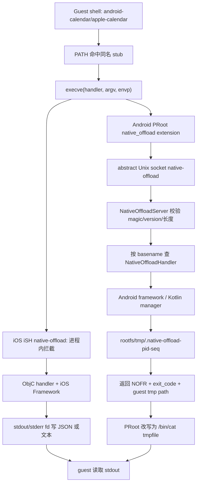

## 8. Native Offload：让沙箱里的 agent 调用设备能力

### 8.1 这一章解决什么问题

Linux guest 适合运行脚本、包管理器和 CLI，但它不能直接调用 iOS 的 EventKit/HealthKit 或 Android 的 ContentProvider、AccessibilityService；Native Offload（原生能力卸载）就是把 guest 中的一个命令映射成宿主进程中的一个受控 handler。它承担发现命令、跨 guest/host 传递参数、调用原生框架、把结构化结果写回 guest stdout 四件事。没有这层，agent 只能把设备当成没有日历、相册、通知、浏览器和麦克风的普通 Linux 主机；有了它，shell 脚本可以组合设备能力，也可以从 `minis-model-use` 反过来调用 LLM。iOS 与 Android 的能力名、权限弹窗和 IPC 细节不同，但两端都把 API key、系统对象和权限状态留在宿主。本文以当前注册表和 handler 为准；旧的 iSH 概述只作为背景，不替代实现源码。

`src/ios/iSH/ISHKernel.m:413-445` `src/android/app/src/main/java/com/openminis/app/MinisApp.kt:367-429` `src/ios/NativeOffloads/NativeOffloadUtils.h:57-94`

### 8.2 先建立正确模型：两个协议层

Native Offload 有两个协议层：

1. **进程捕获层**：guest 通过 `execve()` 找到同名 stub；iOS 的 iSH native-offload 在宿主进程内拦截并把 handler 的 fd 接到 guest 管道，Android 的 PRoot extension 把请求编码后发到抽象 Unix socket。
2. **业务输出层**：handler 自己决定 stdout 是 JSON envelope、纯文本还是文件引用。`OffloadArgs`/`OffloadOutput` 是 Android CLI 参数和 JSON 输出约定，不是 socket wire format；Android socket 上传输的是 argv/env/cwd 的二进制帧。

iOS 当前可直接验证的注册入口是 `ISHKernel`：启动时逐个调用 `*_offload_register()`，每个 handler 再调用 `native_offload_add_handler()` 并创建 guest stub。`src/ios/iSH/ISHKernel.m:394-445` `src/ios/NativeOffloads/WeatherOffload.m:233-240`。iSH 集成说明把运行时链路写成 `execve → native_offload.c → Objective-C handler → EventKit → pipe`，并说明 native handler 负责实时 I/O。`docs/specs/ios-sandbox-ish-summary.md:133-145`。

Android 有完整的宿主端 endpoint：guest exec 触发后，PRoot extension 发送 argv/env/cwd，handler 输出写入 rootfs 内临时文件，再返回 guest 路径；extension 将原 exec 改写成 `/bin/cat <tmpfile>`。`src/android/app/src/main/java/com/openminis/app/sandbox/NativeOffload.kt:15-26`



图中 Android 的 magic/version/临时文件是源码直接实现的协议；iOS 的进程内 fd 语义来自 iSH 集成层文档和 handler 签名。不要把 Android socket 帧误写成 JSON，也不要把 iOS handler stdout envelope 当成统一的 socket 协议。`src/android/app/src/main/java/com/openminis/app/sandbox/NativeOffload.kt:148-217` `src/ios/NativeOffloads/NativeOffloadUtils.h:57-94`

#### 8.2.1 Android 二进制 IPC：字段、方向和边界

Android endpoint 使用 `LocalServerSocket("native-offload")`，名称是 Linux abstract local socket 而不是 TCP 端口；常量给出请求 magic `NOFF`、响应 magic `NOFR`、版本 1。`src/android/app/src/main/java/com/openminis/app/sandbox/NativeOffload.kt:53-70` `src/android/app/src/main/java/com/openminis/app/sandbox/NativeOffload.kt:78-103`

```text
u32 magic = 0x46464F4E      // NOFF
u32 version = 1
u32 pid
u32 argc
repeat argc: u32 byte_len + argv[i] bytes
u32 envc
repeat envc: u32 byte_len + "KEY=VALUE" bytes
u32 cwd_len + cwd bytes

u32 magic = 0x52464F4E      // NOFR
 i32 exit_code
u32 tmpfile_len + guest_tmpfile bytes
```

字段是 little-endian；字符串是“4 字节长度 + UTF-8 bytes”。服务端核对 magic/version，限制 `argc <= 256`、`envc <= 4096`，并限制单字符串不超过 1 MiB；这些是 framing 防线，不是业务参数校验。`src/android/app/src/main/java/com/openminis/app/sandbox/NativeOffload.kt:148-177` `src/android/app/src/main/java/com/openminis/app/sandbox/NativeOffload.kt:221-245`

服务端按 `argv.first().substringAfterLast('/')` 提取 basename，再从 `ConcurrentHashMap<String, NativeOffloadHandler>` 查找；找不到返回 exit 127，handler 抛异常返回 exit 1。业务文本写进 rootfs 的 `/tmp/.native-offload-<pid>-<seq>`，socket 响应只携带临时文件 guest 路径。`src/android/app/src/main/java/com/openminis/app/sandbox/NativeOffload.kt:179-217`

```kotlin
val name = argv.firstOrNull().orEmpty().substringAfterLast('/')
val handler = handlers[name]
val result = if (handler == null) {
    NativeOffloadResult(127, "native_offload: no handler for '$name'\n")
} else {
    handler.handle(NativeOffloadRequest(pid, argv, env, cwd, sessionId = ...))
}
tmpHost.writeText(result.output)
output.writeLEInt(MAGIC_RSP)
output.writeLEInt(result.exitCode)
output.writeLEString("/tmp/${tmpHost.name}")
```

来源：`src/android/app/src/main/java/com/openminis/app/sandbox/NativeOffload.kt:179-217`。每个连接由 daemon worker thread 处理，不同请求可并行进入不同 handler；handler 若调用 `runBlocking`，只阻塞这个 offload worker，不阻塞 Android 主线程。`src/android/app/src/main/java/com/openminis/app/sandbox/NativeOffload.kt:127-146` `src/android/app/src/main/java/com/openminis/app/sandbox/offload/OffloadGate.kt:16-25`

#### 8.2.2 Android 业务参数：`OffloadArgs` 和 `OffloadOutput`

`OffloadArgs` 把 shell argv 分成 positional、flags、values，支持 `--flag`、`--key value`、`--key=value` 和短 flag；所有 handler 共享 `--compact`、`--quiet`、`-q`。`src/android/app/src/main/java/com/openminis/app/sandbox/offload/OffloadArgs.kt:3-14` `src/android/app/src/main/java/com/openminis/app/sandbox/offload/OffloadArgs.kt:19-70`

```kotlin
val args = OffloadArgs(request.argv.drop(1), booleanFlags = setOf("all-day"))
val command = args.positional.firstOrNull() ?: "list"
val limit = args.getInt("limit", "max") ?: 50
val compact = args.hasFlag("compact")
```

来源：`src/android/app/src/main/java/com/openminis/app/sandbox/offload/OffloadArgs.kt:14-18` `src/android/app/src/main/java/com/openminis/app/sandbox/offload/CalendarOffloadHandler.kt:43-50`。

`OffloadOutput.formatBody()` 默认原样返回 body；`--compact` 只改变 JSON 空白；`--quiet` 只有在 JSON 对象有 `error` 或 `data` 时才抽出字段，数组和纯文本不变。它刻意与 iOS `noff_emit_json` 对齐。`src/android/app/src/main/java/com/openminis/app/sandbox/offload/OffloadOutput.kt:15-31` `src/android/app/src/main/java/com/openminis/app/sandbox/offload/OffloadOutput.kt:45-101`

```kotlin
val body = JSONObject().put("error", "permission_denied").toString()
return NativeOffloadResult(126, OffloadOutput.formatBody(body, args) + "\n")
```

来源：`src/android/app/src/main/java/com/openminis/app/sandbox/offload/OffloadGate.kt:52-70`。

#### 8.2.3 iOS 业务输出：JSON envelope 不是 IPC 帧

iOS `NativeOffloadUtils` 定义成功 envelope 为 `{ok, tool, action, data, timestamp}`，失败 envelope 为 `{ok:false, tool, action, error:{code,message}, timestamp}`。`noff_emit_json` 默认 pretty + sorted keys，`--compact` 变单行，`--quiet` 只保留 `data` 或 `error`。`src/ios/NativeOffloads/NativeOffloadUtils.h:57-68` `src/ios/NativeOffloads/NativeOffloadUtils.m:133-193`

```objc
NSDictionary *noff_json_envelope(NSString *tool, NSString *action, id data) {
    return @{
        @"ok": @YES,
        @"tool": tool,
        @"action": action,
        @"data": data ?: [NSNull null],
        @"timestamp": noff_format_date([NSDate date]),
    };
}
```

来源：`src/ios/NativeOffloads/NativeOffloadUtils.m:135-142`。Weather handler 在宿主 API 完成后把 envelope 写到 stdout fd，注册函数再确保 `/usr/local/bin/apple-weather` stub 存在。`src/ios/NativeOffloads/WeatherOffload.m:229-240`

iOS 的 host path helper 只是去掉 guest 绝对路径的前导 slash，再拼到 `Documents/alpine-rootfs/data`；它不是完整的 canonical path sandbox。`src/ios/NativeOffloads/NativeOffloadUtils.m:242-258`


### 8.3 handler 注册与分发：从“加一个命令”到全链路可用

#### 8.3.1 iOS：启动时静态注册，handler 自带 stub

`ISHKernel` 在挂载 fakefs、创建 PID 1、TTY 和 stdio 后，按固定顺序注册原生命令。当前列表包括 `ffmpeg`、Apple 服务、`minis-model-use`、`minis-sessions-cli`、`minis-browser-use`、`minis-config` 和 `minis-debug`。`src/ios/iSH/ISHKernel.m:394-445`

| 注册行 | 命令 | 注册函数/实现 |
|---:|---|---|
| 413-419 | `ffmpeg`、`apple-calendar`、`apple-location`、`apple-weather`、`apple-vision`、`apple-open` | `FFmpegOffload.m`、`CalendarOffload.m`、`LocationOffload.m`、`WeatherOffload.m`、`VisionOffload.m`、`OpenOffload.m` |
| 420-426 | `apple-clipboard`、`apple-healthkit`、`apple-photos`、`apple-maps`、`apple-nlp`、`apple-alarm`、`apple-media` | 对应 `*_offload_register()` |
| 427-433 | `apple-speak`、`apple-speech`、`apple-device`、`apple-homekit`、`apple-notification`、`apple-player`、`minis-model-use` | 对应 handler 与 Swift bridge |
| 434-445 | `apple-reminders`、`apple-bluetooth`、`apple-nfc`、`minis-sessions-cli`、`minis-browser-use`、`minis-config`、`minis-debug` | 对应 handler；debug handler 在 Release 中仍提供日志子命令 |

每个 handler 的注册函数把公开名字交给 `native_offload_add_handler()`，成功后调用 `noff_ensure_guest_stub()`。以 Weather 为例，真正的路由键是 `apple-weather`，stub 是 `/usr/local/bin/apple-weather`；guest 只需要 PATH 命中这个文件。`src/ios/NativeOffloads/WeatherOffload.m:233-240`。FFmpeg 例外是命令名直接为 `ffmpeg`，它把 `ffmpeg_main()` 在宿主线程执行并把 stdout/stderr 重定向回 guest。`src/ios/NativeOffloads/FFmpegOffload.m:217-220` `src/ios/NativeOffloads/FFmpegOffload.m:243-340` `src/ios/NativeOffloads/FFmpegOffload.m:342-348`

新增 iOS handler 的最小步骤：

1. 建立 `FooOffload.m`/`.h`，实现 `foo_handler(argc, argv, stdin_fd, stdout_fd, stderr_fd)`。
2. 用 `noff_json_envelope`/`noff_json_error` 输出结构化结果，对输入做参数和 exit code 检查。
3. 加 `foo_offload_register()`，调用 `native_offload_add_handler("apple-foo", foo_handler)`，成功后 `noff_ensure_guest_stub("/usr/local/bin/apple-foo")`。
4. 在 `ISHKernel.m` 注册区调用它；若需要 Swift-only 框架，则加 bridge，通过 generated Swift header 暴露最小异步入口。
5. 把系统权限和拒绝后的 JSON error 写进 handler；隐私能力再加入 `OffloadPermissionManager.allCommands`。

验收不是“文件能编译”：guest 中 `foo --help` 必须命中 stub；错误参数要返回非零 exit code；首次授权和拒绝不能让线程永久等待；Release 不能意外暴露 debug-only RPC。`src/ios/NativeOffloads/NativeOffloadUtils.h:23-30` `src/ios/NativeOffloads/HealthKitOffload.m:239-257` `src/ios/iSH/ISHKernel.m:440-445`

#### 8.3.2 Android：先注册 map，再 boot PRoot 和 stub

Android 在 `MinisApp.onCreate()` 先把 handler 放入 `NativeOffloadServer` map，再启动 server；socket 可以在 shell session 启动前接收连接。当前注册区覆盖 `android-*`、`minis-*`、Accessibility、Shizuku 和 debug。`src/android/app/src/main/java/com/openminis/app/MinisApp.kt:367-429`

```kotlin
NativeOffloadServer.register("android-calendar", CalendarOffloadHandler(this))
NativeOffloadServer.register("android-a11y-cli", AccessibilityOffloadHandler(this))
NativeOffloadServer.register("minis-model-use", ModelUseOffloadHandler(this, providerRepository))
NativeOffloadServer.register("minis-config", ConfigOffloadHandler())
NativeOffloadServer.register("android-shizuku-cli", ShizukuOffloadHandler(this))
if (BuildConfig.DEBUG) {
    NativeOffloadServer.register("minis-debug", DebugOffloadHandler(this))
}
NativeOffloadServer.start(RootfsManager.getInstance(this).rootfsDir)
```

来源：`src/android/app/src/main/java/com/openminis/app/MinisApp.kt:367-429`。随后 `PRootKernel.boot()` 启动 server 后，遍历已注册名字创建 `/usr/local/bin/<name>` stub；stub 只需要是可执行 shell 文件，因为 PRoot 会在真正运行前拦截 `execve`。`src/android/app/src/main/java/com/openminis/app/sandbox/PRootKernel.kt:150-178` `src/android/app/src/main/java/com/openminis/app/sandbox/PRootKernel.kt:699-717`

每次 PRoot 命令的 argv 还带上 `--native-offload=<socket>:<comma-separated-handlers>`；这是 extension 获取 socket 名称和允许 basename 的入口。`src/android/app/src/main/java/com/openminis/app/sandbox/PRootKernel.kt:576-647`。新增 Android handler 的步骤是：

1. 实现 `NativeOffloadHandler.handle(NativeOffloadRequest)`，用 `OffloadArgs` 解析 argv。
2. 在 `MinisApp.onCreate()` 注册稳定名字；名字必须与 stub basename、帮助文本和权限 registry 一致。
3. 让 PRoot boot 后自动 materialize stub，不要提交一个会被覆盖的 rootfs 二进制。
4. 对隐私/提权能力在 handler 入口调用 `OffloadGate.enforce()` 或系统权限流程。
5. 用 `OffloadOutput.formatBody()` 统一 compact/quiet，并把错误映射到稳定 exit code。
6. 跨 session 输出使用 request `sessionId` 或显式 resolver，不要把最后一次挂载当成当前调用者。

`NativeOffloadServer.register()` 只检查名字非空并覆盖同名 map；它不自动验证 handler 的权限或业务参数。`src/android/app/src/main/java/com/openminis/app/sandbox/NativeOffload.kt:62-76`。所以“注册成功”不等于“安全可用”，新 handler 的安全边界必须在入口建立。

### 8.4 能力总表：两端同一个抽象如何落地

表中“确认”区分：`无` 表示代码不显示 app 内确认；`系统` 表示系统权限或设置页；`应用` 表示 Minis 自己的 Ask Once/Config confirm；`系统+应用` 表示两层都存在。iOS 静态 app gate 清单见 `OffloadPermissionManager.allCommands`，未列入的命令不会被 `extractOffloadCommand` 识别为 gate。`src/ios/Agent/Offload/OffloadPermissionManager.swift:124-147` `src/ios/Agent/Offload/OffloadPermissionManager.swift:181-191`

| 能力 | iOS 实现 | Android 实现 | 所需权限/前置条件 | 是否需要用户确认 |
|---|---|---|---|---|
| 反向调用 LLM | `minis-model-use` + `ModelUseOffloadBridge`，解析可见 model entry | `minis-model-use` + `ProviderRepository`/`ProviderFactory` | 宿主已配置 provider API key；模型在 Agent Loop 可见 | 无额外系统权限；调用由 agent 发起 |
| 浏览器自动化 | `minis-browser-use` + `BrowserUseOffloadBridge`，驱动 WKWebView | `minis-browser-use` + `sharedBrowserTabPool`，单 tab 模式 | 网络；浏览器池可用 | 无系统权限；页面登录/站点确认仍存在 |
| 配置读取 | `minis-config get/list-topics` + Config bridge | `minis-config` + `ConfigBridge` | 配置 registry；隐藏字段不可读 | 读取无；写入另有确认 |
| 配置写入/审计回滚 | `ConfigOffload.m` 的 `set/set-batch/audit-revert` | `ConfigOffloadHandler` 对应命令 | value JSON、路径和批量大小校验 | **应用确认**；每批一次 |
| 会话查询 | `minis-sessions-cli`，可 list/search/messages/send/retry/status/open | `minis-sessions-cli`，当前主要 list/search/messages | ChatStore/Room 数据库 | 无额外权限；数据隐私可另设 gate |
| 定时 AI 任务 | 当前 iOS 注册表没有 `minis-scheduled` | `minis-scheduled` + ScheduledTaskManager/AlarmManager | Android alarm/通知和任务 runner | 通常由用户创建；run-now 由 agent 调用 |
| Debug RPC | `minis-debug`；Release 仍允许 logs，RPC 子命令 DEBUG gate | `minis-debug` 仅 `BuildConfig.DEBUG` 注册 | DebugServer/OSLogStore | Release 不可用 |
| 设备信息 | `apple-device`，型号、OS、电池、存储 | `android-device`，model/OS/battery/storage | 无危险 runtime permission | 无 |
| 日历 | `apple-calendar` + EventKit | `android-calendar` + CalendarContract/CalendarManager | iOS Calendar authorization；Android READ/WRITE_CALENDAR | 系统 + app gate 可 ASK_ONCE |
| 提醒事项 | `apple-reminders` 复用 EventKit reminder store | 当前无独立 reminders handler | iOS Reminders authorization | 系统 + iOS privacy gate |
| 联系人 | 当前没有 `apple-contacts` handler | `android-contacts` + ContactsContract | READ_CONTACTS；删除还需 WRITE_CONTACTS | 系统 + Android privacy gate |
| 相册查询 | `apple-photos` + Photos/PhotosUI | `android-photos` + MediaStore | iOS Photos read/write；Android READ_MEDIA_IMAGES/selected media | 系统 + app gate |
| 相册原图地理信息 | Photos handler 读取 PHAsset metadata | MediaStore 原图需要 ACCESS_MEDIA_LOCATION | 相册访问 + media-location 条件 | 系统 |
| 健康数据 | `apple-healthkit` + HKHealthStore | 当前无 Health Connect offload | HealthKit entitlement、数据类型授权 | 系统 + iOS privacy gate |
| 智能家居 | `apple-homekit` + HMHomeManager/accessory/scene | 当前没有 HomeKit 等价 handler | HomeKit entitlement、家庭授权、主线程 ready | 系统/家庭授权 + app gate |
| 当前位置 | `apple-location` + CLLocationManager | `android-location` + LocationManager/Fused path | iOS When In Use；Android FINE/COARSE_LOCATION | 系统 + app gate |
| 天气 | `apple-weather` + WeatherKit，位置由 CLLocationManager 提供 | `android-weather` + Open-Meteo，无 API key | iOS current weather 需要 location；Android 网络 | iOS 系统 location；Android 无 |
| 地图/地点/路线 | `apple-maps` + MapKit/CLGeocoder | 无独立 maps offload；可用 browser/open | iOS MapKit；坐标/地点输入 | 通常无 |
| 剪贴板 | `apple-clipboard` + UIPasteboard | `android-clipboard` + ClipboardManager | Android 10+ 后台读取需前台；iOS 有 pasteboard privacy | app gate 可 ASK_ONCE；Android 还需前台 |
| 本地通知 | `apple-notification` + UserNotifications | `android-notification` + NotificationManager/ScheduledNotificationStore | iOS notification auth；Android POST_NOTIFICATIONS；list 需 Notification Access | 系统；Android settings gate |
| 闹钟/计时器 | `apple-alarm` + AlarmKit bridge（iOS 26+） | `android-alarm` + Clock intents/AlarmManager | iOS AlarmKit；Android SET_ALARM/SCHEDULE_EXACT_ALARM | 系统/设置 |
| 语音合成 | `apple-speak` + AVSpeechSynthesizer | `android-speak` + Android TTS | 无危险权限 | 无 |
| 语音识别 | `apple-speech` + SFSpeechRecognizer/AVAudioSession | `android-speech` + SpeechRecognizer | iOS Speech + microphone；Android RECORD_AUDIO | 系统 |
| 播放器会话 | `apple-player` + AVPlayer bridge | `android-player` + MediaPlayerManager | 音频路径/session；无危险权限 | 无 |
| Media Library | `apple-media` + MPMediaLibrary/AVFoundation | 无同名 library handler；Player 管 app 会话 | iOS Media Library authorization | iOS 系统 |
| FFmpeg 转码 | `ffmpeg` + FFmpeg.framework `ffmpeg_main` | 当前无 FFmpeg handler | 输入输出文件/网络 | 无；iOS handler 自己 mutex 串行 |
| Vision/OCR/条码 | `apple-vision` + Vision | 当前无同名 vision handler | 图片路径；相册输入另算 | 无 |
| NLP | `apple-nlp` + NaturalLanguage | 当前无同名 handler | 文本 | 无 |
| Bluetooth LE | `apple-bluetooth` + CoreBluetooth | 当前无对应 handler | Bluetooth entitlement/系统授权 | 系统 |
| NFC | `apple-nfc` + CoreNFC session | 当前无对应 handler | NFC capability、实体标签和用户动作 | 系统 session/用户动作 |
| 打开 URL/应用 | `apple-open` + UIApplication/openURL | `android-open` + Intent/Activity | 系统是否有 resolver/OEM fallback | 无 |
| Accessibility UI 自动化 | 无通用系统级等价 offload | `android-a11y-cli` + AccessibilityService | Settings → Accessibility 手动启用；API 30 截图 | **应用默认 NOT_ALLOWED + 系统设置** |
| Shizuku/ADB 级控制 | 无等价提权通道 | `android-shizuku-cli` + Shizuku binder，uid 2000/0 | manager/binder、用户授权、ADB/root 启动 | **应用默认 NOT_ALLOWED + Shizuku 授权** |

iOS 现有注册表可核对 `ffmpeg`、Apple 命令和 `minis-*`，而不是旧文档中的“22 total”。`src/ios/iSH/ISHKernel.m:413-445`。Android 全部注册名和 debug 条件见 `src/android/app/src/main/java/com/openminis/app/MinisApp.kt:371-426`；manifest 的危险权限与特殊服务见 `src/android/app/src/main/AndroidManifest.xml:39-102` `src/android/app/src/main/AndroidManifest.xml:466-525`。

能力表的实现名可由以下源码符号核对，而不是仅看产品文案：iOS 各 handler 的 `TOOL_NAME` 定义集中在 `src/ios/NativeOffloads/AlarmOffload.m:25-27`、`src/ios/NativeOffloads/CalendarOffload.m:15-17`、`src/ios/NativeOffloads/HealthKitOffload.m:18-20`、`src/ios/NativeOffloads/HomeKitOffload.m:22-24`、`src/ios/NativeOffloads/LocationOffload.m:15-18`、`src/ios/NativeOffloads/ModelUseOffload.m:15-17`、`src/ios/NativeOffloads/PhotosOffload.m:18-22`、`src/ios/NativeOffloads/SpeechOffload.m:16-20`、`src/ios/NativeOffloads/WeatherOffload.m:22-26`，总注册调用见 `src/ios/iSH/ISHKernel.m:413-445`。

Android 对应的 handler 类和入口分别位于 `src/android/app/src/main/java/com/openminis/app/sandbox/offload/AccessibilityOffloadHandler.kt:28-40`、`src/android/app/src/main/java/com/openminis/app/sandbox/offload/AlarmOffloadHandler.kt:37-43`、`src/android/app/src/main/java/com/openminis/app/sandbox/offload/CalendarOffloadHandler.kt:43-50`、`src/android/app/src/main/java/com/openminis/app/sandbox/offload/ContactsOffloadHandler.kt:28-34`、`src/android/app/src/main/java/com/openminis/app/sandbox/offload/LocationOffloadHandler.kt:47-53`、`src/android/app/src/main/java/com/openminis/app/sandbox/offload/ModelUseOffloadHandler.kt:35-51`、`src/android/app/src/main/java/com/openminis/app/sandbox/offload/NotificationOffloadHandler.kt:53-89`、`src/android/app/src/main/java/com/openminis/app/sandbox/offload/PhotosOffloadHandler.kt:56-64`、`src/android/app/src/main/java/com/openminis/app/sandbox/offload/ShizukuOffloadHandler.kt:41-69`，完整注册 map 见 `src/android/app/src/main/java/com/openminis/app/MinisApp.kt:371-426`。
未在上组展开的工具名仍可由以下符号核对：iOS `src/ios/NativeOffloads/BluetoothOffload.m:16-20`、`src/ios/NativeOffloads/BrowserUseOffload.m:24-33`、`src/ios/NativeOffloads/ClipboardOffload.m:14-18`、`src/ios/NativeOffloads/ConfigOffload.m:46-50`、`src/ios/NativeOffloads/DeviceOffload.m:16-20`、`src/ios/NativeOffloads/DebugOffload.m:30-34`、`src/ios/NativeOffloads/FFmpegOffload.m:342-348`、`src/ios/NativeOffloads/MapsOffload.m:17-21`、`src/ios/NativeOffloads/MediaOffload.m:16-20`、`src/ios/NativeOffloads/NFCOffload.m:67-71`、`src/ios/NativeOffloads/NLPOffload.m:15-19`、`src/ios/NativeOffloads/NotificationOffload.m:14-18`、`src/ios/NativeOffloads/OpenOffload.m:14-18`、`src/ios/NativeOffloads/PlayerOffload.m:17-21`、`src/ios/NativeOffloads/RemindersOffload.m:14-18`、`src/ios/NativeOffloads/SessionsOffload.m:48-52`、`src/ios/NativeOffloads/SpeakOffload.m:15-19`、`src/ios/NativeOffloads/VisionOffload.m:15-19`；Android `src/android/app/src/main/java/com/openminis/app/sandbox/offload/BrowserUseOffloadHandler.kt:39-49`、`ConfigOffloadHandler.kt:39-47`、`DeviceOffloadHandler.kt:26-32`、`OpenOffloadHandler.kt:27-35`、`PlayerOffloadHandler.kt:20-28`、`ScheduledTaskOffloadHandler.kt:41-48`、`SessionsOffloadHandler.kt:37-45`、`SpeakOffloadHandler.kt:43-51`、`SpeechOffloadHandler.kt:63-71`、`WeatherOffloadHandler.kt:37-45`。

### 8.5 权限模型：应用 gate、系统授权和拒绝降级

#### 8.5.1 iOS 三态 gate

iOS `OffloadPermissionLevel` 是 `bypass`、`askOnce`、`notAllowed`。永久等级写入 `UserDefaults` 的 `offloadPermission.<command>`，Ask Once grant 只存内存中的 `[sessionId: Set<command>]`。`src/ios/Agent/Offload/OffloadPermissionManager.swift:6-22` `src/ios/Agent/Offload/OffloadPermissionManager.swift:151-179`

```swift
switch level {
case .bypass:
    return .allowed
case .notAllowed:
    return .denied("Permission denied: the user has disabled ...")
case .askOnce:
    if sessionGrants[sessionId]?.contains(command) == true { return .allowed }
    let allowed = await withCheckedContinuation { continuation in
        pendingRequest = PermissionRequest(..., continuation: continuation)
        Task { @MainActor in
            try? await Task.sleep(nanoseconds: 30_000_000_000)
            if pendingRequest?.id == request.id {
                pendingRequest = nil
                continuation.resume(returning: false)
            }
        }
    }
    if allowed { sessionGrants[sessionId, default: []].insert(command) }
    return allowed ? .allowed : .denied("...")
}
```

来源：`src/ios/Agent/Offload/OffloadPermissionManager.swift:195-256`。shell 工具在真正启动 iSH 命令前，从 command 第一个 token 提取已知 offload，调用 `checkPermission`；拒绝时不会进入 guest。`src/ios/Agent/Chat/AIChatViewModel+ConcurrentTools.swift:216-250`。

永久 `notAllowed` 的降级是结构化用户消息，提示 Settings → Permissions；Ask Once 拒绝或 30 秒超时会变成 `toolSuccess = false`，不会伪装成功。`src/ios/Agent/Offload/OffloadPermissionManager.swift:243-254` `src/ios/Agent/Chat/AIChatViewModel+ConcurrentTools.swift:238-245`

这个 gate 只覆盖 allCommands 中的隐私命令；媒体和系统项被登记成默认 bypass。`src/ios/Agent/Offload/OffloadPermissionManager.swift:124-147`。这不等于跳过 Apple 系统授权：Calendar 仍调用 EventKit，Photos 仍调用 PHPhotoLibrary，Speech 仍调用 SFSpeechRecognizer。`src/ios/NativeOffloads/CalendarOffload.m:112-188` `src/ios/NativeOffloads/PhotosOffload.m:129-147` `src/ios/NativeOffloads/SpeechOffload.m:143-157`

#### 8.5.2 iOS 系统 API 首次调用的约束

- **HealthKit**：多个 guest handler 线程同时授权时，iOS 一次只允许一个 HealthKit sheet。代码用串行 `NSOperationQueue`，在 sheet 消失后等待；同时过滤只能读不能 share 的类型，以 `@try/@catch` 防止版本变化导致 ObjC exception。`src/ios/NativeOffloads/HealthKitOffload.m:239-281` `src/ios/NativeOffloads/HealthKitOffload.m:284-355`
- **EventKit**：Calendar 和 Reminders 共用单例 `EKEventStore`，首次调用按 entity type 请求访问。`src/ios/NativeOffloads/CalendarOffload.m:112-120` `src/ios/NativeOffloads/CalendarOffload.m:145-188`
- **Location/Weather**：Location 在 NotDetermined 时请求 When In Use；Weather 先取 CLLocation，再调用 Swift WeatherKit bridge。`src/ios/NativeOffloads/LocationOffload.m:101-123` `src/ios/NativeOffloads/WeatherOffload.m:8-13` `src/ios/NativeOffloads/WeatherOffload.m:94-100`
- **HomeKit**：`HMHomeManager` 必须在主线程长存，并等待 `homeManagerDidUpdateHomes:`。`src/ios/NativeOffloads/HomeKitOffload.m:77-119`
- **Media/Notification**：Media Library 和 UserNotifications 各自调用系统 request authorization。`src/ios/NativeOffloads/MediaOffload.m:68-84` `src/ios/NativeOffloads/NotificationOffload.m:244-270`

#### 8.5.3 Android 三态 gate 和系统 permission coordinator

Android registry 定义 BYPASS、ASK_ONCE、NOT_ALLOWED；日历、位置、剪贴板、联系人、相册默认 BYPASS，Accessibility 和 Shizuku integrations 默认 NOT_ALLOWED。`src/android/app/src/main/java/com/openminis/app/offload/OffloadPermissionManager.kt:13-17` `src/android/app/src/main/java/com/openminis/app/offload/OffloadPermissionManager.kt:59-100`

永久等级存于 `SharedPreferences("offload_permissions")` 的 `level_<toolName>`；grant/denial 是内存 session map，session 结束清除。`src/android/app/src/main/java/com/openminis/app/offload/OffloadPermissionManager.kt:101-120` `src/android/app/src/main/java/com/openminis/app/offload/OffloadPermissionManager.kt:308-334` `src/android/app/src/main/java/com/openminis/app/offload/OffloadPermissionManager.kt:336-413`

handler 是同步接口，而权限 UI 是 suspend，所以 `OffloadGate.allow()` 用 `runBlocking` 把 IPC worker 暂停到用户响应；被拒绝时返回 exit 126 和 `permission_denied` envelope。`src/android/app/src/main/java/com/openminis/app/sandbox/offload/OffloadGate.kt:16-25` `src/android/app/src/main/java/com/openminis/app/sandbox/offload/OffloadGate.kt:40-70`

Android runtime 系统授权另有 coordinator：

1. `requestAndroidPermission()` 把权限暴露给 UI，最长等待 120 秒；denied 后可进入 Settings gate 并轮询 grant。`src/android/app/src/main/java/com/openminis/app/offload/OffloadPermissionManager.kt:124-182` `src/android/app/src/main/java/com/openminis/app/offload/OffloadPermissionManager.kt:190-263`。
2. 代码持久记录“是否曾询问过”某个 permission，以区分“从未问过”和“永久拒绝”。`src/android/app/src/main/java/com/openminis/app/offload/OffloadPermissionManager.kt:293-305`。
3. Notification `send/schedule` 在 Android 13+ 检查 POST_NOTIFICATIONS，拒绝后转 app details Settings；超时/拒绝返回 exit 77。`src/android/app/src/main/java/com/openminis/app/sandbox/offload/NotificationOffloadHandler.kt:103-177`。
4. Calendar、Contacts、Location、Photos 都有系统权限 + settings gate 模式。`src/android/app/src/main/java/com/openminis/app/sandbox/offload/LocationOffloadHandler.kt:120-141` `src/android/app/src/main/java/com/openminis/app/sandbox/offload/ContactsOffloadHandler.kt:100-122`。
5. Accessibility、Notification Access、Shizuku、exact alarm 不是普通 runtime permission；handler 只能检测状态并给下一步。`src/android/app/src/main/AndroidManifest.xml:466-525` `src/android/app/src/main/java/com/openminis/app/sandbox/offload/ShizukuOffloadHandler.kt:71-80`。

常见错误是只检查 `PackageManager.PERMISSION_GRANTED`，不处理永久拒绝后系统不会再次弹窗。本项目把“system dialog → grant race polling → settings gate → timeout”拆成可复用状态机，读者应保留这个顺序。

### 8.6 ModelUse offload：为什么让 guest 再调用一次 LLM

#### 8.6.1 设计动机和接口

普通 agent loop 已在宿主中调用模型，但脚本、批处理和第三方 skill 不能直接访问 provider 对象。`minis-model-use` 给 guest 一个稳定 CLI：脚本可以列出模型、按 provider 搜索，再提交 OpenAI Chat Completions 形状的 JSON；宿主负责模型解析、API key、provider body 转换、multimodal 文件落盘和 usage 返回。iOS help 把 `--input/stdin` 限定为 provider-agnostic OpenAI shape，并说明不要手写 provider-native body。`src/ios/NativeOffloads/ModelUseOffload.m:62-73`。Android 只暴露 `resolvedAgentLoopEntries()` 中允许 agent 使用的模型。`src/android/app/src/main/java/com/openminis/app/sandbox/offload/ModelUseOffloadHandler.kt:21-34`

接口最小集合：

```text
minis-model-use list [--provider P] [--modality M]
minis-model-use search <query> [--provider P] [--modality M]
minis-model-use run --model <id_or_name>
    [--provider <instance>] [--input <json-path>]
    [--system <text>|--system-file <path>]
    [--max-tokens N] [--temperature F]
    [--output <absolute-path>]
```

iOS 另有 `--prompt`、`--prompt-file`、`--stream` 和 `--endpoint`；Android 当前 help 没有 `--stream`，但支持 image generation 和 OpenAI-compatible passthrough。`src/ios/NativeOffloads/ModelUseOffload.m:29-60` `src/android/app/src/main/java/com/openminis/app/sandbox/offload/ModelUseOffloadHandler.kt:1709-1778`

模型选择不是“把任意 API endpoint 暴露给 guest”：iOS `resolveModelEntry` 和 Android `resolveEntry` 都从 app 配置解析可见 entry；重复 model id 要用 `instance_label/model_id` 或 `--provider` 消歧。`src/ios/NativeOffloads/ModelUseOffloadBridge.swift:84-134` `src/android/app/src/main/java/com/openminis/app/sandbox/offload/ModelUseOffloadHandler.kt:115-135`

#### 8.6.2 iOS 调用路径：ObjC 同步 CLI → Swift Task → provider

ObjC handler 负责 shell 世界：读取 stdin/input/prompt、拒绝相对 output path、创建 semaphore，调用 Swift `runModel`。`runModel` 在 `Task` 内 await `performRun`，最后通过 completion 回到 ObjC。`src/ios/NativeOffloads/ModelUseOffload.m:295-407` `src/ios/NativeOffloads/ModelUseOffload.m:409-447` `src/ios/NativeOffloads/ModelUseOffloadBridge.swift:182-214`

```objc
__block NSDictionary *result = nil;
__block NSString *errorMsg = nil;
dispatch_semaphore_t sem = dispatch_semaphore_create(0);
[ModelUseOffloadBridge runModelWithIdOrName:modelIdOrName
    providerFilter:providerFilter inputJSON:inputJSON
    systemPrompt:systemPrompt maxTokens:maxTokens
    temperature:temperature outputHostPath:outputHostPath
    streamFd:streamFd completion:^(NSDictionary *data, NSString *error) {
        result = data;
        errorMsg = error;
        dispatch_semaphore_signal(sem);
    }];
dispatch_semaphore_wait(sem, dispatch_time(DISPATCH_TIME_NOW, 300 * NSEC_PER_SEC));
```

来源：`src/ios/NativeOffloads/ModelUseOffload.m:409-447`。这里有一个真实坑：代码没有检查 `dispatch_semaphore_wait` 返回值；5 分钟超时且 completion 未到达时，非 streaming 分支可能把空 result 当作成功 envelope。新实现应显式返回 `model_timeout`。

Swift `performRun` 先解析模型和 provider，再识别 passthrough，接着解析 OpenAI messages、generation config、extra body/headers，最后在 streaming 或普通 `sendMessage` 路由执行。`src/ios/NativeOffloads/ModelUseOffloadBridge.swift:280-327` `src/ios/NativeOffloads/ModelUseOffloadBridge.swift:632-687`

- streaming 逐 token 写 `streamFd`，结束写换行；全量文本仍在内存中累积并可写 output file。`src/ios/NativeOffloads/ModelUseOffloadBridge.swift:643-680`。
- non-streaming 调用 `provider.sendMessage`，按 output extension 或 session attachments 保存图片/音频/视频，并在 JSON 中返回 `media_files`。`src/ios/NativeOffloads/ModelUseOffloadBridge.swift:681-802`。
- usage 只把 provider 返回的 input/output token 放回结果；没有本地价格表或余额扣减。`src/ios/NativeOffloads/ModelUseOffloadBridge.swift:782-802`。

#### 8.6.3 Android 调用路径：worker → `runBlocking` → provider

Android `cmdRun` 解析 model、拒绝 relative output、读取 guest input，通过 `ProviderRepository.loadApiKey()` 得到 host-side key，再创建 provider。`src/android/app/src/main/java/com/openminis/app/sandbox/offload/ModelUseOffloadHandler.kt:115-186` `src/android/app/src/main/java/com/openminis/app/sandbox/offload/ModelUseOffloadHandler.kt:188-275`

```kotlin
val apiKey = providerRepository.loadApiKey(entry.providerInstanceId)
    ?: return NativeOffloadResult(2, "missing_api_key\n")
val provider = ProviderFactory.create(instance, apiKey, entry.model, context)
val response = runBlocking {
    provider.sendMessage(
        messages = messages,
        systemPrompt = systemPrompt,
        maxTokens = maxTokens,
        temperature = temperature,
        imageParts = imageParts,
    )
}
```

来源：`src/android/app/src/main/java/com/openminis/app/sandbox/offload/ModelUseOffloadHandler.kt:260-289` `src/android/app/src/main/java/com/openminis/app/sandbox/offload/ModelUseOffloadHandler.kt:379-399`。key 不经过 guest argv/env，也不会出现在 `NativeOffloadResult`；skill 可以“用模型”但不能直接读取 provider secret。

Android 对 multimodal 做显式 precheck：输入有 audio block 但模型没有 audio modality 时失败；非 OpenAI-compatible provider 会拒绝当前 input_audio 路径而不是悄悄丢音频。`src/android/app/src/main/java/com/openminis/app/sandbox/offload/ModelUseOffloadHandler.kt:224-241` `src/android/app/src/main/java/com/openminis/app/sandbox/offload/ModelUseOffloadHandler.kt:276-289`。passthrough 只接受 OpenAI provider，并允许 raw body/headers/endpoint path；返回带 HTTP status、warnings 和 applied extras。`src/android/app/src/main/java/com/openminis/app/sandbox/offload/ModelUseOffloadHandler.kt:294-321` `src/android/app/src/main/java/com/openminis/app/sandbox/offload/ModelUseOffloadHandler.kt:647-709`

普通输出回传 `model`、`text`、可选 `usage`、`output_file` 和媒体引用；没有 output path 时，媒体自动保存到调用 session 的 attachments。`src/android/app/src/main/java/com/openminis/app/sandbox/offload/ModelUseOffloadHandler.kt:401-478`。iOS 也根据 mounted session 选择 attachment 目录，避免并发 session 共享动态 symlink。`src/ios/NativeOffloads/ModelUseOffloadBridge.swift:694-761`

#### 8.6.4 并发、超时、计费和预算：代码实际做了什么

| 维度 | iOS 当前实现 | Android 当前实现 | 从零实现建议 |
|---|---|---|---|
| 并发 | 每次 handler 一个 Swift `Task`，ObjC 一个 semaphore；无 ModelUse 全局串行锁 | server 每连接 worker；handler 在 worker 中 `runBlocking`；无 ModelUse 全局串行锁 | 按 provider/key 或 session 建 semaphore |
| 单次上限 | ObjC 等 completion 最多 300 秒，但 wait 返回值未检查 | ModelUse handler 无统一 timeout，依赖 provider/外层 shell | provider call 外包 `withTimeout`，明确 timeout exit code |
| 生成长度 | `--max-tokens` 默认 4096，传给 provider | 同样默认 4096 | 同时限制 input bytes、output tokens、wall-clock |
| 价格/余额 | 只回传 `usage.input_tokens/output_tokens`；未见本地 cost/quota ledger | 只回传同名 usage；未见本地 cost/quota ledger | token usage 乘 price，持久写 budget，超额前置拒绝 |
| stream | iOS 有 `--stream`，直接写 fd；stream result 不含完整 usage | 当前 CLI 无 stream flag，返回完整响应 | token stream 与最终 accounting 做两阶段提交 |
| API key | Swift provider factory 在 app 进程创建 provider | `ProviderRepository.loadApiKey` 在宿主读取 | 永远不把 key 放进 guest 文件、stdout、error |

“没有计费/预算控制”是指相关 handler 文件只有 `maxTokens` 和 usage 回传，没有价格、余额、quota、budget 分支，不是说 provider API 不收费。`src/ios/NativeOffloads/ModelUseOffload.m:240-246` `src/ios/NativeOffloads/ModelUseOffloadBridge.swift:793-798` `src/android/app/src/main/java/com/openminis/app/sandbox/offload/ModelUseOffloadHandler.kt:260-265` `src/android/app/src/main/java/com/openminis/app/sandbox/offload/ModelUseOffloadHandler.kt:464-478`

真正预算实现应在 provider entry 解析后、读取 key 前做 `estimate(input) + maxTokens <= sessionBudget`；调用结束以实际 usage 原子扣减。并发调用不能同时通过余额检查，reserve 与 settle 要由同一把锁或数据库事务保护。当前代码没有这一步，不能声称它已防止 API 费用失控。

### 8.7 Android 独有的 Accessibility 与 Shizuku

#### 8.7.1 Accessibility：把 UI 树变成短期可引用对象

`MinisAccessibilityService` 是 host-side Android `AccessibilityService`，用户必须在系统设置手动开启，应用不会也不能程序化启动。服务实例存入静态 `_instance`；收到事件时写入容量 1024 的 ring，并通知 listeners。`src/android/app/src/main/java/com/openminis/app/accessibility/MinisAccessibilityService.kt:23-39` `src/android/app/src/main/java/com/openminis/app/accessibility/MinisAccessibilityService.kt:49-99`

handler CLI 分成 `ui/tap/input/scroll/gesture/wait/event/notify/dialog/extract/service`，非 diagnostic 子命令先过 `OffloadGate("a11y_cli")`；`service status/ping` 可在未授权时报告服务状态。`src/android/app/src/main/java/com/openminis/app/sandbox/offload/AccessibilityOffloadHandler.kt:34-56` `src/android/app/src/main/java/com/openminis/app/sandbox/offload/AccessibilityOffloadHandler.kt:81-145`

`ui dump` 枚举 windows/root nodes，递归读取 class/text/contentDescription/bounds/clickable，并通过 `NodeRegistry` 分配短 ID；后续 `tap node a3f2` 使用这个 ID。`src/android/app/src/main/java/com/openminis/app/sandbox/offload/AccessibilityOffloadHandler.kt:173-223`。节点不是永久句柄：`AccessibilityNodeInfo` 刷新后 identity 不保证，registry 只保留 60 秒，service destroy 时清空。`src/android/app/src/main/java/com/openminis/app/accessibility/NodeRegistry.kt:7-16` `src/android/app/src/main/java/com/openminis/app/accessibility/NodeRegistry.kt:23-56`

动作最终调用 Accessibility API；输入文本使用 `ACTION_SET_TEXT`，截图使用 API 30+ `takeScreenshot`，截图有 5 秒 latch timeout，API 30 以下返回 not supported。`src/android/app/src/main/java/com/openminis/app/accessibility/MinisAccessibilityService.kt:206-263` `src/android/app/src/main/java/com/openminis/app/sandbox/offload/AccessibilityOffloadHandler.kt:329-340`

安全边界不是“agent 只能操作 Minis 自己 UI”：AccessibilityService 可以看到系统窗口和其他 app 的可访问树，所以 registry 默认 NOT_ALLOWED 必要。即便系统服务已启用，`OffloadPermissionManager` 仍要求 app integration gate 通过。`src/android/app/src/main/java/com/openminis/app/offload/OffloadPermissionManager.kt:84-100`

#### 8.7.2 Shizuku：不是 root API，而是显式特权 shell 通道

Shizuku backend 检查未安装、binder 未运行、已连接但 app 未授权三种状态，只有 `READY` 才允许调用。`src/android/app/src/main/java/com/openminis/app/offload/ShizukuBackend.kt:50-76`。ready snapshot 暴露 uid：2000 是 adb shell，0 是 root；handler `service status` 报告 state/version/uid/startup_type。`src/android/app/src/main/java/com/openminis/app/sandbox/offload/ShizukuOffloadHandler.kt:110-130`

非 service 子命令先经过默认 NOT_ALLOWED 的 `shizuku_cli` gate，再检查 binder/授权。`src/android/app/src/main/java/com/openminis/app/sandbox/offload/ShizukuOffloadHandler.kt:51-80`。通过后 backend 反射调用 `Shizuku.newProcess(argv, env, cwd)`，读取 stdout/stderr，并以 timeout 结束进程；SDK 的 `waitFor` 异常还有 polling fallback。`src/android/app/src/main/java/com/openminis/app/offload/ShizukuBackend.kt:141-177` `src/android/app/src/main/java/com/openminis/app/offload/ShizukuBackend.kt:179-241`

能力面相当于 adb shell：package、permission、activity、settings、user、network、input、notification、file 和 raw `exec`。handler 允许未知 group 建议转 `exec`，raw exec 会以 Shizuku uid 运行 `sh -c`。`src/android/app/src/main/java/com/openminis/app/sandbox/offload/ShizukuOffloadHandler.kt:83-106` `src/android/app/src/main/java/com/openminis/app/sandbox/offload/ShizukuOffloadHandler.kt:901-910`

Manifest 声明 Shizuku provider 和 API_V23 sentinel，以便官方 Shizuku/AXManager 推送 binder；这只是连接前置条件，不代表 app 自动拥有 shell/root 权限。`src/android/app/src/main/AndroidManifest.xml:91-102` `src/android/app/src/main/AndroidManifest.xml:479-498`

### 8.8 安全边界、参数校验和路径逃逸

#### 8.8.1 guest 能做什么、不能做什么

1. guest 能执行已注册 basename 的 stub；Android server 通过 handler map 查找，未注册命令 exit 127；iOS 注册表由 `ISHKernel` 固定。`src/android/app/src/main/java/com/openminis/app/sandbox/NativeOffload.kt:179-199` `src/ios/iSH/ISHKernel.m:413-445`。
2. guest 不能从 IPC 得到 Swift/Java 对象或 API key，只能提交字符串 argv/env/cwd，读取 handler stdout/tmpfile。request data class 字段正是 pid/argv/env/cwd/sessionId。`src/android/app/src/main/java/com/openminis/app/sandbox/NativeOffload.kt:28-46`。
3. PRoot 的 guest root 不是 Android root；但能调用 `android-shizuku-cli` 时，操作可能触达 uid 2000/0。`src/android/app/src/main/java/com/openminis/app/sandbox/PRootKernel.kt:589-608` `src/android/app/src/main/java/com/openminis/app/sandbox/offload/ShizukuOffloadHandler.kt:15-21`。
4. iOS native handler 与 app 共进程，ObjC exception、死锁、无限等待会伤害主应用；HealthKit 的 `@try` 和 semaphore 约束是稳定性边界。`src/ios/NativeOffloads/HealthKitOffload.m:323-355` `src/ios/NativeOffloads/ModelUseOffload.m:446-468`。

#### 8.8.2 通用参数防线

- socket 帧先校验 magic/version/count/string length；handler 再校验 subcommand、必填项、数值范围和 modality。`src/android/app/src/main/java/com/openminis/app/sandbox/NativeOffload.kt:152-177` `src/android/app/src/main/java/com/openminis/app/sandbox/offload/ModelUseOffloadHandler.kt:115-185`。
- iOS `NativeOffloadUtils` 统一 exit code：0 success、1 internal、2 invalid args、3 authorization denied、4 unavailable。`src/ios/NativeOffloads/NativeOffloadUtils.h:23-30`。
- Config 写入的 stdin 限制 1 MiB、批量最多 50 items；Android Config bridge 解析 hidden/unknown path。`src/ios/NativeOffloads/ConfigOffload.m:312-346` `src/android/app/src/main/java/com/openminis/app/sandbox/offload/ConfigOffloadHandler.kt:194-227`。
- Accessibility node ID 是短期缓存，不是 host object；Shizuku backend 有 timeout。`src/android/app/src/main/java/com/openminis/app/accessibility/NodeRegistry.kt:30-56` `src/android/app/src/main/java/com/openminis/app/offload/ShizukuBackend.kt:198-241`。

#### 8.8.3 路径映射的真实风险

iOS `noff_resolve_host_path()` 只移除前导 slash，再把剩余字符串 append 到 fakefs dataRoot；代码没有 `..`、canonical prefix 或 symlink containment 检查。`src/ios/NativeOffloads/NativeOffloadUtils.m:244-258`。较新的 agent FileTools 有更严格的 `guard linuxPath.hasPrefix("/"), !linuxPath.contains("..")` 和 read-only mount 检查，但两个 resolver 不是同一个安全层。`src/ios/Agent/Chat/AIChatViewModel+FileTools.swift:146-156` `src/ios/Agent/Chat/AIChatViewModel+FileTools.swift:428-486`

ModelUse iOS 对 `/var/minis/`、`/home/`、`/tmp/` 走 `noff_resolve_host_path`，其他 output path 直接作为 host path；relative output 被拒绝，但绝对 host path 仍不是自动归一化沙箱。`src/ios/NativeOffloads/ModelUseOffload.m:248-264` `src/ios/NativeOffloads/ModelUseOffload.m:383-407`。新实现必须只接受允许 guest prefix，再 canonicalize 并检查 root/component 边界。

Android `PRootKernel.resolveHostPath()` 做最长 bind prefix 匹配，再把 `relativePath` 直接 `File(hostBase, relativePath)`；fallback 直接 append 到 rootfs。`src/android/app/src/main/java/com/openminis/app/sandbox/PRootKernel.kt:674-697`。ModelUse 额外拒绝相对 output，并优先当前 session host file，但这不是通用 canonical containment。`src/android/app/src/main/java/com/openminis/app/sandbox/offload/ModelUseOffloadHandler.kt:137-160` `src/android/app/src/main/java/com/openminis/app/sandbox/offload/ModelUseOffloadHandler.kt:409-418`

外部 folder mount 还要防止“只读 UI、shell 可写”的错觉：PRoot `-b` 没有 read-only modifier，Android 因此安装 shell wrappers 拒绝 raw `touch/cp/mv/tee/redirect`，iOS FileTools 做 host URL defense-in-depth。`src/android/app/src/main/java/com/openminis/app/sandbox/PRootKernel.kt:268-284` `src/ios/Agent/Chat/AIChatViewModel+FileTools.swift:431-486`

#### 8.8.4 passthrough 的网络边界

ModelUse raw passthrough 允许 extra headers、replace body 和 endpoint path，所以必须限制在已解析 provider 的 base host，不能接受完整 `https://attacker` URL。iOS help 说明 custom endpoint 是 provider own base URL host 上的 path；Android help 也注明 credentials 不离开 provider base host。`src/ios/NativeOffloads/ModelUseOffload.m:101-120` `src/android/app/src/main/java/com/openminis/app/sandbox/offload/ModelUseOffloadHandler.kt:1748-1778`

即使如此，extra headers 仍可能把 provider header 发给同一 host 的非标准 endpoint；生产实现应维护 header allowlist，并审计 endpoint/status/bytes/usage。当前代码会返回 warnings/applied extras，但不等同于计费或泄露审计。`src/ios/NativeOffloads/ModelUseOffloadBridge.swift:313-358` `src/android/app/src/main/java/com/openminis/app/sandbox/offload/ModelUseOffloadHandler.kt:324-354`

### 8.9 平台对照

| 维度 | iOS/iSH | Android/PRoot | 为什么不同 |
|---|---|---|---|
| guest 执行引擎 | iSH fakefs/用户态 Linux kernel；handler 在 app 进程中注册 | Android Alpine + PRoot；handler 是 Kotlin host server | iOS 依赖 iSH fork，Android 可使用原生 ARM64 PRoot |
| stub | `noff_ensure_guest_stub` 在 fakefs 创建同名文件 | `PRootKernel.installHandlerStubs` 在 rootfs 写 shell stub | 两端都让 PATH/execve 看见命令，拦截点不同 |
| IPC | iSH native-offload 进程内 fd/pipe；stdout 回 guest | abstract Unix socket + little-endian frame + tmpfile | Android handler 与 PRoot 是不同进程，必须 socket |
| wire JSON | handler stdout envelope `{ok,tool,action,data}` | handler body 可是 envelope/raw JSON/文本；socket 不传 JSON | 业务协议统一趋势，底层帧不能混淆 |
| 分发键 | C `native_offload_add_handler` 注册名 | `ConcurrentHashMap` basename → handler | Android 还把 sessionId 从 env 转发给 gate |
| 参数解析 | ObjC `noff_find_arg`/`noff_get_subcommand` | Kotlin `OffloadArgs` | 语义需兼容，Kotlin 共享 boolean flag 集合 |
| API key | Swift provider factory 在 app 进程 | `ProviderRepository.loadApiKey` 在宿主 | guest 只传 model/input |
| ModelUse async | Swift `Task` + ObjC semaphore，支持 stream fd | worker `runBlocking`，当前无 stream flag | iOS 已有 fd streaming；Android 先返回完整响应 |
| ModelUse budget | maxTokens + usage 回传；无 cost ledger | maxTokens + usage 回传；无 cost ledger | 两端尚未建立统一 billing 层 |
| app permission | UserDefaults 永久等级；Ask Once 按 chat session 内存缓存 | SharedPreferences 永久等级；grant/denial 按 session 内存缓存 | 都要避免一次授权泄漏到其他 chat |
| 系统权限 | EventKit/HealthKit/Photos/HomeKit/Location 等 Apple sheet | runtime permission、Settings gate、Notification Access/Shizuku | Android 特殊权限常不能由普通 dialog 完成 |
| Accessibility | 无通用系统级等价能力 | AccessibilityService + NodeRegistry 60 秒 node ID | Android 可读其他 app UI，安全风险更高 |
| 提权 | 无 Shizuku 等价通道 | Shizuku uid 2000/0，支持 raw shell | 必须 NOT_ALLOWED、二次 gate、timeout、审计 |
| 路径 resolver | native helper 较宽松；FileTools 较严格 | PRoot bind prefix + File append；ModelUse 只拒绝 relative | 都应补 canonical containment |
| 并发 | HealthKit/FFmpeg 等 handler 自己串行；ModelUse 可并发 | server 每连接 worker；manager 自己约束 | 原生框架线程规则比 offload 线程模型重要 |
| 后台行为 | iSH/宿主 app lifecycle 受 iOS 限制 | Doze、前台服务、电池优化、OEM service kill | 权限与可靠性不能只看 API 是否可调用 |

### 8.10 设计取舍与踩坑

1. **选择命令 stub 而不是 guest SDK。** 脚本语言无需 Swift/Kotlin FFI；任意 shell、Python、Node 都能 `execve`。代价是 argv/env 都是字符串，复杂 JSON 需要 stdin/file，shell quoting 成为输入面。`src/android/app/src/main/java/com/openminis/app/sandbox/offload/OffloadArgs.kt:3-14` `src/ios/NativeOffloads/ConfigOffload.m:81-104`
2. **Android 使用 tmpfile + cat，而不是把 stdout 直接穿 socket。** 这样 extension 可用普通 guest `/bin/cat` 恢复输出，不必伪造完整 fd 生命周期；代价是额外文件写入。server 仍写 response exit code，guest shell 最终如何观察它取决于 extension rewrite。`src/android/app/src/main/java/com/openminis/app/sandbox/NativeOffload.kt:203-217`
3. **iOS handler 同进程，性能好但崩溃半径大。** HealthKit 对不可 share 类型会同步抛 ObjC exception；FFmpeg 全局状态不能并发，所以使用 mutex、重置 globals、8 MB worker stack。`src/ios/NativeOffloads/HealthKitOffload.m:260-355` `src/ios/NativeOffloads/FFmpegOffload.m:217-337`
4. **权限分层而不是只相信系统授权。** Android Accessibility/Shizuku 即使系统授权，agent 仍默认不可用；iOS HealthKit 即使 app gate bypass，系统仍可拒绝具体数据类型。`src/android/app/src/main/java/com/openminis/app/offload/OffloadPermissionManager.kt:84-100` `src/ios/NativeOffloads/HealthKitOffload.m:284-355`
5. **默认 bypass 是产品选择，不是安全证明。** Android privacy tools 默认 BYPASS，但 integrations 默认 NOT_ALLOWED；新相册/联系人 handler 若忘记 registry/gate，会在 host 权限下直接执行。`src/android/app/src/main/java/com/openminis/app/offload/OffloadPermissionManager.kt:59-91`
6. **iOS summary 文档存在版本漂移。** 它仍把 Contacts 列为 Apple handler并写“22 total”，当前 `ISHKernel` 已注册 Bluetooth、NFC、Sessions、Browser、Config、Debug；章节应以注册代码和 `TOOL_NAME` 为准。`docs/specs/ios-sandbox-ish-summary.md:147-193` `src/ios/iSH/ISHKernel.m:413-445`
7. **绝对路径不等于安全路径。** iOS native helper 与 Android PRoot resolver 都可能把未经 canonicalize 的尾路径 append 到 root；仅 FileTools 做了 `..` guard。`src/ios/NativeOffloads/NativeOffloadUtils.m:242-258` `src/android/app/src/main/java/com/openminis/app/sandbox/PRootKernel.kt:674-697`
8. **系统设置页是异步状态机。** Notification Access、Accessibility、Shizuku、exact alarm 可能离开 app 后才改变状态；handler 必须返回 timeout/denied，而不是同步假设授权。`src/android/app/src/main/java/com/openminis/app/offload/OffloadPermissionManager.kt:190-263` `src/android/app/src/main/java/com/openminis/app/sandbox/offload/NotificationOffloadHandler.kt:103-177`
9. **ModelUse 的 maxTokens 不是预算。** 它不能阻止多次并发调用、昂贵图像生成或 passthrough；真正预算须在 host 侧原子 reserve/settle。`src/ios/NativeOffloads/ModelUseOffloadBridge.swift:782-802` `src/android/app/src/main/java/com/openminis/app/sandbox/offload/ModelUseOffloadHandler.kt:464-478`
10. **超时必须可观测。** iOS ModelUse semaphore 没检查 timeout 返回值；Android BrowserUse 有 90 秒 timeout，但 ModelUse 无统一 wall-clock timeout。`src/ios/NativeOffloads/ModelUseOffload.m:446-468` `src/android/app/src/main/java/com/openminis/app/sandbox/offload/BrowserUseOffloadHandler.kt:86-120`

### 8.11 从零实现清单

下面按“最小可用、再逐步增强”排序；每一步都有可观察验收标准。

1. **定义 handler 名称和 envelope。** 决定 `apple-foo`/`android-foo` basename、action、成功/错误字段和 exit codes。验收：help、坏参数、成功结果格式稳定；可砍掉 quiet，不要砍 error code。
2. **写 guest stub 安装器。** iOS 注册成功后调用 `noff_ensure_guest_stub`；Android 由注册 map 在 boot 后写 `/usr/local/bin` stub。验收：`command -v foo` 能找到，stub 不会真正执行。`src/ios/NativeOffloads/NativeOffloadUtils.h:81-87` `src/android/app/src/main/java/com/openminis/app/sandbox/PRootKernel.kt:699-717`
3. **先做 echo handler。** 暂不接系统 API，只回传 argv/cwd JSON。验收：并发调用不串线；Android 错 magic/version 被拒绝。
4. **建立 IPC transport。** iOS 接 iSH native-offload signature；Android 建立 `LocalServerSocket`、LE framing、tmpfile/cat。验收：纯文本和结构化输出都能回到 guest，server 重启后能重新 bind。
5. **统一 CLI parser。** iOS 使用 `noff_find_arg` 等 helper，Android 使用 `OffloadArgs`；定义 flag/value/positional 冲突规则。验收：`--flag value` 不吞掉 subcommand，坏数字返回 exit 2。
6. **统一 JSON output。** 实现 `{ok,tool,action,data|error,timestamp}`、compact、quiet。验收：脚本可依赖 `-q`，纯文本不被错误地 JSON parse。
7. **注册并 materialize stub。** 把名字加入 iOS `ISHKernel` 或 Android `MinisApp`，不要只创建 handler 类。验收：冷启动后 PATH 命令存在，未知命令返回 127。
8. **接入原生 API 的最小读取路径。** 先做 `device info` 或天气 current，再做写操作。验收：API unavailable、权限 denied、空数据各有稳定 error，不阻塞 handler 线程。
9. **实现 app permission gate。** 隐私能力先 default ASK_ONCE/NOT_ALLOWED；记录永久等级，session grant/denial 在会话结束清理。验收：同一 session 不重复弹；换 session 必须重新问。
10. **接入系统权限 coordinator。** Android 把 runtime dialog、永久拒绝 Settings gate、polling timeout 分开；iOS 处理主线程、单例和系统 sheet 串行。验收：用户拒绝后不会无限重弹，系统未授权返回可行动 message。
11. **实现路径 resolver。** 只接受允许 guest prefix；`standardized/canonical` 后检查 root component 边界、symlink 和 read-only mount。验收：`../`、绝对 host path、外部 mount 越界都失败；合法 session path 可读写。
12. **实现 ModelUse list/search。** 只返回 agent-visible model entry 和 modality/hint，不返回 API key。验收：重复 model id 可 provider 消歧，不可见模型返回结构化 not found。
13. **实现 ModelUse run。** 解析 OpenAI messages，执行 modality precheck，宿主读取 key，调用 provider，把文本/媒体/usage 回传。验收：输入 JSON、stdin、图片输出和 provider error 均可复现。
14. **加并发和预算。** 为 provider 设置 semaphore；预算 reserve 使用原子事务；结束时按实际 usage settle。验收：并发压测不会超卖 budget，timeout 不遗留 task。
15. **实现高风险能力。** Accessibility 默认关闭并验证 node TTL；Shizuku 默认关闭、验证 binder uid、限制命令和 timeout。验收：服务未启用/未授权时只能得到 typed error，不能执行 raw shell。
16. **做生命周期验收。** 冷启动、后台、Doze/前台服务、进程重启、系统权限切换、rootfs 重建都要跑一遍。验收：socket 能重新 bind，stub 会重建，session 文件不会串到另一个会话。
17. **补审计和可观测性。** 记录 handler、session、provider、permission decision、endpoint、耗时、exit code，不记录 API key 和完整健康/联系人内容。验收：一次失败可以从日志定位到“guest 参数/系统权限/provider/路径”哪一层。

### 8.12 关键文件索引

行数按当前工作树统计；同一功能的 `.h` 仅在暴露注册/协议 API 时列出，handler 实现和 bridge 全部列出。

#### iOS 核心与调用链

| 路径 | 行数 | 职责 |
|---|---:|---|
| `src/ios/iSH/ISHKernel.m` | 1305 | boot、fakefs、PID 1、全部 handler 注册 |
| `src/ios/Agent/Chat/AIChatViewModel+ConcurrentTools.swift` | 815 | shell_execute 前的 offload permission gate、tool 输出回写 |
| `src/ios/Agent/Offload/OffloadPermissionManager.swift` | 271 | 三态 app permission、UserDefaults、Ask Once session map |
| `src/ios/Agent/Chat/AIChatViewModel+FileTools.swift` | 812 | agent file resolver、`..` guard、mount read-only defense |
| `src/ios/NativeOffloads/NativeOffloadUtils.h` | 108 | exit code、arg、JSON、stub、path API 声明 |
| `src/ios/NativeOffloads/NativeOffloadUtils.m` | 301 | envelope 序列化、fd 输出、stub、host path 映射 |
| `src/ios/NativeOffloads/ModelUseOffload.m` | 518 | ModelUse CLI、stdin/prompt/output、semaphore、注册 |
| `src/ios/NativeOffloads/ModelUseOffloadBridge.swift` | 2074 | model resolve、provider、stream、multimodal、passthrough、usage |
| `src/ios/NativeOffloads/ConfigOffload.m` | 460 | config CLI、stdin batch、写入确认入口 |
| `src/ios/NativeOffloads/ConfigOffloadBridge.swift` | 1018 | config registry、确认、audit/revert |
| `src/ios/NativeOffloads/BrowserUseOffload.m` | 356 | browser_use CLI envelope |
| `src/ios/NativeOffloads/BrowserUseOffloadBridge.swift` | 248 | WKWebView browser action bridge |
| `src/ios/NativeOffloads/SessionsOffload.m` | 434 | sessions CLI 参数和 envelope |
| `src/ios/NativeOffloads/SessionsOffloadBridge.swift` | 525 | ChatStore 查询、send/retry/status |
| `src/ios/NativeOffloads/AlarmOffload.m` | 517 | AlarmKit CLI、权限错误码 |
| `src/ios/NativeOffloads/AlarmOffloadBridge.swift` | 477 | AlarmKit async authorization/操作 |
| `src/ios/NativeOffloads/CalendarOffload.m` | 1179 | EventKit calendar CRUD/free-busy |
| `src/ios/NativeOffloads/RemindersOffload.m` | 117 | EventKit reminders |
| `src/ios/NativeOffloads/HealthKitOffload.m` | 3773 | HealthKit 查询/写入、授权串行和重试 |
| `src/ios/NativeOffloads/HomeKitOffload.m` | 784 | HomeManager、accessory/scene 控制 |
| `src/ios/NativeOffloads/LocationOffload.m` | 318 | CoreLocation current/geocode |
| `src/ios/NativeOffloads/WeatherOffload.m` | 241 | WeatherKit CLI、location bridge |
| `src/ios/NativeOffloads/WeatherOffloadBridge.swift` | 123 | WeatherKit Swift-only API |
| `src/ios/NativeOffloads/PhotosOffload.m` | 1378 | Photos/PhotosUI 查询、导入、favorite |
| `src/ios/NativeOffloads/MediaOffload.m` | 506 | MPMediaLibrary/AVFoundation |
| `src/ios/NativeOffloads/PlayerOffload.m` | 326 | AVPlayer session CLI |
| `src/ios/NativeOffloads/PlayerOffloadBridge.swift` | 444 | 播放器 Swift bridge |
| `src/ios/NativeOffloads/SpeechOffload.m` | 446 | SFSpeechRecognizer、audio input |
| `src/ios/NativeOffloads/SpeakOffload.m` | 344 | AVSpeechSynthesizer |
| `src/ios/NativeOffloads/VisionOffload.m` | 797 | Vision OCR/barcode/classify |
| `src/ios/NativeOffloads/NLPOffload.m` | 515 | NaturalLanguage 分析 |
| `src/ios/NativeOffloads/BluetoothOffload.m` | 1061 | CoreBluetooth BLE CLI |
| `src/ios/NativeOffloads/NFCOffload.m` | 2152 | CoreNFC session |
| `src/ios/NativeOffloads/NotificationOffload.m` | 373 | UserNotifications schedule/list/cancel |
| `src/ios/NativeOffloads/ClipboardOffload.m` | 224 | UIPasteboard |
| `src/ios/NativeOffloads/DeviceOffload.m` | 213 | device/battery/storage |
| `src/ios/NativeOffloads/MapsOffload.m` | 457 | MapKit search/directions |
| `src/ios/NativeOffloads/OpenOffload.m` | 130 | UIApplication open URL |
| `src/ios/NativeOffloads/DebugOffload.m` | 511 | debug/log CLI |
| `src/ios/NativeOffloads/FFmpegOffload.m` | 349 | in-process FFmpeg、mutex、fd redirect |

#### Android IPC、权限和 handler

| 路径 | 行数 | 职责 |
|---|---:|---|
| `src/android/app/src/main/java/com/openminis/app/MinisApp.kt` | 726 | 注册 handler、启动 server、初始化权限/manager |
| `src/android/app/src/main/java/com/openminis/app/sandbox/NativeOffload.kt` | 246 | abstract socket server、binary framing、dispatch、tmpfile |
| `src/android/app/src/main/java/com/openminis/app/sandbox/PRootKernel.kt` | 920 | PRoot argv、bind、native-offload 参数、stub、path resolver |
| `src/android/app/src/main/java/com/openminis/app/sandbox/offload/OffloadArgs.kt` | 71 | 通用 CLI parser |
| `src/android/app/src/main/java/com/openminis/app/sandbox/offload/OffloadOutput.kt` | 102 | compact/quiet/envelope shaping |
| `src/android/app/src/main/java/com/openminis/app/sandbox/offload/OffloadGate.kt` | 71 | synchronous handler 到 suspend permission bridge |
| `src/android/app/src/main/java/com/openminis/app/offload/OffloadPermissionManager.kt` | 414 | app 三态 permission、runtime/settings coordinator |
| `src/android/app/src/main/AndroidManifest.xml` | 529 | runtime permission、special service、Shizuku provider |
| `src/android/app/src/main/java/com/openminis/app/sandbox/offload/ModelUseOffloadHandler.kt` | 1815 | list/search/run、provider、multimodal、passthrough |
| `src/android/app/src/main/java/com/openminis/app/offload/ModelUseManager.kt` | 91 | model entry 输出辅助 |
| `src/android/app/src/main/java/com/openminis/app/sandbox/offload/AccessibilityOffloadHandler.kt` | 1119 | UI tree、tap/input/gesture/event/screenshot |
| `src/android/app/src/main/java/com/openminis/app/accessibility/MinisAccessibilityService.kt` | 264 | Accessibility lifecycle、event ring、screenshot、actions |
| `src/android/app/src/main/java/com/openminis/app/accessibility/NodeRegistry.kt` | 57 | 60 秒 node ID cache |
| `src/android/app/src/main/java/com/openminis/app/sandbox/offload/ShizukuOffloadHandler.kt` | 1226 | package/settings/input/file/raw exec CLI |
| `src/android/app/src/main/java/com/openminis/app/offload/ShizukuBackend.kt` | 259 | binder state、newProcess、timeout |
| `src/android/app/src/main/java/com/openminis/app/offload/ShizukuManager.kt` | 135 | Shizuku state façade |
| `src/android/app/src/main/java/com/openminis/app/sandbox/offload/AlarmOffloadHandler.kt` | 443 | alarm/timer/Clock intent |
| `src/android/app/src/main/java/com/openminis/app/offload/AlarmOffloadManager.kt` | 336 | AlarmManager persistence/receiver support |
| `src/android/app/src/main/java/com/openminis/app/sandbox/offload/CalendarOffloadHandler.kt` | 766 | CalendarContract CRUD/free-busy |
| `src/android/app/src/main/java/com/openminis/app/offload/CalendarManager.kt` | 133 | calendar host manager |
| `src/android/app/src/main/java/com/openminis/app/sandbox/offload/ClipboardOffloadHandler.kt` | 246 | ClipboardManager + foreground restriction |
| `src/android/app/src/main/java/com/openminis/app/sandbox/offload/ContactsOffloadHandler.kt` | 332 | ContactsContract read/delete |
| `src/android/app/src/main/java/com/openminis/app/sandbox/offload/LocationOffloadHandler.kt` | 445 | current/geocode + permission/settings gate |
| `src/android/app/src/main/java/com/openminis/app/sandbox/offload/WeatherOffloadHandler.kt` | 309 | Open-Meteo current/hourly/daily/report |
| `src/android/app/src/main/java/com/openminis/app/offload/WeatherManager.kt` | 194 | weather host/network helper |
| `src/android/app/src/main/java/com/openminis/app/sandbox/offload/NotificationOffloadHandler.kt` | 579 | schedule/list/cancel/settings |
| `src/android/app/src/main/java/com/openminis/app/offload/ScheduledNotificationStore.kt` | 85 | pending notification persistence |
| `src/android/app/src/main/java/com/openminis/app/offload/MinisNotificationListenerService.kt` | 130 | Notification Access service |
| `src/android/app/src/main/java/com/openminis/app/sandbox/offload/PhotosOffloadHandler.kt` | 1008 | MediaStore query/import/favorite/EXIF |
| `src/android/app/src/main/java/com/openminis/app/sandbox/offload/SpeechOffloadHandler.kt` | 465 | SpeechRecognizer/status/languages |
| `src/android/app/src/main/java/com/openminis/app/sandbox/offload/SpeakOffloadHandler.kt` | 272 | Android TTS |
| `src/android/app/src/main/java/com/openminis/app/sandbox/offload/PlayerOffloadHandler.kt` | 91 | media playback session CLI |
| `src/android/app/src/main/java/com/openminis/app/offload/MediaPlayerManager.kt` | 214 | playback session host manager |
| `src/android/app/src/main/java/com/openminis/app/sandbox/offload/BrowserUseOffloadHandler.kt` | 483 | browser action parse、90 秒 timeout、single tab |
| `src/android/app/src/main/java/com/openminis/app/sandbox/offload/OpenOffloadHandler.kt` | 141 | Intent URL open |
| `src/android/app/src/main/java/com/openminis/app/sandbox/offload/ConfigOffloadHandler.kt` | 389 | config CLI、confirmation/audit bridge |
| `src/android/app/src/main/java/com/openminis/app/sandbox/offload/SessionsOffloadHandler.kt` | 346 | Room session/message query |
| `src/android/app/src/main/java/com/openminis/app/sandbox/offload/ScheduledTaskOffloadHandler.kt` | 237 | scheduled AI task create/list/run |
| `src/android/app/src/main/java/com/openminis/app/sandbox/offload/DeviceOffloadHandler.kt` | 155 | model/OS/battery/storage |
| `src/android/app/src/main/java/com/openminis/app/sandbox/offload/DebugOffloadHandler.kt` | 341 | DEBUG DebugServer CLI |
| `src/android/app/src/main/java/com/openminis/app/sandbox/offload/OsCompat.kt` | 67 | Harmony/Xiaomi/Huawei compatibility checks |
| `src/android/app/src/main/java/com/openminis/app/power/PowerOptimizationManager.kt` | 193 | battery optimization/background execution guidance |
| `src/android/app/src/main/java/com/openminis/app/offload/AlarmReceiver.kt` | 92 | AlarmManager 广播接收和触发 |
| `src/android/app/src/main/java/com/openminis/app/offload/HealthManager.kt` | 51 | Android 健康数据 host 辅助（当前未注册 health handler） |
| `src/android/app/src/main/java/com/openminis/app/offload/ScheduledNotificationReceiver.kt` | 73 | 定时通知 AlarmManager receiver |

以上索引覆盖本章引用的协议、注册、权限、ModelUse、Accessibility、Shizuku 以及两端能力 handler；未把空的 git submodule 当作可编辑源码。


### 8.13 失败诊断：沿着协议层逐跳定位

当 agent 说“设备能力不可用”时，不要先改 provider 或重装 rootfs。Native Offload 的失败点通常在以下五跳之一：stub 没有安装、exec 没被拦截、IPC framing 失败、handler/系统权限失败、业务输出无法被 guest 消费。逐跳诊断能把“一个黑盒错误”缩小成一条可验证的证据链。

| 现象 | 最先观察什么 | 可能层次 | 代码证据/修复方向 |
|---|---|---|---|
| `command not found` | guest 的 PATH 和 `/usr/local/bin` | stub materialize | iOS `noff_ensure_guest_stub`、Android `installHandlerStubs`；确认注册发生在 boot 前/后正确阶段。`src/ios/NativeOffloads/NativeOffloadUtils.m:219-240` `src/android/app/src/main/java/com/openminis/app/sandbox/PRootKernel.kt:699-717` |
| 命令执行但返回 handler 127 | host server 日志中的 basename/registeredHandlers | 名字不一致或未注册 | Android 按 basename 查 map；检查 CLI 名、注册名、stub 名三者完全一致。`src/android/app/src/main/java/com/openminis/app/sandbox/NativeOffload.kt:179-199` |
| Android 立即断开 socket | magic/version/长度日志 | wire framing 或旧 extension | 检查 LE int、NOFF/NOFR 常量、版本；不要把 pretty JSON 写进 socket。`src/android/app/src/main/java/com/openminis/app/sandbox/NativeOffload.kt:152-177` |
| handler 有日志但 guest 无输出 | rootfs `/tmp/.native-offload-*` 和 cat 路径 | tmpfile 写入、bind、rewrite | server 先写 host tmp，再返回 guest path；检查 rootfs tmp 是否可写。`src/android/app/src/main/java/com/openminis/app/sandbox/NativeOffload.kt:203-217` |
| iOS handler 不回调 | 主线程、系统 sheet、semaphore | EventKit/HealthKit/HomeKit 生命周期 | HealthKit 串行授权、HomeManager 主线程、ModelUse wait timeout；不要从 main thread 同步等待 main-only bridge。`src/ios/NativeOffloads/HealthKitOffload.m:307-355` `src/ios/NativeOffloads/HomeKitOffload.m:77-119` |
| Android 权限拒绝后再也不弹 | `hasAskedForPermission` 与 Settings gate | 永久拒绝状态 | 不能重复 launch runtime dialog；跳 app details 并轮询 grant。`src/android/app/src/main/java/com/openminis/app/offload/OffloadPermissionManager.kt:293-305` |
| Accessibility `SERVICE_NOT_RUNNING` | `service ping`、`MinisAccessibilityService.getInstance()` | 系统服务未开启/被 OEM 杀掉 | 用户开启 Settings；不要尝试程序化启动；必要时给 OEM battery/autostart 指引。`src/android/app/src/main/java/com/openminis/app/accessibility/MinisAccessibilityService.kt:23-39` `src/android/app/src/main/java/com/openminis/app/sandbox/offload/AccessibilityOffloadHandler.kt:149-168` |
| Shizuku `NEED_PERMISSION` | state、binder uid、manager package | binder 在但 app 未授权 | 先显示 Settings/manager 引导，再重新 `refresh`；不要把 NOT_RUNNING 与 NEED_PERMISSION 混为一类。`src/android/app/src/main/java/com/openminis/app/offload/ShizukuBackend.kt:62-76` |
| ModelUse `model_not_found` | list/search 输出和 provider label | entry 不在 Agent Loop 可见集合 | 不直接用全配置模型；让用户把 entry 加入 model group。`src/android/app/src/main/java/com/openminis/app/sandbox/offload/ModelUseOffloadHandler.kt:63-135` |
| ModelUse 有文本但图片文件不存在 | output extension、session host file、media_files | modality 路由或 host path | 先做 modality precheck，再写 session scoped host path，返回实际 guest path。`src/android/app/src/main/java/com/openminis/app/sandbox/offload/ModelUseOffloadHandler.kt:401-478` |
| 费控统计为零 | response usage 是否存在 | provider 未返回 usage 或代码未 settle | usage 缺失不能当作零成本；将未知 usage 记为 unknown，预算策略决定是否允许继续。当前 handler 只条件性输出 usage。`src/ios/NativeOffloads/ModelUseOffloadBridge.swift:793-798` |
| `../` 读取到 host 外文件 | resolver 的 standardized/canonical 路径 | native helper/PRoot path escape | 先拒绝 traversal，再 canonicalize；不要只依赖 `File.exists`。`src/ios/NativeOffloads/NativeOffloadUtils.m:244-258` `src/android/app/src/main/java/com/openminis/app/sandbox/PRootKernel.kt:678-697` |

推荐的现场记录格式是：

```text
session=<id> command=<basename> argv_hash=<hash>
stub=<guest path> intercepted=<yes/no>
transport=<ish-fd|android-local-socket> framing=<ok/error>
handler=<name> permission=<bypass|ask|denied|system-denied>
elapsed_ms=<n> exit=<n> output_bytes=<n> usage=<known|unknown>
```

日志不能记录 API key、完整健康数据、联系人内容或剪贴板原文。iOS 的 handler 可以用 `AppLogger`/`NSLog` 记录 action 和错误 code；Android server 已记录 name、exit、bytes、tmpGuest、elapsed，但新 handler 仍应避免把原始 argv 中的秘密写入 log。`src/android/app/src/main/java/com/openminis/app/sandbox/NativeOffload.kt:201-211` `src/ios/NativeOffloads/NativeOffloadUtils.m:180-193`

### 8.14 一个可迁移到 macOS/Windows/Linux 的抽象

如果以后把实现扩展到桌面端，不应复制 iOS 的每一个 `.m` 或 Android 的每一个 `Handler.kt`；应保留下面四个跨平台接口：

```text
OffloadRegistry.register(name, descriptor, invoke)
OffloadTransport.request(name, argv, env, cwd) -> exit/output
PermissionPolicy.check(capability, session, request) -> allow/deny/prompt
PathPolicy.resolveGuestPath(session, guestPath, mode) -> canonical host path
```

`OffloadRegistry` 对应 iOS `native_offload_add_handler` 和 Android `NativeOffloadServer.register`；`OffloadTransport` 在 iOS 可以是进程内 fd，在 Android 是 local socket，在桌面可以是 Unix socket/pipe。`PermissionPolicy` 必须独立于 handler：Accessibility/Shizuku 的“系统授权”和 agent 的“本次允许”是两个状态，不应散落在命令分支中。`PathPolicy` 必须独立于 transport：无论 stdout 是 pipe 还是 tmpfile，`--output ../secret` 都应得到相同拒绝结果。

桌面移植的验收矩阵至少包括：

1. 相同 CLI 名和 JSON action，在三个 host 得到同一个 schema。
2. 未注册 basename 永远不会进入 native code。
3. permission deny 不产生副作用，系统 permission pending 不堵住主 UI。
4. session A 的 `/var/minis/workspace` 不能读取 session B 的文件。
5. handler crash 只终止调用，不应终止整个 agent UI；iOS 当前同进程模型需要额外 worker/process 才能达到这个目标。
6. LLM API key 只存在 host secret store，日志和 guest 文件都不出现。
7. 预算 reserve 在并发调用中原子化，usage 缺失时采用保守策略。
8. 高风险桌面能力（自动化、系统设置、shell）默认关闭，并且每一次启用都有可审计的 capability 名。

这套抽象保留了本章最重要的设计：让 guest 获得可组合的命令能力，但不让 guest 获得 native object、API key、系统 root 或无界 host path。
