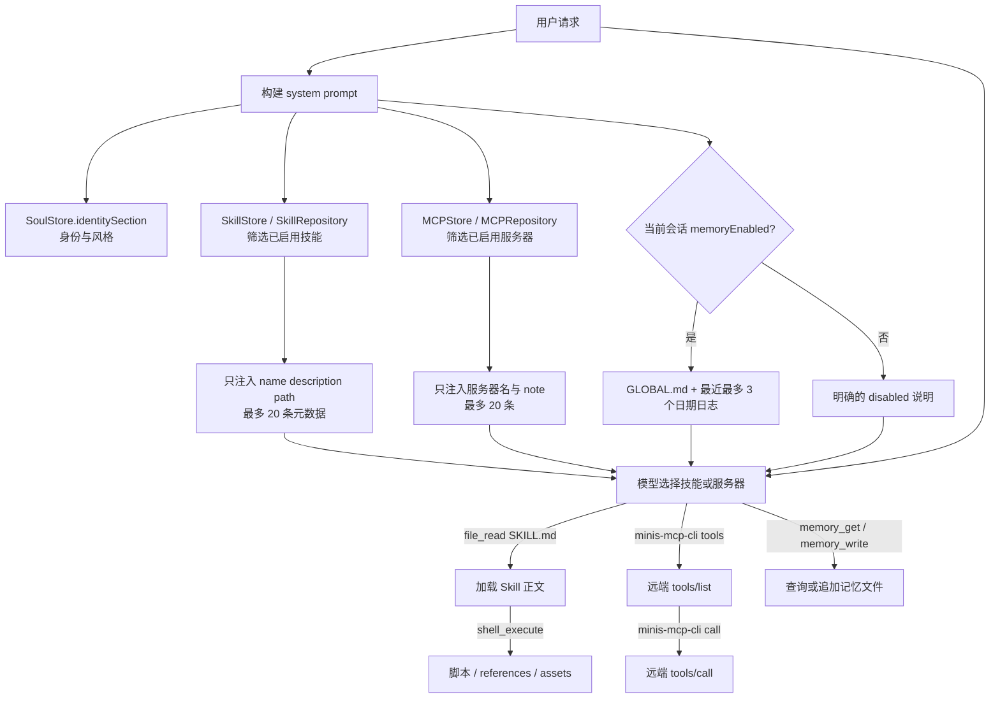

## 9. Skills、Soul、Memory 与 MCP：可扩展的 agent 能力面

### 9.1 这一章解决什么问题

一个可以持续工作的 AI Agent，不应把所有说明、历史和外部服务一次性塞进 system prompt。OpenMinis 把能力面拆成四种不同生命周期的对象：

1. **Skill**：面向任务的可分发指令包。它有自己的目录、`SKILL.md`、脚本和参考资料；默认只公开元数据，真正命中任务后才读正文。
2. **Soul**：应用级身份与表达偏好。它不是某个技能，也不是用户历史，而是每次会话建立时都参与的 Layer 1 身份段。
3. **Memory**：跨会话的文件型事实和日志。`GLOBAL.md` 是用户维护的长期背景，日期文件是 agent 可追加的日志；二者都不是 standing instruction。
4. **MCP（Model Context Protocol）**：外部工具服务器的连接配置。应用只向模型披露服务器目录，具体工具通过 `minis-mcp-cli tools` 动态发现。

这四者的边界必须先设计清楚，否则会出现三个常见故障：把每个技能正文都注入导致上下文膨胀；把历史日志误当作系统指令；把访问令牌写进可同步的服务器配置。iOS 的 `SkillStore` 在文件注释中明确区分 SQLite 元数据、原始 `SKILL.md` 和 system prompt 注入（`src/ios/Agent/Session/SkillStore.swift:1-8,45-65`）；Android 的 `SkillRepository` 对应地把元数据放入 `skills.db`，正文放入 `minis-global/skills/<id>/SKILL.md`（`src/android/app/src/main/java/com/openminis/app/data/repository/SkillRepository.kt:33-40,86-100,113-119`）。

本章的阅读方法是“先看存储，再看 prompt，再看执行”：

- 存储回答“对象是否可同步、可编辑、可恢复”；
- prompt 回答“模型在当前请求看到了什么”；
- 执行回答“模型如何从一个名字走到文件、脚本或远端工具”。

不要把 README 的兼容性宣称直接当成解析器规范。README 的原话是 Claude、Codex、OpenClaw、Hermes Agent 的技能通常可以直接运行（`README.md:69-83`）；真正的格式兼容性要以 `SkillStore.parse`、`SkillRepository.parseSkillMd` 和可用工具为准。

### 9.2 总体架构：四条能力链和一个受控入口

原生层不把脚本直接执行在 app 进程里。技能与 MCP 配置被放进 `/var/minis/` 下的共享目录，由 iSH（iOS）或 PRoot（Android）中的 shell/CLI 读取；原生层负责注册、选择、UI、同步和敏感凭据。iOS 的 system prompt 已把这些根目录写给模型：`/var/minis/workspace/` 是工作文件，`/var/minis/memory/` 是记忆，`/var/minis/mcp-servers/` 是 MCP 配置，技能目录则由技能片段单独给出（`src/ios/Agent/Chat/AIChatViewModel.swift:1742-1750,1751-1762`）。Android prompt 保持同样的目录合同（`src/android/app/src/main/java/com/openminis/app/ui/chat/ChatViewModel.kt:7999-8017`）。



图中的关键是箭头发生在不同时间：`MD`、`MCMD` 是 prompt 构建时的低成本目录；`BODY`、`RES` 和 `DISC` 是模型决定使用之后的高成本动作。iOS 在 `runAgentLoop` 中按“skill → MCP → memory”追加片段（`src/ios/Agent/Chat/AIChatViewModel.swift:4267-4307`）；Android 的 `buildSystemPrompt` 同样按“skills → MCP → global memory → daily memory”追加，并在读取片段前重新扫描磁盘（`src/android/app/src/main/java/com/openminis/app/ui/chat/ChatViewModel.kt:8081-8124`）。

### 9.3 Skill 的可移植格式：以 `SKILL.md` 为唯一入口

#### 9.3.1 目录合同

内置的 `skill-creator` 不是抽象文档，而是应用自带的真实模板。它定义了如下目录：

```text
skill-name/
├── SKILL.md              # 必需：frontmatter + Markdown body
└── scripts/              # 可选：可执行脚本
    references/           # 可选：按需读取的长文档
    assets/               # 可选：模板、图标、输出素材
```

源码同时强调 `SKILL.md` 正文是在触发后加载，正文接近 500 行时应拆到 reference 文件；`metadata → body → resources` 是三个披露层级（`src/ios/Agent/Session/SkillStore.swift:331-360`）。这里的目录描述是教程性约定，解析器并不会验证 `scripts/`、`references/` 或 `assets/` 的名字；它只要求能找到 `SKILL.md`，其余文件按相对路径保存。

iOS 的归档导入在压缩包根目录或恰好一层目录内寻找 `SKILL.md`，然后把其余条目写到 skill 目录及 rootfs 镜像，并为 `/var/minis/skills/<id>/...` 建立 fakefs 元数据（`src/ios/Agent/Session/SkillStore.swift:811-875`）。Android 采用相同的根目录/一层目录规则，并额外拒绝包含 `..` 的相对路径，避免 zip-slip（`src/android/app/src/main/java/com/openminis/app/data/repository/SkillRepository.kt:414-460`）。因此，从零实现时要同时满足：

- 包内有一个名为 `SKILL.md` 的普通文件；
- 同级资源使用相对路径；
- 不依赖压缩包外的绝对路径；
- 资源脚本需要在设备 Linux 环境中可运行，而不是假设 macOS 命令存在。

#### 9.3.2 frontmatter 实际认可的字段

这是本章最重要的“不要想当然”表。OpenMinis 目前把 frontmatter 当作轻量 key-value 解析，而不是完整 YAML。

| 字段 | iOS `SkillStore.parse` | Android `SkillRepository.parseSkillMd` | 进入数据库/提示词的用途 |
|---|---|---|---|
| `name` | 认可；缺省为 `Untitled Skill` | 认可；为空则返回 `null` | 显示名，也是 slug/id 的输入 |
| `description` | 认可；缺省空串 | 认可；缺省空串 | 触发目录中的短说明，最多 200 字符 |
| `version` | 认可；缺省 `1.0.0` | 认可；缺省 `1.0.0` | 更新比较和 UI 展示 |
| `body` | 不是键；关闭 fence 后的剩余 Markdown | 不是键；关闭 fence 后的剩余 Markdown | 只有读取 `SKILL.md` 后才作为指令正文 |
| `allowed-tools`、`tools`、`triggers`、`license`、`compatibility` 等 | 未在 `switch key` 中处理，落入 `default` 丢弃 | 未在 `when (key)` 中处理，落入 `else` 丢弃 | 不会自动产生工具白名单、触发器或许可证约束 |

iOS 的证据是：`ParsedSkillMD` 只有 `name`、`description`、`version`、`body` 四个属性（`src/ios/Agent/Session/SkillStore.swift:417-426`），最终 `switch` 只有三个 frontmatter key（`src/ios/Agent/Session/SkillStore.swift:491-547`）。Android 的 `ParsedSkill` 结构完全对应（`src/android/app/src/main/java/com/openminis/app/data/repository/SkillRepository.kt:1270-1275`），解析分支也只有 `name`、`description`、`version`（`src/android/app/src/main/java/com/openminis/app/data/repository/SkillRepository.kt:1310-1387`）。

一个最小可移植文件应写成：

```markdown
---
name: csv-report
version: 1.0.0
description: Create and validate CSV reports when the user asks for one.
---

# CSV report

1. Read the input file.
2. Use the bundled script only after checking its arguments.
3. Save the result in `/var/minis/workspace/`.
```

这个片段只使用了两个平台都识别的字段。`version` 不负责语义版本解析，只是字符串；iOS 在内置 skill 更新时以字符串比较版本（`src/ios/Agent/Session/SkillStore.swift:383-390`），Android 也按字符串判断 bundled skill 是否需要升级（`src/android/app/src/main/java/com/openminis/app/data/repository/SkillRepository.kt:1104-1139`）。[推断] 如果要实现真正的 semver，必须新增明确的比较器和迁移规则，不能把当前比较当成完整 semver 规范。

#### 9.3.3 两个平台的 parser 差异

iOS 更宽松：如果文件没有开头的 `---`，它会尝试把前导 `key: value` 块识别为 headless frontmatter；只有至少出现 `name`、`description`、`version` 之一才会接受，避免把普通 Markdown 的 `Author: ...` 误当元数据（`src/ios/Agent/Session/SkillStore.swift:428-489`）。Android 要求去掉空白后以 `---` 开始，并且必须找到下一条独立的 `---`，否则返回 `null`（`src/android/app/src/main/java/com/openminis/app/data/repository/SkillRepository.kt:1310-1325`）。

两边都支持短值和 block scalar：`description: |` 保留换行，`description: >` 折叠为空格；iOS 还检查 `|-`、`>-2` 一类 suffix，Android 也接受 `>-`、`|+` 和显式缩进数字（`src/ios/Agent/Session/SkillStore.swift:498-536`；`src/android/app/src/main/java/com/openminis/app/data/repository/SkillRepository.kt:1338-1369`）。两边都不是 YAML 引擎：嵌套 map、数组、引用、复杂引号转义不能被当作通用 YAML 语法依赖。[推断] 面向第三方技能发布时，应把三个字段写成简单的单行值，长描述优先用 `>`，正文放在 fence 之后。

#### 9.3.4 agent 如何访问脚本和资源

SkillStore 不执行脚本，也不自动解析资源名称。它提供的是相对路径枚举、读取和写入：iOS 的 `listSkillFiles` 合并 Library 与 rootfs，`readSkillFile` 先读 Library 再回退到 rootfs，`writeSkillFile` 对 `SKILL.md` 走 metadata 更新、对其他文件同时写两处（`src/ios/Agent/Session/SkillStore.swift:1053-1099`）。Android 对应 `listSkillFiles`、`readSkillFile`、`writeSkillFile`，并在读写时拒绝包含 `..` 的路径（`src/android/app/src/main/java/com/openminis/app/data/repository/SkillRepository.kt:726-747,799-817`）。

模型真正获得入口，是 prompt 中的路径：

```text
Reusable instruction sets stored at /var/minis/skills/<name>/SKILL.md.
Read the SKILL.md file to load full instructions before using a skill.
```

这段文字和 `<path>/var/minis/skills/<id>/SKILL.md</path>` 由两个平台的 prompt fragment 生成（`src/ios/Agent/Session/SkillStore.swift:1332-1356`；`src/android/app/src/main/java/com/openminis/app/data/repository/SkillRepository.kt:266-294`）。模型随后用通用 `file_read` 读取正文；当正文指示“运行 `scripts/report.py`”时，再用 `shell_execute` 调用它。[推断] 因为 parser 没有 `allowed-tools` 分支，Skill 不能通过 frontmatter 自动缩小工具权限；权限仍由应用的全局 `makeAgentTools` 和文件系统沙箱决定。

### 9.4 渐进式加载：metadata 何时进入 prompt，body 何时进入上下文

#### 9.4.1 数据流

启动时，SkillStore 先建/打开 `skills.db`，读取 DB 行和磁盘文件；Android 也在 repository 初始化时 `loadAll()`，再安装 bundled skill（`src/ios/Agent/Session/SkillStore.swift:67-102,124-161`；`src/android/app/src/main/java/com/openminis/app/data/repository/SkillRepository.kt:41-51,104-119`）。这一步把 `body` 也保存在内存结构中，但这不等于把 body 发送给模型。

在每次 agent loop 构建 prompt 时，iOS 只调用 `skillPromptFragment(for:)` 并拼接返回的 metadata（`src/ios/Agent/Chat/AIChatViewModel.swift:4267-4283`）。Android 在 `buildSystemPrompt` 中先 `reloadFromDisk()`，再取 `skillPromptFragment(activeSessionId)`（`src/android/app/src/main/java/com/openminis/app/ui/chat/ChatViewModel.kt:8081-8090`）。这样做有两个效果：shell 新建的技能无需重启即可出现在下一轮；当前会话开关也能在下一次请求生效。

#### 9.4.2 20 条上限和选择优先级

两端都把最大元数据条目设为 20，描述上限为 200 字符（`src/ios/Agent/Session/SkillStore.swift:1248-1256,1329-1344`；`src/android/app/src/main/java/com/openminis/app/data/repository/SkillRepository.kt:43-51,266-276`）。少于等于 20 个时按最近更新排序；多于 20 个时按三层优先级：

1. `bundled`：保证内置基础能力可被发现；
2. 最近 7 天修改/创建的技能，最多占 10 个位置；
3. 剩余位置按 `useCount` 从高到低填充。

iOS 的选择和省略提示在 `skillPromptFragment` 中实现（`src/ios/Agent/Session/SkillStore.swift:1262-1313,1348-1359`），Android 的等价逻辑在 `SkillRepository.skillPromptFragment`（`src/android/app/src/main/java/com/openminis/app/data/repository/SkillRepository.kt:229-264,282-295`）。每条 metadata 写入 name、截断后的 description 和准确的 `SKILL.md` path，而不是 body。

#### 9.4.3 body 的加载边界

当模型决定使用某技能，它要按照 metadata 中的 path 发出 `file_read`。源码把“读 `SKILL.md`”定义成使用事件：iOS 由 `skillIdFromPath` 只匹配 `/var/minis/skills/<id>/SKILL.md`，再由并发工具执行器调用 `recordSkillUse`；脚本和 references 的读取不会增加技能使用次数（`src/ios/Agent/Session/SkillStore.swift:1172-1191,1235-1245`；`src/ios/Agent/Chat/AIChatViewModel+ConcurrentTools.swift:415-457`）。Android 同样只识别 `SKILL.md`，`ChatViewModel` 在 `FileReadTool` 成功后记录 use count（`src/android/app/src/main/java/com/openminis/app/data/repository/SkillRepository.kt:298-315,350-364`；`src/android/app/src/main/java/com/openminis/app/ui/chat/ChatViewModel.kt:7119-7131`）。

因此上下文成本可以画成：

```text
首轮：20 × (name + <=200 字 description + path)
命中：首轮 metadata + SKILL.md body
继续：再加被 body 指示读取的 references / 脚本输出
```

`hasMore` 为真时，prompt 会告诉模型仍有更多技能，并建议列目录或 grep；这是一种“发现能力的二级索引”，而不是把所有名称硬塞进首轮（`src/ios/Agent/Session/SkillStore.swift:1352-1359`；`src/android/app/src/main/java/com/openminis/app/data/repository/SkillRepository.kt:286-294`）。[推断] 对正文的工程约束应是：短正文包含决策和入口，长规范拆到 `references/`；否则渐进式加载虽成立，第二轮仍可能产生巨大的 tool result。

#### 9.4.4 会话开关和草稿会话

全局 enabled 只决定默认值；会话可以在 `session_skill_overrides` 中覆盖。iOS 的读取优先级是 session override → 全局 skill → false，写入时若值等于全局默认则删除 override 行（`src/ios/Agent/Session/SkillStore.swift:1150-1170`）。Android 具有相同的 fallback 和 draft-id 重命名 API（`src/android/app/src/main/java/com/openminis/app/data/repository/SkillRepository.kt:179-219`）。

这个“稀疏 override”设计很重要：把“当前值等于全局值”保存成一条永久行，会让之后的全局开关无法传播。[推断] 新实现可把 session id 作为所有能力开关的统一键，并在草稿首次发送、得到真实 session id 时迁移 skill 与 MCP 两类 override；Android `ChatViewModel.ensureSession` 已同时调用两个重命名方法（`src/android/app/src/main/java/com/openminis/app/ui/chat/ChatViewModel.kt:2796-2799`）。

### 9.5 兼容性：README 的“能运行”不等于字段完全兼容

README 的兼容性表述是“Claude、Codex、OpenClaw、Hermes Agent 的技能一般可直接运行”（`README.md:76-79`）。逆向代码后，可以把这个结论拆成三层：

| 兼容层 | 已实现的事实 | 没有实现的事实 |
|---|---|---|
| 文件入口 | 识别常见的 `SKILL.md`，正文是 Markdown；zip 可根目录或一层目录 | 没有跨生态 manifest 解析器 |
| 元数据 | `name`、`description`、`version` 三个键在 iOS/Android 都生效 | 没有 `allowed-tools`、`triggers`、`license`、`compatibility` 等字段映射 |
| 执行面 | generic `file_read`、`file_write`、`file_edit`、`shell_execute`、`browser_use` 能承接很多通用技能 | 没有把外部生态工具名自动映射为 Minis 工具名的兼容层 |

工具名字来自 iOS `makeAgentTools` 的固定定义（`src/ios/Agent/Chat/AIChatViewModel+ToolDefinitions.swift:9-18,30-69`），Android 则由 `AgentTools.makeAgentTools` 注册（`src/android/app/src/main/java/com/openminis/app/tools/AgentTools.kt:8-36`）。因此，外部技能如果只要求读取文件、运行 shell、操作浏览器，通常可以迁移；如果正文明确要求 Claude 专有工具，不能因为 frontmatter 能解析就声称完全兼容。[推断]

不要把 `version` 误当兼容版本，也不要把未知键当触发器。当前解析器对未知键直接忽略（`src/ios/Agent/Session/SkillStore.swift:538-543`；`src/android/app/src/main/java/com/openminis/app/data/repository/SkillRepository.kt:1372-1379`）。若产品需要真正的生态适配，应在解析阶段保留原始 frontmatter、建立显式 alias 表，并在 tool registry 做能力探测；这已经超出当前实现，不能在教程中伪装成已有功能。

### 9.6 分发、安装、校验与更新

#### 9.6.1 用户入口

iOS Settings 的技能页提供 URL、Paste、File 三种模式；File 接受普通文本、`.skill` 和 `.zip`（`src/ios/Views/Skills/SkillsManagementView.swift:214-337,347-385`）。Android Compose 页面提供 URL、Paste、File 三个 tab，文件通过 Android Activity Result 选择（`src/android/app/src/main/java/com/openminis/app/ui/settings/SkillsManagementScreen.kt:114-153,387-548`）。

URL 不是盲写：iOS `preflightGitHubImport` 先把 GitHub URL 转成 raw URL、检查 HTTP 200、解析 frontmatter，之后才 commit（`src/ios/Agent/Session/SkillStore.swift:703-727`）。Android `importFromGitHub` 先下载 `SKILL.md`，通过 `importFromContent` 解析成功后才进入 repository（`src/android/app/src/main/java/com/openminis/app/data/repository/SkillRepository.kt:489-527`）。这就是最小校验链：HTTP 成功、UTF-8 非空、frontmatter 可解析、`name` 可生成非空 slug。

#### 9.6.2 GitHub sibling 资源和部分成功

导入 GitHub 后，两端都递归读取同目录 sibling 文件，目的是把 `scripts/`、`references/`、`assets/` 同步下来，而不只是下载 `SKILL.md`。iOS 将 sibling 下载放进 detached task，更新完成后标记 dirty；更新既有 URL 技能时同步等待并返回 `partialSuccess`（`src/ios/Agent/Session/SkillStore.swift:724-765,768-809`）。Android 使用 repository-owned `backgroundScope`，避免离开 Compose 页面取消递归；`updateFromURL` 把 sibling 失败显式返回 `PartialSuccess`（`src/android/app/src/main/java/com/openminis/app/data/repository/SkillRepository.kt:64-70,503-527,558-621`）。

Android 的目录遍历最多深度 5，GitHub API 和 blob 请求对 transient 失败各重试一次，UI 能看到第一个具体失败原因（`src/android/app/src/main/java/com/openminis/app/data/repository/SkillRepository.kt:820-939,943-1010`）。这不是完整签名校验：当前源码没有在导入时核验签名、SHA 或作者身份。[推断] 面向生产分发时，应把 HTTPS、内容大小限制、可选哈希/签名放在导入器外层，而不要误以为 `name` 能防篡改。

#### 9.6.3 更新、导出和 bundled skill

URL 技能的更新是“原地更新”：读取记录中的 source URL，刷新 `SKILL.md` 和 sibling 文件，不创建第二个 id；缺少旧 source URL 时 Android 明确要求重新导入（`src/android/app/src/main/java/com/openminis/app/data/repository/SkillRepository.kt:565-620`）。两端都支持把整个目录导出为 zip；Android 在 `cacheDir/share/skill-export-<uuid>/` 生成非空文件，并在新导出前清理超过 24 小时的旧目录（`src/android/app/src/main/java/com/openminis/app/data/repository/SkillRepository.kt:623-705,708-723`），iOS 也采用 24 小时 sweep 和唯一导出目录（`src/ios/Views/Skills/SkillsManagementView.swift:769-837`）。

bundled skill 在 app 初始化时按内置版本升级：iOS 当前内置 `skill-creator` 为 `2.1.0`（`src/ios/Agent/Session/SkillStore.swift:285-390`），Android 当前写入的是 `2.0.0`（`src/android/app/src/main/java/com/openminis/app/data/repository/SkillRepository.kt:1104-1139`）。这是平台构建产物的版本差异，不能在跨平台同步中简单假定版本相同。[推断]

#### 9.6.4 磁盘发现和 iCloud/LAN 边界

agent 可以在 shell 中直接创建 `/var/minis/skills/<id>/SKILL.md`，所以两端都有 reload/rescan：Android Skills 页面进入时 `reloadFromDisk`（`src/android/app/src/main/java/com/openminis/app/ui/settings/SkillsManagementScreen.kt:148-154`），iOS 通过 `reload`、rescan 发现磁盘新目录并在必要时 mark dirty（`src/ios/Agent/Session/SkillStore.swift:1362-1403,974-1022`）。

iOS 进一步把 skill 内容和 bundled files 纳入 iCloud 的 dirty queue，并用本地较新的 `updatedAt` 拒绝陈旧云记录（`src/ios/Agent/Session/SkillStore.swift:618-701`）。Android `SkillRepository` 的设计是本地 SQLite + 文件目录，没有对应 CloudKit 实现（`src/android/app/src/main/java/com/openminis/app/data/repository/SkillRepository.kt:33-40`）。[推断] 要拓展到 macOS/Windows/Linux，应先把目录根、元数据数据库和 dirty/sync 接口抽成平台适配层，不能直接复制 iOS 的 CloudKit 调用。

### 9.7 Soul：稳定身份，不是可选技能

#### 9.7.1 文件格式和持久化

`SOUL.md` 和记忆文件放在同一目录。iOS 的 `SoulMetadata` 认可 `name`、`emoji`、`style`、`lang`，`SoulFile` 则是 metadata + body（`src/ios/Agent/Session/SoulStore.swift:4-47`）；Android 数据类相同（`src/android/app/src/main/java/com/openminis/app/agent/SoulStore.kt:10-76`）。解析器要求首个独立行是 `---`、之后有闭合 `---`，未知键忽略；序列化只写 `name/style/lang` 三个键，旧 `emoji` 可读但下一次保存会被移除（`src/ios/Agent/Session/SoulStore.swift:49-116`；`src/android/app/src/main/java/com/openminis/app/agent/SoulStore.kt:78-152`）。

默认文件只播种 frontmatter 或默认人格内容，`ensureExists` 不覆盖已有文件（`src/ios/Agent/Session/SoulStore.swift:229-267`；`src/android/app/src/main/java/com/openminis/app/agent/SoulStore.kt:271-315`）。iOS 用原子写入并在保存后标记 `SoulV2` dirty（`src/ios/Agent/Session/SoulStore.swift:298-314`）；Android 用 `.tmp` 后 rename，并刷新 StateFlow cache（`src/android/app/src/main/java/com/openminis/app/agent/SoulStore.kt:333-367`）。

#### 9.7.2 进入 system prompt 的顺序

Soul 是 base prompt 的第一段，不受 memory 开关控制。iOS 的 `baseSystemPrompt` 先调用 `SystemPromptBuilder.identitySection()`，再接运行时指导和工具说明（`src/ios/Agent/Chat/AIChatViewModel.swift:1701-1711`）；Android `buildSystemPrompt` 同样先计算 `identitySection`（`src/android/app/src/main/java/com/openminis/app/ui/chat/ChatViewModel.kt:7938-7948`）。其后才是 skills、MCP、GLOBAL、daily logs：iOS 的具体拼接在 `runAgentLoop`（`src/ios/Agent/Chat/AIChatViewModel.swift:4278-4307`），Android 的具体拼接在 `buildSystemPrompt`（`src/android/app/src/main/java/com/openminis/app/ui/chat/ChatViewModel.kt:8089-8124`）。

Soul body 以明确的 `Personality (from SOUL.md...)` 标签注入，style 作为单独的 `Response style` 段注入；超出限制时不截断，而回退到 identity-only（`src/ios/Agent/Session/SoulStore.swift:413-488`；`src/android/app/src/main/java/com/openminis/app/agent/SoulStore.kt:449-518`）。两端还会删除疑似 “ignore previous instructions” 的行（同文件 `scrubInjections`）。[推断] 这说明 Soul 适合表达名字、语气和人格，不适合承载项目规范、秘密或临时任务；项目规范应进 Skill 或 Memory，秘密应进环境变量/Keychain。

body 长度规则也要按平台实际实现：iOS 统一按 CJK glyph/punctuation 或空白分隔词计数，硬上限为 2000 token（`src/ios/Agent/Session/SoulStore.swift:144-188`）；Android 按 CJK 比例选择 1600 code point 或 1000 个英文词（`src/android/app/src/main/java/com/openminis/app/agent/SoulStore.kt:187-243`）。不要在跨端文档中把“字符数”和“token”混用。

### 9.8 Memory：文件型跨会话上下文，与 workspace 分离

#### 9.8.1 存储介质

Memory 目录是 `<persistent>/memory/`，不是 SQLite：iOS `minisMemoryPersistentDir` 下有 `GLOBAL.md`、`YYYY-MM-DD.md` 和 `SOUL.md`；Android `MemoryRepository` 接收 `memoryDir`，约定相同文件名（`src/ios/Agent/Chat/AIChatViewModel+MemoryTools.swift:9-20`；`src/android/app/src/main/java/com/openminis/app/data/repository/MemoryRepository.kt:9-26,18-47`）。

`memory_write` 将带时间注释的 Markdown entry 插入当天文件头部，所以同一文件新记录在前。iOS 写入后注册 fakefs 元数据并加入 iCloud `MemoryDailyV2` dirty queue（`src/ios/Agent/Chat/AIChatViewModel+MemoryTools.swift:63-119`）；Android 直接写文件并返回保存结果（`src/android/app/src/main/java/com/openminis/app/data/repository/MemoryRepository.kt:49-77`）。

`memory_get` 支持 `scope=daily|all` 和空格分隔关键词。iOS 把带 timestamp 的块作为 entry，按匹配置信度 50% + 新鲜度 50% 排序，最多返回 60 个 entry 或约 30 KB（`src/ios/Agent/Chat/AIChatViewModel+MemoryTools.swift:122-365`）。Android 采用所有关键词在 ±2 行窗口内都出现的模糊搜索，完整倾倒最多 500 行，关键词搜索最多 60 行并有 30 KB 字节上限（`src/android/app/src/main/java/com/openminis/app/data/repository/MemoryRepository.kt:80-231`）。两者都不是向量数据库，也没有嵌入检索。[推断]

#### 9.8.2 自动注入和工具检索的差别

自动注入只做背景预览：`GLOBAL.md` 整体读取；最近 30 天内最多挑 3 个非空 daily log；每个 daily log 最多前 200 行，超出部分提示使用 `memory_get`（`src/ios/Agent/Chat/AIChatViewModel+MemoryTools.swift:19-60`；`src/android/app/src/main/java/com/openminis/app/data/repository/MemoryRepository.kt:234-301`）。这是和 Skill metadata 同样的渐进式思想：system prompt 放小的常用窗口，完整搜索延迟到工具调用。

`GLOBAL.md` 的 prompt 文案明确要求把它当 background context，不是 standing instruction，并且用户最新消息冲突时优先最新消息（`src/ios/Agent/Chat/AIChatViewModel+MemoryTools.swift:9-17`；`src/android/app/src/main/java/com/openminis/app/data/repository/MemoryRepository.kt:241-255`）。Android tool definition 还把 GLOBAL 标成“read-only, user-maintained via Settings”（`src/android/app/src/main/java/com/openminis/app/tools/MemoryTools.kt:15-37`）。因此建议的职责是：

- `GLOBAL.md`：偏好、设置、稳定约定；用户明确要求时才用 `file_edit` 更新；
- `YYYY-MM-DD.md`：每天的事实、已完成任务、行动项；agent 可用 `memory_write` 追加；
- `/var/minis/workspace/`：脚本、数据集、报告、网页项目等工作产物，不会自动成为记忆。

workspace 与 memory 的分离由 base prompt 的目录说明直接体现（`src/ios/Agent/Chat/AIChatViewModel.swift:1742-1750`；`src/android/app/src/main/java/com/openminis/app/ui/chat/ChatViewModel.kt:7999-8007`）。[推断] 如果把构建产物写进 daily log，会导致后续检索噪音；如果把用户偏好只写到 workspace，则不会跨会话自动可见。

#### 9.8.3 memory 开关和跨会话可见性

iOS `makeAgentTools` 在 `memoryEnabled` 为 false 时根本不注册 `memory_write` 和 `memory_get`（`src/ios/Agent/Chat/AIChatViewModel+ToolDefinitions.swift:9-17,103-124`）；执行函数还有 defense-in-depth 拒绝（`src/ios/Agent/Chat/AIChatViewModel+MemoryTools.swift:63-71,126-135`）。Android `AgentTools.makeAgentTools(memoryEnabled)` 同样条件注册（`src/android/app/src/main/java/com/openminis/app/tools/AgentTools.kt:14-35`），`ChatViewModel` 同时跳过 memory fragment 和工具执行（`src/android/app/src/main/java/com/openminis/app/ui/chat/ChatViewModel.kt:7949-7987,8096-8105`）。

会话开关不是“删文件”：它只改变本次 prompt 是否注入、模型是否看到 memory 工具；文件仍在磁盘，下一会话若开启就可见。Android 从现有 session DB 恢复 `memoryEnabled`（`src/android/app/src/main/java/com/openminis/app/ui/chat/ChatViewModel.kt:2950-2955`），复制 session 时也复制此字段（`src/android/app/src/main/java/com/openminis/app/data/SessionForkManager.kt:41-45,78-83`）。iOS 的跨设备 memory 复制由 `SessionForkManager.copyRemoteMemory` 写入同一 persistent memory 目录（`src/ios/Agent/Session/SessionForkManager.swift:192-213`）。

### 9.9 MCP：配置、传输、发现与命名

#### 9.9.1 `servers.json` 是共享事实源

两个平台和 guest CLI 共用如下形状：

```json
{
  "mcpServers": {
    "weather": {
      "url": "https://example.test/mcp",
      "headers": { "Authorization": "Bearer $$WEATHER_TOKEN" },
      "note": "天气查询",
      "enabled": true
    },
    "local-tools": {
      "command": "python3",
      "args": ["/var/minis/workspace/server.py"],
      "env": { "API_KEY": "$$API_KEY" },
      "enabled": true
    }
  }
}
```

iOS 的 `MCPServerConfig` 明确把 server name 作为 `id`，HTTP 使用 `url + headers`，STDIO 使用 `command + args + env`；文件位置是可同步的 `MinisConfig/mcp-servers/servers.json`，guest bind mount 到 `/var/minis/mcp-servers`（`src/ios/Agent/Session/MCPStore.swift:1-16,22-73,107-120`）。Android 的 `MCPRepository` 把同一文件放在 `filesDir/minis-global/mcp-servers/servers.json`，且明确说这是 CLI 和 file browser 共同读写的 Claude Desktop 兼容形状（`src/android/app/src/main/java/com/openminis/app/data/repository/MCPRepository.kt:14-35,46-107`）。guest `config.py` 也把 `mcpServers` object 作为跨 iOS/Android/UI 的固定 schema（`src/ios/default_mount/usr/local/lib/minis-mcp-cli/utils/config.py:1-23,54-82`）。

保存必须是原子的：iOS 用 JSONEncoder + `.atomic`（`src/ios/Agent/Session/MCPStore.swift:338-371`），guest CLI 用临时文件 + `os.replace`（`src/ios/default_mount/usr/local/lib/minis-mcp-cli/utils/config.py:70-77`）。Android 用 `serversFile.writeText` 保存 JSON（`src/android/app/src/main/java/com/openminis/app/data/repository/MCPRepository.kt:168-180`）。[推断] 在 Android 新增跨进程写入时应补原子 rename，否则 Settings、file browser、CLI 并发读写时可能看到半截 JSON。

#### 9.9.2 HTTP、SSE 和 STDIO

UI 中 iOS 显示 HTTP、SSE、STDIO 三个选择；源码把 SSE 当 HTTP-family URL transport，实际由 CLI 的 HTTP transport 解析返回的 SSE（`src/ios/Views/MCP/MCPFormSheet.swift:20-25`）。Android model 也把 HTTP/SSE 统一成 `url + headers`，或者把 command family 归为 STDIO（`src/android/app/src/main/java/com/openminis/app/data/repository/MCPRepository.kt:48-71`）。

HTTP transport 的真实流程是：POST JSON-RPC `initialize`，发送 `notifications/initialized`，再调用 `tools/list` 或 `tools/call`；响应可以是 `application/json` 或 `text/event-stream`，SSE 取最后一个可解析的 `data:` payload（`src/ios/default_mount/usr/local/lib/minis-mcp-cli/transport/http.py:1-15,54-75,284-307`）。它会覆盖用户自定义的 `Accept`/`Content-Type` 变体，保证 `application/json, text/event-stream`（`src/ios/default_mount/usr/local/lib/minis-mcp-cli/transport/http.py:225-256`）。

STDIO transport 启动 `[command] + args` 子进程，使用换行分隔 JSON-RPC；先发 `initialize`，再发 `notifications/initialized`，每次 session 结束时关闭进程，崩溃最多自动重试一次（`src/ios/default_mount/usr/local/lib/minis-mcp-cli/transport/stdio.py:30-57,59-122,124-159`）。daemon 将 HTTP session 和 STDIO child 放进统一 pool，每个 server 独立保持 10 分钟 idle TTL，并以 server 名作为 pool key（`src/ios/default_mount/usr/local/lib/minis-mcp-cli/daemon.py:41-45,208-239,242-317`）。

环境变量在 HTTP 的 URL、headers 和 STDIO env 中展开，支持 `$VAR`、`${VAR}`、`$$VAR`、`$${VAR}`；`$$` 只是 UI 显式引用形式，不会二次展开（`src/ios/default_mount/usr/local/lib/minis-mcp-cli/transport/http.py:23-44`）。prompt 也要求 agent 使用 `$$VARNAME` 而不是把 secret 硬编码（`src/ios/Agent/Session/MCPStore.swift:622-639`；`src/android/app/src/main/java/com/openminis/app/data/repository/MCPRepository.kt:450-466`）。

#### 9.9.3 startup timeout 的别名层

MCP 协议本身不规定本地子进程启动等待，所以 Minis 把它作为本地配置。原生层为 `startupTimeoutSeconds`，并兼容 `startup_timeout_sec`、`startupTimeout`、`handshakeTimeout`、`initializeTimeout`（`src/ios/Agent/Session/MCPStore.swift:551-579`；`src/android/app/src/main/java/com/openminis/app/data/repository/MCPRepository.kt:213-234`）。guest config 按相同优先级读取，默认 60 秒、上限 900 秒，对非法值返回 warning 而不是静默吞掉（`src/ios/default_mount/usr/local/lib/minis-mcp-cli/utils/config.py:25-44,127-169`）。这是真正存在的 MCP 配置 alias；不要把它和 Skill frontmatter alias 混为一谈。

#### 9.9.4 发现、调用和冲突

system prompt 不枚举远端工具本身，只列最多 20 个已启用 server 的 name/note，并告诉模型执行：

```text
minis-mcp-cli tools <server>
minis-mcp-cli call <server> <tool> [args]
```

iOS 的 `systemPromptSnippet` 按 `createdAt` 降序取 Top-20，note 截断 200 字符（`src/ios/Agent/Session/MCPStore.swift:601-639`）；Android 采用相同数量和 note 上限（`src/android/app/src/main/java/com/openminis/app/data/repository/MCPRepository.kt:432-466`）。CLI 的 `tools` 实际转发到 `tools/list`，`call` 转发到 `tools/call`（`src/ios/default_mount/usr/local/lib/minis-mcp-cli/main.py:321-361`；`src/ios/default_mount/usr/local/lib/minis-mcp-cli/transport/http.py:300-307`）。Settings 的 Refresh 也只是执行 `minis-mcp-cli refresh` 并解析工具数组（`src/ios/Agent/Session/MCPStore.swift:642-698`）。

server 名是 `mcpServers` 的 key，也是 `MCPServerConfig.id`；同名添加是覆盖而不是生成第二个 namespace：iOS `add` 按 id 替换（`src/ios/Agent/Session/MCPStore.swift:403-425`），Android `add` 过滤旧 id 再追加（`src/android/app/src/main/java/com/openminis/app/data/repository/MCPRepository.kt:275-291`），CLI `upsert_server` 也按 name 覆盖（`src/ios/default_mount/usr/local/lib/minis-mcp-cli/utils/config.py:90-105`）。远端工具名没有在原生层重命名，也没有把同名工具合并到一个全局列表；调用参数始终带 server 和 tool 两级定位（`src/ios/default_mount/usr/local/lib/minis-mcp-cli/main.py:341-361`）。因此“工具名冲突”的解决办法是保持 server 参数，不是在 prompt 中拼接未经验证的别名。[推断]

JSON 导入支持三种常见外形：标准 `{mcpServers:{...}}`、以 server name 为顶层 key、单个带 `command` 或 `url` 的对象；`disabled:true` 映射为 `enabled:false`（`src/ios/Agent/Session/MCPStore.swift:444-498`；`src/android/app/src/main/java/com/openminis/app/data/repository/MCPRepository.kt:370-429`）。

### 9.10 MCP OAuth：非秘密配置、PKCE 和 guest 边界

#### 9.10.1 配置与秘密分离

iOS `MCPOAuthConfig` 只保存 mode、client id、authorization endpoint、token endpoint、scopes、redirect URI；`client_secret` 和 token 不进入 `servers.json`（`src/ios/Agent/Session/MCPOAuthController.swift:37-50`）。Android `MCPOAuthConfig` 也只保存相同的非秘密信息，secret/token 放进 `EncryptedSharedPreferences`（`src/android/app/src/main/java/com/openminis/app/mcp/oauth/MCPOAuthConfig.kt:5-27`；`src/android/app/src/main/java/com/openminis/app/mcp/oauth/MCPOAuthStore.kt:9-27,32-90`）。

注意字段名的跨端边界：iOS 使用 Swift `Codable` 属性名如 `clientId`、`authorizationEndpoint`；Android `toJson/fromJson` 使用 `client_id`、`authorization_endpoint`、`token_endpoint`、`redirect_uri`（`src/ios/Agent/Session/MCPOAuthController.swift:37-50`；`src/android/app/src/main/java/com/openminis/app/mcp/oauth/MCPOAuthConfig.kt:29-59`）。guest CLI 的 `add` 则写 camelCase oauth 对象（`src/ios/default_mount/usr/local/lib/minis-mcp-cli/main.py:431-453`）。[推断] 这不是一个已实现的字段别名层；跨平台交换 OAuth JSON 时必须做显式转换，不能只复制 `oauth` 对象。

#### 9.10.2 iOS 完整流程

iOS 使用 PKCE Authorization Code：随机 verifier，SHA-256 得到 S256 challenge，生成 state；默认 loopback `http://localhost:54546/callback`，也支持 custom scheme；authorization request 和 token exchange 都可带 RFC 8707 `resource`（`src/ios/Agent/Session/MCPOAuthController.swift:65-74,269-329,347-385`）。loopback 由本地 `OAuthCallbackServer` + in-app Safari 完成，custom scheme 回退到 `ASWebAuthenticationSession`，回调必须校验 state（`src/ios/Agent/Session/MCPOAuthController.swift:337-445`）。

token 写入不可同步的 Keychain；成功后再 materialize guest bridge `/var/minis/mcp-servers/oauth/<server>.json`，权限 0600，桥中包含 access/refresh token、token endpoint、client id 和可选 client secret（`src/ios/Agent/Session/MCPOAuthController.swift:16-27,90-135,227-267`）。guest HTTP transport 在 token 过期前 60 秒刷新，遇到 401 强制刷新一次并重试，失败时返回带 `minis://settings/mcp-servers/<name>` 的授权链接（`src/ios/default_mount/usr/local/lib/minis-mcp-cli/transport/http.py:78-135,153-223,266-282`）。

#### 9.10.3 Android 当前阶段

Android `MCPOAuthController.authorize` 使用同一个 54546 loopback 端口、Chrome Custom Tab、state 校验、PKCE 和 RFC 8707 resource，授权码交换成功后把 token 写入 `MCPOAuthStore`（`src/android/app/src/main/java/com/openminis/app/mcp/oauth/MCPOAuthController.kt:21-31,50-117,120-172`；`src/android/app/src/main/java/com/openminis/app/mcp/oauth/McpPkce.kt:22-101`）。

源码明确标记当前阶段的边界：Android 已完成浏览器 round-trip、token exchange 和加密存储，但 guest transport bridge 与自主刷新“故意留到后续阶段”（`src/android/app/src/main/java/com/openminis/app/mcp/oauth/MCPOAuthController.kt:27-30`）。因此不能把 Android 的“Authorized” UI 当作与 iOS 完全同等的端到端调用保障；当前实现是否能让 PRoot 中的 CLI 使用 token，需要额外的 bridge/refresh 接口。[推断]

### 9.11 Session fork 与 lock：复制一致性和本地隐私是两件事

#### 9.11.1 Fork/duplicate 解决什么

iOS `SessionForkManager.forkSession` 从远端设备读取 session 和 messages，创建新本地 session，并为每条消息生成新 id；`duplicateSession` 对本地 session 做同样的深复制，并额外重映射 compact marker 的 message id/sort order（`src/ios/Agent/Session/SessionForkManager.swift:12-53,56-167`）。它还可以把远程 skill 重新导入本机，或把远程 memory 文件写入本地 memory 目录（`src/ios/Agent/Session/SessionForkManager.swift:169-213`）。

Android 当前只实现 local duplicate；类注释明确说明来自 iCloud 远端的 `forkSession` 等待跨设备同步层（`src/android/app/src/main/java/com/openminis/app/data/SessionForkManager.kt:9-19`）。复制时会带上 category、modelBinding、memoryEnabled、thinking override，消息得到全新 id，compact markers 在所有消息写入后再重映射（`src/android/app/src/main/java/com/openminis/app/data/SessionForkManager.kt:30-89,90-167`）。

因此 fork 的核心不是“复制一段文本”，而是复制可恢复的关系：消息 id、排序、压缩边界、模型绑定和 memory 开关必须一起处理。复制 skill/memory 时还要走各自 repository/file contract，不能把远端路径直接当成本地路径。[推断]

#### 9.11.2 iOS SessionLock 的职责

`SessionLockStore` 是 iOS 的本地生物识别门，不修改 `ChatSession` 数据模型，也不进入同步/导出管线；锁定 id 集合持久化到 UserDefaults，解锁时间戳只在内存中保存（`src/ios/Agent/Session/SessionLockStore.swift:5-20,64-82,100-115`）。每个 session 的可视锁状态由 global toggle、设备可用性、locked set 和 idle timeout 共同决定（`src/ios/Agent/Session/SessionLockStore.swift:117-152`）。

它支持永久解锁、解锁后 idle 重锁、后台清除解锁时间戳，以及 app-level lock；生物识别 wrapper 使用 `.deviceOwnerAuthentication`，允许 Face ID/Touch ID 失败后走 passcode（`src/ios/Agent/Session/SessionLockStore.swift:154-221,476-505`）。Android 目标源码中没有 `SessionLockStore`、`lockedSessionIds` 或同等 session biometric gate；现有 Android `EncryptedPrefsFactory` 只服务加密偏好存储（`src/android/app/src/main/java/com/openminis/app/util/EncryptedPrefsFactory.kt:17-20`）。[推断] 将产品拓展到 Android 时应把 lock 作为独立本地安全层实现，而不是把锁字段塞进会话同步记录。

#### 9.11.3 一次请求的可观测时序

下面把一次“用户询问某领域问题”的请求拆成可以在日志中定位的阶段。它不是新的抽象 API，而是把现有调用点串起来：

| 阶段 | iOS 观察点 | Android 观察点 | 模型是否已经看到正文 |
|---|---|---|---|
| 会话载入 | `SkillStore.loadSkills`、`SoulStore.load` | `SkillRepository.loadAll`、`SoulStore.load` | 否 |
| prompt 建立 | `runAgentLoop` | `buildSystemPrompt` | 只看到 Soul、Skill metadata、MCP metadata、可选 memory 预览 |
| 技能选择 | 模型生成 `file_read` | 模型生成 `file_read` | 否，tool call 尚未返回 |
| 正文读取 | `FileReadTool` + `skillIdFromPath` | `FileReadTool` + `skillIdFromPath` | 是，返回值进入下一轮上下文 |
| 资源执行 | `shell_execute` 访问脚本或 reference | `shell_execute` 访问脚本或 reference | 取决于 tool result 是否返回 |
| MCP 发现 | `minis-mcp-cli tools` | 同一 guest CLI | 看到远端工具 schema/列表 |
| MCP 调用 | `minis-mcp-cli call` | 同一 guest CLI | 看到远端结果 |

这张表的前两行分别由 iOS 的初始化和 prompt 代码实现（`src/ios/Agent/Session/SkillStore.swift:96-102`；`src/ios/Agent/Chat/AIChatViewModel.swift:4267-4307`），Android 的对应点是 repository 初始化和 `buildSystemPrompt`（`src/android/app/src/main/java/com/openminis/app/data/repository/SkillRepository.kt:104-119`；`src/android/app/src/main/java/com/openminis/app/ui/chat/ChatViewModel.kt:8081-8124`）。后四行的 file read、MCP tools/call 入口分别可在 iOS 并发工具执行器与 CLI main 中看到（`src/ios/Agent/Chat/AIChatViewModel+ConcurrentTools.swift:415-457`；`src/ios/default_mount/usr/local/lib/minis-mcp-cli/main.py:321-361`）。

实现时要给每个阶段留下不同错误，而不是全部返回“skill failed”：

```text
IMPORT_INVALID        # fence/name/body 无法解析
SKILL_RESOURCE_MISSING # SKILL.md 已安装，但 sibling 下载失败
SKILL_BODY_READ_FAILED # file_read 失败
MCP_NOT_FOUND          # server key 不存在
MCP_TOOL_DISCOVERY_FAILED
MCP_AUTH_REQUIRED
MEMORY_DISABLED
```

当前代码已经把其中多项区分开：Android URL 更新把正文成功、资源失败表示为 `PartialSuccess`（`src/android/app/src/main/java/com/openminis/app/data/repository/SkillRepository.kt:530-620`）；MCP CLI 用 `NOT_FOUND`、`AUTH_REQUIRED` 等统一 envelope（`src/ios/default_mount/usr/local/lib/minis-mcp-cli/main.py:67-77,224-268`）；memory disabled 则在工具执行时返回明确失败原因（`src/ios/Agent/Chat/AIChatViewModel+MemoryTools.swift:63-71,126-135`）。

#### 9.11.4 reload、同步和 prompt cache 的相互作用

技能文件可能从三个地方改变：Settings UI、agent 的 file tools、guest shell/CLI。iOS 的 `rescanAndMarkChangedSkillsDirty` 先保存 DB 侧时间快照，再 reload，最后把新增、修改、删除和 bundled 文件变化转为 dirty 记录（`src/ios/Agent/Session/SkillStore.swift:1364-1403`）。Android 每次打开 Skills 页面或构建 prompt 时重新 `loadAll`/`reloadFromDisk`，避免只依赖 app 启动时的 StateFlow（`src/android/app/src/main/java/com/openminis/app/data/repository/SkillRepository.kt:1142-1159`；`src/android/app/src/main/java/com/openminis/app/ui/chat/ChatViewModel.kt:8081-8090`）。

MCP 也存在外部修改路径。iOS `scanExternalChanges` 比较服务器语义 fingerprint，发现 guest CLI 绕过 CRUD 改写 `servers.json` 时重新盖 `updatedAt` 并 mark dirty（`src/ios/Agent/Session/MCPStore.swift:859-897`）；Android 通过 Settings 进入时 `reloadFromDisk`，但 repository 注释说明它是本地模型，不提供对应 CloudKit per-server sync（`src/android/app/src/main/java/com/openminis/app/data/repository/MCPRepository.kt:14-35,113-121`）。

Android 还刻意把动态日期、时区、语言和 model count 放到 prompt 的尾部，使静态 prefix 更容易命中 provider 的 prefix cache（`src/android/app/src/main/java/com/openminis/app/ui/chat/ChatViewModel.kt:7920-7937,8125-8132`）。iOS 也在构建后记录 context baseline 和 token 估计（`src/ios/Agent/Chat/AIChatViewModel.swift:4312-4343`）。[推断] 因此 metadata 的稳定排序不仅影响模型可发现性，也影响缓存命中；不要在每一轮用随机顺序列技能或服务器。

#### 9.11.5 一个可迁移的 Skill 接口

如果要把这套机制移到 macOS、Windows 或 Linux，可以先实现一个平台无关的窄接口，再把 FileManager/`File`/SQLite/同步接到适配器：

```text
SkillCatalog
  listEnabled(sessionId) -> [SkillMeta]
  promptFragment(sessionId, limit=20) -> String?
  import(content, source) -> SkillId
  importArchive(stream) -> SkillId
  readFile(id, relativePath) -> bytes/text
  writeFile(id, relativePath, content)
  rescan()
  recordBodyRead(id)
```

这个接口的每个方法都能在现有实现中找到对应函数：prompt、导入、归档、资源读取、重扫和 usage 分别对应 iOS `SkillStore` 的公开方法（`src/ios/Agent/Session/SkillStore.swift:554-616,811-896,1053-1099,1152-1177,1364-1387`），Android 则是 `SkillRepository` 的同名能力（`src/android/app/src/main/java/com/openminis/app/data/repository/SkillRepository.kt:123-219,229-315,372-460,731-817,1157-1234`）。

适配器必须把“正文”和“元数据”作为两个返回层，而不是把 `Skill` 直接序列化成 prompt。iOS `Skill` 结构虽然包含 `body`，但 prompt 生成只读 name/description/id（`src/ios/Agent/Session/SkillStore.swift:45-65,1332-1344`）；这正是跨桌面端保持上下文成本可控的最小合同。

#### 9.11.6 一个可迁移的 Memory 接口

Memory 的窄接口可以只有以下方法：

```text
MemoryStore
  writeDaily(markdown) -> filename
  get(keywords, scope) -> text
  globalFragment() -> text?
  recentDailyFragment() -> text?
  listFiles() -> [MemoryFile]
  readFile(name) / saveFile(name, content)
```

Android `MemoryRepository` 已按这个形状实现：写入、搜索、两个 prompt fragment、文件列表和文件读写集中在同一 repository（`src/android/app/src/main/java/com/openminis/app/data/repository/MemoryRepository.kt:49-77,80-231,241-301,314-369`）。iOS 则把 fragment 和工具执行放在 `AIChatViewModel+MemoryTools`，但文件路径、日期命名和输出限制仍集中在同一 extension（`src/ios/Agent/Chat/AIChatViewModel+MemoryTools.swift:9-60,63-119,122-365`）。

接口实现时应显式传 `scope`，不要把 `GLOBAL.md` 和 daily log 混成一张表：Android `memory_get` 的 schema 用 `daily`/`all` 枚举，iOS 执行器也读取相同两种值（`src/android/app/src/main/java/com/openminis/app/tools/MemoryTools.kt:41-71`；`src/ios/Agent/Chat/AIChatViewModel+MemoryTools.swift:144-177`）。

#### 9.11.7 一个可迁移的 MCP 接口

MCP 适配器最小需要三个层次：

```text
ConfigStore
  loadServers() / saveServers()
Transport
  initialize() / listTools() / callTool(name, args)
CredentialStore
  clientSecret(server) / tokens(server) / signOut(server)
```

`ConfigStore` 的事实源是 mcpServers object；`Transport` 的协议动作是 initialize、notifications/initialized、tools/list、tools/call；`CredentialStore` 不能和 config JSON 共用存储。三层分别由 guest `config.py`、`http.py`/`stdio.py` 和 iOS/Android OAuth store 实现（`src/ios/default_mount/usr/local/lib/minis-mcp-cli/utils/config.py:54-115`；`src/ios/default_mount/usr/local/lib/minis-mcp-cli/transport/http.py:284-307`；`src/ios/default_mount/usr/local/lib/minis-mcp-cli/transport/stdio.py:111-159`；`src/ios/Agent/Session/MCPOAuthController.swift:90-135`；`src/android/app/src/main/java/com/openminis/app/mcp/oauth/MCPOAuthStore.kt:32-90`）。

这三个层次不要合成一个“连接 MCP”函数：HTTP 无子进程但有 session id，STDIO 有子进程和握手超时，OAuth 还需要浏览器 callback。daemon 用 `MCPHTTPSession` 和 `MCPServerProcess` 做接口兼容，但保留了两种实现的生命周期差异（`src/ios/default_mount/usr/local/lib/minis-mcp-cli/daemon.py:208-239,244-289`）。

### 9.12 从代码到产品的调试观测点

#### 9.12.1 验证渐进式加载，而不是只看 UI

最小调试实验应建立一个拥有长 body 的 skill，并分别观察三次上下文：

1. 导入完成后调用 prompt builder：只能看到 `<name>`、截断 `<description>` 和 path；
2. 让模型发出 `file_read`：tool result 才出现 body；
3. 让模型读取 `references/large.md`：只有再次 tool result 才出现长参考资料。

第一步可直接对照 iOS fragment 的 XML 生成位置（`src/ios/Agent/Session/SkillStore.swift:1332-1350`）或 Android 的 `buildString`（`src/android/app/src/main/java/com/openminis/app/data/repository/SkillRepository.kt:266-285`）；第二步用 iOS/Android 的 `FileReadTool` 路径统计入口核对（`src/ios/Agent/Chat/AIChatViewModel+ConcurrentTools.swift:415-417`；`src/android/app/src/main/java/com/openminis/app/ui/chat/ChatViewModel.kt:7121-7129`）。

如果第一步已经出现 body，说明实现把 `Skill.body` 误拼进 prompt；如果第二步没有 body，说明 guest mount、skill id、file_read 路径或权限有问题。若第三步把整个 references 目录自动塞进上下文，则说明正文没有遵守“按需读取”的指令约定。[推断]

#### 9.12.2 验证 memory 的可见性边界

要分开测试“文件存在”和“模型可见”：

```text
会话 A：memory_write(content="偏好：CSV 使用 UTF-8")
会话 B：memoryEnabled=true，memory_get(keywords="CSV UTF-8")
会话 C：memoryEnabled=false，尝试同一 memory_get
```

A 的成功结果应是当天日期文件，且 entry 在文件头；B 可从自动注入预览或 `memory_get` 搜到；C 的工具 schema 和执行都应拒绝。iOS 写入格式和前置行为见（`src/ios/Agent/Chat/AIChatViewModel+MemoryTools.swift:78-119`），Android 文件格式见（`src/android/app/src/main/java/com/openminis/app/data/repository/MemoryRepository.kt:59-73`），两个平台的 disabled gate 见（`src/ios/Agent/Chat/AIChatViewModel+ToolDefinitions.swift:9-17`；`src/android/app/src/main/java/com/openminis/app/tools/AgentTools.kt:14-35`）。

GLOBAL 测试要额外确认：文件不存在时 `memory_get` 返回可解释的空状态；用户没有明确请求时，agent 不应把 daily entry 改写成 GLOBAL。Android 的 repository 明确禁止删除 GLOBAL，Settings 另有 `saveGlobalMd`（`src/android/app/src/main/java/com/openminis/app/data/repository/MemoryRepository.kt:353-374`）；iOS prompt 也把 GLOBAL 标成 read-only user-maintained（`src/ios/Agent/Chat/AIChatViewModel+MemoryTools.swift:9-17`）。

#### 9.12.3 验证 MCP 的 transport 分叉

至少准备一个本地 STDIO server 和一个返回 SSE 的 HTTP server：

- STDIO：检查 `initialize` 收到的协议版本，之后收到 `notifications/initialized`，再检查 `tools/list`；
- HTTP：检查 `Content-Type: application/json`、`Accept: application/json, text/event-stream`，并返回 `data:` 行；
- 两者：用同一个 `minis-mcp-cli call <server> <tool>`，确认 daemon 的外部接口不依赖具体 transport。

STDIO 的握手和 retry 在（`src/ios/default_mount/usr/local/lib/minis-mcp-cli/transport/stdio.py:102-159`）；HTTP 的 SSE 解析和强制 header 在（`src/ios/default_mount/usr/local/lib/minis-mcp-cli/transport/http.py:54-75,225-282`）；daemon 的统一 pool 在（`src/ios/default_mount/usr/local/lib/minis-mcp-cli/daemon.py:244-317`）。

再测试四个错误：配置中没有 server、server disabled、工具不存在、HTTP 401 且 OAuth refresh 失败。CLI 已为前三类保留统一 envelope，HTTP OAuth 失败会返回授权 deeplink（`src/ios/default_mount/usr/local/lib/minis-mcp-cli/main.py:67-77,313-361`；`src/ios/default_mount/usr/local/lib/minis-mcp-cli/transport/http.py:153-176`）。[推断] Android 在 bridge 尚未实现的构建中应明确把第四类标为“native token 已存储但 guest 未接入”，不能吞掉成普通网络错误。

#### 9.12.4 验证 fork 的引用完整性

建立一个已经 compact 过的 session，然后 duplicate。验收不只看消息数量，还要检查：

- 每条新消息 id 与源 id 不同；
- marker 的 `firstKeptMessageId`、`lastCompactedMessageId`、`boundaryMessageId` 都指向新消息；
- marker 的 legacy sort order 按新消息 sort order 重算；
- category、model binding、memoryEnabled 保留；
- source session 的 lock/解锁时间戳不被复制。

Android 复制实现对所有引用逐条校验，发现 dangling marker 就跳过，不写坏数据（`src/android/app/src/main/java/com/openminis/app/data/SessionForkManager.kt:109-157`）；iOS 也在复制 marker 时建立 old-to-new map（`src/ios/Agent/Session/SessionForkManager.swift:74-160`）。锁的 side-channel 设计由（`src/ios/Agent/Session/SessionLockStore.swift:10-20`）保证。

#### 9.12.5 安全边界的最小检查

能力面扩大后，最容易漏掉的不是 parser，而是“谁能写什么”。当前代码给出了四个可复用的边界：

1. Skill 的相对资源路径不能越过 skill root；Android `readSkillFile`、`writeSkillFile` 和 zip importer 都检查 `..`（`src/android/app/src/main/java/com/openminis/app/data/repository/SkillRepository.kt:444-456,799-817`）。
2. Soul body 在 prompt-build 时会过滤常见的指令注入行，超限则整体回退，不把半截人格发给模型（`src/ios/Agent/Session/SoulStore.swift:461-487,490-510`）。
3. Memory 工具在 disabled 时即使被历史重放或未来调用者绕过 schema，也会返回失败；不能只依赖模型“不发工具调用”（`src/ios/Agent/Chat/AIChatViewModel+MemoryTools.swift:126-135`）。
4. OAuth 秘密与可同步的服务器配置分开；删除 server 时要同时 purge secret、token 和 bridge（`src/ios/Agent/Session/MCPStore.swift:427-434`；`src/ios/Agent/Session/MCPOAuthController.swift:193-204`）。

从零实现时，可以把每个写入口标成以下权限矩阵：

| 入口 | 可写对象 | 必须额外做的检查 |
|---|---|---|
| Settings 导入 | skill 目录、MCP 配置 | 解析、路径、原子写 |
| `file_write` | workspace、skill 资源、memory 文件 | Linux 路径沙箱、session memory gate |
| `shell_execute` | PRoot/iSH 可见文件系统 | 子进程超时、不要把秘密打印到输出 |
| `memory_write` | 当天日志 | 非空、敏感信息提示、disabled gate |
| OAuth | Keychain/EncryptedPrefs 和本地 bridge | state、PKCE、权限 0600、401 refresh |

原生工具描述已经把环境变量、API key、token 不应输出写入 prompt（`src/ios/Agent/Chat/AIChatViewModel.swift:1733-1739`；`src/android/app/src/main/java/com/openminis/app/ui/chat/ChatViewModel.kt:8073-8077`）。[推断] 新平台应把这类约束放在工具执行器，而不只是写在 prompt，因为 prompt 可能被第三方 provider 截断或改写。

#### 9.12.6 版本迁移的顺序

一个安全的升级顺序是：先迁文件位置，再迁数据库，再重扫 prompt，最后标记同步。iOS MCP 在加载前把旧 rootfs 路径迁移到新的 `MinisConfig` 目录，并保留 mtime 作为 LWW 时钟（`src/ios/Agent/Session/MCPStore.swift:132-176`）；SkillStore 的数据库迁移先创建表，再增加 `use_count` 列（`src/ios/Agent/Session/SkillStore.swift:134-160`）。Android Skill DB 通过 `DB_VERSION` 和 `SQLiteOpenHelper.onUpgrade` 承载版本演进（`src/android/app/src/main/java/com/openminis/app/data/repository/SkillRepository.kt:43-51,1401-1439`）。

迁移后要立刻执行一次 parser self-heal。Android `loadAll` 会识别旧 parser 留下的 `description == ">"` 或 `"|"`，重新读取磁盘的 `SKILL.md` 并更新 DB（`src/android/app/src/main/java/com/openminis/app/data/repository/SkillRepository.kt:1175-1195`）。这比在 UI 层特判显示文本可靠，因为下一次 prompt、导出和同步都会拿到同一份修复后的 metadata。

同步写入还要避免回声：iOS inbound skill/MCP apply 不 mark dirty，且对 local-newer 做 LWW 保护（`src/ios/Agent/Session/SkillStore.swift:618-647,699-701`；`src/ios/Agent/Session/MCPStore.swift:805-845`）。[推断] 桌面端采用 LAN 或文件同步时，也应为“本地变更、远端应用、删除墓碑”定义不同操作，不能用每次 reload 都上传来替代同步协议。

### 9.X 平台对照

| 维度 | iOS | Android |
|---|---|---|
| Skill 元数据 | `skills.db`，`SkillStore`，Library + rootfs 双写 | `skills.db`，`SkillRepository`，`filesDir/minis-global/skills` |
| Skill parser | 识别 name/description/version；额外接受 headless frontmatter | 识别同三键；要求开头 fence |
| Skill prompt | `SkillStore.skillPromptFragment`，最多 20，bundled/recent/useCount | `SkillRepository.skillPromptFragment`，同样最多 20 和三层优先级 |
| Skill 资源 | `readSkillFile` Library 优先并同步 rootfs | `readSkillFile` 直接读 skillsDir，拒绝 `..` |
| 分发/同步 | URL、paste、file/zip、bundled、iCloud dirty/LWW | URL、paste、file/zip、bundled；本地 DB/文件，无 CloudKit skill 同步 |
| Soul | `SOUL.md` 在 memory dir；2000 unified tokens；Keychain/同步由上层处理 | `SOUL.md` 在 `minis-global/memory`；CJK 1600 / English 1000；Context-scoped store |
| Memory | daily write + iCloud dirty；置信度/新鲜度搜索 | daily write；关键词 ±2 行搜索；repository 文件管理 |
| MCP 配置 | `MinisConfig/mcp-servers/servers.json`，per-server iCloud records | `filesDir/minis-global/mcp-servers/servers.json`，本地 SQLite overrides |
| MCP OAuth | Keychain + guest bridge + guest refresh | EncryptedSharedPreferences + PKCE；当前源码未接 guest bridge/refresh |
| Session fork | 远程 fork + 本地 duplicate + remote skill/memory copy | 本地 duplicate；远端 fork deferred |
| Session lock | UserDefaults + LocalAuthentication + idle/app lock | 目标源码未发现对应 session lock |

表中每一项都对应前述实现，而不是平台能力的抽象愿望；关键路径可从 iOS/Android 的各自源文件直接跳转验证。

### 9.Y 设计取舍与踩坑

1. **不要在初始化时注入所有 body。** `Skill` 结构确实缓存 body，但 system prompt 只使用 `skillPromptFragment`；真正 body 的边界是 `file_read SKILL.md`。把 DB 的 body 字段误认为 prompt 字段，会同时破坏上下文缓存和渐进式加载（`src/ios/Agent/Session/SkillStore.swift:45-65,1248-1359`）。
2. **未知 frontmatter 不是未来兼容。** parser 对未知 key 使用 `default`/`else` 丢弃；如果要保存生态字段，需要原样保存 raw frontmatter 或正式扩展模型（`src/ios/Agent/Session/SkillStore.swift:538-543`；`src/android/app/src/main/java/com/openminis/app/data/repository/SkillRepository.kt:1372-1379`）。
3. **iOS headless 与 Android strict 的差异要在导入 UI 提前报错。** 不能只在一端测试；同一个缺开头 fence 的文件可能 iOS 可读、Android 被视为非法（`src/ios/Agent/Session/SkillStore.swift:433-489`；`src/android/app/src/main/java/com/openminis/app/data/repository/SkillRepository.kt:1310-1325`）。
4. **frontmatter 的 `description` 应短。** prompt 两端都截断到 200 字符；长描述应进正文或 `references/`，否则重要触发词可能被截断（`src/ios/Agent/Session/SkillStore.swift:1329-1344`；`src/android/app/src/main/java/com/openminis/app/data/repository/SkillRepository.kt:266-276`）。
5. **脚本资源要做路径安全。** Android zip importer 拒绝 `..`；iOS 归档路径写入 fakefs/rootfs，跨平台实现必须把相对路径规范化后再落盘（`src/android/app/src/main/java/com/openminis/app/data/repository/SkillRepository.kt:444-456`；`src/ios/Agent/Session/SkillStore.swift:839-859`）。
6. **不要宣称有签名校验。** 当前 import 流程核验的是非空、HTTP 和 frontmatter；没有 SHA/签名验证函数。需要供应链安全时，应在下载层加入 hash/签名并把结果写入可审计 metadata。[推断]
7. **Skill 使用统计只记 `SKILL.md`。** 读取 `scripts/foo.py` 不会把技能标记为触发；这是为了不把资源读取次数当成触发次数（`src/ios/Agent/Session/SkillStore.swift:1235-1245`；`src/android/app/src/main/java/com/openminis/app/data/repository/SkillRepository.kt:350-364`）。
8. **Soul、Memory 不要共用语义。** Soul 是 identity/base 层且 memory toggle 不影响它；Memory 是 background context 并受 per-session toggle 影响（`src/ios/Agent/Chat/AIChatViewModel.swift:1701-1711,4290-4310`；`src/android/app/src/main/java/com/openminis/app/ui/chat/ChatViewModel.kt:7948-7987`）。
9. **记忆默认遵守“最新用户消息优先”。** GLOBAL 和 daily fragment 都把历史定义成背景，不是 standing instruction；否则历史中的旧目标可能劫持当前任务（`src/ios/Agent/Chat/AIChatViewModel+MemoryTools.swift:16-17,57-60`；`src/android/app/src/main/java/com/openminis/app/data/repository/MemoryRepository.kt:241-255,297-301`）。
10. **MCP 服务器名必须稳定且唯一。** 同名 add 是覆盖；name 同时是 JSON key、session override key、daemon pool key，随意改名等价于删除旧服务器并创建新服务器（`src/ios/Agent/Session/MCPStore.swift:24-28,405-420`；`src/ios/default_mount/usr/local/lib/minis-mcp-cli/daemon.py:244-278`）。
11. **工具发现不等于工具授权。** `tools/list` 返回远端声明的工具，native prompt 没有逐工具白名单；权限仍是 server 可连接性和 MCP server 自身的 `tools/call` 校验。[推断] 要做细粒度授权，应在 daemon 侧按 server/tool 配置校验，而不是只改 prompt 文本。
12. **OAuth secret 永远不能进入可同步 JSON。** iOS 明确把 secret/token 放 Keychain，Android 放 EncryptedSharedPreferences；iOS bridge 仅为 guest 运行时准备并设 0600（`src/ios/Agent/Session/MCPOAuthController.swift:16-27,90-135,237-263`；`src/android/app/src/main/java/com/openminis/app/mcp/oauth/MCPOAuthStore.kt:9-14,57-90`）。
13. **Android OAuth 目前不是 iOS 的功能等价物。** Android controller 注释直接写明 bridge/自主 refresh 尚未接入；部署时必须测试 PRoot CLI 是否收到 token（`src/android/app/src/main/java/com/openminis/app/mcp/oauth/MCPOAuthController.kt:27-30`）。
14. **Fork 不能只复制 message text。** compact marker 里的旧 message id 必须 remap；session-level model binding 和 memoryEnabled 也应复制（`src/android/app/src/main/java/com/openminis/app/data/SessionForkManager.kt:72-89,90-155`）。
15. **Lock 不应写进可同步 session。** iOS 把锁放 UserDefaults side-channel，并明确不参与 sync/export；这样复制会话不会意外复制“解锁状态”（`src/ios/Agent/Session/SessionLockStore.swift:5-20`）。

### 9.Z 从零实现清单

1. **定义目录根。** 为目标平台确定 persistent root，并映射 `/var/minis/skills`、`/var/minis/memory`、`/var/minis/mcp-servers`。验收：shell 写入这些路径后，原生 reload 能看到文件；对照 iOS 目录合同（`src/ios/Agent/Chat/AIChatViewModel+Misc.swift:118-123`）。
2. **实现 Skill 元数据表。** 至少保存 id、name、description、version、source、enabled、installedAt、updatedAt、useCount。验收：重复导入保留 enabled/useCount，表结构参照 iOS（`src/ios/Agent/Session/SkillStore.swift:134-160,167-194`）。
3. **实现有限 frontmatter parser。** 支持独立 `---` fence、name/description/version、`|` 和 `>`；未知键明确忽略或明确保留。验收：普通样例、block scalar、缺 name、缺闭合 fence 各有可观察结果，参照 Android 行为（`src/android/app/src/main/java/com/openminis/app/data/repository/SkillRepository.kt:1310-1387`）。
4. **实现安全导入。** 支持 raw GitHub URL、粘贴文本、纯 `SKILL.md`、zip；zip 只接受根或一层入口，拒绝 `..`。验收：恶意 `../escape` 不会写出 skill root，参照（`src/android/app/src/main/java/com/openminis/app/data/repository/SkillRepository.kt:422-460`）。
5. **实现 sibling 资源下载。** 先落 `SKILL.md`，再递归脚本/reference/assets，报告部分成功。验收：网络中断时正文仍可用、UI 显示明确 partial reason，参照（`src/android/app/src/main/java/com/openminis/app/data/repository/SkillRepository.kt:558-621`）。
6. **实现 session override。** 采用 override → global → false 的读取顺序；等于 global 时删除 override。验收：修改全局开关后没有显式 override 的会话跟随变化，参照（`src/android/app/src/main/java/com/openminis/app/data/repository/SkillRepository.kt:181-219`）。
7. **实现 progressive prompt。** 每次请求只注入最多 20 个 metadata，描述截断 200 字符并带 `SKILL.md` path；超过上限时给出搜索提示。验收：21 个技能时正文未出现在首轮 prompt，参照（`src/ios/Agent/Session/SkillStore.swift:1251-1359`）。
8. **把 file read 接到使用统计。** 仅 `/var/minis/skills/<id>/SKILL.md` 增加 useCount，资源读取不增加。验收：读取正文后下一次选择优先级改变，参照（`src/android/app/src/main/java/com/openminis/app/ui/chat/ChatViewModel.kt:7119-7131`）。
9. **实现 Soul。** 解析四个字段，原子保存，做长度限制和 prompt-injection 行过滤；identity 段放在 skills/memory 之前。验收：Soul body 不为空时出现 Personality 段，memory off 仍保留身份，参照（`src/android/app/src/main/java/com/openminis/app/agent/SoulStore.kt:388-518`）。
10. **实现 Memory 文件和工具。** `memory_write` 追加当天日志；`memory_get` 支持 daily/all、关键词和输出上限；GLOBAL 只能按用户意图编辑。验收：新会话开启 memory 能看到旧文件，关闭时工具 schema 和自动注入都消失，参照（`src/android/app/src/main/java/com/openminis/app/tools/MemoryTools.kt:15-71`；`src/android/app/src/main/java/com/openminis/app/ui/chat/ChatViewModel.kt:7949-7987`）。
11. **实现 MCP 配置读写。** 使用 `{mcpServers:{name:entry}}`，原子保存，支持 HTTP/SSE 和 STDIO；验收：CLI、设置页、file browser 读到同一配置，参照（`src/ios/default_mount/usr/local/lib/minis-mcp-cli/utils/config.py:1-15,70-82`）。
12. **实现 MCP discovery/call。** 初始化 JSON-RPC 后调用 `tools/list`，再用 `tools/call`；HTTP 解析 JSON/SSE，STDIO 解析 newline JSON。验收：工具列表刷新后包含远端新增工具，参照（`src/ios/default_mount/usr/local/lib/minis-mcp-cli/transport/http.py:284-307`；`src/ios/default_mount/usr/local/lib/minis-mcp-cli/transport/stdio.py:111-159`）。
13. **实现 OAuth 最小闭环。** PKCE verifier/challenge/state、loopback callback、token exchange、加密存储；验收：state mismatch、取消、无 token 三条路径都可显示错误。iOS 完整范式参照（`src/ios/Agent/Session/MCPOAuthController.swift:269-385`）。
14. **补齐 guest token bridge 或明确暂不支持。** 如果目标平台的 CLI 要自动刷新，必须桥接 access/refresh token、设文件权限、在 401 时重试。验收：过期 token 不要求用户每次重新登录；iOS 参照（`src/ios/Agent/Session/MCPOAuthController.swift:227-267`；`src/ios/default_mount/usr/local/lib/minis-mcp-cli/transport/http.py:153-223`）。
15. **实现 fork/duplicate 一致性。** 新建消息 id、复制 compact marker 并 remap 引用，同时复制 model binding 和 memoryEnabled。验收：复制后的 compact divider 和会话开关与源会话一致，参照（`src/android/app/src/main/java/com/openminis/app/data/SessionForkManager.kt:56-167`）。
16. **把 lock 作为独立本地安全层。** session lock 不写 ChatSession、不参加 sync；验收：重启后锁集合仍在，解锁时间戳不会随 session export 泄露，参照 iOS（`src/ios/Agent/Session/SessionLockStore.swift:5-20,100-152`）。
17. **做端到端验收矩阵。** 至少覆盖“导入 → 首轮 metadata → file_read body → 脚本执行 → memory_write → 新会话 memory_get → MCP tools/list → fork”，并记录 iOS/Android 差异。验收：每一条都能在日志、文件或 tool result 中观察到，而不是只检查 UI 是否显示绿色状态。[推断]

### 9.W 关键文件索引

| 路径 | 行数 | 职责 |
|---|---:|---|
| `src/ios/Agent/Session/SkillStore.swift` | 2459 | Skill 模型、SQLite、解析、导入、资源、渐进 prompt、iCloud dirty |
| `src/ios/Agent/Session/SoulStore.swift` | 530 | SOUL.md parser、长度规则、原子保存、身份 prompt |
| `src/ios/Agent/Session/MCPStore.swift` | 925 | `servers.json`、HTTP/STDIO config、session override、Top-20、发现刷新 |
| `src/ios/Agent/Session/MCPOAuthController.swift` | 502 | Keychain、PKCE、loopback/custom scheme、token bridge |
| `src/ios/Agent/Session/SessionForkManager.swift` | 216 | 远程 fork、本地 duplicate、skill/memory copy |
| `src/ios/Agent/Session/SessionLockStore.swift` | 507 | UserDefaults session/app lock、LocalAuthentication、idle re-lock |
| `src/ios/Agent/Chat/AIChatViewModel.swift` | 5831 | base prompt 与 skill/MCP/memory 注入顺序 |
| `src/ios/Agent/Chat/AIChatViewModel+MemoryTools.swift` | 373 | memory fragment、读写、搜索与截断 |
| `src/ios/Agent/Chat/AIChatViewModel+ToolDefinitions.swift` | 145 | iOS agent tool registry 与 memory gate |
| `src/ios/Agent/Chat/AIChatViewModel+ConcurrentTools.swift` | 815 | file_read 后技能使用统计、SKILL.md reload |
| `src/ios/Views/Skills/SkillsManagementView.swift` | 1203 | URL/paste/file/zip 导入、更新、导出 UI |
| `src/ios/Views/MCP/MCPFormSheet.swift` | 594 | MCP transport、env reference、OAuth 表单与保存 |
| `src/ios/default_mount/usr/local/lib/minis-mcp-cli/utils/config.py` | 169 | 共享 `servers.json` schema、timeout alias、原子保存 |
| `src/ios/default_mount/usr/local/lib/minis-mcp-cli/transport/http.py` | 312 | HTTP/streamable SSE、环境变量、OAuth refresh |
| `src/ios/default_mount/usr/local/lib/minis-mcp-cli/transport/stdio.py` | 159 | STDIO JSON-RPC 子进程、handshake、retry |
| `src/ios/default_mount/usr/local/lib/minis-mcp-cli/daemon.py` | 490 | MCP session pool、TTL、server-key 路由 |
| `src/ios/default_mount/usr/local/lib/minis-mcp-cli/main.py` | 642 | CLI 的 list/tools/refresh/call/add 命令 |
| `src/android/app/src/main/java/com/openminis/app/data/repository/SkillRepository.kt` | 1536 | Android Skill DB、parser、URL/zip、资源、prompt |
| `src/android/app/src/main/java/com/openminis/app/agent/SoulStore.kt` | 530 | Android SOUL.md parser/store/prompt builder |
| `src/android/app/src/main/java/com/openminis/app/data/repository/MemoryRepository.kt` | 521 | Android memory 文件、搜索、注入片段、设置编辑 |
| `src/android/app/src/main/java/com/openminis/app/tools/MemoryTools.kt` | 137 | Android memory tool schema 与执行 |
| `src/android/app/src/main/java/com/openminis/app/tools/AgentTools.kt` | 132 | Android tool registry、memoryEnabled 条件注册 |
| `src/android/app/src/main/java/com/openminis/app/data/repository/MCPRepository.kt` | 487 | Android MCP JSON、transport model、override、Top-20 |
| `src/android/app/src/main/java/com/openminis/app/mcp/oauth/MCPOAuthConfig.kt` | 62 | Android 非秘密 OAuth JSON schema |
| `src/android/app/src/main/java/com/openminis/app/mcp/oauth/MCPOAuthStore.kt` | 91 | EncryptedSharedPreferences secret/token |
| `src/android/app/src/main/java/com/openminis/app/mcp/oauth/MCPOAuthController.kt` | 214 | Custom Tab、loopback、PKCE、token exchange |
| `src/android/app/src/main/java/com/openminis/app/mcp/oauth/McpPkce.kt` | 102 | PKCE、resource、authorization URL 构造 |
| `src/android/app/src/main/java/com/openminis/app/data/SessionForkManager.kt` | 213 | Android local duplicate、metadata/marker remap |
| `src/android/app/src/main/java/com/openminis/app/ui/chat/ChatViewModel.kt` | 9845 | Android agent loop、prompt、skill/MCP/memory/tool routing |
| `src/android/app/src/main/java/com/openminis/app/ui/settings/SkillsManagementScreen.kt` | 1215 | Android skill 安装、更新、文件/zip 分享 UI |
| `src/android/app/src/main/java/com/openminis/app/ui/settings/MCPIntegrationsScreen.kt` | 982 | Android MCP CRUD、JSON import、OAuth 表单 |

