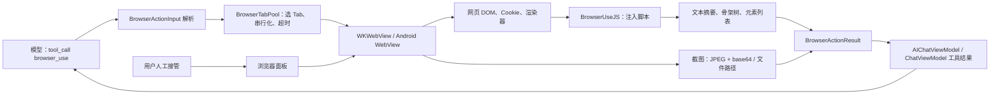

## 10. 浏览器自动化：让 agent 用你的登录态上网

### 10.1 这一章解决什么问题

浏览器自动化（browser automation）不是把一个 URL 丢给 HTTP 客户端，而是让模型在带有页面状态、Cookie、渲染器和用户界面的 WebView 上逐步观察、决策、操作。OpenMinis 把这条链拆成动作协议、页面表示、Tab 池、Cookie 边界和 UI 接管五层；iOS 以 `WKWebView` 为执行面，Android 以 `WebView` 为执行面。没有页面表示，模型只能盲猜 CSS 选择器；没有 Tab 池，并发工具调用会互相覆盖页面；没有 Cookie 边界，复用登录态就会变成不可审计的凭据泄露。读者可以把本章当作一份“从一个 WebView 到可生产使用的 agent 浏览器”的实现顺序。

本章所有行为都以仓库中的 Swift/Kotlin/JavaScript 为准；对于跨平台代码的差异，优先说明实际实现，而不是假设两端完全对称。

### 10.2 先画出系统边界

模型拿到的不是 WebView 对象，而是一次 `browser_use` 工具调用的文本、可选图片、文件引用和页面 URL。调用先由输入解析器将 JSON 变成 `BrowserActionInput`，再由 Tab 池确定目标 Tab，最后由单 Tab manager 把动作翻译成 WebKit/Android WebView API 或注入 JavaScript。



**入口与结果对象。** iOS 的动作枚举和输入字段位于 `` `src/ios/Agent/BrowserUse/BrowserUseActions.swift:5-128` ``；Android 的同一组枚举和解析字段位于 `` `src/android/app/src/main/java/com/openminis/app/browser/BrowserAction.kt:6-71` ``、`` `src/android/app/src/main/java/com/openminis/app/browser/BrowserActionInput.kt:9-105` ``。两端结果对象都携带 `text`、`success`、可选截图、可选下载文件、页面 URL 和实际 Tab ID，分别见 `` `src/ios/Agent/BrowserUse/BrowserUseActions.swift:180-217` `` 与 `` `src/android/app/src/main/java/com/openminis/app/browser/BrowserActionResult.kt:6-35` ``。

**关键数据流。** iOS 聊天工具分支解析 JSON 后调用 `browserTabPool.execute`，将结果文本、截图路径、页面 URL 和图片数据写回工具消息，见 `` `src/ios/Agent/Chat/AIChatViewModel+ConcurrentTools.swift:460-527` ``。Android 的 agent 分支做同样的路由，并把 base64 解码、缩放后保存到 session 的 `/var/minis/browser/`，见 `` `src/android/app/src/main/java/com/openminis/app/ui/chat/ChatViewModel.kt:7380-7448` ``。

### 10.3 动作空间：模型究竟能发什么指令

#### 10.3.1 输入协议的公共字段

工具定义要求 `tool_title` 与 `action`，其余字段按动作使用。iOS agent 的完整 schema 在 `` `src/ios/Agent/Chat/AIChatViewModel+ToolDefinitions.swift:70-100` ``；Android agent 的完整 schema 在 `` `src/android/app/src/main/java/com/openminis/app/tools/AgentTools.kt:55-101` ``。独立的 Android `BrowserUseTool.toolDefinition()` 也提供了通用 API schema，但只显式列出基础字段，见 `` `src/android/app/src/main/java/com/openminis/app/tools/BrowserUseTool.kt:21-108` ``；实际 app agent 应以 `AgentTools.browserUseDefinition` 的字段为准。

输入解析器的行为有几个容易忽略的细节：

- iOS 先验证 JSON、`action` 字符串和 `BrowserAction` 枚举；`keywords` 既可为字符串也可为字符串数组，见 `` `src/ios/Agent/BrowserUse/BrowserUseActions.swift:70-110` ``。
- Android 解析器把 `keywords` 当作 JSON 数组；shell offload 层会先把空白/逗号分隔字符串正规化成数组，分别见 `` `src/android/app/src/main/java/com/openminis/app/browser/BrowserActionInput.kt:48-80` ``、`` `src/android/app/src/main/java/com/openminis/app/sandbox/offload/BrowserUseOffloadHandler.kt:154-165` ``。
- Cookie 字段在两端都接受真实数组或“JSON 编码的字符串”，iOS 见 `` `src/ios/Agent/BrowserUse/BrowserUseActions.swift:113-128` ``，Android 见 `` `src/android/app/src/main/java/com/openminis/app/browser/BrowserActionInput.kt:86-103` ``。
- `tab_id` 是目标 Tab 的提示，不是结果中“猜出来的”编号；池在真正 dispatch 后把已验证的目标 ID 写回结果，iOS 见 `` `src/ios/Agent/BrowserUse/BrowserTabPool.swift:949-966` ``，Android 见 `` `src/android/app/src/main/java/com/openminis/app/browser/BrowserTabPool.kt:632-685` ``。

#### 10.3.2 完整动作表

下表列出 `BrowserAction` 的全部 22 个值，而不是只列常用的 navigate/click/type。Swift 枚举完整列表见 `` `src/ios/Agent/BrowserUse/BrowserUseActions.swift:5-28` ``；Kotlin 枚举完整列表见 `` `src/android/app/src/main/java/com/openminis/app/browser/BrowserAction.kt:6-28` ``。返回值均为 `BrowserActionResult`；“文本结果”指 `text` 字段，“失败”通常是 `success=false` 且 `text` 以 `Error:` 开头。

| 动作 | 参数与默认值 | 实际执行与返回 | 代码位置 |
|---|---|---|---|
| `navigate` | `url` 必填；无 scheme 时补 `https://` | iOS 仅允许 `http/https/minis` 直接导航；Android 由 WebViewClient 处理 Google OAuth 与外部 scheme；两端等待完成或 30 秒超时，返回 URL、标题、viewport、页面尺寸、滚动位置 | iOS `` `src/ios/Agent/BrowserUse/BrowserUseManager.swift:662-729` ``；Android `` `src/android/app/src/main/java/com/openminis/app/browser/BrowserUseManager.kt:565-647` `` |
| `screenshot` | `full_page` 可选，默认 `false` | 当前 viewport 或拉伸到页面高度后截图；返回 JPEG base64 与本地路径，`text` 含尺寸/URL/滚动元数据 | iOS `` `src/ios/Agent/BrowserUse/BrowserUseManager.swift:741-851` ``；Android `` `src/android/app/src/main/java/com/openminis/app/browser/BrowserUseManager.kt:651-733` `` |
| `click` | `selector`，或同时提供 `coordinate_x` + `coordinate_y` | 选择器走 `querySelector`；坐标走 `elementFromPoint`；成功返回元素 tag/短文本，找不到或 disabled 返回错误 | iOS `` `src/ios/Agent/BrowserUse/BrowserUseManager.swift:900-910` ``、`` `src/ios/Agent/BrowserUse/BrowserUseJavaScript.swift:26-66` ``；Android `` `src/android/app/src/main/java/com/openminis/app/browser/BrowserUseManager.kt:834-843` `` |
| `type` | `selector`、`text` 均必填 | 设置 input/textarea/contenteditable，派发键盘、input、change 事件；成功返回 selector 与字符数 | iOS `` `src/ios/Agent/BrowserUse/BrowserUseManager.swift:914-924` ``、`` `src/ios/Agent/BrowserUse/BrowserUseJavaScript.swift:70-117` ``；Android `` `src/android/app/src/main/java/com/openminis/app/browser/BrowserUseManager.kt:845-851` `` |
| `get_text` | `selector` 可选；省略则读 body | `innerText` 最多 10,000 字符；指定 selector 时返回元素诊断信息，未找到返回错误 | iOS `` `src/ios/Agent/BrowserUse/BrowserUseJavaScript.swift:121-180` ``、`` `src/ios/Agent/BrowserUse/BrowserUseManager.swift:929-959` ``；Android `` `src/android/app/src/main/java/com/openminis/app/browser/BrowserUseJS.kt:114-135` `` |
| `scroll` | `direction`=`up/down`，默认 down；`amount` 默认 500；`selector` 可选 | 先滚 window；若 window 不动，在最多 10 层 DOM 中选择面积最大的可滚动容器；返回滚动容器、位置、高度和其它容器提示 | iOS `` `src/ios/Agent/BrowserUse/BrowserUseJavaScript.swift:232-315` ``；Android `` `src/android/app/src/main/java/com/openminis/app/browser/BrowserUseJS.kt:163-212` `` |
| `get_page_info` | 无 | 返回 URL、标题、`scrollY`、页面尺寸、viewport、readyState、forms/links/images 数量 | iOS `` `src/ios/Agent/BrowserUse/BrowserUseJavaScript.swift:840-858` ``；Android `` `src/android/app/src/main/java/com/openminis/app/browser/BrowserUseJS.kt:250-267` `` |
| `execute_js` | `script` 必填 | 在 page world 执行；iOS 使用 `callAsyncJavaScript` 支持顶层 `await/return`，Android 用 `__minis__` bridge 等 Promise，返回 JSON 或字符串 | iOS `` `src/ios/Agent/BrowserUse/BrowserUseManager.swift:1333-1353` ``；Android `` `src/android/app/src/main/java/com/openminis/app/browser/BrowserUseManager.kt:881-931` `` |
| `find_elements` | `selector` 必填 | 查询最多 20 个匹配元素；返回总数、显示数、局部 `index`、tag/id/class/text/href/rect/可见性 | iOS `` `src/ios/Agent/BrowserUse/BrowserUseJavaScript.swift:349-372` ``；Android `` `src/android/app/src/main/java/com/openminis/app/browser/BrowserUseJS.kt:228-248` `` |
| `hover` | `selector` 必填 | 派发 mouseenter/mouseover，返回 tag 与最多 100 字符文本 | iOS `` `src/ios/Agent/BrowserUse/BrowserUseJavaScript.swift:335-345` ``；Android `` `src/android/app/src/main/java/com/openminis/app/browser/BrowserUseJS.kt:214-224` `` |
| `get_readable` | 无 | 按 `article`、`role=main`、`main`、常见内容 class 顺序选择正文，回退 body；空白折叠后最多 15,000 字符 | iOS `` `src/ios/Agent/BrowserUse/BrowserUseJavaScript.swift:185-227` ``；Android `` `src/android/app/src/main/java/com/openminis/app/browser/BrowserUseJS.kt:137-159` `` |
| `set_user_agent` | `user_agent`：iOS pool 支持 `mobile_safari/desktop_safari/custom`；Android agent schema 暴露 `mobile_chrome/desktop_chrome`，`custom` 由设置 UI 应用 | iOS pool 会把 profile/已保存 custom UA 同步到现有 Tab；Android action path 更新 profile并 reload，custom UA 通过 `setUserAgentFromUI` 传入；两端已有 URL 都会 reload | iOS `` `src/ios/Agent/BrowserUse/BrowserTabPool.swift:864-870` ``、`` `src/ios/Agent/BrowserUse/BrowserTabPool.swift:1385-1408` ``；Android `` `src/android/app/src/main/java/com/openminis/app/browser/BrowserUseManager.kt:1051-1065` ``、`` `src/android/app/src/main/java/com/openminis/app/ui/browser/BrowserSettingsSheet.kt:164-218` `` |
| `set_viewport` | `viewport_width` + `viewport_height` 均为正数，或 `reset=true` | session 级覆盖；iOS/Android 都对现有 Tab 应用新尺寸并 reload；返回设置/重置说明 | iOS `` `src/ios/Agent/BrowserUse/BrowserTabPool.swift:873-890` ``、`` `src/ios/Agent/BrowserUse/BrowserTabPool.swift:1356-1383` ``；Android `` `src/android/app/src/main/java/com/openminis/app/browser/BrowserTabPool.kt:1070-1172` `` |
| `get_backbone` | `max_depth` 可选，manager 默认 5 | 注入脚本生成可见 DOM 骨架树；返回节点数、深度、合并数及每节点的 selector/role/text/href/input/rect | iOS `` `src/ios/Agent/BrowserUse/BrowserUseManager.swift:1479-1514` ``；Android `` `src/android/app/src/main/java/com/openminis/app/browser/BrowserUseManager.kt:947-963` `` |
| `fetch` | `url` 必填 | 在当前页面上下文用 `fetch` 读取资源，返回 status/content-type/size/文件名，并把原始 bytes 放到 `fetchedFileData` | iOS `` `src/ios/Agent/BrowserUse/BrowserUseManager.swift:1551-1637` ``；Android `` `src/android/app/src/main/java/com/openminis/app/browser/BrowserUseManager.kt:965-1016` `` |
| `new_tab` | `url` 可选；`tab_id` 不用于创建 | Tab 池创建新 WebView、选中并返回新 ID；iOS/Android 每池最多 3 个；若有 URL 会加载 | iOS `` `src/ios/Agent/BrowserUse/BrowserTabPool.swift:423-454` ``；Android `` `src/android/app/src/main/java/com/openminis/app/browser/BrowserTabPool.kt:822-843` `` |
| `close_tab` | `tab_id` 可选，省略使用 selected tab | 从池移除 WebView/Tab，选择剩余 Tab；不存在返回错误 | iOS `` `src/ios/Agent/BrowserUse/BrowserTabPool.swift:512-529` ``；Android `` `src/android/app/src/main/java/com/openminis/app/browser/BrowserTabPool.kt:846-861` `` |
| `list_tabs` | 无 | 返回每个 Tab 的 ID、标题、URL，当前 selected Tab 有标记 | iOS `` `src/ios/Agent/BrowserUse/BrowserTabPool.swift:531-543` ``；Android `` `src/android/app/src/main/java/com/openminis/app/browser/BrowserTabPool.kt:863-874` `` |
| `get_cookies` | `keywords` 可选；`fuzzy` 两端默认值不同：iOS true，Android input 默认 false | iOS 只取当前 host/root domain，返回环境文件路径、名称和 value length；Android 取当前 URL 的 `Cookie` header，返回 name/value 预览 | iOS `` `src/ios/Agent/BrowserUse/BrowserUseManager.swift:1062-1183` ``；Android `` `src/android/app/src/main/java/com/openminis/app/browser/BrowserUseManager.kt:1425-1465` `` |
| `set_cookies` | `cookies` 数组或 JSON 字符串；每项必须 `name/value`，可选 domain/path/secure/http_only/expires | 通过原生 Cookie store 写入，能写 HttpOnly；默认 domain 为当前页面 host、path 为 `/`；SameSite 目前只接受不应用 | iOS `` `src/ios/Agent/BrowserUse/BrowserUseManager.swift:1185-1284` ``；Android `` `src/android/app/src/main/java/com/openminis/app/browser/BrowserUseManager.kt:1467-1561` `` |
| `scroll_and_collect` | iOS：direction/amount/scroll_count 默认 10、最多 20，selector/item_selector 可选；Android：实现要求 `item_selector`，iterations 默认 5、最多 50，keywords 可选 | 滚动并按文本去重；iOS 自动寻找重复元素并有单项 500、总输出 30,000 字符上限；Android 每步抓 selector、滚一 viewport、等待 400ms | iOS `` `src/ios/Agent/BrowserUse/BrowserUseManager.swift:1006-1052` ``、`` `src/ios/Agent/BrowserUse/BrowserUseJavaScript.swift:647-835` ``；Android `` `src/android/app/src/main/java/com/openminis/app/browser/BrowserUseManager.kt:1667-1724` `` |
| `wait_for_dom_stable` | iOS `timeout` 秒默认 10；Android `timeout` 毫秒默认 5,000，限制 1,000–60,000 | iOS `MutationObserver` 每 0.5 秒采样，连续 3 次不增且可为 0 即稳定；Android 比较 body `innerHTML.length`，两个连续读数相同即成功，超时返回失败 | iOS `` `src/ios/Agent/BrowserUse/BrowserUseManager.swift:1355-1463` ``；Android `` `src/android/app/src/main/java/com/openminis/app/browser/BrowserUseManager.kt:1599-1665` `` |

#### 10.3.3 Tab ID 与并发语义

`tab_id` 不能被当作“页面元素编号”。它标识 Tab；元素引用是 CSS selector 或坐标。动作结果追加 `tab_id: N`，用于模型把下一次 `get_text`、`scroll` 或 `click` 送回实际执行动作的 Tab。这个设计修复了并发 navigate 改写全局 selected ID 后，后续读取落到错误页面的问题，iOS 的说明与 stamping 逻辑见 `` `src/ios/Agent/BrowserUse/BrowserUseActions.swift:193-200` ``、`` `src/ios/Agent/BrowserUse/BrowserTabPool.swift:953-966` ``，Android 对应说明见 `` `src/android/app/src/main/java/com/openminis/app/browser/BrowserActionResult.kt:20-28` ``。

对“没有 `tab_id` 的调用”不能简单理解为永远使用 Tab 0：只有打开/替换页面的 `navigate` 允许在 busy grace 窗口 fan-out；读取、执行 JS、点击、滚动和截图必须跟随 selected/current page。iOS 在 `` `src/ios/Agent/BrowserUse/BrowserTabPool.swift:751-835` `` 明确区分 `isOpenPageAction`；Android 用 `BrowserAction.opensNewPage` 只把 `NAVIGATE` 放入集合，见 `` `src/android/app/src/main/java/com/openminis/app/browser/BrowserAction.kt:30-68` ``，路由分支见 `` `src/android/app/src/main/java/com/openminis/app/browser/BrowserTabPool.kt:547-576` ``。

#### 10.3.4 一次动作如何组合成可靠步骤

动作表只说明单个调用；agent 实际运行的是“观察—动作—再观察”的短序列。一个稳健的登录后读取流程通常是：先 `navigate`，再用 `get_page_info` 判断 readyState/尺寸，用 `get_backbone` 或 `find_elements` 找到 selector，随后 `click`/`type`，再显式 `wait_for_dom_stable`，最后 `get_readable` 或 `screenshot`。页面变化动作的自动 snapshot 只用于 UI preview，不能替代最后一次显式 screenshot，见 `` `src/ios/Agent/BrowserUse/BrowserUseManager.swift:243-321` ``、`` `src/android/app/src/main/java/com/openminis/app/browser/BrowserUseManager.kt:528-559` ``。

这套序列有三个可观察的边界：

1. **导航边界。** `navigate` 的文本结果会包含实际 URL、标题、viewport、页面尺寸和滚动位置；模型可以发现重定向或 viewport 不一致，见 `` `src/ios/Agent/BrowserUse/BrowserUseManager.swift:616-657` ``、`` `src/android/app/src/main/java/com/openminis/app/browser/BrowserUseManager.kt:610-647` ``。
2. **结构边界。** `get_backbone` 生成的 `sel` 是下一步动作输入；如果 click 后 URL/DOM 改变，旧 backbone 不再是当前页面的事实，应再次提取，见 `` `src/ios/Agent/BrowserUse/BrowserUseJavaScript.swift:614-640` ``。
3. **结果边界。** 每次结果都带 `success` 与实际 `tab_id`；失败时先根据 `text` 决定重读页面、换 selector、换 Tab 还是放弃，而不是把同一 JSON 无限重放，见 `` `src/ios/Agent/BrowserUse/BrowserTabPool.swift:966-989` ``、`` `src/android/app/src/main/java/com/openminis/app/browser/BrowserActionResult.kt:29-35` ``。

一个“发现后点击”的最小例子如下，参数名与仓库 schema 一致：

```json
{"action":"get_backbone","max_depth":5}
```

模型从返回树中选择 `sel`，而不是自己编造编号：

```json
{"action":"click","selector":"#search > button"}
```

点击返回成功但页面可能异步更新，因此下一步应是：

```json
{"action":"wait_for_dom_stable","timeout":10}
```

然后再读文本或截图：

```json
{"action":"get_readable"}
```

这些 JSON 片段是协议示例，不是仓库中的固定调用；它们对应的参数校验与实际返回仍由 `` `src/ios/Agent/BrowserUse/BrowserUseActions.swift:32-110` `` 和 `` `src/android/app/src/main/java/com/openminis/app/browser/BrowserActionInput.kt:9-80` `` 执行。

对于并发场景，两个没有 `tab_id` 的 `navigate` 可以被池分到不同 Tab；但其后的 `get_text` 应使用第一个 navigate 返回的 `tab_id`，否则模型可能跟随最新 selected Tab。iOS 的 fan-out 与 result stamping 见 `` `src/ios/Agent/BrowserUse/BrowserTabPool.swift:808-829` ``、`` `src/ios/Agent/BrowserUse/BrowserTabPool.swift:949-966` ``；Android 的同等规则见 `` `src/android/app/src/main/java/com/openminis/app/browser/BrowserTabPool.kt:547-576` ``、`` `src/android/app/src/main/java/com/openminis/app/browser/BrowserTabPool.kt:632-685` ``。

### 10.4 页面表示：给模型的不是“整个网页”

这是浏览器 agent 成败的核心。OpenMinis 没有把完整 DOM、HTML 或无障碍树直接塞给模型，而是提供四种互补表示：可读正文、截断文本、结构骨架和有限元素列表；截图作为多模态补充。模型要先选择一种表示，再用 CSS selector/坐标进行动作。

#### 10.4.1 `get_text` 与 `get_readable`：便宜的文本通道

`get_text` 读取可见 `innerText`，body 结果最多 10,000 字符；指定 selector 时也最多 10,000 字符，并附带 readyState、DOM 数量、滚动高度等诊断字段，真实脚本见 `` `src/ios/Agent/BrowserUse/BrowserUseJavaScript.swift:121-180` ``。Android 脚本的核心截断同样是 10,000 字符，但 Android 的 `get_text` 结果诊断字段更少，见 `` `src/android/app/src/main/java/com/openminis/app/browser/BrowserUseJS.kt:114-135` ``。

`get_readable` 是启发式正文抽取，不是浏览器的阅读模式实现。脚本按 `article`、`[role="main"]`、`main`、`.post-content`、`.article-body`、`.entry-content`、`#content`、`.content` 顺序找第一个可见且有文字的元素，找不到才回退 body；文本折叠连续空白后截断到 15,000 字符，见 `` `src/ios/Agent/BrowserUse/BrowserUseJavaScript.swift:185-227` ``。Android 移植了同一选择器顺序，见 `` `src/android/app/src/main/java/com/openminis/app/browser/BrowserUseJS.kt:137-159` ``。

这两个通道适合文章、搜索结果和登录后的文本页面，但不适合识别按钮位置、Canvas、图片里的文字或复杂 SPA 的视觉层。此时使用 `get_backbone`、`find_elements` 或显式 `screenshot`。

#### 10.4.2 `find_elements`：有局部 index，但没有永久 element handle

真实注入脚本如下，来自 `` `src/ios/Agent/BrowserUse/BrowserUseJavaScript.swift:347-372` ``：

```swift
// source: src/ios/Agent/BrowserUse/BrowserUseJavaScript.swift:349-370
(function() {
    var els = document.querySelectorAll('\(jsQuote(selector))');
    var results = [];
    var limit = Math.min(els.length, 20);
    var scrollX = window.scrollX || window.pageXOffset || 0;
    var scrollY = window.scrollY || window.pageYOffset || 0;
    for (var i = 0; i < limit; i++) {
        var el = els[i];
        var rect = el.getBoundingClientRect();
        results.push({
            index: i,
            tag: el.tagName,
            id: el.id || null,
            className: el.className || null,
            text: (el.innerText || '').substring(0, 80),
            href: el.href || null,
            rect: {x: Math.round(rect.x), y: Math.round(rect.y),
                   width: Math.round(rect.width), height: Math.round(rect.height),
                   pageX: Math.round(rect.x + scrollX),
                   pageY: Math.round(rect.y + scrollY),
                   visible: rect.width > 0 && rect.height > 0 &&
                            rect.top < window.innerHeight && rect.bottom > 0}
        });
    }
    return JSON.stringify({count: els.length, shown: limit, elements: results});
})()
```

这里的 `index` 是本次 `querySelectorAll` 结果里的 0 到 19，不是页面全局 ID，也不是可以直接传给 `click` 的参数。`click` 的协议只接受 CSS selector 或坐标，见 `` `src/ios/Agent/BrowserUse/BrowserUseManager.swift:900-909` ``；Android 的 `click` 同样只接受 selector/coordinate，见 `` `src/android/app/src/main/java/com/openminis/app/browser/BrowserUseManager.kt:836-842` ``。因此从零实现时应让模型复制结果里的 selector，不能设计成“click index=3”，除非你自己再增加一层编号到 selector 的映射。

#### 10.4.3 `get_backbone`：压缩的可见 DOM 骨架

这是本项目最重要的注入算法。下面片段保留了真实 Swift 字符串中的核心语义，来源是 `` `src/ios/Agent/BrowserUse/BrowserUseJavaScript.swift:377-403` ``：

```swift
// source: src/ios/Agent/BrowserUse/BrowserUseJavaScript.swift:377-403
static func getBackbone(maxDepth: Int) -> String {
    """
    (function() {
        var MAX_DEPTH = \(maxDepth);
        var MERGE_THRESHOLD = 10;
        var MIN_SIZE = 8;

        function isVisible(el) {
            if (!el.getBoundingClientRect) return false;
            var st = window.getComputedStyle(el);
            if (st.display === 'none' || st.visibility === 'hidden' || st.opacity === '0') return false;
            var r = el.getBoundingClientRect();
            return r.width >= MIN_SIZE && r.height >= MIN_SIZE;
        }

        var SEMANTIC_TAGS = new Set(['IMG','SVG','VIDEO','CANVAS','INPUT','TEXTAREA','BUTTON','A','SELECT','IFRAME']);
        var SKIP_TAGS = new Set(['SCRIPT','STYLE','NOSCRIPT','BR','HR','META','LINK','TEMPLATE']);

        function isLeaf(el) {
            if (SKIP_TAGS.has(el.tagName)) return false;
            if (SEMANTIC_TAGS.has(el.tagName)) return true;
            var children = el.children;
            for (var i = 0; i < children.length; i++) {
                if (!SKIP_TAGS.has(children[i].tagName) && isVisible(children[i])) return false;
            }
            return true;
        }
    })()
    """
}
```

算法分七个概念步骤：

1. **过滤可见节点。** `display:none`、`visibility:hidden`、`opacity:0` 或宽高小于 8 的节点先被过滤；脚本把按钮、链接、输入框、媒体等语义标签直接当作叶子候选，见 `` `src/ios/Agent/BrowserUse/BrowserUseJavaScript.swift:384-403` ``。
2. **向上合并。** 可见叶子会向父级冒泡；如果父级矩形与代表节点在四条边上都相差不超过 10 px，就把父级作为代表，减少重复的布局包裹层，见 `` `src/ios/Agent/BrowserUse/BrowserUseJavaScript.swift:405-485` ``。
3. **补结构组节点。** 从每个代表向上走最多 6 层；一个祖先包含至少两个代表时，它会被加成 group node，保留页面的区域结构，见 `` `src/ios/Agent/BrowserUse/BrowserUseJavaScript.swift:487-509` ``。
4. **提取可操作信息。** 节点携带 tag、短 class、selector、role、最多 120 字符 text；链接只保留 path 与最多 40 字符 query，图片 src 最多 120 字符，输入 value/placeholder 最多 60 字符，见 `` `src/ios/Agent/BrowserUse/BrowserUseJavaScript.swift:511-549` ``。
5. **按真实 DOM containment 建树。** 节点先按面积排序，再用 `el.contains` 找最小面积父节点，避免纯矩形包含在浮层/重叠布局上的误判，见 `` `src/ios/Agent/BrowserUse/BrowserUseJavaScript.swift:551-575` ``。
6. **清理冗余组节点。** 只有一个子节点的空 group 会被展平；没有内容的空 group 被删除，见 `` `src/ios/Agent/BrowserUse/BrowserUseJavaScript.swift:577-605` ``。
7. **深度裁剪与序列化。** `max_depth` 默认由 manager 设为 5；达到深度后清空 children。序列化结果包含 `sel`、role、text、href、input、`rect` 与页面坐标 `pageXY`，见 `` `src/ios/Agent/BrowserUse/BrowserUseJavaScript.swift:607-640` ``。

Android 的 `BrowserUseJS.getBackbone` 是逐行移植，使用同样的可见性、10 px 合并、短 selector、DOM containment、group prune 和 `MAX_DEPTH`，见 `` `src/android/app/src/main/java/com/openminis/app/browser/BrowserUseJS.kt:271-434` ``。

#### 10.4.4 稳定引用：短 CSS selector，而不是无障碍编号

短 selector 的真实实现如下，来源 `` `src/ios/Agent/BrowserUse/BrowserUseJavaScript.swift:412-439` ``：

```javascript
// source: src/ios/Agent/BrowserUse/BrowserUseJavaScript.swift:412-439
// Short selector: #id or #ancestor > tag:nth(n) — max 2 segments after anchor
function shortSelector(el) {
    if (el.id) return '#' + el.id;
    var path = [];
    var cur = el;
    while (cur && cur !== document.body && cur !== document.documentElement) {
        if (cur.id) { path.unshift('#' + cur.id); break; }
        var seg = cur.tagName.toLowerCase();
        var parent = cur.parentElement;
        if (parent) {
            var siblings = parent.children;
            var sameTag = 0, idx = 0;
            for (var i = 0; i < siblings.length; i++) {
                if (siblings[i].tagName === cur.tagName) {
                    sameTag++;
                    if (siblings[i] === cur) idx = sameTag;
                }
            }
            if (sameTag > 1) seg += ':nth-of-type(' + idx + ')';
        }
        path.unshift(seg);
        cur = parent;
    }
    if (path.length > 3 && path[0].charAt(0) === '#') {
        path = [path[0]].concat(path.slice(-2));
    } else if (path.length > 2) {
        path = path.slice(-2);
    }
    return path.join(' > ');
}
```

规则是：有 id 就使用 `#id`；没有 id 时根据同 tag 兄弟生成 `:nth-of-type(n)`，最终最多保留锚点加两段或最后两段。它比完整 DOM 路径短，适合模型上下文；但它仍是对当前 DOM 的 CSS 查询字符串，不是浏览器原生 element handle。DOM 重排、列表插入或 selector 变化都可能使旧引用指向别的节点或失效，这是由“每次结果只返回字符串 selector、下一次又重新 `querySelector`”直接得到的工程结论，标记为[推断]。因此每次 click/type 前最好重新 `get_backbone` 或 `find_elements`。

骨架会保留 `role` 属性，但脚本没有调用 `AccessibilityNodeInfo`，也没有构造完整无障碍树；模型收到的是简化 DOM 树。iOS 序列化 `role` 的代码在 `` `src/ios/Agent/BrowserUse/BrowserUseJavaScript.swift:618-635` ``，Android 对应在 `` `src/android/app/src/main/java/com/openminis/app/browser/BrowserUseJS.kt:415-429` ``。

#### 10.4.5 大页面与无限滚动裁剪

普通文本有 10,000/15,000 字符上限，骨架有深度上限；无限滚动专用动作还限制单项和总输出。iOS `scrollAndCollect` 的 `ITEM_CAP=500`、`TOTAL_CAP=30000`、最多 `scrollCount` 次，并按前 80 字符文本去重；脚本会观察滚动容器 mutation，最多等 2 秒并在 mutation 后等待至多 1 秒 settle，见 `` `src/ios/Agent/BrowserUse/BrowserUseJavaScript.swift:662-665` ``、`` `src/ios/Agent/BrowserUse/BrowserUseJavaScript.swift:741-809` ``。manager 把次数限制在 20，见 `` `src/ios/Agent/BrowserUse/BrowserUseManager.swift:1008-1026` ``。

Android 的同名动作不是调用 Kotlin 端的完整移植脚本，而是在 manager 中要求 `item_selector`，每次抓匹配节点文本、向下滚一 viewport、等待 400ms，再进行大小写不敏感的关键词过滤；默认 5 次、最多 50 次，见 `` `src/android/app/src/main/java/com/openminis/app/browser/BrowserUseManager.kt:1667-1724` ``。这是两端实际行为的重要差异：跨平台文档不能笼统写成“item selector 可省略且两端自动检测”。

#### 10.4.6 截图是第二种页面表示，不是 DOM 的替代品

显式 `screenshot` 才会把 JPEG base64 放入结果。iOS 当前 viewport 使用 `WKSnapshotConfiguration`；`full_page=true` 先读 `scrollHeight`、临时改变 WebView frame、让 lazy image eager 化并等待两个 RAF，最后用 JPEG quality 0.8 编码，同时把高度限制到 32,768 CSS px，见 `` `src/ios/Agent/BrowserUse/BrowserUseManager.swift:741-851` ``。Android 以设备 density 把 CSS 高度换成物理像素，使用同样的 32,768 px 上限，拉伸后 `Bitmap` 绘制再 JPEG quality 80，见 `` `src/android/app/src/main/java/com/openminis/app/browser/BrowserUseManager.kt:46-53` ``、`` `src/android/app/src/main/java/com/openminis/app/browser/BrowserUseManager.kt:651-733` ``。

视觉变化动作（navigate/click/scroll/scroll_and_collect/hover/type）会自动等待 DOM 变化并保存一张 UI preview snapshot，但这张自动 snapshot 只放 `imageFilePath`，不自动放 `base64Image` 给模型；iOS 代码在 `` `src/ios/Agent/BrowserUse/BrowserUseManager.swift:243-321` ``，Android 的 `attachSnapshot` 在 `` `src/android/app/src/main/java/com/openminis/app/browser/BrowserUseManager.kt:497-559` ``。模型需要视觉信息时应显式发 `screenshot`，或者在后续动作中引用保存的 `minis://` 图片。

### 10.5 从动作到 WebView：执行、等待与失败反馈

#### 10.5.1 iOS dispatch 顺序

iOS `BrowserUseManager.execute(action:)` 在任何动作前调用 `CookieBackupStore.syncIfNeeded()`，随后 switch 到 22 个动作；Tab 管理动作由池处理，`set_viewport` 也由池处理，见 `` `src/ios/Agent/BrowserUse/BrowserUseManager.swift:249-300` ``。成功的视觉变化动作进入 `waitForDomSettleAndSnapshot`：安装 MutationObserver，最多观察 5 秒；DOM 摘要会追加到 `text` 并送给模型，snapshot 仅作为文件路径给 UI，见 `` `src/ios/Agent/BrowserUse/BrowserUseManager.swift:318-393` ``。

导航用 `CheckedContinuation` 等 delegate；`didFinish` 会更新 URL/title/back-forward 状态、写历史并 resume，失败 delegate 设置 `loadError` 同时以 error resume，见 `` `src/ios/Agent/BrowserUse/BrowserUseManager.swift:2047-2093` ``。导航的自身 timeout 是 30 秒，超时时不直接报失败，而是 resume 让页面的部分加载结果仍可被读取，见 `` `src/ios/Agent/BrowserUse/BrowserUseManager.swift:693-729` ``。

JavaScript evaluation 特别容易无限等待。iOS 对导航 metadata 的 `evaluateJavaScript` 使用 `DispatchSourceTimer` 与 continuation race，默认 10 秒；代码注释还解释了后台 CPU throttle 下 `Task.sleep` 可能延迟，所以采用 GCD wall-clock timer，见 `` `src/ios/Agent/BrowserUse/BrowserUseManager.swift:551-614` ``。单动作在 Tab 池外层还有 300 秒 hard ceiling；超时会丢弃 wedged WebView、创建新 Tab，并把新 ID 和旧 URL 反馈给模型，见 `` `src/ios/Agent/BrowserUse/BrowserTabPool.swift:997-1114` ``。

#### 10.5.2 Android dispatch 顺序

Android manager 的 `execute` 先记录前 URL，再 switch；显式截图直接返回，其他视觉变化动作执行后等待 300ms 并附加文件 snapshot，同时检查 URL 是否变化，见 `` `src/android/app/src/main/java/com/openminis/app/browser/BrowserUseManager.kt:497-559` ``。导航通过 `CompletableDeferred` 等 `onPageFinished`，Handler 30 秒后完成 deferred；页面错误也完成 deferred，所以模型能拿到可读的导航 metadata，而不是永远挂住，见 `` `src/android/app/src/main/java/com/openminis/app/browser/BrowserUseManager.kt:347-383` ``、`` `src/android/app/src/main/java/com/openminis/app/browser/BrowserUseManager.kt:563-607` ``。

Android `evaluateJavascript` 的回调返回 JSON 编码字符串，helper 会先 unquote，再将 `{error:...}` 转成失败结果，见 `` `src/android/app/src/main/java/com/openminis/app/browser/BrowserUseManager.kt:1225-1279` ``。由于 Android WebView 的 `evaluateJavascript` 不会等待 Promise，`execute_js` 使用 `__minis__.resolve/reject` bridge，单次等待上限 30 秒；`fetch` 使用同样的 bridge，但等待上限 60 秒，见 `` `src/android/app/src/main/java/com/openminis/app/browser/BrowserUseManager.kt:881-931` ``、`` `src/android/app/src/main/java/com/openminis/app/browser/BrowserUseManager.kt:1018-1048` ``。

#### 10.5.3 结果如何回到模型

iOS 工具分支捕获 `execute` 抛出的错误并转成 `BrowserActionResult.error`；成功结果的 `text` 写入 tool block，`imageFilePath` 与 `browserURL` 更新 UI，显式 base64 会被解码、缩放到最长边 2,000 后作为 JPEG 输入模型，见 `` `src/ios/Agent/Chat/AIChatViewModel+ConcurrentTools.swift:460-514` ``。fetch bytes 也被保存到 session workspace，并追加 `minis_url`，见 `` `src/ios/Agent/Chat/AIChatViewModel+ConcurrentTools.swift:516-527` ``。

Android agent 分支将 base64 解码为原始 JPEG，保留原文件，另外生成最多 2,000 长边的推理副本，并把 `/var/minis/browser/...` 转成 percent-encoded `minis://browser/...`，见 `` `src/android/app/src/main/java/com/openminis/app/ui/chat/ChatViewModel.kt:7380-7448` ``。当模型在 sandbox 中通过 `minis-browser-use` 调用时，offload handler 使用 90 秒 hard timeout；成功输出 JSON envelope，截图默认以路径/`minis_url` 引用，只有 `--with-base64` 才内嵌 base64，见 `` `src/android/app/src/main/java/com/openminis/app/sandbox/offload/BrowserUseOffloadHandler.kt:23-37` ``、`` `src/android/app/src/main/java/com/openminis/app/sandbox/offload/BrowserUseOffloadHandler.kt:86-120` ``、`` `src/android/app/src/main/java/com/openminis/app/sandbox/offload/BrowserUseOffloadHandler.kt:239-301` ``。

### 10.6 Tab 池：并发、复用与内存回收

#### 10.6.1 iOS 的两级容量模型

单个 `BrowserTabPool` 最多 3 个 Tab；进程级 `BrowserTabPoolRegistry` 对所有 session 的 live tabs 设硬上限 8，优先回收其它 pool 中最老的 idle Tab，没有 idle 才 preempt in-use Tab，见 `` `src/ios/Agent/BrowserUse/BrowserTabPool.swift:20-108` ``、`` `src/ios/Agent/BrowserUse/BrowserTabPool.swift:191-204` ``。收到内存警告时，registry 回收所有非 `inUse` Tab，保留正在执行的动作，见 `` `src/ios/Agent/BrowserUse/BrowserTabPool.swift:110-123` ``。

Tab 在 action 期间及 action 完成后 15 秒 grace 内保持 `inUse`；隐式 navigate 遇到 busy Tab 会优先重用 free Tab，否则在容量允许时 fan-out 新 Tab，避免连续 navigate 覆盖同一页面。这个状态与 grace 的字段定义见 `` `src/ios/Agent/BrowserUse/BrowserTabPool.swift:206-229` ``，选择策略见 `` `src/ios/Agent/BrowserUse/BrowserTabPool.swift:790-835` ``，grace timer 见 `` `src/ios/Agent/BrowserUse/BrowserTabPool.swift:1151-1170` ``。

同一 Tab 上的动作必须串行。iOS pool 用 per-tab serial chain，等待前一操作最多 60 秒；不同 Tab 仍可并行。超时返回“打开新 Tab 或换 tab_id”的指导，而不是无限排队，见 `` `src/ios/Agent/BrowserUse/BrowserTabPool.swift:546-658` ``、`` `src/ios/Agent/BrowserUse/BrowserTabPool.swift:892-907` ``。

Tab 闲置超过 15 分钟、每 60 秒检查一次；回收前保存当前 URL，下一次创建同 ID 的 Tab 时恢复。Tab URL、selected ID 和 session viewport 写入 `Application Support/MinisChat/browser_tabs/<session>.json`，见 `` `src/ios/Agent/BrowserUse/BrowserTabPool.swift:1181-1217` ``、`` `src/ios/Agent/BrowserUse/BrowserTabPool.swift:1411-1509` ``。

#### 10.6.2 iOS WebView 的 cookie/session 共享与重建

所有 manager 使用同一个 `WKProcessPool` 与 `.default()` `WKWebsiteDataStore`；这样多个 Tab 能共享 OAuth/session Cookie，配置工厂见 `` `src/ios/Agent/BrowserUse/BrowserUseManager.swift:69-72` ``、`` `src/ios/Agent/BrowserUse/BrowserUseManager.swift:132-169` ``。新窗口由 `window.open` 回调携带配置创建新 manager，因此 opener 的会话与 Tab 池仍相连，见 `` `src/ios/Agent/BrowserUse/BrowserTabPool.swift:469-502` ``。

切换 UA 或 viewport 会重建 WKWebView，并在旧 URL 上 reload，而不是尝试对既有 renderer 打补丁；见 `` `src/ios/Agent/BrowserUse/BrowserUseManager.swift:1698-1742` ``。若 WebContent process 被系统杀死，manager 会让 pending continuation 失败，Tab 池在 300 秒动作上限路径中丢掉有毒 WebView 并开新 Tab，见 `` `src/ios/Agent/BrowserUse/BrowserUseManager.swift:2191-2221` ``、`` `src/ios/Agent/BrowserUse/BrowserTabPool.swift:1097-1114` ``。

#### 10.6.3 Android 的 per-pool 模型

Android `BrowserTabPool` 也限制 3 个 Tab，idle 默认 15 分钟、60 秒检查；设置可以调到 1–240 分钟。Tab 是 `data class`，持有一个 `BrowserUseManager(WebView)`、`inUse`、最近活动时间、初始 blank page 标记和 grace job，见 `` `src/android/app/src/main/java/com/openminis/app/browser/BrowserTabPool.kt:28-133` ``、`` `src/android/app/src/main/java/com/openminis/app/browser/BrowserTabPool.kt:189-246` ``。

Android 没有 iOS registry 的跨 session 8 Tab 总上限；这里的容量控制是 pool 实例内 `MAX_TABS=3`，见 `` `src/android/app/src/main/java/com/openminis/app/browser/BrowserTabPool.kt:34-60` ``。当所有 Tab 都 busy 且达到 3 个时，隐式 acquire 最多等待 20 秒、每 250ms 轮询；仍没有空闲 Tab 才回退到最近活动策略，见 `` `src/android/app/src/main/java/com/openminis/app/browser/BrowserTabPool.kt:721-778` ``。

显式 `tab_id` 的并发调用用每 Tab `Mutex`，等待锁最多 60 秒；没有 `tab_id` 的调用不共用一个锁，`navigate` 可以 fan-out，读取/操作动作跟随 selected Tab，见 `` `src/android/app/src/main/java/com/openminis/app/browser/BrowserTabPool.kt:98-110` ``、`` `src/android/app/src/main/java/com/openminis/app/browser/BrowserTabPool.kt:522-611` ``。隐式 action 返回后保持 15 秒 grace，显式 tab_id 则释放 `inUse`，见 `` `src/android/app/src/main/java/com/openminis/app/browser/BrowserTabPool.kt:624-707` ``。

#### 10.6.4 Android WebView 的复用方式

Android pool 在创建 Tab 时分配一个 detached `WebView`，设置 UA、viewport、`window.open/close` 和下载回调；没有 initial URL 时先标记 `needsInitialBlankPage`，在 suspend context 中加载带 viewport meta 的空页面，避免 `about:blank` 报告固定 980 CSS px，见 `` `src/android/app/src/main/java/com/openminis/app/browser/BrowserTabPool.kt:781-817` ``、`` `src/android/app/src/main/java/com/openminis/app/browser/BrowserUseManager.kt:55-72` ``。

Compose 重新组合不能只依赖 `AndroidView.factory` 返回一次 WebView。`BrowserWebView` 使用 `FrameLayout` 容器，在 `update` 中拆下并挂载当前 Tab 的 WebView；Tab 切换或 idle 后重建时不会让标题栏已经变化而内容仍显示旧 WebView，见 `` `src/android/app/src/main/java/com/openminis/app/ui/browser/BrowserWebView.kt:12-73` ``。iOS 则把 manager 的 WKWebView 直接交给 `UIViewRepresentable`，并在 sheet 里用 `.id(pool.selectedTabId)` 触发 Tab remount，见 `` `src/ios/Agent/BrowserUse/BrowserWebView.swift:3-14` ``、`` `src/ios/Agent/BrowserUse/BrowserSheetView.swift:58-75` ``。

### 10.7 登录态、Cookie 与隐私边界

#### 10.7.1 “用你的登录态”到底是什么

两端的 agent Tab 都运行在 app 自己的 WebView cookie store 中。用户在浏览器面板里完成登录后，agent 后续动作继续使用同一个 Tab/共享 store；iOS 的 manager 明确使用默认 website data store，Android 使用全局 `CookieManager` 并为每个 WebView 打开 first-party 与 third-party cookies，见 `` `src/ios/Agent/BrowserUse/BrowserUseManager.swift:132-169` ``、`` `src/android/app/src/main/java/com/openminis/app/browser/BrowserUseManager.kt:75-111` ``。

这不等于“自动读取系统 Safari/Chrome 的所有登录态”。Android 对 Google OAuth 明确把 accounts/signin/myaccount/oauth 域名路由到 Chrome Custom Tab；认证后的 Cookie 留在 Chrome，不会回到 app WebView，见 `` `src/android/app/src/main/java/com/openminis/app/browser/GoogleAuthRouter.kt:10-23` ``、`` `src/android/app/src/main/java/com/openminis/app/browser/GoogleAuthRouter.kt:40-66` ``。因此 Android agent 遇到 Google 登录页时应请求用户在 Chrome 完成登录并把结果带回，而不是反复重试 WebView。

iOS 的导航策略没有同等的 Google 外部路由；其 delegate 允许 `http`、`https`、`about`、`blob`、`minis`，阻止 `tel/mailto/itms-apps` 等 scheme，并避免 universal link 自动跳外部 app，见 `` `src/ios/Agent/BrowserUse/BrowserUseManager.swift:2095-2145` ``。是否能在某个站点完成 WebView 登录取决于该站点策略，不能把“有 Cookie store”误写成“所有 OAuth 都可用”。

#### 10.7.2 iOS CookieBackupStore：抗 ITP 的本地恢复层

iOS 每次 browser action 前最多每 60 秒同步一次 Cookie backup；同步先读取默认 `WKHTTPCookieStore`，将 domain/path/expires/secure/HttpOnly 与完整 value 按 registrable domain 写入 Netscape `cookies.txt`，再把 backup 中 live store 缺少的 Cookie 重新 set 回去，见 `` `src/ios/Agent/BrowserUse/CookieBackupStore.swift:6-22` ``、`` `src/ios/Agent/BrowserUse/CookieBackupStore.swift:206-300` ``。

它专门应对 WebKit ITP 在高流量域名上清除站点数据的情形；agent 自动浏览通常不构成真实用户 gesture。backup 在 Application Support 的每域文件目录，标记 excluded-from-backup，并设置 `completeUntilFirstUserAuthentication` 文件保护，不放进 iCloud/设备迁移，也不让 guest rootfs 直接读取原始登录 Cookie，见 `` `src/ios/Agent/BrowserUse/CookieBackupStore.swift:24-40` ``、`` `src/ios/Agent/BrowserUse/CookieBackupStore.swift:126-140` ``、`` `src/ios/Agent/BrowserUse/CookieBackupStore.swift:397-407` ``。

为防止 backup 无限增长，真实 navigate 才会刷新 domain 的 lastVisit；30 天未访问的 domain 被丢弃，最多保留 1,000 个 domain，见 `` `src/ios/Agent/BrowserUse/CookieBackupStore.swift:45-56` ``、`` `src/ios/Agent/BrowserUse/CookieBackupStore.swift:164-173` ``、`` `src/ios/Agent/BrowserUse/CookieBackupStore.swift:220-276` ``。用户在 Settings 清理 domain 时，UI 还会调用 `reconcileDomainAfterUserEdit`，确保下次 sync 不把用户刚删掉的 Cookie 复活，见 `` `src/ios/Agent/BrowserUse/BrowserManagementView.swift:422-459` ``。

#### 10.7.3 CookieAuditLogger：审计“变化”，而不是记录凭据

`CookieAuditLogger` 观察默认 Cookie store 的变化，采用 live diff 与启动后的 offline diff 两层机制；每个 key 是 `domain|path|name`，metadata 只包括 value length、expiry、HttpOnly，不记录 raw value，见 `` `src/ios/Agent/BrowserUse/CookieAuditLogger.swift:6-19` ``、`` `src/ios/Agent/BrowserUse/CookieAuditLogger.swift:24-75` ``。observer 事件会延迟 400ms 合并，diff 会逐条记录 removal，并将 additions/modifications 限制为每事件 20 条，见 `` `src/ios/Agent/BrowserUse/CookieAuditLogger.swift:79-125` ``。

为什么要审计 Cookie 访问：登录失效可能来自页面写入、agent `set_cookies`、Cookie 过期或 WebKit ITP 删除；没有“何时哪个域名的哪种 metadata 消失”的记录，用户只能看到空白登录页。审计的隐私边界是可归因而不可逆：日志可以证明 `x.com|/|sid` 被删除、它是 HttpOnly、值长度是多少，但不能从日志恢复 token。snapshot 本身写入 Application Support，见 `` `src/ios/Agent/BrowserUse/CookieAuditLogger.swift:138-147` ``。

Android 当前实现没有 iOS 同名的 backup/audit 层；它在每个动作里直接使用 `CookieManager`。`get_cookies` 读取当前 URL 的 Cookie header、按分号拆分，并把 value 原样或截断到 80 字符显示，见 `` `src/android/app/src/main/java/com/openminis/app/browser/BrowserUseManager.kt:1425-1465` ``。这是与 iOS 明显不同的隐私行为：Android agent result 可能看到 value preview；iOS agent result 只返回 env 文件位置、Cookie 名称和 value length，raw value 不放进 tool response，见 `` `src/ios/Agent/BrowserUse/BrowserUseManager.swift:1128-1182` ``。

#### 10.7.4 `set_cookies` 与跨域

两端都使用 native cookie API，而不是只在 JS 中写 `document.cookie`，因此可以落地 HttpOnly。iOS 接受 `http_only/httpOnly`、`expires/expirationDate` 等别名，`sameSite` 只读取不写入；见 `` `src/ios/Agent/BrowserUse/BrowserUseManager.swift:1217-1269` ``。Android 组装 Set-Cookie 字符串、调用 `CookieManager.setCookie` 后 `flush()`，同样接受 aliases，但 SameSite 目前不应用，见 `` `src/android/app/src/main/java/com/openminis/app/browser/BrowserUseManager.kt:1510-1548` ``。

`get_cookies` 有意收窄读取范围：iOS 只允许当前 host、root domain 或其子域匹配，见 `` `src/ios/Agent/BrowserUse/BrowserUseManager.swift:1067-1097` ``；Android 直接调用当前 URL 的 `CookieManager.getCookie(url)`，见 `` `src/android/app/src/main/java/com/openminis/app/browser/BrowserUseManager.kt:1435-1451` ``。但两端共享 store 都意味着 Tab 之间没有账号隔离。若产品需要多账号，不能只增加 `tab_id`；必须设计不同的 data store/profile/container，并明确哪些动作允许跨 profile。

### 10.8 反自动化对抗：UA、viewport、webdriver 与等待

#### 10.8.1 UA 不是一个字符串就结束

iOS 的 browser UA 定义在 `UserAgentProfile`，mobile Safari 为 iPhone UA、desktop Safari 为 macOS UA，并分别绑定 390×844 与 1280×800 逻辑 viewport，见 `` `src/ios/Agent/BrowserUse/BrowserUseActions.swift:131-175` ``。WebView 工厂同时设置 custom UA、preferred content mode，并在 desktop/custom viewport 时注入固定宽度 meta viewport，见 `` `src/ios/Agent/BrowserUse/BrowserUseManager.swift:123-191` ``。navigation delegate 还按 profile/viewport 决定 mobile 或 desktop content mode，见 `` `src/ios/Agent/BrowserUse/BrowserUseManager.swift:2135-2145` ``。

Android profile 是 mobile Chrome 412×915、desktop Chrome 1280×800，见 `` `src/android/app/src/main/java/com/openminis/app/browser/BrowserAction.kt:81-108` ``。Android 先按 density 把 CSS viewport 换成物理像素 measure/layout，再计算 shrink-to-fit 初始 scale；否则在高 density 手机上直接传 CSS px 会让页面逻辑宽度过窄，见 `` `src/android/app/src/main/java/com/openminis/app/browser/BrowserUseManager.kt:1067-1115` ``。

`src/ios/Shared/MinisUserAgent.swift` 容易被误读：它生成的是 LLM provider 的出站 URLSession UA，例如 `Minis/<version> (iOS <version>; iPhone)`，不是浏览器 WebView UA，见 `` `src/ios/Shared/MinisUserAgent.swift:4-32` ``。浏览器反自动化应改 `UserAgentProfile`/`customUserAgentString`，而不是修改该 provider helper。

#### 10.8.2 webdriver 痕迹的实际结论

已核对 iOS `BrowserUseJS` 的注入脚本与 Android 对应移植：它们访问 `document.querySelector`、样式、矩形、事件和 mutation observer，没有写入 `navigator.webdriver`、没有伪造完整无障碍树，也没有独立的 stealth/undetected-driver 层，见 `` `src/ios/Agent/BrowserUse/BrowserUseJavaScript.swift:3-858` ``、`` `src/android/app/src/main/java/com/openminis/app/browser/BrowserUseJS.kt:3-463` ``。因此本项目的“反自动化”策略主要是贴近 Safari/Chrome UA、保持 viewport/content mode 一致、用真实事件序列和等待页面稳定；不能声称它消除了站点的所有自动化检测。

点击脚本派发 mouseover/mouseenter/mousemove/mousedown/mouseup 后调用 `el.click()`；输入脚本使用 native value setter，再逐字符派发 keydown/keypress/input/keyup/change，并尝试触发 Angular/Vue 更新，见 `` `src/ios/Agent/BrowserUse/BrowserUseJavaScript.swift:26-43` ``、`` `src/ios/Agent/BrowserUse/BrowserUseJavaScript.swift:70-115` ``。这是为了兼容 controlled input，而不是为了伪造 WebDriver 的低层输入。

#### 10.8.3 站点策略与外部登录

Android 对 Google OAuth 采用域名后缀匹配，命中 accounts.google.com、signin.google.com、myaccount.google.com、oauth2.googleapis.com、accounts.youtube.com 就交给 Custom Tab；这是平台合规策略，不是继续升级 UA 的办法，见 `` `src/android/app/src/main/java/com/openminis/app/browser/GoogleAuthRouter.kt:28-45` ``。

Android 还将 `intent://`、`market://`、`tel:`、`mailto:`、`geo:` 等外部 scheme 路由到系统 Activity，未知 app scheme 阻断并 toast；http/https/about/file 留在 WebView，见 `` `src/android/app/src/main/java/com/openminis/app/ui/browser/BrowserExternalSchemeHandler.kt:11-32` ``、`` `src/android/app/src/main/java/com/openminis/app/ui/browser/BrowserExternalSchemeHandler.kt:78-107` ``。iOS 则在 navigation delegate 阻断非允许 scheme，见 `` `src/ios/Agent/BrowserUse/BrowserUseManager.swift:2101-2128` ``。

#### 10.8.4 等待策略不是固定 sleep

动作后，iOS 观察 DOM mutation 数量与新增 tag/text，连续三次 mutation 增长不再上升就结束，最多 5 秒；结果摘要包含 added/removed/attribute/text/new content/title，见 `` `src/ios/Agent/BrowserUse/BrowserUseManager.swift:396-548` ``。显式 `wait_for_dom_stable` 则把 mutation 计数每 0.5 秒采样，连续三次稳定后结束，见 `` `src/ios/Agent/BrowserUse/BrowserUseManager.swift:1357-1461` ``。

Android 自动 preview 使用 300ms 延迟；显式 `wait_for_dom_stable` 用 body HTML 长度轮询 200ms，并对 readyState=complete 且 body 非空的页面提供快速路径，见 `` `src/android/app/src/main/java/com/openminis/app/browser/BrowserUseManager.kt:550-559` ``、`` `src/android/app/src/main/java/com/openminis/app/browser/BrowserUseManager.kt:1601-1665` ``。动态页面最好让模型显式调用 `wait_for_dom_stable`，不要把一次 300ms 当作通用网络完成信号。

### 10.9 UI 面板与人工接管

#### 10.9.1 iOS 浏览器面板

`BrowserSheetView` 由 Tab bar、URL bar、live `BrowserWebView`、前进后退/停止/刷新/全屏工具栏组成；agent busy 时禁用 Tab、URL 输入、底部导航和关闭操作，并在 WebView 上覆盖 `AgentBrowsingOverlay`，见 `` `src/ios/Agent/BrowserUse/BrowserSheetView.swift:16-152` ``。overlay 半透明遮罩捕获所有触摸，显示“Minis is browsing”，并提供 `Takeover` 按钮，见 `` `src/ios/Agent/BrowserUse/BrowserSheetView.swift:332-384` ``。

UI 显示的 WebView 与 agent 驱动的是同一个 manager；页面加载失败显示 Safari 风格错误层而不是白屏，见 `` `src/ios/Agent/BrowserUse/BrowserSheetView.swift:58-75` ``、`` `src/ios/Agent/BrowserUse/BrowserUseManager.swift:16-23` ``。浏览器设置允许切换 UA、custom UA、viewport，并列出 Cookie domain；清理 all website data 时同时删除 Cookie backup，见 `` `src/ios/Agent/BrowserUse/BrowserManagementView.swift:32-56` ``、`` `src/ios/Agent/BrowserUse/BrowserManagementView.swift:361-459` ``。

#### 10.9.2 iOS takeover 如何衔接 agent loop

普通 takeover 在 agent loop 中等待用户返回前景，然后截一张新图，向 `agentHistory` 追加一条 user message 和 JPEG，让模型看到用户操作后的状态，见 `` `src/ios/Agent/Chat/AIChatViewModel+BackgroundTask.swift:373-410` ``。如果用户在一次 browser action 中途 takeover，系统等待 continuation；最长 5 分钟，恢复后重新截图并将结果交回工具分支，见 `` `src/ios/Agent/Chat/AIChatViewModel+BackgroundTask.swift:412-455` ``。工具结果会附加 `[Browser takeover] User manually operated...`，见 `` `src/ios/Agent/Chat/AIChatViewModel+ConcurrentTools.swift:472-483` ``。

这条链的关键是“人工操作后重新观察”，而不是假设模型知道用户点击了什么。否则模型的 DOM/视觉记忆会过期，下一次 selector 很可能已经失效。

#### 10.9.3 Android Compose 面板

`BrowserSheet` 使用 `StandardChatSheet`，展示 Tab chips、URL bar、加载进度、WebView、下载 banner、history/settings 和底部导航。sheet 打开时确保至少有一个 Tab；WebView 外侧的 nested-scroll guard 把滚动 delta 消费掉，防止网页滚动拖动 bottom sheet，见 `` `src/android/app/src/main/java/com/openminis/app/ui/browser/BrowserSheet.kt:83-138` ``。UI 在没有 URL 时不挂载空 WebView，避免 ModalBottomSheet/OpenGL 首屏出现黑白空白，见 `` `src/android/app/src/main/java/com/openminis/app/ui/browser/BrowserSheet.kt:302-333` ``。

agent busy 时 Compose 显示呼吸灯 overlay，点击 `Takeover` 目前只调用 `tabPool.releaseAllTabs()`，见 `` `src/android/app/src/main/java/com/openminis/app/ui/browser/BrowserSheet.kt:335-339` ``、`` `src/android/app/src/main/java/com/openminis/app/ui/browser/BrowserSheet.kt:573-625` ``。Android pool 的 `releaseAllTabs` 只是把 `inUse=false` 并保存状态，见 `` `src/android/app/src/main/java/com/openminis/app/browser/BrowserTabPool.kt:1041-1046` ``。

因此两端 takeover 语义不完全相同：iOS 有 5 分钟 continuation、恢复截图和 agent history 注入；在本章核对到的 Android browser/chat 路径中，Takeover 按钮没有对应的等待 continuation 或自动截图实现。这是一个[核实到的实现差异]，从零实现 Android 时必须补上“暂停 tool / 等用户结束 / 截图 / 继续 agent loop”，否则只是释放 busy 标志，并不能保证当前模型 turn 已被正确暂停。

#### 10.9.4 历史、下载与 `minis://` 资源

浏览器面板不仅是一个“把 WebView 塞进 sheet”的容器，还要把 agent 产生的文件、历史和内部资源交给用户可检查的路径。iOS 历史 store 保留 7 天，连续访问同一 URL 不重复；`didFinish` 时记录 URL/title，见 `` `src/ios/Agent/BrowserUse/BrowserHistory.swift:30-113` ``、`` `src/ios/Agent/BrowserUse/BrowserUseManager.swift:2047-2058` ``。Android `BrowserHistoryStore` 也保留 7 天、连续 URL 去重，并支持按 title/URL 搜索，见 `` `src/android/app/src/main/java/com/openminis/app/browser/BrowserHistory.kt:14-63` ``、`` `src/android/app/src/main/java/com/openminis/app/browser/BrowserHistory.kt:96-139` ``。

历史不是 agent 的页面表示：它只告诉用户“曾经访问过什么”，不会替代当前 Tab 的 DOM 或截图。点击历史项时，iOS history view 调用 `onSelect(url)`，Android history sheet 在没有 selected Tab 时先创建 Tab 再导航，见 `` `src/ios/Agent/BrowserUse/BrowserHistory.swift:173-183` ``、`` `src/android/app/src/main/java/com/openminis/app/ui/browser/BrowserSheet.kt:451-465` ``。

下载也分为“浏览器原生下载”和 `fetch` 两条路径。iOS 对 `<a download>`、Content-Disposition attachment 或 WebKit 不可内联的 MIME 类型走 `WKDownload`，把文件保存到 session workspace，并通过 BrowserDownloadCenter 显示进度，见 `` `src/ios/Agent/BrowserUse/BrowserUseManager.swift:2103-2165` ``、`` `src/ios/Agent/BrowserUse/BrowserUseManager.swift:2226-2312` ``。Android 的 WebView download listener 区分 http/data/blob：http 交给 pool 的 workspace downloader，blob/data 通过页面 JS 的 FileReader/bridge 解码，见 `` `src/android/app/src/main/java/com/openminis/app/browser/BrowserUseManager.kt:138-231` ``、`` `src/android/app/src/main/java/com/openminis/app/browser/BrowserUseManager.kt:252-275` ``。

下载要复用登录 Cookie。Android downloader 从 `CookieManager.getCookie(url)` 构造请求头，所以需要用同一个 WebView cookie store；见 `` `src/android/app/src/main/java/com/openminis/app/browser/BrowserTabPool.kt:391-417` ``。iOS 的 WKDownload 由 WebKit 自己在同一 session 中执行，再由 delegate 选择 workspace 目标文件，见 `` `src/ios/Agent/BrowserUse/BrowserUseManager.swift:2227-2269` ``。这比让 agent 重新用 curl/wget 下载更能保留登录态。

`minis://` 是 app 内部资源 scheme，不是把任意本地路径暴露给网页。iOS scheme handler 将 URL 解析为 `AIChatViewModel.resolveMinisURL` 能解析的本地文件，再根据扩展名生成 MIME；找不到文件就失败，见 `` `src/ios/Agent/BrowserUse/BrowserUseManager.swift:2399-2463` ``。Android 的 WebViewClient 将 `minis://workspace/...` 映射到 PRoot 的 host path，HTML 没有 viewport meta 时才注入 session viewport，见 `` `src/android/app/src/main/java/com/openminis/app/browser/BrowserUseManager.kt:386-454` ``。

模型侧得到的是受控的 `minis_url`，不是任意 `file://`；iOS 将 browser artifact 写入 session 目录后转换成 minis URL，见 `` `src/ios/Agent/Chat/AIChatViewModel+ConcurrentTools.swift:499-527` ``。Android 也只把 `/var/minis/` 下的 namespace/filename 做 percent-encoding，见 `` `src/android/app/src/main/java/com/openminis/app/ui/chat/ChatViewModel.kt:7463-7476` ``。从零实现时应限制 scheme、根目录和 MIME，禁止把 Cookie backup 目录映射进 WebView。[推断]

#### 10.9.5 viewport 与可见 WebView 的生命周期

iOS 的 agent WebView 可能平时停在视图层级之外，打开 BrowserSheet 时又被拉伸到 sheet 宽度；如果截图后只恢复 frame 而不触发 resize，页面可能保持错误的 CSS visual viewport。`restoreViewportFrame` 会释放焦点键盘、恢复当前 viewport、layout，并派发 `resize`，见 `` `src/ios/Agent/BrowserUse/BrowserUseManager.swift:1744-1781` ``。输入动作结束后也主动 blur/endEditing，避免 offscreen WebView 留下全屏键盘占位，见 `` `src/ios/Agent/BrowserUse/BrowserUseManager.swift:914-924` ``、`` `src/ios/Agent/BrowserUse/BrowserUseManager.swift:1784-1802` ``。

Android 的 detached WebView 必须先 measure/layout 才能让 `window.innerWidth` 与截图尺寸正确；`applyViewport` 以 density 换算物理像素，写入 `lastAppliedViewport` 并设置初始缩放，见 `` `src/android/app/src/main/java/com/openminis/app/browser/BrowserUseManager.kt:1094-1115` ``。改变 viewport 后 pool 会对每个 Tab reload 并等待 `onPageFinished`，否则 follow-up `get_page_info` 读到的还是旧 CSS viewport，见 `` `src/android/app/src/main/java/com/openminis/app/browser/BrowserTabPool.kt:1133-1155` ``。

这解释了为什么“UI 看起来有页面”并不等于“agent 能正确读页面”：UI 容器尺寸、WebView layout、CSS viewport、截图 rect 和模型 metadata 必须一致。iOS 以重建/restore frame 保证一致，Android 以 measure/layout/reload 保证一致；只在 UI 层改变宽高而不通知 manager 会产生裁切、固定定位漂移或 980px blank fallback。

#### 10.9.6 停止、错误层与可恢复性

iOS 浏览器面板的 stop 按钮调用 `stopAllLoading`，遍历所有 loading Tab 并调用 manager `stopLoading`，从而让等待中的 navigation continuation 走 delegate 错误路径，见 `` `src/ios/Agent/BrowserUse/BrowserTabPool.swift:323-335` ``、`` `src/ios/Agent/BrowserUse/BrowserUseManager.swift:1820-1823` ``。导航失败既写入 `loadError` 给用户看，也 resume agent continuation 给模型处理，不把 UI 错误和工具错误二选一，见 `` `src/ios/Agent/BrowserUse/BrowserUseManager.swift:2066-2092` ``。

Android 面板把 stop/reload 与 `isAgentBusy` 绑定：agent 正在操作时禁用用户导航控件，空闲时才允许手动 back/forward/reload，见 `` `src/android/app/src/main/java/com/openminis/app/ui/browser/BrowserSheet.kt:379-440` ``。Android `onReceivedError` 对主 frame 清理 loading 并完成 navigation deferred，但不会像 iOS 一样持有一个 `loadError` overlay 状态，见 `` `src/android/app/src/main/java/com/openminis/app/browser/BrowserUseManager.kt:375-384` ``。实现跨平台 UI 时应分别处理“用户看到的错误页”和“agent 收到的失败文本”。

#### 10.9.7 面向调试的最小观测字段

一个可诊断的 browser result 至少需要：动作名、实际 `tab_id`、请求 URL、当前 page URL、标题、viewport、success/error、截图路径以及是否触发下载。iOS manager 的 navigation/screenshot metadata 已包含 URL、title、viewport、page size、scroll position，见 `` `src/ios/Agent/BrowserUse/BrowserUseManager.swift:616-657` ``、`` `src/ios/Agent/BrowserUse/BrowserUseManager.swift:854-895` ``；Android 也在对应 metadata 中查询 live `window.innerWidth/Height`，见 `` `src/android/app/src/main/java/com/openminis/app/browser/BrowserUseManager.kt:610-647` ``、`` `src/android/app/src/main/java/com/openminis/app/browser/BrowserUseManager.kt:735-781` ``。

不要只记录 selected Tab。并发 fan-out 会在 action 等待期间改变 selected ID；两端都把“实际 acquired/dispatch 的 Tab ID”单独写入结果，见 `` `src/ios/Agent/BrowserUse/BrowserTabPool.swift:949-966` ``、`` `src/android/app/src/main/java/com/openminis/app/browser/BrowserTabPool.kt:632-685` ``。这一个字段能把大量“模型读到空白页面”的问题从猜测变成可复盘事件。

### 10.10 平台对照

| 抽象 | iOS 落地 | Android 落地 | 为什么有差异 |
|---|---|---|---|
| Web 执行面 | `WKWebView`，`@MainActor` manager | Android `WebView`，WebView 调用跳 `Dispatchers.Main` | 两套系统 API 的线程与 Promise 回调模型不同 |
| 共享登录态 | `WKProcessPool` + `WKWebsiteDataStore.default()` | 全局 `CookieManager`；显式开启 third-party Cookie | iOS 通过 process pool 共享，Android CookieManager 本身是进程级接口 |
| Tab 上限 | pool 3；registry 跨 session 8 | pool 3；无对应跨 session registry | iOS 对 WebContent/jetsam 建了进程级回收层，Android 当前仅 pool 级约束 |
| idle 回收 | 60 秒检查，15 分钟固定；保存 URL | 60 秒检查，默认 15 分钟，可调 1–240；保存 URL | Android 将设置暴露给 Compose，iOS 固定常量 |
| 同 Tab 并发 | per-tab serial chain，等待 60 秒 | per-tab `Mutex`，等待 60 秒 | Swift continuation chain 与 Kotlin Mutex 的实现方式不同 |
| 隐式 navigate | busy grace 期间优先 free、必要时 fan-out | 同样 15 秒 grace；满容量最多等 20 秒 | 两端都避免连续导航覆盖 Tab 0 |
| 读取/操作跟随 | 非 navigate 跟随 selected/current Tab，不 fan-out | `opensNewPage` 只有 NAVIGATE，其它操作跟随 selected | 修复 navigate 后立即 get_text 落到空 Tab 的问题 |
| UA | mobile/desktop/custom Safari；viewport 390×844 或 1280×800 | mobile/desktop/custom Chrome；viewport 412×915 或 1280×800 | 平台默认浏览器身份不同 |
| viewport | UA/content mode + document-start meta script；改动重建 WKWebView | CSS px 转物理 px measure/layout，setInitialScale，再 reload | Android density 与 detached WebView 需要额外布局 |
| 页面正文 | `get_text` 10k；`get_readable` 15k | 同样 10k/15k，但诊断字段较少 | JS 基本移植，但 manager formatting 不完全相同 |
| 元素列表 | `find_elements` 最多 20，返回局部 index/rect | 同样最多 20 | index 都不是稳定句柄，动作仍需 selector/坐标 |
| DOM 骨架 | 可见 leaf、合并、group、短 selector、深度裁剪 | 1:1 移植算法 | 两端共享页面表示协议，降低模型提示差异 |
| 无限滚动 | 自动探测容器/item，item 500、总 30k，最多 20 步 | manager 要求 `item_selector`，默认 5、最多 50 步，400ms | Android manager 没有调用同等 `BrowserUseJS.scrollAndCollect` |
| DOM 等待 | MutationObserver 0.5 秒采样，3 次梯度稳定；默认 10 秒 | body innerHTML 长度，200ms 轮询；默认 5 秒，1–60 秒 | Android 使用 evaluateJavascript 结果更简单、成本更低 |
| 显式截图 | `WKSnapshotConfiguration`，base64 + path，32,768 CSS px cap | `Bitmap` 绘制，base64 + path，32,768 physical px cap | WebKit snapshot 与 Android Canvas 的内存单位不同 |
| 自动 snapshot | 视觉动作后 DOM 摘要给模型，snapshot path 给 UI | 视觉动作后延迟 300ms，path 给 UI | 两端都避免每个点击自动上传图片 |
| Cookie 读取 | 当前 host/root domain；结果不含 raw value，写 guest env 文件 | 当前 URL Cookie header；结果显示 value preview | iOS 选择更严格的 tool 输出隐私，Android 实现仍暴露 preview |
| Cookie backup | 有 per-domain Netscape backup、ITP restore、audit diff | 无同名 backup/audit 层，直接 CookieManager | WebKit ITP 清理问题在 iOS 更突出；Android 尚未实现对应恢复层 |
| Google OAuth | 本章代码只做 scheme 过滤，不自动路由 Google | 命中 Google auth 域名交 Chrome Custom Tab，Cookie 不回 WebView | Google 禁止 WebView 登录，Android 显式遵守该策略 |
| UI wrapper | `UIViewRepresentable`，sheet 用 `.id(selectedTabId)` | `AndroidView` + FrameLayout update/reparent | Compose factory 一次性执行，需要显式换 child WebView |
| Takeover | overlay + continuation + 5 分钟 timeout + 恢复截图/history | overlay 的 Takeover 只 `releaseAllTabs` | 当前两端人工接管协议尚未完全对称 |
| shell offload | iOS agent 直接使用 pool（本章引用的聊天路径） | `minis-browser-use` JSON envelope，90 秒 timeout，singleTab=true | Android sandbox 通过 PRoot/native offload 访问宿主 WebView |

### 10.11 设计取舍与踩坑

1. **不要把“元素编号”与 Tab ID 混为一谈。** `find_elements.index` 只在一次查询的前 20 个结果中有效；真正的 click/type 参数是 selector 或坐标，见 `` `src/ios/Agent/BrowserUse/BrowserUseJavaScript.swift:349-372` ``、`` `src/ios/Agent/BrowserUse/BrowserUseManager.swift:900-909` ``。如果教学项目想提供 `click(element_id=7)`，必须在页面变化后重新生成编号表并拒绝旧编号。

2. **短 selector 减少 token，但不保证永久稳定。** selector 只保留 id 或最多两段 `nth-of-type`，见 `` `src/ios/Agent/BrowserUse/BrowserUseJavaScript.swift:412-439` ``。列表插入后 nth-of-type 会改变；模型在 click 失败时应重新读取 backbone，而不是盲目重试旧字符串。[推断]

3. **文本截断是上下文预算策略，不是完整抓取。** `get_text`/`get_readable` 明确截断到 10k/15k；完整数据应使用 selector 分区、scroll_and_collect 或 fetch，见 `` `src/ios/Agent/BrowserUse/BrowserUseJavaScript.swift:127-154` ``、`` `src/ios/Agent/BrowserUse/BrowserUseJavaScript.swift:207-225` ``。

4. **大截图必须设硬上限。** 32,768 px 高度仍可能产生很大的 ARGB bitmap；代码选择“截断并在 metadata 告知原始高度”，而不是冒险 OOM，见 `` `src/android/app/src/main/java/com/openminis/app/browser/BrowserUseManager.kt:46-53` ``、`` `src/ios/Agent/BrowserUse/BrowserUseManager.swift:741-745` ``。从零实现时可先只支持 viewport screenshot，把 full page 留到有内存预算和滚动拼接方案后。

5. **Cookie backup 与显式 Cookie 导出是两个权限面。** iOS backup 受文件保护且不可被 guest rootfs 读；但 `get_cookies` 为 shell 使用而写出 env 文件，且 raw value 会存在该文件中，见 `` `src/ios/Agent/BrowserUse/CookieBackupStore.swift:24-32` ``、`` `src/ios/Agent/BrowserUse/BrowserUseManager.swift:1128-1180` ``。产品必须在 UI/提示中把“恢复登录态”和“把 token 交给 shell”区分开。

6. **审计不能记录 Cookie value。** `CookieAuditLogger` 只保存 value length、expiry、HttpOnly，见 `` `src/ios/Agent/BrowserUse/CookieAuditLogger.swift:24-32` ``。如果为了调试把 raw value 打进日志，审计本身就成为凭据泄露渠道。

7. **共享 Cookie store 没有账号隔离。** iOS 默认 store 与 Android CookieManager 都让 Tab 共享登录态，见 `` `src/ios/Agent/BrowserUse/BrowserUseManager.swift:136-140` ``、`` `src/android/app/src/main/java/com/openminis/app/browser/BrowserUseManager.kt:98-111` ``。多账号需要 profile/container 级隔离，`tab_id` 不足以解决。

8. **SameSite 不是“接受字段”就完成了。** 两端代码都解析 `sameSite` 但明确不应用，见 `` `src/ios/Agent/BrowserUse/BrowserUseManager.swift:1257-1261` ``、`` `src/android/app/src/main/java/com/openminis/app/browser/BrowserUseManager.kt:1537-1543` ``。跨站登录、验证码和第三方 iframe 流程要用真实设备验证，不要只测 cookie name/value。

9. **UA 与 viewport 必须成套调整。** iOS 管理 UI 会在 mobile UA 配大于等于 768 的 viewport 时警告可能拿到桌面布局，见 `` `src/ios/Agent/BrowserUse/BrowserManagementView.swift:265-291` ``；Android 切 UA 后还要重应用 session/global viewport，见 `` `src/android/app/src/main/java/com/openminis/app/browser/BrowserTabPool.kt:1024-1039` ``。只改 UA 而不改 viewport 会让截图裁切或 CSS media query 与服务端 UA-sniffing 矛盾。

10. **不要把 `MinisUserAgent` 当 WebView UA。** 它是 provider URLSession 的默认 header，见 `` `src/ios/Shared/MinisUserAgent.swift:4-16` ``；浏览器 profile 在 `BrowserUseActions.UserAgentProfile` 与 WebView factory 中实现，见 `` `src/ios/Agent/BrowserUse/BrowserUseActions.swift:131-175` ``、`` `src/ios/Agent/BrowserUse/BrowserUseManager.swift:123-169` ``。

11. **导航 timeout 与 renderer dead timeout 是两种错误。** iOS 30 秒导航 timeout 可以继续读取部分加载页面；300 秒 action dead timeout 则认为 WebContent 已 wedged，必须丢弃 WebView，见 `` `src/ios/Agent/BrowserUse/BrowserUseManager.swift:699-729` ``、`` `src/ios/Agent/BrowserUse/BrowserTabPool.swift:997-1114` ``。把两个 timeout 合成一个会让模型既等太久又拿不到可恢复提示。

12. **Android 的 Promise bridge 不能省略。** `evaluateJavascript` 不会等待 Promise；`execute_js`/`fetch` 必须通过 `__minis__.resolve/reject`，见 `` `src/android/app/src/main/java/com/openminis/app/browser/BrowserUseManager.kt:881-931` ``、`` `src/android/app/src/main/java/com/openminis/app/browser/BrowserUseManager.kt:1018-1048` ``。直接返回 evaluateJavascript 的 `{}` 会被误报为资源没有 body。

13. **后台执行要使用 wall-clock 上限。** iOS 代码明确避免用受后台 throttle 影响的 `Task.sleep` 来限制 WebKit eval，而用 GCD timer，见 `` `src/ios/Agent/BrowserUse/BrowserUseManager.swift:555-570` ``。Android offload 也用 `withTimeout(90s)`，见 `` `src/android/app/src/main/java/com/openminis/app/sandbox/offload/BrowserUseOffloadHandler.kt:86-104` ``。

14. **Takeover 必须刷新观察。** iOS takeover 恢复后主动截图并写入 agent history，见 `` `src/ios/Agent/Chat/AIChatViewModel+BackgroundTask.swift:381-409` ``。Android 当前 UI 只释放 `inUse`，见 `` `src/android/app/src/main/java/com/openminis/app/ui/browser/BrowserSheet.kt:335-339` ``；如果直接照搬而不补暂停/恢复，模型上下文会停留在 takeover 之前。

15. **外链策略是安全边界。** iOS delegate 阻止非 web/minis scheme，Android 将外部 app scheme 交给系统并阻止未知 scheme，见 `` `src/ios/Agent/BrowserUse/BrowserUseManager.swift:2101-2128` ``、`` `src/android/app/src/main/java/com/openminis/app/ui/browser/BrowserExternalSchemeHandler.kt:78-107` ``。不要让 `javascript:`、`intent:`、`tel:` 等 URL 直接绕过策略进入 WebView 或 shell。

### 10.12 从零实现清单

1. **定义动作协议。**
   - 最小实现：`navigate`、`screenshot`、`click`、`type`、`get_text`、`scroll`。
   - 验收：非法 action、缺少 selector/text/url 都返回结构化失败，不抛出无法解析的异常。
   - 可砍掉：先不做 `fetch`、Cookie 管理、UA 切换和 `scroll_and_collect`。
   - 对照 `` `src/ios/Agent/BrowserUse/BrowserUseActions.swift:5-128` `` 与 `` `src/android/app/src/main/java/com/openminis/app/browser/BrowserActionInput.kt:9-45` ``。

2. **建立单 Tab WebView manager。**
   - iOS 设置 navigation/ui delegate；Android 设置 WebViewClient/WebChromeClient，所有 WebView API 在正确线程执行。
   - 验收：navigate 在页面完成、失败、30 秒超时三种情况下都能返回；不会遗留 pending continuation。
   - 对照 `` `src/ios/Agent/BrowserUse/BrowserUseManager.swift:80-107` `` 与 `` `src/android/app/src/main/java/com/openminis/app/browser/BrowserUseManager.kt:211-231` ``。

3. **实现安全的 JS 注入边界。**
   - 对 selector/text 做 JavaScript 字符串转义；所有脚本返回可解析 JSON 的 `{error:...}` 或成功对象。
   - 验收：selector 包含引号、换行、反斜杠时不会破坏脚本；元素不存在时模型收到明确错误。
   - 对照 `` `src/ios/Agent/BrowserUse/BrowserUseJavaScript.swift:7-22` ``、`` `src/android/app/src/main/java/com/openminis/app/browser/BrowserUseJS.kt:10-23` ``。

4. **加入页面表示。**
   - 先实现 10k `get_text` 和 15k `get_readable`；再实现 `find_elements` 的局部列表；最后实现 backbone。
   - 验收：模型可以先读取正文，再通过真实 selector click；大页面不会把完整 HTML 送入上下文。
   - 对照 `` `src/ios/Agent/BrowserUse/BrowserUseJavaScript.swift:121-227` ``、`` `src/ios/Agent/BrowserUse/BrowserUseJavaScript.swift:377-640` ``。

5. **让 selector 引用可重新生成。**
   - backbone 输出短 selector、role、text、rect；不要把 index 当永久句柄。
   - 验收：DOM 更新后重新 backbone 能得到新 selector；旧 selector 失败时工具结果能引导模型重读页面。
   - 对照 `` `src/ios/Agent/BrowserUse/BrowserUseJavaScript.swift:412-439` ``、`` `src/ios/Agent/BrowserUse/BrowserUseManager.swift:1467-1497` ``。

6. **实现显式截图和内存上限。**
   - 先做 viewport JPEG/base64；设置最大高度并在结果 metadata 声明是否截断。
   - 验收：模型能收到 image input；截图文件可被 UI 和后续 `read_image` 读取；超长页面不会 OOM。
   - 对照 `` `src/ios/Agent/BrowserUse/BrowserUseManager.swift:747-851` ``、`` `src/android/app/src/main/java/com/openminis/app/browser/BrowserUseManager.kt:651-733` ``。

7. **加入 Tab 池和结果中的实际 Tab ID。**
   - 最小实现 1 个默认 Tab；再扩展到 3 个、new/close/list 和显式 `tab_id`。
   - 验收：并发操作同一 Tab 串行；并发 navigate 不会覆盖彼此；后续动作能使用返回的 `tab_id`。
   - 对照 `` `src/ios/Agent/BrowserUse/BrowserTabPool.swift:722-907` ``、`` `src/android/app/src/main/java/com/openminis/app/browser/BrowserTabPool.kt:522-685` ``。

8. **加入 idle 回收与 URL 恢复。**
   - 回收非 busy Tab，保存 URL；重新创建时恢复；接收 iOS memory warning 或 Android 生命周期时不杀正在执行的 Tab。
   - 验收：闲置超过阈值的 WebView 被释放，下一次使用能恢复页面地址；in-flight action 不会被普通 idle timer 删除。
   - 对照 `` `src/ios/Agent/BrowserUse/BrowserTabPool.swift:1189-1283` ``、`` `src/android/app/src/main/java/com/openminis/app/browser/BrowserTabPool.kt:1048-1067` ``。

9. **实现登录态共享，再定义 Cookie 权限。**
   - 将用户可见 WebView 与 agent WebView 绑定到同一 data store；默认只允许当前 origin/domain 的读取。
   - 验收：用户在面板登录后 agent 可访问同一站点；get_cookies 不跨域泄露；clear cookies 能真正退出登录。
   - 对照 `` `src/ios/Agent/BrowserUse/BrowserUseManager.swift:132-140` ``、`` `src/android/app/src/main/java/com/openminis/app/browser/BrowserUseManager.kt:98-111` ``。

10. **再做 Cookie backup/audit。**
    - iOS 可采用 per-domain Netscape backup、ITP 恢复和 metadata-only audit；Android 若要同等能力需另建持久化与审计层。
    - 验收：删 Cookie 后审计能指出 removal；用户主动清理后 backup 不会复活它；日志永远没有 raw value。
    - 对照 `` `src/ios/Agent/BrowserUse/CookieBackupStore.swift:206-300` ``、`` `src/ios/Agent/BrowserUse/CookieAuditLogger.swift:93-147` ``。
    - 可砍掉：第一版可以不做 backup，但必须明确“WebKit ITP 可能让登录态消失”。

11. **实现等待与死 renderer 恢复。**
    - action 后使用 MutationObserver/body size；为 JS eval、导航和整次 action 分别设置上限；iOS 在 renderer 死亡时重建 Tab。
    - 验收：SPA 异步渲染可由 wait action 等到稳定；无限 JS/被挂起的 WebContent 不会永久占用 agent turn。
    - 对照 `` `src/ios/Agent/BrowserUse/BrowserUseManager.swift:1355-1463` ``、`` `src/ios/Agent/BrowserUse/BrowserTabPool.swift:1048-1114` ``。

12. **把结果接进 agent loop。**
    - 文本写入 tool result；显式 screenshot 作为 multimodal image；文件 bytes 保存到 session workspace 并产生稳定 URL。
    - 验收：模型能根据失败文本重试；能看到显式截图；能在下一 turn 通过 `minis://` 读取图片/下载文件。
    - 对照 `` `src/ios/Agent/Chat/AIChatViewModel+ConcurrentTools.swift:460-527` ``、`` `src/android/app/src/main/java/com/openminis/app/ui/chat/ChatViewModel.kt:7380-7448` ``。

13. **最后加 UI 与 takeover。**
    - 面板显示 Tab、URL、加载状态、截图/下载；agent busy 时遮罩，人工接管需要暂停并刷新模型观察。
    - 验收：用户可以看到 agent 当前页面；Takeover 后模型收到新截图；停止/超时能恢复控制权。
    - iOS 的完整参考是 `` `src/ios/Agent/BrowserUse/BrowserSheetView.swift:58-98` `` 与 `` `src/ios/Agent/Chat/AIChatViewModel+BackgroundTask.swift:412-455` ``；Android 当前 UI 参考是 `` `src/android/app/src/main/java/com/openminis/app/ui/browser/BrowserSheet.kt:302-341` ``，但 takeover 协调仍需补齐。

### 10.13 关键文件索引

| 路径 | 行数 | 职责 |
|---|---:|---|
| `src/ios/Agent/BrowserUse/BrowserUseActions.swift` | 218 | iOS 22 个动作、输入解析、UA profile、结果对象；`` `:5-217` `` |
| `src/ios/Agent/BrowserUse/BrowserUseJavaScript.swift` | 858 | 点击、输入、文本、滚动、元素列表、骨架、collect、页面信息注入脚本；`` `:3-858` `` |
| `src/ios/Agent/BrowserUse/BrowserUseManager.swift` | 2640 | 单 WKWebView 生命周期、动作 dispatch、截图、Cookie、fetch、等待、导航 delegate；`` `:80-300` ``、`` `:662-1823` `` |
| `src/ios/Agent/BrowserUse/BrowserTabPool.swift` | 1517 | 3 Tab 池、跨 session registry、并发串行、grace、idle/memory 回收、URL 持久化；`` `:20-108` ``、`` `:191-1517` `` |
| `src/ios/Agent/BrowserUse/BrowserWebView.swift` | 15 | SwiftUI `UIViewRepresentable` 显示 manager-owned WKWebView；`` `:3-14` `` |
| `src/ios/Agent/BrowserUse/BrowserHistory.swift` | 235 | 7 日浏览历史、连续 URL 去重、持久化与 SwiftUI history view；`` `:30-114` ``、`` `:118-235` `` |
| `src/ios/Agent/BrowserUse/BrowserSheetView.swift` | 814 | Tab/URL/导航面板、agent overlay、Takeover、下载 banner；`` `:4-152` ``、`` `:332-410` `` |
| `src/ios/Agent/BrowserUse/BrowserManagementView.swift` | 469 | UA/viewport 设置、Cookie domain 列表、清理与 backup reconcile；`` `:4-57` ``、`` `:361-459` `` |
| `src/ios/Agent/BrowserUse/CookieAuditLogger.swift` | 157 | live/offline Cookie metadata diff，禁止记录 raw value；`` `:6-19` ``、`` `:67-157` `` |
| `src/ios/Agent/BrowserUse/CookieBackupStore.swift` | 461 | ITP 抗性 Cookie backup、Netscape 文件、恢复、域名 retention；`` `:6-40` ``、`` `:206-300` `` |
| `src/ios/Shared/MinisUserAgent.swift` | 33 | provider outbound UA；不是 WebView UA；`` `:4-32` `` |
| `src/ios/Agent/Chat/AIChatViewModel+ConcurrentTools.swift` | 816 | iOS browser_use tool loop、结果/图片/下载文件回写；`` `:460-551` `` |
| `src/ios/Agent/Chat/AIChatViewModel+BackgroundTask.swift` | 529 | iOS takeover 等待、5 分钟 timeout、恢复截图注入 history；`` `:373-463` `` |
| `src/ios/Agent/Chat/AIChatViewModel+ToolDefinitions.swift` | 145 | iOS LLM browser_use schema 与参数说明；`` `:70-100` `` |
| `src/android/app/src/main/java/com/openminis/app/browser/BrowserAction.kt` | 109 | Android 动作枚举、visual/open-page 集合、UA profile；`` `:6-108` `` |
| `src/android/app/src/main/java/com/openminis/app/browser/BrowserActionInput.kt` | 105 | Android JSON 输入解析、cookie string/array 兼容；`` `:9-103` `` |
| `src/android/app/src/main/java/com/openminis/app/browser/BrowserActionResult.kt` | 36 | Android 结果、图片/文件/页面 URL/实际 Tab ID；`` `:6-35` `` |
| `src/android/app/src/main/java/com/openminis/app/browser/BrowserUseJS.kt` | 463 | iOS JS 移植版，另含页面信息、骨架和 fetch；`` `:3-463` `` |
| `src/android/app/src/main/java/com/openminis/app/browser/BrowserUseManager.kt` | 1726 | 单 WebView 配置、动作实现、Promise bridge、截图、Cookie、DOM wait；`` `:35-112` ``、`` `:499-1724` `` |
| `src/android/app/src/main/java/com/openminis/app/browser/BrowserTabPool.kt` | 1244 | 3 Tab、Mutex、grace、idle 回收、viewport、下载与 session URL；`` `:28-246` ``、`` `:505-1244` `` |
| `src/android/app/src/main/java/com/openminis/app/browser/BrowserHistory.kt` | 148 | 7 日历史、搜索、domain 列表与 JSON 持久化；`` `:14-140` `` |
| `src/android/app/src/main/java/com/openminis/app/browser/GoogleAuthRouter.kt` | 69 | Google OAuth → Chrome Custom Tab，解释 Cookie 不回 WebView；`` `:10-66` `` |
| `src/android/app/src/main/java/com/openminis/app/ui/browser/BrowserSheet.kt` | 636 | Compose 浏览器面板、Tab/URL/导航/下载、busy overlay 与 takeover 按钮；`` `:83-341` ``、`` `:573-635` `` |
| `src/android/app/src/main/java/com/openminis/app/ui/browser/BrowserWebView.kt` | 74 | Compose `AndroidView` 容器、WebView reparent、触摸滚动隔离；`` `:12-73` `` |
| `src/android/app/src/main/java/com/openminis/app/ui/browser/BrowserSettingsSheet.kt` | 692 | UA/viewport/idle timeout、Cookie domain/clear UI；`` `:67-114` ``、`` `:334-435` `` |
| `src/android/app/src/main/java/com/openminis/app/ui/browser/BrowserHistorySheet.kt` | 213 | Compose 历史列表与选中导航；`` `:1-213` `` |
| `src/android/app/src/main/java/com/openminis/app/ui/browser/BrowserDownloadsSheet.kt` | 248 | 下载记录、进度、取消与清理面板；`` `:1-248` `` |
| `src/android/app/src/main/java/com/openminis/app/ui/browser/BrowserExternalSchemeHandler.kt` | 174 | intent/market/tel/mailto 等外部 scheme 路由与未知 scheme 阻断；`` `:11-107` `` |
| `src/android/app/src/main/java/com/openminis/app/tools/BrowserUseTool.kt` | 130 | 基础 Android browser_use API schema；`` `:11-108` `` |
| `src/android/app/src/main/java/com/openminis/app/tools/AgentTools.kt` | 132 | Android agent 实际完整 browser_use schema；`` `:55-101` `` |
| `src/android/app/src/main/java/com/openminis/app/sandbox/offload/BrowserUseOffloadHandler.kt` | 483 | PRoot 内 `minis-browser-use` 参数、90 秒 timeout、JSON envelope、图片/文件落盘；`` `:23-120` ``、`` `:408-481` `` |
| `src/android/app/src/main/java/com/openminis/app/ui/chat/ChatViewModel.kt` | 9845 | Android browser pool lazy session 绑定、agent tool 结果/图片/`minis_url`；`` `:761-778` ``、`` `:7380-7448` `` |

