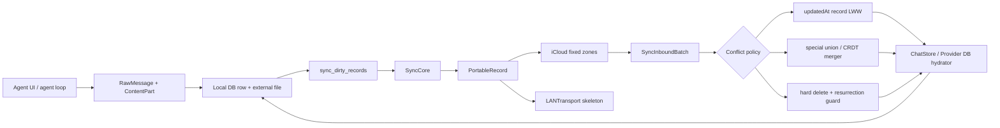

## 11. 持久化与多端同步

### 11.1 这一章解决什么问题

AI Agent 的“记住上下文”不是一个数组问题，而是一个可恢复、可迁移、可合并的存储问题（本章的本地持久化入口是 `ChatStore`，见 `src/ios/Agent/Chat/ChatStore.swift:ChatStore:355-413`）。
本章把一次会话从 UI 中的 `ChatMessage` 还原到磁盘上的数据库行、JSON 内容块、附件文件和沙箱路径，再追踪它如何变成同步队列中的 `PortableRecord`（见 `src/ios/Agent/Chat/ChatStore.swift:ChatStore.appendMessages/saveMedia:1909-2020,2441-2487` 和 `src/ios/Agent/Sync/V2/PortableRecord.swift:PortableRecord:90-137`）。
如果没有明确的持久化边界，进程被杀、工具输出很大、用户在另一台设备删除消息、或模型配置发生并发修改时，都会出现空白会话、重复内容、消息复活或密钥泄露；对应的删除、分页、冲突和密钥边界分别见 `src/ios/Agent/Sync/V2/TombstoneManager.swift:TombstoneManager:5-45`、`src/android/app/src/main/java/com/openminis/app/data/repository/ChatRepository.kt:ChatRepository.loadMessages:118-195`、`src/ios/Agent/Sync/V2/SyncableTypeRegistry.swift:SyncableTypeRegistry.erase.resolveConflict:167-180`、`src/ios/Agent/Sync/V2/ChatStoreSyncHydrators.swift:buildEnvVarItem:726-754`。
阅读完本章，读者应能在 iOS 和 Android 各写出一个最小可用的会话库，并知道何时使用整条记录 LWW（last-write-wins）、何时必须拆成子记录或使用集合合并。

本章主要依据以下真实实现：iOS 的 `ChatStore` 是直接调用 SQLite C API 的 actor；Android 的 `AppDatabase`/`ChatDao` 是 Room 数据库；同步只在本章核查到的 iOS Sync V2 上完整实现，Android 当前保留设备身份和未来同步边界，而没有对应的 CloudKit 同步引擎，见 `src/ios/Agent/Chat/ChatStore.swift:ChatStore:355-396`、`src/android/app/src/main/java/com/openminis/app/data/db/AppDatabase.kt:AppDatabase:10-22`、`src/ios/Agent/Sync/V2/SyncV2Bootstrap.swift:SyncV2Bootstrap.startIfEnabled:135-175`、`src/android/app/src/main/java/com/openminis/app/data/DeviceIdentity.kt:DeviceIdentity:7-19`。

### 11.2 先建立一张端到端地图

把系统分成四层，学习和实现时不要把它们混成一个“保存消息”函数：

1. **应用模型层**：`RawMessage`、`ContentPart`、`ChatSession`、工具调用和工具结果。
2. **本地存储层**：iOS SQLite + 文件目录，Android Room + `filesDir` 文件目录。
3. **同步形状层**：iOS `Syncable` 元数据把模型变成 `PortableRecord`；该层不应该知道 CloudKit 还是 LAN。
4. **传输与合并层**：iCloud `CKSyncEngine`/固定 record zone 负责可靠存储，`SyncCore` 负责 dirty 队列、节流和合并入口。

代码位置：iOS `ChatStore` 的 actor、数据库初始化和缓存见 `src/ios/Agent/Chat/ChatStore.swift:ChatStore.init/openDatabase/createTables:355-755`；同步中枢见 `src/ios/Agent/Sync/V2/SyncCore.swift:SyncCore:17-40`。
Android 的 Room 入口见 `src/android/app/src/main/java/com/openminis/app/data/db/AppDatabase.kt:AppDatabase:10-22`，会话仓库入口见 `src/android/app/src/main/java/com/openminis/app/data/repository/ChatRepository.kt:ChatRepository:10-40`。



图中的关键点是：`PortableRecord` 是跨传输的中间格式，不是第二份业务数据库；落地仍由各自的 hydrator 写 SQLite 或文件。`SyncCoreHydrators` 明确把“如何构建”和“如何合并”拆为两个闭包，避免同步核心直接依赖具体 store，见 `src/ios/Agent/Sync/V2/SyncCoreHydrators.swift:SyncCoreHydrators:3-17,23-37`。

### 11.3 一个会话在 iOS 磁盘上长什么样

#### 11.3.1 根目录和文件目录

iOS 的默认根目录是 `Library/MinisChat`：`minis.db` 是主 SQLite 数据库，`minis/` 是每个会话的文件根。`ChatStore.init` 同时创建这两个路径，故物理布局可以先画成：

```text
<Library>/MinisChat/
├── minis.db
├── minis/
│   └── <sessionId>/
│       ├── workspace/
│       ├── attachments/
│       ├── browser/
│       └── offloads/
├── env-vars.json
├── provider-config.json
└── provider-config.db
```

`minis.db` 和 `minis/` 的实际构造见 `src/ios/Agent/Chat/ChatStore.swift:ChatStore.init:386-408`；附件相对路径的实际生成见 `src/ios/Agent/Chat/ChatStore.swift:ChatStore.saveMedia/mediaFileURL:2441-2487`。

不是所有同名目录都属于一个同步域：`workspace`、`attachments`、`browser`、`offloads` 是 session-scoped 文件；技能、memory、shared 等目录由独立的文件扫描/同步类型管理。`scanAndMarkSessionFiles` 的子目录白名单见 `src/ios/Agent/Chat/ChatStore.swift:ChatStore.scanAndMarkSessionFiles:3628-3695`。

#### 11.3.2 `sessions`、`messages` 和 `compact_markers`

最小的会话关系是：一个 `sessions` 父行，多个 `messages` 子行，零个或多个 `compact_markers` 历史压缩边界。

`sessions` 的初始 DDL 包含 `id`、`title`、`model_id`、`created_at`、`updated_at`；运行中再通过幂等 `ALTER TABLE` 增加 `category`、`model_binding`、`source`、`memory_enabled`、同步时间、远端设备、置顶和 tombstone 等字段，见 `src/ios/Agent/Chat/ChatStore.swift:ChatStore.createTables:442-510`。

`messages` 的基本 DDL 是 `id` 主键、`session_id` 外键、`role`、`parts_json`、`created_at`、可选 `token_usage`、`sort_order`；后续增加 `reasoning_content`、`stream_interrupt_count`、`updated_at`、`error_info` 和派生的 `part_flags`，见 `src/ios/Agent/Chat/ChatStore.swift:ChatStore.createTables:453-498`。

`compact_markers` 保存模型生成的摘要和压缩边界，不是删除旧消息的替代物；当前表同时保留旧的 sort-order 字段和 id-first 字段，并以 `version` 区分旧/新边界模型，见 `src/ios/Agent/Chat/ChatStore.swift:ChatStore.createTables:532-556`。

#### 11.3.3 消息内容的粒度

消息没有拆成 `tool_calls`、`tool_results` 多张表。一个 `messages` 行的 `parts_json` 是 `[ContentPart]` 的 JSON，文本、图片引用、tool use 和 tool result 都是该数组中的元素。

`appendMessages` 在一个 SQLite transaction 中逐行编码 `message.parts`，并写入 `parts_json`；同一批消息只触发一次提交，再为每个 message 和 touched session 写 dirty 标记，见 `src/ios/Agent/Chat/ChatStore.swift:ChatStore.appendMessages:1909-2020`。

真实的字段绑定如下，片段保留了数据粒度和写入顺序：

**来源：`src/ios/Agent/Chat/ChatStore.swift:ChatStore.appendMessages:1939-1983`**

```swift
let sql = """
    INSERT INTO messages
      (id, session_id, role, parts_json, created_at, token_usage,
       sort_order, reasoning_content, stream_interrupt_count,
       updated_at, error_info, part_flags)
    VALUES (?, ?, ?, ?, ?, ?, ?, ?, ?, ?, ?, ?)
"""

let data = try JSONEncoder().encode(message.parts)
let partsJSON = String(data: data, encoding: .utf8) ?? "[]"
let partFlags = Self.partFlags(for: message.parts)
```

因此工具调用的输入参数和工具结果输出默认和普通文本一样位于 `parts_json`；工具结果里的图片数据不一定内嵌在 JSON，而是通过 `MediaRef` 指向文件。`RawMessage.toAgentMessage` 在重建 agent history 时按 ref 重新读文件，见 `src/ios/Agent/Chat/ChatStore.swift:RawMessage.toAgentMessage:4135-4147`。

#### 11.3.4 空会话和删除的语义

新建 session 不会立即同步：`createSession` 只插入占位父行，等首条消息、标题/置顶等明确意图发生时才 mark dirty，避免把用户没有使用的 “New Chat” 空行传播到所有设备，见 `src/ios/Agent/Chat/ChatStore.swift:ChatStore.createSession:791-854`。

删除不是只执行 `DELETE FROM sessions`。删除前必须枚举并标记 Session、Message、CompactMarker 和 SessionFile 的 `op=delete`，再删除本地 rows 和目录，见 `src/ios/Agent/Chat/ChatStore.swift:ChatStore.markSessionForCloudDeletion/deleteSessionLocalRowsOnly:1809-1894`。

这是一个通用设计原则：如果删除时已经丢失了子记录 id，就无法向远端发出可靠的删除操作；先写同步意图，再删本地数据。

### 11.4 iOS 的 SQLite 实现和大库优化

#### 11.4.1 技术选型：不是 Core Data，也不是 Codable 文件数据库

`ChatStore` 直接 `import SQLite3` 并持有 `OpaquePointer? db`；`openDatabase` 调用 `sqlite3_open(dbURL.path, &db)`，所以主聊天存储是原生 SQLite，不是 Core Data、SwiftData 或一整个 Codable JSON 文件，见 `src/ios/Agent/Chat/ChatStore.swift:ChatStore.openDatabase:432-440`。

`ChatStore` 是 actor，注释要求所有同步 SQLite 操作在 actor 内执行；数据库文件可在 `closeDatabase`/`reloadDatabase` 中关闭、重新打开并重新建表，方便 backup/restore，见 `src/ios/Agent/Chat/ChatStore.swift:ChatStore:355-428`。

打开时开启 `PRAGMA journal_mode=WAL` 和 `PRAGMA foreign_keys=ON`。WAL（write-ahead logging）让并发读更适合会话列表、加载历史和同步合并；外键保证消息/压缩标记不会脱离 session，见 `src/ios/Agent/Chat/ChatStore.swift:ChatStore.openDatabase:432-440`。

#### 11.4.2 索引和预览位图

基础索引 `idx_messages_session(session_id, sort_order)` 支持按会话顺序读取；`idx_msg_sess_role_sort(session_id, role, sort_order DESC)` 支持会话列表找最新 assistant/user 预览，见 `src/ios/Agent/Chat/ChatStore.swift:ChatStore.createTables:465-470`。

早期实现对 `parts_json` 做多次 `LIKE`，100k-message 数据库上会产生大量不可索引扫描。现在写入时根据 parts 计算 `part_flags`：bit0 表示 text，bit1 表示 toolUse；列表查询改用整数位运算，并且对旧行做一次性 SQL backfill，见 `src/ios/Agent/Chat/ChatStore.swift:ChatStore.createTables:558-583` 和 `src/ios/Agent/Chat/ChatStore.swift:ChatStore.partFlags/partFlagsSQLExpr:857-909`。

会话列表还保留四个相关子查询，但它们使用角色/排序索引而不是在 JSON 中找类型；源码记录的实测是约 523ms 降到约 30–58ms，窗口函数方案反而约 1100ms，见 `src/ios/Agent/Chat/ChatStore.swift:ChatStore.listSessions:944-1003`。

#### 11.4.3 缓存和避免重复解码

`listSessions()` 解析每个 session 的预览，重复调用会重复分配大量字符串。`ChatStore` 在 actor 内维护 `sessionListCache` 和 `sessionListCacheDirty`；所有影响列表的 mutation 使缓存失效，未失效时直接返回同一个数组，见 `src/ios/Agent/Chat/ChatStore.swift:ChatStore:365-384` 和 `src/ios/Agent/Chat/ChatStore.swift:ChatStore.listSessions:944-951,1099-1103`。

只需要计数时不应调用 `listSessions().count`。`sessionCount()` 直接 `SELECT COUNT(*)`，源码注释记录这比大库完整列表快很多，并能避免 actor 串行队列被列表解析阻塞，见 `src/ios/Agent/Chat/ChatStore.swift:ChatStore.sessionCount:911-923`。

加载单个会话时按 `sort_order ASC, created_at ASC, id ASC` 读取，逐行解码 `[ContentPart]`；该路径会记录 SQL/IO 和 JSON decode 耗时，便于判断瓶颈是数据库还是 Codable，见 `src/ios/Agent/Chat/ChatStore.swift:ChatStore.loadMessages:2041-2150`。

`AIChatViewModel.loadSession` 不是每次 iCloud 到达都无条件重建 UI。它先读取 DB，比较最后 sort order、行数和 `(id, sortOrder)` hash；只有新增、删除或重排时才 `loadSession()`，并在处理中的 streaming/compaction 阶段把 reload 延后，见 `src/ios/Agent/Chat/AIChatViewModel+Persistence.swift:AIChatViewModel.reloadMessagesFromDB/computeOrderHash:10-132`。

#### 11.4.4 增量写、批量写和发送时机

消息写入是 batch transaction，不是每个 token 一次 fsync；`appendMessages` 将一批 message 包在 `BEGIN TRANSACTION`/`COMMIT` 中，并在 commit 后发 session update 通知，见 `src/ios/Agent/Chat/ChatStore.swift:ChatStore.appendMessages:1913-2019`。

同步 dirty 标记和网络发送是两个时序。消息写入时立即把 dirty row 写入 SQLite，保证进程崩溃后仍能恢复；agent loop 期间可以设置 `syncSendDeferred`，只延迟 `scheduleSend`，loop 结束再扫描文件并触发一次发送，见 `src/ios/Agent/Chat/ChatStore.swift:ChatStore.setSyncSendDeferred/flushPendingSyncDirty:3589-3625`。

V2 的 dirty 查询按 priority、父类型先于子类型和批量上限排序：优先发送用户刚写的 row，不让迁移历史队列饿死；Session/Message 的父子顺序避免 peer 先收到孤儿消息，见 `src/ios/Agent/Chat/ChatStore.swift:ChatStore.loadDirtyRecords:4785-4830`。

### 11.5 消息、工具结果和大附件：为什么不能全放在一行里

#### 11.5.1 JSON 行适合结构，文件适合字节

`parts_json` 适合保存需要和消息一起原子提交的结构：role、文本、toolUse 参数、toolResult 文本、token usage 引用等。

图片、浏览器下载、文件工具输出等大字节保存为 `MediaRef`，数据库只保存 `id`、相对路径、MIME 和原文件名；iOS `saveMedia` 将数据写入 `Library/MinisChat/minis/<sessionId>/<subdir>/<UUID>.<ext>`，再返回 ref，见 `src/ios/Agent/Chat/ChatStore.swift:ChatStore.saveMedia:2441-2476`。

加载时 `mediaFileURL(for:)` 只做根目录和 relative path 拼接，`loadMediaData` 再按需读 `Data`，见 `src/ios/Agent/Chat/ChatStore.swift:ChatStore.mediaFileURL/loadMediaData:2479-2487`。这是一种懒加载边界：打开历史时可以先构建文字和 tool block，真正渲染图片时才读文件。

#### 11.5.2 SessionFile 的同步 identity

V2 不把 SessionFile 的 identity 设成随机文件 id，而是用 `sessionId:relativePath` 组成复合 key；`SyncedSessionFile` 的 `idKeyPath` 指向 `compositeKey`，文件本体通过 `PortableAsset` 引用，见 `src/ios/Agent/Sync/V2/SyncedTypes.swift:SyncedSessionFile:185-216`。

这样重启后同一个路径仍然对应同一个远端 record；文件内容变化只更新 `updatedAt` 和 asset，不需要维护一张额外的 attachment SQL 表。

#### 11.5.3 文件变更如何变成 dirty row

iSH fakefs 事件可能带 guest 路径 `/var/minis/...`，也可能带 host path。`SessionFileChangeTracker` 以 actor 保存 `sessionId -> relativePath -> Change`，同一路径只留下最后一次 upsert/delete；消费时原子 read-and-clear，避免事件在 drain 期间丢失，见 `src/ios/Agent/Sync/V2/SessionFileChangeTracker.swift:SessionFileChangeTracker:1-19,24-109`。

`resolveSessionRelative` 只接受 `workspace`、`attachments`、`browser`、`offloads` 四个 session 子目录；memory、skills、shared 走自己的同步机制，见 `src/ios/Agent/Sync/V2/SessionFileChangeTracker.swift:resolveSessionRelative/validateAndReturnSubpath:208-267`。

`SyncCore.sendNow` 在读取 dirty rows 之前先 drain tracker 并将每个文件转换为 `SessionFile` dirty row，且以 mtime 过滤“只 open 没有实际写入”的假阳性，见 `src/ios/Agent/Sync/V2/SyncCore.swift:SyncCore.drainSessionFileChangesIntoDirty:805-857`。

#### 11.5.4 文件大小和 junk 目录策略

扫描 SessionFile 时跳过 `.git`、`node_modules`、缓存、虚拟环境等目录，并以 `UploadPolicy.maxFileSizeBytes` 做每文件上限；默认上限是 1 MiB，超限文件不进入 dirty 队列，见 `src/ios/Agent/Chat/ChatStore.swift:ChatStore.scanAndMarkSessionFiles:3628-3695` 和 `src/ios/Agent/Sync/V2/UploadPolicy.swift:UploadPolicy.maxFileSizeBytes:86-97`。

CloudKit 传输层把超过 750,000 bytes 的字段视为 asset 候选，低于阈值可内联；`PortableAsset` 只携带本地 file URL、size 和 MIME，真正如何上传由 transport 决定，见 `src/ios/Agent/Sync/V2/Syncable.swift:AssetPolicy:16-22`、`src/ios/Agent/Sync/V2/PortableRecord.swift:PortableAsset:80-88` 和 `src/ios/Agent/Sync/V2/ICloudSharedZoneTransport.swift:ICloudSharedZoneTransport.assetInlineThreshold:77-80`。

注意：1 MiB upload policy 是“是否允许这个设备上传”，750 KB 是“CloudKit 字段何时倾向 CKAsset”；二者不是同一个阈值，也不是保证所有文件都能上传的替代品。

### 11.6 `minis://` 如何落到物理路径

#### 11.6.1 iOS 的命名空间规则

iOS 将 `minis://` host 视为命名空间。`memory`、`skills`、`shared`、`mcp-servers` 走全局目录；其他 host 被视为 session 子目录，拼成 `minisPersistentBase/<sessionId>/<host>/`，见 `src/ios/Agent/Chat/AIChatViewModel+FileTools.swift:AIChatViewModel.resolveMinisURL:66-91`。

Linux 路径 `/var/minis/<namespace>/<filename>` 通过 `linuxPathToMinisURL` 变成 `minis://<namespace>/<percent-encoded-filename>`；源码只编码 namespace 之后的 filename，并拒绝不在 `/var/minis/` 下的路径，见 `src/ios/Agent/Chat/AIChatViewModel+FileTools.swift:AIChatViewModel.linuxPathToMinisURL:94-104`。

转换必须只做一次 URL percent-encoding。点击解析时 `URL.path` 已经解码一层；`MinisURLPathDecoding.subPathCandidates` 先尝试这一层，再在磁盘不存在时尝试第二次解码，以兼容中间 Markdown 处理多编码一次的链接，见 `src/ios/Agent/Chat/MinisURLPathDecoding.swift:MinisURLPathDecoding.subPathCandidates:3-35`。

```swift
let subPaths = MinisURLPathDecoding.subPathCandidates(for: url)
let candidates = subPaths.map { base.appendingPathComponent($0) }
return candidates.first { FileManager.default.fileExists(atPath: $0.path) }
    ?? candidates.first
```

#### 11.6.2 Android 的物理路径

Android 的 `MediaRef` 不是绝对路径，而是相对于 `context.filesDir/media` 的 `relativePath`。普通保存路径为 `media/yyyy/MM/dd/<sessionId>/<uuid>.<ext>`，大文件用 `saveMediaStreamed` 通过 InputStream 复制，避免一次性 `readBytes()`，见 `src/android/app/src/main/java/com/openminis/app/data/storage/MediaStore.kt:MediaStore.mediaBaseDir/saveMedia/saveMediaStreamed:12-79`。

Android agent 的会话沙箱文件另外位于 `filesDir/minis-sessions/<sessionId>/<subdir>`，再 bind mount 为 `/var/minis/<subdir>`；`ExecutionCoordinator.buildSessionBindMounts` 明确建立 `workspace`、`attachments` 等 host 目录，见 `src/android/app/src/main/java/com/openminis/app/sandbox/ExecutionCoordinator.kt:ExecutionCoordinator.buildSessionBindMounts:176-205`。

Android WebView 处理 `minis://workspace/foo.html` 时，先转成 `/var/minis/workspace/foo.html`，再调用 `PRootKernel.resolveHostPath` 找 host file；这不是把 URI 当网络 URL，而是一个本地命名空间解析器，见 `src/android/app/src/main/java/com/openminis/app/browser/BrowserUseManager.kt:BrowserUseManager.interceptMinisURL:396-425`。

因此跨平台约定应保存逻辑相对路径或 Linux-visible path，不要把 iOS 的 `/var/mobile/...` 或 Android 的 `/data/user/0/...` 写进同步记录。

### 11.7 Android Room：同一抽象的另一种落地

#### 11.7.1 Room 数据库和版本迁移

Android 主数据库名为 `minis.db`，`AppDatabase` 继承 `RoomDatabase`，实体包含 `ChatSessionEntity`、`MessageEntity`、`CompactMarkerEntity` 和 `WebAppShortcutEntity`，当前版本为 10，见 `src/android/app/src/main/java/com/openminis/app/data/db/AppDatabase.kt:AppDatabase:10-22,196-205`。

Room 的 schema 迁移是显式 `Migration(from,to)`，例如 1→2 增加 session 列、2→3 增加 reasoning_content、3→4 增加 parity 字段和 compact_markers、7→8 增加 marker version、9→10 增加 message error_info，见 `src/android/app/src/main/java/com/openminis/app/data/db/AppDatabase.kt:AppDatabase.MIGRATION_1_2/MIGRATION_2_3/MIGRATION_3_4/MIGRATION_7_8/MIGRATION_9_10:28-193`。

初始化时使用 `addMigrations(...)`，没有 `fallbackToDestructiveMigration`；这保证聊天历史不会因为忘记写迁移而被静默删库，见 `src/android/app/src/main/java/com/openminis/app/data/db/AppDatabase.kt:AppDatabase.getInstance:196-204`。

#### 11.7.2 Entity 结构

`ChatSessionEntity` 的字段是 nullable/primitive Kotlin 属性，时间单位是 epoch milliseconds；包括 model binding、source、memory、pin、edit counter 和 thinking override，见 `src/android/app/src/main/java/com/openminis/app/data/db/ChatSessionEntity.kt:ChatSessionEntity:7-28`。

`MessageEntity` 一行保存 `role`、`partsJson`、token usage、sort order、reasoning、stream interruption、updatedAt 和 error_info；外键 `session_id` 对 `sessions.id` 使用 `CASCADE`，并有 `(session_id, sort_order)` 索引，见 `src/android/app/src/main/java/com/openminis/app/data/db/MessageEntity.kt:MessageEntity:9-37`。

`CompactMarkerEntity` 与 session 同样使用级联外键，并保留旧 sort-order 边界和 id-first 边界；`version=2` 时 `lastCompactedMessageId` 是权威锚点，见 `src/android/app/src/main/java/com/openminis/app/data/db/CompactMarkerEntity.kt:CompactMarkerEntity:14-57`。

#### 11.7.3 DAO 和 repository 的职责

`ChatDao` 用 `@Query` 定义 Flow session 列表、session 读取、消息读取、插入和删除；消息按 `sort_order ASC` 读取，`nextSortOrder` 通过 `MAX(sort_order)+1` 生成下一个位置，见 `src/android/app/src/main/java/com/openminis/app/data/db/ChatDao.kt:ChatDao:56-138`。

`ChatRepository` 不把所有 SQL 暴露给 UI。它负责创建 UUID session、映射 memoryEnabled、包装 DAO，并在加载大历史时分页，见 `src/android/app/src/main/java/com/openminis/app/data/repository/ChatRepository.kt:ChatRepository.createSession/loadMessages:10-176`。

Android 的 `ContentPart` 与 iOS 的 `ContentPart` 采用同样的四类数据形状：`text`、`mediaRef`、`toolUse`、`toolResult`；`ToolResult` 还可带一个 `MediaRef`，见 `src/android/app/src/main/java/com/openminis/app/data/model/ContentPart.kt:ContentPart/ToolResult:11-68`。

#### 11.7.4 Android 的大消息补丁

Android 的 `CursorWindow` 通常约有 2 MB 行窗口限制。仓库中记录过一个大 tool_result 让整批消息读取抛出 `SQLiteBlobTooBigException`，所以 `ChatRepository.loadMessages` 现在按页读取，单页仍失败则逐行读取，并用 proxy row 跳过不能 materialize 的单行，见 `src/android/app/src/main/java/com/openminis/app/data/repository/ChatRepository.kt:ChatRepository.loadMessages:118-195`。

新消息写入还会限制 `partsJson` 长度；超过上限时保留同一 JSON parts 形状而不是写坏数组，避免 UI 和搜索解析器因为截断成非法 JSON 而二次崩溃，见 `src/android/app/src/main/java/com/openminis/app/data/repository/ChatRepository.kt:ChatRepository.appendMessage:222-255`。

这和 iOS 的策略不同：iOS 以文件外置和列表 bitmask 优化为主，Android 额外针对 CursorWindow 做分页和单行降级。不要只复制 SQL schema，不复制平台的内存/IPC 限制。

### 11.8 存储 schema 对照表

下面的表只列本章真正核查到的主结构；“同步字段”不等于“每端都同步”，Android 当前没有 iOS Sync V2 的对应实现。

| 逻辑对象 | iOS 物理结构 | Android 物理结构 | 粒度与差异 |
|---|---|---|---|
| 会话 | `sessions`，`id` 主键；`model_id`、时间、title/category/binding/source/memory/pin 等，`src/ios/Agent/Chat/ChatStore.swift:ChatStore.createTables:442-510` | Room `sessions`，`ChatSessionEntity`，`src/android/app/src/main/java/com/openminis/app/data/db/ChatSessionEntity.kt:ChatSessionEntity:7-28` | 一行一个 session；iOS 时间为 SQLite REAL 秒，Android 为 Long 毫秒。 |
| 消息 | `messages`，`parts_json`、role、token usage、reasoning、sort、updated/error/flags，`src/ios/Agent/Chat/ChatStore.swift:ChatStore.createTables:453-498` | Room `messages`，`MessageEntity.partsJson` 等，`src/android/app/src/main/java/com/openminis/app/data/db/MessageEntity.kt:MessageEntity:9-37` | 一行一个 agent iteration/message；toolUse/toolResult 在 JSON parts 内，不是独立表。 |
| 工具调用 | 消息的 `ContentPart.toolUse` JSON，写入 `parts_json`，`src/ios/Agent/Chat/ChatStore.swift:ChatStore.appendMessages:1950-1982` | `ContentPart.Tool`/`ToolUse` 序列化为 `partsJson`，`src/android/app/src/main/java/com/openminis/app/data/model/ContentPart.kt:ContentPart:35-51` | 保留调用 id、name、input；重建历史时按 parts 顺序解析。 |
| 工具结果 | 消息的 `ContentPart.toolResult`；文字 inline，图片可挂 `MediaRef`，`src/ios/Agent/Chat/ChatStore.swift:RawMessage.toAgentMessage:4135-4147` | `ContentPart.Result` 的 `ToolResult`，可带 `mediaRef`，`src/android/app/src/main/java/com/openminis/app/data/model/ContentPart.kt:ToolResult:27-33` | 结果和调用仍在 message row 内；大图不应复制进文本 JSON。 |
| 压缩标记 | `compact_markers` + id-first/version 字段，`src/ios/Agent/Chat/ChatStore.swift:ChatStore.createTables:532-556` | Room `CompactMarkerEntity` + migration version，`src/android/app/src/main/java/com/openminis/app/data/db/CompactMarkerEntity.kt:CompactMarkerEntity:14-57` | 一行一个摘要边界；外键 cascade 删除。 |
| 图片/附件 | `Library/MinisChat/minis/<sid>/<subdir>/<uuid>.<ext>`，`MediaRef.relativePath`，`src/ios/Agent/Chat/ChatStore.swift:ChatStore.saveMedia:2441-2487` | `filesDir/media/yyyy/MM/dd/<sid>/<uuid>.<ext>`，`MediaStore`，`src/android/app/src/main/java/com/openminis/app/data/storage/MediaStore.kt:MediaStore:12-83` | DB 只存引用；Android 额外提供 streamed copy。 |
| agent 沙箱文件 | `Library/MinisChat/minis/<sid>/{workspace,attachments,browser,offloads}`，`src/ios/Agent/Chat/ChatStore.swift:ChatStore.scanAndMarkSessionFiles:3638-3684` | `filesDir/minis-sessions/<sid>/<subdir>` bind 到 `/var/minis/<subdir>`，`src/android/app/src/main/java/com/openminis/app/sandbox/ExecutionCoordinator.kt:ExecutionCoordinator.buildSessionBindMounts:176-205` | session file 通过相对路径定位；不要同步绝对 sandbox 路径。 |
| 同步 dirty | `sync_dirty_records`、`sync_pushed_records`、删除 tombstone 表，`src/ios/Agent/Chat/ChatStore.swift:ChatStore.createTables:586-647` | 本章核查的 Android `data/db` 没有对应 SyncCore dirty schema | iOS 是 crash-safe queue；Android 的 DeviceIdentity 仅预留未来 namespace。 |
| Provider instance | iOS `provider-config.db` 的 `provider_instances`，`src/ios/Providers/ProviderConfigDB.swift:ProviderConfigDB.defaultURL/runMigrations:23-64,106-136` | Room `provider.db` 的 `provider_instances`，`src/android/app/src/main/java/com/openminis/app/data/db/ProviderDatabase.kt:ProviderDatabase:10-42` 和 entity | 两端都从整文件逐步转 per-row；密钥不放普通列。 |
| Provider model entry/group | iOS `provider_model_entries`、`provider_model_groups`，`src/ios/Providers/ProviderConfigDB.swift:ProviderConfigDB.runMigrations:138-168` | Room `ProviderModelEntryEntity`/`ProviderModelGroupEntity`，`src/android/app/src/main/java/com/openminis/app/data/db/ProviderModelEntryEntity.kt:ProviderModelEntryEntity:20-39`、`ProviderModelGroupEntity.kt:ProviderModelGroupEntity:14-25` | model/group 结构化为行，member order 仍以 JSON array 保存。 |
| 环境变量元数据 | iOS `Library/MinisChat/env-vars.json`，值在 synchronizable Keychain，`src/ios/Shared/EnvVarStore.swift:EnvVarStore.init/saveEntries/saveValue:34-52,95-126,148-206` | `filesDir/env-vars.json` 元数据，值在 EncryptedSharedPreferences，`src/android/app/src/main/java/com/openminis/app/data/repository/EnvVarRepository.kt:EnvVarRepository:14-50,137-175` | key/note/id 与 secret value 分离；Android 没有本章范围内的跨设备上传。 |

### 11.9 Sync V2 的可移植记录模型

#### 11.9.1 `Syncable` 是 schema contract

`Syncable` 本身只有 `static syncMetadata`；字段、wire name、类型、optional、scope、冲突策略和 schema version 全由 `SyncTypeMetadata` 携带，见 `src/ios/Agent/Sync/V2/Syncable.swift:SyncTypeMetadata/Syncable:190-248`。

`SyncScope` 区分 global、perObject、perParent。Session 是 perObject；Message 和 CompactMarker 是 SessionV2 的子记录；这种 scope 让 transport 可以按父子关系组织记录并支持整棵 session 重推，见 `src/ios/Agent/Sync/V2/Syncable.swift:SyncScope:3-14`。

`FieldDescriptor` 同时定义字段的读取和写回闭包，并且 optional nil 映射为 `.null`；transport 在写入时应省略 null，而不是把一个无意义的 null literal 上传，见 `src/ios/Agent/Sync/V2/Syncable.swift:FieldDescriptor:55-70,91-110`。

#### 11.9.2 `PortableRecord` 的字段、资产和未知字段

`SyncRecordID` 统一成 `type:id`，这个格式同时被 `ChatStore.clearDirtyRecord(recordName:)` 解析，所以改变分隔符会破坏 dirty queue，见 `src/ios/Agent/Sync/V2/PortableRecord.swift:SyncRecordID:3-24`。

`PortableRecord` 保存 `id`、typed `fields`、`assets`、`schemaVersion`、`minimumCompatibleVersion`、`unknownFields` 和 `updatedAt`。未知字段必须随记录 round-trip，避免旧客户端读到新字段后再写回时把新数据删掉，见 `src/ios/Agent/Sync/V2/PortableRecord.swift:PortableRecord:90-137`。

`SyncableTypeRegistry.erase` 将 generic metadata 擦除成 `AnySyncableTypeMetadata`，在运行时通过 recordType 查找 builder、已有模型写回和冲突闭包；registry 用 lock 保护，注册重复版本会 assert，见 `src/ios/Agent/Sync/V2/SyncableTypeRegistry.swift:AnySyncableTypeMetadata/SyncableTypeRegistry:3-104`。

registry 的默认 builder 从字段 descriptor 提取值，并从冲突 policy 的 Date keypath 提取 `updatedAt`；默认的 `resolveConflict` 是一个模型级选择，不是逐字段自动 merge，见 `src/ios/Agent/Sync/V2/SyncableTypeRegistry.swift:SyncableTypeRegistry.erase:120-180`。

#### 11.9.3 Session/Message/SessionFile 的 wire shape

`SyncedSession` 是 SessionV2，包含 session id、title、category、model、创建/更新日期、memory、binding、pin，冲突 policy 是 `updatedAt` 的 record-level LWW，见 `src/ios/Agent/Sync/V2/SyncedTypes.swift:SyncedSession:14-58`。

`SyncedMessage` 是 MessageV2 的 per-parent 子记录，包含 `partsJson`、token usage、reasoning、stream interruption、created/updatedAt；wire `sortOrder` 只是 hint，接收端按自己的 `(created_at,id)` 排名，见 `src/ios/Agent/Sync/V2/SyncedTypes.swift:SyncedMessage:64-123`。

`SyncedSessionFile` 的 wire record 用复合 identity，且 `fileURL` 不直接序列化到字段；它通过 `PortableAsset` 交给 transport，冲突 policy 是 server etag，见 `src/ios/Agent/Sync/V2/SyncedTypes.swift:SyncedSessionFile:187-216`。

### 11.10 dirty 扫描、队列和发送调度

#### 11.10.1 事件驱动不是唯一来源

iOS 有 `SyncDirtyScanner` 作为磁盘变化 backstop：每 180 秒扫描 skills、provider/env 配置文件和最近 30 天 memory 文件；首次看到文件只记录 baseline，不把所有文件重新上传，见 `src/ios/Agent/Sync/SyncDirtyScanner.swift:SyncDirtyScanner:6-24,25-95` 和 `src/ios/Agent/Sync/SyncDirtyScanner.swift:scanSkills/scanConfigFiles/scanMemoryFiles:128-305`。

scanner 用 `NSLock` 保护 `isScanning`，保证 timer tick 和首轮 Task 不会同时改动 `knownModDates`；文件枚举仍在后台，不把大磁盘扫描放到主线程，见 `src/ios/Agent/Sync/SyncDirtyScanner.swift:SyncDirtyScanner.scan:70-95`。

`ChatStore.markDirty` 先检查 sync zone 是否初始化，再检查 `UploadPolicy`；关闭某类上传时该类记录连 dirty queue 都不进入，见 `src/ios/Agent/Chat/ChatStore.swift:ChatStore.markDirty:4183-4201` 和 `src/ios/Agent/Sync/V2/UploadPolicy.swift:UploadPolicy.allowsRecordType:59-84`。

#### 11.10.2 dirty row 的语义

写 dirty row 使用 `(record_type, record_id)` 主键，`INSERT OR REPLACE` 合并同一记录的重复写；operation 为 upsert/delete，priority 0 是用户写，priority 1 是迁移 backlog，见 `src/ios/Agent/Chat/ChatStore.swift:ChatStore.markDirty:4222-4273` 和 `src/ios/Agent/Chat/ChatStore.swift:ChatStore.createTables:503-508,586-605`。

V2 `SyncCore.markDirty` 将模型 metadata 的 record type/id 写入 ChatStore，再 debounce 3 秒触发发送；agent streaming 时可 defer，网络上不会有每个 token 的请求，见 `src/ios/Agent/Sync/V2/SyncCore.swift:SyncCore.markDirty/scheduleSend:278-321`。

发送前 `SyncCore.sendNow` 从 dirty table 取最多 100 行，未知 builder 的 dirty row 保留，已知 builder 但本地行已消失才清掉；这区分了“代码尚未支持该类型”和“记录真的被删掉”，见 `src/ios/Agent/Sync/V2/SyncCore.swift:SyncCore.sendNow:362-416`。

#### 11.10.3 节流和背压

`currentSendDelay` 的基准是 5 秒：同步页面 1×，普通前台 3×，后台 4×；蜂窝网络再乘 2×，见 `src/ios/Agent/Sync/V2/SyncCore.swift:SyncCore.currentSendDelay:83-104`。

如果 CloudKit 返回 `requestRateLimited`，transport 暴露 retry-after，SyncCore 设置 `nextEarliestSendAt`，不在窗口内继续 hammer；transient failure 保留 dirty row，permanent failure 才清除，见 `src/ios/Agent/Sync/V2/SyncCore.swift:SyncCore.sendNow:324-353,469-531` 和 `src/ios/Agent/Sync/V2/SyncCore.swift:SyncCore.applyOutcomes:536-568`。

入站批次每 25 条处理并 sleep 50ms，让主线程滚动和 SwiftUI diff 有机会运行；这是为迁移时数百条消息导致的内存峰值而加的背压，见 `src/ios/Agent/Sync/V2/SyncCore.swift:SyncCore.processInbound:583-701`。

### 11.11 冲突解决：源码实际是哪些算法

这一节必须和“听起来合理的同步算法”区分。源码没有 vector clock；默认策略也不是所有字段独立合并。

#### 11.11.1 默认策略：按一个 Date keypath 选择整条模型

`ConflictPolicy.lastWriteWinsByField(KeyPath<T, Date>)` 的名字容易误读。“ByField”指用哪个 Date 字段做比较，不是逐字段 merge。registry 的实现是：若 `local.updatedAt >= remote.updatedAt` 返回 local，否则返回 remote，见 `src/ios/Agent/Sync/V2/SyncableTypeRegistry.swift:SyncableTypeRegistry.erase.resolveConflict:167-180`。

Session 和 Message 都注册为 `lastWriteWinsByField(updatedAt)`，因此同一 id 的并发更新会选择整条较新的模型；时间相等时本地获胜，见 `src/ios/Agent/Sync/V2/SyncedTypes.swift:SyncedSession.syncMetadata:25-44` 和 `src/ios/Agent/Sync/V2/SyncedTypes.swift:SyncedMessage.syncMetadata:80-100`。

`lastWriteWinsByServerEtag` 只适合“服务器 etag 才有意义”的资产记录；`alwaysAccept` 用于自然按设备隔离的 heartbeat；custom policy 允许业务代码提供纯 merge 函数，见 `src/ios/Agent/Sync/V2/Syncable.swift:ConflictPolicy:24-40`。

#### 11.11.2 Session/Message 的接收端补丁

Session 合并沿用 `ChatStore.mergeRemoteSession`：远端 `updated_at` 严格大于本地才 update，否则保持本地；不存在时先检查最近删除 tombstone，避免旧云记录把已删除 session 重新插入，见 `src/ios/Agent/Chat/ChatStore.swift:ChatStore.mergeRemoteSession:5219-5381`。

Message 合并的 LWW 比较的是 `COALESCE(updated_at,created_at)`。远端旧于或等于本地时跳过内容覆盖；远端更新时只更新 parts/token/reasoning/interrupt/updated_at/flags，不覆盖接收端自己的 sort order，见 `src/ios/Agent/Chat/ChatStore.swift:ChatStore.mergeRemoteMessage:5408-5515`。

新插入的远端 message 也不盲信发送端 sort order，而是按 `(created_at,id)` 计算本端 rank；有 gap 就插入，没有 gap 才把后续行整体右移，见 `src/ios/Agent/Chat/ChatStore.swift:ChatStore.mergeRemoteMessage:5517-5614`。

这使“消息内容的胜者”和“本地展示顺序”分离：跨设备消息数量不同不再把发送端的整数位置泄漏到接收端。

#### 11.11.3 Provider group 的特殊集合 CRDT

Provider model group 不是简单整行 LWW。标量字段（name、strategy、limits、sortOrder）按 `updatedAt` LWW；成员集合使用 `addedMembers`/`removedMembers` 的每成员时间戳 map，分别取 local/inbound 的最大时间，成员在 `added >= removed` 时存在，见 `src/ios/Providers/ProviderConfigDB.swift:ProviderConfigDB.upsertGroupFromInbound:963-1047`。

成员顺序仍由较新的 group scalar record 决定，另一端看见但新端未列出的成员追加到后面；因此“成员不丢失”和“路由顺序收敛”是两条不同规则，见 `src/ios/Providers/ProviderConfigDB.swift:ProviderConfigDB.upsertGroupFromInbound:1049-1125`。

这是一个很适合学习的设计：若把成员数组整体 LWW，两台设备各自新增一个模型时，后写入的一方会覆盖另一方；拆出 per-member timestamp 后，删除也能压住旧快照的复活。

#### 11.11.4 MemoryDaily 的 set union

每日 memory 记录的合并不是文本文件 LWW。`mergeMemoryDaily` 按 `<!-- timestamp -->` 分块解析，本地和远端同 timestamp 同内容时幂等跳过；同 timestamp 不同内容时保留双方，远端使用 `content.hashValue` 后缀避免 key 冲突，见 `src/ios/Agent/Sync/V2/ChatStoreSyncHydrators.swift:mergeMemoryDaily:974-1106`。

union 没有新增内容时不重写文件，避免 mtime 被 inbound apply 推进后又被 dirty scanner 识别为新的本地编辑，见 `src/ios/Agent/Sync/V2/ChatStoreSyncHydrators.swift:mergeMemoryDaily:1108-1125`。

#### 11.11.5 Server conflict 的回路

CloudKit 保存遇到 `serverRecordChanged` 时，transport 返回 `.conflict(serverRecord)`；SyncCore 把 server record 重新喂入 inbound merger，但不清掉 dirty，等 transport 使用新的 server etag 重试，见 `src/ios/Agent/Sync/V2/ICloudSharedZoneTransport.swift:CKSyncEngineDelegate.handleSentRecordZoneChanges:1562-1581` 和 `src/ios/Agent/Sync/V2/SyncCore.swift:SyncCore.applyOutcomes:536-560`。

这不是 vector clock：没有看到向量时钟、device counter 或 causal context 字段。默认因果信息只有 `updatedAt`、CloudKit etag 和 dirty operation；因此设备时钟异常会影响 LWW，必须在产品约束中接受或额外设计服务端时间戳。

### 11.12 删除墓碑和“防复活”

#### 11.12.1 为什么只发 delete 还不够

CloudKit 的查询可能在 delete 传播前再次读到仍存在的旧 record。若接收端看到本地 session 已不存在，就直接 INSERT，刚删掉的 session 会短暂或永久复活。

`ChatStore` 为最近删除的 session 保存 `deleted_session_tombstones(session_id,deleted_at)`，TTL 为 30 天；若 remoteUpdatedAt 不晚于 deletedAt 加 5 秒偏差，就拒绝 inbound，见 `src/ios/Agent/Chat/ChatStore.swift:ChatStore.createTables/recordDeletedSessionTombstone/isResurrectionOfDeleted:607-647,2720-2757`。

Skill、EnvVarItem、CompactMarker、MCPServerItem 和 Provider V3 rows 使用通用 `deleted_record_tombstones(record_type,record_id,deleted_at)`；`markDirty(op=delete)` 在写 dirty 前记录墓碑，见 `src/ios/Agent/Chat/ChatStore.swift:ChatStore.markDirty/recordDeletedRecordTombstone:4202-4211,2765-2795`。

#### 11.12.2 V2 入站删除是 hard delete

V2 曾考虑 soft tombstone：保留 session 行并在恢复时 cascade re-push，但这样会在会话列表留下 phantom empty rows，因此当前 `TombstoneManager` 对 `SessionV2 op=delete` 直接删除本地 session、子消息、compact marker 和 session files，不再次把 delete 排入 dirty queue，见 `src/ios/Agent/Sync/V2/TombstoneManager.swift:TombstoneManager:5-28,34-45`。

`SyncCore.processInbound` 先检查 registry，再把 deletes 交给 `SyncCoreHydrators.applyRemoteDeletion`；删除器通常是 local-only，不会反向放大 tombstone，见 `src/ios/Agent/Sync/V2/SyncCore.swift:SyncCore.processInbound:669-681` 和 `src/ios/Agent/Sync/V2/SyncCoreHydrators.swift:SyncCoreHydrators.applyRemoteDeletion:84-96`。

#### 11.12.3 重新创建和 tombstone 的边界

Session UUID 不复用，30 天 tombstone 不会挡住一个相同 id 的新 session；真正需要允许复活时，业务必须写出比 deletion timestamp 更新的记录，`isResurrectionOfDeleted` 才会放行，见 `src/ios/Agent/Chat/ChatStore.swift:ChatStore.isResurrectionOfDeleted:2748-2757`。

Provider group 的成员删除与 session 删除不同：它不删整行，而是以 per-member removed timestamp 抑制旧成员重新出现，见 `src/ios/Providers/ProviderConfigDB.swift:ProviderConfigDB.upsertGroupFromInbound:973-1047`。

### 11.13 两种 transport：iCloud 实现与 LAN 边界

#### 11.13.1 iCloud 实际不是 `CKShare` 对象

用户需求中常把这一层称为“CKShare 共享 zone”。当前源码实际使用的是同一个 Apple ID 的 private database + 三个固定 custom record zones，并通过 `CKSyncEngine` 做持久同步；`ICloudSharedZoneTransport` 的注释和 zone map 没有创建/传递 `CKShare` 对象，见 `src/ios/Agent/Sync/V2/ICloudSharedZoneTransport.swift:ICloudSharedZoneTransport:6-19,30-75`。

这一区别影响实现路线：读者不能照着“生成 CKShare、邀请参与者”的教程实现当前产品的同一语义；当前产品依赖 private CloudKit container 下的固定 zone 和同账户设备共享。

三类 zone 是：`minis-shared` 放会话、消息、文件、skills、memory；`minis-devices` 放设备 heartbeat；`minis-secrets` 放 provider/env/MCP 等敏感配置，见 `src/ios/Agent/Sync/V2/ICloudSharedZoneTransport.swift:ICloudSharedZoneTransport.zoneByRecordType:12-75`。

#### 11.13.2 iCloud 发现、鉴权和增量

iCloud 的“发现”不是 Bonjour，而是同一 CloudKit container 中的 record zone 和 CKSyncEngine change token；transport capabilities 声明支持 deltaFetch、assets、persistence 和 conflictDetect，见 `src/ios/Agent/Sync/V2/SyncTransport.swift:TransportCapabilities:3-27`。

启动时 queue 三个 zone 的保存操作并调用 `modifyRecordZones` 确保它们存在，见 `src/ios/Agent/Sync/V2/ICloudSharedZoneTransport.swift:ICloudSharedZoneTransport.ensureZonesExist:894-922`。

正常 fetch 使用 CKSyncEngine token；额外的 `fetchRecentV2` 对各 record type 用 `CKQuery` 查询最近窗口，并按类型选择 zone。新设备恢复 provider/group 时，配置类型使用 full history 和 query cursor 分页，单页上限 200，见 `src/ios/Agent/Sync/V2/ICloudSharedZoneTransport.swift:ICloudSharedZoneTransport.fetchRecentV2:599-718`。

鉴权由 CloudKit private database 的 Apple ID 容器提供；本层代码没有自定义用户密码或 LAN token 交换。记录名由 `type:id` 生成并在送入 `CKRecord.ID` 前做合法性校验，以避免非法 dirty id 触发 Objective-C 异常，见 `src/ios/Agent/Sync/V2/ICloudSharedZoneTransport.swift:ICloudSharedZoneTransport.send:955-1005`。

#### 11.13.3 iCloud 资产和分块

iCloud 端不实现自定义 socket 分块；小字段可作为 CKRecord value，大文件由 `CKAsset`/CloudKit API 负责传输，业务层只传 `PortableAsset` 的 file URL、size 和 MIME，见 `src/ios/Agent/Sync/V2/PortableRecord.swift:PortableAsset:80-88` 和 `src/ios/Agent/Sync/V2/ICloudSharedZoneTransport.swift:ICloudSharedZoneTransport.assetInlineThreshold:77-80`。

入站 CKSyncEngine 修改会被切成 50-record sub-batch 再交给 SyncCore，SyncCore 内部再按 25 条处理；这两个边界分别保护 transport delegate 和主 actor 内存，见 `src/ios/Agent/Sync/V2/ICloudSharedZoneTransport.swift:CKSyncEngineDelegate.handleFetchedZoneChanges:1460-1479` 和 `src/ios/Agent/Sync/V2/SyncCore.swift:SyncCore.processInbound:599-667`。

#### 11.13.4 LANTransport 的真实状态

`LANTransport` 目前是 skeleton，`isImplemented=false`，SyncCore 明确拒绝注册；任何把它描述成“已经能局域网同步”的文档都是错误的，见 `src/ios/Agent/Sync/V2/LANTransport.swift:LANTransport:3-7,27-40` 和 `src/ios/Agent/Sync/V2/SyncCore.swift:SyncCore.register:182-199`。

源码留下了未来协议契约：Bonjour `_minis-sync._tcp` + `NWListener/NWBrowser` 发现 peer，WebSocket 推送 Codable JSON，asset 用同一连接 length-prefixed binary frame；LAN 无 durable persistence，因此 fullFetch 通常为空，见 `src/ios/Agent/Sync/V2/LANTransport.swift:LANTransport.future implementation outline:9-26`。

这意味着 LAN 的鉴权、重连、历史补偿、分块和冲突重放尚未在仓库中落地。教学实现可以沿着注释写，但必须把它标为后续实现，不应把预留设计写成现有能力。

### 11.14 V1 → V2：为什么重写以及如何迁移

#### 11.14.1 V1 的结构性问题

V1 `CloudSyncEngine` 以设备 zone 为中心，record mapping 和各 store 的 union/LWW 逻辑混在一个巨大 engine 中；provider/env 还采用 whole-file payload，导致两台设备各改一个变量时，整文件 LWW 会覆盖对方的新增，见 `src/ios/Agent/Sync/CloudSyncEngine.swift:CloudSyncEngine provider/env merge:1661-1993`。

V2 的目标不是换一个 API 名称，而是把模型、dirty queue、hydrator、transport 和 migration 分层：`SyncV2Bootstrap` 启动时注册 all `Syncable` types、设置 zone、注册 ChatStore hydrators，再注册 iCloud transport，见 `src/ios/Agent/Sync/V2/SyncV2Bootstrap.swift:SyncV2Bootstrap.startIfEnabled:135-175`。

V2 同时把 provider instance/model entry/model group 拆成 per-record V3，env var 拆成每个变量一个 `EnvVarItem`；旧 whole-file 类型保留为 inbound-only 兼容记录，见 `src/ios/Agent/Sync/V2/SyncedTypes.swift:SyncedProviderInstanceV3/SyncedProviderModelEntryV3/SyncedProviderModelGroupV3:354-523` 和 `src/ios/Agent/Sync/V2/SyncedTypes.swift:SyncedEnvVars/SyncedEnvVar:526-602`。

#### 11.14.2 迁移状态机

`MigrationEngine` 的状态机是 detect → v1FullFetch → v2ZonesCreate → v2InitialPush → v1ZoneDelete → lock/completed；状态落在 `Library/MinisChat/cloud-sync-v2/migration-state.json` 并用 UserDefaults 保存状态 key，见 `src/ios/Agent/Sync/V2/MigrationEngine.swift:MigrationEngine.init/currentStatus:56-115` 和 `src/ios/Agent/Sync/V2/MigrationEngine.swift:runPhase:499-522`。

迁移默认 opt-in，不会因为启用 V2 就自动把多年历史上传；用户点击 Request Migration 后才设置 requested flag，见 `src/ios/Agent/Sync/V2/MigrationEngine.swift:runIfNeeded:339-361` 和 `src/ios/Agent/Sync/V2/SyncV2Bootstrap.swift:SyncV2Bootstrap.isMigrationRequested:99-112`。

`phaseV1FullFetch` 统计旧 zone；`phaseV2ZonesCreate` 让 CKSyncEngine 建立新 zones；`phaseV2InitialPush` 以本地 SQLite 为 authority，调用 `V2InitialPusher.markAllLocalDirty()`，再等待 dirty queue drain，见 `src/ios/Agent/Sync/V2/MigrationEngine.swift:phaseV1FullFetch/phaseV2ZonesCreate/phaseV2InitialPush:524-595`。

如果 30 分钟内没有 drain 完，状态不是立即 failed，而是 `deferredUntilNextLaunch`，因为 CloudKit throttle 下仍可能在后台推进；这样不会把正常慢迁移误计为连续失败，见 `src/ios/Agent/Sync/V2/MigrationEngine.swift:phaseV2InitialPush:572-592`。

只有确认 V2 云端 Session 数不少于本地的一半，才删除当前设备的 V1 zone；查询失败返回 unknown 时也延期删除，避免误删唯一的旧备份，见 `src/ios/Agent/Sync/V2/MigrationEngine.swift:phaseV1ZoneDelete:597-641`。

#### 11.14.3 旧记录的兼容策略

V2 `SyncableTypeRegistry` 的 unknown fields 和 `minimumCompatibleVersion` 让旧 app 可以跳过不兼容记录或保留未来字段；SyncCore 对 minimum version 不满足的 record 只 skip，不写坏本地数据，见 `src/ios/Agent/Sync/V2/PortableRecord.swift:PortableRecord:102-115` 和 `src/ios/Agent/Sync/V2/SyncCore.swift:SyncCore.processInbound:623-658`。

EnvVar 的 legacy `EnvVarV2` builder 返回 nil，但 merger 保留；第一次 per-key push 后再排队删除旧 whole-file record，见 `src/ios/Shared/EnvVarStore.swift:EnvVarStore.scheduleLegacyRecordCleanupIfNeeded:54-93` 和 `src/ios/Agent/Sync/V2/ChatStoreSyncHydrators.swift:ChatStoreSyncHydrators.registerAll:100-117`。

### 11.15 敏感数据、密钥和脱敏

#### 11.15.1 iOS env var 的本地边界

iOS `env-vars.json` 只保存 `id/key/createdAt/note` 元数据；真正 value 写入 synchronizable Keychain，且 Keychain 写入采用 update-first、add-on-missing，避免 delete/add 竞态造成值变空，见 `src/ios/Shared/EnvVarStore.swift:EnvVarStore:9-31,42-50,148-206`。

添加或更新 env var 时先提交 Keychain，再更新 metadata JSON；删除时先移除 entry 和 Keychain，再把该 UUID 标成 EnvVarItem delete，见 `src/ios/Shared/EnvVarStore.swift:EnvVarStore.add/update/delete:277-360`。

#### 11.15.2 iOS 同步是否“排除密钥”

这里必须按源码事实表述：iOS V2 **没有把 env value 排除出同步 payload**。`buildEnvVarItem` 在构造 PortableRecord 时从 Keychain 读 value，UTF-8 转 base64 放入 `valueB64`；`SyncedEnvVar` 的注释明确说明 base64 是 encoding，不是 encryption，见 `src/ios/Agent/Sync/V2/ChatStoreSyncHydrators.swift:buildEnvVarItem:726-754` 和 `src/ios/Agent/Sync/V2/SyncedTypes.swift:SyncedEnvVar:558-575`。

因此“敏感数据策略”是分层的：本地普通文件不存 value、云端放在单独 `minis-secrets` zone、同步 category 可关闭，但 payload 本身仍含可解码的 base64 value。若产品要求真正排除密钥，应改协议为只同步 key metadata，并接受新设备不会自动得到 value；当前源码没有这样做。

Provider V3 的 instance record 则有 `secretBlob` 和 `secretKind` 字段，注释说明它是 base64-wrapped ciphertext；它与 env var 的明文 base64 不是同一安全等级，见 `src/ios/Agent/Sync/V2/SyncedTypes.swift:SyncedProviderInstanceV3:368-429`。

#### 11.15.3 Android env var 的本地策略

Android metadata 在 `filesDir/env-vars.json`，值在 `EncryptedSharedPreferences`，仓库注释标明 AES-256-GCM；`allAsDict` 只在注入 shell 时从加密 preferences 读取 value，见 `src/android/app/src/main/java/com/openminis/app/data/repository/EnvVarRepository.kt:EnvVarRepository:14-50,120-135`。

Android 当前没有本章 iOS V2 对应的 CloudKit/SyncCore；`DeviceIdentity` 仅生成稳定 per-install UUID，并注明 Android 没有 iCloud Keychain 等价物，见 `src/android/app/src/main/java/com/openminis/app/data/DeviceIdentity.kt:DeviceIdentity:7-19,21-58`。

#### 11.15.4 脱敏只保护模型上下文，不保护 UI/数据库

iOS `EnvVarPrivacyStore` 的 `enabled` 默认值是 true，`EnvVarRedactor.redactIfEnabled` 读取本地所有 env values，按最长字符串优先做普通替换，不用正则；命中后追加 system reminder，见 `src/ios/Shared/EnvVarPrivacyStore.swift:EnvVarPrivacyStore:4-43` 和 `src/ios/Shared/EnvVarRedactor.swift:EnvVarRedactor:1-89`。
代码注释仍写着“Default OFF”，但运行时 `defaultEnabled = true`，首次没有 UserDefaults key 时实际开启；Android 的注释同样写 OFF 而常量 `DEFAULT_ENABLED = true`。实现新端时应以测试验证实际默认值，并把产品文案与代码统一，见 `src/ios/Shared/EnvVarPrivacyStore.swift:EnvVarPrivacyStore:11-33` 和 `src/android/app/src/main/java/com/openminis/app/data/EnvVarPrivacyStore.kt:EnvVarPrivacyStore:18-43`。

这条路径只改传给模型的 tool output，UI 仍可显示原始 shell output；所以它不是数据库加密，也不是 CloudKit payload 脱敏。Android 同样使用最长优先、普通 `String.replace`，见 `src/android/app/src/main/java/com/openminis/app/data/EnvVarRedactor.kt:EnvVarRedactor:5-87`。

### 11.16 小型但重要的本地状态：Provider、badge、Share Extension

#### 11.16.1 Provider 配置是第二个 SQLite

iOS Provider 配置不是 `ChatStore` 的表，而是 `Library/MinisChat/provider-config.db`，`ProviderConfigDB` 是独立 actor，开启 WAL/foreign keys/synchronous NORMAL，并用 `PRAGMA user_version` 做事务迁移，见 `src/ios/Providers/ProviderConfigDB.swift:ProviderConfigDB.defaultURL/init/runMigrations:23-104`。

Provider DB 将 instances、model entries、groups 每个对象一行保存；local KV、session bindings、inference config 和 agent loop ids 是 device-local 表，见 `src/ios/Providers/ProviderConfigDB.swift:ProviderConfigDB.runMigrations:106-203`。

为 downgrade safety，旧的 `provider-config.json` 仍保持在旁边，每次 mutate 后重写为完整 snapshot；V3 SQLite 是 authority，JSON 是旧版本可读的 mirror，见 `src/ios/Providers/ProviderConfigDB.swift:ProviderConfigDB:6-22` 和 `src/ios/Providers/ProviderConfigDB.swift:ProviderConfigDB.dumpProviderConfig:662-813`。

Android 也拆出独立 `provider.db`，并保留 legacy JSON mirror；Room schema 当前版本 3，明确不使用 destructive migration，见 `src/android/app/src/main/java/com/openminis/app/data/db/ProviderDatabase.kt:ProviderDatabase:10-28,30-85`。

#### 11.16.2 session badge 不是会话正文

`SessionBadgeStore` 在 UserDefaults 保存 per-session badge 队列。`.paused` 可恢复，`.unread` 是 transient hint，persist 时会剔除；打开 session 会移除 unread，见 `src/ios/Shared/SessionBadgeStore.swift:SessionBadgeStore:37-52,77-104,141-169`。

这说明“用户看到的状态”不一定属于会话同步数据：将 unread 误写进 SessionV2 会让一台设备的阅读状态覆盖另一台设备，不符合正文同步语义。

#### 11.16.3 Share Extension 的跨进程交接

Share Extension 不直接写 ChatStore。它把 Codable `PendingShare` 写到 App Group `group.com.openminis.app` 的 shared UserDefaults，附件放到同一 shared container 的 `ShareExtension/` 目录；主 app 读取后消费并清理，见 `src/ios/Shared/SharedContainerStore.swift:SharedContainerStore:3-57`。

这个模式适合短生命周期 handoff，不适合消息历史：UserDefaults 里是一次 pending envelope，真正的大附件应放文件，再由主 app 转成 session MediaRef。

### 11.17 平台对照

| 主题 | iOS | Android | 选择原因与迁移提示 |
|---|---|---|---|
| 主聊天 DB | `ChatStore` actor + SQLite C API + WAL，`src/ios/Agent/Chat/ChatStore.swift:ChatStore.openDatabase:432-440` | Room `AppDatabase` version 10，`src/android/app/src/main/java/com/openminis/app/data/db/AppDatabase.kt:AppDatabase:10-22` | iOS 需要直接控制既有 SQLite/CloudSync 表；Android 用 Room 让 Kotlin data layer 获得编译期 DAO 映射。 |
| 并发边界 | actor 串行化 db handle，`src/ios/Agent/Chat/ChatStore.swift:ChatStore:355-376` | suspend DAO + Flow，`src/android/app/src/main/java/com/openminis/app/data/db/ChatDao.kt:ChatDao:56-109` | 两端都不应让 UI 线程直接跑大历史；actor 与 coroutine 是不同的调度工具。 |
| 消息内容 | `[ContentPart]` JSON → `parts_json`，`src/ios/Agent/Chat/ChatStore.swift:ChatStore.appendMessages:1950-1982` | `ContentPart` kotlinx.serialization → `partsJson`，`src/android/app/src/main/java/com/openminis/app/data/model/ContentPart.kt:ContentPart:35-68` | 共享逻辑 shape，但时间/序列化库不同；跨端协议应保持字段名兼容。 |
| 大消息 | 附件外置、`part_flags`、list cache，`src/ios/Agent/Chat/ChatStore.swift:ChatStore.createTables/listSessions:465-498,944-1003` | 分页、逐行 fallback、JSON cap，`src/android/app/src/main/java/com/openminis/app/data/repository/ChatRepository.kt:ChatRepository.loadMessages/appendMessage:118-176,222-255` | Android CursorWindow 限制更直接；iOS 重点是 actor 阻塞和字符串分配。 |
| 附件目录 | `Library/MinisChat/minis/<sid>/<subdir>`，`src/ios/Agent/Chat/ChatStore.swift:ChatStore.saveMedia:2441-2487` | `filesDir/media/date/<sid>`，沙箱另有 `filesDir/minis-sessions/<sid>`，`src/android/app/src/main/java/com/openminis/app/data/storage/MediaStore.kt:MediaStore:12-83`、`src/android/app/src/main/java/com/openminis/app/sandbox/ExecutionCoordinator.kt:176-205` | 同步 identity 用 relative path；不要跨平台同步绝对目录。 |
| minis URL | host → global/session base，双重 percent decode 容错，`src/ios/Agent/Chat/AIChatViewModel+FileTools.swift:66-143` | URI → `/var/minis/...` → PRoot host resolver，`src/android/app/src/main/java/com/openminis/app/browser/BrowserUseManager.kt:396-425` | Linux-visible namespace 是跨端协议，宿主物理路径不是协议。 |
| Provider storage | 独立 `provider-config.db` actor + JSON downgrade mirror，`src/ios/Providers/ProviderConfigDB.swift:6-64` | 独立 Room `provider.db` + JSON mirror，`src/android/app/src/main/java/com/openminis/app/data/db/ProviderDatabase.kt:10-28` | Provider schema 演进和聊天 schema 解耦，避免旧版本启动崩溃。 |
| Env value | Keychain value；V2 `EnvVarItem` 当前 base64 入 secrets zone，`src/ios/Shared/EnvVarStore.swift:148-255`、`src/ios/Agent/Sync/V2/ChatStoreSyncHydrators.swift:726-754` | EncryptedSharedPreferences，本章范围无云端同步，`src/android/app/src/main/java/com/openminis/app/data/repository/EnvVarRepository.kt:44-50,120-135` | “本地加密”和“同步不上传”是两件事，必须单独定义。 |
| 多端 sync | V2 `SyncCore` + `PortableRecord` + iCloud transport，`src/ios/Agent/Sync/V2/SyncCore.swift:17-29` | Device identity 预留 namespace，远程 fork 明确 deferred，`src/android/app/src/main/java/com/openminis/app/data/DeviceIdentity.kt:7-19`、`src/android/app/src/main/java/com/openminis/app/data/SessionForkManager.kt:9-19` | 不应把 Android 本地 fork 或 device id 误称为已经实现的同步。 |
| 删除语义 | V2 Session inbound delete hard-delete，另有最近删除墓碑防复活，`src/ios/Agent/Sync/V2/TombstoneManager.swift:5-45` | 本章 Android repository 仅本地级联删除，`src/android/app/src/main/java/com/openminis/app/data/repository/ChatRepository.kt:107-110` | Android 将来实现 sync 时需重新选择删除 tombstone，而不是直接照搬 local delete。 |

### 11.18 设计取舍与踩坑

#### 11.18.1 不要把整条会话做成一个 JSON 文件

整文件 Codable 的优点是快速原型，但它会让一个 token、一个工具结果或一个标题变化都重写整个历史；iOS 选择 `messages` 行粒度并用 transaction/索引/缓存解决大库问题，见 `src/ios/Agent/Chat/ChatStore.swift:ChatStore.appendMessages/listSessions:1913-2020,944-1103`。

Android Room 进一步把 message page 化，因为单行大 tool_result 会触发 CursorWindow 限制，见 `src/android/app/src/main/java/com/openminis/app/data/repository/ChatRepository.kt:ChatRepository.loadMessages:118-176`。

#### 11.18.2 “逐字段 LWW”这个名字可能误导维护者

V2 默认 `lastWriteWinsByField` 实际只选择拥有较新日期的整个模型。若 UI 同时编辑 title 和 category，较旧设备对其中一个字段的改动也会被整条记录丢掉；需要保留独立字段时，必须写 custom merge 或拆成 per-field/per-record，而不是只改 enum 名称，见 `src/ios/Agent/Sync/V2/SyncableTypeRegistry.swift:167-180`。

Provider group 已经示范了正确的混合策略：标量 LWW、成员集合 timestamp CRDT、排序按较新 scalar side 收敛，见 `src/ios/Providers/ProviderConfigDB.swift:963-1125`。

#### 11.18.3 客户端时间不是可靠因果序

Session/Message LWW 只使用 `updatedAt`；代码没有 vector clock 或服务端逻辑时钟。用户改动设备系统时间、离线很久再上线时，时间戳可能让旧内容“赢”，这是当前实现的约束，不应在教学文档里偷偷宣称它具备因果一致性，见 `src/ios/Agent/Sync/V2/PortableRecord.swift:117-120` 和 `src/ios/Agent/Sync/V2/SyncableTypeRegistry.swift:167-180`。

#### 11.18.4 同步不要覆盖正在运行的 agent loop

收到远端消息时，如果本地 session 正在 streaming 或执行工具，`mergeRemoteMessage` 直接 defer；否则远端回显或 sort-order shift 可能改写正在运行的 UI 和历史，见 `src/ios/Agent/Chat/ChatStore.swift:ChatStore.mergeRemoteMessage:5417-5431`。

ViewModel reload 还要在 await 后重新检查 `isProcessing`，否则磁盘读取期间刚发送的 placeholder assistant 可能被 wholesale assignment 抹掉，见 `src/ios/Agent/Chat/AIChatViewModel+Persistence.swift:AIChatViewModel.reloadMessagesFromDB:71-120`。

#### 11.18.5 unknown fields 是升级安全阀

当新版本增加 CloudKit 字段时，旧客户端如果 decode 后重新写入时丢弃未知字段，会造成字段 ping-pong。`PortableRecord.unknownFields` 和 Provider V3 `extrasJson` 正是为此存在，见 `src/ios/Agent/Sync/V2/PortableRecord.swift:90-115` 和 `src/ios/Agent/Sync/V2/SyncedTypes.swift:362-375,394-429`。

#### 11.18.6 迁移删除必须有可逆的安全检查

V1 zone 是旧设备仍可能需要的最后副本。V2 迁移在删除前查询 V2 session count，并允许 50% slack；查询失败或云端明显过少时保留 V1，见 `src/ios/Agent/Sync/V2/MigrationEngine.swift:602-641`。

取消 migration 只删除 priority=1 backlog，已上传 V2 记录不做 zone-wide 清理；这让用户可以停止历史回填而不损坏已成功上传的数据，见 `src/ios/Agent/Sync/V2/MigrationEngine.swift:117-146`。

#### 11.18.7 Android 还没有“照搬 iOS SyncCore”的条件

Android `SessionForkManager` 明确说来自 iCloud mirrored remote devices 的 fork 延后到 cross-device sync layer；`DeviceIdentity` 也明确没有 iCloud Keychain equivalent，见 `src/android/app/src/main/java/com/openminis/app/data/SessionForkManager.kt:9-19` 和 `src/android/app/src/main/java/com/openminis/app/data/DeviceIdentity.kt:7-13`。

因此从零跨平台实现时，应先稳定 Android Room/文件引用和设备 identity，再选择 CloudKit 不可用时的服务端或 LAN 协议；不要在 Room entity 上添加一个看似同步的 `remoteOrigin` 字段就宣称完成多端一致性。

### 11.19 从零实现清单

以下清单以“先能可靠恢复，再能同步”为顺序。每一步都有可观察验收标准。

1. **定义跨端逻辑模型。**
   - 写出 `Session`、`Message`、`ContentPart`、`MediaRef`、`CompactMarker` 的字段和时间单位。
   - 验收：同一个包含文本、toolUse、toolResult、图片 ref 的 message 能在 JSON 编码/解码后保持调用 id、顺序和成功状态。
   - 可砍：初版可去掉 reasoning、token usage 和 compact marker；不能去掉 stable message id、session id 和 parts discriminator。

2. **建立 iOS 主库或 Android Room 主库。**
   - iOS 先实现 `sessions/messages` DDL、WAL、foreign key；Android 先写 Entity、DAO 和 version 1。
   - 验收：杀进程后重启，session/message 仍可按 sort order 读取；父 session 删除会级联子行。
   - 参考：`src/ios/Agent/Chat/ChatStore.swift:ChatStore.openDatabase/createTables:432-470`；`src/android/app/src/main/java/com/openminis/app/data/db/AppDatabase.kt:AppDatabase:10-22`。

3. **为每个 message 写原子 append。**
   - 用 transaction 批量写 JSON parts、createdAt、sortOrder，并在 commit 后更新 session updatedAt/preview。
   - 验收：一次 agent turn 的多条 iteration 不会留下半批提交；assistant 空 parts 不会破坏下一轮 provider history。
   - 参考：`src/ios/Agent/Chat/ChatStore.swift:ChatStore.appendMessages:1913-2020`；`src/android/app/src/main/java/com/openminis/app/data/repository/ChatRepository.kt:ChatRepository.appendMessage:222-255`。

4. **把大字节从数据库外置。**
   - 建立 `MediaStore`/`saveMedia`，返回相对路径 ref；加载时按需读；删除 session 时清理目录。
   - 验收：带 10 MB 图片的历史能打开文本部分；删除 session 后附件目录不再存在。
   - 可砍：第一版可以只支持 PNG/JPEG 和内存 `ByteArray`，但必须保留 `relativePath` 边界。

5. **定义 Linux-visible 文件命名空间。**
   - 约定 `/var/minis/<namespace>/...`，实现 `minis://` 转换和 host path resolver；拒绝 `..` 越界和非 minis 路径。
   - 验收：含空格、中文、百分号的文件名从 agent 生成 minis URL 后可被 WebView/文件工具再次打开。
   - 参考：`src/ios/Agent/Chat/AIChatViewModel+FileTools.swift:66-143`；`src/android/app/src/main/java/com/openminis/app/browser/BrowserUseManager.kt:396-425`。

6. **先做本地搜索和列表优化，再做同步。**
   - iOS 加 `(session_id,role,sort_order)` 索引和 session list cache；Android 用 Flow、分页 DAO 和 message JSON cap。
   - 验收：100k 条模拟消息列表不会在 UI 线程一次性解码全部内容；大 tool result 不会让 Android CursorWindow 崩溃。
   - 参考：`src/ios/Agent/Chat/ChatStore.swift:ChatStore.createTables/listSessions:465-470,944-1003`；`src/android/app/src/main/java/com/openminis/app/data/repository/ChatRepository.kt:118-195`。

7. **给本地 mutation 建 crash-safe dirty queue。**
   - 主键用 `(recordType,recordId)`，operation 支持 upsert/delete，写 dirty 和本地 mutation 的边界要明确。
   - 验收：在写完 DB、发送前强制 kill，重启后队列仍能构建同一个 record；重复 markDirty 不会生成无限重复行。
   - 参考：`src/ios/Agent/Chat/ChatStore.swift:ChatStore.markDirty:4183-4273`。

8. **先定义 transport-neutral record。**
   - 实现 `SyncRecordID`、typed field enum、`PortableAsset`、`PortableRecord`，加入 schema version、minimum compatibility 和 unknown fields。
   - 验收：一个未知字段从旧客户端读取再写回时仍存在；不兼容版本会 skip 而不是破坏本地。
   - 参考：`src/ios/Agent/Sync/V2/PortableRecord.swift:3-24,26-40,80-120`。

9. **建立 type registry 和 hydrator。**
   - 每个 record type 注册 builder、merge、deletion applier；SyncCore 不直接调用 SQL。
   - 验收：删除一个 local row 后 builder 返回 nil 能清理 stale dirty；未注册 builder 的 dirty row 会保留等待未来版本。
   - 参考：`src/ios/Agent/Sync/V2/SyncableTypeRegistry.swift:57-104`；`src/ios/Agent/Sync/V2/SyncCoreHydrators.swift:23-96`。

10. **实现默认 record-level LWW。**
    - 每个可合并类型选择稳定 `updatedAt`；比较时明确 tie 行为；接收端不要覆盖自己负责的排序字段。
    - 验收：同 id 的旧 remote 不覆盖新 local；相同时间戳的行为固定可测；Message remote sort hint 不会改变本端 rank。
    - 参考：`src/ios/Agent/Sync/V2/SyncableTypeRegistry.swift:167-180`；`src/ios/Agent/Chat/ChatStore.swift:5408-5614`。

11. **识别必须拆分或自定义 merge 的对象。**
    - Provider group 成员用 per-member add/remove timestamp；MemoryDaily 用 block union；env var 用 per-variable record。
    - 验收：两台设备分别新增不同成员/变量，合并后双方都存在；同一个变量并发改动按规则只保留一个胜者。
    - 参考：`src/ios/Providers/ProviderConfigDB.swift:963-1125`；`src/ios/Agent/Sync/V2/ChatStoreSyncHydrators.swift:974-1125`；`src/ios/Agent/Sync/V2/SyncedTypes.swift:558-602`。

12. **先做删除 tombstone，再做远端 hard delete。**
    - delete 前枚举 children 并写 dirty；接收端 hard delete 不反向 requeue；短期墓碑拦截旧云快照复活。
    - 验收：设备 A 删除 session，设备 B 在 delete 延迟期间 pull 旧 record，不会重新插入 session；同一 delete 重放是幂等的。
    - 参考：`src/ios/Agent/Sync/V2/TombstoneManager.swift:5-45`；`src/ios/Agent/Chat/ChatStore.swift:2720-2795`。

13. **实现 iCloud 或你的 durable server transport。**
    - iOS 当前路径是 private CloudKit fixed zones + CKSyncEngine；为 record type 映射 zone，支持 change token、asset、etag conflict、retry-after。
    - 验收：掉网时 dirty 保留；恢复后推送；serverRecordChanged 会 remerge 并用新 etag 重试。
    - 参考：`src/ios/Agent/Sync/V2/ICloudSharedZoneTransport.swift:6-80,936-1008`。

14. **把 LAN 明确标成独立阶段。**
    - 如果实现 LAN，先做 Bonjour discovery、peer authentication、WebSocket JSON、length-prefixed asset frame，再决定历史补偿。
    - 验收：无 server 时新设备能发现 peer，但离线后仍能解释为什么没有 full history；未实现前不要注册 skeleton。
    - 参考：`src/ios/Agent/Sync/V2/LANTransport.swift:3-67`；`src/ios/Agent/Sync/V2/SyncCore.swift:182-199`。

15. **最后做 V1→V2 迁移和可视化。**
    - 迁移必须可暂停、可恢复、可取消；先 local dirty backfill，再确认 V2 cloud count，最后删 V1 zone。
    - 验收：迁移被 kill 后从 `migration-state.json` 继续；CloudKit throttle 不会被误标 failed；低云端计数时 V1 保留。
    - 参考：`src/ios/Agent/Sync/V2/MigrationEngine.swift:339-486,524-683`。

16. **把敏感策略单独验收。**
    - 明确 metadata、Keychain/EncryptedSharedPreferences、云端 payload、模型上下文脱敏四个边界。
    - 验收：shell 输出中的长 secret 在送模型前被 mask；数据库普通文件不含 value；若云端策略禁止上传 secret，则测试 PortableRecord 中确实不存在 value，而不是只做 base64。
    - 参考：`src/ios/Shared/EnvVarRedactor.swift:34-69`；`src/ios/Agent/Sync/V2/ChatStoreSyncHydrators.swift:726-754`；`src/android/app/src/main/java/com/openminis/app/data/EnvVarRedactor.kt:46-87`。

### 11.20 关键文件索引

| 路径 | 行数 | 职责 |
|---|---:|---|
| `src/ios/Agent/Chat/ChatStore.swift` | 6211 | iOS 主 SQLite actor；sessions/messages/markers、附件、dirty queue、远端 merge、删除保护和列表优化。 |
| `src/ios/Agent/Chat/AIChatViewModel+Persistence.swift` | 1711 | DB → UI 的 reload/loadSession、排序 hash、streaming/compaction 期间的 reload 延迟。 |
| `src/ios/Agent/Chat/AIChatViewModel+FileTools.swift` | 813 | `/var/minis`、`minis://` 与 host 文件路径解析；文件工具直接读写。 |
| `src/ios/Agent/Chat/MinisURLPathDecoding.swift` | 36 | `minis://` 单次/双次 percent decode 候选。 |
| `src/ios/Agent/Sync/V2/SyncCore.swift` | 858 | dirty dispatch、debounce、背压、transport broadcast、inbound chunk 和 outcome。 |
| `src/ios/Agent/Sync/V2/Syncable.swift` | 248 | scope、asset、conflict policy、field descriptor、metadata contract。 |
| `src/ios/Agent/Sync/V2/PortableRecord.swift` | 163 | transport-neutral ID、typed fields、assets、schema compatibility 和 outcomes。 |
| `src/ios/Agent/Sync/V2/SyncableTypeRegistry.swift` | 197 | generic metadata type erasure、builder、apply 和默认冲突选择。 |
| `src/ios/Agent/Sync/V2/SyncedTypes.swift` | 748 | SessionV2/MessageV2/SessionFileV2、Provider V3、EnvVarItem、Memory 等 wire models。 |
| `src/ios/Agent/Sync/V2/SyncCoreHydrators.swift` | 101 | builder/merger/deletionApplier 注册接口。 |
| `src/ios/Agent/Sync/V2/ChatStoreSyncHydrators.swift` | 1595 | ChatStore/Provider/Env/Memory 的实际 build 和 inbound merge。 |
| `src/ios/Agent/Sync/V2/ICloudSharedZoneTransport.swift` | 1817 | private CloudKit 三固定 zone、CKSyncEngine、CKQuery、asset/etag/retry。 |
| `src/ios/Agent/Sync/V2/SyncTransport.swift` | 99 | transport capabilities 与统一 send/fetch/observe/delete 协议。 |
| `src/ios/Agent/Sync/V2/LANTransport.swift` | 68 | Bonjour/WebSocket/二进制 frame 的未来协议注释；当前 skeleton。 |
| `src/ios/Agent/Sync/V2/TombstoneManager.swift` | 74 | V2 Session inbound delete 的 hard-delete 和 full-fetch reconcile。 |
| `src/ios/Agent/Sync/V2/UploadPolicy.swift` | 122 | category upload toggle、record type allowlist 和单文件上限。 |
| `src/ios/Agent/Sync/V2/MigrationEngine.swift` | 936 | V1→V2 状态机、backfill、V1 删除安全阀、可取消迁移。 |
| `src/ios/Agent/Sync/V2/SessionFileChangeTracker.swift` | 423 | iSH fakefs 事件去重、路径验证、mtime 过滤和原子 drain。 |
| `src/ios/Agent/Sync/SyncDirtyScanner.swift` | 307 | skills/provider/env/memory 文件 mtime backstop 扫描。 |
| `src/ios/Providers/ProviderConfigDB.swift` | 1447 | iOS provider per-row SQLite、JSON downgrade mirror、group 成员 timestamp CRDT。 |
| `src/ios/Shared/EnvVarStore.swift` | 460 | env metadata JSON + Keychain value、本地 CRUD、EnvVarItem build 前的数据源。 |
| `src/ios/Shared/EnvVarPrivacyStore.swift` | 44 | iOS shell output Privacy Mode preference。 |
| `src/ios/Shared/EnvVarRedactor.swift` | 90 | 长 secret 值脱敏和 system reminder。 |
| `src/ios/Shared/SharedContainerStore.swift` | 58 | App Group UserDefaults/file transfer 的 Share Extension 交接。 |
| `src/ios/Shared/SessionBadgeStore.swift` | 171 | 非正文的 per-session badge queue 和持久化规则。 |
| `src/android/app/src/main/java/com/openminis/app/data/db/AppDatabase.kt` | 209 | Android 主 Room database、schema version 10 和 migrations。 |
| `src/android/app/src/main/java/com/openminis/app/data/db/ChatDao.kt` | 301 | session/message/marker 查询、Flow、分页和 last-tail predicate。 |
| `src/android/app/src/main/java/com/openminis/app/data/db/ChatSessionEntity.kt` | 28 | Android `sessions` entity。 |
| `src/android/app/src/main/java/com/openminis/app/data/db/MessageEntity.kt` | 37 | Android `messages` entity、cascade foreign key 和 index。 |
| `src/android/app/src/main/java/com/openminis/app/data/db/CompactMarkerEntity.kt` | 57 | Android compact marker entity 和 id-first/version 字段。 |
| `src/android/app/src/main/java/com/openminis/app/data/repository/ChatRepository.kt` | 754 | Room repository、分页/2 MB fallback、parts JSON cap、session CRUD。 |
| `src/android/app/src/main/java/com/openminis/app/data/storage/MediaStore.kt` | 104 | Android media external file store、streamed write 和 session cleanup。 |
| `src/android/app/src/main/java/com/openminis/app/data/model/ContentPart.kt` | 68 | Android serializable text/media/toolUse/toolResult model。 |
| `src/android/app/src/main/java/com/openminis/app/sandbox/ExecutionCoordinator.kt` | 300 | Android session host directories到 `/var/minis` bind mount。 |
| `src/android/app/src/main/java/com/openminis/app/browser/BrowserUseManager.kt` | 1726 | Android WebView `minis://` → PRoot host path。 |
| `src/android/app/src/main/java/com/openminis/app/data/db/ProviderDatabase.kt` | 90 | Android 独立 provider Room DB、JSON mirror 和 migrations。 |
| `src/android/app/src/main/java/com/openminis/app/data/db/ProviderInstanceEntity.kt` | 37 | Android provider instance entity，credential 不放普通列。 |
| `src/android/app/src/main/java/com/openminis/app/data/db/ProviderModelEntryEntity.kt` | 39 | Android model entry entity 和 instance 外键。 |
| `src/android/app/src/main/java/com/openminis/app/data/db/ProviderModelGroupEntity.kt` | 25 | Android model group entity、ordered member JSON。 |
| `src/android/app/src/main/java/com/openminis/app/data/repository/EnvVarRepository.kt` | 175 | Android env metadata JSON + encrypted preferences value。 |
| `src/android/app/src/main/java/com/openminis/app/data/EnvVarPrivacyStore.kt` | 50 | Android Privacy Mode state flow 和 preference。 |
| `src/android/app/src/main/java/com/openminis/app/data/EnvVarRedactor.kt` | 88 | Android shell output secret mask。 |
| `src/android/app/src/main/java/com/openminis/app/data/DeviceIdentity.kt` | 59 | Android per-install identity、zone namespace 预留。 |
| `src/android/app/src/main/java/com/openminis/app/data/SessionForkManager.kt` | 213 | Android local session clone；remote-device fork 明确 deferred。 |
