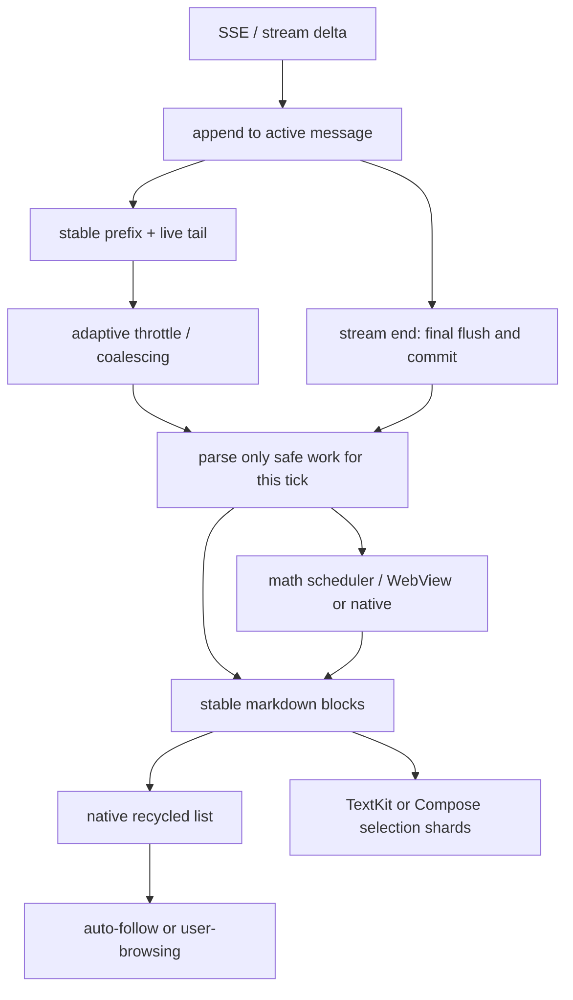

## 12. UI 层与流式渲染：让 8000 行的对话不掉帧

### 12.1 这一章解决什么问题

对话 UI 同时面对两个增长方向：消息历史不断变长，当前回答又以每个 token 的频率增长；把这两个维度都交给默认的声明式列表和 Markdown 组件，通常会把解析、布局、滚动和状态传播叠加到同一帧。OpenMinis 把消息拆成稳定的块（block），把高频流式字段从低频消息结构中分离，并在 iOS、Android 两端分别用 UIKit/Compose 的缓存与节流机制控制工作量；证据见 `src/ios/Agent/MessageList/MessageListInfrastructure.swift:18-29`、`src/android/app/src/main/java/com/openminis/app/ui/chat/ChatModels.kt:81-96`。本章重点不是“把 Markdown 画出来”，而是解释一帧里哪些内容可以不动、哪些内容必须更新、更新时如何不重新测量整个会话。读者还会看到工具卡片、数学公式、跨块选择和输入区为何都必须遵守同一套增量更新原则。

本文中的“流式渲染”指模型增量到达后的可见 UI 更新，不等于网络层本身；iOS 网络事件在后台处理后再回到 `MainActor` 更新块，Android 则把 token 保存在 `streamingById`，由具体渲染项订阅高频通道。引用的行号均来自当前仓库；如果把这些实现迁移到 macOS、Windows、Linux，应保留“稳定前缀 + 活跃尾部 + 最终 flush”的抽象，再替换平台文本、列表和窗口 API。

### 12.2 先建立正确的性能模型：列表、块、文本三层

#### 12.2.1 不是“不能用声明式列表”，而是不能把整条回答当作一个不断重建的大对象

一个朴素实现通常是：`messages` 改变 → 重新构造所有消息行 → 每行把整段 Markdown 解析成树 → 重新测量整行高度 → 列表重新计算滚动位置。这样的实现有三个放大器：

1. **结构放大**：一次 token 只改变回答尾部，却令父消息、扁平列表、所有子项都获得新值。
2. **文本放大**：解析器看到的是从开头到当前 token 的完整字符串，成本随回答长度增长。
3. **布局放大**：高度变化发生在视口底部或用户正在阅读的上方时，列表必须决定是跟随底部还是保持用户的阅读位置。

Android 代码直接记录过这种退化：`AssistantText` 旧的自动 `equals` 会逐字符比较整段 `messageMarkdown`；典型 50 个片段、每片约 1KB 的消息在主线程耗时约 3.7 秒，`String.charAt` 占 profile 的 91.8%，见 `src/android/app/src/main/java/com/openminis/app/ui/chat/ChatFlatItems.kt:314-323`。这不是 LazyColumn 本身的固定缺陷，而是“大字符串 + 自动相等比较 + 每 token 重建列表”的组合缺陷。

#### 12.2.2 iOS 的选择：UICollectionView 外壳，SwiftUI 内容

iOS 的 `CollectionViewMessageListV3` 是 `UIViewControllerRepresentable`，实际创建的是 `MessageListViewController`；消息项定义为用户整条消息、assistant header、assistant block、assistant footer，见 `src/ios/Agent/MessageList/MessageListInfrastructure.swift:18-38`。V3 的设计注释明确列出四个约束：UIKit self-sizing 是唯一高度来源、按“已测量 → NSAttributedString 预计算 → estimate”三级求高、滚动只有 `autoScrolling/userBrowsing` 两态、消息查找用 UUID 索引，见 `src/ios/Agent/MessageList/CollectionViewMessageListV3.swift:12-20`。

这使一个回答可以变成多个可回收 cell：已完成的段落、代码块、表格和工具胶囊各自拥有高度和身份；只有正在增长的 cell 需要频繁重排。`BridgedAssistantBlockV3` 明确声明“不使用 GeometryReader，UIKit self-sizing 是唯一高度源”，见 `src/ios/Agent/MessageList/CollectionViewMessageListV3.swift:195-210`。

**为什么不是直接用 SwiftUI `List`/`LazyVStack`：**仓库没有一条“SwiftUI List 永远不能用”的规则，反而把 SwiftUI 继续用于 cell 内容。可验证的结论是：当每个 cell 内有 TextKit、`NSTextAttachment`、异步图片/公式和动态高度时，UIKit 的可控 self-sizing、diffable snapshot、布局缓存和滚动偏移修正提供了默认 List 难以同时提供的控制面。[推断] 因此迁移到另一套平台时，应复用“原生列表做回收和位置管理、声明式组件做单块内容”的分层，而不是照搬 UIKit 类型名。

#### 12.2.3 Android 的选择：LazyColumn 外壳，块级 item，文本分片

Android 的聊天表面使用 `LazyColumn(reverseLayout = true)`，并把 `flatItems.asReversed()` 以稳定 `key` 和 `contentType` 提交，见 `src/android/app/src/main/java/com/openminis/app/ui/chat/ChatScreen.kt:3007-3129`。`ChatFlatItems` 将 assistant 的每个 Markdown 子块做成独立 `AssistantMarkdownBlock`；代码注释说明，旧方案把整条 assistant 放在一个 item 内部的 `Column`，流式过程中滚动锚点会漂移，现方案让已完成块冻结，只让最后一个 live block 重解析，见 `src/android/app/src/main/java/com/openminis/app/ui/chat/ChatFlatItems.kt:351-379`。

Android 还把长会话做成尾部窗口：`ChatScreen` 消费 `uiMessages`，300 条以内保持同一引用，超过后只保留 `INITIAL_VISIBLE_MESSAGE_CAP`，滚到顶部再调用 `loadOlderMessages`，见 `src/android/app/src/main/java/com/openminis/app/ui/chat/ChatScreen.kt:430-440`。高频 token 不直接写入 canonical `messages`；`ChatModels` 的 `StreamingDelta` 旁路保存内容，渲染项读取 `streamingById[id]?.content ?: message.content`，一轮结束才回写并删除旁路项，见 `src/android/app/src/main/java/com/openminis/app/ui/chat/ChatModels.kt:81-102`。

#### 12.2.4 “长文档用 LazyColumn，聊天 Markdown 用 Column”并不矛盾

Android 的 `MarkdownDocument` 确实使用 LazyColumn；它是独立的文件预览表面，200 个 block 首帧只组合视口部分，见 `src/android/app/src/main/java/com/openminis/app/ui/chat/StreamingMarkdownText.kt:603-618`。聊天消息则已经位于外层 LazyColumn，如果在每个聊天 item 中再放一个垂直 LazyColumn，会触发 Compose 的 infinite vertical constraint；因此 `StreamingMarkdownText` 在聊天侧使用 `Column`，依靠外层块级 item 和内部缓存控制成本。这是嵌套滚动约束，不是对 LazyColumn 的否定。

### 12.3 iOS 消息列表：把高度、身份和滚动拆开

#### 12.3.1 cell 身份是稳定性基础

`MessageListItem` 把 assistant turn 拆成 header、每个 block 和 footer；一个 block 的 UUID 由 `(messageId, blockId)` 构成，见 `src/ios/Agent/MessageList/MessageListInfrastructure.swift:18-38`。diffable data source 因而不必把整条回答作为一个变化 item；当新增工具块时，只需在 snapshot 中插入对应 item，已有文本 cell 的身份不变。

V3 coordinator 同时维护 `messageIndex` 与 `itemToIndex`，注释标明这是 O(1) lookup，见 `src/ios/Agent/MessageList/CollectionViewMessageListV3.swift:660-666`。cell 配置前后还记录 `contentKey`，把真正测得的高度按内容键保存，而不是依赖可能暂时为 `-1` 的 indexPath，见 `src/ios/Agent/MessageList/MessageListInfrastructure.swift:89-111`。

#### 12.3.2 三级高度解析不是装饰，而是把昂贵工作推迟到必要时

`MessageListLayout` 的第一层是 `heightCache` 中已经由 UIKit 测得的高度；第二层是完成文本的 `NSAttributedString.boundingRect()` 预计算；第三层才是按内容长度、角色等得到的 estimate，见 `src/ios/Agent/MessageList/MessageListLayout.swift:15-40` 及 `src/ios/Agent/MessageList/MessageListLayout.swift:173-205`。布局在失效时不会丢弃离屏高度，因此不会发生 contentSize 先塌缩、再重建、再让滚动条闪烁的循环，见 `src/ios/Agent/MessageList/MessageListLayout.swift:4-14`。

`SelfSizingCell` 还提供两个不同语义的缓存：50ms 内重复的 `preferredLayoutAttributesFitting` 直接复用上一次实测高度；跨 cell 回收的 `seededHeight` 只接受此前 UIKit 真正测过的值，绝不把粗略 estimate 当作硬高度，见 `src/ios/Agent/MessageList/MessageListInfrastructure.swift:64-103`、`src/ios/Agent/MessageList/MessageListInfrastructure.swift:120-143`。这一区分避免“初始估算短了导致文字被截断，后来才扩张”的错误。

#### 12.3.3 为什么主动关闭 UIKit prefetch

Coordinator 在 attach 时保留 `prefetchDataSource` 接口，但明确把 `collectionView.isPrefetchingEnabled` 设为 false。仓库注释记录了 Time Profiler 证据：预取会从 `_prefetchItemsForPrefetchingContext_` 链到 `SelfSizingCell.preferredLayoutAttributesFitting` 和 `systemLayoutSizeFitting`，一个离屏大 cell 约占主线程样本 44ms（30%），用户感知为显示大文本/表格前的 2–3 帧卡顿；关闭后只在真正上屏时测量，见 `src/ios/Agent/MessageList/CollectionViewMessageListV3.swift:740-758`。

#### 12.3.4 滚动两态：自动跟随和用户阅读不能混成一个布尔值

`scrollMode` 只有 `.autoScrolling` 与 `.userBrowsing`；状态变化同步给布局的 `isAutoScrollPinning`，见 `src/ios/Agent/MessageList/CollectionViewMessageListV3.swift:643-650`。流式 cell 在自动跟随时增长，布局可以在同一 pass 把 content offset 按增量调整，让新行从底部平滑升起；用户离开底部后，增长不能把视口强行拉回去，见 `src/ios/Agent/MessageList/MessageListLayout.swift:109-118`。

流式布局刷新再做一次时间节流：自动跟随为 100ms，用户浏览历史时为 3s，并用 trailing work item 保证尾部更新不会丢失；滚动信号另以 80ms 合并，见 `src/ios/Agent/MessageList/CollectionViewMessageListV3.swift:1754-1810`。这不是隐藏内容，而是把“用户正在看什么”转成布局调度策略。

#### 12.3.5 空 block、异步媒体和 suspend 是必须显式处理的边界

流式文本 block 从空到非空时，UIHostingConfiguration 不一定触发 `preferredLayoutAttributesFitting`；`applyStreamingTextBlockContent` 因此发送 `blockContentFilledSignal`，Coordinator 先失效旧高度，再 reconfigure 该 item，见 `src/ios/Agent/Chat/AIChatViewModel.swift:5668-5690` 和 `src/ios/Agent/MessageList/CollectionViewMessageListV3.swift:1614-1634`。

图片、视频或公式异步完成时，attachment 的 intrinsic height 改变，但 cell 的宽泛缓存可能阻止再次测量；V3 订阅 attachment size change 并清理相应缓存，相关设计注释见 `src/ios/Agent/MessageList/CollectionViewMessageListV3.swift:684-690`。如果用户在滚动、转场、后台或工具详情 sheet 中，`AIChatViewModel` 会把最新 `DeferredStreamingTextUpdate` 暂存；结构体和数组见 `src/ios/Agent/Chat/AIChatViewModel.swift:1079-1091`，真正应用时再合并到 block，见 `src/ios/Agent/Chat/AIChatViewModel.swift:5623-5658`、`src/ios/Agent/Chat/AIChatViewModel.swift:5693-5710`。

### 12.4 Android 消息列表：窗口化、轻量相等和反向布局

#### 12.4.1 canonical messages 与 uiMessages 分层

`uiMessages` 是给聊天窗口的尾部视图，VM 的完整 `messages` 仍服务于发送、压缩、fork、重试等操作；`ChatScreen` 的注释明确要求这些全历史操作继续读取 VM 全量数据，见 `src/android/app/src/main/java/com/openminis/app/ui/chat/ChatScreen.kt:430-440`。这种分层比在每个 Composable 中做 `drop` 更可靠，因为分页窗口的状态和 `loadOlderMessages` 由 ViewModel 负责。

高频字段走 `streamingById` 旁路，保持 `messages` 的对象引用稳定；顶层 `ChatScreen` 的 `.any/.associate/.isNotEmpty/.lastOrNull` 因而不必每个 token 重组，见 `src/android/app/src/main/java/com/openminis/app/ui/chat/ChatModels.kt:81-96`。块级渲染项再按自己的订阅频率更新。

#### 12.4.2 手写 equals 是性能修复，不是微优化

`AssistantText.equals` 比较 message id、block identity、streaming 状态和正文长度，不逐字符扫描 `messageMarkdown`；`AssistantMarkdownBlock.equals` 同样比较稳定 id、block index、长度和状态，见 `src/android/app/src/main/java/com/openminis/app/ui/chat/ChatFlatItems.kt:314-390`。这是在 Compose/LazyColumn 需要判断 skip 时减少字符串访问。

列表提交时必须使用稳定 key：`key = { itemKey(it) }` 与 `contentType = { itemType(it) }` 的组合让 Compose 保留可复用节点；`ChatScreen` 还在 `snapshotFlow` 中读取滚动索引与 offset，见 `src/android/app/src/main/java/com/openminis/app/ui/chat/ChatScreen.kt:3007-3129`、`src/android/app/src/main/java/com/openminis/app/ui/chat/ChatScreen.kt:1127-1140`。

#### 12.4.3 反向布局的滚动语义

`reverseLayout = true` 让新消息插入底部时不需要把整段历史的 index 重新映射；用户上拉加载旧消息时，`loadOlderMessages` 以 prepend 语义补齐窗口。代码用 `isNearBottom` 的 derived state 与 `userScrolledAway` 的真实拖拽状态区分模型更新和用户手势，见 `src/android/app/src/main/java/com/openminis/app/ui/chat/ChatScreen.kt:995-1055`、`src/android/app/src/main/java/com/openminis/app/ui/chat/ChatScreen.kt:1210-1290`。

Compose 侧不能只依据 `firstVisibleItemIndex == 0` 判断底部：反向列表有 item 高度、动画和正在组合的工具块，`snapshotFlow` 还会合并最近滚动状态。`ChatScreen` 只有在 `!userScrolledAway`、接近底部且列表不在滚动中时才跟随，见 `src/android/app/src/main/java/com/openminis/app/ui/chat/ChatScreen.kt:1385-1458`、`src/android/app/src/main/java/com/openminis/app/ui/chat/ChatScreen.kt:1573-1588`。这与 iOS 的两态模型是同一抽象，但 Android 由 `LazyListState` 和协程滚动实现。

### 12.5 流式增量渲染：网络 token 到屏幕的一条可审计管线

核心原则是：**状态可以每 token 追加，解析和布局不能每 token 无条件同步执行**。下面的时序图只展示已经由网络层交付到 UI 层的 delta；持久化和 agent 业务不在本章范围。



#### 12.5.1 iOS：节流在 SSE stream，增量快路径在 TextKit view

iOS 的 `textDelta` 分支把增量追加到当前 `StreamResult.assistantText`，达到时间/换行阈值后在 `MainActor` 回写对应的 text block；阈值和合并逻辑位于 `src/ios/Agent/Chat/AIChatViewModel+SSEStream.swift:417-513`。关键刷新分支如下，保留真实语义：

来源：`src/ios/Agent/Chat/AIChatViewModel+SSEStream.swift:479-511`

```swift
let throttle: TimeInterval = len < 500 ? 0.20
                            : len < 2000 ? 0.30
                            : len < 32_000 ? 0.50
                            : len < 64_000 ? 1.00
                            : len < 128_000 ? 1.50
                            : 2.00
let newlineFlush = len < 5000 && text.contains("\n") && unflushed >= 50

if elapsed >= throttle || newlineFlush {
    lastTextDeltaFlush = now
    lastTextDeltaFlushedLength = len
    let snapshot = result.assistantText
    let prepared = prepareMarkdownForRender(snapshot)
    let parsed = MarkdownContent(prepared)
    await MainActor.run {
        guard msgIdx < messages.count, blockIdx < messages[msgIdx].blocks.count else { return }
        self.setStreamingTextBlockContent(
            msgIdx: msgIdx,
            blockIdx: blockIdx,
            text: snapshot,
            parsedMarkdown: parsed,
            cacheAttributedString: false,
            requestScroll: true
        )
    }
}
```

这是 `textDelta` 分支中的精简片段：省略了上层事件枚举和统计字段，但保留了真实阈值、`MarkdownContent` 后台构造、`MainActor` 回写以及 block 边界保护。

这段代码说明一个容易被误读的事实：当前 iOS 路径**不是**一个按字符追加的完整增量 Markdown parser；每次 flush 仍会为当前快照构造 `MarkdownContent`。节流、解析放在非主线程的上游、以及视图层 append-only 快路径共同限制成本，不能把它宣传成“每次只解析最后一个字符”。

`prepareMarkdownForRender` 会把未闭合代码围栏/表格尾部等特殊情况转换为可测量的临时输入，位于 `src/ios/Agent/Chat/AIChatViewModel+SSEStream.swift:515-599`。当正文只是在已有段落末尾追加，`SelectableMarkdownView` 复用旧 attributed prefix，仅替换 tail；当新 block 边界或结构改变时才走完整渲染，见 `src/ios/Views/Chat/SelectableMarkdownView.swift:6753-6868`。

可把它概括为两层增量：

- **数据层增量**：`result.assistantText` 只在当前 stream result 中增长，采样点才调用 `setStreamingTextBlockContent` 回写对应 block。
- **文本层增量**：`updateUIView` 比较旧文本前缀；若旧值是新值的 prefix，则只追加新尾巴并重新测量必要的 glyph range，见 `src/ios/Views/Chat/SelectableMarkdownView.swift:6828-6868`。

#### 12.5.2 iOS：adaptive throttle 的具体边界

刷新不是固定的 16ms 定时器。`textDelta` 分支按 `assistantText` 长度选择 0.20、0.30、0.50、1.00、1.50 或 2.00 秒 tier；短文还允许“换行 + 至少 50 个未 flush 字符”的 fast path，长于 5000 字则关闭该 fast path，见 `src/ios/Agent/Chat/AIChatViewModel+SSEStream.swift:465-495`。这种节奏把全文 Markdown 重解析从每 token 调用改成合并批次。

因此要用两个指标评价流式体验：可见 token 延迟和单次 flush 工作量。把 interval 固定为“每 token 一次”会让长回答的全量解析/布局变成锯齿；把 interval 固定为“每秒一次”又会使短回答反馈变慢。仓库用按长度分 tier 的 throttle 和 newline fast path 折中，而不是伪造一个永远稳定的 FPS。

#### 12.5.3 Android：采样快照与 live tail

Android `StreamingMarkdownText` 在 `content` 改变时先通过 `snapshotFlow { content }.conflate()` 合并值，再按 `streamingThrottleFor` 延迟；当前 tier 为 200、300、500、1000、1500、2000ms，见 `src/android/app/src/main/java/com/openminis/app/ui/chat/StreamingMarkdownText.kt:517-525`、`src/android/app/src/main/java/com/openminis/app/ui/chat/StreamingMarkdownText.kt:551-566`。UI 读取的是最近完成快照，解析由后续 `LaunchedEffect` 调度。

来源：`src/android/app/src/main/java/com/openminis/app/ui/chat/StreamingMarkdownText.kt:551-580`

```kotlin
val sampledText by produceState(initialValue = streamingText, streamingText, policy) {
    if (!isStreaming) {
        value = streamingText
        return@produceState
    }
    val delayMs = policy.delayFor(streamingText.length)
    delay(delayMs)
    value = streamingText
}

val parsed by produceState(initialValue = emptyList<MdBlock>(), sampledText) {
    value = withContext(Dispatchers.Default) {
        parseMarkdownBlocks(sampledText)
    }
}
```

`parseMarkdownBlocks` 在采样点仍看到整段 `sampledText`，所以 Android 的块级 parser 也是“分块渲染 + 采样全量解析”，而不是任意位置的 AST 增量合并。真正的增量优化发生在 live paragraph 的 inline/math 层：安全前缀进入 `ParsedInlineCache`，只有最后一段未闭合内容重算，见 `src/android/app/src/main/java/com/openminis/app/ui/chat/StreamingMarkdownText.kt:2712-3033`。

`streamingTailBlock` 会给正在增长的段落单独的 key；已经完成的 `MdBlock` 不因尾部变化而换 key，见 `src/android/app/src/main/java/com/openminis/app/ui/chat/StreamingMarkdownText.kt:1500-1606`。`ChatFlatItems` 再把这些块映射到外层 LazyColumn item，因此 Compose 不会把一个 20KB 回答的所有 block 作为同一个重组单元。

#### 12.5.4 Android：后台 parse 不能等于无界缓存

Android 的 `MarkdownParseCaches` 用按字符预算的 LRU；默认每个 cache 的 source 字符预算为 2,000,000，`Lru.put` 按总字符数淘汰旧项，见 `src/android/app/src/main/java/com/openminis/app/ui/chat/StreamingMarkdownText.kt:2712-2831`、`src/android/app/src/main/java/com/openminis/app/ui/chat/StreamingMarkdownText.kt:2851-2862`。这是因为一个包含代码和表格的条目可能比几十个短段落更大；按 entry count 会低估内存。

`safeInlineSplitOffset` 不会在代码围栏、链接、强调或数学分隔符中间切断。它只把“已知不会随尾部重新解释”的前缀交给缓存；短文本或没有安全边界时回退普通 parse，见 `src/android/app/src/main/java/com/openminis/app/ui/chat/StreamingMarkdownText.kt:2887-2937`、`src/android/app/src/main/java/com/openminis/app/ui/chat/StreamingMarkdownText.kt:3060-3135`。

#### 12.5.5 完成事件是协议的一部分

两端都不能只依赖定时器：流结束时必须取消等待任务、强制解析最后的半行/半个表格，并把旁路流文本提交为 canonical message。iOS 的 `force: true` 路径位于 `src/ios/Agent/Chat/AIChatViewModel+SSEStream.swift:465-513`；Android 的 `updateAssistantMessage(..., isStreaming = false)` 会把 `StreamingDelta` 写回 `_messages` 并清理旁路，见 `src/android/app/src/main/java/com/openminis/app/ui/chat/ChatViewModel.kt:7540-7692`。否则最后一个 token 可能只存在于旁路 state，重新打开会话后消失。

### 12.6 Markdown 管线：块级身份优先，inline 只在必要处重算

#### 12.6.1 iOS：MarkdownMathExtractor → cmark block → RenderedBlock

`MinisMarkdownParser` 的入口先提取数学公式，再把公式替换为不会与普通文字冲突的对象替代占位符；它支持 `$$...$$`、`\[...\]`、`$...$`、`\(...\)`，同时跳过 fenced code 和 inline code，见 `src/ios/Agent/Markdown/MinisMarkdownParser.swift:28-84`、`src/ios/Agent/Markdown/MinisMarkdownParser.swift:452-607`。跳过代码是必要的：代码示例里的美元符号不能变成公式 attachment。

随后 parser 以 cmark-gfm AST 遍历 block。heading、paragraph、blockquote、list、table、code block、thematic break 和 HTML 分别生成 block node；表格会保留 header/rows/alignment 元数据，见 `src/ios/Agent/Markdown/MinisMarkdownParser.swift:91-225`。行级 inline 再生成普通文本、强调、删除线、code span、link 和媒体节点，见 `src/ios/Agent/Markdown/MinisMarkdownParser.swift:227-345`。

`SelectableMarkdownView` 不把所有内容拼成一个无差别的 Text，而是把每个 node 变成 `RenderedBlock`。段落使用 `renderInlines`；heading 设定独立 paragraph style；blockquote 累积 quote depth；代码块使用固定的 Menlo 字体和可横向裁切的 TextView，见 `src/ios/Views/Chat/SelectableMarkdownView.swift:559-593`、`src/ios/Views/Chat/SelectableMarkdownView.swift:1348-1430`。

来源：`src/ios/Views/Chat/SelectableMarkdownView.swift:1404-1418`

```swift
let codeStyle = NSMutableParagraphStyle()
codeStyle.lineSpacing = 4
codeStyle.lineBreakMode = .byClipping
let codeAttr = NSAttributedString(string: code, attributes: [
    .font: theme.codeBlockFont,
    .foregroundColor: theme.codeBlockTextColor,
    .paragraphStyle: codeStyle,
])
codeTextView.attributedText = codeAttr
```

当前 iOS 对话渲染器没有接入一个独立的语言服务器式高亮器；代码块主要由专用字体、颜色和复制/横向滚动容器呈现，真实逻辑见上述范围。把“语法高亮”写成 iOS 已经使用完整 compiler highlighter 会超出代码证据，应避免这种误读。

#### 12.6.2 Android：MarkdownParser 的块模型和表格保护

Android `MarkdownParser.parseWithMath` 的顺序与 iOS 对齐：先 `extractMath`，再扫描 fenced code、heading、列表、引用、表格和段落，见 `src/android/app/src/main/java/com/openminis/app/ui/markdown/MarkdownParser.kt:31-90`、`src/android/app/src/main/java/com/openminis/app/ui/markdown/MarkdownParser.kt:331-480`。数学提取器按字符走状态机，遇到 code fence 或 inline code 会原样复制分隔符；`` 样式的 Object Replacement Character + `MATH<n>` 占位符避免与普通 Markdown 符号冲突，见 `src/android/app/src/main/java/com/openminis/app/ui/markdown/MarkdownParser.kt:331-345`。

表格解析不是简单 `split("|")`：当单元格有 Markdown link 的括号时，`splitTableRow` 追踪括号深度，只有 depth 为 0 的竖线才分列，见 `src/android/app/src/main/java/com/openminis/app/ui/markdown/MarkdownParser.kt:298-328`。渲染阶段再把 `MdBlock.Table` 映射到横向滚动的 Row/Column，见 `src/android/app/src/main/java/com/openminis/app/ui/chat/StreamingMarkdownText.kt:1558-1645`。

Android 的 `SyntaxHighlighter` 是轻量词法着色器，只按 keyword、string、comment、number、type 着色，未声明为完整 parser，见 `src/android/app/src/main/java/com/openminis/app/ui/markdown/SyntaxHighlighter.kt:8-94`。普通 Markdown 组件支持 headings、粗斜体、代码块、列表、引用、表格、分隔线和链接，入口说明在 `src/android/app/src/main/java/com/openminis/app/ui/markdown/MarkdownText.kt:81-99`。

#### 12.6.3 `minis://` 媒体是解析后、布局前的资源解析问题

Markdown link 的 URL 不能直接交给平台图片加载器。iOS 的媒体 renderer 为 image、video、audio 生成 attachment，并以 source 为 key 缓存 audio attachment；图像则交给 `MinisMediaCache`，见 `src/ios/Views/Chat/SelectableMarkdownView.swift:1000-1057`、`src/ios/Views/Chat/SelectableMarkdownView.swift:1260-1365`。图片加载完成后必须发 size change，消息列表才会清除高度缓存并重排。

Android 的 `resolveMdMediaFile` 先把 `minis://attachments/foo` 映射成 Linux `/var/minis/attachments/foo`，优先调用 session-scoped `PRootKernel.resolveSessionHostPath`；找不到时遍历所有 session 目录和 global 目录，见 `src/android/app/src/main/java/com/openminis/app/ui/chat/StreamingMarkdownText.kt:2129-2198`。它特意只剥离 query、不剥离 `#`，因为 attachment 文件名允许包含 `#`；这类资源解析细节不能由 URL 组件的默认 fragment 规则替代。

Android 找到文件后还通过 `FileProvider` 生成可分享 URI，媒体外部打开入口见 `src/android/app/src/main/java/com/openminis/app/ui/chat/StreamingMarkdownText.kt:2201-2223`。因此 `minis://` 的完整链路是“Markdown link → session resolver → File/attachment → 尺寸回调或外部 intent”，并非把自定义 scheme 当成网络 URL。

### 12.7 数学公式：KaTeX WebView 与 SwiftMath 原生双通道

#### 12.7.1 两条路分别解决什么问题

KaTeX 适合覆盖完整 LaTeX 语法、显示公式和 HTML/CSS 排版；代价是 WebView 初始化、HTML 注入和快照高度测量。SwiftMath 直接生成原生图片，首屏和短 inline 公式开销低，但语法覆盖和复杂布局边界不同，见 `src/ios/Agent/Markdown/KaTeXRenderer.swift:34-70`、`src/ios/Agent/Markdown/SwiftMathRenderer.swift:6-19`。

iOS 的两条通道不是由 `MathRenderScheduler` 按长度自动选择的：普通 `MathAttachment` 进入 scheduler 后，`performRender()` 先走 `SwiftMathRenderer.render`，失败再走 `renderFallback`；显式 KaTeX 请求则由 `KaTeXRenderer` 自己排队并缓存，见 `src/ios/Views/Chat/SelectableMarkdownView.swift:3208-3235`、`src/ios/Agent/Markdown/KaTeXRenderer.swift:42-70`。

`MathRenderScheduler` 是主线程串行队列，每个 run-loop tick 最多处理 4 个 attachment，队列未空时用 `DispatchQueue.main.async` 让手势、滚动和布局先运行，见 `src/ios/Agent/Markdown/MathRenderScheduler.swift:5-24`、`src/ios/Agent/Markdown/MathRenderScheduler.swift:25-101`。缓存不在 scheduler：SwiftMath 用 `NSCache`（上限 256），KaTeX 用 `NSCache`（上限 200），见 `src/ios/Agent/Markdown/SwiftMathRenderer.swift:6-19`、`src/ios/Agent/Markdown/KaTeXRenderer.swift:21-69`。

#### 12.7.2 iOS 调度顺序

`KaTeXRenderer` 将 latex HTML-escape 后放进本地 KaTeX HTML 模板，以 `WKWebView` 计算内容尺寸并在完成后回传 snapshot，见 `src/ios/Agent/Markdown/KaTeXRenderer.swift:22-147`。HTML 和资源都来自仓库 `src/ios/Resources/KaTeX/`，因此公式渲染不依赖外网；资源加载完成后才允许计算高度。

`SwiftMathRenderer` 对短公式创建原生 attributed/drawing 结果；字符遍历和字体选择见 `src/ios/Agent/Markdown/SwiftMathRenderer.swift:128-155`。它不替代 KaTeX 的复杂显示布局，而是让 inline 公式不必为每个 token 启动或唤醒 WebView。

视图层收到 scheduler 结果后，用 `NSTextAttachment` 替换占位符；占位符在公式仍在生成时保持稳定宽度/最小高度，真实 attachment 完成再发送尺寸变化，见 `src/ios/Views/Chat/SelectableMarkdownView.swift:1150-1262`。这一步把异步公式网络与消息 cell 高度缓存连接起来。

#### 12.7.3 Android WebView pool 与 Compose 状态

`KatexWebViewPool` 这个名字虽叫 Pool，实际是一个 offscreen WebView 加 `Mutex` 串行请求；它用容量 150 的 `LruCache`，key 包含 latex、displayMode、isDark、fontSizePx，失败/超时返回 null 让调用方显示 raw LaTeX，见 `src/android/app/src/main/java/com/openminis/app/ui/chat/KatexWebViewPool.kt:21-85`、`src/android/app/src/main/java/com/openminis/app/ui/chat/KatexWebViewPool.kt:222-225`。`StreamingMarkdownText.RenderMath` 使用 `produceState`，以 latex、dark、fontSize 为 key；状态变化会重新申请结果，见 `src/android/app/src/main/java/com/openminis/app/ui/chat/StreamingMarkdownText.kt:2010-2085`。

Android `MarkdownParser.MathSpan` 只携带 placeholder、latex 和 display 标志；解析器不在后台线程里做 WebView 工作，UI 层拿到 span 后才渲染，见 `src/android/app/src/main/java/com/openminis/app/ui/markdown/MarkdownParser.kt:16-31`。这样 `Dispatchers.Default` parse 不会触碰 Android View，只把可序列化的数据传回主线程。

#### 12.7.4 数学公式的流式边界

单个 `$`、`$$`、`\(` 或 `\[` 处于未闭合状态时，iOS/Android 都必须保留普通文本或临时 placeholder，不能把“半个公式”交给 KaTeX 并在下一 token 里重写整段布局。Android 的 `extractMath` 在找不到 close delimiter 时不生成 `MathSpan`，见 `src/android/app/src/main/java/com/openminis/app/ui/markdown/MarkdownParser.kt:426-478`；iOS 对应逻辑见 `src/ios/Agent/Markdown/MinisMarkdownParser.swift:452-607`。

公式 cache 的视觉输入要分别核对：Android key 明确包含 dark/display/font size；iOS `KaTeXRenderer.cacheKey` 也读取当前 trait 的 dark 状态，但 `SwiftMathRenderer.cacheKey` 只包含 display、字号和 latex，暗色切换若仍复用 SwiftMath bitmap 可能需要由上层失效或重新建 attachment，见 `src/android/app/src/main/java/com/openminis/app/ui/chat/KatexWebViewPool.kt:222-225`、`src/ios/Agent/Markdown/KaTeXRenderer.swift:171-174`、`src/ios/Agent/Markdown/SwiftMathRenderer.swift:73-75`。这是双通道实现中不能忽略的 cache 约束。

### 12.8 8006 行 `SelectableMarkdownView` 与 Android TextKit 选择器

#### 12.8.1 iOS 解决的是跨 block 选择，不只是“给 Text 加 selectable”

`SelectableMarkdownView.swift` 同时包含 Markdown AST、RenderedBlock、TextKit 容器、attachment、手势、复制和动态尺寸，是一个 8006 行的 UIKit 适配层；它把多个 `NSTextStorage`/`UITextView` block 组织成一个可感知全局位置的选择面。文本视图使用 TextKit 1，选择范围按全局 offset 计算，见 `src/ios/Views/Chat/SelectableMarkdownView.swift:6330-6410`、`src/ios/Views/Chat/SelectableMarkdownView.swift:6500-6578`。

选择跨越多个 block 时，`selectedRange` 先转换成 block range，再把各 block 的子范围拼成 plain string；attachment 会变成可复制的占位文本而不是静默丢失，见 `src/ios/Views/Chat/SelectableMarkdownView.swift:5022-5095`。菜单同时提供 plain text、Markdown、富文本和“复制表格”等路径，`copyMarkdown` 会还原公式 delimiter 和代码围栏，见 `src/ios/Views/Chat/SelectableMarkdownView.swift:5099-5195`。

TextKit 不能在每次尾部追加时对整个 storage 调 `ensureLayout`; 代码把可见 glyph range 加一个小 overscan 作为快路径，只在需要时做 bounded layout，见 `src/ios/Views/Chat/SelectableMarkdownView.swift:6828-6872`。同一段还说明，全文 `ensureLayout` 在流式和大表格下曾造成明显卡顿，因此避免把“测量完整文本”当作默认操作。

#### 12.8.2 Android 为什么自行实现 `MinisTextKitSelection`

Compose `SelectionContainer` 以 Composable 子树为边界；聊天 item 会被 LazyColumn 回收，跨 item selection 的 anchor 可能失效。因此 `MinisTextKitSelection` 在 LazyColumn 外提升一个共享 `SelectionController`，注册每个可见 TextShard 的稳定 id、文本和坐标，见 `src/android/app/src/main/java/com/openminis/app/ui/chat/MinisTextKitSelection.kt:16-33`、`src/android/app/src/main/java/com/openminis/app/ui/chat/MinisTextKitSelection.kt:189-213`。

选择值是全局 `TextPosition(shardId, offset)`；拖拽时 controller 根据当前注册 shards 做 window-space hit test，再扩展 anchor/head，见 `src/android/app/src/main/java/com/openminis/app/ui/chat/MinisTextKitSelection.kt:214-390`。LazyColumn 回收 shard 后，registry 移除它，但选择模型保留逻辑位置；重新进入视口时再注册。这一行为是默认 `SelectionContainer` 不保证的，正是造轮子的原因。

#### 12.8.3 Android 手势层的 frame-safe 设计

`MinisTextKitGesture` 不直接在 pointer move 回调里无限修改布局，而是把最新拖拽点写入 `DragIntent`，由一个 16ms ticker 合并更新；边缘滚动只在 handle 距离顶部/底部阈值内触发，见 `src/android/app/src/main/java/com/openminis/app/ui/chat/MinisTextKitGesture.kt:1-179`。这样同一帧多次 move 不会重复做 hit test 和 selection recomposition。

手柄绘制和触摸命中区域分开：视觉圆点较小，命中 padding 更大；代码以 density 将 44dp 左右的触摸范围换算到像素，见 `src/android/app/src/main/java/com/openminis/app/ui/chat/MinisTextKitGesture.kt:170-390`。长按、拖拽、点击工具栏分别处理，不让 Compose 的普通 scroll gesture 抢走所有事件。

`MinisMarkdownTextToolbar` 将复制、复制 Markdown、加入输入框、朗读和选择全选等动作绑定到 controller，见 `src/android/app/src/main/java/com/openminis/app/ui/chat/MinisMarkdownTextToolbar.kt:216-390`。因此 toolbar 是选择状态机的一部分，不是脱离文本的浮层按钮。

### 12.9 工具调用 UI：实时输出与最终 diff 都不能阻塞聊天列表

#### 12.9.1 iOS ToolLiveSheet 的数据模型

`ToolLiveSheet` 接收当前 assistant block 的 tool snapshots；它以 `toolUseId` 维护当前 index，并把 shell 输出、文件 edits、browser snapshots 和图片工具分开呈现，见 `src/ios/Views/Chat/ToolLiveSheet.swift:1-83`。顶部实时预览显示有限行的 ANSI 清洗文本，tap 后进入全屏详情；iOS 不是把 70KB shell 输出全部塞进聊天 cell。

实时文本 renderer 对一条超长行做 2000 字截断、允许的行数做上限，并把输出分成约 40 行的增量 chunk；这三个约束和 ANSI 清洗在 `src/ios/Views/Chat/ToolLiveSheet.swift:28-60`、`src/ios/Views/Chat/ToolLiveSheet.swift:100-185`。文件 edit 另走 `old_string/new_string` 的 unified diff 展示，见 `src/ios/Views/Chat/ToolLiveSheet.swift:200-372`。

详情页不是普通滚动全文：初次只渲染约 5 个 chunk，最多约 10KB；用户接近底部才 reveal 下一批，并提供 Load more，见 `src/ios/Views/Chat/ToolLiveSheet.swift:1240-1340`。这是“渐进加载”而不是删除工具输出；最终 snapshot 仍可按需查看。

#### 12.9.2 Android ToolDetailSheet 的对应做法

Android `ChatToolDetailUI` 把工具状态映射为 pending/running/success/failed/timeout/cancelled，卡片点击打开 `ModalBottomSheet`，见 `src/android/app/src/main/java/com/openminis/app/ui/chat/ChatToolDetailUI.kt:269-320`、`src/android/app/src/main/java/com/openminis/app/ui/chat/ChatToolDetailUI.kt:560-620`。`ChatAssistantMessageUI` 的工具行只显示标题、状态和摘要，避免把结果正文挂在每次消息重组上，见 `src/android/app/src/main/java/com/openminis/app/ui/chat/ChatAssistantMessageUI.kt:760-910`。

工具详情的 lazy reveal 以约 40 行为一批，初始约 5 批；单个文件 edit 的 diff 解析 old/new 行并显示 added/deleted，见 `src/android/app/src/main/java/com/openminis/app/ui/chat/ChatToolDetailUI.kt:1379-1538`。实现明确指出一次性构造 70KB 文本、测量全部行会导致打开 sheet 时卡顿，所以只在用户滚动到末尾时追加 `Text`，见同文件 `LazyRevealToolText` 的注释和范围 `src/android/app/src/main/java/com/openminis/app/ui/chat/ChatToolDetailUI.kt:1381-1518`。

Android 详情页的文本选择故意使用独立 `SelectionContainer`，不嵌入聊天列表的 `MinisTextKitSelection` registry，见 `src/android/app/src/main/java/com/openminis/app/ui/chat/ChatToolDetailUI.kt:1389-1395`。这是为了避免工具 sheet 关闭后仍有 shard 注册在聊天树中；两种选择模型的边界必须显式保持。

#### 12.9.3 为什么工具输出要有“折叠卡片 + 实时面板 + 最终详情”三层

折叠卡片解决历史列表密度；实时面板解决用户需要观察正在运行的命令；最终详情解决审计和复制。三者展示的是同一 `ToolSnapshot` 的不同窗口，而不是复制三份不一致的 state。iOS 的 `toolSnapshots`/current index 见 `src/ios/Views/Chat/ToolLiveSheet.swift:70-83`，Android 的 `toolBlocks` 与 `expanded` 见 `src/android/app/src/main/java/com/openminis/app/ui/chat/ChatToolDetailUI.kt:280-320`。

工具状态不能只用布尔 `isLoading`：Android 的 `ToolBlockStatus` 显式区分 `STREAMING`、`PENDING`、`RUNNING`、`SUCCESS`、`FAILED`、`CANCELLED`、`TIMEOUT`，枚举与注释在 `src/android/app/src/main/java/com/openminis/app/ui/chat/ChatModels.kt:212-225`，卡片状态映射在 `src/android/app/src/main/java/com/openminis/app/ui/chat/ChatAssistantMessageUI.kt:580-638`；iOS 也以 snapshot status 驱动实时/最终视图。状态枚举决定取消按钮、错误颜色和是否允许展示最终 diff。

### 12.10 输入区：附件、语音、@ mention 和斜杠命令也要节流

#### 12.10.1 iOS 输入区的组件边界

`ChatInputBar` 把附件 grid、录音按钮、文本输入和发送 capsule 组合为一个组件；`InputAttachmentGridView` 维护 `InputAttachment` 数组、加载中的视频计数、拖拽 id 和删除回调，见 `src/ios/Views/Chat/ChatInputBar.swift:150-210`。拖拽时只修改顺序和 opacity，删除/上传完成才改变附件集合，避免拖动过程触发整个聊天列表更新。

`AIChatView` 将附件预览放在 composer 上方，并设置最大内容宽度/最大高度，避免 iPad 横屏或大量图片把输入区无限撑高，见 `src/ios/Views/Chat/AIChatView.swift:3190-3340`。语音模式使用 `voiceInputActive`，识别回调只追加新增 delta，发送后再 `clearAndRearm`，见 `src/ios/Views/Chat/AIChatView.swift:3217-3247`、`src/ios/Views/Chat/AIChatView.swift:4140-4149`。

#### 12.10.2 iOS 的 slash 与 mention 是输入状态机

`AIChatViewModel+SlashCommands.swift` 定义 slash command 的 id、icon、title、subtitle，并区分用户安装 skill 与 MCP row；选择后不是立刻在 UI 执行脚本，而是把 `<name>`/SKILL.md 提示注入 agent loop，见 `src/ios/Agent/Chat/AIChatViewModel+SlashCommands.swift:1-180`。这说明菜单是 prompt 选择器，不是另一个发送 API。

mention picker 读取 `inputText` 和 caret，只有 caret 前的 token 以 `@` 开头时才显示；选择后在原光标位置替换 token，逻辑见 `src/ios/Agent/Chat/AIChatViewModel+MentionMenu.swift:1-130` 与 `src/ios/Views/Chat/AIChatView.swift:3190-3340`。因此不能简单用 `inputText.contains("@")` 全局触发菜单。

#### 12.10.3 Android 复刻语义而不是复刻 UIKit

`ChatComposerWidgets` 提供 `AttachmentChip`、`MicButton`、`InputCircleButton` 和 launcher；录音按钮进入 inline voice panel，而不是跳转到新页面，见 `src/android/app/src/main/java/com/openminis/app/ui/chat/ChatComposerWidgets.kt:278-405`。`ChatScreen` 使用 `BasicTextField` 并维护 selection，插入 mention/slash 后通过 `TextFieldValue` 保留 caret，见 `src/android/app/src/main/java/com/openminis/app/ui/chat/ChatScreen.kt:599-623`。

附件 picker 限制最多 50 项并按照 `image/jpeg` 等 mime 类型选择，见 `src/android/app/src/main/java/com/openminis/app/ui/chat/ChatScreen.kt:719-742`。相机使用 `rememberLauncherForActivityResult`，启动前设置 overlay state，回调中再关闭 overlay，见 `src/android/app/src/main/java/com/openminis/app/ui/chat/ChatScreen.kt:804-823`。这类 Activity 前后台边界是 Compose 输入区最容易遗漏的地方。

Android mention popup 从 ViewModel 的 `mentionMenuOpenForSpy`、entries、selectedIndex 收集状态；选择项通过 `executeSelectedMention` 替换 caret 前 token，见 `src/android/app/src/main/java/com/openminis/app/ui/chat/ChatScreen.kt:3979-4150`。slash popup 使用同样的 `showSlashMenu`/`executeSelectedSlash` 状态，不把候选列表硬编码在文本组件里，见 `src/android/app/src/main/java/com/openminis/app/ui/chat/ChatScreen.kt:3660-3798`。

### 12.11 主题、动态字号和无障碍：缓存键必须包含视觉状态

#### 12.11.1 iOS：系统颜色 + 自定义字号通知

iOS `ChatColors` 直接从 `UIColor.systemBackground`、`label`、`secondaryLabel` 和 `tertiarySystemFill` 派生 light/dark 颜色；工具、输入框、用户气泡和发送按钮共享同一 palette，见 `src/ios/Views/Chat/AIChatView.swift:67-94`。这比在每个 Markdown renderer 写一套 dark literal 更能跟随系统对比度。

`FontSettings` 定义六档 `FontScaleLevel`，倍率从 0.88 到 1.21，`AppFontScaleModifier` 将用户字号应用到 `dynamicTypeSize`，见 `src/ios/Shared/FontSettings.swift:8-45`、`src/ios/Shared/FontSettings.swift:196-216`。字号改变会发 `fontSettingsMessageBaseChanged`；`AIChatViewModel` 清理 attributed string cache，消息列表再按可见项重新测量，见 `src/ios/Shared/FontSettings.swift:1-8`、`src/ios/Agent/Chat/AIChatViewModel.swift:501-513`。

代码块、attachment 和公式的高度都受字号影响，因此 cache key 不能只用 message id。V3 的 layout cache 按 attributed string identity 保存，user bubble 的真实高度 key 还包含 content、width、fontsize；字号变化由 VM 清空 attributed cache 并触发布局更新，见 `src/ios/Agent/MessageList/CollectionViewMessageListV3.swift:671-690`、`src/ios/Agent/Chat/AIChatViewModel.swift:501-513`。选择控制器还把拖动 handle 的全局 offset 交给 collection view 做边缘自动滚动，见 `src/ios/Views/Chat/SelectableMarkdownView.swift:4700-4798`。

#### 12.11.2 Android：ChatPalette、Typography 和 Markdown font scale

`ChatColors` 把 iOS palette 语义映射到 `ChatPalette`：background、secondaryBg、userBubble、toolBg、label、separator 等都由 `isDark` 选择，见 `src/android/app/src/main/java/com/openminis/app/ui/theme/ChatColors.kt:10-162`。Markdown 与工具卡片不要直接读取 `Color.White`，否则系统切暗色或用户切换应用内主题时会出现局部亮色。

`AppearanceScreen` 的字号档位与 iOS 对齐，`scaledTypography(factor)` 复制各个 TextStyle 并缩放 `fontSize`，见 `src/android/app/src/main/java/com/openminis/app/ui/settings/AppearanceScreen.kt:119-169`。`Theme.kt` 把这些 Typography 放入 `MinisTheme`，见 `src/android/app/src/main/java/com/openminis/app/ui/theme/Theme.kt:119-178`；流式 Markdown 另外读取 `LocalMarkdownFontScale`，见 `src/android/app/src/main/java/com/openminis/app/ui/chat/StreamingMarkdownText.kt:180-235`。

工具详情和 markdown 复合树要避免两套 dark 判定。`ChatToolDetailUI` 的注释明确指出 `isSystemInDarkTheme()` 不跟随应用内 override，实际取 `ChatColors.isDark` 决定 diff 卡片颜色，见 `src/android/app/src/main/java/com/openminis/app/ui/chat/ChatToolDetailUI.kt:616-628`。[推断] 如果产品继续允许独立应用内主题，应把所有 preview branch 统一到 `LocalChatPalette`，并在切换时清空 KaTeX/图片/测量缓存。

无障碍要覆盖输入和媒体：`ChatComposerWidgets` 为图片 chip、mic、send 等提供 content description，`StreamingMarkdownText` 对公式和图片给出可读 fallback，见 `src/android/app/src/main/java/com/openminis/app/ui/chat/ChatComposerWidgets.kt:278-405`、`src/android/app/src/main/java/com/openminis/app/ui/chat/StreamingMarkdownText.kt:2060-2120`。自定义选择器还要让 TalkBack 能知道当前 selected range；不能因为替换了 SelectionContainer 就删掉语义节点。

### 12.12 流式渲染时序与实现要点

下面按一次 assistant 回答拆解，括号中的文件是实现证据。

1. SSE/transport 收到 delta；iOS 把它追加到活跃消息的 `streamingText`，Android 写入 `streamingById`，不立即重建历史列表（`src/ios/Agent/Chat/AIChatViewModel+SSEStream.swift:363-464`；`src/android/app/src/main/java/com/openminis/app/ui/chat/ChatModels.kt:81-102`）。
2. 根据文本长度、最近耗时和滚动状态合并更新；iOS 使用 streaming work item，Android 使用 `produceState`/policy delay（`src/ios/Agent/Chat/AIChatViewModel+SSEStream.swift:301-513`；`src/android/app/src/main/java/com/openminis/app/ui/chat/StreamingMarkdownText.kt:528-600`）。
3. 到达安全点后解析：iOS 构造 `MarkdownContent`，Android 在 `Dispatchers.Default` 调 `parseMarkdownBlocks`（`src/ios/Agent/Chat/AIChatViewModel+SSEStream.swift:465-513`；`src/android/app/src/main/java/com/openminis/app/ui/chat/StreamingMarkdownText.kt:551-580`）。
4. 解析器在 code fence/inline code 中保护公式 delimiter，把安全的 heading、paragraph、table、code block 转成稳定 block（`src/ios/Agent/Markdown/MinisMarkdownParser.swift:28-225`；`src/android/app/src/main/java/com/openminis/app/ui/markdown/MarkdownParser.kt:331-480`）。
5. 外层列表只插入/更新变化 block：iOS diffable + UICollectionView cell，Android LazyColumn stable key + `AssistantMarkdownBlock`（`src/ios/Agent/MessageList/MessageListInfrastructure.swift:18-38`；`src/android/app/src/main/java/com/openminis/app/ui/chat/ChatFlatItems.kt:351-390`）。
6. 活跃文本在 TextKit/Compose 中只重排安全尾部，公式交给 scheduler/WebView pool，媒体完成后触发尺寸失效（`src/ios/Views/Chat/SelectableMarkdownView.swift:6753-6872`；`src/android/app/src/main/java/com/openminis/app/ui/chat/StreamingMarkdownText.kt:2712-3033`）。
7. 滚动层根据 auto-follow/user-browsing 决定是否 pin bottom；用户阅读历史时不能被 token 抢回底部（`src/ios/Agent/MessageList/MessageListLayout.swift:109-118`；`src/android/app/src/main/java/com/openminis/app/ui/chat/ChatScreen.kt:995-1055`、`src/android/app/src/main/java/com/openminis/app/ui/chat/ChatScreen.kt:1385-1458`）。
8. stream end 强制 flush、提交 canonical message、清理旁路和 in-flight tasks（`src/ios/Agent/Chat/AIChatViewModel+SSEStream.swift:465-513`；`src/android/app/src/main/java/com/openminis/app/ui/chat/ChatViewModel.kt:7540-7692`）。

### 12.13 平台对照

| 抽象 | iOS 落地 | Android 落地 | 差异与原因 |
|---|---|---|---|
| 外层消息列表 | `CollectionViewMessageListV3` + `UICollectionView`，`src/ios/Agent/MessageList/CollectionViewMessageListV3.swift:12-20` | `ChatScreen` + `LazyColumn(reverseLayout = true)`，`src/android/app/src/main/java/com/openminis/app/ui/chat/ChatScreen.kt:3007-3129` | iOS 需要控制 UIKit self-sizing、content offset 和 TextKit attachment；Compose 则用 key/contentType/协程状态完成节点复用。 |
| 消息拆块 | `MessageListItem.assistantBlock`，`src/ios/Agent/MessageList/MessageListInfrastructure.swift:18-38` | `AssistantMarkdownBlock`，`src/android/app/src/main/java/com/openminis/app/ui/chat/ChatFlatItems.kt:351-390` | 两端都冻结已完成 block；iOS 以 diffable item 身份管理，Android 以 LazyColumn item key 管理。 |
| 高度缓存 | measured → attributed precompute → estimate，`src/ios/Agent/MessageList/MessageListLayout.swift:15-40` | Compose 测量由 item 组合完成，长会话还做 ui window，`src/android/app/src/main/java/com/openminis/app/ui/chat/ChatScreen.kt:430-440` | UIKit 需要主动保存 layout attributes；Compose 的 Lazy 布局保存组合节点，但仍须避免整条文本变成一个 item。 |
| 流式节流 | `textDelta` 的长度 tier/newline fast path，`src/ios/Agent/Chat/AIChatViewModel+SSEStream.swift:465-513`；布局 100ms/3s flush，`src/ios/Agent/MessageList/CollectionViewMessageListV3.swift:1754-1810` | `streamingThrottleFor` + `produceState`/`snapshotFlow.conflate()`，`src/android/app/src/main/java/com/openminis/app/ui/chat/StreamingMarkdownText.kt:517-580` | iOS 重点保护 MainActor/TextKit；Android 重点把采样和 block parse 分开，并把 block parse 放到 `Dispatchers.Default`。 |
| Markdown block parser | cmark-gfm AST + `MarkdownContent`，`src/ios/Agent/Markdown/MinisMarkdownParser.swift:91-225` | 自定义 `MdBlock`，`src/android/app/src/main/java/com/openminis/app/ui/markdown/MarkdownParser.kt:31-90` | 两端均保护 code fence、表格和公式；Android parser 便于在 Kotlin/Compose 中传递轻量数据。 |
| 流式尾部优化 | `SelectableMarkdownView` prefix reuse / bounded glyph layout，`src/ios/Views/Chat/SelectableMarkdownView.swift:6753-6872` | `MarkdownParseCaches.inlineIncremental` + safe prefix + live tail，`src/android/app/src/main/java/com/openminis/app/ui/chat/StreamingMarkdownText.kt:2887-3033` | 两端都不是任意 AST 增量；iOS 全量 MarkdownContent 后在 TextKit 复用，Android block parse 采样后在 inline/math 层复用。 |
| 数学公式 | `MathRenderScheduler` 在 SwiftMath/KaTeX 间选择，`src/ios/Agent/Markdown/MathRenderScheduler.swift:1-109` | `KatexWebViewPool` + `RenderMath`，`src/android/app/src/main/java/com/openminis/app/ui/chat/KatexWebViewPool.kt:1-240` | WebView 覆盖复杂 LaTeX，原生/缓存降低 inline 公式延迟；两端 cache key 都包含主题、字号、display。 |
| 文本选择 | TextKit 多 block 全局 range，`src/ios/Views/Chat/SelectableMarkdownView.swift:5022-5195` | registry + `TextShard` + 自定义 gesture，`src/android/app/src/main/java/com/openminis/app/ui/chat/MinisTextKitSelection.kt:16-390` | UIKit 原生 selection 不跨多个子 TextView；Compose item 会回收，需提升共享 controller。 |
| 工具实时输出 | `ToolLiveSheet` 2000 字/约 40 行 chunk，`src/ios/Views/Chat/ToolLiveSheet.swift:28-60` | `ChatToolDetailUI` lazy reveal，`src/android/app/src/main/java/com/openminis/app/ui/chat/ChatToolDetailUI.kt:1379-1538` | 都先折叠、再按需详情；Android sheet 使用独立 SelectionContainer。 |
| 输入附件 | `InputAttachmentGridView` + UIKit drag，`src/ios/Views/Chat/ChatInputBar.swift:150-210` | Compose chips + ActivityResult picker，`src/android/app/src/main/java/com/openminis/app/ui/chat/ChatComposerWidgets.kt:278-405`、`src/android/app/src/main/java/com/openminis/app/ui/chat/ChatScreen.kt:719-823` | iOS 组件直接管理 attachment view；Android 必须处理 Activity 前后台和 remember launcher。 |
| slash/mention | ViewModel extension + caret 前 token，`src/ios/Agent/Chat/AIChatViewModel+SlashCommands.swift:1-180`、`src/ios/Agent/Chat/AIChatViewModel+MentionMenu.swift:1-130` | StateFlow popup + `TextFieldValue` selection，`src/android/app/src/main/java/com/openminis/app/ui/chat/ChatScreen.kt:3660-3798`、`src/android/app/src/main/java/com/openminis/app/ui/chat/ChatScreen.kt:3979-4150` | 语义一致，交互载体不同；两端都不应全局扫描 `@` 或直接丢失 caret。 |
| 主题/字号 | `FontSettings` + dynamicType + cache invalidation，`src/ios/Shared/FontSettings.swift:8-45` | `AppearanceScreen` + `MinisTheme` + Markdown scale，`src/android/app/src/main/java/com/openminis/app/ui/settings/AppearanceScreen.kt:119-169` | 视觉状态必须进入高度、公式、图片缓存 key。 |

### 12.14 设计取舍与踩坑

#### 12.14.1 iOS：UIKit 外壳带来的收益与成本

收益是可观察的：`UICollectionViewLayout` 能单独控制缓存、prefetch、content offset 和 diffable snapshot，V3 还有真实测量/estimate 分层。成本也同样具体：SwiftUI view 的重建不代表 UIKit cell 已重新测量，`UIHostingConfiguration` 在空 block 首次填充时可能不触发 fitting，因此必须有 `blockContentFilledSignal`，见 `src/ios/Agent/MessageList/CollectionViewMessageListV3.swift:1614-1634`。

另一个成本是 ViewModel 生命周期。`UIViewControllerRepresentable` 在 SwiftUI 重建时可能收到同一 session 的新 VM；Coordinator 会更新 weak VM 引用，否则 scroll callback 会写入旧 VM，注释和更新逻辑见 `src/ios/Agent/MessageList/CollectionViewMessageListV3.swift:50-62`、`src/ios/Agent/MessageList/CollectionViewMessageListV3.swift:620-642`。[推断] 任何 UIKit bridge 都应该把“controller 身份”和“数据源身份”分开测试。

TextKit 的危险操作是对全文调用 `ensureLayout`。当前代码只布局 visible glyph range 加 overscan，并限制 attachment/layout 回调的同步范围，见 `src/ios/Views/Chat/SelectableMarkdownView.swift:6828-6918`。大表格、未闭合代码块和异步图片会使全量测量成本突然变大；不要用“每次 append 后全文 ensureLayout”作为最简单实现。

#### 12.14.2 iOS：为什么没有把 prefetch 当作优化

常规列表建议预取，但本章对象是动态高度和重文本 cell；仓库的注释已经给出 44ms 的测量证据，预取反而在用户尚未看到内容时占用主线程，见 `src/ios/Agent/MessageList/CollectionViewMessageListV3.swift:740-758`。可砍掉的不是“按需测量”，而是离屏主动测量；如果迁移到桌面端，应重新以 profiler 验证，而不要盲目保留该数值。

#### 12.14.3 Android：lazy 不等于免费

LazyColumn 只保证 item 级组合和布局惰性；如果一个 item 内部持有整条 100KB 文本、`Column` 遍历所有 block，仍会在该 item 首次进入时集中工作。`ChatFlatItems` 的块级模型和 `ChatToolDetailUI` 的 lazy reveal 都是针对这一点的直接修补，见 `src/android/app/src/main/java/com/openminis/app/ui/chat/ChatFlatItems.kt:351-390`、`src/android/app/src/main/java/com/openminis/app/ui/chat/ChatToolDetailUI.kt:1379-1538`。

后台 parse 也有代价：`produceState` 的 sampled snapshot 可能落后 token；policy 变长是延迟换主线程稳定性。必须在 stream end 走 force update，并把出错 parse 作为可渲染的 plain text fallback，`StreamingMarkdownText` 的异常/空结果分支见 `src/android/app/src/main/java/com/openminis/app/ui/chat/StreamingMarkdownText.kt:580-620`。

Compose 的 selection registry 若没有在 `DisposableEffect` 中 unregister，会保留已回收 shard 的坐标；代码在 `MinisTextKitSelection` 对注册/注销做成显式生命周期，见 `src/android/app/src/main/java/com/openminis/app/ui/chat/MinisTextKitSelection.kt:189-213`。这类泄漏比普通文本 bug 更隐蔽，因为只在拖动选择或长会话回收后出现。

#### 12.14.4 共同约束：安全前缀和主题版本

Markdown 增量合并只能在语法安全边界做。表格中 `|`、链接中 `)`、代码 fence 和 `$` delimiter 都可能使之前的文本重新解释；Android 通过 `safeInlineSplitOffset` 防止切开 token，见 `src/android/app/src/main/java/com/openminis/app/ui/chat/StreamingMarkdownText.kt:2887-2937`、`src/android/app/src/main/java/com/openminis/app/ui/chat/StreamingMarkdownText.kt:3060-3135`；iOS 则在 `prepareMarkdownForRender` 对未闭合结构做临时保护，见 `src/ios/Agent/Chat/AIChatViewModel+SSEStream.swift:515-599`。

主题/字体变化必须令相关缓存失效。只刷新 Text color 而不重测高度会让代码块、公式和图片 attachment 的 frame 错位；iOS 的 font notification 清理 attributed cache，Android 的 Typography 从主题重新下发，见 `src/ios/Agent/Chat/AIChatViewModel.swift:495-515`、`src/android/app/src/main/java/com/openminis/app/ui/theme/Theme.kt:119-178`。

#### 12.14.5 可见性和后台行为

流式更新在用户正在滚动或打开工具详情时不应抢占主界面布局；iOS 用 `DeferredStreamingTextUpdate` 暂存并在恢复后合并，见 `src/ios/Agent/Chat/AIChatViewModel.swift:1079-1091`。Android 的 live state 仍可继续收集，但 UI item 只在 LazyColumn 组合/采样时消费；这一差异要求 ViewModel 的 canonical commit 与 UI snapshot 解耦，见 `src/android/app/src/main/java/com/openminis/app/ui/chat/ChatModels.kt:81-102`。[推断] 桌面端可把相同机制扩展到窗口最小化和多窗口会话。

#### 12.14.6 失败模式矩阵：用症状定位错误层

| 症状 | 先查哪一层 | 代码证据 | 常见错误修复 |
|---|---|---|---|
| token 到达但 UI 不变 | stream side-channel / sampled snapshot | iOS `flushStreamingUIUpdate`：`src/ios/Agent/Chat/AIChatViewModel+SSEStream.swift:465-513`；Android `StreamingDelta`：`src/android/app/src/main/java/com/openminis/app/ui/chat/ChatModels.kt:81-102` | 不要直接加 `objectWillChange`/`mutableState` 频率；先确认最终 flush 和 snapshot key。 |
| 只有正在生成的段落抖动 | block identity / equals | iOS `MessageListItem`：`src/ios/Agent/MessageList/MessageListInfrastructure.swift:18-38`；Android block equals：`src/android/app/src/main/java/com/openminis/app/ui/chat/ChatFlatItems.kt:351-390` | 不要把正文作为 key；不要让 equals 逐字符比较整条答案。 |
| 用户阅读历史时被拉到底 | scroll mode | iOS `scrollMode`：`src/ios/Agent/MessageList/CollectionViewMessageListV3.swift:643-650`；Android `isNearBottom/userScrolledAway`：`src/android/app/src/main/java/com/openminis/app/ui/chat/ChatScreen.kt:995-1055`、`src/android/app/src/main/java/com/openminis/app/ui/chat/ChatScreen.kt:1210-1290` | 不要无条件 `scrollTo(last)`；分离 programmatic scroll 与用户滚动。 |
| 公式出现后下方内容跳动 | math result/height invalidation | iOS scheduler：`src/ios/Agent/Markdown/MathRenderScheduler.swift:31-109`；Android render key：`src/android/app/src/main/java/com/openminis/app/ui/chat/KatexWebViewPool.kt:30-70` | 不要把异步公式结果当普通 string 替换而不清 height cache。 |
| 图片是旧尺寸或占位高度不消失 | media cache / attachment size | iOS attachment cache：`src/ios/Views/Chat/SelectableMarkdownView.swift:1000-1057`；Android resolver：`src/android/app/src/main/java/com/openminis/app/ui/chat/StreamingMarkdownText.kt:2141-2198` | 不要只缓存文件名；纳入 session、主题、宽度，并在完成时发尺寸信号。 |
| 表格列错位 | block parser | iOS table nodes：`src/ios/Agent/Markdown/MinisMarkdownParser.swift:180-225`；Android `splitTableRow`：`src/android/app/src/main/java/com/openminis/app/ui/markdown/MarkdownParser.kt:298-328` | 不要用未考虑 link 括号的 `split("|")`；保留空单元格。 |
| 复制缺少后半段 | selection registry/range mapping | iOS copy：`src/ios/Views/Chat/SelectableMarkdownView.swift:5022-5195`；Android shards：`src/android/app/src/main/java/com/openminis/app/ui/chat/MinisTextKitSelection.kt:214-390` | 不要只读取当前可见 Text；复制操作必须走全局 range。 |
| 工具 sheet 打开卡顿 | reveal window | iOS chunks：`src/ios/Views/Chat/ToolLiveSheet.swift:1240-1340`；Android lazy reveal：`src/android/app/src/main/java/com/openminis/app/ui/chat/ChatToolDetailUI.kt:1379-1538` | 不要在 bottom sheet 首帧构造完整 stdout；先显示摘要和有限批次。 |
| 切字号后截断/重叠 | font generation/cache invalidation | iOS font notification：`src/ios/Shared/FontSettings.swift:1-8`；Android Typography：`src/android/app/src/main/java/com/openminis/app/ui/theme/Theme.kt:119-178` | 不要只更新颜色或 TextStyle；清理 layout、attributed、math 结果。 |

这张表的使用顺序是从外到内：先确认 token 是否进入正确的 snapshot，再看 block key，最后才看 parser 和 TextKit/Compose 细节。否则很容易用“增加延迟”“禁用动画”来掩盖 state 丢失或高度失效的问题。

#### 12.14.7 需要保留的状态不变量

以下不变量可以直接作为平台无关的单元或手工 smoke 检查；它们分别对应仓库中的真实 state 边界。

1. **稳定前缀不被重写。** 当新文本是旧文本的 append 时，已完成 block 的 identity 与渲染结果不变；如果 append 闭合了 fence/table/link，允许只重算受影响的尾部（`src/android/app/src/main/java/com/openminis/app/ui/chat/ChatFlatItems.kt:351-390`、`src/ios/Views/Chat/SelectableMarkdownView.swift:6828-6868`）。
2. **旁路最终必回 canonical。** stream end 后 `streamingById`/`streamingText` 为空，完整正文仍在消息模型；应用重启或切换会话不会丢最后一个 token（`src/android/app/src/main/java/com/openminis/app/ui/chat/ChatViewModel.kt:7540-7692`、`src/ios/Agent/Chat/AIChatViewModel+SSEStream.swift:465-513`）。
3. **用户滚动优先级高于自动 pin。** 只有用户接近底部且没有主动拖拽时才自动跟随；流式状态不能把 user-browsing 改成 auto-scrolling（`src/ios/Agent/MessageList/MessageListLayout.swift:109-118`、`src/android/app/src/main/java/com/openminis/app/ui/chat/ChatScreen.kt:995-1055`、`src/android/app/src/main/java/com/openminis/app/ui/chat/ChatScreen.kt:1385-1458`）。
4. **异步尺寸变化可传回列表。** 公式、图片、视频和字体变化必须能触发对应 block 的 remeasure；不能只更新 attachment 内部状态（`src/ios/Agent/MessageList/CollectionViewMessageListV3.swift:684-690`、`src/ios/Views/Chat/SelectableMarkdownView.swift:1150-1262`）。
5. **选区位置与视口位置分离。** TextKit/Compose 的 selection 用逻辑 offset，回收和滚动只改变 shard 的可见坐标，不改变用户已选的 range（`src/ios/Views/Chat/SelectableMarkdownView.swift:6330-6410`、`src/android/app/src/main/java/com/openminis/app/ui/chat/MinisTextKitSelection.kt:214-390`）。
6. **主题变化使视觉 cache 失效。** dark、fontScale、display mode 是渲染输入；同一 latex 或正文在主题改变后不能命中旧 bitmap/height（`src/ios/Agent/Markdown/MathRenderScheduler.swift:31-64`、`src/android/app/src/main/java/com/openminis/app/ui/chat/KatexWebViewPool.kt:30-70`）。
7. **失败降级保持文本可读。** parser、WebView、媒体 resolver 失败时展示原始 fenced/plain text 或占位符，并允许复制；不能用一个空 View 把消息吞掉（`src/android/app/src/main/java/com/openminis/app/ui/chat/StreamingMarkdownText.kt:580-620`、`src/ios/Views/Chat/SelectableMarkdownView.swift:985-1057`）。

#### 12.14.8 迁移到桌面端时不能直接复制移动端常数

仓库中的 iOS 200–2000ms 文本 throttle、Android 200–2000ms sampled throttle、100ms/3s layout flush、44ms prefetch 代价和 2M 字符 LRU 都是当前移动设备/实现下的证据，不是跨平台协议。Windows/macOS/Linux 仍需实现：

- 一个可以取消或合并的 render scheduler；
- 一个按稳定 block key 回收的列表/虚拟化容器；
- 一个能报告真实尺寸变化的文本/媒体 renderer；
- 一个把用户滚动和自动跟随分开的状态机；
- 一个最终 flush 和 canonical commit 事件。

迁移时应重新测量 parser、文本布局、WebView/HTML、GPU 纹理上传和窗口滚动的时间，而不是把 iOS 的 100ms/3s 或 Android 的 200–2000ms 写死。该结论来自两端都采用按长度分 tier 的事实：iOS 的 `textDelta` 计算 `throttle`，见 `src/ios/Agent/Chat/AIChatViewModel+SSEStream.swift:465-495`；Android 的 `streamingThrottleFor` 计算采样间隔，见 `src/android/app/src/main/java/com/openminis/app/ui/chat/StreamingMarkdownText.kt:517-525`。

### 12.15 从零实现清单

下面每一步都包含最小验收标准；“可以砍掉”表示单平台 MVP 可先省略的能力，但不能改变核心流式语义。

1. **定义消息与 block 数据模型。** 为 message、assistant turn、Markdown block、tool block 分配稳定 id；高频 `streamingText` 独立于 canonical message。验收：追加一个 token 时，已完成 block 的 id、文本和列表 key 不变（参照 `src/android/app/src/main/java/com/openminis/app/ui/chat/ChatModels.kt:81-102`、`src/ios/Agent/MessageList/MessageListInfrastructure.swift:18-38`）。MVP 可以先只支持 paragraph 和 plain text，不要把整条回答作为唯一 item。
2. **先实现可回收的原生外层列表。** iOS 用 UICollectionView cell-per-block；Android 用 LazyColumn stable key/contentType。验收：插入新 block 不会让历史 block 全部重组/重测；上拉或向上滚动时视口不被新 token 拉回底部（参照 `src/ios/Agent/MessageList/CollectionViewMessageListV3.swift:12-20`、`src/android/app/src/main/java/com/openminis/app/ui/chat/ChatScreen.kt:3007-3129`）。MVP 可以不做分页，但必须有稳定 key。
3. **建立滚动状态机。** 至少区分 auto-follow 与 user-browsing，并记录 programmatic scroll。验收：用户接近底部时回答增长会跟随；用户阅读历史时增长不会改变可见首行（参照 `src/ios/Agent/MessageList/CollectionViewMessageListV3.swift:643-650`、`src/android/app/src/main/java/com/openminis/app/ui/chat/ChatScreen.kt:995-1055`、`src/android/app/src/main/java/com/openminis/app/ui/chat/ChatScreen.kt:1385-1458`）。MVP 可不做复杂跳转按钮，但不能只用“总是 scrollTo(last)” 。
4. **把 token 采样成 UI snapshot。** 追加可以每 token 发生，parse/layout 以 iOS/Android 约 200–2000ms 的可调策略发生；stream end 走强制 flush。验收：长回答仍连续可见，主线程不在每个 token 调全文测量（参照 `src/ios/Agent/Chat/AIChatViewModel+SSEStream.swift:465-495`、`src/android/app/src/main/java/com/openminis/app/ui/chat/StreamingMarkdownText.kt:517-580`）。MVP 可固定 500ms，但必须可替换并有最终 flush。
5. **实现 block parser。** 先支持 paragraph、heading、fenced code、列表和 link；每个 block 输出可渲染数据和稳定 key。验收：未闭合 fence 的增量不破坏此前段落，代码中的 `$` 不会生成公式（参照 `src/ios/Agent/Markdown/MinisMarkdownParser.swift:28-84`、`src/android/app/src/main/java/com/openminis/app/ui/markdown/MarkdownParser.kt:331-480`）。MVP 可以砍掉 table/HTML，但要保留 fence 状态。
6. **为活跃尾部加入安全边界。** 维护 stable prefix 和 live tail；只在已闭合 paragraph/inline/link/math 边界缓存。验收：链接、代码、强调和公式跨多个 token 时不会闪成错误文本；无法判定边界就回退全文 parse（参照 `src/android/app/src/main/java/com/openminis/app/ui/chat/StreamingMarkdownText.kt:2887-2937`、`src/android/app/src/main/java/com/openminis/app/ui/chat/StreamingMarkdownText.kt:3060-3135`）。MVP 可没有 LRU，但不能在任意字符切 prefix。
7. **实现文本高度缓存。** iOS 至少保存 measured/estimate 两层并在字体、宽度、媒体尺寸变化时失效；Android 通过块级 item 避免单 item 大文本。验收：cell 回收再出现时高度稳定，字号改变后不截断（参照 `src/ios/Agent/MessageList/MessageListLayout.swift:15-40`、`src/ios/Shared/FontSettings.swift:8-45`）。MVP 可砍掉预计算层，但必须保留真实测量和失效机制。
8. **添加代码块与表格的渲染。** 代码块使用可复制、可横向滚动的容器；表格处理 link 括号，不直接无脑 split pipe。验收：含 `|` 的 link 不错列，复制代码保留换行（参照 `src/android/app/src/main/java/com/openminis/app/ui/markdown/MarkdownParser.kt:298-328`、`src/ios/Views/Chat/SelectableMarkdownView.swift:1348-1430`）。MVP 可砍掉轻量 syntax coloring，但不要伪称完整高亮器。
9. **接入数学双通道或明确降级策略。** 复杂公式交给 KaTeX/WebView，短 inline 可用原生 renderer；cache key 包含 latex、display、字号、主题。验收：公式异步完成会更新高度，切暗色/字号后不会复用旧图（参照 `src/ios/Agent/Markdown/MathRenderScheduler.swift:1-109`、`src/android/app/src/main/java/com/openminis/app/ui/chat/KatexWebViewPool.kt:30-70`）。MVP 可以只做 KaTeX 或只做 plain fallback，但要保证未闭合公式不吞文字。
10. **实现媒体 scheme resolver。** 把 `minis://` 解析到 session-scoped 文件，再处理 image/video/audio 的尺寸与外部打开。验收：不同 session 有同名 attachment 时读取当前会话，query 不误删文件名中的 `#`（参照 `src/android/app/src/main/java/com/openminis/app/ui/chat/StreamingMarkdownText.kt:2141-2198`）。MVP 可只支持 image，但必须有找不到资源的占位符。
11. **加入跨块选择和复制格式。** iOS 把 TextKit block 映射到全局 range；Android 在 LazyColumn 外维护 shard registry，并在回收时注销。验收：拖过两个段落复制出完整文本；复制 Markdown 保留 fence/公式 delimiter（参照 `src/ios/Views/Chat/SelectableMarkdownView.swift:5022-5195`、`src/android/app/src/main/java/com/openminis/app/ui/chat/MinisTextKitSelection.kt:189-390`）。MVP 可先做单块选择，但必须预留 global offset 接口。
12. **把工具输出分为 card、live、detail。** 限制实时长行/行数，详情按 chunk reveal，文件 edit 计算 added/deleted。验收：70KB shell 输出打开详情不会一次性测量全部文本，最终 diff 可复制（参照 `src/ios/Views/Chat/ToolLiveSheet.swift:28-60`、`src/android/app/src/main/java/com/openminis/app/ui/chat/ChatToolDetailUI.kt:1379-1538`）。MVP 可只做折叠卡片和最后结果，但不要在主消息 item 渲染未限长 stdout。
13. **实现附件、语音、mention/slash 输入。** 先维护 `TextFieldValue`/caret，再做 popup；附件和语音都是独立 state。验收：选择 mention 后 caret 位于插入文本之后，Activity/录音取消不会清空已输入文字（参照 `src/android/app/src/main/java/com/openminis/app/ui/chat/ChatScreen.kt:599-623`、`src/android/app/src/main/java/com/openminis/app/ui/chat/ChatScreen.kt:3979-4150`）。MVP 可以砍掉相机和语音，但不能通过全局字符串扫描替代 caret。
14. **接入主题、动态字号和语义标签。** 把颜色、字号、深色、content description 统一从主题环境读取；主题/字号变化使文本、公式和高度缓存失效。验收：切换 dark/large text 后可见消息重新测量，图片/按钮可被辅助技术识别（参照 `src/ios/Shared/FontSettings.swift:196-216`、`src/android/app/src/main/java/com/openminis/app/ui/theme/Theme.kt:119-178`）。MVP 可只做两档字号，但不能把颜色写死在 block renderer。
15. **最后做 profiling 和回归场景。** 测试 300+ 历史、长代码块、9 行以上表格、未闭合公式、异步图片、工具 70KB 输出、用户离底部滚动后继续流式。验收：记录 parse、layout、compose/main-thread 时间，并验证 stream end 后重开内容一致；iOS 可参考 prefetch 的 44ms/30% 证据，`src/ios/Agent/MessageList/CollectionViewMessageListV3.swift:740-758`。MVP 可以不设固定 FPS 门槛，但不能只测短句 demo。

#### 12.15.1 最小可重复验收场景

实现者可以用下面的固定输入做手工或自动化 smoke；每个场景都专门打一个边界，不需要先构造完整 agent 后端。

1. **短 plain paragraph。** 逐 token 发送“hello world”，检查采样窗口内文本连续出现，stream end 后旁路为空、canonical 仍是完整句子（`src/android/app/src/main/java/com/openminis/app/ui/chat/ChatViewModel.kt:7540-7692`；`src/ios/Agent/Chat/AIChatViewModel+SSEStream.swift:465-513`）。
2. **跨换行段落。** 发送一个段落后追加空行和 heading，确认前一个 block key 不变、新 block 才加入列表；iOS 应触发 block snapshot，而不是重建全部 cells（`src/ios/Agent/MessageList/MessageListInfrastructure.swift:18-38`；`src/android/app/src/main/java/com/openminis/app/ui/chat/ChatFlatItems.kt:351-390`）。
3. **未闭合代码 fence。** 依次发送 ` ```swift`、代码、闭合 fence；在中间帧 `$x$` 必须仍是代码文字，闭合后才进入 code block 渲染（`src/android/app/src/main/java/com/openminis/app/ui/markdown/MarkdownParser.kt:354-415`；`src/ios/Agent/Markdown/MinisMarkdownParser.swift:452-607`）。
4. **跨 token link。** 将 `[Open`、`Minis](minis://attachments/a.png)` 分成多个 delta；中间帧不应丢失 `Open`，完成后 URL 进入媒体 resolver（`src/android/app/src/main/java/com/openminis/app/ui/chat/StreamingMarkdownText.kt:2141-2198`）。
5. **表格和空单元格。** 发送 `| | Name |` 与 body 行，检查第一列仍存在；含 link 括号的 cell 不应多出列（`src/android/app/src/main/java/com/openminis/app/ui/markdown/MarkdownParser.kt:298-328`；`src/ios/Agent/Markdown/MinisMarkdownParser.swift:180-225`）。
6. **未闭合数学。** 发送 `$x` 再发送 `$`；前一帧显示普通文本或受控 placeholder，后一帧才调用 renderer，公式 bitmap 完成后下方 block 重测（`src/ios/Agent/Markdown/MathRenderScheduler.swift:31-109`；`src/android/app/src/main/java/com/openminis/app/ui/chat/StreamingMarkdownText.kt:2010-2085`）。
7. **用户离开底部。** 回答流式增长时先上滑到历史位置，再继续发送 token；视口首行保持，出现新消息按钮或状态提示而不是强制回底（`src/ios/Agent/MessageList/MessageListLayout.swift:109-118`；`src/android/app/src/main/java/com/openminis/app/ui/chat/ChatScreen.kt:995-1055`、`src/android/app/src/main/java/com/openminis/app/ui/chat/ChatScreen.kt:1385-1458`）。
8. **跨块选择。** 长按第一个段落拖到第二个 block，复制 plain 和 Markdown 两次；两次结果分别保留/去除 Markdown 标记，且回收中间 item 后仍能继续拖（`src/ios/Views/Chat/SelectableMarkdownView.swift:5022-5195`；`src/android/app/src/main/java/com/openminis/app/ui/chat/MinisTextKitSelection.kt:214-390`）。
9. **大工具输出。** 生成 70KB shell stdout 和一条 3000 字单行，打开详情只渲染首批，滚到底才追加，复制仍可取得全文（`src/ios/Views/Chat/ToolLiveSheet.swift:28-60`、`src/ios/Views/Chat/ToolLiveSheet.swift:1240-1340`；`src/android/app/src/main/java/com/openminis/app/ui/chat/ChatToolDetailUI.kt:1379-1538`）。
10. **字号/主题切换。** 在公式、图片、代码块同时可见时切 dark 与大字号，检查文本颜色、公式颜色、attachment 尺寸和列表高度都更新；旧 cache 不应覆盖新状态（`src/ios/Shared/FontSettings.swift:1-8`；`src/android/app/src/main/java/com/openminis/app/ui/settings/AppearanceScreen.kt:119-169`）。

#### 12.15.2 一个可移植的伪代码接口

平台实现可以先把 UI 依赖压缩到四个接口。以下不是仓库新增 API，而是从两端现有字段抽出的教学型协议；每个接口的真实落点在注释中给出。

```text
onDelta(messageID, delta):
    streamState[messageID].append(delta)
    scheduler.coalesce(messageID)

onRenderTick(messageID):
    snapshot = streamState[messageID]
    safe = parser.safePrefix(snapshot.text)
    blocks = parser.render(snapshot.text, safe)
    list.apply(blocks.withStableKeys())
    list.updateScroll(mode)

onAsyncSize(blockID, size):
    list.invalidateHeight(blockID)

onStreamEnd(messageID):
    scheduler.cancel(messageID)
    onRenderTick(messageID, force = true)
    canonical.commit(messageID, streamState[messageID])
```

`streamState` 对应 iOS 当前 stream result 的 `assistantText` 和 Android 的 `streamingById`；`scheduler.coalesce` 对应 iOS work item/interval 和 Android `produceState` delay；`safePrefix` 对应 Android `safeInlineSplitOffset`，iOS 则在 `prepareMarkdownForRender` 保护未闭合结构，见 `src/ios/Agent/Chat/AIChatViewModel+SSEStream.swift:515-599`、`src/android/app/src/main/java/com/openminis/app/ui/chat/StreamingMarkdownText.kt:2887-2937`。

`list.apply` 不应接收“整条消息的一个可变字符串”作为唯一输入，而应接收 stable key 的 block 集合；iOS 对应 diffable snapshot，Android 对应 `flatItems`，见 `src/ios/Agent/MessageList/CollectionViewMessageListV3.swift:1000-1130`、`src/android/app/src/main/java/com/openminis/app/ui/chat/ChatFlatItems.kt:351-390`。

`onAsyncSize` 是公式、图片和视频完成后的必要回调。没有它，渲染内容虽然正确，下一条消息仍可能使用旧高度；iOS 的 attachment size change 和 reconfigure 位于 `src/ios/Agent/MessageList/CollectionViewMessageListV3.swift:684-690`、`src/ios/Agent/MessageList/CollectionViewMessageListV3.swift:1614-1634`。

`onStreamEnd` 是一致性边界而非 UI 小优化：它同时完成“最后一个 token 可见”和“旁路状态被清理”。Android 通过 `ChatViewModel.updateAssistantMessage(..., isStreaming = false)`，iOS 通过 `flushStreamingUIUpdate(force:)`，见 `src/android/app/src/main/java/com/openminis/app/ui/chat/ChatViewModel.kt:7540-7692`、`src/ios/Agent/Chat/AIChatViewModel+SSEStream.swift:465-513`。

#### 12.15.3 可以砍掉什么，不能砍掉什么

为了先做出可运行的跨平台原型，可以按顺序砍掉：SwiftMath 原生捷径、复杂 HTML block、浏览器截图工具卡、语音转写、跨块 Markdown 复制、历史分页和轻量 syntax coloring。砍掉这些功能时仍应留下 plain text、代码 fence、稳定 block key、采样 snapshot、scroll mode 和最终 commit。

不能砍掉的是安全边界：没有 fence/table/math 状态，增量 parser 会在后续 token 到来时篡改已经显示的前缀；不能砍掉的是尺寸失效：没有媒体/公式回调，用户看到的是重叠或大空白；不能砍掉的是用户阅读状态：没有 user-browsing，流式回答会抢走滚动位置。这三类约束分别由 `src/android/app/src/main/java/com/openminis/app/ui/chat/StreamingMarkdownText.kt:2884-2948`、`src/ios/Agent/MessageList/CollectionViewMessageListV3.swift:684-690`、`src/ios/Agent/MessageList/MessageListLayout.swift:109-118` 直接体现。

#### 12.15.4 事件字段与调试日志

流式卡顿很难只凭肉眼定位，最小诊断事件应记录 message id、block id、文本长度、采样原因、parse 耗时、layout 耗时、是否自动跟随和最终提交状态。iOS 的 streaming policy 已保存更新耗时与 interval 依据，见 `src/ios/Agent/Chat/AIChatViewModel+SSEStream.swift:301-362`；Android 的 sampled render 在后台 parse 后更新快照，见 `src/android/app/src/main/java/com/openminis/app/ui/chat/StreamingMarkdownText.kt:551-600`。

推荐把一帧拆成三个时间段，而不是只记录总耗时：

1. `deltaToSnapshot`：token 进入旁路到采样快照可用；
2. `snapshotToLayout`：block/inline 结果进入文本引擎到高度稳定；
3. `layoutToPresent`：列表更新、滚动调整和系统绘制提交。

iOS 若 `snapshotToLayout` 大，先检查 `ensureLayout` 是否越过 visible glyph range；代码的可见 range + overscan 限制位于 `src/ios/Views/Chat/SelectableMarkdownView.swift:6828-6872`。Android 若 `deltaToSnapshot` 大，先检查 policy 是否在长文本放宽了采样间隔；若 `snapshotToLayout` 大，则检查是否误把 `MarkdownDocument` 的长文 LazyColumn 逻辑复制到聊天内层，相关聊天/文档分支见 `src/android/app/src/main/java/com/openminis/app/ui/chat/StreamingMarkdownText.kt:603-618`。

调试日志不能把完整正文或 shell stdout 写入每帧日志；应只写长度、hash、block 数、cache hit/miss 和错误类型。Android 的 tool detail 已采用有限 preview 和 lazy reveal，见 `src/android/app/src/main/java/com/openminis/app/ui/chat/ChatToolDetailUI.kt:1379-1538`；同样的限量原则适用于流式日志。

当出现视觉跳动时，先打印旧/新 content key 和 measured height，而不是截图猜测。iOS 的 `contentKey` 与 measured height 由 `MessageListInfrastructure` 保存，见 `src/ios/Agent/MessageList/MessageListInfrastructure.swift:89-143`；Android 则应打印 `AssistantMarkdownBlock` 的 stable id、block index 与正文长度，字段定义见 `src/android/app/src/main/java/com/openminis/app/ui/chat/ChatFlatItems.kt:351-390`。

这套日志字段可在移动端和桌面端复用，因为它描述的是协议状态，不描述 UIKit 或 Compose 的具体类。生产版本可以关闭正文内容和高频 debug 输出，但应保留错误、取消、最终 flush 及 cache eviction 计数，方便还原“最后一个 token 是否提交”的问题。

#### 12.15.5 代码评审时的边界问题

审查流式 UI 时，先问“这个字段是否改变了列表 item identity”，再问“这个字段是否只改变当前 block 的内容”。如果答案混在一起，历史 item 会被重建；`ChatFlatItems` 把 `AssistantText` 与 `AssistantMarkdownBlock` 分开正是为此，见 `src/android/app/src/main/java/com/openminis/app/ui/chat/ChatFlatItems.kt:314-390`。

再问“这个缓存的失效输入是否完整”：正文长度、宽度、字号、颜色模式、display mode、session 和媒体尺寸中任意一个变化，都可能使旧结果不可用。iOS 公式 key 和消息 font generation 给出了实现证据，见 `src/ios/Agent/Markdown/MathRenderScheduler.swift:31-64`、`src/ios/Agent/MessageList/CollectionViewMessageListV3.swift:655-690`。

最后问“取消和错误是否有可见结果”：用户不能因为 WebView 失败、解析器异常或 activity 被系统回收而看到空白；应保留 plain fallback、错误状态或未加载占位符。Android 的 resolver/外部打开分支和 iOS 的 HTML/media block 都保留了这些边界，见 `src/android/app/src/main/java/com/openminis/app/ui/chat/StreamingMarkdownText.kt:2164-2198`、`src/ios/Views/Chat/SelectableMarkdownView.swift:983-1057`。

若代码只新增一个 debounce，而没有 stable key、最终 flush、尺寸回调或 user-browsing 状态，它解决的通常只是症状；应继续沿本章的四个协议追踪到源头。

#### 12.15.6 迁移顺序建议

先迁移稳定 block 与滚动状态，再迁移 parser；先保证文本可见，再接入公式、媒体和选择。这样每一步都有可观察的回归点，而不会同时调试网络、HTML、字体和列表。

iOS 迁移到另一种原生列表时，先保留 `MessageListItem`/height cache 的语义；Android 迁移到桌面 Compose 时，先保留 `ChatFlatItems`/stable key 的语义。平台类名可以换，stable identity、safe prefix、size invalidation 不能换（`src/ios/Agent/MessageList/MessageListInfrastructure.swift:18-143`；`src/android/app/src/main/java/com/openminis/app/ui/chat/ChatFlatItems.kt:314-390`）。

最后再调视觉细节：颜色、圆角、动画和工具卡图标不应先于“最后 token 可见、用户滚动不跳、复制完整、字号可重测”这些契约。它们是本章所有实现路径都共享的验收顺序。

这也解释了为什么 OpenMinis 的 UI 文件看起来很大：复杂度不是来自某一个 Markdown switch，而来自列表回收、异步尺寸、选择、媒体和输入状态同时存在。把每个复杂部分放在可取消、可缓存、可回退的协议后面，才有机会继续扩展到桌面平台。

在关键文件索引之前，建议把一次真实回答的 trace 与这些文件对应起来：token 进入哪一个 state、哪一次采样生成 snapshot、哪一个 block 触发测量、哪一个异步结果触发失效。这样读者可以从代码位置反向验证本章的性能结论，而不是把“掉帧”归因于单一 UI 框架。

表中行数按当前工作区 `wc -l` 结果记录；目录行表示资源集合，不把其中每个 KaTeX 资源重复列出。

### 12.16 关键文件索引

| 路径 | 行数 | 职责 |
|---|---:|---|
| `src/ios/Agent/MessageList/CollectionViewMessageListV3.swift` | 4290 | UIKit message list、diffable snapshot、滚动状态、缓存、流式布局 flush。 |
| `src/ios/Agent/MessageList/MessageListInfrastructure.swift` | 1018 | `MessageListItem`、cell 注册、self-sizing、真实高度种子。 |
| `src/ios/Agent/MessageList/MessageListLayout.swift` | 930 | height cache、estimate、content offset 和 auto pinning。 |
| `src/ios/Agent/Chat/AIChatViewModel.swift` | 5830 | 消息状态、deferred streaming update、cache invalidation、UI bridge。 |
| `src/ios/Agent/Chat/AIChatViewModel+SSEStream.swift` | 1243 | token 追加、adaptive streaming policy、MarkdownContent flush、完成提交。 |
| `src/ios/Agent/Chat/AIChatViewModel+SlashCommands.swift` | 416 | slash command/skill/MCP 候选与选择语义。 |
| `src/ios/Agent/Chat/AIChatViewModel+MentionMenu.swift` | 246 | @ mention 候选、caret token 解析和插入。 |
| `src/ios/Agent/Markdown/MinisMarkdownParser.swift` | 785 | cmark-gfm block/inline、表格、link、math placeholder。 |
| `src/ios/Agent/Markdown/MathRenderScheduler.swift` | 109 | SwiftMath/KaTeX 调度、in-flight 合并、generation 与缓存。 |
| `src/ios/Agent/Markdown/KaTeXRenderer.swift` | 364 | 本地 KaTeX HTML、WKWebView 测量和 snapshot。 |
| `src/ios/Agent/Markdown/SwiftMathRenderer.swift` | 232 | 原生短公式/inline attributed renderer。 |
| `src/ios/Views/Chat/SelectableMarkdownView.swift` | 8006 | Markdown block render、TextKit 选择、复制、attachment、增量尾部布局。 |
| `src/ios/Views/Chat/AIChatView.swift` | 5818 | 消息列表容器、composer、工具浮层、slash/mention、语音/附件入口。 |
| `src/ios/Views/Chat/ToolLiveSheet.swift` | 2521 | tool snapshot、实时 stdout、渐进详情、文件 diff 和 browser 预览。 |
| `src/ios/Views/Chat/ChatInputBar.swift` | 1517 | attachment grid、录音/发送 capsule、输入交互。 |
| `src/ios/Shared/FontSettings.swift` | 216 | 字号档位、倍率、dynamic type modifier 与通知。 |
| `src/ios/Resources/KaTeX/` | — | 离线 KaTeX CSS/JS/字体资源；由 `KaTeXRenderer` 使用。 |
| `src/android/app/src/main/java/com/openminis/app/ui/chat/ChatModels.kt` | 269 | canonical messages、`StreamingDelta` 和 streaming side-channel。 |
| `src/android/app/src/main/java/com/openminis/app/ui/chat/ChatFlatItems.kt` | 763 | message→flat block items、stable key、轻量 equals。 |
| `src/android/app/src/main/java/com/openminis/app/ui/chat/ChatScreen.kt` | 5867 | LazyColumn、滚动/分页、消息组合、composer、slash/mention。 |
| `src/android/app/src/main/java/com/openminis/app/ui/chat/ChatViewModel.kt` | — | 流式消息旁路、完成提交、会话消息窗口状态。 |
| `src/android/app/src/main/java/com/openminis/app/ui/chat/StreamingMarkdownText.kt` | 3542 | adaptive sampled render、safe prefix、inline cache、媒体 resolver、KaTeX composable。 |
| `src/android/app/src/main/java/com/openminis/app/ui/markdown/MarkdownParser.kt` | 620 | `MdBlock`、表格、math extraction 和 placeholder。 |
| `src/android/app/src/main/java/com/openminis/app/ui/markdown/MarkdownText.kt` | 958 | 非流式 Markdown 组件和 block renderer 入口。 |
| `src/android/app/src/main/java/com/openminis/app/ui/markdown/SyntaxHighlighter.kt` | 94 | 常见语言的轻量关键词/字符串/注释/数字着色。 |
| `src/android/app/src/main/java/com/openminis/app/ui/chat/KatexWebViewPool.kt` | 240 | 复用 WebView、合并相同公式请求、render key cache。 |
| `src/android/app/src/main/java/com/openminis/app/ui/chat/MinisTextKitSelection.kt` | 1152 | 跨 LazyColumn shard 的全局选择 controller。 |
| `src/android/app/src/main/java/com/openminis/app/ui/chat/MinisTextKitGesture.kt` | 935 | long press、handle drag、边缘自动滚动和 frame ticker。 |
| `src/android/app/src/main/java/com/openminis/app/ui/chat/MinisMarkdownTextToolbar.kt` | — | 复制、复制 Markdown、加入输入、朗读等选择动作。 |
| `src/android/app/src/main/java/com/openminis/app/ui/chat/ChatToolDetailUI.kt` | 1654 | tool 状态卡、bottom sheet、lazy reveal、shell/file diff。 |
| `src/android/app/src/main/java/com/openminis/app/ui/chat/ChatAssistantMessageUI.kt` | 1127 | assistant block、thinking、tool 摘要和 markdown item 组合。 |
| `src/android/app/src/main/java/com/openminis/app/ui/chat/ChatComposerWidgets.kt` | 1046 | Compose 附件 chip、mic、输入圆按钮和 launcher。 |
| `src/android/app/src/main/java/com/openminis/app/ui/theme/ChatColors.kt` | 162 | light/dark ChatPalette 语义颜色。 |
| `src/android/app/src/main/java/com/openminis/app/ui/theme/Theme.kt` | 178 | MinisTheme、Typography 和字号缩放。 |
| `src/android/app/src/main/java/com/openminis/app/ui/settings/AppearanceScreen.kt` | 699 | 字号选项、动态 Typography、thinking 展开偏好。 |

本章的最小可迁移单元不是某个具体 View，而是四个可测试协议：稳定 block identity、采样后的 render snapshot、安全前缀/活跃尾部、完成事件的最终 flush。列表、文本引擎、KaTeX WebView 和输入组件都只实现这些协议的一个平台版本。