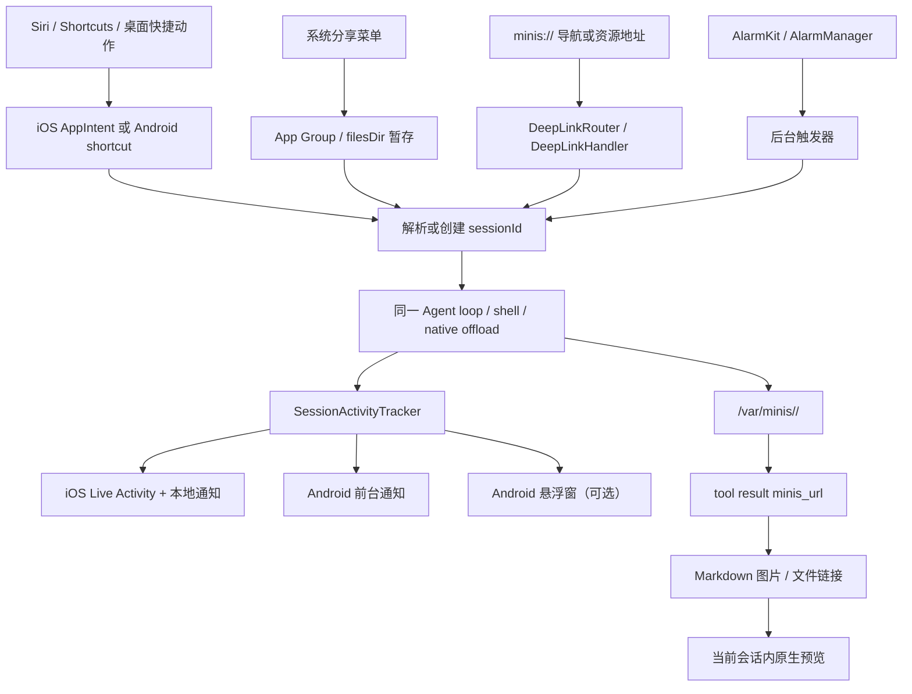

## 13. 系统集成：让 agent 长在操作系统里

### 13.1 这一章解决什么问题

一个能调用模型的聊天页还不是移动端 agent；真正可用的 agent 必须能从 Siri、快捷指令、分享菜单、通知、桌面图标和系统文件入口被唤起，也必须在用户离开页面后继续完成工具调用。OpenMinis 把这些入口汇聚到三类稳定抽象：`minis://` 资源/导航地址、可观察的会话活动状态、以及把后台工作交给操作系统的前台执行载体。iOS 组合了 App Intents、App Group、`UIApplication.beginBackgroundTask`、后台音频、位置后台活动和 Live Activity；Android 组合了前台服务、部分唤醒锁、AlarmManager、通知和可选悬浮窗。本文按“资源地址—入口—后台生命周期—结果呈现—持久化文件”的顺序拆开两端实现，并明确指出规范与当前实现不一致的地方。

本章中的“后台执行”只指 agent loop、shell、browser 或 native offload 继续运行；它不等于模型 API 的异步回调，也不等于系统承诺无限执行。引用的代码位置均以当前仓库为准；把同样的架构迁移到 macOS、Windows 或 Linux 时，应保留会话、资源作用域和可恢复状态这三个边界，再替换平台调度器与窗口表面。

### 13.2 先画出系统入口和汇合点

系统集成最容易失败的做法，是为每个入口各写一套“打开聊天、发送文本、通知完成”的流程。OpenMinis 的关键汇合点是：入口只负责产生一个动作或 `sessionId`，会话 ViewModel/Headless runner 才负责真正发送；完成事件再统一进入通知、Live Activity 或悬浮窗。



图中的“当前会话”不是 UI 选择器，而是安全边界。规范明确规定，同一个字符串 `minis://attachments/photo.png` 在两个会话中指向不同的持久目录，且 URL 本身不携带 session ID，见 `docs/specs/minis-url-scheme.md:43-71`。因此入口可以携带会话 ID，资源地址却不应该把会话 ID 拼进去。

### 13.3 `minis://`:同时给 agent、Markdown 和系统导航使用

#### 13.3.1 URL 的正式语义是 session-relative，而不是普通网络 URL

规范定义的格式只有一层 host（namespace）和相对 path：`minis://<namespace>/<path>`，path 可以继续包含子目录，见 `docs/specs/minis-url-scheme.md:20-41`。`minis://` 不是可以交给公网浏览器的 HTTP 地址，而是当前会话上下文里的不透明资源标识；agent、shell 和聊天 UI 都只看到当前会话的 `/var/minis/` 工作副本，见 `docs/specs/minis-url-scheme.md:43-64`。

规范的解析链是三段：

1. URL 到 Linux 路径：`minis://attachments/a.png` 映射为 `/var/minis/attachments/a.png`，见 `docs/specs/minis-url-scheme.md:137-148`。
2. Linux 工作副本到 host 文件：iSH/PRoot 的 `/var/minis/` 是一次只挂载一个会话的工作副本，见 `docs/specs/minis-url-scheme.md:150-180`。
3. host 文件到持久目录：会话目录是 `Library/MinisChat/minis/<sessionId>/`，切会话时按 harvest、clear、mount、meta.db register 顺序切换，见 `docs/specs/minis-url-scheme.md:166-187`。

这套语义解释了为什么 URL 不带 session ID：如果把 URL 当成跨会话全局文件地址，用户从历史会话点开链接时就会产生越权或“同名文件命中另一个会话”的风险。iOS 的媒体解析器已经针对这个问题禁用了“扫描所有 session 找第一个同名文件”的旧兜底，见 `src/ios/Views/Chat/MinisMediaViews.swift:233-243`。

#### 13.3.2 规范规定的四个资源 namespace

下表是规范的完整资源 namespace，不把 `settings`、`session` 等导航 host 混进来。路径、持久化位置和渲染语义来自 `docs/specs/minis-url-scheme.md:73-136`。

| namespace | Linux 路径 | 规范中的持久位置 | 写入者 | Markdown/预览语义 |
|---|---|---|---|---|
| `attachments` | `/var/minis/attachments/<path>` | `Library/MinisChat/minis/<sessionId>/attachments/<path>` | agent 的 `file_write`/`shell_execute`、host 的 `saveAttachment`、用户附件 | 图片、音频、视频可以内联；其余文件可链接 |
| `workspace` | `/var/minis/workspace/<path>` | `Library/MinisChat/minis/<sessionId>/workspace/<path>` | agent 的 `file_write`/`shell_execute` | 普通文件链接，不自动以内联媒体显示 |
| `offloads` | `/var/minis/offloads/<filename>` | `Library/MinisChat/minis/<sessionId>/offloads/<filename>` | host 自动保存超长工具输出 | 不内联；用 `file_read` 读取全文 |
| `browser` | `/var/minis/browser/<filename>` | `Library/MinisChat/minis/<sessionId>/browser/<filename>` | `browser_use` 截图、extract 或下载 | 图片可以内联，其他文件按链接预览 |

`offloads` 的文件名还承担可追踪性：规范要求 `<toolName>_<timestamp>_<toolIdPrefix>.txt`，并规定工具输出超过 20,000 字符时把完整结果写入该文件，见 `docs/specs/minis-url-scheme.md:114-124`。这不是把大字符串再复制一份到 UI，而是把模型上下文变成“截断预览 + 可再次读取的文件”。

#### 13.3.3 当前实现还存在全局扩展 namespace

规范的安全清单要求只接受上述四个 namespace，见 `docs/specs/minis-url-scheme.md:335-342`；但当前 iOS 代码已经支持若干全局或系统扩展：

| 实现中的 host | 作用域 | 代码证据 | 与四个正式 namespace 的关系 |
|---|---|---|---|
| `shared` | 全局共享目录，不随 session 变化 | `src/ios/Agent/Chat/AIChatViewModel+FileTools.swift:69-91`；`src/ios/Views/Chat/MinisMediaViews.swift:183-197` | prompt 也把它列为 `/var/minis/shared/`，见 `src/ios/Agent/Chat/AIChatViewModel.swift:1742-1750` |
| `memory` | 全局持久 memory | `src/ios/Views/Chat/MinisMediaViews.swift:183-197` | 非规范四 namespace 的全局扩展 |
| `skills` | 全局 Skills 文件 | `src/ios/Views/Chat/MinisMediaViews.swift:183-197` | 非规范四 namespace 的全局扩展 |
| `mcp-servers` | 全局 MCP 配置资源 | `src/ios/Agent/Chat/AIChatViewModel+FileTools.swift:77-86` | 只在 iOS direct resolver 的 host switch 中出现 |
| `mounts` | 用户授权的外部目录 | `src/ios/Views/Chat/MinisMediaViews.swift:199-230` | 属于外部挂载，不应误当 session 文件 |

因此从零实现时要先决定“规范 namespace”和“系统导航 host”是否共用 URI 语法；若共用，至少要在 parser 中区分资源解析和动作路由，并对非规范扩展做显式 allow-list。当前 iOS `DeepLinkRouter` 只处理导航 host，不处理资源 host，`src/ios/Shared/DeepLinkRouter.swift:14-45`；Android 也在 `ChatLinkResolver.resolve` 中先尝试动作，未知 `minis://` 再落到 sandbox 文件，见 `src/android/app/src/main/java/com/openminis/app/ui/chat/ChatLinkResolver.kt:30-67`。

#### 13.3.4 Linux path 与 URL 的互转：iOS 已有统一函数

iOS 的 `linuxPathToMinisURL` 只接受 `/var/minis/` 下、且至少包含 namespace 和文件路径的字符串，并对文件部分做 URL path 编码，见 `src/ios/Agent/Chat/AIChatViewModel+FileTools.swift:94-104`。

```swift
// 来源：src/ios/Agent/Chat/AIChatViewModel+FileTools.swift:94-104
func linuxPathToMinisURL(_ path: String) -> String? {
    let prefix = "/var/minis/"
    guard path.hasPrefix(prefix) else { return nil }
    let rest = String(path.dropFirst(prefix.count))
    guard let slashIdx = rest.firstIndex(of: "/") else { return nil }
    let namespace = String(rest[rest.startIndex..<slashIdx])
    let filename = String(rest[rest.index(after: slashIdx)...])
    let encoded = filename.addingPercentEncoding(withAllowedCharacters: .urlPathAllowed) ?? filename
    return "minis://\(namespace)/\(encoded)"
}
```

这段函数的非显然约束有两个。第一，中文、emoji、空格等文件名必须 percent-encode；系统 prompt 要求模型直接使用工具返回的 `minis_url`，见 `src/ios/Agent/Chat/AIChatViewModel.swift:1763-1767`。第二，函数不把 session ID 放进 URL，所以调用它的对象必须已经持有正确的 `AIChatViewModel.sessionId`，而不是从任意全局 mount 表猜测。

iOS 的直接读取 resolver 对 `memory`、`skills`、`shared` 先走全局目录，其余 host 走当前 session 目录，并且会尝试单解码和双解码候选，见 `src/ios/Agent/Chat/AIChatViewModel+FileTools.swift:69-91`。媒体层同样先用 active session，再用全局目录和 mount；它不扫描其他 session，见 `src/ios/Views/Chat/MinisMediaViews.swift:155-243`。

#### 13.3.5 工具结果：地址必须在资源产生的同一轮返回

规范的核心契约是“工具产生或修改可寻址资源时，工具结果必须带 `minis://`”，见 `docs/specs/minis-url-scheme.md:189-218`。iOS 当前实现已覆盖三个关键位置。

**文件读写。** `file_read` 在成功结果末尾追加 URL，`file_write` 在写盘和 meta.db 注册后追加 URL，见 `src/ios/Agent/Chat/AIChatViewModel+FileTools.swift:314-325`、`src/ios/Agent/Chat/AIChatViewModel+FileTools.swift:511-524`。

```swift
// 来源：src/ios/Agent/Chat/AIChatViewModel+FileTools.swift:511-524
let bytesWritten = contentData.count
let action = appendMode ? "Appended" : "Wrote"
var result = "\(action) to \(path) (\(bytesWritten) bytes)"
if let minisURL = linuxPathToMinisURL(path) {
    result += "\nminis_url: \(minisURL)"
}
return FileToolResult(output: result, success: true)
```

**shell 和 browser。** iOS 在 shell 结果中枚举 new/modified 文件并追加 URL，见 `src/ios/Agent/Chat/AIChatViewModel+ConcurrentTools.swift:387-390`；browser 截图和下载保存到 browser 持久目录后分别追加 URL，见 `src/ios/Agent/Chat/AIChatViewModel+ConcurrentTools.swift:495-527`。

**超长输出。** iOS 的 `offloadToolOutput` 用 session 持久目录生成标准文件名，见 `src/ios/Agent/Chat/AIChatViewModel+RequestBudget.swift:339-360`；工具循环截断时同时输出 Linux path、`minis_url` 和 `file_read` 指引，见 `src/ios/Agent/Chat/AIChatViewModel+ConcurrentTools.swift:738-758`。

```swift
// 来源：src/ios/Agent/Chat/AIChatViewModel+ConcurrentTools.swift:743-758
let offloadResult = offloadToolOutput(toolOutput, toolName: tu.name, toolId: tu.id)
let offloadMinisURL = linuxPathToMinisURL(offloadResult.linuxPath)
finalOutput = truncatedBody
    + "\n\n[OUTPUT TRUNCATED] Full output (\(toolOutput.count) chars) saved to: \(offloadResult.linuxPath)"
    + (offloadMinisURL.map { "\nminis_url: \($0)" } ?? "")
    + "\nUse file_read tool to read the complete output."
```

**Android 的一致处与缺口。** Android 的 `browser_use` 确实把截图写入 `/var/minis/browser/` 并返回 `minis_url`，下载文件返回 `fetched_minis_url`，见 `src/android/app/src/main/java/com/openminis/app/sandbox/offload/BrowserUseOffloadHandler.kt:245-295`。`read_image` 接受 `minis://` 输入并转成 `/var/minis/`，见 `src/android/app/src/main/java/com/openminis/app/tools/ReadImageTool.kt:41-60`。

但 Android `FileWriteTool.execute` 的成功结果只返回 `Wrote to $path ($bytes bytes)`，没有像 iOS 那样追加 `minis_url`，见 `src/android/app/src/main/java/com/openminis/app/tools/FileWriteTool.kt:78-108`。Android 的仓库搜索也没有在 `file_read` 结果路径发现规范要求的 `minis_url` 字段；因此这是当前实现相对于 `docs/specs/minis-url-scheme.md:200-218` 和 §9 checklist 的可验证缺口，而不是文档应忽略的细节。[推断] 如果模型在 Android 上写入 workspace 后要生成 Markdown 链接，当前 prompt 只能让它自行构造 URL，可靠性低于 iOS。

#### 13.3.6 Markdown 渲染：资源 URL 和动作 URL 必须分流

iOS 的 `resolveMinisFileURL` 把当前 session 的 `minis://attachments/...`、`workspace/...` 等映射到 host 文件，并按扩展名决定图片、音频、视频、Markdown、文本、HTML、PDF 或通用分享预览，见 `src/ios/Views/Chat/MinisMediaViews.swift:155-243` 和 `src/ios/Views/Chat/AIChatView.swift:2703-2764`。

```swift
// 来源：src/ios/Views/Chat/AIChatView.swift:2703-2754
private func handleMinisURLTap(_ url: URL) -> OpenURLAction.Result {
    if let scheme = url.scheme?.lowercased(), scheme == "http" || scheme == "https" {
        withAnimation { safariURL = url }
        return .handled
    }
    guard url.scheme == "minis" else { return .systemAction }
    if url.host == "open_terminal" {
        let comps = URLComponents(url: url, resolvingAgainstBaseURL: false)
        let initCmd = comps?.queryItems?.first(where: { $0.name == "init_command" })?.value
        let dl = DeepLinkCoordinator.shared
        dl.terminalInitCommand = initCmd
        dl.showTerminal = true
        return .handled
    }
    if url.host == "views" && url.path == "/alarm" {
        DeepLinkCoordinator.shared.showAlarmList = true
        return .handled
    }
    if url.host == "settings" {
        DeepLinkRouter.handle(url: url, shareCoordinator: shareCoordinator)
        return .handled
    }
if let fileURL = resolveMinisFileURL(url: url) {
    let ext = url.pathExtension.lowercased()
    withAnimation {
        if minisImageExtensions.contains(ext) { previewImageFile = fileURL }
        else if minisVideoExtensions.contains(ext) { previewVideoFile = fileURL }
        else if minisAudioExtensions.contains(ext) { previewAudioFile = fileURL }
        else if minisMarkdownExtensions.contains(ext) { previewMarkdownFile = fileURL }
        else if minisTextExtensions.contains(ext) { previewTextFile = fileURL }
        else if minisHTMLExtensions.contains(ext) { previewHTMLFile = fileURL }
        else if minisDocumentExtensions.contains(ext) { previewDocumentFile = fileURL }
        else { shareFile = fileURL }
    }
} else {
    let name = url.lastPathComponent.removingPercentEncoding ?? url.lastPathComponent
    missingMinisFileName = name.isEmpty ? url.absoluteString : name
    return .handled
}
```

代码片段中的注释分支对应真实实现：`open_terminal` 和 `views/alarm` 是导航动作，`settings` 进入 `DeepLinkRouter`，其它可解析 host 才是文件资源，完整分支见 `src/ios/Views/Chat/AIChatView.swift:2708-2764`。图片 tile 还按文件大小和 mtime 生成缓存 key，避免同一路径被 agent 覆盖后仍显示旧图，见 `src/ios/Views/Chat/MinisMediaViews.swift:344-362`。

Android 的 Markdown 图片由 Coil `MinisImageFetcher` 处理：去掉 query、percent-decode、拼接 `/var/minis/`，再交给 `PRootKernel.resolveHostPath`，见 `src/android/app/src/main/java/com/openminis/app/ui/MinisImageFetcher.kt:16-51`。链接点击由 `ChatLinkResolver` 先调用 `DeepLinkHandler.parse`，未知动作才解析成 sandbox 文件，见 `src/android/app/src/main/java/com/openminis/app/ui/chat/ChatLinkResolver.kt:37-67`。这实现了同一原则：`minis://settings/...` 不应被当作丢失的文件，`minis://workspace/...` 才进入文件预览。

Android browser WebView 也把 minis 资源当本地子资源服务；`BrowserUseManager.interceptMinisURL` 将 host/path 映射为 `/var/minis/$host$path`，返回 MIME 和文件流，见 `src/android/app/src/main/java/com/openminis/app/browser/BrowserUseManager.kt:386-427`。因此 agent 生成多文件 HTML 时，HTML、JS、CSS、图片可以共享同一个 minis 资源命名空间；Android tool definition 也把这一点写入 prompt，见 `src/android/app/src/main/java/com/openminis/app/tools/AgentTools.kt:55-70`。

#### 13.3.7 导航 deep link：同一 scheme 的另一张表

资源 namespace 与导航 host 的区别可以用下表固定下来。iOS 路由清单来自 `src/ios/Shared/DeepLinkRouter.swift:18-40`，Android 解析器的相同 route 表来自 `src/android/app/src/main/java/com/openminis/app/deeplink/DeepLinkHandler.kt:6-45` 和 `src/android/app/src/main/java/com/openminis/app/deeplink/DeepLinkHandler.kt:99-143`。

| URL | 语义 | iOS 落点 | Android 落点 |
|---|---|---|---|
| `minis://share` | 打开待注入分享 | `DeepLinkRouter.handle` 调 `ShareCoordinator.raisePendingShare`，见 `src/ios/Shared/DeepLinkRouter.swift:47-60` | `DeepLinkAction.OpenShare`，见 `src/android/app/src/main/java/com/openminis/app/deeplink/DeepLinkHandler.kt:105-107` |
| `minis://views/alarm` | 查看系统闹钟 | `DeepLinkCoordinator.showAlarmList`，见 `src/ios/Shared/DeepLinkRouter.swift:62-66` | `AlarmClock.ACTION_SHOW_ALARMS`，见 `src/android/app/src/main/java/com/openminis/app/MainActivity.kt:607-619` |
| `minis://open_terminal?init_command=...` | 打开终端并传初始命令 | `DeepLinkCoordinator.terminalInitCommand/showTerminal`，见 `src/ios/Shared/DeepLinkRouter.swift:68-71` | `DeepLinkAction.OpenTerminal`，见 `src/android/app/src/main/java/com/openminis/app/deeplink/DeepLinkHandler.kt:111-113` |
| `minis://session/<id>` | 打开一个会话 | 发布 `.openSessionFromIntent`，见 `src/ios/Shared/DeepLinkRouter.swift:76-91` | `Routes.chat(sessionId)`，见 `src/android/app/src/main/java/com/openminis/app/MainActivity.kt:547-567` |
| `minis://sessions/<id>` | canonical 会话别名 | iOS 与 singular route 共用，见 `src/ios/Shared/DeepLinkRouter.swift:76-91` | 当前 `DeepLinkHandler` 主要解析 `session`，通知和 runner 使用 singular 形式，见 `src/android/app/src/main/java/com/openminis/app/scheduled/ScheduledAgentRunner.kt:256-264` |
| `minis://settings/...` | 设置导航 | `SettingsDeepLinkTarget` 与 `DeepLinkCoordinator`，见 `src/ios/Shared/DeepLinkCoordinator.swift:7-29` | `Routes` 字符串路由，见 `src/android/app/src/main/java/com/openminis/app/deeplink/DeepLinkHandler.kt:161-225` |
| `minis://action/new_chat` / `voice_chat` / `camera_chat` | 桌面长按动作 | `UIApplicationShortcutItem` + `QuickActionWorkflow`，见 `src/ios/Shared/QuickActionRouter.swift:48-112` | 静态 `shortcuts.xml` + `DeepLinkAction`，见 `src/android/app/src/main/res/xml/shortcuts.xml:8-48`、`src/android/app/src/main/java/com/openminis/app/deeplink/DeepLinkHandler.kt:114-122` |
| `minis://open?session=...&path=...` | WebApp launcher 回跳 | `handleWebAppLauncherReturn`，见 `src/ios/Shared/DeepLinkRouter.swift:73-75` | 当前 WebApp 主要由显式 `ACTION_OPEN_WEBAPP` intent 启动，见 `src/android/app/src/main/AndroidManifest.xml:340-358` |

`DeepLinkCoordinator` 只保存“一次性待处理副作用”，例如 Android 的 `pendingChatAction` 被 ChatScreen 消费一次，见 `src/android/app/src/main/java/com/openminis/app/deeplink/DeepLinkCoordinator.kt:64-86`；iOS 的设置焦点、终端和目标 session 也都是发布属性，见 `src/ios/Shared/DeepLinkCoordinator.swift:47-75`。这种 coordinator 让 cold start、warm start 和导航重建都能复用同一个动作，而不是依赖一次可能早于 UI 订阅建立的 NotificationCenter 事件。

### 13.4 App Intents、Shortcuts 与 Android 的入口对照

#### 13.4.1 iOS intent 清单：参数和返回值是公共 API

以下清单对应当前 `src/ios/Agent/Intents/` 的实际类型；“返回”是 App Intents 类型签名，不是注释推测。

| Intent | `openAppWhenRun` | 参数 | 返回/行为 | 代码位置 |
|---|---:|---|---|---|
| `AskMinisIntent` | `true` | `prompt: String`；`session: SessionEntity?` | 只返回 dialog，打开 app 并发布 `.openSessionFromIntent` | `src/ios/Agent/Intents/AskMinisIntent.swift:14-29`、`src/ios/Agent/Intents/AskMinisIntent.swift:73-91` |
| `QuickTaskIntent` | `false` | `task: QuickTask`；`files: [IntentFile]?`；`model: ModelSelectionEntity?`；`waitForResult: Bool = false` | `ReturnsValue<SendPromptResult>`；Running 或 Completed | `src/ios/Agent/Intents/QuickTaskIntent.swift:52-70`、`src/ios/Agent/Intents/QuickTaskIntent.swift:179-239` |
| `SendPromptIntent` | `false` | `prompt`；`files`；`session: SessionEntity?`；`model: ModelSelectionEntity?`；`waitForResult` | `ReturnsValue<SendPromptResult>`；默认立即返回 Running | `src/ios/Agent/Intents/SendPromptIntent.swift:8-31`、`src/ios/Agent/Intents/SendPromptIntent.swift:161-220` |
| `FollowUpSessionIntent` | `false` | `session: SessionEntity`；`prompt`；`files`；`waitForResult` | `ReturnsValue<SendPromptResult>`；`isNewSession=false` | `src/ios/Agent/Intents/FollowUpSessionIntent.swift:7-28`、`src/ios/Agent/Intents/FollowUpSessionIntent.swift:112-176` |
| `RetryRunIntent` | `false` | `session`；`message: UserMessageEntity?`；替换附件 `files`；`waitForResult` | 从选定 user message 重跑，返回 `SendPromptResult` | `src/ios/Agent/Intents/RetryRunIntent.swift:7-28`、`src/ios/Agent/Intents/RetryRunIntent.swift:103-142`、`src/ios/Agent/Intents/RetryRunIntent.swift:169-227` |
| `OpenSessionIntent` | `true` | `session: SessionEntity` | 发布 `.openSessionFromIntent`，返回空 result | `src/ios/Agent/Intents/OpenSessionIntent.swift:4-21` |
| `ListSessionsIntent` | `false` | 无 | `ReturnsValue<String>`，每行 title、相对时间和 ID | `src/ios/Agent/Intents/ListSessionsIntent.swift:4-27` |
| `GetSessionStatusIntent` | `false` | `sessionID: String` | `ReturnsValue<SessionStatus>`，运行态、最后消息、最后工具等 | `src/ios/Agent/Intents/GetSessionStatusIntent.swift:58-126` |

`QuickTask` 不是自由文本，而是八个固定枚举：睡眠分析、健康报告、天气、早间简报、日历、拍照、闹钟和 HomeKit，提示词映射见 `src/ios/Agent/Intents/QuickTaskIntent.swift:7-49`。这让 Siri 可以在一次选择里表达任务，但代价是新任务必须新增枚举和本地化文本，而不是让模型解释任意自然语言。

`SessionEntity` 只暴露 `id`、显示名和 model ID，并从 `ChatStore` 建议最多 100 个 session，见 `src/ios/Agent/Intents/SessionEntity.swift:4-45`。`ModelSelectionEntity` 同时支持 model group 和具体 model entry，group 会解析第一个 member 作为初始 entry，见 `src/ios/Agent/Intents/ModelSelectionEntity.swift:6-57`。

结构化结果 `SendPromptResult` 的字段是 `sessionId`、`modelName`、`status`、`isNewSession`、`prompt`、`responseText`，见 `src/ios/Agent/Intents/SendPromptResult.swift:4-44`。`SessionStatus` 额外提供 `title`、`isRunning`、`lastMessage`、`lastTool`、`updatedAt`，见 `src/ios/Agent/Intents/GetSessionStatusIntent.swift:4-49`。

#### 13.4.2 `waitForResult` 如何同时支持同步和异步 automation

`SendPromptIntent` 的 perform 先把 `vm.send()` 发出去；如果 `waitForResult` 为真，就观察 `vm.$isProcessing` 直到 false，返回完整 response，否则立即返回 Running，并在另一个 `Task` 中等待完成后发通知，见 `src/ios/Agent/Intents/SendPromptIntent.swift:130-220`。

```swift
// 来源：src/ios/Agent/Intents/SendPromptIntent.swift:130-187
vm.inputText = prompt
vm.send()

if waitForResult {
    for await processing in vm.$isProcessing.values {
        if !processing { break }
    }
    let responseText = Self.extractResponseText(from: vm)
    let result = SendPromptResult(
        sessionId: sid, modelName: modelName, status: "Completed",
        isNewSession: isNewSession, prompt: prompt, responseText: responseText
    )
    return .result(value: result, dialog: "\(responseText.prefix(500))")
}

let result = SendPromptResult(
    sessionId: sid, modelName: modelName, status: "Running",
    isNewSession: isNewSession, prompt: prompt
)
return .result(value: result, dialog: "Task started with \(modelName). I'll notify you when it's done.")
```

这不是把后台任务“伪装成已完成”：Shortcuts 的下一步若需要答案就必须显式选择等待，若选择异步就应把 `sessionId` 传给 `GetSessionStatusIntent` 或等待本地通知。iOS system prompt 对同一事实也有约束：没有 scheduler 时，当前 turn 结束后不会自动继续 polling，见 `src/ios/Agent/Chat/AIChatViewModel.swift:1727-1732`。

App Shortcuts provider 将 Ask、QuickTask、SendPrompt、GetStatus、ListSessions、FollowUp、OpenSession 注册为 Siri/Spotlight 可发现动作，见 `src/ios/Agent/Intents/MinisShortcutsProvider.swift:13-89`。`RetryRunIntent` 刻意不注册到 `appShortcuts`，因为其 `@IntentParameterDependency` 会在 iOS 16 触发 launch crash，但仍可在 Shortcuts 的 All Actions 找到，见 `src/ios/Agent/Intents/MinisShortcutsProvider.swift:78-81`。

`AskMinisIntent` 和普通 `SendPromptIntent` 不走第二套 agent 逻辑：它们都取 `ViewModelCache` 中的 VM、设置 `inputText`、调用 `vm.send()`；Ask 额外将 app 打开并发布 `.openSessionFromIntent`，见 `src/ios/Agent/Intents/AskMinisIntent.swift:48-91`。这正是“系统入口薄、agent loop 厚”的边界。

#### 13.4.3 Android 对应能力：有入口和调度，但没有 App Intent 类型系统

Android 当前公开的系统入口是三项 app-icon long-press shortcut：new chat、voice chat、camera chat，XML 每项都以 `minis://action/<name>` 启动 `MainActivity`，见 `src/android/app/src/main/res/xml/shortcuts.xml:3-48`。`DeepLinkHandler` 将其转换成 `NewChat`、`NewVoiceChat`、`NewCameraChat`，`MainActivity.handleDeepLink` 再把 voice/camera 待动作放进 `DeepLinkCoordinator`，见 `src/android/app/src/main/java/com/openminis/app/deeplink/DeepLinkHandler.kt:55-68`、`src/android/app/src/main/java/com/openminis/app/MainActivity.kt:587-606`。

Android 没有与 `AskMinisIntent`、`SendPromptResult` 对等的 App Intents/App Actions 声明；仓库可验证的 assistant-like surface 是上述静态 shortcuts XML，而不是一个可被 Siri/Google Assistant 直接填充参数的 Intent schema。因此不要把 Android shortcut 描述成 iOS Siri action 的等价物；若要实现等价能力，需要另建 Android App Actions/Assistant schema，并把参数映射到同一个 Headless runner。[推断]

Android 的真正对等抽象出现在 scheduled target mode：`NEW_SESSION` 相当于无 session 的 SendPrompt，`APPEND_TO` 相当于 FollowUp，`RERUN` 相当于 RetryRun，见 `src/android/app/src/main/java/com/openminis/app/scheduled/ScheduledTask.kt:36-72`。这是“产品行为对等”，不是“系统 API 对等”。

### 13.5 后台执行：在有限时间预算里让 agent 活着

#### 13.5.1 先纠正 iOS 的“BGTask”称呼

当前 iOS agent loop 使用的是 `UIApplication.beginBackgroundTask(withName:)`，不是 `BGTaskScheduler` 的 `BGProcessingTaskRequest`。`beginBackgroundProcessing` 保存一个 `UIBackgroundTaskIdentifier`，设置 expiry handler，并在结束时调用 `endBackgroundProcessing`，见 `src/ios/Agent/Chat/AIChatViewModel+BackgroundTask.swift:10-83`、`src/ios/Agent/Chat/AIChatViewModel+BackgroundTask.swift:85-117`。

```swift
// 来源：src/ios/Agent/Chat/AIChatViewModel+BackgroundTask.swift:12-51
func beginBackgroundProcessing() {
    guard backgroundTaskID == .invalid else { return }
    backgroundTaskID = UIApplication.shared.beginBackgroundTask(withName: "AgentLoop") { [weak self] in
        guard let self else { return }
        if BackgroundKeepAliveManager.shared.enhancedBackgroundEffective {
            let expiringId = self.backgroundTaskID
            self.backgroundTaskID = .invalid
            if expiringId != .invalid {
                UIApplication.shared.endBackgroundTask(expiringId)
            }
            self.beginBackgroundProcessing()
            return
        }
        self.backgroundSuspended = true
        self.stopCurrentCommand()
        self.endBackgroundProcessing()
    }
    startBackgroundStatusTimer()
}
```

仓库的 `Info.plist` 确实声明了 `BGTaskSchedulerPermittedIdentifiers`，但当前源码搜索不到 `BGTaskScheduler.shared.register`、`BGProcessingTask` 或 `BGAppRefreshTask` 的注册/提交，只有 `com.openminis.app.liveactivity-refresh` 这个 identifier，见 `src/ios/Info.plist:33-47` 和 `src/ios/Agent/Chat/AIChatViewModel+BackgroundTask.swift:10-83`。[已核实搜索结果] 因此本章不能把它写成“系统会在任意时间重新唤醒 agent 的 BGProcessing 任务”。现状是：前台触发的 agent loop 通过有限 `UIApplication` 背景窗口运行；若用户开启增强后台，再由音频/位置腿维持进程。

普通 iOS app 的标准短窗口在 `BackgroundSurvivalTier.short` 的注释中记为约 30 秒，见 `src/ios/Agent/Background/BackgroundKeepAliveManager.swift:18-45`。这不是可精确依赖的 SLA；代码每次都记录 `UIApplication.shared.backgroundTimeRemaining`，见 `src/ios/Agent/Background/BackgroundKeepAliveManager.swift:273-282`。

#### 13.5.2 iOS 的三条保活腿是互补关系

`BackgroundKeepAliveManager` 的有效条件是 `enhancedBackgroundEnabled && backgroundSpeakEnabled`，仅打开 master switch 不代表后台保活生效，见 `src/ios/Agent/Background/BackgroundKeepAliveManager.swift:88-101`。它把以下机制组合起来：

| 机制 | 触发条件和实现 | 可观察时间/频率 | 解决的问题 | 证据 |
|---|---|---|---|---|
| `UIApplication` finite background task | 每轮 agent loop 调 `beginBackgroundProcessing`; expiry 时重启 finite task 或暂停 shell | 系统给出动态 `backgroundTimeRemaining`；代码在剩余 `<15s` 时升级日志 | 让刚离开前台的当前调用有收尾窗口 | `src/ios/Agent/Chat/AIChatViewModel+BackgroundTask.swift:12-81`、`:204-231` |
| 后台静音音频 | active session + app background + Background Speak 开启时，创建 1 秒零填充 buffer 循环播放；音频中断时重试最多 3 次、间隔 0.5s | 音频腿持续期间由系统音频后台模式托住进程；没有代码承诺固定上限 | 防止 finite background task 到期直接杀掉长 shell/网络等待 | `src/ios/Agent/Background/BackgroundKeepAliveManager.swift:1071-1237`、`src/ios/Info.plist:37-43` |
| 后台位置/`CLBackgroundActivitySession` | enhanced + 权限 + background + 延迟 15s 后才 arm；位置请求间隔 5s；iOS 17 用 `CLLocationUpdate.liveUpdates` | 5s 请求、5s Live Activity 最小更新间隔；离开后台或任务结束即 teardown | 在用户显式授权后给长任务一个系统认可的后台活动通道 | `src/ios/Agent/Background/BackgroundKeepAliveManager.swift:930-1025` |
| Live Activity | 任务开始/更新/结束都由单例 Activity manager 管理；前台 timer 和音频/位置 callback 驱动更新 | 前台/音频更新 timer 10s；结束采用 soft-finish，回前台再 dismiss | 在锁屏/灵动岛显示工具和完成态，不负责替代 agent loop | `src/ios/Agent/Background/BackgroundKeepAliveManager.swift:1339-1468` |

增强后台开启时，finite task expiry handler 不取消 shell，而是结束旧 finite ID 再重新 begin；未开启时才停止当前命令并记录 interruption，见 `src/ios/Agent/Chat/AIChatViewModel+BackgroundTask.swift:24-80`。这一区分很重要：`UIApplication` 背景任务的时钟到点，并不等于音频保活腿已经失效。

后台音频实现不是“播放用户声音”而是 44.1kHz、1 秒、零填充的 `AVAudioPCMBuffer`，音量设为 0.001，见 `src/ios/Agent/Background/BackgroundKeepAliveManager.swift:1207-1237`。媒体附件或 TTS 播放时，它会用 suspend counter 暂停静音音频，所有调用者 resume 后才重新评估，见 `src/ios/Agent/Background/BackgroundKeepAliveManager.swift:285-309`；这避免静音引擎抢占真正的朗读/播放音频。

位置腿不会一进后台就显示定位状态。代码先在后台等待 15 秒，再在任务仍活动且用户给过权限时创建一次全局 `CLBackgroundActivitySession`，见 `src/ios/Agent/Background/BackgroundKeepAliveManager.swift:962-1025`。任务结束时先停位置，再 soft-finish Live Activity；App 被强杀后冷启动还会 retract orphaned session，见 `src/ios/Agent/Background/BackgroundKeepAliveManager.swift:625-647`、`:1041-1067`。

#### 13.5.3 Shortcuts 唤醒要在第一个 await 之前 arm

App Intent 被系统唤起时，进程可能在 VM 建立、SQLite 读写和第一个 `await` 之间被挂起。`SendPromptIntent` 因此在 `perform()` 顶部用临时 session ID（新会话）或真实 ID（旧会话）调用 `armEagerlyForShortcut`，创建真实 session 后再交换 placeholder，见 `src/ios/Agent/Intents/SendPromptIntent.swift:30-111`。

```swift
// 来源：src/ios/Agent/Background/BackgroundKeepAliveManager.swift:1273-1309
@discardableResult
func armEagerlyForShortcut(sessionId: String, caller: String)
    -> (armed: Bool, skipReason: String?) {
    guard enhancedBackgroundEnabled && backgroundSpeakEnabled else {
        return (false, "background keep-alive disabled")
    }
    SessionActivityTracker.shared.setActive(sessionId, source: "\(caller).eager")
    evaluateSilentAudio(caller: "\(caller).eager")
    return (true, nil)
}
```

这段机制只在用户显式开启两项后台设置时生效，代码明确拒绝在用户未同意时悄悄启动后台音频，见 `src/ios/Agent/Background/BackgroundKeepAliveManager.swift:1282-1308`。`QuickTaskIntent`、`FollowUpSessionIntent` 和 `RetryRunIntent` 复用同一 eager arm，而不是各自实现一套保活，见 `src/ios/Agent/Intents/QuickTaskIntent.swift:72-125`、`src/ios/Agent/Intents/FollowUpSessionIntent.swift:28-55`、`src/ios/Agent/Intents/RetryRunIntent.swift:28-51`。

#### 13.5.4 Live Activity 是状态投影，不是后台执行器

`AgentActivityAttributes.ContentState` 保存活动 session 数、每个 session 的标题、当前 tool icon/status、loop iteration、完成态、最后消息、音频状态和隐私模式，见 `src/ios/Shared/AgentActivityAttributes.swift:4-79`。属性中的 `startDate` 由 WidgetKit 渲染实时计时器；完成态另存 `finishedAt`，避免完成后计时器继续增长。

`BackgroundKeepAliveManager.reevaluate` 以 `SessionActivityTracker.activeSessions` 的非空状态为事实源：激活时 start Activity、启动 timer、评估位置和音频；全部结束时先停 location，再把 Live Activity 翻成 completed resting state，见 `src/ios/Agent/Background/BackgroundKeepAliveManager.swift:690-740`。

Widget 在 Dynamic Island expanded 区展示 soul 名、活动 session 数、当前 session 的 title/tool status/loop；completed 时改成 checkmark、最后消息和静态总耗时，见 `src/ios/AgentWidget/AgentLiveActivityWidget.swift:8-163`。iOS 17 才把音频开关渲染为 `Button(intent:)`，iOS 16 退化为只读 glyph，见 `src/ios/AgentWidget/AgentLiveActivityWidget.swift:166-207`。

隐私模式不是把 Activity 整体关掉，而是让 manager 在 push 前将标题、工具状态、工具图标和最后消息脱敏为中性进度状态，设置和字段定义见 `src/ios/Agent/Background/BackgroundKeepAliveManager.swift:113-127`、`src/ios/Shared/AgentActivityAttributes.swift:70-78`。这解决了“用户开启通知但不想在锁屏泄露 prompt/工具名”的冲突。

#### 13.5.5 Android 前台服务是执行锚点

Android 在 manifest 中声明 `FOREGROUND_SERVICE`、`FOREGROUND_SERVICE_MEDIA_PLAYBACK`、`WAKE_LOCK`、通知、精确闹钟和电池优化请求等权限，见 `src/android/app/src/main/AndroidManifest.xml:10-46`；`AgentForegroundService` 的类型设置为 `mediaPlayback`，见 `src/android/app/src/main/AndroidManifest.xml:434-441`。

服务启动时立即 `startForeground`，Android Q 及以上指定 `FOREGROUND_SERVICE_TYPE_MEDIA_PLAYBACK`，返回 `START_STICKY`，见 `src/android/app/src/main/java/com/openminis/app/service/AgentForegroundService.kt:195-210`。manifest 注释记录了一个具体工程约束：Android 14+ 的 `dataSync` 类型有 6h/24h 累计上限，长 shell 会触发异常，所以本项目改成 `mediaPlayback`；该做法是当前 sideload 包的运行策略，不等价于 Play Store 审核许可，见 `src/android/app/src/main/AndroidManifest.xml:12-20`。

服务还持有 `PARTIAL_WAKE_LOCK`，无超时但只在服务生命周期内存在，在 `onDestroy` 释放，见 `src/android/app/src/main/java/com/openminis/app/service/AgentForegroundService.kt:82-94`、`:556-587`。它解决的是屏幕熄灭后 Doze/OEM ROM 降低 CPU 使 shell 卡住，而不是绕过网络或系统后台限制。

前台通知显示 session 数、tool label、状态和 elapsed time；工具运行中显示 indeterminate progress，通知带 Stop action，见 `src/android/app/src/main/java/com/openminis/app/service/AgentForegroundService.kt:663-771`。用户点 Stop 不只移除通知，还调用 `SessionActivityTracker.cancelAllActiveStreams()`，见 `src/android/app/src/main/java/com/openminis/app/service/AgentForegroundService.kt:182-192`。

`onTaskRemoved` 在用户从最近任务划掉 Activity 后重新发出前台通知；只有 `activeSessions` 非空才保持 service，见 `src/android/app/src/main/java/com/openminis/app/service/AgentForegroundService.kt:215-257`。这把“UI 被关闭”和“agent loop 被取消”区分开，防止用户以为 Stop 和 swipe 是同一个动作。

#### 13.5.6 Android 的 Doze 白名单和 OEM 设置是用户协作

`PowerOptimizationManager.isIgnoringBatteryOptimizations` 查询系统 Doze exemption，且 UI 可通过 `ACTION_REQUEST_IGNORE_BATTERY_OPTIMIZATIONS` 或系统列表页引导用户授权，见 `src/android/app/src/main/java/com/openminis/app/power/PowerOptimizationManager.kt:14-79`。代码还针对 Xiaomi、Huawei、OPPO、Vivo、Samsung 选择 OEM 自启动设置页，见 `src/android/app/src/main/java/com/openminis/app/power/PowerOptimizationManager.kt:82-173`。

这说明 Android 的“前台服务可无限运行”不是充分条件：服务、唤醒锁、Doze exemption、OEM autostart 和通知权限是五个不同开关。代码注释明确说 stock Android 13+ 中前台服务单独也不保证不进入 App Standby/Doze，见 `src/android/app/src/main/java/com/openminis/app/power/PowerOptimizationManager.kt:19-33`。

#### 13.5.7 Android 悬浮窗与通知是两层呈现，不重复显示

`ToolOverlayController` 使用 `TYPE_APPLICATION_OVERLAY`，要求 `SYSTEM_ALERT_WINDOW`；服务只在 app 后台、toggle 开启、权限存在且 stream/tool 忙时显示，见 `src/android/app/src/main/java/com/openminis/app/service/ToolOverlayController.kt:35-59`、`:142-179`。

服务的 `applyOverlayState` 先判断 Android 16 promoted notification 是否启用；若启用就隐藏 overlay，避免同一任务同时出现通知 chip 和悬浮胶囊，见 `src/android/app/src/main/java/com/openminis/app/service/AgentForegroundService.kt:383-419`。没有 promoted notification 时，overlay 的显示条件是 `enabled && hasPerm && !isForeground && !cameraSuppress && (isBusy || hasCompletionPending)`，见 `src/android/app/src/main/java/com/openminis/app/service/AgentForegroundService.kt:420-477`。

悬浮窗点击会构造 `minis://session/<id>` 回到原会话；没有 session ID 时只把 MainActivity 拉到前台，见 `src/android/app/src/main/java/com/openminis/app/service/ToolOverlayController.kt:123-136`、`:648-683`。完成态的 linger 只由一次 background busy→idle 边沿触发，用户点开或点 X 后清除，避免每次重新进入桌面都重新弹出旧结果，见 `src/android/app/src/main/java/com/openminis/app/service/AgentForegroundService.kt:423-437`。

#### 13.5.8 两端时间预算和实际可保证程度

| 阶段 | iOS | Android | 工程含义 |
|---|---|---|---|
| 刚进入后台 | 标准 `UIApplication` grace 约 30s（注释值），实际以 `backgroundTimeRemaining` 为准 | FGS 启动必须在系统规定的前台 deadline 内调用 `startForeground`；safe-mode 注释按 5s 处理 | 入口必须先快速建立后台锚点，再做 SQLite、rootfs 或模型网络初始化 |
| 长任务 | 无用户授权时 finite task 到期就暂停/停止当前 command；开启 Background Speak 后静音音频腿继续托住进程 | FGS + `PARTIAL_WAKE_LOCK`；manifest 选择 mediaPlayback 规避 dataSync 6h 累计上限 | 两端都不应把“某一次 API 请求”写成无限 promise |
| 额外后台腿 | location 15s 后 arm、5s request；Live Activity 更新频率 10s | Doze exemption 和 OEM autostart 由用户在设置授权；没有 WorkManager 代码 | 权限和电量策略必须显示给用户，不应静默失败 |
| 定时任务 | 当前没有 BGTaskScheduler agent runner；系统 prompt 指向 Apple Shortcuts automation | `AlarmManager.setExactAndAllowWhileIdle`；触发后 runner ceiling 10min，见 `ScheduledAgentRunner.RUN_TIMEOUT_MS` | “按时唤起一次”与“长时间运行一轮”是两个预算 |
| 完成通知 | 仅在后台且开关开启时发本地通知，内容可被 privacy mode 脱敏 | `BackgroundTaskNotifier` 在 active→inactive 且 app 不在前台时通知；无 responseSummary，点通知进入会话 | 通知是结果入口，不是结果存储 |

Android 的 `RUN_TIMEOUT_MS = 10 * 60 * 1000L` 是 scheduled runner 的业务 ceiling，见 `src/android/app/src/main/java/com/openminis/app/scheduled/ScheduledAgentRunner.kt:31-61`；它不代表普通聊天 FGS 只有十分钟。iOS 的 4 分钟 `CacheKeepAliveManager` timer 只是 Anthropic prompt cache 的 warmup，最多两次，约覆盖 13 分钟 idle cache，见 `src/ios/Agent/Background/CacheKeepAliveManager.swift:6-13`、`:25-45`，不能算 app 后台执行预算。

### 13.6 Live Activity、前台通知和完成结果

#### 13.6.1 iOS 的完成态是“软结束”

普通 `endActivity()` 会用空 state 立即结束所有系统 Activity；而 agent 全部结束时，`finishActivity` 把每个 session 标记 `isCompleted=true`，留下 checkmark、最后消息和 `finishedAt`，等用户回到前台再 dismiss，见 `src/ios/Agent/Background/AgentLiveActivityManager.swift:154-191`、`:910-989`。

多 session 时不能“一条结束就整个卡片消失”。`markSessionCompleted(sessionId:lastMessage:)` 只替换对应 snapshot，其余 session 继续工作，见 `src/ios/Agent/Background/AgentLiveActivityManager.swift:141-148`、`:604-629`。这也是 `SessionActivityTracker` 采用 Set 和每 session tool info 的原因：完成状态与活动数量不是同一个字段。

本地通知在 `endBackgroundProcessing` 中等待 Live Activity 先完成态更新，再发通知，见 `src/ios/Agent/Chat/AIChatViewModel+BackgroundTask.swift:119-196`。后台通知默认携带 session title 和最多 200 字 response summary；privacy mode 则退化为“1 task completed · duration”，见 `src/ios/Agent/Background/BackgroundKeepAliveManager.swift:771-813`。

#### 13.6.2 Android 的前台通知是持续状态，完成通知是独立频道

`AgentForegroundService` 的 `agent_status` channel 设为 `IMPORTANCE_LOW`，避免每个 tool 都响铃，见 `src/android/app/src/main/java/com/openminis/app/service/AgentForegroundService.kt:590-615`；`BackgroundTaskNotifier` 另用完成频道和默认重要性，见 `src/android/app/src/main/java/com/openminis/app/notification/BackgroundTaskNotifier.kt:167-180`。

完成通知不从 `parts_json` 强行抽取模型回复，而是只放 title/body 并把 `minis://session/<id>` 放进 PendingIntent，见 `src/android/app/src/main/java/com/openminis/app/notification/BackgroundTaskNotifier.kt:22-47`、`:91-127`。这是 Android 与 iOS 的一个有意识差异：iOS 已在结束路径里构造 plain-text summary，Android 直接打开聊天避免对结构化消息做脆弱解析。

### 13.7 Share Sheet：把外部内容变成一次性会话输入

#### 13.7.1 iOS Share Extension 的传输协议

iOS Share Extension 与主 app 不能直接共享内存，使用 App Group `group.com.openminis.app`：JSON 放在 shared `UserDefaults` 的 `pendingShare` key，二进制附件放在 group container 的 `ShareExtension/` 目录，见 `src/ios/Shared/SharedContainerStore.swift:3-19`、`:21-57`。

`PendingShare` 的 wire model 只有 `items` 和 `timestamp`；item kind 是 `inlineText` 或 `attachment`，attachment 的 value 是 shared directory 中的文件名，见 `src/ios/Shared/PendingShare.swift:3-19`。ShareViewModel 对 URL、短文本直接内联；超过 1000 字符的文本、图片、视频和一般文件落盘，并用 UUID 前缀避免同名覆盖，见 `src/ios/ShareExtension/ShareViewModel.swift:5-37`、`:39-119`、`:122-175`。

```swift
// 来源：src/ios/ShareExtension/ShareViewController.swift:14-53, 69-96
let vm = ShareViewModel()
let items = (extensionContext?.inputItems as? [NSExtensionItem]) ?? []
await vm.processExtensionItems(items)
_ = vm.save()
redirectToHostApp()       // minis://share
extensionContext?.completeRequest(returningItems: [])
```

扩展通过 responder chain 打开 `minis://share`；iOS 18 使用 `application.open`，旧版本走 selector 兼容路径，见 `src/ios/ShareExtension/ShareViewController.swift:69-96`。即使 URL 跳转失败，主 app 冷启动时仍会 `checkForPendingShare()` 读取 shared defaults，见 `src/ios/Shared/ShareCoordinator.swift:166-184`。

主 app 的 `ContentView.processPendingShare` 先读取并清掉 shared defaults，再放入内存 buffer；它不在 session list 阶段直接创建消息，见 `src/ios/Views/ContentView.swift:2053-2074`。`ShareCoordinator` 允许短时间内合并多次 share，buffer TTL 为 300s，见 `src/ios/Shared/ShareCoordinator.swift:52-63`、`:106-152`。

真正注入发生在 `AIChatView.onAppear` 或 `bufferVersion` 变化时：inline text 追加到 composer，attachment 从 group path 读入 VM；provider export JSON 会先弹出“导入 provider 还是作为附件”的选择，随后清理 shared transfer directory，见 `src/ios/Views/Chat/AIChatView.swift:1475-1537`、`:1185-1212`。

#### 13.7.2 Android 用显式 ShareReceiverActivity 替代 App Group

Android 的 manifest 将 `ShareReceiverActivity` 注册为 `ACTION_SEND`、`SEND_MULTIPLE` 和多个 `ACTION_VIEW` MIME 入口，见 `src/android/app/src/main/AndroidManifest.xml:253-338`。它从 `EXTRA_TEXT`、`EXTRA_STREAM` 或 `intent.data` 读取 URI，通过 `ContentResolver.openInputStream` 复制到 `filesDir/share_extension/`，然后写入 SharedPreferences JSON，见 `src/android/app/src/main/java/com/openminis/app/share/ShareReceiverActivity.kt:45-93`、`:176-257`。

Android 的 `PendingShare` 有意复刻 iOS wire shape：`{items:[{kind,value}], timestamp}`，见 `src/android/app/src/main/java/com/openminis/app/share/PendingShare.kt:6-47`；`SharedShareStore` 是 `share_prefs` + `filesDir/share_extension`，见 `src/android/app/src/main/java/com/openminis/app/share/SharedShareStore.kt:8-50`。

`ShareReceiverActivity` 完成暂存后启动 `MainActivity`，带 `shared_content=true`；MainActivity 在 `onCreate` 和 warm `onNewIntent` 中先调用 `ShareCoordinator.processPendingShare`，再处理 deep link，见 `src/android/app/src/main/java/com/openminis/app/share/ShareReceiverActivity.kt:261-267`、`src/android/app/src/main/java/com/openminis/app/MainActivity.kt:303-309`、`:535-545`。

Android `ShareCoordinator` 的 launch stale age 是 5 分钟，但进入内存后的 buffer TTL 仍是 30 秒，见 `src/android/app/src/main/java/com/openminis/app/share/ShareCoordinator.kt:17-20`、`:35-71`。这和 iOS 300s 的内存 buffer 不一致：Android 的 cold-start 最长可等 5 分钟，warm-start 进入 composer 后只保留 30s；迁移时应把两个 TTL 命名成不同语义并在 UX 中提示。[推断] 当前实现中的 30s 可能在用户停留 session list 时丢掉分享，属于应优先验证的边界。

#### 13.7.3 iOS/Android 分享链路对照

| 步骤 | iOS | Android |
|---|---|---|
| 外部入口 | Share Extension `NSExtensionItem` | exported `ShareReceiverActivity` |
| 文字处理 | ≤1000 字符 inline，否则写 `.txt` | ≤1000 字符 inline，否则写 `.txt`，见 `ShareReceiverActivity.kt:176-198` |
| 二进制传输 | App Group directory + `PendingShare` | app-private `filesDir/share_extension` + SharedPreferences |
| 回到主 app | `minis://share` | `MainActivity` extra `shared_content=true` |
| 注入时机 | AIChatView onAppear / bufferVersion | ChatScreen 观察 `ShareCoordinator.bufferVersion`（coordinator 注释，见 `ShareCoordinator.kt:26-33`） |
| 生命周期清理 | consume/过期后 `cleanSharedFiles` | consume/过期后 `cleanSharedFiles` |
| 特殊 JSON | provider export 弹导入/附件二选一 | `ShareReceiverActivity` 同样支持 provider export 二选一，见 `ShareReceiverActivity.kt:59-170` |

### 13.8 File Provider、SAF 与“workspace 是否真的可见”

#### 13.8.1 iOS File Provider 当前暴露的是全局共享树

iOS File Provider extension 的注释和初始化都明确写出根结构是 `Minis → { memory, skills, shared }`，根目录位于 App Group 的 `MinisFileProvider/`，见 `src/ios/FileProvider/FileProviderExtension.swift:5-35`。`Info.plist` 使用 `com.apple.fileprovider-nonui`，document group 仍是 `group.com.openminis.app`，见 `src/ios/FileProvider/Info.plist:5-17`。

FileProvider enumerator 首次枚举目录内容，变更时在没有历史 diff 的情况下重放所有当前 item，避免 external iSH writes 让 Files 缓存卡死，见 `src/ios/FileProvider/FileProviderEnumerator.swift:18-61`。Item capabilities 对 `memory`/`skills` 设为只读，对 `shared` 允许新增子项，普通文件允许写、改名、移动和删除，见 `src/ios/FileProvider/FileProviderItem.swift:49-78`。

因此“把 agent workspace 暴露到 iOS 文件 App”要精确表述：当前 File Provider 暴露的是 `shared` 等全局共享树，而不是每个 session 的 `/var/minis/workspace/`。session workspace 仍由 `AIChatViewModel.minisWorkspacePersistentDir(for:)` 和 chat 内的 minis resolver 访问，File Provider 的 top-level list 没有它，见 `src/ios/FileProvider/FileProviderExtension.swift:24-35`、`src/ios/Views/Chat/MinisMediaViews.swift:169-180`。若产品要求用户在 Files 中直接看到某个 session workspace，需要额外设计 session selector/虚拟目录，同时保持 session isolation；当前代码并未这样做。

#### 13.8.2 Android DocumentsProvider 已写，但当前 manifest 没有注册

`MinisDocumentsProvider` 实现了 Android SAF 的 `DocumentsProvider`：root 是 `filesDir/minis-global`，只列出 `memory`、`skills`、`shared`，其中 memory/skills 只读，shared 支持 create/write/delete/rename，见 `src/android/app/src/main/java/com/openminis/app/providers/MinisDocumentsProvider.kt:42-113`、`:121-224`。

它实现了 path traversal 防护：document ID 含 `..` 就拒绝，并限制在 provider root 内，见 `src/android/app/src/main/java/com/openminis/app/providers/MinisDocumentsProvider.kt:79-97`。不过当前 `AndroidManifest.xml` 列出的 provider 是 AndroidX FileProvider、ShizukuProvider 等，没有 `MinisDocumentsProvider` 的 `<provider android:name=".providers.MinisDocumentsProvider">` 注册，见 `src/android/app/src/main/AndroidManifest.xml:479-510`。[已核实] 所以 Android 对应 SAF 的代码边界已经存在，但仅凭当前 manifest，系统 DocumentsUI 不会发现这个 authority；它不是已经完成的用户可见能力。

Android manifest 中的 `androidx.core.content.FileProvider` 只用于把 cache 中导出的 JSON/HTML 分享给其它 app，authority 是 `${applicationId}.fileprovider`，见 `src/android/app/src/main/AndroidManifest.xml:500-510`，这不能替代 DocumentsProvider 的“在文件选择器中作为根目录出现”。

### 13.9 定时任务与“无 UI 跑完一轮”

#### 13.9.1 iOS：AlarmKit 是闹钟工具，不是 agent scheduler

iOS `AlarmOffloadBridge` 是 iOS 26 的 AlarmKit bridge，提供固定时间 alarm、daily/weekdays repeat、countdown timer、list/cancel；AlarmKit 的 label 不会在 `alarmUpdates` 返回，因此代码额外用 SQLite 保存 `alarm_id → label`，见 `src/ios/NativeOffloads/AlarmOffloadBridge.swift:20-53`、`:81-160`、`:215-302`。

`AlarmListViewModel` 只在 iOS 26+ 调 bridge 列表/取消，见 `src/ios/Views/Alarms/AlarmListView.swift:108-162`。`minis://views/alarm` 的作用是打开闹钟列表/系统入口，不是唤起一轮 agent。

当前 iOS system prompt 明确写着 Minis 没有 in-app scheduler，长任务只能在当前 turn 中用 `delay` polling；需要跨对话定时执行时应让用户设置 Apple Shortcuts automation，见 `src/ios/Agent/Chat/AIChatViewModel.swift:1727-1732`。结合代码中没有 `BGTaskScheduler` 注册/提交这一事实，iOS 不能被描述为已经拥有 Android 那样的 headless scheduled agent runner。[已核实]

#### 13.9.2 Android：AlarmManager 只负责唤起，Runner 负责 agent loop

Android `ScheduledTask` 持久化用户定义的 label、时分、repeat mode、prompt、target mode、model binding、active window 和最多 50 条 run history，见 `src/android/app/src/main/java/com/openminis/app/scheduled/ScheduledTask.kt:102-135`、`:206-263`。它用 `Calendar` 按本地时区计算下一个触发时间，支持 once/daily/weekdays/custom，见 `src/android/app/src/main/java/com/openminis/app/scheduled/ScheduledTask.kt:138-203`。

`ScheduledTaskManager` 不使用 `setRepeating`，每次 fire 后重算并注册下一次；优先 `setExactAndAllowWhileIdle`，缺少精确闹钟权限时退回 `setAndAllowWhileIdle`，见 `src/android/app/src/main/java/com/openminis/app/scheduled/ScheduledTaskManager.kt:12-21`、`:81-136`。

```kotlin
// 来源：src/android/app/src/main/java/com/openminis/app/scheduled/ScheduledTaskAlarmReceiver.kt:19-50
override fun onReceive(context: Context, intent: Intent) {
    if (intent.action != ScheduledTaskManager.ACTION_FIRE) return
    val taskId = intent.getStringExtra(ScheduledTaskManager.EXTRA_TASK_ID) ?: return
    val pending = goAsync()
    CoroutineScope(SupervisorJob() + Dispatchers.Default).launch {
        try {
            val manager = ScheduledTaskManager(context.applicationContext)
            val task = manager.get(taskId) ?: return@launch
            if (!task.enabled) return@launch
            manager.rescheduleNext(taskId)
            ScheduledAgentRunner.run(context.applicationContext, task)
        } finally {
            pending.finish()
        }
    }
}
```

`BroadcastReceiver` 的 `goAsync()` 不是长任务保活方案；注释明确说 agent loop 远超 receiver 约 10s 预算，因此 runner 在真正 dispatch 前启动复用的 `AgentForegroundService`，见 `src/android/app/src/main/java/com/openminis/app/scheduled/ScheduledTaskAlarmReceiver.kt:12-18`、`src/android/app/src/main/java/com/openminis/app/scheduled/ScheduledAgentRunner.kt:67-74`。

`ScheduledAgentRunner.run` 先 resolve session：新会话创建 DB row，append/re-run 要求目标 session 仍存在；再调用 `HeadlessChatRunner.prompt` 或 `.retry`，最后写 run record 并发 completion notification，见 `src/android/app/src/main/java/com/openminis/app/scheduled/ScheduledAgentRunner.kt:57-108`、`:121-154`、`:156-235`。它不创建 Activity，也不需要 Compose UI 挂载。

runner 的同步 alarm 路径等待完成；编辑页的 Run now 走 app-scoped `bgScope`，先返回 session ID，agent 和完成通知继续在后台执行，见 `src/android/app/src/main/java/com/openminis/app/scheduled/ScheduledAgentRunner.kt:43-108` 和 `src/android/app/src/main/java/com/openminis/app/ui/scheduled/ScheduledTasksViewModel.kt:126-151`。

#### 13.9.3 WorkManager 的现实位置

当前 Android 仓库搜索不到 `WorkManager`、`CoroutineWorker`、`OneTimeWorkRequest` 或 `PeriodicWorkRequest`；定时 agent 使用的是 AlarmManager + BroadcastReceiver + FGS，证据是 `ScheduledTaskManager.kt:115-136`、manifest 的 scheduled receiver `src/android/app/src/main/AndroidManifest.xml:458-464`。[已核实] 因此“Android 对照 WorkManager”应写成设计选择/迁移建议，而不是现状：WorkManager 适合可延迟、可约束、可重试的短后台工作；本项目需要用户指定时刻和一轮长 agent loop，当前作者选择 exact alarm 唤起再转 FGS。[推断]

### 13.10 WebApp：agent 产出的 HTML 不是普通网页链接

#### 13.10.1 WebApp 的数据模型是“HTML 文件 + 稳定作用域 + launcher tile”

iOS `WebAppShortcut` 把 HTML 的相对路径、`WebAppPathScope`、scope context、标题、图标来源、source session 存成持久行；scope 包括 session attachment、session workspace、shared 和 mount，见 `src/ios/WebApp/WebAppShortcut.swift:3-16`、`:63-105`。

添加到主屏时，iOS 先用 `WebAppPathClassifier` 将 host URL 反解到这些 scope；session 目录只接受 attachments/workspace，其它 offloads/browser 直接拒绝，见 `src/ios/WebApp/WebAppPathClassifier.swift:22-49`。resolver 再按 scope 重建 base，拒绝 `..` 逃逸，并给 session HTML 读取同一 session root，让 sibling assets 可以互相引用，见 `src/ios/WebApp/WebAppPathResolver.swift:40-98`。

```swift
// 来源：src/ios/WebApp/WebAppPathResolver.swift:66-98
let trimmed = shortcut.htmlPath.trimmingCharacters(in: CharacterSet(charactersIn: "/"))
let candidate = base.appendingPathComponent(trimmed).standardizedFileURL
let scopeRoot = base.standardizedFileURL
if !candidate.path.hasPrefix(scopeRoot.path + "/") && candidate.path != scopeRoot.path {
    throw ResolveError.escapesScope
}
if !FileManager.default.fileExists(atPath: candidate.path) {
    throw ResolveError.sourceMissing
}
return Resolved(htmlURL: candidate, readAccessRoot: readAccessRoot)
```

iOS 的 `WebAppAddToHomeSheet` 会把 scope-prefixed path、session 和 category 编进 `https://openminis.app/launch.html`，把标题放进 fragment；Safari 的“添加到主屏幕”安装 launcher 后再以 `minis://open?...` 回跳到原 app 的 immersive WebView，见 `src/ios/WebApp/WebAppAddToHomeSheet.swift:6-20`、`:249-289`。这解释了 WebApp 的接口边界：公网 launcher 只传递稳定元数据，实际 HTML 仍由 app sandbox 读取。

`WebAppWebViewController` 使用 `WKWebView.loadFileURL(_:allowingReadAccessTo:)`，iOS 17+ 按 shortcut UUID 隔离 websiteDataStore；不注册 JS bridge，也不允许 `window.open` 创建第二个 WebView，见 `src/ios/WebApp/WebAppWebViewController.swift:44-106`、`:263-270`。因此 agent 生成的网页可以执行 JS，但不能借此直接调用 native offload。[推断] 若要暴露 native API，应增加显式、权限审计过的 bridge，而不是复用 WebView 的任意脚本能力。

#### 13.10.2 Android WebApp 使用 WebViewAssetLoader 和 Room shortcut row

Android 的 `WebAppShortcutEntity` 用 Room 表保存 HTML path、scope、title、icon cache path 和 source session，见 `src/android/app/src/main/java/com/openminis/app/data/db/WebAppShortcutEntity.kt:7-37`；`ShortcutPinner` 调用 `ShortcutManagerCompat.requestPinShortcut`，intent action 是 `com.openminis.app.action.OPEN_WEBAPP`，见 `src/android/app/src/main/java/com/openminis/app/webapp/ShortcutPinner.kt:14-59`。

`WebAppPathResolver` 当前支持 `session_attachment`、`shared`、`mount`，不支持 iOS 的 `session_workspace` enum；session attachment 可接受绝对 `/var/minis/` path 并调用 per-session resolver，见 `src/android/app/src/main/java/com/openminis/app/webapp/WebAppPathResolver.kt:9-32`、`:73-83`。scope 反推规则也明确把 memory/skills、per-session subdirs 和 rootfs 排除，见 `src/android/app/src/main/java/com/openminis/app/webapp/WebAppPathResolver.kt:35-70`。

Android WebView 允许 JS 和 DOM storage，但关闭 file/content 直接访问；`WebViewAssetLoader.InternalStoragePathHandler` 把 HTML 所在 parent 作为资源根，WebViewClient 只允许 `https://appassets.androidplatform.net` 与 `about:`，其它外部导航拦截，见 `src/android/app/src/main/java/com/openminis/app/webapp/WebAppActivity.kt:78-95`、`:482-534`。

| WebApp 抽象 | iOS | Android | 差异原因/风险 |
|---|---|---|---|
| 持久索引 | `WebAppShortcut`（应用自身持久存储） | Room `WebAppShortcutEntity` | 两端都存 scope 而不是随机绝对路径，能跨容器重建 |
| session 工作树 | attachments + workspace | 当前 resolver 只支持 session attachment；workspace 不在 `pathScope` 常量 | Android 代码注释列的 scope 是 `session_attachment/shared/mount`，见 `WebAppShortcutEntity.kt:13-21` |
| 主屏入口 | Safari launcher → `minis://open` → app | `ShortcutManagerCompat` → explicit `WebAppActivity` | iOS 需要绕过 Safari 的 Add to Home Screen；Android 可直接 pin explicit shortcut |
| HTML 资源边界 | `loadFileURL` + readAccessRoot | AssetLoader virtual HTTPS host | 两者都禁止任意文件访问和外部跳转，但实现 API 不同 |
| cookie/localStorage | iOS 17 按 shortcut UUID 隔离 | Android WebViewActivity 当前使用 WebView 默认 profile | Android 多 tile 之间的 session storage 隔离程度低于 iOS。[推断] |

### 13.X 平台对照

| 系统集成抽象 | iOS 落地 | Android 落地 | 共同契约 | 非对称点 |
|---|---|---|---|---|
| 资源地址 | `linuxPathToMinisURL`、`resolveMinisFileURL`、Markdown native preview | `MinisImageFetcher`、`ChatLinkResolver`、PRoot host resolver | URL 不暴露 session ID；当前 session 才能解析 | Android FileWriteTool 未返回 minis_url；iOS 支持更多 global host |
| 会话入口 | App Intents、`DeepLinkRouter`、QuickActionWorkflow | static shortcuts、`DeepLinkHandler`、MainActivity nav | 入口最终只传动作/sessionId | iOS 有 Siri/Shortcuts 参数实体；Android 没有对应 App Intent schema |
| 分享 | Share Extension + App Group defaults/files | exported ShareReceiverActivity + SharedPreferences/filesDir | PendingShare wire shape：inlineText/attachment | iOS buffer TTL 300s，Android 内存 buffer TTL 30s |
| 文件 App | NSFileProvider extension | DocumentsProvider 源码存在但未在 manifest 注册 | 读写能力应由 scope/权限显式约束 | 当前两端都主要暴露 global shared tree，不是每 session workspace |
| 长任务锚点 | finite background task + silent audio/location | foreground service + partial wake lock + Doze/OEM guidance | active session 状态驱动执行与呈现 | iOS 用户授权后台音频/位置；Android 用户授权电池优化/悬浮窗 |
| 进度 UI | ActivityKit Lock Screen/Dynamic Island | FGS notification；Android 16 promoted notification；可选 overlay | 只投影 SessionActivityTracker 状态 | Android overlay 与 promoted notification互斥，iOS 只有一套 Activity |
| 定时运行 | 无 agent scheduler；Apple Shortcuts automation；AlarmKit 只做闹钟 | AlarmManager exact/idle → receiver → FGS → headless runner | 定时触发不应依赖 Activity | Android runner 有 10 分钟 ceiling，iOS 没有等价 headless runner |
| 产出 WebApp | scope classifier + Safari launcher + WKWebView | Room shortcut + explicit activity + AssetLoader | HTML 与相邻资源必须在同一安全 scope | iOS 支持 workspace scope，Android 当前不支持 |

### 13.Y 设计取舍与踩坑

#### 13.Y.1 session ID 只能出现在动作，不应出现在资源 URL

资源 URL 无 session ID 是规范刻意设计，见 `docs/specs/minis-url-scheme.md:47-71`。通知、悬浮窗、scheduled completion 可以使用 `minis://session/<id>` 打开具体会话，因为它们是导航动作；tool result 和 Markdown 资源则必须使用 `minis://attachments/...` 等 session-relative 地址，见 `src/android/app/src/main/java/com/openminis/app/notification/BackgroundTaskNotifier.kt:102-115`、`src/ios/Agent/Chat/AIChatViewModel+FileTools.swift:94-104`。

一个常见错误是把 `minis://attachments/foo.png` 在全局缓存中按字符串缓存。iOS 已将 active session 纳入 resolved URL cache key，见 `src/ios/Views/Chat/MinisMediaViews.swift:73-101`；从零实现时，缓存 key 至少应为 `(sessionId, url, file fingerprint)`。

#### 13.Y.2 “BGTask 到期”不能等同于“任务取消”

iOS finite background task 到期时，增强后台有效就重新 arm；没有保活腿才 `stopCurrentCommand` 并记录 interruption，见 `src/ios/Agent/Chat/AIChatViewModel+BackgroundTask.swift:24-80`。如果把 expiry handler 无条件写成 cancel，长 shell 会在用户已经授权 Background Speak 时被错误切断。

另一方面，silent audio 不是免费能力：`enhancedBackgroundEffective` 明确要求 Background Speak，且媒体播放期间有 suspend counter，见 `src/ios/Agent/Background/BackgroundKeepAliveManager.swift:92-101`、`:285-309`。产品必须在设置和审核策略上解释为何需要 audio background mode；不能把静音音频隐藏成普通“网络请求”。

#### 13.Y.3 位置保活会带来权限、指示器和泄露状态

位置腿需要用户授权，并延迟 15s 才 arm，见 `src/ios/Agent/Background/BackgroundKeepAliveManager.swift:866-910`。`CLBackgroundActivitySession` 会跨进程存活；clean termination、cold start 和 foreground 都要 retract orphaned session，否则位置指示器可能长期悬挂，见 `src/ios/Agent/Background/BackgroundKeepAliveManager.swift:625-647`、`:1041-1067`。从零实现应把“创建、更新、停止、崩溃恢复”作为一个状态机，不要只在成功路径调用 invalidate。

#### 13.Y.4 Android FGS 类型选择是平台约束和分发策略的交叉点

manifest 注释明确记录 dataSync 的 Android 14+ 6h/24h 上限，以及选择 mediaPlayback 的原因，见 `src/android/app/src/main/AndroidManifest.xml:12-22`。这能解决某些设备上的系统超时，但注释也承认 Play Store 的“必须实际媒体播放/MediaStyle”是另一套政策，当前包以 sideload 为前提，见同一位置 `:17-20`。迁移到 Play 分发时必须重新评估合法的 FGS type，不能只复制 manifest。

`PARTIAL_WAKE_LOCK` 没有 timeout，但只在 `onDestroy` release，见 `src/android/app/src/main/java/com/openminis/app/service/AgentForegroundService.kt:556-587`。如果 service 停止路径不完整，耗电会高于预期；因此 `SessionActivityTracker.activeSessions` 变空、Stop action、task removal 和 crash restart 都要覆盖。

#### 13.Y.5 悬浮窗权限和系统 chip 要互斥

悬浮窗必须 `SYSTEM_ALERT_WINDOW`，且用户可撤销；service 在 toggle 开启但权限缺失时发一条高优先级 nudge，见 `src/android/app/src/main/java/com/openminis/app/service/AgentForegroundService.kt:449-455`、`:628-660`。Android 16 promoted notification 激活时 overlay 硬隐藏，见 `src/android/app/src/main/java/com/openminis/app/service/AgentForegroundService.kt:387-418`。如果两层同时显示，用户会看到两个状态、两个点击入口和两个完成态，状态机应把“选择哪个表面”放在 service 层统一决定。

#### 13.Y.6 文件提供器的“代码存在”不等于“系统可见”

iOS File Provider 有 extension point 和 document group，见 `src/ios/FileProvider/Info.plist:5-17`；Android `MinisDocumentsProvider` 有完整 query/open/create/delete 实现，见 `src/android/app/src/main/java/com/openminis/app/providers/MinisDocumentsProvider.kt:121-224`。但 Android manifest 当前没有注册该 provider，见 `src/android/app/src/main/AndroidManifest.xml:479-510`。验收必须以系统 Files/DocumentsUI 中真正出现根目录为准，不能以“类能编译”作为完成标准。

#### 13.Y.7 规范 checklist 与实现应持续对账

当前对账结果如下：

- iOS `file_read`、`file_write`、offload、browser 和 system prompt 已实现 URL，见 `src/ios/Agent/Chat/AIChatViewModel+FileTools.swift:314-325`、`:511-524`、`src/ios/Agent/Chat/AIChatViewModel+ConcurrentTools.swift:734-758`、`src/ios/Agent/Chat/AIChatViewModel.swift:1742-1772`。
- iOS Markdown 图片和普通文件链接已经走 native preview，见 `src/ios/Views/Chat/AIChatView.swift:2703-2764`；规范中“增强的 file chip”在代码中以 extension preview 分支落地，而不是一个单独名为 chip 的类型。[推断]
- Android browser screenshot/download 已返回 minis URL，见 `src/android/app/src/main/java/com/openminis/app/sandbox/offload/BrowserUseOffloadHandler.kt:245-295`。
- Android `FileWriteTool` 成功结果没有 minis URL，见 `src/android/app/src/main/java/com/openminis/app/tools/FileWriteTool.kt:78-108`，与规范 §6.1 不一致。
- iOS 规范只列四个 namespace，但实现 prompt/resolver 还支持 shared、memory、skills、mounts，见 `src/ios/Agent/Chat/AIChatViewModel.swift:1751-1762`、`src/ios/Views/Chat/MinisMediaViews.swift:183-230`；安全 allow-list 必须同步更新，否则“规范表”和真实 parser 会漂移。
- Android DocumentsProvider 源码有而 manifest 未注册，见 `src/android/app/src/main/java/com/openminis/app/providers/MinisDocumentsProvider.kt:42-50`、`src/android/app/src/main/AndroidManifest.xml:479-510`。
- iOS Info.plist 有 BGTask identifier 但源码没有 BGTaskScheduler 注册/提交；当前 agent runner 是 UIApplication finite task + audio/location，见 `src/ios/Info.plist:33-47`、`src/ios/Agent/Chat/AIChatViewModel+BackgroundTask.swift:12-83`。
- Android 没有 WorkManager 使用；定时任务明确是 AlarmManager + receiver + FGS，见 `src/android/app/src/main/java/com/openminis/app/scheduled/ScheduledTaskManager.kt:115-136`、`src/android/app/src/main/java/com/openminis/app/scheduled/ScheduledAgentRunner.kt:67-108`。

#### 13.Y.8 不能把 WebApp 的 HTML 当作“网页 URL”而放宽 sandbox

iOS WebApp resolver 通过 scope root prefix 检查拒绝 `../../`，见 `src/ios/WebApp/WebAppPathResolver.swift:66-81`；Android AssetLoader 只允许 internal storage handler host，外部导航被拦截，见 `src/android/app/src/main/java/com/openminis/app/webapp/WebAppActivity.kt:507-534`。两端都允许 JavaScript，但没有 native JS bridge，见 `src/ios/WebApp/WebAppWebViewController.swift:61-66`、`src/android/app/src/main/java/com/openminis/app/webapp/WebAppActivity.kt:482-493`。这使 agent 生成的网站可以作为 UI 产物，却不会自动获得 contacts、calendar 或 shell 权限。

### 13.Z 从零实现清单

1. **定义 URL grammar。** 先固定 `minis://<namespace>/<path>`、四个正式 namespace、动作 host 和 percent-encoding 规则；验收标准是同一个资源 URL 在两个 session 中解析到不同目录，且 `..` 与未知 namespace 被拒绝。可以先砍掉 `memory`、`skills`、`mounts` 和 `mcp-servers` 扩展，但不能砍掉 session context。
2. **实现 session 资源生命周期。** 为每个 session 建立 attachments/workspace/offloads/browser 持久目录；加载 session 时完成 harvest、clear、mount、meta.db register；验收标准是 shell 写入的文件重启后仍能从相同 `minis://` URL 读到。可以先只支持 flat path，但要明确不支持嵌套目录。
3. **建立统一 path codec。** 实现 Linux path→URL、URL→当前 session host path 两个函数，并在 tool、Markdown 和 browser 三处复用；验收标准是中文、空格、emoji、query 参数和同名跨 session 文件都能正确处理。不要让每个工具自行字符串拼接。
4. **为每种资源产出 URL。** `file_write`、`file_read`、shell post-scan、browser screenshot/download、offload 都在成功结果中返回 URL；验收标准是模型不需要猜文件名就能把结果粘贴进 Markdown。可以先不支持 shell post-scan，但必须给出明确的未支持错误，而不是假装全覆盖。
5. **接入 Markdown 资源渲染。** 图片、音频、视频用异步本地预览，普通文本/PDF/HTML 用文件预览，动作 host 交给 deep-link router；验收标准是点击 `minis://settings/...` 不触发“文件不存在”，点击 `minis://workspace/x.html` 能加载相邻 JS/CSS。可以先砍掉音视频和 PDF，但保留图片与普通文件链接。
6. **实现导航路由表。** 为 share、session、settings、terminal、alarm 和 app-icon actions 建立单一 parser；验收标准是 cold start、warm `onNewIntent`、通知点击和 Markdown 点击最终都能打开同一 session。不要让 UI 直接解析 URL 字符串。
7. **实现一个可观察的活动 tracker。** 用 `activeSessions`、当前工具名、状态和 completion snapshot 作为唯一状态源；验收标准是两个并发 session 不会互相覆盖，停止一个只减少一个计数。可以先只有一个 session，但数据模型不应把 session ID 写死成全局单例字段。
8. **先做有限后台窗口，再加长保活。** iOS 先实现 `beginBackgroundTask` 的正常结束/expiry；Android 先实现 FGS 启动、通知更新和 service destroy；验收标准是离开页面时当前短任务能结束，过期时能暂停并可恢复。不要一开始就依赖静音音频或唤醒锁掩盖生命周期错误。
9. **实现用户可见的长期腿。** iOS 将 Background Speak、位置权限、Live Activity 设置分开并记录 privacy mode；Android 将 FGS、Doze exemption、OEM autostart、通知权限和 overlay permission 分开；验收标准是每个关闭项都产生可解释的降级行为。可先砍掉位置腿和 overlay，但必须保留通知/前台服务的基本路径。
10. **建立完成呈现。** iOS 先做 Live Activity running/completed 两态和本地通知，Android 先做 ongoing FGS notification 与 completion notification；验收标准是 app 在后台完成后，用户点通知能回到正确 session，且前台时不重复打扰。可以先不做隐私脱敏，但要在状态模型保留扩展位。
11. **实现分享暂存协议。** iOS 使用 App Group defaults + transfer directory，Android 使用 private files + prefs；验收标准是短文本进入 composer、二进制进入 attachment、连续两次 share 不互相覆盖、过期文件会清理。可以先不支持 provider JSON 特判。
12. **注册系统文件入口。** iOS 配置 File Provider extension；Android 不仅要写 `DocumentsProvider`，还要在 manifest 注册 authority 并从 DocumentsUI 实测发现；验收标准是系统文件 App 能列出、打开和按权限写入目标树。可以先只暴露 `shared`，但不要把未注册类当完成。
13. **选择定时模型。** 若目标平台没有 headless scheduler，就明确依赖 Apple Shortcuts；Android 用 exact AlarmManager 触发 receiver，receiver 只转交 FGS/headless runner；验收标准是重启后任务可重注册、一次性任务不会重复、目标 session 删除会得到失败记录。可以先砍掉 custom weekdays 和 run history。
14. **把 agent 生成的 HTML 封装为 WebApp。** 持久化 scope/path/title/icon，启动时重新解析文件，限制 read access root 和外部导航；验收标准是 HTML 能加载同目录资源，删除源文件时显示 source missing，不会访问 scope 外文件。可以先砍掉主屏 launcher，只保留 app 内 fullscreen preview。
15. **做跨平台一致性审计。** 用同一组样例覆盖资源 URL、通知点击、share、settings、session 和 WebApp；验收标准是把 iOS 生成的动作链接交给 Android、把 Android 生成的资源链接交给 iOS 时，至少能安全落到合理的 fallback。对不兼容项（Android FileWrite minis_url、DocumentsProvider 未注册、iOS 无 scheduler）必须在发布清单中显式标注。

### 13.W 关键文件索引

下表列出本章实际涉及的关键文件；行数为当前工作树统计值，职责按代码中已观察到的符号和入口归纳。

| 路径 | 行数 | 职责 |
|---|---:|---|
| `docs/specs/minis-url-scheme.md` | 342 | `minis://` 权威格式、namespace、session 生命周期和 checklist |
| `src/ios/Agent/Chat/AIChatViewModel+FileTools.swift` | 812 | `linuxPathToMinisURL`、file read/write、直接 URL 解析 |
| `src/ios/Agent/Chat/AIChatViewModel+ConcurrentTools.swift` | 815 | shell/browser 工具结果、new/modified 扫描、截断输出 URL |
| `src/ios/Agent/Chat/AIChatViewModel+RequestBudget.swift` | 363 | offload 文件持久化和 URL 生成 |
| `src/ios/Agent/Chat/AIChatViewModel+Offloading.swift` | 818 | `saveAttachment` 和附件持久目录 |
| `src/ios/Agent/Chat/AIChatViewModel+BackgroundTask.swift` | 528 | `beginBackgroundProcessing`、expiry、后台完成通知 |
| `src/ios/Agent/Chat/AIChatViewModel.swift` | 5830 | agent system prompt、共享目录和 URL 使用规则 |
| `src/ios/Views/Chat/MinisMediaViews.swift` | 1101 | minis 文件解析、媒体扩展、session-scoped cache |
| `src/ios/Views/Chat/AIChatView.swift` | 5818 | Markdown URL tap、文件预览、share 注入 |
| `src/ios/Agent/Background/BackgroundKeepAliveManager.swift` | 1643 | finite task 配合、音频、位置、Live Activity 更新和通知 |
| `src/ios/Agent/Background/AgentLiveActivityManager.swift` | 1046 | ActivityKit start/update/soft-finish/cleanup |
| `src/ios/Agent/Background/CacheKeepAliveManager.swift` | 154 | Anthropic prompt cache warmup，不是 app 后台 scheduler |
| `src/ios/Shared/AgentActivityAttributes.swift` | 80 | Live Activity attributes/content state |
| `src/ios/AgentWidget/AgentLiveActivityWidget.swift` | 418 | Lock Screen、Dynamic Island、音频控制呈现 |
| `src/ios/Info.plist` | 334 | background modes、Live Activities、URL schemes、BG identifier |
| `src/ios/Agent/Intents/AskMinisIntent.swift` | 93 | 打开 app 的 Siri-facing Ask intent |
| `src/ios/Agent/Intents/QuickTaskIntent.swift` | 241 | 八种固定 quick task、模型、附件、等待结果 |
| `src/ios/Agent/Intents/SendPromptIntent.swift` | 395 | 新/已有 session prompt、附件、结构化结果 |
| `src/ios/Agent/Intents/FollowUpSessionIntent.swift` | 178 | 已有 session 追加 prompt |
| `src/ios/Agent/Intents/RetryRunIntent.swift` | 233 | 选择 user message 重跑和替换附件 |
| `src/ios/Agent/Intents/OpenSessionIntent.swift` | 26 | 打开具体 session |
| `src/ios/Agent/Intents/ListSessionsIntent.swift` | 28 | 列出 session 文本结果 |
| `src/ios/Agent/Intents/GetSessionStatusIntent.swift` | 127 | `SessionStatus` 和运行状态查询 |
| `src/ios/Agent/Intents/SessionEntity.swift` | 45 | Shortcuts 可选 session entity |
| `src/ios/Agent/Intents/UserMessageEntity.swift` | 98 | Retry 动态 user-message entity |
| `src/ios/Agent/Intents/ModelSelectionEntity.swift` | 188 | model group/entry entity |
| `src/ios/Agent/Intents/SendPromptResult.swift` | 52 | Shortcuts prompt result entity |
| `src/ios/Agent/Intents/MinisShortcutsProvider.swift` | 94 | App Shortcuts 注册表 |
| `src/ios/Shared/DeepLinkRouter.swift` | 306 | `minis://` 动作路由表 |
| `src/ios/Shared/DeepLinkCoordinator.swift` | 155 | 设置、终端、session 的待处理副作用 |
| `src/ios/Shared/QuickActionRouter.swift` | 126 | iOS app-icon shortcuts 注册和接收 |
| `src/ios/Shared/QuickActionWorkflow.swift` | 276 | 确认回到 home、session mount、cover present 的状态机 |
| `src/ios/Shared/ShareCoordinator.swift` | 185 | pending share buffer、TTL、合并和消费 |
| `src/ios/Shared/SharedContainerStore.swift` | 58 | App Group defaults/file transfer |
| `src/ios/Shared/PendingShare.swift` | 19 | share wire model |
| `src/ios/ShareExtension/ShareViewController.swift` | 97 | Share Extension 处理、回跳 `minis://share` |
| `src/ios/ShareExtension/ShareViewModel.swift` | 176 | URL/text/image/video/file 分流和暂存 |
| `src/ios/FileProvider/FileProviderExtension.swift` | 389 | iOS Files provider root、item lookup、写入 |
| `src/ios/FileProvider/FileProviderEnumerator.swift` | 248 | 全量/增量枚举、sync anchor |
| `src/ios/FileProvider/FileProviderItem.swift` | 98 | MIME、version、读写 capabilities |
| `src/ios/FileProvider/Info.plist` | 19 | File Provider extension 注册 |
| `src/ios/NativeOffloads/AlarmOffloadBridge.swift` | 477 | AlarmKit alarm/timer/list/cancel bridge |
| `src/ios/Views/Alarms/AlarmListView.swift` | 345 | iOS 26 AlarmKit 列表 UI |
| `src/ios/WebApp/WebAppShortcut.swift` | 107 | WebApp scope、icon 和持久行 |
| `src/ios/WebApp/WebAppPathClassifier.swift` | 83 | host path 反解为 WebApp scope |
| `src/ios/WebApp/WebAppPathResolver.swift` | 100 | scope path、安全前缀和 read access root |
| `src/ios/WebApp/WebAppAddToHomeSheet.swift` | 416 | Safari launcher URL 和主屏引导 |
| `src/ios/WebApp/WebAppWebViewController.swift` | 289 | WKWebView 隔离、文件加载和退出手势 |
| `src/android/app/src/main/java/com/openminis/app/service/AgentForegroundService.kt` | 900 | FGS、通知、wake lock、overlay observer |
| `src/android/app/src/main/java/com/openminis/app/service/ToolOverlayController.kt` | 867 | `TYPE_APPLICATION_OVERLAY` 浮窗、拖拽和点击返回 |
| `src/android/app/src/main/java/com/openminis/app/service/SessionActivityTracker.kt` | 571 | active session、tool 状态和取消回调 |
| `src/android/app/src/main/java/com/openminis/app/service/DynamicIslandSupport.kt` | 64 | Android promoted notification capability |
| `src/android/app/src/main/java/com/openminis/app/notification/BackgroundTaskNotifier.kt` | 187 | session 完成通知与 deep link |
| `src/android/app/src/main/java/com/openminis/app/power/PowerOptimizationManager.kt` | 193 | Doze exemption 和 OEM autostart 引导 |
| `src/android/app/src/main/java/com/openminis/app/scheduled/ScheduledTask.kt` | 265 | scheduled schema、repeat、target mode、run history |
| `src/android/app/src/main/java/com/openminis/app/scheduled/ScheduledTaskManager.kt` | 176 | AlarmManager 注册/取消/重调度 |
| `src/android/app/src/main/java/com/openminis/app/scheduled/ScheduledTaskAlarmReceiver.kt` | 57 | alarm 广播到 runner 的桥 |
| `src/android/app/src/main/java/com/openminis/app/scheduled/ScheduledAgentRunner.kt` | 291 | headless session resolve、prompt/retry、completion |
| `src/android/app/src/main/java/com/openminis/app/scheduled/ScheduledTaskStore.kt` | 79 | SharedPreferences JSON persistence |
| `src/android/app/src/main/java/com/openminis/app/ui/scheduled/ScheduledTasksViewModel.kt` | 172 | scheduled UI、model/session picker、Run now |
| `src/android/app/src/main/java/com/openminis/app/share/ShareReceiverActivity.kt` | 282 | SEND/SEND_MULTIPLE/VIEW 分享 producer |
| `src/android/app/src/main/java/com/openminis/app/share/ShareCoordinator.kt` | 73 | Android pending share buffer |
| `src/android/app/src/main/java/com/openminis/app/share/SharedShareStore.kt` | 51 | filesDir/prefs 传输存储 |
| `src/android/app/src/main/java/com/openminis/app/share/PendingShare.kt` | 49 | iOS 对齐的 share wire model |
| `src/android/app/src/main/java/com/openminis/app/deeplink/DeepLinkHandler.kt` | 227 | Android `minis://` action parser |
| `src/android/app/src/main/java/com/openminis/app/deeplink/DeepLinkCoordinator.kt` | 87 | env/logs/html/quick action pending state |
| `src/android/app/src/main/java/com/openminis/app/ui/chat/ChatLinkResolver.kt` | 120 | Markdown link 动作/文件/Web 分流 |
| `src/android/app/src/main/java/com/openminis/app/ui/MinisImageFetcher.kt` | 137 | Coil minis 图片 fetcher |
| `src/android/app/src/main/java/com/openminis/app/providers/MinisDocumentsProvider.kt` | 224 | SAF provider 实现（当前未在 manifest 注册） |
| `src/android/app/src/main/java/com/openminis/app/webapp/WebAppActivity.kt` | 553 | WebViewAssetLoader WebApp host |
| `src/android/app/src/main/java/com/openminis/app/webapp/WebAppPathResolver.kt` | 84 | Android WebApp scope 解析 |
| `src/android/app/src/main/java/com/openminis/app/webapp/ShortcutPinner.kt` | 60 | Android 主屏 shortcut pin |
| `src/android/app/src/main/java/com/openminis/app/data/db/WebAppShortcutEntity.kt` | 37 | Room WebApp shortcut row |
| `src/android/app/src/main/java/com/openminis/app/data/repository/WebAppShortcutRepository.kt` | 52 | WebApp CRUD |
| `src/android/app/src/main/AndroidManifest.xml` | 529 | service、share、shortcut、权限、provider 声明 |
| `src/android/app/src/main/res/xml/shortcuts.xml` | 48 | new/voice/camera app-icon actions |
| `src/android/app/src/main/java/com/openminis/app/MainActivity.kt` | 624 | share/deep-link intent 汇合和导航 |
| `src/android/app/src/main/java/com/openminis/app/tools/FileWriteTool.kt` | 110 | Android 文件写工具（当前未附 minis_url） |
| `src/android/app/src/main/java/com/openminis/app/sandbox/offload/BrowserUseOffloadHandler.kt` | 483 | browser screenshot/download URL 结果 |
