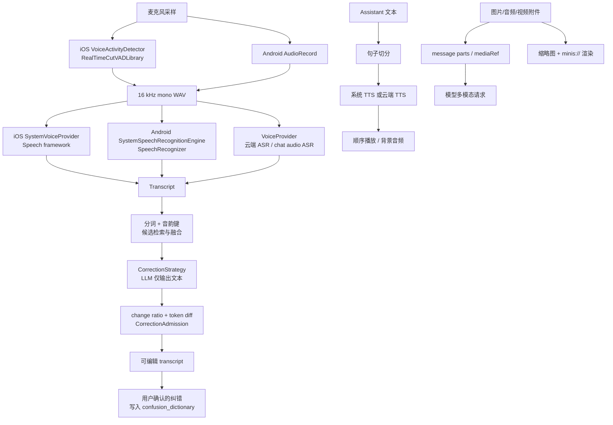

## 14. 语音与多媒体管线

### 14.1 这一章解决什么问题

语音输入不是“把麦克风交给一个 SDK”这么简单：Agent 需要把连续采样可靠地切成一句句音频，再选择系统或云端识别器，并把结果回填到可编辑的 composer。识别器还会把专有名词、同音字、缩写和数字听错，因此 OpenMinis 另外维护一条“候选检索 → LLM 后处理 → 差分校验 → 用户反馈学习”的纠错管线。语音输出则需要在系统 TTS、云端 TTS、音频附件播放之间协调音频会话、队列、暂停和后台存活。最后，图片、音频、视频既可能是用户附件，也可能是 Agent 工具产物；它们要以模型可读的输入 parts 进入上下文，同时以缩略图、`minis://` URL 和原生播放器进入 UI。

本章只描述仓库中已验证的实现，不把“未来可接入 FFmpeg”写成现状：当前可见的 FFmpeg/LAME 入口是 iOS 依赖构建脚本；语音请求本身由 Swift/Kotlin provider 代码构造 multipart、JSON 或厂商专用 envelope。

---

### 14.2 总体模型：四条管线，不共用一个状态机

OpenMinis 将四类工作拆开：

1. **采集与 ASR**：麦克风 →（iOS VAD 或 Android 录音/系统 recognizer）→ WAV/PCM → ASR → transcript。
2. **语音纠错**：transcript → 分词和音韵键 → confusion dictionary / typed vocabulary → LLM → diff/admission → 可选学习。
3. **朗读与音频播放**：assistant 文本 → 句子切分 → 系统 TTS 或 VoiceProvider TTS → 顺序播放；附件音频由另一套 `AVAudioPlayer` / `MediaPlayer` 控制。
4. **多模态媒体**：文件缓存或 sandbox 路径 → message parts / `mediaRef` / `minis://` → 模型请求或图片、音视频渲染。

不要把“播放 TTS”和“播放音频附件”混为一谈。iOS 的 `VoiceOutputPlayer` 负责云端朗读队列，而 `GlobalAudioPlayer` 负责附件；前者由 `VoiceOutputState` 暴露给全局语音 capsule，后者在 `AudioSessionCoordinator` 中声明 `.mediaAttachment` intent（`src/ios/Providers/Voice/VoiceOutputPlayer.swift:65-75`，`src/ios/Views/Chat/Media/AudioPlayback.swift:18-43,70-117`）。Android 也将 `ReadAloudPlayer`（provider TTS + 系统 fallback）与 `TextToSpeechManager` 分层，但两者共用 `SpeechSentenceSplitter`（`src/android/app/src/main/java/com/openminis/app/speech/ReadAloudPlayer.kt:26-58,100-123`，`src/android/app/src/main/java/com/openminis/app/speech/TextToSpeechManager.kt:118-161`）。



**读图要点**：纠错不改变原始 ASR 的安全边界；只要 LLM 超过变更比例或 admission 拒绝，输出仍是原 transcript。媒体渲染也不等同于模型输入：一个图片可以有 UI 缩略图、持久文件、`mediaRef` 和模型上下文中的 `imageData` 四种表现。

---

### 14.3 语音输入：系统 recognizer 与 provider ASR

#### 14.3.1 iOS 旧的系统直连路径

`SpeechRecognitionManager` 是一个 `@MainActor` 单例，状态只有 `idle` 和 `recording`；当前 `SpeechProvider` 枚举实际只有 `system`。初始化时从 `SFSpeechRecognizer.supportedLocales()` 恢复并排序 locale，保存用户选择到 `UserDefaults`（`src/ios/Agent/Speech/SpeechRecognitionManager.swift:5-44,103-140`）。这条路径直接使用 Apple Speech framework，不经过云 provider。

来源：`src/ios/Agent/Speech/SpeechRecognitionManager.swift:212-229`

```swift
let audioSession = AVAudioSession.sharedInstance()
try audioSession.setCategory(.record, mode: .measurement)
try audioSession.setActive(true, options: .notifyOthersOnDeactivation)

let request = SFSpeechAudioBufferRecognitionRequest()
request.shouldReportPartialResults = true
if speechRecognizer?.supportsOnDeviceRecognition == true {
    request.requiresOnDeviceRecognition = true
}
recognitionRequest = request
```

随后在 `AVAudioEngine.inputNode` 安装 tap，把 buffer append 到 `SFSpeechAudioBufferRecognitionRequest`，并计算 RMS 更新 40 个 waveform level；识别 callback 持续回写 `recognizedText`，遇到 error 或 `result.isFinal` 就 teardown（`src/ios/Agent/Speech/SpeechRecognitionManager.swift:231-239,251-298,307-340`）。这一路的用途是系统级、实时 partial transcription；它并不使用 RealTimeCutVADLibrary。

一个重要的工程保护是 Obj-C 异常：`installTap` 或 `audioEngine.start()` 在音频路由错误时可能抛 `NSException`，不是 Swift `Error`。实现用 `noff_try_objc` 包住安装和启动，失败时停止 engine、移除 tap、清空 request，再抛普通 NSError（`src/ios/Agent/Speech/SpeechRecognitionManager.swift:241-281`）。

#### 14.3.2 iOS 生产语音面板：VAD 先切段，再选 ASR

聊天中的新入口是 `VoiceInputViewModel`，注释明确说明 shared VAD + ASR 状态机驱动 inline voice input，并从 `VoiceProviderResolver` 解析 ASR（`src/ios/Views/Chat/Voice/VoiceInputPanel.swift:6-20`）。状态为 `waiting → recording → processing → result`；`prepare()` 创建默认 Voice Input/Output group、解析候选、检查权限并预热系统识别器（`src/ios/Views/Chat/Voice/VoiceInputPanel.swift:184-249`）。

真正启动时，`startVAD()` 会先停止云端朗读，标记 `VoiceModePreference.shared.isCapturing`，再根据当前 provider 设置段长：系统 ASR 使用 59 秒安全上限，云 provider 放宽到总录音上限；之后调用 `vad.start()`（`src/ios/Views/Chat/Voice/VoiceInputPanel.swift:342-369`）。这意味着“系统 ASR”在生产面板中仍然经过 VAD，而不是直接用 `SpeechRecognitionManager` 的实时 tap。

`VoiceActivityDetector` 接入 `RealTimeCutVADLibrary`、Silero VAD v5 和 WebRTC APM；库回调 `voiceStarted`、`voiceEnded(withWavData:)`、`voiceDidContinue`（`src/ios/Providers/Voice/VoiceActivityDetector.swift:1-12,41-53`）。实现有噪声 floor、AGC、speech start/end frame 阈值和原始采样备份；默认 start 需要约 10 帧确认，end 为 156 帧，后者约等于 5 秒尾部静音（`src/ios/Providers/Voice/VoiceActivityDetector.swift:55-126`）。

VAD 确认开始时，会从 `rawAudioBuffer` 回填最多 1.5 秒，避免确认延迟截掉汉字首音；结束时从自己的 `captureSamples` 生成带前导的 WAV，而不是盲信库返回的缓冲区（`src/ios/Providers/Voice/VoiceActivityDetector.swift:73-107,599-649`）。因此链路是：

```text
AVAudioEngine tap
  → VADWrapper（后台 vadQueue）
  → voiceStarted（UI recording）
  → voiceEnded（16 kHz WAV）
  → VoiceInputViewModel.transcribeSegment
  → VoiceProviderResolver 选出的 VoiceInputCapable
  → transcript 追加/替换
```

VAD 没有公开 flush API，所以 detector 保留自己的采样；用户点击暂停时，面板先 `vad.flush()`，若运行超过 1 秒但 VAD 从未判定 speaking，则 `flushRawFallback()`，再停止录音（`src/ios/Views/Chat/Voice/VoiceInputPanel.swift:263-307`）。这是“安静说话不丢首句”和“从未触发 VAD 仍可提交音频”两个非显然补丁。

#### 14.3.3 Android：系统流式与 provider 一次性两种 engine

Android 把后端抽象成 `SpeechRecognitionEngine`：有稳定 `id`、可用性、是否支持 partial、locale 列表，以及 `start/stop/cancel` 和 listener 回调（`src/android/app/src/main/java/com/openminis/app/speech/SpeechRecognitionEngine.kt:5-83`）。`RecognitionError` 将无结果、网络、权限、无 OEM 服务、忙、语言不支持、音频错误分开，`RecognitionState` 还显式包含 `STARTING`、`FINISHING`（同文件 `86-131`）。

`SpeechRecognitionManager.init()` 注册 `SystemSpeechRecognitionEngine` 和 `ProviderSpeechRecognitionEngine`，从 SharedPreferences 恢复 engineId/locale，刷新 availability 和 supported locales（`src/android/app/src/main/java/com/openminis/app/speech/SpeechRecognitionManager.kt:25-112`）。默认选择第一个可用 engine；系统 engine 的语言枚举通过 `ACTION_GET_LANGUAGE_DETAILS` 广播，并以 2.5 秒 fallback list 保证回调只触发一次（`src/android/app/src/main/java/com/openminis/app/speech/SystemSpeechRecognitionEngine.kt:48-110`）。

系统 engine 是 streaming/live transcript：`supportsPartialResults=true`，调用 Android `SpeechRecognizer`；API 31+ 只有在用户选择 offline 且有 `allowOnDeviceRetry` 时才创建 on-device recognizer，语言包不可用时重启一次普通 recognizer（`src/android/app/src/main/java/com/openminis/app/speech/SystemSpeechRecognitionEngine.kt:32-42,146-200`）。这是 Android 与 iOS `requiresOnDeviceRecognition` 的差异：Android 把 offline 作为显式偏好，并对 SODA 语言包错误降级。

provider engine 用 `AudioRecord` 捕获 16 kHz、mono、PCM16，单次最多 60 秒；没有 partial 结果，停止后再包装 WAV 并调用云端 provider（`src/android/app/src/main/java/com/openminis/app/speech/ProviderSpeechRecognitionEngine.kt:34-55,81-161`）。它根据 Voice Input group 取完整候选链，成功模型成为 sticky candidate，失败才尝试下一个；空文本是 `NO_MATCH`，不会误判为 provider 故障（同文件 `64-72,163-223`）。

Android 这里没有可验证的 RealTimeCutVADLibrary 接入点；provider engine 采用录音停止和时长上限，系统 engine 由 `SpeechRecognizer` 自己处理听音和 partial。故不要把 iOS 的 silence segmentation 直接移植成 Android 现状。

---

### 14.4 provider 协议：ASR 的请求形状与路由

#### 14.4.1 共同数据模型

两端都把输入抽象为“音频 bytes + model + language + response format + optional prompt”。iOS 的 `VoiceInputRequest` 注释声明它通常是 VAD 生成的 16 kHz mono WAV，Android 的 `VoiceInputRequest` 有同样约定（`src/ios/Providers/Voice/VoiceInputModels.swift:1-35`；`src/android/app/src/main/java/com/openminis/app/provider/voice/VoiceModels.kt:12-38`）。

默认 OpenAI-compatible ASR 请求是 `POST /v1/audio/transcriptions` 的 multipart：字段 `file=voice.wav`、`model`、ISO-639-1 两字母 `language`、`response_format` 和可选 prompt；响应先解析 `{text, language, duration}`，失败再接受纯文本（`src/ios/Providers/Voice/VoiceProvider.swift:39-52,69-136,288-316`；Android 同逻辑在 `src/android/app/src/main/java/com/openminis/app/provider/voice/VoiceProvider.kt:78-174`）。区域 locale 如 `zh-CN` 会在请求前折叠为 `zh`，避免 Whisper 端返回 unsupported language。

#### 14.4.2 chat-based ASR 是按模型名选择的

`VoiceProvider.transcribe` 先检查 `usesChatBasedASR(model:)`；模型 id 包含 `omni`，或同时包含 `audio` 与 `gpt/qwen` 时，才走 `/v1/chat/completions`，把 WAV base64 放在 `input_audio` content 中，并要求模型“只输出逐字转写”。普通 Whisper、SenseVoice、Paraformer 等仍走 transcriptions endpoint（`src/ios/Providers/Voice/VoiceProvider.swift:39-51,197-285`；Android `src/android/app/src/main/java/com/openminis/app/provider/voice/VoiceProvider.kt:80-100,218-293`）。

这个选择故意不依据“模型 modality 是否包含 text”：用户可能手工给 Whisper 标记了 text，但第三方 ASR 服务器并没有 chat completions；用模型族名可避免 `/v1/chat/completions` 404（iOS `VoiceProvider.usesChatBasedASR` 注释与实现 `223-228`）。

#### 14.4.3 厂商适配与 sticky failover

`VoiceProviderFactory` 从 provider type 和 custom base URL 识别 Groq、Alibaba、MiniMax、Doubao、Xunfei、Mimo、ElevenLabs、Azure、Deepgram、Gemini 等；需要多凭据的厂商使用单字段分号字符串拆解（`src/ios/Providers/Voice/VoiceProviderFactory.swift:5-16,22-145`；Android `src/android/app/src/main/java/com/openminis/app/provider/voice/VoiceProviderFactory.kt:7-115`）。具体 vendor 类只覆盖 endpoint、auth、请求/响应 envelope，例如 Android Doubao 使用 `X-Api-Key` 和 JSON/base64，MiniMax 使用嵌套 `audio.audio` base64（`src/android/app/src/main/java/com/openminis/app/provider/voice/VoiceProviderVendors.kt:60-133,136-234`）。

iOS 面板按 `resolvedInputCandidates` 解析 group，sticky 成功项置于下一段首位；Android provider engine 也按 group candidate chain 排序，并以随机 seed 做 load balance，失败才推进（`src/ios/Views/Chat/Voice/VoiceInputPanel.swift:189-221`；`src/android/app/src/main/java/com/openminis/app/speech/ProviderSpeechRecognitionEngine.kt:81-100,163-221`）。

---

### 14.5 语音纠错：从候选证据到安全应用

#### 14.5.1 目标与不变量

纠错引擎的输入是 ASR transcript，不是原始音频；它尝试修复同音字、近音英文、缩写展开、数字规范化，而不是替用户重写内容。iOS `VoiceCorrectionEngine.correct` 与 Android `VoiceCorrectionEngine.correct` 都保证“不抛出到 UI”：空输入、LLM 超时、策略异常、过大改写都返回原文和 `rejectedReason`（`src/ios/Agent/Speech/VoiceCorrectionEngine.swift:142-207`；`src/android/app/src/main/java/com/openminis/app/speech/correction/VoiceCorrectionEngine.kt:24-31,49-113`）。

核心不变量如下：

- 模型返回原文：不是失败，`hasChange=false`、reason 为 null。
- 变更比例超过 `MAX_CHAR_CHANGE_RATIO`（测试验证为 0.5 上限）：拒绝 wholesale rewrite。
- LLM/网络/策略异常：保留用户原 transcript。
- 只有实际替换操作才产生可学习 pair；纯插入、纯删除不代表“听成了另一个词”。
- 收集学习数据需要 consent；纠错运行本身不因 consent 关闭而失效。

#### 14.5.2 候选检索：分词、音韵键、并发融合、缓存

iOS `retrieveCandidates` 先为 locale 找 normalizer，把分词结果中过短 token（单字符）丢弃，生成去重 phonetic keys；命中内存缓存的候选直接复用，miss 则对 `sources` 并发查询，最后按 `sourceWeight × confidence` 去重并截断 top-N（`src/ios/Agent/Speech/VoiceCorrectionEngine.swift:73-138`）。Android 逻辑等价，但缓存 key 显式加 locale，避免不同语言共享同一音韵键（`src/android/app/src/main/java/com/openminis/app/speech/correction/VoiceCorrectionEngine.kt:138-192,194-235`）。

默认 object graph 同时挂入两个 source：`ConfusionDictionarySource` 和 `TypedVocabularySource`；iOS 在 engine 初始化处创建同类 source，Android `VoiceCorrection.ensureInitialized` 将它们与 LLM strategy 装配（`src/ios/Agent/Speech/VoiceCorrectionEngine.swift:1-58`；`src/android/app/src/main/java/com/openminis/app/speech/correction/VoiceCorrection.kt:41-87`）。source 故障在 Android `retrieveCandidates` 中 `runCatching` 降级为 empty list；单元测试明确要求数据库 down 时不抛异常（`src/android/app/src/test/java/com/openminis/app/speech/correction/CorrectionEngineTest.kt:158-172`）。

#### 14.5.3 LLM 后处理：证据有预算、输出无解释

iOS `LLMCorrectionStrategy` 只走 sub model，解析不到时 fallback primary；system prompt 要求只输出 corrected text，关闭 reasoning，并将 output budget 设为 `max(512, ceil(1.2 × transcriptChars))` 再服从模型 cap（`src/ios/Providers/Voice/CorrectionStrategy.swift:40-104,208-235`）。Android `LlmCorrectionStrategy` 复刻同一 prompt、model group fallback、`ThinkingLevel.OFF` 和 max token 规则（`src/android/app/src/main/java/com/openminis/app/speech/correction/CorrectionStrategy.kt:38-109`）。

Prompt 证据分为 typed vocabulary、confusion history、rare-term digest、近期对话 excerpts，各自有字符预算：400、800、200、4800，消息上下文总上限 5000；上下文明确标注为“供理解，不是待处理文本”（`src/ios/Agent/Speech/CorrectionContextBuilder.swift:5-43`；策略拼装在 `src/ios/Providers/Voice/CorrectionStrategy.swift:113-180`）。Android `CorrectionContextBuilder.build` 只扫描最近最多 12 条、每条最多 2000 字，按罕见词分数挑 excerpt，并保持时间顺序（`src/android/app/src/main/java/com/openminis/app/speech/correction/CorrectionContextBuilder.kt:118-169,191-245`）。

上下文来源不是所有 UI rows：Android `VoiceCorrection.toSourceMessages` 只保留 user/assistant，assistant 优先取 text blocks，排除 thinking/tool_use，并剥除 `<user-attached-files>`；7 个测试中的 `CorrectionContextWiringTest` 将这些规则锁死（`src/android/app/src/main/java/com/openminis/app/speech/correction/VoiceCorrection.kt:106-158`；`src/android/app/src/test/java/com/openminis/app/speech/correction/CorrectionContextWiringTest.kt:31-114`）。

#### 14.5.4 Diff 算法：为什么不是简单字符串 replace

当前 iOS `VoiceCorrectionDiff.tokenPairs` 对两侧重新分词，运行 `LCSDiff.diff`，只取 `.replace`，将 token 拼回可读 span，并丢弃长度比超过 8 的 pathological replacement（`src/ios/Agent/Speech/VoiceCorrectionDiff.swift:20-89`）。`LCSDiff` 是后缀动态规划表，时间复杂度 O(n·m)，连续 equal/replace/insert/delete 合并（同文件 `113-180`）。

Android 文件保留了“字符级 LCS + 原文词边界 widening”设计：先把 `from/to` 拆成字符，LCS 得到最小 replace；再根据原文 token span 扩大 old side，并对 new side 做同量 padding，长度比超过 2 的 replace 丢弃（`src/android/app/src/main/java/com/openminis/app/speech/correction/VoiceCorrectionDiff.kt:3-21,39-105`）。这与 iOS 当前 token-level 版本是一个必须记录的跨端差异，不应假设两侧 diff 输出完全一致。

Android 单测给出了最有用的契约：

| 测试行为 | 契约 |
|---|---|
| `widens a minimal char replace out to the whole word` | `张山→张三` 必须是一个 pair，不能只显示 `山→三`。|
| `handles multiple corrections in one sentence` | 一句中可产生 `石塘→食堂` 与 `张山→张三` 两个 pair。|
| `identical text yields no pairs` | 相同字符串返回空。|
| `empty input yields no pairs` | 任一侧为空返回空。|
| `pure insertion/deletion produces no pair` | 加词/删词不是误听证据。|
| `length-imbalanced replacements are dropped as rewrites` | 1→8 字符的替换丢弃。|
| `charChangeRatio` tests | 精准修复低于 0.5，全句重写高于 0.5，相同文本为 0。|
| `lcs detects a replace` | `张山,说` → `张三,说` 产出 replace，而不是 delete+insert。|

这些行为分别见 `src/android/app/src/test/java/com/openminis/app/speech/correction/VoiceCorrectionDiffTest.kt:45-135`。iOS 同类测试位于 `src/ios/MinisTests/VoiceCorrectionTests.swift`，实现的纯函数拆分也让测试不必加载 provider stack（`src/ios/Agent/Speech/VoiceCorrectionDiff.swift:3-9`）。

#### 14.5.5 CorrectionAdmission：从单一相似度到多信号准入

`CorrectionAdmission.judge` 的顺序是 load-bearing：先 locality，再 pure reorder，再 phonetic similarity，再 digit normalization，最后 acronym relation（`src/ios/Agent/Speech/CorrectionAdmission.swift:66-113`；Android 同样在 `src/android/app/src/main/java/com/openminis/app/speech/correction/CorrectionAdmission.kt:90-138`）。

- **locality**：`max(from.count,to.count) / sentenceLength > 0.6`，即使音韵相似也认为是全局改写。
- **reorder**：去空白后的字符 multiset 相同但顺序不同，拒绝；否则用户只是重排内容。
- **homophone**：音韵 key 的 Levenshtein similarity ≥ 0.6，接受。
- **digitNorm**：一侧有中文数字、另一侧有 ASCII 数字，接受 `十七→17`、`二V三→v3`。
- **acronym**：短 key 是长 key 的有序子序列，短边/长边必须小于 0.9，接受 `MediaS→Media Server`、`上帝→上`。
- 其他情况是 `rejectedReword`，不写 confusion row。

Android `CorrectionAdmissionTest` 进一步规定了真实矩阵：`审推→闪退`、`绘画→会话`、`cloud→claude`、`worker→work on`、`MediaS→Media Server`、中文数字到阿拉伯数字应收集；`挂载→规则`、`secure→SSH key`、纯 reorder 应拒绝；同一 pair 在 sentence length=20 时可收集，在 length=2 时因 too-global 拒绝（`src/android/app/src/test/java/com/openminis/app/speech/correction/CorrectionAdmissionTest.kt:61-126,168-205`）。

这组测试还锁定两个安全边界：9/10 的近等长字符串不能靠 acronym 进入；`RTU→Retry` 不做特殊放行，以免引入语义误报（同文件 `138-165`）。

#### 14.5.6 Recorder：学习前还要 sentence-align

iOS recorder 在 before/after 都切句；句子数量相同只 diff 改变的句子，否则整段 diff，给每个 pair 附上 sentence length，再运行 admission 和 consent gate，写入 `confusion_dictionary`（`src/ios/Agent/Speech/VoiceCorrectionRecorder.swift:36-107`）。Android `VoiceCorrectionRecorder` 同样在 `alignedCandidates` 中优先逐句对齐，shape 不同才 fallback 全文，并将 `contextSample` 截断后保存（`src/android/app/src/main/java/com/openminis/app/speech/correction/VoiceCorrectionRecorder.kt:58-159`）。

两种来源共用一条规则：ASR transcript 手改使用 `SOURCE_VOICE`，普通文本框 select-and-replace 使用 `SOURCE_TEXT`；Android `VoiceCorrection` 将两个入口放到 IO scope fire-and-forget，不能阻塞输入或录音（`src/android/app/src/main/java/com/openminis/app/speech/correction/VoiceCorrection.kt:160-221`）。

AI 建议被用户接受时只写 metrics event，不把模型自己的输出重新写入 confusion dictionary；否则模型会从自己生成的结果中自激学习。用户拒绝建议时只记录 negative feedback，降低 pair confidence（`src/ios/Agent/Speech/VoiceCorrectionRecorder.swift:110-145`；Android 同逻辑 `src/android/app/src/main/java/com/openminis/app/speech/correction/VoiceCorrectionRecorder.kt:162-197`）。

---

### 14.6 用户词表：typed vocabulary 与过滤器

#### 14.6.1 为什么使用已发送文字

`TypedVocabularyBuilder` 不读 draft，而扫描已经发送的 user messages：发送行为是隐式确认，草稿可能被放弃；它补上 cold start 时 confusion dictionary 为空的问题（`src/ios/Agent/Speech/TypedVocabularyBuilder.swift:5-16`；Android `src/android/app/src/main/java/com/openminis/app/speech/correction/TypedVocabularyBuilder.kt:12-20`）。两端都保存 cursor，只扫描新消息；至少间隔一小时，iOS 还要求新消息达到 20 条才运行，构建在后台 actor/IO scope 中完成（iOS `src/ios/Agent/Speech/TypedVocabularyBuilder.swift:17-61`；Android `src/android/app/src/main/java/com/openminis/app/speech/correction/TypedVocabularyBuilder.kt:21-70,147-159`）。

只取 `.text` parts，并删除 `<user-attached-files>…</user-attached-files>`；工具名、文件名、base64、mediaRef 不应该污染用户词表（iOS `src/ios/Agent/Speech/TypedVocabularyBuilder.swift:108-141`；Android `src/android/app/src/main/java/com/openminis/app/speech/correction/TypedVocabularyBuilder.kt:129-172`）。

#### 14.6.2 VocabularyFilter 的分数

过滤器先做绝对拒绝：中文/英文 stopwords、长度小于 2、大于 12、纯 ASCII 数字或标点。之后正向计分：不在常用词表 +2，proper-noun POS（`nr/ns/nz/nt`）+2，包含 ASCII 字母或数字 +1，长度 2–6 +1；达到 `VOCAB_MIN_SCORE` 才接受（`src/ios/Agent/Speech/VocabularyFilter.swift:15-74`；Android `src/android/app/src/main/java/com/openminis/app/speech/correction/VocabularyFilter.kt:17-78`）。

ASCII guard 是必须保留的行为：Swift/Java 的通用 `isLetter` 对汉字也为真，通用 `isDigit` 对 `一二三` 也可能为真；无 guard 会让每个中文词虚增 Latin 分，或把 `三星` 当作数字-only。Android 测试直接锁定 `张三` 和 `三星` 的 `hasLatinOrDigit=0`（`src/android/app/src/test/java/com/openminis/app/speech/correction/VocabularyFilterTest.kt:60-76`）。

候选生成优先 POS tagging，重复 token 累加 occurrences；非中文、jieba 不可用或 POS 为空时退回普通 segmentation，并将 posTag 置 null（`src/ios/Agent/Speech/VocabularyFilter.swift:76-92`；Android `src/android/app/src/main/java/com/openminis/app/speech/correction/VocabularyFilter.kt:80-105`）。测试还要求频率文件忽略注释、空行和 malformed rank（`src/android/app/src/test/java/com/openminis/app/speech/correction/VocabularyFilterTest.kt:123-163`）。

#### 14.6.3 iOS 与 Android 的实现差异

| 抽象 | iOS | Android | 原因/影响 |
|---|---|---|---|
| 分词 | `TextSegmenter.shared`，cppjieba/NL 路径 | `TextSegmenter.getInstance(context)`，jieba JNI/资源 | 资源初始化方式不同，规则契约相同。|
| 执行模型 | `actor TypedVocabularyBuilder` | `Mutex` + `Dispatchers.IO` | Swift actor 与 Kotlin 协程隔离相同目标：不阻塞发送。|
| 增量游标 | DB meta `vocab_last_built_at` | DB meta 同名 key，另有 max 500 条/批 | Android 首次历史扫描有显式批量上限。|
| 常用词表 | bundle `zh_background_wordfreq.txt` | `res/raw/zh_background_wordfreq.txt` | 两端都把“存在=普通词”作为负信号。|
| 过滤测试 | iOS MinisTests + debug RPC | JVM `VocabularyFilterTest` 可注入 rank/segment | Android 将纯逻辑依赖注入，避免 JVM 缺少 android.icu。|
| 同意开关 | `VoiceCorrectionCollectionConsent.collectionEnabled` | `VoiceCorrectionConsent.isEnabled(context)` | 运行和收集分离；关闭后仍可纠错。|

---

### 14.7 TTS、朗读队列与后台音频

#### 14.7.1 iOS：系统朗读与 cloud VoiceOutputPlayer

iOS `VoiceOutputPlayer` 是云端 TTS 的 `@MainActor` ordered queue：文本按句子/标题/tool announcement 入队，最多两个 synthesize prefetch，但 playback 严格按 sequence；失败会在候选模型间 sticky failover（`src/ios/Providers/Voice/VoiceOutputPlayer.swift:65-105,119-170`）。动态窗口根据每字符音频时长、合成耗时和已缓冲秒数计算下一批字符数，避免 underrun，又不把批次拉得过大（同文件 `145-213`）。

`enqueueSegmented` 复用 `AIChatViewModel.splitIntoSpeechSegments` 和 `VoiceTextSanitizer`，所以流式回复与“长按朗读”边界一致（`src/ios/Providers/Voice/VoiceOutputPlayer.swift:229-257`）。系统 provider 不在该云端 player 中：iOS 的 `AIChatViewModel` 保留 `AVSpeechSynthesizer` 路径，带 voice/rate/pitch/volume 和 background keep-alive；这一点由 player 的注释直接声明（`src/ios/Providers/Voice/VoiceOutputPlayer.swift:67-75`）。

系统和云 TTS 共享 global `VoiceOutputState`，它保存 enabled、speed、muted 等偏好并向 chat/home capsule 镜像 reading/paused 状态；`AudioTogglePlaybackIntent` 是 Siri/Live Activity 的系统入口（`src/ios/Providers/Voice/VoiceOutputPlayer.swift:4-35`；`src/ios/Shared/AudioTogglePlaybackIntent.swift:1-53`）。

#### 14.7.2 Android：TextToSpeechManager 与 ReadAloudPlayer

`TextToSpeechManager` 初始化 Android `TextToSpeech`，按汉字检测自动在 zh-CN 与 en-US 间切换；`QUEUE_FLUSH` 立即讲话，`QUEUE_ADD` 追加句子，`UtteranceProgressListener` 维护 speaking 状态（`src/android/app/src/main/java/com/openminis/app/speech/TextToSpeechManager.kt:13-25,61-115,225-271`）。Android TTS 没有原生 pause，`togglePause()` 通过 stop + pendingTexts/pausedAtIndex 记录位置，再重播剩余 utterances（同文件 `175-199`）。

`ReadAloudPlayer` 是聊天朗读统一入口：每个句子经过 sanitizer，再由单 worker `Channel` 串行处理，解析到 voice output provider 就 synthesize，否则 fallback 到系统 TTS；任意 provider 合成失败也按句 fallback，不丢整段回复（`src/android/app/src/main/java/com/openminis/app/speech/ReadAloudPlayer.kt:26-58,100-189`）。provider 音频先写 cache 文件，再交给 `MediaPlayer` 完整播放；stop 先调用 finisher 解开挂起的 continuation，再 release player，防止队列永久 wedge（同文件 `191-256`）。

两端都抽出了数字内标点保护：`SpeechSentenceSplitter.isIntraNumberSeparator` 不把 `3.14`、`1,000` 切句，streaming buffer 末尾的 `28.` 也等待下一 delta；`TextToSpeechManager` 与 `ReadAloudPlayer` 共享它（`src/android/app/src/main/java/com/openminis/app/speech/SpeechSentenceSplitter.kt:12-80`）。

#### 14.7.3 音频会话与后台

iOS 附件播放与 TTS 分别声明 intent。`GlobalAudioPlayer.play` 在加载文件后 `AudioSessionCoordinator.begin(.mediaAttachment)`，暂停/自然结束/stop 时释放 intent，并在媒体播放期间 suspend silent audio keep-alive（`src/ios/Views/Chat/Media/AudioPlayback.swift:70-117,173-217`）。它监听 AVAudioSession interruption，至少记录 call/Siri/其他播放器打断，后台真正是否恢复由上层状态决定（`src/ios/Views/Chat/Media/AudioPlayback.swift:18-43`）。

Android 本章可验证的后台策略是生命周期内 coroutine worker + MediaPlayer cache file；`ReadAloudPlayer.shutdown()` 负责停队列、取消 worker、关闭 channel 和系统 TTS（`src/android/app/src/main/java/com/openminis/app/speech/ReadAloudPlayer.kt:149-170`）。不要把 iOS 的 silent-audio keep-alive 假设成 Android 行为。

---

### 14.8 FFmpeg/LAME：依赖边界与 LGPL 约束

#### 14.8.1 仓库中真正的构建入口

`deps/build_lame.sh` 将 LAME 3.100 交叉编译为 iOS arm64 静态 `libmp3lame.a`，关闭 shared、frontend、decoder，只保留给 FFmpeg 的编码库（`deps/build_lame.sh:4-15,64-89`）。`deps/build_ffmpeg.sh` 将 FFmpeg 6.1.2 打成多个动态 framework 和 umbrella `FFmpeg.framework`，并将 `ffmpeg.c` 的 `main` 改名为 `ffmpeg_main`，避免与 app 入口冲突（`deps/build_ffmpeg.sh:4-15,274-341`）。

FFmpeg configure 的可验证事实：

- 找到 `deps/lame-build/lib/libmp3lame.a` 才加 `--enable-libmp3lame`；否则 MP3 encoding unavailable。
- 开启 shared、VideoToolbox、HLS/network/file/pipe/http/https 等必要能力。
- `--disable-programs`、`--disable-devices`、`--disable-protocols` 后逐项开放协议，缩小 iOS 包。
- 没有 `--enable-gpl` 或 `--enable-nonfree`；这是 LGPL 约束的一部分。

上述开关位于 `deps/build_ffmpeg.sh:194-254`，构建顺序与“LAME 必须先于 FFmpeg”写在 `BUILDING.md:86-107`。当前源码搜索中，FFmpeg/LAME 的直接可验证入口就是这些 build/package 脚本；语音输入和朗读运行时使用的是 Swift/Kotlin provider 与系统播放器，而不是一个已暴露给聊天层的 `ffmpeg()` Swift/Kotlin API。

#### 14.8.2 它们解决什么问题

LAME 提供 MP3 编码，FFmpeg 提供媒体 demux/decode/encode/转封装能力；在本仓库配置里能确定的产品关联是：LAME 编进 FFmpeg 的 `libmp3lame`，provider TTS 请求默认可以要求 MP3，Android voice model 也将 MP3 作为默认 output format（`src/android/app/src/main/java/com/openminis/app/provider/voice/VoiceModels.kt:40-52`；`deps/build_ffmpeg.sh:204-216`）。不能从当前 Swift/Kotlin 文件推断所有附件都会经过本地 FFmpeg 转码。

#### 14.8.3 合规清单

| 检查项 | 仓库证据 | 开发含义 |
|---|---|---|
| FFmpeg license | LGPL-2.1-or-later，且 built without GPL/nonfree | 不得为方便加入 `--enable-gpl` 或 `--enable-nonfree`。|
| LAME license | LGPL-2.0-or-later | 保留 LAME LICENSE，维持独立构建产物和归属。|
| 动态链接 | FFmpeg 各 `.framework` 为 dynamic bundles | 变更链接方式时重新审 LGPL 义务。|
| 许可证清单 | `THIRD_PARTY_LICENSES.md:5-15` | 发布包保留第三方 LICENSE 文件。|
| 构建顺序 | `BUILDING.md:88-103` | 先 LAME 后 FFmpeg，否则 MP3 编码会缺失。|
| 总体产品 license | `BUILDING.md:230-235` | OpenMinis 自身因 iSH/PRoot 为 GPLv3；不要把它误写成 FFmpeg GPL。|

---

### 14.9 多模态媒体：从附件到模型、缩略图和 `minis://`

#### 14.9.1 iOS 输入附件

图片、视频和普通文件先写入 Caches 下 `InputAttachments`，再加入 `InputAttachment`；相机图片会 downsample + JPEG 以把 12MP 原图从 15–25 MB 降到约 1–3 MB，PhotosPicker 原始 bytes 则尽量原样保存，以保留 PNG alpha、HEIC 或 GIF（`src/ios/Agent/Chat/AIChatViewModel+Attachments.swift:11-80`）。picker 先插入 loading placeholders，后台加载完成后 in-place flip 为 ready，发送按钮以 `hasLoadingAttachments` 防止半成品进入请求（同文件 `82-167`）。

发送时 attachment 与 text 一起进入 queued prompt 和 user ChatMessage；这保证 UI 先显示 queued bubble，实际 agent loop 随后消费同一份 attachment 结构（`src/ios/Agent/Chat/AIChatViewModel+Compaction.swift:47-72`）。模型上下文中的 image bytes 有独立保留策略：历史最多保留限定图片数量；持久 `/var/minis/*` 路径只放可重新读取的 placeholder，volatile 或无原路径用户图像才 snapshot 到 offload（`src/ios/Agent/Chat/AIChatViewModel+Offloading.swift:169-187,219-273`）。

#### 14.9.2 iOS 工具媒体与 Minis URL

Agent 的 `read_image`、browser screenshot 等工具结果可以落成 `mediaRef`，持久文件位于 session attachments；`saveAttachment` 返回 `minis://attachments/<filename>`，bind mount 使 iSH 也能看到同一文件（`src/ios/Agent/Chat/AIChatViewModel+Offloading.swift:640-667,800-816`）。`minis://` 不是仅仅 UI 装饰：路径能被模型的 read tool、WKWebView scheme handler 和文件浏览器重新解析。

图片 gallery 的 source URL 可以是 `minis://` 或 http，点击 markdown 图片时用 sourceURL 选中初始页（`src/ios/Views/Chat/Media/MessageImageGallery.swift:1-15,291-313`）。音频附件由 `MinisAudioPreviewView` 加载全局 player，sheet 关闭后播放继续并显示 PiP capsule（`src/ios/Views/Chat/Media/AudioPreview.swift:14-63`）。视频先用 `AVAssetImageGenerator` 生成最多 400×400 缩略图，点击后进入 fullscreen AVPlayer（`src/ios/Views/Chat/Media/VideoPlayer.swift:15-159`）。

#### 14.9.3 Android `minis://` 渲染

Android 在 `MinisApp.newImageLoader()` 注册 Coil `MinisImageFetcher.Factory` 和 `UriFactory`；这两条入口分别覆盖原始 String model 与 Markdown renderer 转出的 `android.net.Uri`。fetcher 将 `minis://attachments/foo.jpg` 转为 `/var/minis/attachments/foo.jpg`，经 PRootKernel 找到 host file，再交给 Coil 解码（`src/android/app/src/main/java/com/openminis/app/ui/MinisImageFetcher.kt:16-60,63-85`）。

由于 Agent 可能覆盖同名文件，fetcher 的 `MtimeKeyer` 把 lastModified 加入 memory/disk cache key；否则 URI 不变时 Coil 会继续显示旧 bitmap（同文件 `89-135`）。

Android WebView 的 `BrowserUseManager.shouldInterceptRequest` 拦截 `minis` scheme，host/path 映射到 `/var/minis/<host><path>`，按扩展名返回 MIME；当前可验证映射包括 png/jpg/gif/svg/webp、mp4、mp3、pdf 等（`src/android/app/src/main/java/com/openminis/app/browser/BrowserUseManager.kt:386-427,457-475`）。HTML 还会在没有 viewport meta 时注入 session viewport，避免 minis HTML 用 WebView 默认 980 CSS px。

#### 14.9.4 平台对照

| 媒体环节 | iOS | Android |
|---|---|---|
| 用户图片缓存 | Caches/InputAttachments，图片可原始保存或相机 downsample | Android 侧本章目标代码未显示等价的 iOS attachment extension；模型/渲染路径依赖 app 的 URI/file storage。|
| 模型媒体引用 | `imageData`、toolResult `mediaRef`、持久 `/var/minis` | provider/agent 侧以本地文件和 URI 解析，Coil 用 PRootKernel。|
| 图片缩略图 | SwiftUI/UIKit `ImagePreview`、gallery、工具图片历史 trim | Coil 解码，mtime key 避免 stale bitmap。|
| 音频附件 | `AVAudioPlayer` + `GlobalAudioPlayer` + PiP | `MediaPlayer`/`ReadAloudPlayer` 主要负责朗读；附件播放器需区分于 TTS。|
| 视频 | `AVAssetImageGenerator` 缩略图 + AVPlayer fullscreen | WebView MIME 可直接提供 mp4；本章未发现与 iOS 同名的 Compose 视频 preview。|
| minis URL | WKWebView `MinisURLSchemeHandler` 与 `/var/minis` bind mount | Coil Fetcher、WebView `shouldInterceptRequest` 与 PRootKernel。|

---

### 14.10 平台对照

| 维度 | iOS | Android | 差异原因 |
|---|---|---|---|
| VAD 方案 | `VoiceActivityDetector` 接入 RealTimeCutVADLibrary，Silero/WebRTC，silence 切段并生成 WAV。 | 本章可验证代码没有 RealTimeCutVADLibrary；`AudioRecord` provider 在 stop 或 60 秒上限后提交整段，系统 recognizer 自己管理会话。 | iOS 生产面板需要连续听写和 silence segmentation；Android 先复用系统服务与简单录音后端。|
| ASR 路由 | 系统 `SpeechRecognitionManager` 走 Speech framework；生产面板由 `VoiceProviderResolver` 在 SystemVoiceProvider 与云 provider 间选择。 | `SpeechRecognitionManager` 注册 `SystemSpeechRecognitionEngine` 和 `ProviderSpeechRecognitionEngine`，分别提供 partial 与 one-shot。 | Android 将 backend 抽象成 engine，iOS 旧直连路径与新 VAD 面板并存。|
| TTS/朗读 | 系统 `AVSpeechSynthesizer` 与 cloud `VoiceOutputPlayer` 分开，cloud queue 支持 prefetch 和 sticky failover。 | `TextToSpeechManager` 为系统 fallback，`ReadAloudPlayer` 用单 worker 串行 provider TTS/MediaPlayer。 | iOS 已实现动态预取；Android 先用顺序性换取取消和 fallback 的确定性。|
| 后台音频 | `AudioSessionCoordinator` 区分 capture、TTS、media attachment；附件播放与 silent keep-alive 协调。 | `ReadAloudPlayer.shutdown` 释放 coroutine worker、Channel、MediaPlayer 和系统 TTS；没有 iOS silent-audio 等价证据。 | AVAudioSession 是 iOS 特有资源竞争点；Android 主要依靠生命周期清理。|
| 音频编解码 | LAME 先构建静态库，FFmpeg 再打 iOS dynamic frameworks；configure 保持 LGPL。当前语音运行时入口仍是 provider/system player。 | 本章目标代码没有对应 FFmpeg/LAME runtime wrapper；provider 返回 MP3/WAV/OPUS 等 bytes 给 Android 播放器。 | codec 构建产物是 iOS 依赖边界，不应推断两端附件都走本地转码。|
| 词表存储 | actor `TypedVocabularyBuilder` 增量扫描 ChatStore，写 `VoiceCorrectionDB`，bundle 背景词表参与过滤。 | `TypedVocabularyBuilder` 用 ChatDao/Room、Mutex 和 IO dispatcher，资源词表在 `res/raw`。 | 存储 API 不同，但发送文字、consent、cursor、score 契约一致。|
| 纠错落地 | 当前 iOS diff 为 token LCS；`CorrectionAdmission` 与 actor recorder 写 confusion rows。 | Android diff 为字符 LCS + 原文词边界 widening；JUnit 用注入 normalizer 锁定 admission 和 engine bailout。 | 两端要保持可学习 pair 和安全回退契约，不要求 diff 内部实现相同。|

代码依据：VAD/ASR 对照见 `src/ios/Providers/Voice/VoiceActivityDetector.swift:1-12,73-126`、`src/android/app/src/main/java/com/openminis/app/speech/ProviderSpeechRecognitionEngine.kt:34-55,134-161`；TTS 对照见 `src/ios/Providers/Voice/VoiceOutputPlayer.swift:65-75,145-170`、`src/android/app/src/main/java/com/openminis/app/speech/ReadAloudPlayer.kt:26-58,100-109`；词表和纠错差异见本章 14.6 与 14.5 的文件引用。
 
### 14.11 纠错测试契约

单元测试的价值不只是验证 helper，而是把“什么时候允许系统学习”定义成了可观察 API。`CorrectionEngineTest` 用 `FakeStrategy` 替代真实模型，因此每个断言都落在 `VoiceCorrectionEngine.correct` 的边界，而不是网络服务的偶然响应（`src/android/app/src/test/java/com/openminis/app/speech/correction/CorrectionEngineTest.kt:22-68`）。

输入为空时，strategy calls 必须为 0；这表示空输入应在检索和模型之前短路，不消耗网络或 token（同测试 `70-79`）。

strategy 返回原文时，`hasChange=false`、`rejectedReason=null`，并保留 strategy 返回的 `modelGroupUsed`；“没有修改”是成功观察，不是失败（同测试 `81-88`）。

strategy 返回完全不同的句子时，`rejectedReason=diff_too_large`，`corrected` 必须仍等于原文；因此 UI 永远有安全可提交文本（同测试 `90-97`）。

strategy 抛异常时，错误标签以 `llm_error:` 开头，原文不变且 `hasChange=false`；调用方可以显示提示而不需要 try/catch 包住发送流程（同测试 `99-105`）。

目标替换 `张山→张三` 必须 accepted，summary 必须包含 Unicode arrow `→`；这个箭头不是装饰，而是 metrics、debug 和负反馈定位 pair 的稳定格式（同测试 `107-114`）。

locale 不支持时，retrieval 返回空候选，而且 source lookup 次数必须为 0；纠错仍可以依赖 context 或 LLM，但不应把无法比较的语言硬塞进字典（同测试 `118-124`）。

fusion 对同一 `phoneticKey|term` 只保留一个候选，比较的是 source weight × confidence；confusion dictionary 的 0.9 乘 1.0 可以胜过 vocabulary 的 1.0 乘 0.6（同测试 `131-146`）。

候选 list 有 `MAX_CANDIDATES` 上限；source 抛异常时降级为空 list，整次 correction 不得因为单个 DB source 挂掉而失败（同测试 `148-172`）。

`CorrectionStrategyTest` 又把 output budget 固定为 floor、input scaling、model cap 三种情况：短文本不得低于 reasoning model 所需 floor，长文本按输入增长，显式 model cap 总是优先（`src/android/app/src/test/java/com/openminis/app/speech/correction/CorrectionEngineTest.kt:175-194`）。

这套测试意味着读者自己的最小实现应当拥有以下状态转移：

```text
blank ──(no model call)──> rejected(empty_input)
nonblank ──(strategy unchanged)──> unchanged(success)
nonblank ──(strategy exception/timeout)──> original + error
nonblank ──(ratio > cap)──> original + diff_too_large
nonblank ──(targeted replace)──> corrected + pairs + optional event
```

测试还故意没有把 Android instrumented path 假装成 JVM path：真正的 `android.icu` pinyin normalization 需要 instrumented test，JVM 只注入 normalizer；这提示工程实现要把平台依赖包在接口后，不要让纯算法不可测（`src/android/app/src/test/java/com/openminis/app/speech/correction/PhoneticNormalizerTest.kt:9-32`）。

`RecorderAdmissionTest` 则锁定 recorder 不区分“语音编辑”与“普通文本替换”的 admission：两者都接受同音 `石塘→食堂`，都拒绝语义重写 `吃饭→看电影`（`src/android/app/src/test/java/com/openminis/app/speech/correction/RecorderAdmissionTest.kt:33-75`）。同文件还规定 malformed attachment opener 保持原文，不因为清理器过度贪婪而截断消息（`src/android/app/src/test/java/com/openminis/app/speech/correction/RecorderAdmissionTest.kt:78-102`）。

因此，纠错测试的验收顺序应是：先测纯 diff，再测 admission，再测 engine bailout，最后才测真实 provider。先测试网络，会把“原文回退”和“模型没有变化”的语义错误隐藏在 mock response 里。

### 14.12 纠错上下文的预算执行

上下文 builder 不是简单的 `messages.takeLast(n)`。iOS 先对最近最多 12 条消息做扫描，并把每条扫描限制在 2000 字符；Android 同样保存 `newestIndex`，最新消息从 0 开始倒序扫描（`src/ios/Agent/Speech/CorrectionContextBuilder.swift:41-43,205-227`；`src/android/app/src/main/java/com/openminis/app/speech/correction/CorrectionContextBuilder.kt:126-155`）。

每个分词 term 会经过 `RareContentScorer`：背景词表中的 term 得分 0；混合 CJK/Latin、camelCase、ALL-CAPS、数字和连接符技术 token 得分高；普通 ASCII 单词得分较低（`src/ios/Agent/Speech/CorrectionContextBuilder.swift:45-140`）。这使 `WGHome`、`LiveActivity`、`dns-server` 等比“今天”更容易进入 correction prompt。

rare digest 按 score、occurrences、term length 排序，使用 `、` 拼接并严格控制 200 字；一个过长 term 会被跳过，而不是 break，以便后面的短 term 仍有机会进入（`src/ios/Agent/Speech/CorrectionContextBuilder.swift:258-273`；Android `CorrectionContextBuilder.kt:171-188`）。

excerpt 选择有非对称策略：最新两轮即使没有 rare hit 也提供 grounding，较旧消息只有包含 strong rare content 的句子才获得 slot；最后再按时间顺序还原给模型（`src/ios/Agent/Speech/CorrectionContextBuilder.swift:275-321`；Android `CorrectionContextBuilder.kt:191-245`）。

这解释了为什么 correction prompt 既能看到当前语境，又不会把整段聊天历史复制到每次 ASR 后处理请求：预算是 prompt contract，而不是日志中的建议值。

### 14.13 纠错事件与置信度的闭环

`VoiceCorrectionRecorder` 写入 confusion row 时保存 phoneticKey、originalVariant、correctedTerm、locale、contextSample、asrProvider、source；后续 source lookup 可以把“哪个识别器犯错”和“用户从哪里修正”区分开（`src/ios/Agent/Speech/VoiceCorrectionRecorder.swift:79-103`；Android `src/android/app/src/main/java/com/openminis/app/speech/correction/VoiceCorrectionRecorder.kt:94-114`）。

数据库的正/负反馈不应直接改变模型 prompt 文本，而应影响 candidate confidence；Android 测试规定 `confidence(3,0)=1.0`、`confidence(3,1)=0.6`、三次 reject 后低于 retrieval floor（`src/android/app/src/test/java/com/openminis/app/speech/correction/PhoneticNormalizerTest.kt:69-77`）。

因此，一个最小 confusion row 至少需要：key、wrong variant、correct term、locale、positive count、negative count、last seen、source。只存一个静态替换字典无法实现用户撤销、跨日期频率和 provider 归因。

录音修正的正反馈是“手工改过 transcript”，而不是“模型建议后用户点击接受”；后者的 suggestion 已经依赖现有 dictionary，回写会形成 echo。这个闭环设计允许收集真实 ASR 错误，同时避免 LLM 自己制造训练数据（`src/android/app/src/main/java/com/openminis/app/speech/correction/VoiceCorrectionRecorder.kt:162-197`）。

### 14.14 媒体的生命周期分层

一份媒体数据在 iOS 中至少可能有四个生命周期：picker 临时 URL、Caches 中的 attachment 文件、session persistent attachment、agentHistory 中的 imageData 或 placeholder。`AIChatViewModel+Attachments` 负责前两者，`AIChatViewModel+Offloading` 负责后两者；不要让 SwiftUI view 自己决定何时删除文件（`src/ios/Agent/Chat/AIChatViewModel+Attachments.swift:82-167`；`src/ios/Agent/Chat/AIChatViewModel+Offloading.swift:169-187`）。

发送前的 loading placeholder 解决的是 UI 顺序问题：用户可以一次选择多张图片，bytes 以并发速度返回，但 chips 必须保持 picked order；因此 finalize 通过 id 回找数组位置，而不是 append 到尾部（`src/ios/Agent/Chat/AIChatViewModel+Attachments.swift:84-126`）。

工具生成图片的持久化路径则由 `mediaRef` 指向 ChatStore 保存的数据；session reload 时通过 media resolver 把 ref 恢复成 file URL，模型 context 只对应该保留的图片 bytes（`src/ios/Agent/Chat/AIChatViewModel+Persistence.swift:860-905,1315-1320`）。

历史裁剪的关键不是“删除旧图片”，而是把旧 bytes 换成带 original path/snapshot path 的文字 placeholder；这样模型仍知道如何通过 `read_image` 重新取回持久 minis 文件（`src/ios/Agent/Chat/AIChatViewModel+Offloading.swift:169-187,239-272`）。

Android 的 `minis://` 则没有复制 bytes 的 fetcher 层：Coil 每次按 URI 映射到 PRoot host file，再用 mtime key 解决原地覆盖。这个差异说明两端都需要稳定路径，但缓存失效机制不同（`src/android/app/src/main/java/com/openminis/app/ui/MinisImageFetcher.kt:30-50,89-135`）。

多模态模型输入和 UI preview 也不必同一 MIME：模型 part 需要 bytes 或 provider 可访问的 URL，图片 preview 需要 bitmap，音频 preview 需要可 seek 的 AVAudioPlayer/MediaPlayer，视频 preview 需要 thumbnail + AVPlayer；四者共享 file identity，但不共享播放器实例（iOS `src/ios/Views/Chat/Media/AudioPlayback.swift:61-117`；iOS `src/ios/Views/Chat/Media/VideoPlayer.swift:40-159`）。

### 14.15 minis:// 的安全与可恢复性

`minis://` URL 的 host 是 namespace，例如 `attachments`、`workspace`、`browser`；路径需要 percent-decode 后再映射到 `/var/minis/<namespace>/...`。Android fetcher 先去 query、再 URL decode；iOS `saveAttachment` 在返回 URL 前对 filename 做 percent encoding（`src/android/app/src/main/java/com/openminis/app/ui/MinisImageFetcher.kt:30-36`；`src/ios/Agent/Chat/AIChatViewModel+Offloading.swift:803-815`）。

模型看到的 path 不能只依赖 Caches，因为 Caches 可被系统清理；iOS 持久 attachments 由 session 目录和 bind mount 映射到 iSH `/var/minis/attachments`，Android 由 PRootKernel 将同一 Linux path 解析到 app 文件（`src/ios/Agent/Chat/AIChatViewModel+Offloading.swift:640-667`；`src/android/app/src/main/java/com/openminis/app/ui/MinisImageFetcher.kt:23-40`）。

WebView 资源拦截还必须返回正确 MIME；mp4/mp3 若被当作 octet-stream，浏览器可能下载而不渲染。Android `guessMimeType` 明确列出 `video/mp4` 和 `audio/mpeg`；HTML 则额外处理 viewport（`src/android/app/src/main/java/com/openminis/app/browser/BrowserUseManager.kt:396-475`）。

恢复策略的验收应该是“关闭并重新打开 session 后，引用仍然能读”，而不是“当前页面显示过一次”。这也是为什么文件写入、mount、URL resolve、Coil/AVPlayer preview 被分成不同模块。

### 14.16 调试语音与媒体问题的观测点

iOS 对实际送往 ASR 的 payload 有 `CapturedVoiceInput` ring：它保留最多 5 条、WAV header 元数据、model/language、VAD segment count、end reason 和 running duration，并由 `debug.voiceInputs` 导出，可回答“VAD 是否把首音裁掉”而不是只看最终文字（`src/ios/Debug/VoiceInputCapture.swift:1-60,100-143`；`src/ios/Debug/DebugMethodRegistry.swift:309-316`）。

录音排查应按顺序看：权限状态、VAD start/end、WAV duration、provider candidate、HTTP status、最终 text。若 VAD running duration 大于 WAV duration，优先检查 segment flush/pre-roll，而不是先怀疑 LLM。

纠错排查应按顺序看：token count、phonetic keys、cache hit、source counts、admission verdict、ratio、model group 和 rejectedReason。iOS debug RPC 的 `simulateVocabularyFilter` 直接返回每个 term 的 score breakdown 和 background list version，避免 debug 层重新实现 scoring（`src/ios/Debug/VoiceCorrectionDebugRPC.swift:166-187`）。

Android 的 `CorrectionEngineTest` 把 strategy/source 做 fake，生产日志只记录长度、计数和 signal names，不打印原始用户文本；这同时满足可诊断性和隐私约束（`src/android/app/src/main/java/com/openminis/app/speech/correction/VoiceCorrectionRecorder.kt:75-123`）。

媒体排查则应分别检查：文件是否存在、namespace/path 是否 decode 正确、mime 是否匹配、mtime 是否改变、播放器是否持有 file descriptor。只检查 URL 字符串是不够的，因为 `minis://attachments/cat.jpg` 可能解析成功但 backing mount 尚未建立。

这套观测点也解释了为什么源码有专门的 capture ring、VAD end reason、cache keyer 和 dry-run API：语音问题往往发生在“模型请求之前”，只记录最终 transcript 会丢掉最有价值的证据。

### 14.17 一次完整请求的故障定位表

| 现象 | 最先检查 | 不要先做什么 | 证据位置 |
|---|---|---|---|
| 点击麦克风立即回到 waiting | mic permission、AVAudioSession、VAD engine start | 不要直接重试 LLM | `VoiceInputPanel.startVAD` 与 `VoiceActivityDetector.start`。|
| waveform 有波形但没有文字 | VAD end callback 是否触发、WAV byte count 是否非零 | 不要把空 transcript 写入 vocabulary | `VoiceActivityDetector.voiceEnded`、`CapturedVoiceInput`。|
| 云 ASR 404 | base URL 是否已经含 `/v1`、模型是否走 chat-based route | 不要盲目换 API key | `VoiceProvider.composedURLString` 与 `usesChatBasedASR`。|
| 云 ASR 空文本 | provider 请求成功但 response text 为空 | 不要推进 failover candidate | `ProviderSpeechRecognitionEngine` 的 `NO_MATCH` 分支。|
| 系统 Android 语言失败 | 语言 tag 是否含不被 recognizer 接受的 script、语言包是否存在 | 不要把 locale 永久标为 unavailable | `SystemSpeechRecognitionEngine.mapError` 与 fallback locale。|
| LLM 把整句改写 | change ratio、diff pairs、rejectedReason | 不要把 corrected 原文直接写回 | 两端 `VoiceCorrectionEngine.correct` 的 ratio guard。|
| 修复没有进入 confusion dictionary | consent、normalizer、admission verdict、sentence locality | 不要降低所有阈值 | 两端 `VoiceCorrectionRecorder.recordEdit`。|
| 词表出现 `the`/文件名 | stopword、attachment markup、parts type 过滤 | 不要只提高频率阈值 | `VocabularyFilter`、`TypedVocabularyBuilder`。|
| TTS 句子顺序颠倒 | queue worker 是否单消费者、seq/Channel 是否被绕过 | 不要让每个 sentence 启动独立 player | iOS `VoiceOutputPlayer`、Android `ReadAloudPlayer`。|
| `3.14` 被读成两句 | splitter 的 intra-number guard | 不要用简单 `split(".")` | `SpeechSentenceSplitter.isIntraNumberSeparator`。|
| minis 图片是旧图 | 文件 mtime、Coil key、同名文件覆盖 | 不要只清 UI state | `MinisImageFetcher.MtimeKeyer`。|
| minis 视频/音频下载而非播放 | MIME extension mapping、WebView interception | 不要把所有文件返回 octet-stream | `BrowserUseManager.guessMimeType`。|

这个表体现了管线的诊断顺序：先确认 bytes 和状态，再确认协议和 provider，最后才检查模型质量。每层都应有可观测的输入输出，避免把所有问题归因于“ASR 不准”。

### 14.18 可移植抽象的最小接口

从 iOS 与 Android 的差异可以提炼出一个跨桌面平台也可用的接口边界：

```text
AudioCapture.start(format, onFrame, onInterrupt)
Segmenter.accept(frame) -> Started | Continued | Ended(audio)
Recognizer.transcribe(audio, locale, model) -> text | typed error
Correction.correct(text, locale, context) -> original-safe suggestion
Synthesizer.synthesize(sentence, voice) -> encoded audio bytes
Playback.enqueue(bytes, owner) / stop(owner) / pause / resume
MediaResolver.resolve(minisURL) -> local readable file
```

Apple `AVAudioEngine`、Android `AudioRecord`、Windows WASAPI、Linux PipeWire 都可以实现 `AudioCapture`，而不会泄漏到 `Correction`。同样，`MediaResolver` 只需要把稳定 URL 解析成可读文件，UI 可以在各平台用 AVPlayer、MediaPlayer、WebView 或桌面播放器渲染。

必须保留的跨平台语义不是类名，而是错误和回退：no-match 与 network failure 分开；原文与 corrected 分开；媒体路径不存在与 MIME 不支持分开。Android `RecognitionError` 枚举和 iOS provider errors 已经展示了这种边界（`src/android/app/src/main/java/com/openminis/app/speech/SpeechRecognitionEngine.kt:86-113`；`src/ios/Providers/Voice/VoiceInputModels.swift:54-76`）。

### 14.19 内存与延迟预算

iOS VAD 同时保留 raw buffer、segment buffer 和可能送入 provider 的 WAV；因此 raw buffer 有五分钟 cap，segment 又有 59 秒 system ASR cap（`src/ios/Providers/Voice/VoiceActivityDetector.swift:73-107`；`src/ios/Views/Chat/Voice/VoiceInputPanel.swift:349-356`）。Android provider 以 `MAX_RECORD_SECONDS=60` 和约 1.9 MB PCM16 上限约束单次 take（`src/android/app/src/main/java/com/openminis/app/speech/ProviderSpeechRecognitionEngine.kt:39-43,134-145`）。

纠错也有三种预算：retrieval wall-clock budget、LLM correction timeout、prompt character budgets。retrieval 超预算目前只记录 warning，不强杀查询；LLM timeout 则必须回退原文。这种“不影响输入的 retrieval”与“不能阻塞 send 的 correction”分层可见于 iOS `VoiceCorrectionEngine.swift:111-118,257-269` 和 Android `VoiceCorrectionEngine.kt:65-93,167-172`。

TTS 的预算是音频缓冲秒数和并发 synthesis 数：iOS 根据每字符音频/合成耗时动态计算窗口，并限制 max prefetch=2；Android 先用单 worker 保证顺序，牺牲 prefetch 换取简单可靠（`src/ios/Providers/Voice/VoiceOutputPlayer.swift:145-170,198-213`；`src/android/app/src/main/java/com/openminis/app/speech/ReadAloudPlayer.kt:47-53,100-109`）。

如果向 macOS/Windows/Linux 扩展，先保留这些数字所代表的约束，再调整实际常数：麦克风采样不应无限增长，模型请求不应把发送卡住，TTS 不应让下一句跑到前面，媒体缓存不应因 URI 不变而显示旧内容。

### 14.20 跨端验收顺序

先验收可恢复性，再验收质量：录音失败能回 idle、provider 失败保留原文、媒体文件丢失有明确占位符，然后才比较识别字词或 TTS 音色。iOS 和 Android 都把状态、错误和 bytes 分开，因而可以在没有真实麦克风和模型的环境中验证绝大多数契约（`src/android/app/src/main/java/com/openminis/app/speech/SpeechRecognitionEngine.kt:68-83`；`src/ios/Agent/Speech/VoiceCorrectionDiff.swift:3-9`）。

系统 ASR、provider ASR、纠错、TTS、附件渲染应各有 fake boundary；端到端 smoke 只负责证明 wiring，没有必要把所有 diff 边界塞进一次网络测试。这个拆分也让未来桌面平台可以复用纯 correction/media resolver，而替换采集和播放后端。

完成这些验收后，用户才能看到一个可解释的结果：音频在哪一段结束、用了哪一个 provider、纠错为何接受或拒绝、媒体从哪个持久 URL 来。
实现时每个状态都应有唯一 owner：VAD owner 管采样，provider owner 管网络请求，correction engine owner 管原文回退，player owner 管播放资源。跨 owner 只传值或事件，不共享可变 audio buffer；这正是 iOS `@MainActor`/actor 与 Android coroutine scope/Channel 分工的实际意义（`src/ios/Agent/Speech/VoiceCorrectionRecorder.swift:18-27`；`src/android/app/src/main/java/com/openminis/app/speech/ReadAloudPlayer.kt:60-109`）。

当这条规则成立时，取消录音不会取消已经入队的另一条朗读，停止单个 session 也不会删除其他 session 的媒体；当它不成立时，最常见症状就是音频串台、队列卡死或 transcript 被旧 callback 覆盖。
跨平台时可以更换实现，但不能改变这些 owner 边界和回退契约。

### 14.21 设计取舍与踩坑

1. **VAD 与 ASR 的边界必须清晰。** iOS VAD 负责“何时结束一句”，ASR 负责“这句说了什么”；Android 系统 engine 让 SpeechRecognizer 自己管理会话，provider engine 则 stop 后一次性转写。把 Android `AudioRecord` 直接当成 iOS VAD 会造成错误的 silence 语义（iOS `src/ios/Providers/Voice/VoiceActivityDetector.swift:7-12`；Android `src/android/app/src/main/java/com/openminis/app/speech/ProviderSpeechRecognitionEngine.kt:34-55`）。
2. **权限是双重的。** iOS 系统 ASR 需要 speech authorization + microphone record permission；生产面板在开始前分别检查/请求；Android 需要 `RECORD_AUDIO`，系统服务和语言包又是另一层可用性（iOS `src/ios/Agent/Speech/SpeechRecognitionManager.swift:69-80,181-207`；Android `src/android/app/src/main/java/com/openminis/app/speech/SystemSpeechRecognitionEngine.kt:146-156`）。
3. **不要把“model returned empty”当 failover。** provider 成功请求但无语音是 `NO_MATCH`，推进候选会把一个语义结果误判为坏服务（Android `ProviderSpeechRecognitionEngine.kt:197-205`）。
4. **语言 tag 不要原样发给 Whisper。** UI 需要 `zh-Hans-CN` 区分 locale，OpenAI-compatible ASR 却要求 `zh`；两端 provider 都实现了 ISO-639-1 fold（iOS `VoiceProvider.swift:153-160,299-305`；Android `VoiceProvider.kt:43-50,130-133`）。
5. **纠错模型必须有 hard guard。** LLM 很容易“顺手润色”整句；ratio > 0.5、超时、exception 都应保留原文。不要用“模型更流畅”覆盖安全策略（iOS `VoiceCorrectionEngine.swift:175-205`；Android `VoiceCorrectionEngine.kt:104-135`）。
6. **diff 的对齐粒度会影响学习质量。** Android 的字符 LCS + 原文词 widening 专门解决分词邻接变化；iOS 当前版本使用 token LCS。跨端同步时要同步测试契约，不要只复制注释或旧实现（iOS `VoiceCorrectionDiff.swift:47-89`；Android `VoiceCorrectionDiff.kt:18-105`）。
7. **admission 的 locality 必须用句长。** 只看 from/to 长度会让“全句同音改写”进入词典；sentence-align 后以 changed-span/sentence 长度判断，测试明确覆盖同一 pair 在短句中拒绝（`src/android/app/src/test/java/com/openminis/app/speech/correction/CorrectionAdmissionTest.kt:111-126`）。
8. **学习必须 opt-in，debug 不得自喂。** debug RPC 的 dry run 要 `persistEvent=false`；accepted suggestion 只写 metrics，不能把 LLM 输出当 ground truth（iOS `VoiceCorrectionEngine.swift:142-150`、`VoiceCorrectionRecorder.swift:130-145`）。
9. **词表不要把文件名和工具调用学进去。** 只采 `.text` parts 并剥除 attachment envelope；Android wiring 测试把 assistant text block、system row、tool/thinking block 都写成可执行契约（`CorrectionContextWiringTest.kt:31-114`）。
10. **音频类别互斥。** 录音时先停 TTS 防回声；附件播放时声明 media intent 并 suspend silent keep-alive；否则 AVAudioSession category 会互相抢夺（iOS `VoiceInputPanel.swift:342-347`、`AudioPlayback.swift:82-114`）。
11. **流式 TTS 要防数字切句。** `.` 或 `,` 两侧都是数字时不能切；buffer 末尾的 `28.` 也要等下一 delta。这种错误通常只能在跨语言金额、版本号、IP 地址时暴露（Android `SpeechSentenceSplitter.kt:18-80`）。
12. **队列 stop 必须解除挂起。** Android `MediaPlayer.release()` 可能阻止 completion callback，ReadAloudPlayer 先调用 `playbackFinisher` 再 release；iOS 也要 stop/cancel 所有 cloud synthesis task（Android `ReadAloudPlayer.kt:69-78,149-160,223-255`；iOS `VoiceOutputPlayer.swift:260-297`）。
13. **缓存 key 必须带语义版本或 mtime。** Android minis 图片同 URI 覆盖时若不带 mtime，Coil 显示旧图；纠错候选则将空结果也缓存，避免每次重复查无结果 key（`MinisImageFetcher.kt:89-135`；`VoiceCorrectionEngine.kt:218-232`）。
14. **FFmpeg 合规不能靠“功能需要”绕过。** MP3 编码缺失应先检查 LAME 构建顺序，而不是加 GPL/nonfree flag；发布时保留动态 framework 与许可证（`deps/build_ffmpeg.sh:204-254`；`BUILDING.md:88-107,230-235`）。

---

### 14.22 从零实现清单

1. **先定义四个独立接口。** 建立 `SpeechRecognitionEngine`（start/stop/cancel/listener）、`VoiceInputProvider`（WAV→text）、`CorrectionStrategy`（text→text）和 `ReadAloudPlayer`（sentence queue）。验收：每个接口可注入 fake，UI 不直接依赖 SDK；对应仓库抽象见 `src/android/app/src/main/java/com/openminis/app/speech/SpeechRecognitionEngine.kt:20-83` 和 `src/ios/Providers/Voice/CorrectionStrategy.swift:11-16`。
2. **完成权限和可用性探测。** iOS 同时探测 speech 与 mic；Android 探测 `RECORD_AUDIO`、recognition service、语言列表。验收：拒绝权限、无 service、语言包缺失都变成可显示 error，而不是空白按钮（`SpeechRecognitionManager.swift:69-80,181-207`；`SystemSpeechRecognitionEngine.kt:48-110,343-379`）。
3. **实现最小系统 ASR。** iOS 用 `AVAudioEngine + SFSpeechAudioBufferRecognitionRequest`；Android 用 `SpeechRecognizer` partial callbacks。验收：partial 会更新 waveform/transcript，stop 后一定回到 idle，tap/recognizer error 能清理资源（`SpeechRecognitionManager.swift:212-317`；`SystemSpeechRecognitionEngine.kt:146-218`）。
4. **再加入 provider ASR。** 统一 16 kHz mono WAV，构造 multipart/JSON，ISO locale，解析 JSON/text fallback。验收：OpenAI-compatible、chat audio、至少一个 vendor envelope 都能被 fake HTTP 验证；失败候选链推进，空文本不推进（`VoiceProvider.swift:39-136,230-316`；`ProviderSpeechRecognitionEngine.kt:163-223`）。
5. **若需要连续听写，再实现 VAD。** iOS 接 VAD library、保留 raw buffer、处理 pre-roll、silence end 和 max segment；Android 第一版可先采用 stop/timeout，不要假装有 VAD。验收：首字不被切掉、静音自动结束、手动 flush 有 fallback（`VoiceActivityDetector.swift:73-126,599-649`）。
6. **实现纯 diff 函数并先写测试。** 锁定 identical/empty/insertion/deletion/word widening/imbalanced replacement/ratio。验收：`张山→张三` 产生一个可读 pair，全句重写 ratio 超阈值（`VoiceCorrectionDiffTest.kt:45-135`）。
7. **实现多信号 admission。** 顺序固定为 locality → reorder → homophone → digit → acronym；阈值集中在 Config。验收：Android admission 矩阵中的 collect/reject 全部通过，尤其 `十七→17` 与 `MediaS→Media Server` 不再被旧 lengthRatio 丢掉（`CorrectionAdmissionTest.kt:61-205`）。
8. **实现 recorder 与 consent gate。** 先 sentence-align，再 diff，再 admission，最后 upsert；ASR edit 与 text select-replace 共享规则。验收：DB 不可用或 consent off 时 UI 仍可输入，且不写任何学习行（`VoiceCorrectionRecorder.kt:58-124`；`VoiceCorrection.kt:160-221`）。
9. **实现候选 source 和 typed vocabulary。** 只从已发送 text parts 取词，stopword/length/ASCII guard/POS/频率分数后写入；cursor + throttle + background worker。验收：附件标签、tool blocks、英文 function words 不进入词表（`TypedVocabularyBuilder.kt:46-127,129-172`；`VocabularyFilterTest.kt:34-163`）。
10. **接入 LLM correction，但先做安全回退。** prompt 只要求输出文本；补充上下文预算、sub→primary fallback、timeout、cleanResponse。验收：空输入不调模型、异常返回原文、原文 unchanged 不是 failure、wholesale rewrite 被拒绝（`CorrectionEngineTest.kt:70-114`；`CorrectionStrategy.swift:43-104,183-203`）。
11. **实现系统 TTS。** 句子切分、QUEUE_FLUSH/ADD、语言检测、停止和伪 pause。验收：流式回复第一句遇到 terminator 就开始，3.14 不被切断（`TextToSpeechManager.kt:83-161`）。
12. **接云端 TTS 与顺序播放。** provider synthesize 返回 bytes；用单 worker/ordered queue 播放，provider 失败按句 fallback 系统 TTS。验收：句子不会乱序，stop 不会永久卡住队列（`ReadAloudPlayer.kt:100-189,223-263`）。
13. **加入音频会话策略。** iOS 为录音、reply TTS、media attachment 建立不同 intent；Android 在 lifecycle 中释放 player/TTS。验收：录音不把 TTS 录成回声，媒体 stop 后资源和状态都复位（`VoiceInputPanel.swift:342-369`；`AudioPlayback.swift:173-217`）。
14. **实现媒体 parts 和本地持久路径。** 图片、视频、音频先落文件，message 保存引用；历史上下文只保留有限图片，持久 `minis://` 路径可重新读取。验收：重启 session 后模型能通过 path 取回，volatile 图片有 snapshot（`AIChatViewModel+Offloading.swift:169-187,239-273`）。
15. **实现 `minis://` UI 渲染。** iOS scheme handler/WKWebView + image gallery；Android Coil Fetcher/Keyer + WebView interception。验收：中文和空格文件名能解码，覆盖同名文件会刷新缩略图，mp4/mp3 MIME 正确（`MinisImageFetcher.kt:30-60,89-135`；`BrowserUseManager.kt:396-475`）。
16. **最后再接本地 codec。** 先按 `build_lame.sh` → `build_ffmpeg.sh` 生成产物，保持 LGPL 配置，不为未验证的运行时场景添加调用。验收：MP3 能力存在时有 `libmp3lame.a`，FFmpeg frameworks 可链接，许可证文件随发布物保留（`deps/build_lame.sh:7-15,77-105`；`deps/build_ffmpeg.sh:218-254`）。

**可以砍掉的部分**：MVP 可以先砍 cloud ASR failover、VAD AGC、typed vocabulary、LLM correction、云 TTS prefetch、视频缩略图和 FFmpeg 本地转码；但不能砍原文回退、权限错误、媒体文件引用的生命周期和 stop/cancel 清理。先做“系统 ASR + 可编辑文本 + 系统 TTS + 图片文件引用”，再逐层增加 provider 与学习闭环。

---

### 14.23 关键文件索引

下表只列本章实际用于推导机制、契约或渲染路径的关键文件；行数为当前工作树的 `wc -l` 结果。

| 路径 | 行数 | 职责 |
|---|---:|---|
| `src/ios/Agent/Speech/SpeechRecognitionManager.swift` | 340 | Apple Speech framework 直连、partial transcript、RMS、权限。|
| `src/ios/Providers/Voice/VoiceActivityDetector.swift` | 695 | RealTimeCutVADLibrary、Silero/WebRTC、pre-roll、WAV segment。|
| `src/ios/Views/Chat/Voice/VoiceInputPanel.swift` | 1095 | 生产 VAD + ASR 状态机、provider candidates、生命周期。|
| `src/ios/Views/Chat/Voice/InlineVoiceInputView.swift` | 1448 | inline waveform、transcript 编辑和发送回填。|
| `src/ios/Providers/Voice/VoiceInputModels.swift` | 143 | ASR/TTS request/response value types。|
| `src/ios/Providers/Voice/VoiceProvider.swift` | 342 | OpenAI-compatible ASR/TTS、chat audio ASR、WAV multipart。|
| `src/ios/Providers/Voice/VoiceProviderFactory.swift` | 146 | provider type/base URL 到 voice vendor 的路由。|
| `src/ios/Providers/Voice/VoiceProvider+Vendors.swift` | 852 | 厂商 endpoint、鉴权和响应 envelope。|
| `src/ios/Providers/Voice/VoiceProviderResolver.swift` | 617 | voice input/output group、sticky selection、全局状态。|
| `src/ios/Providers/Voice/CorrectionStrategy.swift` | 245 | LLM prompt、上下文预算、模型 fallback、response clean。|
| `src/ios/Agent/Speech/VoiceCorrectionEngine.swift` | 277 | 候选检索、融合、cache、ratio guard、timeout。|
| `src/ios/Agent/Speech/VoiceCorrectionDiff.swift` | 183 | token LCS 与可读替换 pair。|
| `src/ios/Agent/Speech/CorrectionAdmission.swift` | 160 | locality/reorder/homophone/digit/acronym 准入。|
| `src/ios/Agent/Speech/VoiceCorrectionRecorder.swift` | 146 | sentence-align、学习写入、正负反馈。|
| `src/ios/Agent/Speech/TypedVocabularyBuilder.swift` | 158 | 已发送文字增量词表、cursor、consent、throttle。|
| `src/ios/Agent/Speech/VocabularyFilter.swift` | 188 | stopword、频率、POS、ASCII 分数。|
| `src/ios/Agent/Speech/CorrectionContextBuilder.swift` | 335 | rare digest 与 conversation excerpts 预算。|
| `src/ios/Agent/Speech/ConversationContextTruncator.swift` | 57 | soft limit、句末截断、hard ceiling。|
| `src/ios/Providers/Voice/VoiceCorrectionDB.swift` | 857 | confusion/vocabulary/event 数据存储和 confidence。|
| `src/ios/Providers/Voice/VoiceOutputPlayer.swift` | 616 | cloud TTS ordered queue、prefetch、sticky failover。|
| `src/ios/Providers/Voice/VoiceTextSanitizer.swift` | 161 | Markdown/URL/emoji 朗读前清洗。|
| `src/ios/Views/Chat/Media/AudioPlayback.swift` | 479 | 音频附件 `AVAudioPlayer`、PiP、seek、media intent。|
| `src/ios/Views/Chat/Media/AudioPreview.swift` | 455 | `minis://` 音频预览、保存、分享。|
| `src/ios/Views/Chat/Media/ImagePreview.swift` | 582 | 图片缩放、全屏预览。|
| `src/ios/Views/Chat/Media/MessageImageGallery.swift` | 336 | 附件/markdown 图片分页 gallery。|
| `src/ios/Views/Chat/Media/VideoPlayer.swift` | 492 | AVAsset 缩略图、fullscreen AVPlayer。|
| `src/ios/Agent/Chat/AIChatViewModel+Attachments.swift` | 453 | 图片/视频/文件缓存、placeholder、发送附件。|
| `src/ios/Agent/Chat/AIChatViewModel+Offloading.swift` | 819 | image history trim、snapshot、`minis://attachments` 持久化。|
| `src/ios/Shared/AudioTogglePlaybackIntent.swift` | 53 | 系统播放切换 intent。|
| `src/android/app/src/main/java/com/openminis/app/speech/SpeechRecognitionEngine.kt` | 131 | Android ASR backend interface、error/state contract。|
| `src/android/app/src/main/java/com/openminis/app/speech/SpeechRecognitionManager.kt` | 260 | engine 注册、选择、locale、waveform state。|
| `src/android/app/src/main/java/com/openminis/app/speech/SystemSpeechRecognitionEngine.kt` | 381 | Android `SpeechRecognizer`、语言广播、offline retry。|
| `src/android/app/src/main/java/com/openminis/app/speech/ProviderSpeechRecognitionEngine.kt` | 257 | AudioRecord 16 kHz capture、WAV、provider failover。|
| `src/android/app/src/main/java/com/openminis/app/provider/voice/VoiceModels.kt` | 87 | ASR/TTS models、formats、provider errors。|
| `src/android/app/src/main/java/com/openminis/app/provider/voice/VoiceProvider.kt` | 295 | multipart/JSON voice protocol、chat audio ASR。|
| `src/android/app/src/main/java/com/openminis/app/provider/voice/VoiceProviderFactory.kt` | 115 | provider voice vendor factory。|
| `src/android/app/src/main/java/com/openminis/app/provider/voice/VoiceProviderVendors.kt` | 723 | Groq/MiniMax/Doubao/Xunfei 等厂商实现。|
| `src/android/app/src/main/java/com/openminis/app/speech/correction/VoiceCorrectionEngine.kt` | 275 | retrieve/fuse/correct/timeout/cache。|
| `src/android/app/src/main/java/com/openminis/app/speech/correction/VoiceCorrectionDiff.kt` | 198 | 字符 LCS、原文词边界 widening、pair。|
| `src/android/app/src/main/java/com/openminis/app/speech/correction/CorrectionAdmission.kt` | 199 | 多信号准入纯逻辑。|
| `src/android/app/src/main/java/com/openminis/app/speech/correction/VoiceCorrectionRecorder.kt` | 203 | ASR/text 两来源学习、sentence alignment。|
| `src/android/app/src/main/java/com/openminis/app/speech/correction/TypedVocabularyBuilder.kt` | 174 | Room/ChatDao 增量挖掘。|
| `src/android/app/src/main/java/com/openminis/app/speech/correction/VocabularyFilter.kt` | 208 | stopword、ASCII guard、rank/POS 计分。|
| `src/android/app/src/main/java/com/openminis/app/speech/correction/CorrectionContextBuilder.kt` | 246 | 最近消息、rare digest、excerpt budget。|
| `src/android/app/src/main/java/com/openminis/app/speech/correction/CorrectionStrategy.kt` | 249 | Android LLM correction protocol、model fallback。|
| `src/android/app/src/main/java/com/openminis/app/speech/correction/VoiceCorrection.kt` | 238 | object graph、UI message wiring、fire-and-forget capture。|
| `src/android/app/src/main/java/com/openminis/app/speech/TextToSpeechManager.kt` | 271 | 系统 TTS、streaming sentence buffer、伪 pause。|
| `src/android/app/src/main/java/com/openminis/app/speech/ReadAloudPlayer.kt` | 294 | provider TTS、system fallback、MediaPlayer queue。|
| `src/android/app/src/main/java/com/openminis/app/speech/SpeechSentenceSplitter.kt` | 82 | 数字安全句子边界。|
| `src/android/app/src/main/java/com/openminis/app/ui/MinisImageFetcher.kt` | 138 | Coil `minis://` fetcher、mtime cache key。|
| `src/android/app/src/main/java/com/openminis/app/browser/BrowserUseManager.kt` | 1727 | WebView `minis://` interception 与 MIME。|
| `src/android/app/src/test/java/com/openminis/app/speech/correction/CorrectionEngineTest.kt` | 369 | empty/unchanged/rewrite/error/targeted fix、fusion、timeout。|
| `src/android/app/src/test/java/com/openminis/app/speech/correction/VoiceCorrectionDiffTest.kt` | 135 | diff 行为契约。|
| `src/android/app/src/test/java/com/openminis/app/speech/correction/CorrectionAdmissionTest.kt` | 208 | 多信号 admission 真实矩阵。|
| `src/android/app/src/test/java/com/openminis/app/speech/correction/RecorderAdmissionTest.kt` | 102 | 两种 capture source 共用准入、attachment strip。|
| `src/android/app/src/test/java/com/openminis/app/speech/correction/VocabularyFilterTest.kt` | 163 | stopword/length/ASCII/POS/rank/candidates 契约。|
| `src/android/app/src/test/java/com/openminis/app/speech/correction/CorrectionContextWiringTest.kt` | 115 | UI message 到 correction context 的过滤契约。|
| `src/android/app/src/test/java/com/openminis/app/speech/correction/PhoneticNormalizerTest.kt` | 86 | locale folding、Levenshtein、similarity、confidence。|
| `deps/build_lame.sh` | 105 | LAME 3.100 arm64 静态库构建。|
| `deps/build_ffmpeg.sh` | 626 | FFmpeg 6.1.2 iOS framework、LGPL configure、LAME link。|
| `BUILDING.md` | 235 | 构建顺序、架构、LGPL 与 MP3 troubleshooting。|
| `THIRD_PARTY_LICENSES.md` | 55 | FFmpeg/LAME/iSH/PRoot 等许可证与版本。|

---

本章的实现边界可以用一句工程规则收束：**让 SDK 负责采样/编解码，让 provider 负责协议，让纯函数负责 diff/admission，让数据库只保存经过 consent 和准入的数据；媒体则始终把“模型可重新读取的路径”和“用户眼前的预览”分开。**
