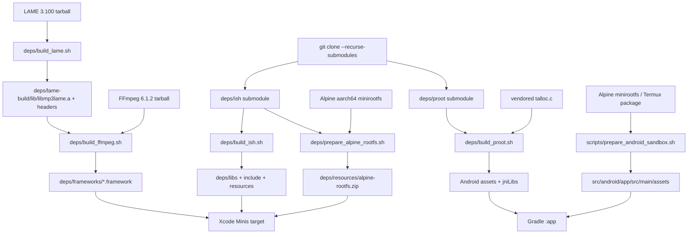

## 15. 工程化：构建、调试、可观测与质量保障

### 15.1 这一章解决什么问题

AI Agent 应用的“能运行”不等于“可交付”：它同时包含 Swift/Kotlin UI、模型网络、真实 Linux guest、音视频原生库、持久化和后台生命周期。构建链如果没有明确的输入、输出和顺序，最常见的结果不是编译器报错，而是功能静默缺失（例如 FFmpeg 找不到 LAME 时仍然能编译，却没有 MP3 编码）。调试、日志和崩溃记录必须从 App 内部就可访问，否则用户设备上的卡顿无法复现，AI 辅助开发也无法观察 UI 和 Agent 状态。测试则要覆盖“纯函数”和“真实沙箱”两个世界，iOS/Android 的本地化还要把界面语言与 Agent 回复语言分开管理。

本章按一条可复用的工程闭环展开：可重建的原生依赖 → 构建期配置 → App 内 DEBUG RPC → 运行时日志/崩溃/卡顿 → 单元、UI、真机沙箱测试 → 本地化和质量门禁。

---

### 15.2 先画出工程边界：源码、构建产物和调试入口

仓库明确不提交原生二进制。`BUILDING.md:1-8` 说明 iSH、PRoot、FFmpeg、LAME 与 Alpine rootfs 由 `deps/` 脚本从源码/发行版生成，并且首次构建预计 30–60 分钟；缓存留在本机，后续构建才快。这个策略同时解决许可证、架构和可重复性问题：二进制不会把某台机器的 SDK、签名或 CPU 架构偷偷带进提交历史。

两端产物边界不同：

|边界|iOS|Android|
|---|---|---|
|Guest|`deps/ish` 的 iSH-ARM64 用户态 Linux 模拟|`deps/proot` + Alpine aarch64 rootfs|
|编解码|FFmpeg per-library frameworks，依赖静态 LAME|本章目标脚本不构建 FFmpeg；JNI/CMake 随 Gradle 构建|
|资源安装|`deps/libs/`、`include/`、`frameworks/`、`resources/`，Xcode 相对路径直接引用|`src/android/app/src/main/assets/` 与 `jniLibs/arm64-v8a/`，由 APK 打包|
|默认架构|脚本用 iPhoneOS arm64，模拟器不能直接复用|`build.gradle.kts:52-54` 只保留 `arm64-v8a`|
|质量入口|Xcode targets 含 `MinisTests`/`MinisUITests`（`BUILDING.md:137-140`）|Gradle JVM unit + connected instrumentation（`BUILDING.md:193-198`）|

从零设计时应先写出同样的边界表。它比“把所有依赖放到项目里”更容易维护，也让桌面端扩展变成替换 guest/backend 的问题，而不是重写 Agent 层。[推断]

---

### 15.3 原生依赖流水线：LAME → FFmpeg 的顺序不是装饰

#### 15.3.1 共同规则和脚本的输入输出

`BUILDING.md:15-31` 要求 clone 时递归初始化 `deps/ish`、`deps/proot` 子模块；子模块为空时，native build 直接失败。所有脚本都使用 `set -e`（例如 `deps/build_lame.sh:1-2`），因此中间步骤出错会停止，而不是产生半成品继续链接。

**LAME。** `deps/build_lame.sh:18-24` 固定版本 3.100，并把源码放到 `deps/lame-3.100`、安装前缀放到 `deps/lame-build`。`deps/build_lame.sh:49-60` 首次运行下载 SourceForge tarball、解压并删除压缩包；`deps/build_lame.sh:68-85` 通过 `xcrun --sdk iphoneos` 取得 SDK/clang，以 arm64、iOS 14.0、静态库和 PIC 选项配置，禁用 frontend/decoder。`deps/build_lame.sh:87-104` 执行 `make`/`make install`，验收 `deps/lame-build/lib/libmp3lame.a` 与 `include/lame/lame.h`。

精简的真实配置片段如下（来源：`deps/build_lame.sh:68-89`）：

```sh
IOS_SDK=$(xcrun --sdk iphoneos --show-sdk-path)
CC="$(xcrun --sdk iphoneos -f clang)"
export CFLAGS="-arch arm64 -miphoneos-version-min=$IOS_DEPLOYMENT_TARGET ..."
./configure \
  --prefix="$LAME_BUILD_DIR" --host=aarch64-apple-darwin \
  --disable-shared --enable-static --disable-frontend --disable-decoder \
  --with-pic
make -j$(sysctl -n hw.ncpu)
make install
```

**FFmpeg。** `deps/build_ffmpeg.sh:29-35` 把源码和 iOS 构建目录分别放到 `deps/ffmpeg-6.1.2` 与 `deps/ffmpeg-6.1.2/build-ios`；脚本注释 `deps/build_ffmpeg.sh:5-26` 声明最终输出是多个 per-library framework 和一个 umbrella `FFmpeg.framework`。关键依赖探测在 `deps/build_ffmpeg.sh:204-216`：只有检测到 `deps/lame-build/lib/libmp3lame.a` 才追加 `--enable-libmp3lame`，否则只是警告并继续。这就是顺序坑：先运行 FFmpeg 不会必然失败，但 MP3 编码会被静默省掉；`BUILDING.md:86-107` 和 `BUILDING.md:207-215` 将此作为显式故障排查项。

FFmpeg 配置在 `deps/build_ffmpeg.sh:218-254`：iOS arm64、VideoToolbox 硬件编解码、`--enable-shared`、禁用静态库/程序/文档，并限定协议和 demuxer；没有 `--enable-gpl`/`--enable-nonfree`，与 `BUILDING.md:100-103` 的 LGPL 约束一致。`deps/build_ffmpeg.sh:263-271` 先 `make` 再 `make install`，`deps/build_ffmpeg.sh:346-372` 从 install 目录收集六个 dylib，`deps/build_ffmpeg.sh:374-436` 逐个生成 `libavcodec.framework` 等 framework，修正 `@rpath` 和 inter-library 引用。

最终 umbrella 的链接与符号修正位于 `deps/build_ffmpeg.sh:439-475`：用 `-force_load` 把 `libfftools.a` 纳入，re-export 六个库，并链接 VideoToolbox/CoreMedia 等系统框架；`deps/build_ffmpeg.sh:486-520` 生成头文件，明确把原始 `main` 改成 `ffmpeg_main`，另提供 `ffmpeg_reset_statics`，避免 App 入口符号冲突且支持多次调用。产物目录由 `deps/build_ffmpeg.sh:24-26` 固定为 `deps/frameworks/`。

**iSH。** `deps/build_ish.sh:29-38` 以 `deps/ish` 为源，以 `deps/libs`、`deps/include`、`deps/resources` 为公开输出。`deps/build_ish.sh:112-125` 初始化 iSH 内层 submodules；`deps/build_ish.sh:144-177` 生成 Meson cross file，固定 Darwin/aarch64、iPhoneOS SDK 与 `needs_exe_wrapper`。`deps/build_ish.sh:185-223` 配置 Meson/Ninja，构建 `libish.a`、`libish_emu.a`、`libfakefs.a` 及 ARM64 guest VDSO。`deps/build_ish.sh:231-321` 拷贝静态库、VDSO、头文件和 `RootfsPatch.bundle`；`deps/build_ish.sh:327-377` 生成 umbrella `deps/include/ish/ish.h`。这些输出由 Xcode 项目相对引用，`BUILDING.md:109-111` 明确无需手工复制。

**iSH rootfs。** `deps/prepare_alpine_rootfs.sh:24-33` 默认 Alpine 3.21/aarch64，将下载缓存放在 `deps/.cache`，输出放在 `deps/resources`。`deps/prepare_alpine_rootfs.sh:96-117` 下载 minirootfs；`deps/prepare_alpine_rootfs.sh:122-157` 用 iSH 原生 Meson 工具构建 `fakefsify`；`deps/prepare_alpine_rootfs.sh:162-187` 把 tar.gz 转成 `deps/resources/alpine-rootfs/data` 与 `meta.db`；`deps/prepare_alpine_rootfs.sh:192-269` 写入 `/etc/passwd`、profile、inittab、DNS、APK 源；`deps/prepare_alpine_rootfs.sh:274-297` 生成 `alpine-rootfs.zip`。这不是普通 tar：fakefs 的数据目录与元数据库必须一起存在，脚本在 `deps/prepare_alpine_rootfs.sh:182-184` 做了最低验收。

**Android PRoot。** `deps/build_proot.sh:28-48` 固定 NDK API 26/ABI arm64-v8a，输出一份 `assets/proot-aarch64` 和一份 `jniLibs/arm64-v8a/libproot.so`。`deps/build_proot.sh:204-234` 直接编译 vendored talloc.c 为 `libtalloc.a`；`deps/build_proot.sh:239-287` 在 `deps/proot/src` 原地 make，链接 `-ltalloc`，strip 后用 objdump 检查 aarch64；`deps/build_proot.sh:292-309` 同步安装两份产物。主顺序在 `deps/build_proot.sh:329-343`：toolchain → talloc → proot → assets。

Android 的另一条资产脚本是 `scripts/prepare_android_sandbox.sh:13-28`：固定 Alpine 3.21.3 与 Termux PRoot 5.1.107-70，目标是 `src/android/app/src/main/assets/alpine-minirootfs.tar.gz` 和 `proot-aarch64`；`scripts/prepare_android_sandbox.sh:30-82` 按文件存在性缓存，下载 `.deb` 后解出 `data.tar.*`，找到 proot 并设置可执行位。需要注意它是“下载预构建 PRoot”的便捷路径，而 `deps/build_proot.sh` 是从 `deps/proot` 源码构建的可重建路径；二者不能在一次流水线中随意混用。[推断]

**QEMU 备用 rootfs 工具。** `scripts/prepare_rootfs.sh:9-21` 使用 `build/` 与 `deps/alpine/` 配置 Alpine aarch64 qcow2；`scripts/prepare_rootfs.sh:66-168` 下载 minirootfs/virt ISO 并创建磁盘；`scripts/install_alpine.sh:29-40` 检查 ISO 和 qcow2 是否存在，`scripts/install_alpine.sh:69-90` 用 QEMU 启动交互式 `setup-alpine`。`scripts/optimize_rootfs.sh:14-19` 约定 qcow2、备份文件和 `/tmp/alpine-rootfs`，`scripts/optimize_rootfs.sh:153-250` 负责禁用服务和优化启动，退出 trap 在 `scripts/optimize_rootfs.sh:252-286` 负责卸载与清理。这套脚本是 QEMU 镜像路径，不应误当成 iSH fakefs 生成器。

依赖关系可画成下面的可执行心智模型：



#### 15.3.2 为什么不提交二进制

iOS 目标架构和模拟器不同：`BUILDING.md:131-135` 明确脚本产出的是 device arm64，直接拿来链接 simulator 会得到架构错误。Android 也在 `BUILDING.md:159-160` 限定 arm64-v8a。把产物提交进仓库会掩盖这些差异，且难以审计 FFmpeg 的 LGPL 配置；`BUILDING.md:230-235` 还要求保留第三方 LICENSE。正确做法是提交版本固定、下载地址、配置参数和验收步骤，把二进制视为缓存。

---

### 15.4 构建期定制：公开模板，不公开实际值

iOS 模板 `src/ios/Configs/ProviderCustomization.xcconfig.example:1-18` 要求复制为同目录的 `ProviderCustomization.xcconfig`，再把 target 的 base configuration 指向它；唯一示例字段是 `ANTHROPIC_OAUTH_IDENTIFIER_PROMPT`。模板说明空值允许编译，但对应功能运行时才失败（`ProviderCustomization.xcconfig.example:8-18`）。Android 对应模板 `src/android/app/provider-customization.properties.example:1-15`，同样只提交空字段。

Android 的加载过程在 `src/android/app/build.gradle.kts:11-23`：读取 `app/provider-customization.properties`（存在才加载），缺失键值变成空字符串，并转义双引号；`src/android/app/build.gradle.kts:44-50` 通过 `buildConfigField` 注入 `BuildConfig.ANTHROPIC_OAUTH_IDENTIFIER_PROMPT`。这是一条“构建时生成常量”的路径，不是运行时从网络拉配置。

公开仓库不带真实值有三层理由：

1. API key/OAuth prompt 可能属于私有发行配置，提交会造成泄漏；
2. 空值仍可构建，只有使用 Claude OAuth 时才需要该 prompt（`BUILDING.md:51-68`）；
3. 定制文件可按开发者/发行渠道切换，不把私有 provider 策略硬编码进开源镜像。

这不是安全保险箱：生成到 binary 的值仍可能被逆向；它只解决“不要把秘密放进 Git”和“不同构建注入不同值”。从零实现时还应配合 CI secret store、签名环境和产物扫描。[推断]

Gradle 还承担两项构建期资源定制：`src/android/app/build.gradle.kts:119-131` 每次 asset merge 前从共享目录复制 bashism 规则；`src/android/app/build.gradle.kts:133-151` 仅在 Debug asset merge 前执行 `scripts/gen_debug_skill_android.sh`。后者把 debug skill 放到 `src/debug/assets`，而不是 `src/main/assets`，因此发布 APK 不会携带调试手册；脚本的理由见 `scripts/gen_debug_skill_android.sh:1-18`。

iOS 对应的 `scripts/gen_debug_skill.sh:1-9` 在 Xcode build phase 生成 `src/ios/Generated/DebugSkillGenerated.swift`，`scripts/gen_debug_skill.sh:27-45` 将 SKILL.md 和三个客户端 base64 编码并包在 `#if DEBUG` 中，只在内容变化时替换，避免无意义重编译。两端的共同抽象是“单一 skill 来源 + Debug-only 资产”，落地差异是 iOS 生成 Swift 常量，Android 复制纯文本文件。

---

### 15.5 App 内 Debug JSON-RPC：把开发工具放进运行时

#### 15.5.1 传输和安全边界

规范 `docs/specs/debug-server-api.md:1-20` 定义 JSON-RPC 2.0 请求形状，并说明 iOS DEBUG build 监听 `http://localhost:8321`、只接受 POST JSON。iOS `src/ios/Debug/DebugServer.swift:1-55` 用 BSD socket bind `0.0.0.0`，默认端口 8321；accept loop 之后用 detached Task 处理连接（`DebugServer.swift:96-135`）。这意味着“localhost”是常用客户端入口，不代表 socket 只绑定 loopback；开发设备上还要考虑局域网暴露。

Android 为了避免与 iOS 工具冲突，实际端口是 5321：`src/android/app/src/main/java/com/openminis/app/debug/DebugServer.kt:16-25` 写明 debug-only 和默认端口 5321，`scripts/gen_debug_skill_android.sh:112-127` 的 curl 示例也明确“Android 5321，iOS 8321”。Android 监听所有接口，但非 loopback 客户端需要 token；`DebugServer.kt:63-77` 将 per-install token 持久化到 `files/debug_server_token`，可用 `adb shell run-as ... cat` 读取。

iOS 的安全隔离由两层构成。第一层是编译隔离：`DebugServer.swift:1`、`DebugAuth.swift:1` 和 `DebugJSONRPC.swift:1` 都在 `#if DEBUG` 内，Release target 根本不应链接/启动。第二层是协议认证：`src/ios/Debug/DebugAuth.swift:6-16` 规定 `/pair`、用户批准、32-byte token、X25519 LAN 包装、HMAC-SHA256-CTR envelope、时间窗和 nonce replay；`DebugAuth.swift:45-49` 给出 30 天 idle TTL、±120 秒时间窗、1024 nonce LRU。服务器先允许无敏感数据的 `/schema` 和 skill GET（`DebugServer.swift:151-199`），再对 `/pair` 或加密 envelope 做认证（`DebugServer.swift:216-258`）。

Android 的认证契约由 `src/android/app/src/test/java/com/openminis/app/debug/DebugServerAuthTest.kt:7-51` 覆盖：loopback 无论 token 正误都放行，远端无 token/错误 token 拒绝，正确 token 放行，空 expected token 也不能意外打开。Android dispatch 对 Shizuku、model-use、sessions、minis-config 方法再次检查 `BuildConfig.DEBUG`，见 `src/android/app/src/main/java/com/openminis/app/debug/DebugRPCHandler.kt:160-198`。这说明“DEBUG-only”必须同时落实在编译源集、server 启动和高风险方法，而不是只靠 UI 隐藏。

#### 15.5.2 请求解析、注册表和扩展方式

iOS `DebugJSONRPC.handle(json:)` 在 `src/ios/Debug/DebugJSONRPC.swift:119-147` 做 JSON parse、`jsonrpc == 2.0`、method 校验和统一错误 envelope；`dispatch` 在 `DebugJSONRPC.swift:152-223` 通过 switch 将名字映射到处理函数。Android 完全对应：`DebugRPCHandler.kt:40-68` 解析和错误转换，`DebugRPCHandler.kt:70-200` 的 `when` 是真实 dispatch 表。

方法注册表不是外部静态文档，而是可查询的运行时 schema。iOS `src/ios/Debug/DebugMethodRegistry.swift:4-25` 定义 `ParamSpec`/`MethodSpec`；`DebugMethodRegistry.swift:27-119` 以 `debug.viewTree`、`debug.search`、`debug.writeFile` 为例声明参数、默认值、返回形状和示例；`DebugMethodRegistry.swift:1100-1115` 的 `discover()` 返回 platform/version/build/methodCount/methods。Android `src/android/app/src/main/java/com/openminis/app/debug/DebugMethodRegistry.kt:17-43` 采用同一结构，`DebugMethodRegistry.kt:795-810` 序列化 discover，且 `methods` 在 `BuildConfig.DEBUG` 时追加 debug-only 方法（`DebugMethodRegistry.kt:39-83`）。

新增方法的最小步骤：

1. 先定义稳定的 namespace、参数和错误码；
2. 在 iOS `DebugJSONRPC.dispatch` 与 Android `DebugRPCHandler.dispatch` 加路由；
3. 在两端 `DebugMethodRegistry` 加 `MethodSpec`，让 `rpc.discover` 自描述；
4. 把 UI/业务逻辑放到 facade，而不是让 RPC 直接改数据库；规范对 provider facade 的约束见 `docs/specs/debug-server-api.md:442-455`；
5. 为危险写入加确认参数/DEBUG guard，并补认证测试；
6. 用同一客户端分别调用 iOS 8321 和 Android 5321，验证错误结构与返回字段。

#### 15.5.3 方法分类表

下表不是臆造的 API 清单，而是由两端 dispatch/registry 的实际分组压缩而来；iOS 注册表的 provider/chat 分组见 `DebugMethodRegistry.swift:590-930`，诊断方法见 `DebugMethodRegistry.swift:522-588`，Android 的对应分组见 `DebugRPCHandler.kt:70-158` 与 `DebugMethodRegistry.kt:318-482`。

|分类|代表方法|用途与教学意义|实现证据|
|---|---|---|---|
|能力发现|`rpc.discover`、`GET /schema`、`GET /skill`|客户端先发现平台、端口、认证和参数 schema；AI coding agent 可自适应版本|`DebugMethodRegistry.swift:1100-1115`；`DebugServer.swift:151-199`|
|视图树/可访问性|`debug.viewTree`、`debug.search`、`debug.inspect`、`debug.highlight`|观察 UIKit/SwiftUI 或 View/Compose semantics，解决“截图看不出层级”|`DebugViewInspector.swift:27-67`；`DebugMethodRegistry.kt:226-263`|
|UI 驱动|`debug.tap`、`debug.inputText`、`debug.scroll`|自动化回归；iOS 优先 accessibilityActivate，坐标点击兜底|`DebugJSONRPC.swift:2411-2530`；`DebugRPCHandler.kt:70-84`|
|截图/视觉诊断|`debug.screenshot`、`debug.screenshot.capture/list/get/clear`|取即时 PNG 或 ring buffer，与滚动视觉 diff 对齐|`DebugJSONRPC.swift:9-96`；`DebugMethodRegistry.kt:284-316`|
|Agent/模型观测|`debug.agentTrace`、`debug.llmRequests`、`debug.providers.quickTest`|看 prompt/tool/响应、token、时延和 provider modality|`DebugJSONRPC.swift:164-175,242-247`；`DebugJSONRPC.swift:2701-2771`|
|文件/guest|`debug.ls`、`debug.readFile`、`debug.writeFile`、`debug.shellExecute`|在真实 Linux guest 内布置 fixture、运行命令、回收 stdout/stderr|`DebugMethodRegistry.swift:84-118,146-156`|
|数据库只读|`debug.db.list/tables/schema/query`|直接检查 session/provider/rootfs 元数据；只读 SQL 限制降低误操作|`DebugMethodRegistry.swift:207-243`；`DebugJSONRPC.swift:222-229`|
|浏览器|`debug.browser.listTabs/pageInfo/executeJS/getReadable/getText/screenshot`|检查 agent 浏览器状态和网页抽取结果|`DebugJSONRPC.swift:230-241`；`DebugMethodRegistry.kt:318-372`|
|日志|`debug.logs.list/read/flush/setEnabled`|切换捕获、读取文件、在复现后强制落盘|`DebugMethodRegistry.swift:337-369`；`DebugRPCHandler.kt:623-627`|
|provider 管理|`provider.types`、`provider.instances.*`、`provider.models.*`、`provider.groups.*`|让自动化配置与 Settings UI 走同一 facade；credential 读操作不返回 key|`DebugMethodRegistry.swift:590-822`；`docs/specs/debug-server-api.md:450-455`|
|chat 管理|`chat.models.list`、`chat.sessions.*`、`chat.messages.list`、`chat.prompt`、`chat.retry`、`chat.compact.*`|自动创建 session、等待响应、取消、压缩与回滚|`DebugMethodRegistry.swift:824-972`；`DebugMethodRegistry.kt:659-772`|
|卡顿/性能|`debug.hangDetector.*`、`debug.perfTrace.*`、`debug.scrollMetrics`|分别定位主线程停顿、业务 span 慢、列表滚动布局漂移|`DebugMethodRegistry.swift:159-166,522-588`|
|专项快照|`debug.markdownSnapshot.*`、`debug.messageListSnapshot.*`、`debug.debugOverlay.*`|将 TextKit/UICollectionView 的几何和 PNG 留在 ring buffer|`DebugMethodRegistry.swift:973-1065`；`DebugJSONRPC.swift:452-552`|
|Android debug offload|`debug.shizuku.exec`、`debug.modelUse.exec`、`debug.sessions.exec`、`debug.minisConfig.exec`|不走交互 shell，直接验证 CLI/offload 端到端；只在 Debug 暴露|`DebugRPCHandler.kt:160-198`；`DebugMethodRegistry.kt:46-83`|

#### 15.5.4 为什么对 AI 辅助开发有价值

一个 AI coding agent 不应只拿截图猜测 UI。它可以先 `rpc.discover`，再 `debug.search` 找到稳定 accessibility id，`debug.inspect` 读取尺寸，`debug.tap` 驱动动作，`debug.screenshot.capture` 留下证据，最后读取 `debug.llmRequests` 或 `debug.agentTrace` 将 UI 失败与模型请求对齐。iOS `DebugViewInspector` 特别处理 SwiftUI accessibility-only 节点：`DebugViewInspector.swift:93-160` 把它们以 `AX.` 节点合并进 UIKit 树，避免纯 subviews walk 看不到 `Text/Button`；iOS tap 还会从 cell/ancestor 逐级选择，证据在 `DebugJSONRPC.swift:2439-2494`。这正是“语义驱动自动化”比盲点坐标可靠的原因。

会话模拟器进一步把网络不确定性拿掉。`src/ios/Debug/SessionDataSimulator.swift:5-35` 说明它把 Copy Session Data JSON 重放到 `AIChatViewModel`，按字符 tick 模拟 streaming；`SessionDataSimulator.swift:55-121` 解析 user/assistant、text/tool_use/tool_result 和 token usage；`SessionDataSimulator.swift:148-187` 提供 mixed、manyMessages、longContent、toolHeavy、streaming、travelPlanning、healthData 场景。这样 UI 测试可以稳定复现长 Markdown、工具块和流式滚动，不需要真实 API key。

---

### 15.6 崩溃、卡顿与符号化：把“死了”变成可行动证据

#### 15.6.1 iOS：launch marker + MetricKit + hang RPC

`src/ios/Diagnostics/CrashReporter.swift:8-33` 将 crash reports 放到 Library/Logs，与运行日志统一；同时在 Application Support 保存 `last_hang_snapshot.txt`、`last_crash_stack.txt`。`CrashReporter.swift:37-57` 保留 20 行 log ring；`CrashReporter.swift:86-103` 在启动安装 signal handler、检查 stale marker、注册 MetricKit subscriber，在正常终止时移除 marker。`CrashReporter.swift:105-185` 更新 marker 时记录内存、活跃 session、shell、后台任务、音频 keep-alive、最近 API 和 WebView tab，给“前景崩溃还是后台 Jetsam”提供上下文。

DEBUG 卡顿路径由 `DebugMethodRegistry.swift:522-546` 暴露：hang detector 默认阈值 100ms、ring buffer 64 个事件；dump 返回 timestamp、duration、runLoopActivity 和 frames。PerfTrace 则在 `DebugMethodRegistry.swift:557-588` 记录超过 16ms 的业务 span，并有 throttle window。二者的分工是“系统线程停在哪里”与“哪段业务 closure 把它拖慢”。

`scripts/symbolicate_hang.py:47-90` 自动从 `~/Library/Developer/Xcode/Archives` 找最新 `Minis.app.dSYM`，把 Minis image offset 批量交给 `atos -arch arm64`；`symbolicate_hang.py:93-132` 将每个事件按时间、持续时长和 frames 格式化；`symbolicate_hang.py:147-163` 可从 live debug server 拉 dump，默认端口是 5321（与 Android 默认相同）。`symbolicate_hang.py:166-220` 还支持 JSON 文件、`--dsym` 覆盖和没有 dSYM 时的明确警告。教程要强调 offset 必须匹配同一 build 的 dSYM，否则输出看似完整但符号错误。

#### 15.6.2 Android：ACRA 文件化、launch beacon 和频率降级

Gradle 只引入 `acra-core`，不引入 HTTP sender，见 `src/android/app/build.gradle.kts:216-219`。`src/android/app/src/main/java/com/openminis/app/crash/CrashFileReporter.kt:14-26` 说明 ACRA 只写本地文件；`CrashFileReporter.kt:27-54` 将 Java/Kotlin stack trace、版本、Android/device 和最近 200 行 logcat 写入 `filesDir/logs/crash-*.log`；`CrashFileReporter.kt:64-73` 通过 service loader 注册 sender，并运行在 ACRA reporter process。

`LaunchCycleBeacon` 的设计目标见 `src/android/app/src/main/java/com/openminis/app/diagnostics/LaunchCycleBeacon.kt:7-22`：每次启动写一小行 beacon，不滚动历史；下一次启动用“无 clean-exit、无 crash log、上次 tick 最近且在前台”区分 MIUI/LMK 清理和真正崩溃。这是 Android 特有的进程被系统回收观测补丁。

**CrashFrequencyDetector 的真实降级策略。** 不能把它简化成“弹窗分享日志”。源码 `src/android/app/src/main/java/com/openminis/app/crash/CrashFrequencyDetector.kt:32-73` 的参数是：扫描最近 1 小时内 `crash-*.log`/`native-crash-*.log`，阈值 `THRESHOLD=2`；达到阈值进入 safe mode，并设置 force-home grace 1 小时；用户 Not now 后抑制提示 24 小时。`CrashFrequencyDetector.kt:204-280` 在 Application 启动过滤 dismissed timestamp，达到 2 个 recent crash 后先 `setSafeMode(true)`，再持久化 `force_home_until`，避免 session restore 立刻重触发。

频率检测之后的降级是三件事：

1. **阻断危险恢复路径**：safe mode 在对话/重载初始化前打开，等分享对话结束才清除（`CrashFrequencyDetector.kt:283-353`）。
2. **改变下一次落点**：force-home grace 使启动解析器绕过“打开上次 session”偏好，避免把用户送回同一崩溃 session（`CrashFrequencyDetector.kt:157-178`）。
3. **分享而非上传**：crash 最近 24 小时最多 10 个，日常日志最近 3 天默认不勾选（`CrashFrequencyDetector.kt:355-425`）；之后 zip 到 cache，并走 Email/Share/Save（`CrashFrequencyDetector.kt:615-669,881-913`）。

此外，Android 的生产卡顿 circuit breaker 在 `src/android/app/src/main/java/com/openminis/app/diagnostics/HangDetector.kt:41-110`：heartbeat 每 1s，3s 未响应算 hang，3 次 force home，2 次就把 streaming Markdown 降级成 plain text，quiet 10s 后重置。`HangDetector.kt:201-260` 按 episode 计数，但每 3s 中途重采样；`HangDetector.kt:271-307` 将 main stack 写入 `stall-YYYY-MM-DD.log`；`HangDetector.kt:310-334` 持久化 count，并在 count=2 激活 render breaker、count=3 提供 launch breaker。这个“渲染降级早于回首页”是为防止系统在第 2～3 次之间直接杀进程的工程取舍，代码注释给出了历史 ANR-loop 依据（`HangDetector.kt:68-76`）。

---

### 15.7 日志：分级、落盘、限流、导出

#### 15.7.1 iOS 日志路径

`src/ios/Shared/AppLogger.swift:3-35` 提供 DEBUG、INFO、NOTICE、WARN、ERROR、CRIT、FAULT；DEBUG 在 Release 编译时完全不构造字符串（`@autoclosure`），INFO/WARN/ERROR 同时进入 `CrashReporter` 的 ring，NSLog 仍保留控制台可见性。`src/ios/Shared/LoggingManager.swift:3-22` 把日志放到 Library/Logs，并由 `UserDefaults(loggingEnabled)` 恢复开关。

捕获实现是 stdout/stderr pipe：`LoggingManager.swift:94-128` 保存 fd、重定向到 pipe、打开当天文件并启动 reader；`LoggingManager.swift:165-207` 以 4KB chunk 读，再异步交给 utility writer queue，不阻塞产生日志的主线程。高频 shell 输出可能堆积，因此 `LoggingManager.swift:43-63,178-206` 把待写 bytes 限制为 8MB，超出就丢磁盘 chunk、保留 console tee，并在恢复后写一行 dropped summary；这比因日志内存队列无限增长而导致 App abort 更安全。

落盘还要受大小和寿命约束：`LoggingManager.swift:316-348` 单文件超过 100MB 就保留后半段，日轮转时按 15 天清理；`LoggingManager.swift:396-420` 实现截断；`LoggingManager.swift:424-476` 按 running/crash/other 分类列出并以 2MB 上限读取尾部，避免用户打开巨型日志再次 OOM。用户删除当天文件后，`LoggingManager.swift:478-508` 关闭旧 fd，修复“unlink 后继续写 zombie file”的坑；`LoggingManager.swift:515-568` 提供 raw line 和 flush/flushSync，崩溃前可强制 fsync。

#### 15.7.2 Android 日志路径

`src/android/app/src/main/java/com/openminis/app/logging/AppLogger.kt:20-77` 使用 `files/logs/`、`minis-yyyy-MM-dd.log`、15 天保留，开关写入 SharedPreferences；`AppLogger.kt:79-120` 同时重定向 stdout/stderr 和启动 `LogcatTailer`，并可恢复原始 PrintStream。`AppLogger.kt:123-147` 过滤自身 `Minis.*` tag，避免 logcat tail 与直接写入重复；`AppLogger.kt:256-291` 以 INFO/WARN/ERROR/DEBUG 分级写 logcat 和文件。

Android 的用户导出由 Settings/Debug RPC 读取：`AppLogger.kt:293-353` 提供 capped metadata、按名字读取；`AppLogger.kt:357-386` 清空日志时关闭 writer，避免“删除了文件但 writer 仍写不可见 inode”。ACRA crash log 和 stall log 复用同一目录，因此 LogManagementScreen 能统一展示，`CrashFileReporter.kt:14-19` 明确这一约定。

日志脱敏不能靠“用户不会分享”。请求方法的注册表明确 credential 是 write-only，`docs/specs/debug-server-api.md:450-455`；LLM request 规范还要求 `requestHeaders` 排除 Authorization/x-api-key、SSE body 上限 64KB（`docs/specs/debug-server-api.md:360-405`）。实际导出前仍应检查 prompt、URL query、tool output、环境变量和文件内容；代码中已经存在“日志字段可含业务上下文”的事实，因此从零实现必须设计结构化 redactor，而不是只删 header。[推断]

---

### 15.8 测试策略：纯逻辑、UI 视觉、真机 guest 三层

#### 15.8.1 iOS

`src/ios/MinisTests/` 当前以 provider wire/OAuth、上下文策略、tool preflight/loop、文本分段、思考级别、语音输入与纠错为主；例如 `ToolPreflightTests.swift:3-109` 验证字段缺失、JSON null、空字符串白名单和未知工具；`TestSupport_AppLogger.swift:3-18` 说明测试 target 用轻量 AppLogger shim，避免把 MetricKit/后台依赖整棵树链接进单测。

`src/ios/MinisUITests/MessageListV3UITests.swift:180-192` 说明 UI 目标：长内容、多消息 lazy-load、streaming auto-scroll、fling deceleration。它没有只断言“页面存在”：`MessageListV3UITests.swift:31-178` 将截图转灰度、计算像素 diff、识别 diff velocity 突变和 freeze-then-jump stutter，作为视觉 jitter gate。`SessionDataSimulator.swift:150-187` 的内置场景使这些测试可重复。

明显空白也要写出来：当前公开测试清单没有证明每个 DEBUG RPC 方法、真实 iSH mount/guest command、iCloud/LAN sync、所有 native signal/MetricKit 报告都被自动化覆盖；`DebugJSONRPC` 的 codegraph 关系也显示 RPC 没有直接覆盖测试。[推断] 这些适合用 Debug RPC + device UI harness 补，而不是把 API key 测试塞进单测。

#### 15.8.2 Android

JVM `src/android/app/src/test/` 覆盖 provider（Anthropic/Gemini/OpenAI）、speech/correction、UI 文本/表格、tool preflight、配置确认、ChatRepository、OAuth、bashism、debug auth 等；`DebugServerAuthTest.kt:7-51` 是协议安全的边界测试。它们不需要设备，适合快速回归 parser、状态机和纯策略。

`src/android/app/src/androidTest/` 的 `sandbox/` 五个测试明确是真机/模拟器路径：`PRootKernelInstrumentedTest.kt:14-20` 测 boot、command building、bind mount、path resolution；`ExecutionCoordinatorInstrumentedTest.kt:16-21` 测 session mount switching、command serialization、lifecycle；`RootfsManagerInstrumentedTest.kt:17-22` 测 rootfs 安装、目录/session dirs、reset；另有 `TerminalSanitizerInstrumentedTest.kt` 和 `ShellExecutorInstrumentedTest.kt`。因此 Android 沙箱不是只 mock PRoot，而是被 connected instrumentation 作为设备级 contract 测过。

Android 的测试空白包括：真实不同 OEM 的后台回收、真实 NDK signal handler、ACRA reporter process 交接、网络切换下长 SSE、Release 混淆后 Debug RPC 不可见，以及 i18n 全部语种的视觉布局。[推断] 从零项目应把这些列为 device farm/发行 smoke，而不是只增加 JVM case 数量。

最小测试金字塔：

|层级|iOS|Android|验收|
|---|---|---|---|
|纯函数/协议|XCTest provider、token、文本、preflight|JUnit provider、auth、sanitizer、bashism|无设备、快速、错误输入有明确断言|
|UI/渲染|XCUITest + SessionDataSimulator + screenshot diff|Compose/UI instrumentation + screenshot/semantics|长消息、流式、旋转/语言切换不抖动|
|真实沙箱|[当前清单未见等价 iOS connected sandbox suite，需补]|PRoot/Rootfs/ExecutionCoordinator instrumentation|能 boot guest、写文件、执行命令、reset 后重装|
|诊断回归|DEBUG hang/perf/snapshot RPC|Debug RPC + ACRA/HangDetector log path|能拉到日志/栈，不影响 Release|

---

### 15.9 i18n：七种界面语言，不等于强制 Agent 七种输出

iOS bundle 的 `Info.plist` 声明 `en、zh-Hans、zh-Hant、ja、ko、fr、de`（`src/ios/Info.plist:7-12`），目录也实际存在这七个 `.lproj`。权限文案示例位于 `src/ios/en.lproj/InfoPlist.strings:1-21`，包括 HealthKit、Calendar、Contacts、HomeKit、相机、照片和麦克风；这些是系统授权弹窗所需的 UI/审核文案，不是发给模型的 prompt。

Android 用 `res/values*/strings.xml` 资源覆盖：基础 `values/strings.xml:1-43` 是中文，`values-zh/strings.xml:1-83` 是英文 fallback（仓库命名与内容需要在维护时保持一致），并存在 `values-de`、`values-fr`、`values-ja`、`values-ko`、`values-zh-rTW`、`values-ru`。因此“七种语言”是 iOS 的已核实 bundle 集合；Android 资源目录还多出俄语，不能把两端语言数量擅自写成相同。[推断]

Android 13+ 交给 `LocaleManager.applicationLocales`；Android 12 及以下由 `LocaleWrap.wrap` 在 `Activity.attachBaseContext` 改写 Configuration（`src/android/app/src/main/java/com/openminis/app/i18n/LocaleWrap.kt:11-29,30-60`）。这解决系统 ActionMode 的 Cut/Copy/Paste 不跟随应用语言的问题，而不是只替换 Compose 文本。`MainActivity.kt:110-117` 负责在旧版本调用 wrapper，`MainActivity.kt:526-532` 在新版本同步 applicationLocales。

Agent 输出语言是另一条合同：iOS system prompt 在 `src/ios/Agent/Chat/AIChatViewModel.swift:1799-1801` 要求默认使用用户输入语言；工具标题 schema 也要求跟随用户语言（`src/ios/Agent/Chat/AIChatViewModel+ToolDefinitions.swift:21-24`）。标题生成进一步读取显式 `appLanguage`，再 fallback 到 bundle locale/系统 locale，并把界面语言注入双语 prompt，证据在 `src/ios/Agent/Chat/AIChatViewModel+TitleGeneration.swift:402-434`。如果 SOUL.md 的 style 指定回复语言，它优先于“匹配用户输入”默认规则（`src/ios/Agent/Session/SoulStore.swift:445-450`；Android 对应 `src/android/app/src/main/java/com/openminis/app/agent/SoulStore.kt:481-484`）。

教学要点是：

- UI string 用平台资源系统；
- Agent 回复由输入语言、用户 style、标题注入和 provider 能力共同决定；
- 不要把 `String(localized:)` 或 `R.string` 的翻译自动拼到 system prompt；
- TTS/ASR 语言还另有 `SpeechRecognitionManager`/Voice provider 解析，不能用 UI locale 代替。

---

### 15.10 CI 现实：镜像仓库缺少 workflow，质量门禁要主动补

本仓库 `.github/` 实际只有 `pull_request_template.md` 与 `ISSUE_TEMPLATE/bug_report.md`，不存在 `.github/workflows/` 文件；因此不能声称已有 GitHub Actions 构建、测试或发布流水线。当前可见质量门禁分散在源码和脚本：Android 的 `src/android/app/src/test`、`src/android/app/src/androidTest`，iOS 的 `MinisTests`/`MinisUITests`，以及共享 bashism 的独立规则/向量（复制任务在 `src/android/app/build.gradle.kts:119-131`）。

这是一项工程风险：没有 workflow 就没有自动执行的“依赖脚本可重建、Debug RPC 不进 Release、两端单测通过、资源完整”的门槛。仓库文档仍给出本地命令：Android `./gradlew :app:testDebugUnitTest` 与 `connectedAndroidTest`（`BUILDING.md:193-198`），iOS 目标/测试 target 列于 `BUILDING.md:137-140`；但本地命令不是 CI 证据。

从零实现时，第一版 CI 至少应拆成：

1. 静态检查：shell `bash -n`、Python `py_compile`、Gradle configuration、Swift/Kotlin 编译；
2. 快速单测：iOS XCTest 与 Android JVM test；
3. 设备/模拟器 job：Android connected instrumentation、iOS UI smoke；
4. 构建产物审计：Release 中没有 debug server/debug skill，APK 只有 arm64，framework 列表和 license 文件齐全；
5. 可选 native cache：cache 只缓存版本化产物，cache miss 必须仍能从脚本重建；
6. 失败上传：保存 ACRA/stall/log、XCTest screenshot 和 symbolication 输入，而非只留下 exit code。

这部分是本章唯一明确的“需要读者补齐”的平台工程，不应伪装成仓库现状。

---

### 15.11 设计取舍与踩坑

#### 15.11.1 构建与依赖

- **静态/动态边界要显式。** LAME 是静态库给 FFmpeg configure 探测；FFmpeg 最终包装为动态 framework；iSH 三个静态库直接给 Xcode link。混用输出目录或手工 copy 会让 linker 错误难以定位（`deps/build_lame.sh:77-89`、`deps/build_ffmpeg.sh:374-395`、`deps/build_ish.sh:248-261`）。
- **设备 arm64 与 simulator 分开。** 不要把 `iphoneos` 产物添加到 simulator scheme（`BUILDING.md:131-135`）。扩展 macOS/Windows/Linux 时应为每个平台提供独立 toolchain/output namespace。[推断]
- **rootfs 有格式契约。** iSH 需要 fakefs `data + meta.db`（`deps/prepare_alpine_rootfs.sh:178-184`）；Android PRoot 只需要 tar.gz，不能把两种资源互换。
- **脚本缓存不是依赖管理。** LAME/Alpine cache 通过文件存在性判断（`deps/build_lame.sh:49-61`、`deps/prepare_alpine_rootfs.sh:99-114`），实际生产应再校验版本、哈希、架构和签名。[推断]

#### 15.11.2 Debug RPC

- **绑定所有接口但必须认证。** iOS `INADDR_ANY`（`DebugServer.swift:22-45`）和 Android all-interface 设计方便 LAN/adb，但把 RELEASE 误启动会成为远程任意 shell/UI/配置入口；必须由 `#if DEBUG`、`BuildConfig.DEBUG`、启动调用三重保护。
- **地址不是稳定 ID。** iOS registry 说明 view address 来自上一轮 tree/search，SwiftUI 重绘后会失效（`DebugMethodRegistry.swift:55-61`）；自动化应优先 accessibilityIdentifier/label/text，再使用 address。
- **避免大响应 OOM。** iOS RPC serializer 对 ObjC exception 做兜底（`DebugJSONRPC.swift:2558-2580`）；readFile 设 limit，规范建议 512KB 默认（`DebugMethodRegistry.swift:95-104`）。截图和 markdown snapshot 都用 ring buffer（`DebugJSONRPC.swift:9-60`、`DebugMethodRegistry.swift:973-1005`）。
- **写方法要确认和 facade。** provider delete、session delete 等 registry 都要求 confirm；RPC 不应直接碰 Keychain/SQLite，规范要求 facade 保持 UI 与自动化同语义（`docs/specs/debug-server-api.md:442-455`）。
- **跨平台不要假装完全相同。** iOS 是加密 envelope + 8321；Android 是 plaintext + loopback exemption/token + 5321。共享客户端必须先读 schema/skill，而不是写死一个端口/协议（`DebugServer.swift:151-159`、`DebugServer.kt:257-270`、`gen_debug_skill_android.sh:11-15`）。

#### 15.11.3 崩溃与日志

- **观测系统本身不能制造卡顿。** iOS writer queue 有 8MB backpressure（`LoggingManager.swift:43-63`），Android logger flush 与 logcat tail 也包围 I/O（`AppLogger.kt:90-120,205-220`）。
- **降级要可恢复。** Android hang count quiet 10s 清零，手动 reset 也恢复 Markdown（`HangDetector.kt:144-186`）；CrashFrequencyDetector 的 24h suppress 只抑制提示，force-home 仍有 1h grace（`CrashFrequencyDetector.kt:51-73,157-178`）。
- **导出是用户动作。** ACRA 不上传网络，用户勾选 crash/daily logs 后 zip/share（`CrashFileReporter.kt:21-26`、`CrashFrequencyDetector.kt:381-425`）；这符合隐私和无额外网络权限取舍，但也意味着没有自动云端 crash 聚合。[推断]
- **符号化需要 build 对应物。** `symbolicate_hang.py` 找 dSYM 失败时只输出 raw offset 警告（`symbolicate_hang.py:201-211`）；发行流程必须保存 dSYM 与版本/Build number。

#### 15.11.4 测试与本地化

- **真沙箱必须有 instrumentation。** PRoot/Rootfs 测试的 `@RunWith(AndroidJUnit4::class)` 和 connected 命令注释（`PRootKernelInstrumentedTest.kt:14-20`）是与 JVM mock 的边界。
- **测试代码也要隔离依赖。** iOS AppLogger shim（`TestSupport_AppLogger.swift:3-18`）避免测试 target 因生产 CrashReporter 依赖链无法编译。
- **字符串翻译不是 Agent policy。** UI locale 由资源和 Configuration 管，Agent 语言由 system prompt/SOUL/输入推导，证据见 `AIChatViewModel.swift:1799-1801` 和 `SoulStore.kt:481-484`。

---

#### 15.11.5 从脚本到可交付产物的验收矩阵

把脚本“运行结束”当成成功是不够的。每个阶段都需要可观察的验收点，否则上游缓存可能把损坏产物继续传给下游。下面的矩阵只使用仓库中脚本已经暴露的路径和检查动作。

|阶段|输入|脚本动作|输出|验收信号|常见误判|
|---|---|---|---|---|---|
|LAME|版本 tarball、iPhoneOS SDK|`configure` 静态/PIC、`make install`|`deps/lame-build/lib/libmp3lame.a`、header|`build_lame.sh:96-104` 检查文件并执行 `file`|以 tarball 存在误认为库已安装|
|FFmpeg 配置|FFmpeg 源码、LAME 输出|探测 `libmp3lame.a`，配置 VideoToolbox/LGPL|`ffmpeg-6.1.2/build-ios`|`build_ffmpeg.sh:204-216` 明确打印 MP3 enabled/unavailable|FFmpeg 能编译但无 MP3 encoder|
|FFmpeg 打包|install 下六个 dylib、fftools archive|复制 dylib、修 install name、re-export|`deps/frameworks/lib*.framework` 和 umbrella|`build_ffmpeg.sh:364-372` 找到每个 dylib，`346-355` 清理旧输出|只看到 umbrella，漏掉被 re-export 的 per-library|
|iSH 库|`deps/ish` 子模块、Meson cross file|Ninja 构建三个 `.a` 和 VDSO|`deps/libs`、`include`、`resources`|`build_ish.sh:248-261` 复制库/VDSO|忘记内层 `libapps` submodule|
|iSH rootfs|Alpine minirootfs、native fakefsify|转换、配置 passwd/profile/inittab、压缩|`deps/resources/alpine-rootfs` + zip|`prepare_alpine_rootfs.sh:182-184` 检查 `data`/`meta.db`|把 zip 当作普通 Linux rootfs 解压|
|PRoot|NDK、talloc.c、`deps/proot`|编译静态 talloc、make proot、strip/objdump|assets 与 `libproot.so`|`build_proot.sh:273-285` 检查 built 文件和 aarch64|只安装 assets，不同步 jniLibs|
|Android Alpine|Alpine URL、Termux `.deb`|下载、ar 解包、提取 data archive|`src/android/app/src/main/assets`|`prepare_android_sandbox.sh:69-81` 检查 proot 并 chmod|把下载版和源码版 PRoot 的版本混用|

建议给每个输出增加 manifest（版本、架构、来源 URL、SHA-256），并让 App 启动时在 DEBUG RPC `debug.appInfo` 返回 manifest。仓库当前 `debug.appInfo` 已返回路径、磁盘用量和 guest 状态：Android 实现在 `src/android/app/src/main/java/com/openminis/app/debug/DebugRPCHandler.kt:202-220`，iOS 由 registry 在 `src/ios/Debug/DebugMethodRegistry.swift:168-173` 描述。manifest 是在此基础上扩展可诊断性，而不是另起一套版本系统。[推断]

#### 15.11.6 架构选择如何影响桌面扩展

桌面平台扩展的核心不是复制 iOS/Android 的文件，而是保持上层契约。当前 Agent 层只需要一个能执行 shell、读写 `/var/minis`、提供浏览器/设备工具的 backend；guest backend 可以替换为原生 Linux、WSL、VM 或容器。[推断] 现有代码已经把边界显式化：iOS `debug.shellExecute` 的 registry 参数说明 `stdinScript`、`sessionId` 和 fs_context 路由（`src/ios/Debug/DebugMethodRegistry.swift:146-156`），Android 方法也把 PRoot guest 作为实现细节（`src/android/app/src/main/java/com/openminis/app/debug/DebugMethodRegistry.kt:109-130`）。

扩展桌面端时至少保留四个不变量：

1. 每个 session 的工作目录不能泄露到另一个 session；
2. debug shell 的 stdout/stderr 必须有超时和大小上限；
3. `debug.writeFile` 的 host path 映射必须经过 allowlist，不能把 RPC 变成任意宿主机文件写入；
4. Provider credential 仍只写入 secret store，`provider.instances.list` 只返回 `hasCredential` 等摘要。

这些不变量在 iOS 的 `debug.writeFile` schema（`DebugMethodRegistry.swift:107-118`）、shell timeout（`DebugMethodRegistry.swift:146-156`）和 provider write-only 约束（`docs/specs/debug-server-api.md:450-455`）中已有可迁移的文字契约。迁移到桌面时应先复用 schema 和错误码，再替换 transport 与 sandbox。[推断]

#### 15.11.7 网络可观测性与日志隐私

网络问题在 Agent 中往往表现为“模型不回话”，但根因可能是 DNS、VPN、代理或连接池里的死 HTTP/2 socket。iOS `src/ios/Shared/NetworkMonitor.swift:17-35` 在第一次 callback 之前立即 `ISHKernel.shared.refreshDns()`，避免 guest 启动早期拿到空 resolv.conf；`NetworkMonitor.swift:45-78` 对每次 NWPath 更新刷新 DNS，但只有 interface set 变化才 evict LLM connection pools，防止信号强度抖动打断流式请求。这个判断应出现在故障手册中，而不是让用户反复重试。

同一个监视器还会 dump CFNetwork proxy/PAC 信息（`NetworkMonitor.swift:81-129`），包括 HTTP/HTTPS/SOCKS host、port、PAC URL 和对 Anthropic URL 的实际代理探测。这里存在隐私风险：代理 host、URL 以及可能的 VPN 字段会进入日志；导出前应做 host/query redaction。[推断] Android 的 `debug.fetch` 则可以并行做 DNS、HttpURLConnection、OkHttp 和 proxy selector 探测，注册表说明见 `src/android/app/src/main/java/com/openminis/app/debug/DebugMethodRegistry.kt:207-224`。

网络诊断的最小实验顺序：

1. 调 `debug.appInfo`，确认 guest 已 boot、日志路径可写；
2. 调 `debug.fetch`/读取 iOS network log，区分 DNS、代理、HTTP status；
3. 读取 `debug.llmRequests`，确认 request 已发出还是在本地 session 阶段阻塞；
4. 仅当 interface set 变化时重试，避免用无效重试掩盖连接池失效；
5. 导出时删 Authorization、API key、Cookie、代理 credential 和用户 prompt 中的秘密。

---

### 15.11.8 质量工程中的“可观察验收”

每个功能都应有一个从外部可观察的验收动作，而不是只检查内部函数返回值：

|功能|外部动作|应观察到的结果|失败时读取|
|---|---|---|---|
|native build|执行脚本后查看产物目录|版本/架构正确、下游能找到|脚本 stdout、`file`/objdump、`debug.appInfo`|
|provider 注入|空配置构建、调用需要 OAuth 的功能|编译成功，运行时明确报缺值|BuildConfig/运行日志|
|视图树|`rpc.discover` → `debug.search`|返回语义节点和稳定 identifier|截图、viewTree、inspect|
|UI action|按 identifier tap，再读 session|状态改变而非只有坐标事件|agentTrace、message snapshot|
|流式 UI|SessionDataSimulator streaming|内容逐步增长、滚动不跳|截图 diff、scrollMetrics、PerfTrace|
|guest shell|write fixture → shellExecute → read|host/guest 看到同一个文件|shell stdout/stderr、rootfs meta|
|崩溃降级|模拟两份近期 crash log 后冷启动|safe mode、force home、可分享|CrashFrequencyDetector logs|
|卡顿降级|触发 hang episode|stall log、render breaker 或 home|`stall-*`、HangDetector count|
|日志导出|开启 logging、生成输出、读取/分享|按天文件可读且不重复|`debug.logs.list/read/flush`|
|语言切换|切换 app locale 后重建 Activity|UI 资源切换，Agent 回复规则仍独立|LocaleWrap、title prompt、session|

这个表可直接转成 acceptance test 的名字。它也暴露当前仓库的空白：iOS 真实 guest shell 与 Android Release 不暴露 debug RPC 的 end-to-end 验收没有出现在已列测试文件中。[推断]

---

### 15.11.9 调试服务器的生命周期坑

iOS 不能只在 App 首次启动时 bind 一次。`src/ios/Debug/DebugServer.swift:65-92` 说明长期后台后 accept queue 可能被系统拆掉，TCP connect probe 甚至会在 backlog 中完成而误报健康；实现选择 foreground transition 时无条件 close + re-bind。`DebugServer.swift:107-124` 还区分 EBADF/EINVAL/ENOTSOCK 等永久错误和 ECONNABORTED 等临时错误，避免 accept 失败时 100% CPU busy-spin。`DebugServer.swift:126-135` 把连接交给 Task，避免 async RPC 堵住 GCD worker。

这三个细节是从零实现时最容易遗漏的验收：

- 从 background 回 foreground 后，客户端重新 GET `/schema` 能成功；
- 反复发 malformed HTTP 不会让 accept loop 占满 CPU；
- 同时发多个慢 `chat.prompt` 时，新连接仍能进入 dispatch。

Android 也需在 Activity 生命周期保持 `currentActivity` 的弱引用，否则 screenshot 会持有旧 Activity 或在无前景 Activity 时崩溃；`DebugRPCHandler.kt:35-38` 将它定义为 `WeakReference<Activity>`，`DebugRPCHandler.kt:230-250` 在没有 active Activity 时返回明确 RPC error。

---

### 15.11.10 版本化协议和向后兼容

`rpc.discover` 同时返回 platform/version/build/methodCount（iOS `DebugMethodRegistry.swift:1100-1109`，Android `DebugMethodRegistry.kt:795-805`），这让客户端能够根据能力而不是 OS 版本选择方法。方法新增应采用 additive change：保留旧字段、对可选参数给默认值、未知方法返回 `-32601` 并提示调用 discover（iOS `DebugJSONRPC.swift:447-449`，Android `DebugRPCHandler.kt:198-200`）。删除或改变返回字段则需要更新 skill、两端 registry 和测试。

安全协议也要版本化。iOS envelope 以 `v=1` 判断（`DebugAuth.swift:127-133`），Android 使用 schema 中的 `auth=token-lan` 描述 plaintext + token（`DebugServer.kt:257-270`）。不要让客户端猜测“看到 JSON 就是同一种协议”；应先读 schema，再按 auth 字段走 pairing/token。这样未来把桌面端接入同一学习手册时，可以新增 `auth` scheme 而不破坏 iOS/Android 客户端。[推断]

---

### 15.11.11 失败证据的最小保留集

一个可靠的 bug report 至少应包含：App version/build、设备/OS、最近 20 行 ring、对应 daily log 尾部、session id（必要时脱敏）、最近一次 provider/model、guest 状态、截图或 viewTree，以及 native/Java/Swift stack。iOS launch marker 已记录这些上下文中的大部分（`CrashReporter.swift:105-185`）；Android `debug.appInfo` 返回 SDK/device/proot/log size（`DebugRPCHandler.kt:204-220`），ACRA sender 记录版本/device/stack/logcat（`CrashFileReporter.kt:34-51`）。

不应默认保留完整 API body 或用户文件。规范只允许 LLM request 中保留去掉 Authorization/x-api-key 的 header，并把响应 body 限到 64KB（`docs/specs/debug-server-api.md:401-405`）；其余字段应在导出流程明确提示用户并支持逐项勾选。CrashFrequencyDetector 的 crash 默认勾选、daily run log 默认不勾选是一个可复用的隐私 UX（`CrashFrequencyDetector.kt:381-423`）。

---

### 15.11.12 本章代码阅读路线

如果读者要在陌生仓库复刻这套工程，可按以下顺序阅读：

1. 先读 `BUILDING.md:1-111`，得到平台依赖图和输出目录；
2. 读 `build_lame.sh:68-104` 与 `build_ffmpeg.sh:204-271`，理解可选依赖“警告但继续”的顺序坑；
3. 读 `build_ish.sh:144-226`、`prepare_alpine_rootfs.sh:122-187`，区分 guest 库和 guest 文件系统；
4. 读 `build_proot.sh:204-309`、`prepare_android_sandbox.sh:30-82`，比较源码构建与发行包提取；
5. 读 `DebugServer.swift:12-55`、`DebugJSONRPC.swift:119-173`、`DebugMethodRegistry.swift:27-43`，建立 transport/dispatch/schema 三层模型；
6. 读 Android `DebugServer.kt:63-77`、`DebugRPCHandler.kt:40-100`、`DebugMethodRegistry.kt:39-83`，看端口、认证和 DEBUG-only 方法如何落地；
7. 读 `LoggingManager.swift:94-207` 和 `AppLogger.kt:59-147`，比较 pipe/logcat 与 backpressure；
8. 读 `CrashFrequencyDetector.kt:204-280` 和 `HangDetector.kt:201-334`，区分 crash burst 与 hang episode；
9. 读 UI 测试与 sandbox instrumentation 的头部注释，确定哪些测试真的需要设备；
10. 最后读 i18n 的 LocaleWrap、titleLanguageInjection 和 system prompt，防止把 UI locale 当作 Agent policy。

这条路线的价值在于每一步都有一个可执行的观测动作，读者可以在实现下一步前先验证上一层，而不会一次性面对数千行 Agent 业务代码。

---

#### 15.11.13 Debug RPC 与自动化测试的组合协议

最实用的自动化不是“每个 RPC 方法单独测一次”，而是把方法组合成可回放脚本。一个 provider/聊天 UI 回归可以遵循：

```text
rpc.discover
  -> debug.appInfo
  -> provider.types / provider.instances.list
  -> chat.models.list
  -> chat.prompt(wait=false)
  -> chat.session.status（轮询）
  -> debug.screenshot.capture(label=after-reply)
  -> debug.llmRequests(last=1)
  -> debug.logs.flush + debug.logs.read
```

每个箭头代表一个可定位的失败层：discover 失败是 server/认证，provider 失败是配置，prompt 失败是 Agent/provider，screenshot 失败是 UI 生命周期，logs 失败是落盘。iOS registry 的 `chat.prompt` 返回字段和 waitTimeout 见 `src/ios/Debug/DebugMethodRegistry.swift:869-882`；Android 同名方法的 dispatch 在 `src/android/app/src/main/java/com/openminis/app/debug/DebugRPCHandler.kt:145-158`，因此客户端可保持相同流程。

回放脚本必须保存 request、response、timestamp 和 build，而不是只保存“成功/失败”。iOS 每个响应额外放 `_meta`（`src/ios/Debug/DebugJSONRPC.swift:2535-2555`）；Android `rpc.discover` 返回 version/build（`DebugMethodRegistry.kt:795-805`）。保存 build 是为了把截图、hang offset、provider 请求和 dSYM 对齐。

对 UI 操作要采用“查找 → 操作 → 再查找”的闭环：

1. 用 `debug.search` 的 identifier/text 找元素；
2. `debug.tap` 返回 strategy/via；
3. 等待状态变化；
4. 再次 search 或读取 session，而不是假设 tap 一定成功；
5. 失败时抓 screenshot 和 viewTree。

iOS 的 tap 返回 `via`，并把 SwiftUI cell 的 accessibilityActivate 放在 coordinate fallback 前（`src/ios/Debug/DebugJSONRPC.swift:2451-2494`）；Android registry 也明确 `debug.tap` 是 Activity-space 坐标（`src/android/app/src/main/java/com/openminis/app/debug/DebugMethodRegistry.kt:150-180`）。如果只写坐标，屏幕密度、键盘、滚动偏移会使回归 flaky。

#### 15.11.14 真实代码片段：RPC 错误必须可诊断

两端都把协议错误与内部异常分开。iOS `DebugJSONRPC.handle` 捕获 `RPCError`/`DebugRPCErr` 后保持 code/message，未知异常使用 `-32000`（`src/ios/Debug/DebugJSONRPC.swift:138-147`）；Android `DebugRPCHandler.handle` 对应捕获 `RPCException`，未知异常也变成 `-32000`（`src/android/app/src/main/java/com/openminis/app/debug/DebugRPCHandler.kt:60-68`）。最小实现可以保持下面的语义：

```swift
do {
    let result = try await dispatch(method: method, params: params)
    return successResponse(result: result, id: id)
} catch let error as RPCError {
    return errorResponse(code: error.code, message: error.message, id: id)
} catch {
    return errorResponse(code: -32000, message: error.localizedDescription, id: id)
}
```

来源：`src/ios/Debug/DebugJSONRPC.swift:138-147`。关键不是 Swift 语法，而是客户端可以据 `-32600` 修正请求、据 `-32601` 重新 discover、据 `-32602` 修参数，而不是把所有异常都显示成“网络错误”。

危险写操作还应返回可审计字段。iOS provider group delete 先检查 `confirm`，并返回 `wasDefault`、`affectedSessionBindings`（`src/ios/Debug/DebugRPCProviderChat.swift:447-467`）；Android `debug.minisConfig.exec` 明确 actor=`debug-rpc` 并复用 production ConfigBridge（`src/android/app/src/main/java/com/openminis/app/debug/DebugRPCHandler.kt:1142-1185`）。这为审计日志和测试回滚提供了语义，而不是只返回 `{ok:true}`。

#### 15.11.15 资源和构建脚本的安全边界

脚本本身也是供应链代码。`scripts/update_models_dev.sh:1-35` 从 models.dev 下载 JSON，先写 `.tmp`、用 `python3 -m json.tool` 验证，再 `mv` 到 iOS 目标并复制 Android asset；这比直接覆盖线上文件更安全，但没有签名校验，生产流水线仍应加入 HTTPS pinning/hash review。[推断]

`scripts/gen_debug_skill.sh:18-45` 用 base64 处理任意 markdown/code，避免 Swift literal 转义错误；生成文件放在 `Generated` 且被 gitignore。Android 生成器 `scripts/gen_debug_skill_android.sh:26-31,33-110` 在源文件缺失时写入“skill unavailable”占位文本。这个 fallback 适合开发者看到明确缺失，但不应让发布构建静默把它当作完整功能；Gradle 的 task `onlyIf { script.exists() }` 和 DEBUG asset source set（`src/android/app/build.gradle.kts:141-151`）应在 CI 中加断言。[推断]

Android `build.gradle.kts:96-98` 对 `tar.gz` 和 `proot-aarch64` 设置 `noCompress`，让 APK 中的 rootfs/proot 以可直接读取的形式存在；这不是性能装饰，压缩后启动时还要额外解压并可能破坏执行权限。iOS rootfs 则必须作为 bundle resource，再在首次启动解压（`deps/prepare_alpine_rootfs.sh:320-324`）。

#### 15.11.16 测试空白如何转成回归用例

“明显空白”只有变成具体用例，才会在质量门禁里消失。建议新增以下行为测试，而非测试源代码文本：

|空白|回归用例|可观察断言|
|---|---|---|
|iOS RPC 未覆盖|启动 DEBUG App，GET `/schema`，发 malformed/unknown method|HTTP 200/400、JSON-RPC code 正确、Release 无 listener|
|iOS guest 未覆盖|写入 fakefs fixture，调用 `debug.shellExecute`，读取 stdout|退出码、stdout、stderr、timeout 与 guest 路径一致|
|Android Release surface|安装 release APK，扫描 assets/class graph，尝试 5321|端口不监听、debug skill 不在 `src/main/assets`|
|ACRA reporter|在测试进程抛异常，等待 reporter process|出现 `crash-*.log`，内容不上传网络|
|native crash|调用受控 native fault 测试入口|出现 `native-crash-*.log` 且默认 signal handler 恢复|
|频率降级|准备两份一小时内 crash 文件，冷启动两次|safe mode、force-home grace、关闭后能恢复|
|日志洪峰|并发 shell 输出超过 8MB/Android daily log|iOS 有 dropped summary 且 App 不 abort；Android writer 不重复自身 log|
|语言切换|Android 12 与 13 各切换语言，重建 Activity|系统 ActionMode 和 app strings 采用所选 locale|
|符号化|用同一 archive 生成 dump，执行 `--dsym`|Minis frames 解析到函数；无 dSYM 明确 warning|

测试输入应控制在本地 fixture，不把真实 API key、用户联系人或 Health 数据带入 CI。Android rootfs instrumentation 现有测试已经采用 `InstrumentationRegistry` context 和临时目录风格（例如 `PRootKernelInstrumentedTest.kt:1-20`），可沿用这个隔离方式。

#### 15.11.17 本地化资源的维护规则

本地化最容易出现“基准字符串更新了，某个语言漏翻”的漂移。iOS 使用 `.lproj` + `String(localized:)`，Android 使用 `values-*` XML；两端都应把默认资源作为 schema，CI 用脚本比较 name/key 集合，允许翻译文本不同但不允许 key 丢失。[推断]

带参数字符串必须保持占位符数量/类型，例如 Android `memory_revoke_result_removed` 使用 `%1$s`（`src/android/app/src/main/res/values/strings.xml:32-38`），翻译检查需要验证 `%1$s` 没被删除。系统权限描述则要按平台审核要求逐项保留，iOS 英文清单示例在 `src/ios/en.lproj/InfoPlist.strings:3-21`。

Agent-facing 文本不应被资源扫描误判为 UI 缺翻译。iOS system prompt 明确“reply in language matching user's input”（`src/ios/Agent/Chat/AIChatViewModel.swift:1799-1801`），Android Soul style 同样只是 prompt block（`src/android/app/src/main/java/com/openminis/app/agent/SoulStore.kt:481-484`）；这些应由 Agent prompt contract 测试，而不是逐语言翻译检查。标题 prompt 才读取 appLanguage（`src/ios/Agent/Chat/AIChatViewModel+TitleGeneration.swift:402-434`），说明“界面语言影响标题”是显式规则，不是所有回答的隐式规则。

#### 15.11.18 给维护者的变更清单

修改本章涉及的任意文件时，按变更类型执行：

- 改依赖版本：更新脚本常量、下载 URL、manifest、LICENSE、`BUILDING.md` 产物和对应 device smoke；
- 改 RPC 方法：更新两端 dispatch、两端 registry、skill、认证/错误测试和方法分类表；
- 改日志字段：检查敏感字段、导出 ZIP、日志大小/retention、Debug read limit；
- 改 crash/hang 阈值：同时检查 safe mode、render breaker、force home、用户恢复路径；
- 改 UI string：更新所有 locale key、系统权限文案和 screenshot baseline；
- 改 Agent 语言策略：更新 iOS/Android system prompt、SOUL precedence、title/TTS 测试，不要只改翻译 XML；
- 改 CI：必须证明 clean checkout 能重建 native artifact，并把 instrumentation 设备要求写进 workflow。

最后的验收不是“改动文件没有编译错误”，而是能从构建脚本的输出一路追到 App 内 debug/日志，再从失败日志回到对应源码符号和测试。这个闭环才是可扩展到 macOS/Windows/Linux 的工程基础。[推断]

---

#### 15.11.19 一个完整故障的时间线示例

以“Android 用户打开上次 session 后 UI 卡死”为例，工程系统应该产生一条可拼接的时间线：

1. `HangDetector` heartbeat 每秒更新；超过 3 秒没有主线程 tick，`recordHang` 写 `stall-YYYY-MM-DD.log` 并增加持久化 hang count（`src/android/app/src/main/java/com/openminis/app/diagnostics/HangDetector.kt:194-199,310-333`）。
2. 第 2 次 episode 触发 `renderBreakerActive`，streaming Markdown 改为 plain text；这比等待第 3 次才 force home 早（`HangDetector.kt:68-76,324-329`）。
3. 进程被系统杀掉时，ACRA 或 native handler 可能写 `crash-*.log`/`native-crash-*.log`；如果没有 crash 文件，`LaunchCycleBeacon` 在下一次启动帮助判断 LMK/MIUI 清理（`LaunchCycleBeacon.kt:7-22`）。
4. 下一次 `CrashFrequencyDetector.checkAtLaunch` 扫描最近一小时文件；两份以上进入 safe mode 和 force-home grace（`CrashFrequencyDetector.kt:227-277`）。
5. Activity resume 弹出文件选择器；crash 默认勾选，日常运行日志默认不勾选，用户可 Share/Email/Save（`CrashFrequencyDetector.kt:373-425,531-589`）。
6. 开发者拿到 zip 后，用版本/build、stall log、crash log 和 session id 对齐；若需要 UI 几何，则通过 Debug RPC 取 viewTree/screenshot。

同一故障若发生在 iOS，则从 launch marker、CrashReporter ring、MetricKit 或 DEBUG hang dump 起步，再用对应 archive dSYM 运行 `symbolicate_hang.py`。差异在于 Android 的频率策略在生产包自愈，iOS 当前 hang detector 主要是 DEBUG RPC（`src/android/app/src/main/java/com/openminis/app/diagnostics/HangDetector.kt:37-39`），不能把 Android 阈值直接移植到 iOS。[推断]

这个时间线也是测试设计的模板：每一步都可以用 fixture、instrumentation 或 DEBUG-only action 触发，并验证下一步留下了正确证据；不应只测最终弹窗。

#### 15.11.20 章节验收自检

提交章节或实现对应工程功能前，逐项确认：

- 依赖图包含 LAME → FFmpeg，并解释 FFmpeg 没有 LAME 时“能编译但无 MP3”；
- iSH fakefs 与 Android PRoot tar 的输入输出没有混淆；
- xcconfig 和 properties 都说明模板复制、空值编译、运行时失败和不入库理由；
- iOS 8321 与 Android 5321 的端口/认证差异有明确表格；
- RPC 方法分类覆盖 UI、guest、provider、chat、browser、日志、性能和 DEBUG offload；
- `rpc.discover`、registry、dispatch 和 DEBUG guard 的扩展步骤可操作；
- CrashFrequencyDetector 的阈值、窗口、safe mode、force-home、render breaker 和 suppress 行为都有来源；
- iOS/Android 日志的等级、落盘、轮转、限流、导出和敏感字段边界都有来源；
- iOS XCTest/XCUITest、Android JVM/instrumentation 和 sandbox 真机覆盖面/空白都列出；
- iOS 七个 `.lproj` 与 Android `values-*` 的现实差异不被误写成同一集合；
- Agent 回复语言与 UI 翻译、标题语言、SOUL style 的关系被分开解释；
- 明确 `.github/workflows` 缺位，并将补 CI 放进从零实现清单；
- 至少一个流程图能从依赖输入走到 App target，且节点 id 是 ASCII。

如果其中一项只能给出“应该如此”而没有路径、符号和行号，就把它标成 `[推断]` 或继续调查；不要用惯例替代仓库事实。

---

### 15.12 平台对照

|抽象|iOS 实现|Android 实现|差异原因|
|---|---|---|---|
|Native sandbox|iSH ARM64 + fakefs|PRoot + Alpine tar|iOS 无普通 Linux process/ptrace；Android 可用用户态路径重写，权限模型不同|
|依赖构建|bash + Xcode SDK/Meson/Ninja|bash + NDK/make 或下载 Termux 包|工具链和 ABI 不同；两端都只保留 arm64|
|Provider 注入|xcconfig → target build settings|Properties → `customizationValue` → `buildConfigField`|Xcode 与 Gradle 的构建配置模型不同|
|Debug server|DEBUG、8321、X25519/HMAC envelope、iOS UIKit/SwiftUI AX|DEBUG、5321、loopback 豁免 + LAN token、View/Compose semantics|Android skill 明确不复用 iOS 加密客户端（`gen_debug_skill_android.sh:11-15`）|
|方法注册|Swift `MethodSpec` + `[String:Any]`|Kotlin `MethodSpec` + `JSONObject`|保持 `rpc.discover` 形状一致，贴合语言 JSON API|
|UI 驱动|accessibilityActivate → cell delegate → coordinate|Activity 坐标/Compose semantics shallow tree|SwiftUI List activation 需要 ancestor escalation（`DebugJSONRPC.swift:2439-2473`）|
|运行日志|NSLog → pipe → utility writer，100MB 截断，15d|logcat/stdout/stderr tail，daily writer，15d|平台日志 API 和 fd 模型不同，但共享 daily log/导出抽象|
|崩溃|MetricKit + signal handler + launch marker + dSYM|ACRA file sender + native crash log + launch beacon|iOS 有 MetricKit/dSYM；Android 以本地报告和 reporter process 为主|
|卡顿|DEBUG hang detector 100ms + PerfTrace|生产 HangDetector 3s、2 次 plain-text degrade、3 次 force home|Android 生产环境更容易被 ANR/系统回收，需自愈；iOS 目前 production counterpart 未见（`HangDetector.kt:37-39`）|
|UI 本地化|七个 `.lproj`，`String(localized:)`|`values-*`、LocaleManager/LocaleWrap|系统资源机制不同；Agent output policy 另行注入|
|质量门禁|XCTest/XCUITest；仓库无 workflow|JUnit/connectedAndroidTest；仓库无 workflow|镜像仓库缺 CI，需从零补设备 job|

---

### 15.13 从零实现清单

1. **写平台矩阵。** 列目标 ABI、最低 OS、guest 方案、产物目录和许可证；验收是新开发者能回答“哪个脚本产出什么、被哪个 target 引用”。可砍掉桌面端初期的 native codec，但不能砍掉架构/许可证记录。
2. **实现可重建 LAME/FFmpeg。** 先下载固定版本，交叉编译 LAME，检查静态库和 header，再让 FFmpeg 探测它；验收 `ffmpeg -buildconf`/产物中存在 MP3 encoder，且没有 GPL/nonfree flag。可砍掉 fftools umbrella，但必须同步修改 App 调用边界。
3. **实现 guest 依赖。** iOS 构建 iSH static libs、fakefs rootfs；Android 构建 PRoot/talloc、准备 Alpine asset；验收是冷启动后 guest 能执行 `echo`、读写文件。可砍掉 QEMU 备用脚本，不可把 fakefs 当 tar 直接使用。
4. **把产物接入 target。** iOS 配置 library/header/framework/resource search path；Android 配置 assets、jniLibs、CMake 和 ABI filter；验收 clean checkout + script 能得到相同目录结构。可砍掉 release signing 的自动化，但不能手工 copy 未记录。
5. **加构建期配置模板。** 提交 `.example`，真实文件 gitignore/secret store；将 key/prompt 通过 xcconfig 或 `buildConfigField` 注入；验收空值也能编译，使用缺值功能有明确 runtime error。可砍掉 provider 定制字段，但不能提交秘密。
6. **定义 JSON-RPC 2.0。** 先做 parse、error envelope、`rpc.discover`、schema GET；验收错误 JSON 的 code/id 稳定，客户端能发现方法和端口。可砍掉 provider mutation，不能砍掉 discovery。
7. **实现安全隔离。** iOS 使用 DEBUG source guard + pairing/envelope，Android 使用 DEBUG guard + loopback/token；验收 Release 中端口未启动、远端无 token 失败、loopback 测试通过。可砍掉 LAN 功能，不能默认暴露未认证写接口。
8. **实现只读诊断。** 加 viewTree/search/inspect、appInfo、logs、LLM trace、DB read-only query；验收 AI/脚本可以定位控件、取截图、读日志而不接触 API key。可砍掉浏览器和数据库 namespace，不能让日志读取无上限。
9. **实现 UI 驱动与模拟数据。** 语义定位优先，坐标兜底；加入 SessionDataSimulator 的 mixed/long/streaming/toolHeavy fixture；验收不联网也能跑一轮 UI regression。可砍掉复杂 provider mock，不能只用固定坐标。
10. **实现崩溃文件化。** iOS launch marker/MetricKit/signal snapshot + dSYM 工具，Android ACRA file sender/native log/launch beacon；验收故障后下一次启动能解释 crash、LMK、后台终止，且用户可导出。可砍掉自动上传，但要保留本地隐私友好路径。
11. **实现频率降级。** Android 至少有 rolling window、safe mode、force-home 和可恢复 render degradation；iOS 至少有 stale marker 与启动上下文；验收重复 crash 不会把用户送回同一 session，quiet/manual reset 能恢复。可砍掉复杂分享 UI，不可砍掉恢复出口。
12. **实现日志预算。** 分级、daily rotation、15d retention、单文件上限、backpressure、flush、导出前 redaction；验收 shell 输出洪峰不导致 App 崩溃，日志开关关闭后不写盘。可砍掉 logcat tail，但需说明丢失范围。
13. **建立测试金字塔。** 纯逻辑先覆盖 provider/auth/preflight；UI 覆盖长消息/streaming/语言；Android connected 覆盖 PRoot/Rootfs/ExecutionCoordinator；验收真机能 boot guest 并 reset。可砍掉截图 diff 的复杂统计，不能只测 ViewModel。
14. **接入本地化。** 先完成资源 fallback、权限文案、Android 旧版本 LocaleWrap；再在 system prompt 中明确“跟随用户输入/尊重 SOUL style”；验收切换 UI 语言不强迫 Agent 改写用户内容，title/TTS 按各自规则工作。可砍掉未支持语言，不可把 UI 翻译字符串直接塞入 prompt。
15. **补齐 CI（本仓库现状缺位）。** 新增 workflow 执行静态检查、JVM/XCTest、instrumentation、Release debug-surface 审计、native cache miss 重建和失败日志上传；验收 pull request 能阻止“Release 暴露 RPC、Android 沙箱未测、LAME 顺序错误”。这一步是读者必须自己补的工程门禁。

---

### 15.14 关键文件索引

|路径|行数|职责|
|---|---:|---|
|`BUILDING.md`|235|构建顺序、产物、架构、测试和故障排查|
|`deps/build_lame.sh`|105|LAME 3.100 iOS arm64 静态库|
|`deps/build_ffmpeg.sh`|626|FFmpeg 6.1.2、LAME 探测、framework 打包|
|`deps/build_ish.sh`|433|iSH Meson 交叉编译、静态库/头文件/VDSO|
|`deps/prepare_alpine_rootfs.sh`|383|Alpine fakefs 转换、iSH rootfs zip|
|`deps/build_proot.sh`|346|talloc + PRoot NDK 构建与 Android 安装|
|`scripts/prepare_android_sandbox.sh`|86|Android Alpine/Termux PRoot 资产下载|
|`scripts/prepare_rootfs.sh`|380|QEMU Alpine qcow2 备用路径|
|`scripts/install_alpine.sh`|90|QEMU 交互安装 Alpine|
|`scripts/optimize_rootfs.sh`|308|qcow2 挂载、服务优化与清理|
|`scripts/gen_debug_skill.sh`|45|iOS Debug skill base64 Swift 生成|
|`scripts/gen_debug_skill_android.sh`|139|Android Debug-only skill/client 资产|
|`scripts/update_models_dev.sh`|34|校验 models.dev JSON 并同步两端 assets|
|`scripts/symbolicate_hang.py`|224|dSYM/atos 批量符号化 hang dump|
|`src/ios/Configs/ProviderCustomization.xcconfig.example`|17|iOS 构建期 provider 模板|
|`src/android/app/provider-customization.properties.example`|15|Android 构建期 provider 模板|
|`src/android/app/build.gradle.kts`|252|ABI、BuildConfig、assets、ACRA、测试依赖和 Debug skill task|
|`src/ios/Debug/DebugServer.swift`|395|iOS DEBUG socket、HTTP、认证 envelope 路由|
|`src/ios/Debug/DebugAuth.swift`|438|pair、token、HMAC/X25519、replay/TTL|
|`src/ios/Debug/DebugJSONRPC.swift`|2972|JSON-RPC parse/dispatch/诊断处理器|
|`src/ios/Debug/DebugMethodRegistry.swift`|1117|iOS 方法 schema 与 discover|
|`src/ios/Debug/DebugViewInspector.swift`|965|UIKit + SwiftUI AX 视图树和语义查找|
|`src/ios/Debug/SessionDataSimulator.swift`|1076|离线 session/streaming 场景重放|
|`src/android/app/src/main/java/com/openminis/app/debug/DebugServer.kt`|355|Android 5321 server、token、skill GET|
|`src/android/app/src/main/java/com/openminis/app/debug/DebugRPCHandler.kt`|1190|Android JSON-RPC dispatch 与 handler|
|`src/android/app/src/main/java/com/openminis/app/debug/DebugMethodRegistry.kt`|810|Android method schema、DEBUG-only catalogue|
|`src/ios/Shared/AppLogger.swift`|36|iOS 分级 logger 与 CrashReporter ring|
|`src/ios/Shared/LoggingManager.swift`|571|pipe 捕获、writer queue、限流、轮转、导出|
|`src/ios/Shared/NetworkMonitor.swift`|140|网络路径、DNS refresh、连接池 eviction|
|`src/ios/Diagnostics/CrashReporter.swift`|672|MetricKit、signal、launch marker、上下文快照|
|`src/android/app/src/main/java/com/openminis/app/logging/AppLogger.kt`|388|Android logcat/stdout 文件化与 retention|
|`src/android/app/src/main/java/com/openminis/app/crash/CrashFileReporter.kt`|73|ACRA 本地 crash sender|
|`src/android/app/src/main/java/com/openminis/app/crash/CrashFrequencyDetector.kt`|920|1h crash burst、safe mode、force-home、用户导出|
|`src/android/app/src/main/java/com/openminis/app/diagnostics/HangDetector.kt`|335|heartbeat、stall stack、render/launch breaker|
|`src/android/app/src/main/java/com/openminis/app/diagnostics/LaunchCycleBeacon.kt`|257|无 crash 文件时识别 LMK/MIUI 清理|
|`src/ios/MinisTests/ToolPreflightTests.swift`|109|tool 参数边界和空字符串策略|
|`src/ios/MinisTests/TestSupport_AppLogger.swift`|35|测试 target logger shim|
|`src/ios/MinisUITests/MessageListV3UITests.swift`|748|长消息、streaming、截图视觉 jitter|
|`src/android/app/src/test/java/com/openminis/app/debug/DebugServerAuthTest.kt`|52|loopback/LAN token 认证边界|
|`src/android/app/src/androidTest/java/com/openminis/app/sandbox/PRootKernelInstrumentedTest.kt`|285|真机 PRoot boot、bind、path、command|
|`src/android/app/src/androidTest/java/com/openminis/app/sandbox/ExecutionCoordinatorInstrumentedTest.kt`|371|真机 session mount、并发和生命周期|
|`src/android/app/src/androidTest/java/com/openminis/app/sandbox/RootfsManagerInstrumentedTest.kt`|401|真机 rootfs 安装、目录和 reset|
|`src/android/app/src/main/java/com/openminis/app/i18n/LocaleWrap.kt`|75|Android 12 及以下 locale override|
|`src/ios/Info.plist`|约40|iOS 支持语言声明|
|`src/ios/en.lproj/InfoPlist.strings`|20|英文权限/系统文案示例|
|`docs/specs/debug-server-api.md`|1809|JSON-RPC 协议、方法和 provider 约束|
|`.github/`|目录|当前无 workflows，仅 PR/issue 模板；CI 需补齐|
