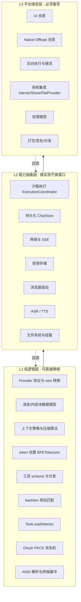

## 16. 跨平台移植：从 iOS/Android 抽到 macOS/Windows/Linux

### 16.1 这一章解决什么问题

前 15 章讲的是"这个 iOS/Android 应用是怎么造的"。这一章回答倒过来的问题：**这套架构里有多少是平台无关的，多少是被移动端强行塑形的，把它挪到桌面端要重写什么、能白拿什么。**

不做这个分析，读者从零开发时最容易犯的错误是两个极端之一：要么一上来就上跨平台框架，结果沙箱、后台执行、系统集成三层全部烂在抽象漏洞里；要么两端各写一遍且不做任何契约固化，半年后两端行为漂移到无法互相验证。OpenMinis 自己选的是第二条路的一个变体——**不共享代码，共享数据与测试向量**——这一章要说清楚它为什么这么选、代价是什么、桌面端该怎么走。

### 16.2 事实先行：这个项目实际共享了多少

`src/shared/` 全部内容：

```
src/shared/bashism/bashism_rules.json          （规则表）
src/shared/bashism/bashism_test_vectors.json   （68 行测试向量）
src/shared/bashism/validate_detector.swift     （70 行独立校验脚本）
```

合计 298 行。对照 iOS 186,750 行 Swift + Android 154,146 行 Kotlin —— **共享率约 0.087%**。

两端**同名文件**（按 basename 匹配 `.swift` 与 `.kt`）有 82 个，占 iOS 唯一文件名 362 个的 22.7%、Android 453 个的 18.1%。这 82 个名字就是"同一概念在两端各实现一遍"的清单：

```
AnthropicProvider  BPETokenizer  BashismDetector  BashismReminder
BrowserHistory  BrowserTabPool  BrowserUseManager  BrowserWebView
ChatModels  ClaudeOAuthManager  ConfigAuditEntry  ConfigAuditLog
ConfigCollection  ConfigConfirmationGate  ConfigError  ConfigField
ConfigRegistry  ContextPolicy  CorrectionAdmission  CorrectionContextBuilder
CorrectionSignalSource  CorrectionStrategy  DebugMethodRegistry  DebugServer
DeepLinkCoordinator  DeviceIdentity  EnvVarPrivacyStore  EnvVarRedactor
FileMentionIndex  GeminiProvider  LLMError  LLMProvider
MCPOAuthController  MinisConfigPermissionStore  MountedFolderCoordinator
NetworkMonitor  OffloadPermissionManager  OnDemandBash  OpenAIProvider
PendingShare  PhoneticNormalizer  RootfsManager  SentenceSplitter
SessionBadgeStore  SessionForkManager  ShareCoordinator  SoulStore
SpeechRecognitionManager  TerminalBuffer  TerminalCanvasView  TerminalEmulator
TerminalInputView  TerminalTypes  TextSegmenter  ThinkingLevelCatalog
ToolLoopDetector  TypedVocabularyBuilder  VocabularyFilter  VoiceCorrectionDiff
VoiceCorrectionEngine  VoiceCorrectionRecorder  VoiceProvider
VoiceProviderFactory  VoiceTextSanitizer  WebAppPathResolver  XAIOAuthManager
…（共 82）
```

（完整清单可用 `comm -12 <(find src/ios -name '*.swift' -exec basename {} .swift \; | sort -u) <(find src/android -name '*.kt' -exec basename {} .kt \; | sort -u)` 复现。）

**这 82 个名字，就是"平台无关核心"的天然候选集。** 注意它们的分布：Provider 层、上下文策略、配置系统、语音纠错、终端模拟器、bashism、OAuth 管理器——全是纯逻辑。缺席的是：所有 `Views/`、`ui/`、`NativeOffloads/`、`offload/` 下的东西。

### 16.3 三个层次的可移植性

把整个系统按"移植成本"切成三层：



#### L1 — 纯逻辑层，可直接移植

判据：只依赖标准库 + JSON + 正则 + 字符串处理，不 import 任何平台框架。

iOS 侧的框架依赖统计（`grep -rhoE "^import [A-Za-z]+" src/ios --include="*.swift" | sort | uniq -c | sort -rn`）：

| import | 次数 | 性质 |
|---|---|---|
| `Foundation` | 237 | 跨平台（swift-corelibs-foundation 在 Linux 可用） |
| `SwiftUI` | 103 | Apple 专有 |
| `UIKit` | 84 | iOS 专有（macOS 需换 AppKit） |
| `os` / `OSLog` | 46 | Apple 专有，易替换 |
| `Combine` | 24 | Apple 专有 |
| `CryptoKit` | 20 | Apple 专有，有 swift-crypto 对应 |
| `AVFoundation` | 20 | Apple 专有 |
| `WebKit` | 16 | Apple 专有 |
| `SQLite`(SQLite3) | 13 | 跨平台 |
| `AppIntents` | 14 | Apple 专有 |

**只 import `Foundation`（+可选 `SQLite3`）的文件就是 L1 候选。** 237 处 `Foundation` 与 103 处 `SwiftUI` 的差值给出一个粗略量级：约 130 个文件不碰 UI 框架。

Android 侧同理（`androidx.compose` 5,900 次 import 集中在 `ui/`，`kotlinx.coroutines` 646 次则遍布全层）。Kotlin 侧的 L1 迁移路径更顺——`kotlinx.serialization` + `kotlinx.coroutines` + OkHttp 本就是 JVM 库，`android.*` 才是绑定点。

L1 层最典型的例子是 Provider 协议本身。iOS 的 `src/ios/Providers/LLMProvider.swift` 只有 20 行：

```swift
import Foundation

protocol LLMProvider {
    var name: String { get }
    var model: LLMModel { get set }

    func sendMessage(
        messages: [LLMMessage], systemPrompt: String?,
        maxTokens: Int, temperature: Double?
    ) async throws -> LLMResponse

    func streamMessage(
        messages: [LLMMessage], systemPrompt: String?,
        maxTokens: Int, temperature: Double?
    ) async throws -> AsyncThrowingStream<LLMStreamChunk, Error>
}
```

Android 的 `provider/LLMProvider.kt:13-118` 是同一概念的更成熟版本（多了 `imageParts`、`tools`、`thinkingLevel`、能力位与结构化钳制）。**两者唯一的平台耦合是流类型：`AsyncThrowingStream` vs `Flow`。** 换成任何语言的异步流原语（Rust `Stream`、TS `AsyncIterable`、Go channel）语义都成立。

#### L2 — 能力抽象层，换实现不换接口

判据：接口是平台无关的，实现全是平台特定的。这层的质量决定移植成本。

以沙箱执行协调器为例，两端接口高度收敛：

`src/ios/Agent/ISH/ISHExecutionCoordinator.swift`（852 行，`actor`）：

| 成员 | 行 |
|---|---|
| `struct ISHCommandResult` | 8 |
| `enum ISHCoordinatorError` | 14 |
| `actor ISHExecutionCoordinator` | 39 |
| `func execute(…)` | 93 |
| `func mountForSession(_:)` | 141 |
| `func ensureMounted(for:)` | 159 |
| `func hostURL(for:sessionId:)` | 191 |
| `func stopCurrentCommand()` | 210 |
| `func stopCurrentCommand(sessionId:)` | 221 |
| `func sessionDidTerminate(sessionId:)` | 232 |

`src/android/app/src/main/java/com/openminis/app/sandbox/ExecutionCoordinator.kt`（300 行，`object`）：

| 成员 | 行 |
|---|---|
| `object ExecutionCoordinator` | 26 |
| `data class CommandResult` | 30 |
| `fun init(context)` | 59 |
| `suspend fun execute(…)` | 72 |
| `private suspend fun getOrCreateShell(sessionId)` | 132 |
| `private fun buildSessionBindMounts(sessionId)` | 170 |
| `fun sessionDidTerminate(sessionId)` | 229 |
| `fun stopCurrentCommand(sessionId)` | 244 |
| `fun stopCurrentCommand()` | 261 |
| `suspend fun broadcastTimezoneChange()` | 274 |
| `suspend fun broadcastProxyChange()` | 292 |

**接口对齐得几乎可以逐行对照**：`execute` / `stopCurrentCommand`（含带 sessionId 与不带的两个重载）/ `sessionDidTerminate` / 会话级挂载。差异在实现深度：iOS 852 行里有 ~450 行在处理 fakefs 元数据（`ensureFakefsMetadata:726`、`batchEnsureFakefsMetadata:784`、`makeStatBlob:811`），因为 iSH 的虚拟文件系统需要 App 侧直接写 SQLite 元数据表；Android 300 行不需要，因为 PRoot 是原生执行，宿主文件系统就是真文件系统。

这正是 L2 的定义：**同一个接口，一边 852 行一边 300 行，差的全是平台税。**

移植到桌面时，L2 的 `ExecutionCoordinator` 接口原样保留，实现替换为：

| 平台 | 沙箱实现 | 成本 |
|---|---|---|
| Linux | 直接 `fork/exec` + namespaces/bubblewrap，或什么都不做直接跑 | 最低，很多约束消失 |
| macOS | `sandbox-exec` / 直接子进程 / Docker | 低 |
| Windows | WSL2 / 直接子进程 + 路径转换 | 中，路径语义差异大 |

#### L3 — 平台绑定层，必须重写

这层没有捷径。iOS 的 `NativeOffloads/` 有 64 个文件 24,259 行，其中 `HealthKitOffload.m` 3,773 行、`NFCOffload.m` 2,152 行、`PhotosOffload.m` 1,378 行、`CalendarOffload.m` 1,179 行、`BluetoothOffload.m` 1,061 行——**这些在桌面端根本没有对应物**，不是"难移植"，是"概念不存在"。

反过来，桌面端有移动端没有的能力面：任意进程管理、多窗口、全局快捷键、系统托盘、无沙箱的文件系统访问、真正的后台常驻。**L3 不是移植，是替换。**

### 16.4 移动端强加的约束，桌面端会消失哪些

这是从零开发时最值得先想清楚的一张表。左列是本书前 15 章里被反复提到的移动端难点，右列是它在桌面端的命运。

| 移动端约束 | 本书章节 | 桌面端 |
|---|---|---|
| 无法 fork/exec 任意二进制（iOS） | 6 | 消失。直接起进程 |
| 无 W^X，JIT 受限（iOS） | 6 | 消失。iSH 整层不需要 |
| 必须自带 rootfs 并从源码构建 | 6/7/15 | 消失。用宿主 shell 或系统容器 |
| exec 位在 app 数据目录被禁（Android） | 7 | 消失 |
| 后台执行有硬时间预算 | 13 | 消失。进程想跑多久跑多久 |
| Doze / 前台服务 / Live Activity 保活 | 13 | 消失。换成托盘 + 通知 |
| 应用商店审核对"执行任意代码"的敏感 | 6/15 | 大幅缓解 |
| 内存上限与 OOM kill | 6/12 | 大幅缓解 |
| 长对话渲染必须回落到 UICollectionView | 12 | 缓解但不消失（虚拟化仍需要） |
| 权限必须逐项动态申请 | 5/8 | 大部分消失，少数（麦克风/屏幕录制/辅助功能）保留 |
| Scoped storage / SAF 挂载 | 7 | 消失 |
| 键盘遮挡、安全区、动态字号 | 12 | 消失，换成窗口管理问题 |

**结论：桌面端能砍掉的是第 6、7 章的绝大部分和第 13 章的大部分。** 一个 Linux/macOS 版的 OpenMinis，L3 层的工作量大约是移动端的三分之一，但 L1+L2 可以近乎完整继承。

反向的新增成本：多窗口状态管理、自动更新、跨平台打包签名（三套）、系统托盘与全局热键、以及桌面用户对"文件到底存在哪"的更高期待。

### 16.5 为什么这个项目不用跨平台框架

代码里没有直接写明理由，但从依赖与实现选择可以反推出四条硬约束。以下每条都有代码证据，推论部分标注 `[推断]`。

**（1）沙箱层根本无法共享。** iOS 走 iSH（用户态 ARM64 指令模拟，`deps/build_ish.sh` 产出 `libish.a`/`libish_emu.a`/`libfakefs.a`），Android 走 PRoot（ptrace 路径重写，`deps/build_proot.sh`）。这两者的本质区别是"模拟执行"与"原生执行"——不是 API 差异，是执行模型差异。任何跨平台框架都抹不平。这是**事实**，见 `BUILDING.md:86-108` 与 `BUILDING.md:162-180`。

**（2）UI 是性能瓶颈所在，不能交给抽象层。** iOS 的消息列表专门回落到了 UIKit 的 `CollectionViewMessageListV3.swift`（4,290 行）而不是用 SwiftUI List；Android 自己实现了 `MinisTextKitSelection.kt`（1,152 行）与 `MinisTextKitGesture.kt`（935 行）来做文本选择而不是用现成组件。**两端都在各自平台上打穿到了原生层去解决性能与交互问题。** 一个跨平台 UI 框架会把这条路堵死。（第 12 章展开。）

**（3）设备能力面完全不重叠。** iOS 独有 HealthKit / HomeKit / EventKit / NFC / WeatherKit / AppIntents；Android 独有 AccessibilityService / Shizuku / SAF。`NativeOffloads/` 与 `sandbox/offload/` 的文件名对照会发现两边各有一半对方没有。（第 8 章展开。）

**（4）`[推断]` 团队规模与迭代速度。** README 明确写"这是私有开发树的镜像，不接受 PR"，且 662 个 `[T-xxx]` 标签显示大量设计决策由用户报告直接驱动。在这种"快速响应真实反馈"的模式下，跨平台框架的抽象层每次都要多改一处，反而拖慢。这条是推断，代码里没有直接说。

### 16.6 它选的替代方案：共享数据与测试向量

不共享代码，那怎么防止两端行为漂移？答案是 bashism 检测器的做法，值得完整看一遍，因为这是可以直接照搬的模式。

**共享的是规则表，不是代码。** iOS 侧（`src/ios/Agent/Shell/BashismDetector.swift:7-9`）：

```swift
/// (T-bash-on-demand). Rules and their fix hints live in the shared JSON
/// (`bashism_rules.json`, also loaded by Android) — this type is only the
/// matching engine.
```

Android 侧（`src/android/app/src/main/java/com/openminis/app/agent/shell/BashismDetector.kt:10-13`）：

```kotlin
 * switch to bash only when needed (T-bash-on-demand). The rule table and its
 * fix hints are the SHARED JSON (assets/bashism/bashism_rules.json, generated
 * from src/shared/bashism — the same file iOS loads), so the two platforms can
 * never drift.
```

**分发靠各自的构建系统指向同一物理文件**，而不是拷贝。Android（`src/android/app/build.gradle.kts:124-128`）：

```kotlin
from(rootProject.file("../shared/bashism")) {
    include("bashism_rules.json", "bashism_test_vectors.json")
}
into(layout.projectDirectory.dir("src/main/assets/bashism"))
```

iOS 用 `sourceTree = SOURCE_ROOT` 相对引用（`src/ios/Minis.xcodeproj/project.pbxproj:716-717`）：

```
E5BSH0014 /* bashism_rules.json */ = {isa = PBXFileReference;
  name = bashism_rules.json;
  path = ../shared/bashism/bashism_rules.json;
  sourceTree = SOURCE_ROOT; };
```

**共享的第二样东西是测试向量。** `src/shared/bashism/bashism_test_vectors.json`（68 行）被两端的测试各自加载：

Android（`src/android/app/src/test/java/com/openminis/app/agent/shell/BashismDetectorTest.kt:28-34`）：

```kotlin
@Before fun loadRules() {
    val rulesJson = File(sharedDir, "bashism_rules.json").readText()
    BashismDetector.loadRulesForTest(rulesJson)
}
private fun vectors(): JSONObject =
    JSONObject(File(sharedDir, "bashism_test_vectors.json").readText())
```

iOS 侧因为项目结构限制走了独立脚本（`src/shared/bashism/validate_detector.swift:2-6`）：

```swift
// Runs the iOS detector algorithm (Foundation NSRegularExpression, the same
// engine the app uses) against bashism_rules.json + bashism_test_vectors.json.
// The Xcode MinisTests host target can't link the iSH static libs in this
// project, so this standalone harness is the canonical iOS-side regression
// gate. Run: `swift src/shared/bashism/validate_detector.swift`
```

注意最后这条注释暴露的真实约束：**iOS 测试目标链不动 iSH 静态库，所以整个 `MinisTests` target 跑不了依赖沙箱的测试**，只能用一个 300 行不到的独立 Swift 脚本当回归门。这是移动端工程的典型妥协，桌面端不会有。

**共享的第三样东西是设计追踪码。** 35 个 `[T-xxx]` 标签同时出现在两端（见 §0.3），它们标记的就是"两端必须一致"的行为契约。`[T-bash-on-demand]` 在 iOS 的 `AIChatViewModel+ISHCommand.swift:27`、`OnDemandBash.swift:6`、`BashismReminder.swift:5`、`BashismDetector.swift:7` 与 Android 的 `ChatViewModel.kt:7171`、`BashismDetectorTest.kt:16` 都出现，形成一条可 grep 的横切索引。

### 16.7 桌面端移植的具体建议

假设读者要写 macOS/Windows/Linux 版，按 L1/L2/L3 分层的落地路径：

**L1 — 抽成独立库。** 语言选择上，如果目标是"三桌面 + 两移动"，Kotlin Multiplatform 或 Rust core 是现实选项；如果只做桌面，随便什么都行。要抽出来的具体内容（对照 §16.2 那 82 个名字）：

| 模块 | iOS 参照 | Android 参照 |
|---|---|---|
| Provider 协议 + 各家 wire 转换 | `src/ios/Providers/LLMProvider.swift` + `Providers/*/` | `provider/LLMProvider.kt` + `provider/*/` |
| 消息数据模型 | `src/ios/Agent/Chat/ChatModels.swift` | `data/model/` |
| 上下文策略 | `src/ios/Agent/Chat/ContextPolicy.swift` | ChatViewModel 内相应逻辑 |
| token 估算 | `src/ios/Shared/BPETokenizer.swift` | `BPETokenizer.kt` |
| 工具循环检测 | `src/ios/Agent/ToolLoopDetector.swift` | `agent/ToolLoopDetector.kt` |
| bashism | `src/ios/Agent/Shell/BashismDetector.swift` | `agent/shell/BashismDetector.kt` |
| OAuth 管理器 | `src/ios/Providers/*/OAuth/` | `auth/` |
| 终端模拟 | `src/ios/iSH/Terminal/{ANSIParser,TerminalBuffer,TerminalTypes}.swift` | `ui/terminal/emulator/` |
| 配置系统 | `src/ios/Shared/Config/` | `config/` |
| 语音纠错 | `src/ios/Agent/Speech/` | `speech/correction/` |

**L2 — 定义接口，桌面各写一份实现。** 优先级从高到低：

1. `ExecutionCoordinator`（沙箱执行）——桌面端最简单，直接子进程
2. `ChatStore`（持久化）——SQLite 三平台通用，iOS 已经是裸 `SQLite3`（13 个文件 `import SQLite3`，`ChatStore.swift:433` 直接 `sqlite3_open`），移植无痛
3. 密钥存储——macOS Keychain / Windows DPAPI / Linux Secret Service
4. HTTP + SSE——任何平台都有
5. 浏览器驱动——桌面可以用 CDP 直连真 Chrome，比移动端的 WKWebView/WebView 注入方案强得多

**L3 — 从零写。** 桌面 UI 建议直接用原生（SwiftUI on macOS / WinUI / GTK）或 Tauri 这类"原生外壳 + Web 内容"，但**消息列表的虚拟化必须自己做**——第 12 章的教训在桌面同样成立，只是阈值更高。

**砍掉清单：** iSH 整层、PRoot 整层、rootfs 构建流水线、后台保活、Live Activity、App Intents、Share Extension、FileProvider、SAF 挂载、Shizuku、AccessibilityService、HealthKit/HomeKit/NFC 系列 offload。这些加起来是移动端代码量的一大块。

### 16.8 平台对照

| 维度 | iOS | Android | macOS | Windows | Linux |
|---|---|---|---|---|---|
| 沙箱执行 | iSH 指令模拟 | PRoot ptrace 重写 | 直接子进程 / sandbox-exec | WSL2 / 子进程 | 直接子进程 / bwrap |
| 二进制来源 | 必须自带 rootfs | 必须自带 rootfs | 可用系统 | 需 WSL 或自带 | 用系统 |
| UI 框架 | SwiftUI + UIKit 回落 | Compose + 自研文本层 | SwiftUI/AppKit | WinUI/WPF | GTK/Qt |
| 长列表虚拟化 | 必须（UICollectionView） | 必须（LazyColumn + 自研） | 建议 | 建议 | 建议 |
| 后台执行 | BGTask + 音频 + Live Activity | 前台服务 + Doze 白名单 | 无限制 | 无限制 | 无限制 |
| 密钥存储 | Keychain | EncryptedSharedPreferences | Keychain | DPAPI/CredMan | Secret Service |
| 持久化 | 裸 SQLite3 | Room | SQLite | SQLite | SQLite |
| 浏览器 | WKWebView + JS 注入 | WebView + JS 注入 | CDP 直连 | CDP 直连 | CDP 直连 |
| 设备能力 | 极丰富（HealthKit 等） | 丰富（+ Shizuku/无障碍） | 中等 | 中等 | 少 |
| 分发 | App Store 审核 | APK 直装 / Play | 公证 | 签名 | 包管理器 |
| 「执行任意代码」政策风险 | 高 | 低 | 低 | 低 | 无 |

### 16.9 设计取舍与踩坑

**取舍一：两端各写一遍，用数据与测试向量对齐。** 收益是每端都能打穿到原生层解决性能问题（第 12 章的两个例子）、能各自吃满平台独有能力（第 8 章）。代价是 82 个概念要维护两份实现，且**只有 bashism 这一个子系统真正做了共享校验**——其余 81 个概念的两端一致性靠人的纪律，没有机械门禁。这是这个方案最脆弱的地方。

**踩坑一：iOS 测试目标链不动沙箱静态库。** `validate_detector.swift:4-6` 明确写了 `MinisTests` host target 无法链接 iSH 静态库，所以沙箱相关的 iOS 测试实际上不存在，只能靠独立脚本。Android 侧有 `src/android/app/src/androidTest/java/com/openminis/app/sandbox/`（5 个 instrumented 测试：`ExecutionCoordinatorInstrumentedTest.kt`、`PRootKernelInstrumentedTest.kt`、`RootfsManagerInstrumentedTest.kt`、`ShellExecutorInstrumentedTest.kt`、`TerminalSanitizerInstrumentedTest.kt`）做真机验证。**两端的测试能力不对等，是 iOS 侧的结构性缺陷**，桌面端不会遇到，但从零开发时要提前设计好测试宿主。

**踩坑二：iOS 部署目标不统一。** `project.pbxproj` 里出现三个不同的 `IPHONEOS_DEPLOYMENT_TARGET`：`16.0`、`16.2`、`26.2`，`SWIFT_VERSION` 也有 `5.0` 与 `6.0` 两种。主 App 按 `BUILDING.md:79` 是 iOS 26.2 + Swift 6.0，较低的值应属扩展目标或依赖包。`[推断]` 这是扩展 target（Share/Widget/FileProvider）为了兼容性单独下调所致。从零开发时要意识到**多 target 的部署目标会分叉**，共享代码必须按最低的那个写。

**踩坑三：共享 JSON 的构建期搬运是单向的。** Android 用 Gradle copy 到 `assets/`，iOS 用相对路径引用源文件。这意味着**改了 `src/shared/bashism/bashism_rules.json` 后，Android 必须重跑那个 copy task 才生效，iOS 立即生效**。两端的生效时机不一致，容易在本地调试时误判。从零开发时建议两端都用符号链接或都用构建期拷贝，不要混。

**踩坑四：`.github/` 没有 workflow。** 共享测试向量存在，但没有任何自动化在每次提交时跑 `validate_detector.swift` 和 Android 的 `BashismDetectorTest`。**共享数据的价值有一半浪费掉了**——它防住了规则漂移，但没防住实现漂移。这是读者从零开发时最该补上的一环，成本极低（两条命令）。

### 16.10 从零实现清单

如果读者的目标是"一套核心，五个平台"，按这个顺序做：

1. **先只做一个平台，做到能用。** 不要一上来就抽象。参照第 17 章的路线图，先在你最熟的平台上把 agent 循环 + 一个 provider + 三个文件工具跑通。
   - *验收*：能多轮对话，能让模型读写文件，能中途取消。

2. **第二个平台开始前，把 L1 划出来。** 判据就是 §16.3 给的：只依赖标准库与 JSON/正则的文件。此时你已经知道哪些是纯逻辑了，不会过度抽象。
   - *验收*：L1 部分能在没有任何 UI 框架的环境下编译并通过单测。

3. **为 L1 里每个「行为契约」写测试向量文件，而不是测试代码。** 照抄 bashism 的做法：规则/期望输入输出放 JSON，每端只写加载器与断言。
   - *验收*：同一份 `*_test_vectors.json` 被两端测试各自加载并全绿。

4. **定义 L2 接口，写第一个平台的实现。** 优先做 `ExecutionCoordinator`（或你的等价物）与 `ChatStore`，接口签名照 §16.3 的对照表来——`execute` / `stopCurrentCommand()` / `stopCurrentCommand(sessionId)` / `sessionDidTerminate(sessionId)` 这四件套是被两个真实实现验证过的最小集。
   - *验收*：接口里不出现任何平台类型（`Context`、`UIViewController`、`Activity`）。

5. **加 CI，哪怕只有两行。** 每次提交跑 L1 单测 + 共享向量校验。这是 OpenMinis 缺失的一环，而它几乎免费。
   - *验收*：改坏 L1 逻辑会导致 CI 红。

6. **第二个平台：只实现 L2 + L3，L1 直接链过来（或按 §16.6 的方式共享数据）。**
   - *验收*：第二平台的代码量里 L1 占比为 0。

7. **桌面端：从第二平台的 L2 实现 fork，把移动端的约束一条条删掉。** 对照 §16.4 的表，删一条验证一条。
   - *验收*：桌面版的沙箱层代码量显著小于移动端（参照：iOS 852 行 vs Android 300 行的差距，桌面应更少）。

8. **建立横切索引。** 采用 `[T-xxx]` 式的追踪码，凡是「两端必须一致」的决策都打同一个标签。这样 `grep` 一次就能找齐所有相关实现点。
   - *验收*：随机抽一个跨端行为，能在 30 秒内用一次 grep 定位到两端全部实现点。

可以砍掉的：第 2 步之前的任何抽象努力；跨平台 UI 框架；把 L3 也塞进抽象层的尝试。

### 16.11 关键文件索引

| 路径 | 行数 | 职责 |
|---|---|---|
| `src/shared/bashism/bashism_rules.json` | — | 两端共享的 bashism 规则表，唯一真源 |
| `src/shared/bashism/bashism_test_vectors.json` | 68 | 两端共享的测试向量 |
| `src/shared/bashism/validate_detector.swift` | 70 | iOS 侧独立回归门（MinisTests 链不动 iSH 时的替代） |
| `src/ios/Providers/LLMProvider.swift` | 20 | iOS provider 协议，L1 的最小样本 |
| `src/android/.../provider/LLMProvider.kt` | 162 | Android provider 接口 + 结构化钳制 + 空流检测 |
| `src/ios/Agent/ISH/ISHExecutionCoordinator.swift` | 852 | iOS 沙箱执行协调（含 fakefs 元数据写入） |
| `src/android/.../sandbox/ExecutionCoordinator.kt` | 300 | Android 沙箱执行协调，同接口不同实现 |
| `src/ios/Agent/Shell/BashismDetector.swift` | — | iOS 匹配引擎（规则来自共享 JSON） |
| `src/android/.../agent/shell/BashismDetector.kt` | — | Android 匹配引擎（同一份规则） |
| `src/android/.../agent/shell/BashismDetectorTest.kt` | — | 加载共享向量的 Android 单测 |
| `src/android/app/build.gradle.kts` | — | 第 124-128 行把共享 JSON 拷进 assets |
| `src/ios/Minis.xcodeproj/project.pbxproj` | — | 第 716-717 行以相对路径引用同一份共享 JSON |
| `BUILDING.md` | 236 | 两端原生依赖与部署目标的权威说明 |
