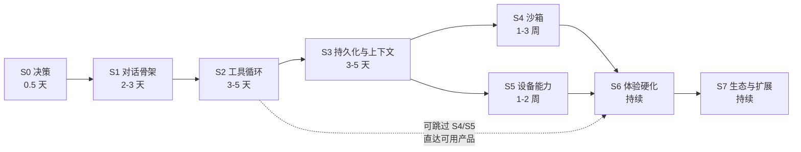

## 17. 从零开始的实施路线图

### 17.1 这一章解决什么问题

前 16 章拆的是一个 34 万行、已上架、迭代过多轮真实用户反馈的成熟产品。直接照着它写，第一天就会淹死在 iSH 编译、Live Activity 保活和 fakefs 元数据里。

这一章把它压回成一条**按"每一步都能跑起来"排序的实施路径**：每个阶段给出交付物、验收标准（一个可以亲手执行的动作）、对应的正文章节、以及**明确允许砍掉的东西**。目标是让读者在第 3 天就有一个能多轮对话+调用工具的东西，而不是在第 3 周还在配 NDK。

排序原则只有一条：**先建立反馈闭环，再加能力面。** 一个能对话、能调一个工具、能看到结果的最小系统，比一个功能齐全但跑不起来的骨架有价值一百倍。

### 17.2 全景：七个阶段



| 阶段 | 交付物 | 主要章节 | 可否跳过 |
|---|---|---|---|
| S0 | 技术选型与边界决策 | 1, 16 | 否 |
| S1 | 能流式对话的 App | 2, 4, 12 | 否 |
| S2 | 能调工具的 agent | 2, 5 | 否 |
| S3 | 会话不丢、上下文不炸 | 3, 11 | 否 |
| S4 | 真 Linux 沙箱 | 6, 7 | **可以**，见 §17.7 |
| S5 | 设备能力接入 | 8 | 可以，按需 |
| S6 | 性能、后台、错误处理 | 12, 13, 15 | 否（决定能否上线） |
| S7 | Skills / MCP / 浏览器 / 同步 | 9, 10, 11 | 可以，按需 |

### 17.3 S0 — 决策阶段（半天）

在写第一行代码前必须定的五件事。每一条都给出 OpenMinis 的选择与它的代价，读者不必照抄，但必须做出选择。

| 决策 | OpenMinis 的选择 | 代价 | 何时该换 |
|---|---|---|---|
| 跨平台策略 | 两端各写一遍，共享 298 行数据（第 16 章） | 82 个概念维护两份 | 团队 < 3 人 → 考虑 KMP/Rust core |
| 工具能力来源 | 给模型真 Linux shell（`sandbox/` 14,900 行 vs `tools/` 881 行） | 首次构建 30–60 分钟，审核风险 | 只做垂直场景 → 手写工具就够 |
| 模型接入 | 自带 Key，多 provider（`Providers/` 27,378 行） | 认证复杂度高 | 单一模型 → 直接写死 |
| 持久化 | iOS 裸 SQLite3 / Android Room | 两端 schema 手工对齐 | 需要同步 → 先设计可移植记录格式 |
| UI 框架 | 各自原生，性能点打穿到 UIKit/自研文本层 | UI 代码占近一半 | 不追求长对话流畅 → 用现成组件 |

**S0 的验收标准**：把上表五行填成你自己的答案，写进一个 `DECISIONS.md`。后面每次想加抽象层时回来看一眼。

一条建议：**S0 阶段不要选跨平台 UI 框架**。第 12 章会展示 OpenMinis 两端都被迫打穿到原生层（iOS 用 UICollectionView，Android 自研文本选择）来解决长对话的性能与交互——这两个点是 agent 应用的必经之路，跨平台 UI 框架在这里会变成阻碍而不是加速。

### 17.4 S1 — 对话骨架（2–3 天）

**目标**：一个能选模型、能流式看到回复、能中途停的对话界面。没有工具，没有持久化，重启清空。

步骤：

1. **定义消息数据模型。** 参照第 2 章的 `ChatModels`。关键点：消息不是字符串，是**内容块（content block）数组**——文本块、思考块、工具调用块、工具结果块、媒体块。一开始就按块建模，后面加 thinking 和多模态才不用重写。
   - *验收*：能构造一个包含「文本 + 工具调用 + 工具结果」三块的消息并序列化成 JSON。

2. **写 Provider 协议。** 照第 4 章。最小签名就是 iOS 那 20 行（`src/ios/Providers/LLMProvider.swift`）：`name`、`model`、`sendMessage`、`streamMessage`。
   - *验收*：协议里不出现任何具体 provider 的名字或字段。

3. **实现第一个 provider。** 建议从 Anthropic Messages API 或 OpenAI Chat Completions 起步——它们的 SSE 格式文档最全。**只做流式**，非流式后面再补（agent 应用 99% 的请求是流式）。
   - *验收*：命令行或单测里能收到逐块到达的文本 delta。

4. **接上最朴素的 UI。** 此时用 `List`/`LazyColumn` 就行，性能问题留给 S6。
   - *验收*：输入一句话，文字逐字出现。

5. **实现取消。** 这一步很多人推迟，是错的——取消路径会影响后面每一层的接口设计（第 2 章会展示取消要同时清理在途请求、在途工具、在途 shell 进程）。现在只有请求这一层，接口最容易定。
   - *验收*：流式过程中点停止，网络请求真的断开（抓包或看日志确认，不是 UI 假装停了）。

**允许砍掉**：多 provider、OAuth（先只支持 API Key）、模型列表拉取、thinking 块渲染、错误重试。

**这一步最容易踩的坑**：SSE 解析写得太随意。`src/android/.../provider/LLMProvider.kt:120-162` 的 `failOnSilentEmptyCompletion` 就是补丁——上游断流时 SSE 会"正常结束"但没有任何内容和 finish reason，界面会静悄悄停住，用户完全不知道发生了什么。**从一开始就区分「正常结束」「有内容的结束」「空结束」三种状态**：

```kotlin
// 来源 src/android/.../provider/LLMProvider.kt:138-161（精简）
fun Flow<LLMStreamChunk>.failOnSilentEmptyCompletion(providerName: String) = flow {
    var sawContent = false; var sawFinishReason = false
    collect { chunk ->
        when (chunk) {
            is LLMStreamChunk.Text -> if (chunk.text.isNotEmpty()) sawContent = true
            is LLMStreamChunk.ToolUseStart, is LLMStreamChunk.ToolCallComplete -> sawContent = true
            is LLMStreamChunk.Finished -> if (chunk.stopReason != null) sawFinishReason = true
            else -> {}
        }
        emit(chunk)
    }
    if (!sawContent && !sawFinishReason) {
        throw LLMError.TransientError("Server returned an empty response")
    }
}
```

### 17.5 S2 — 工具循环（3–5 天）

**目标**：模型能调用工具，结果回灌后继续推理，直到给出最终答案。这是"聊天应用"变成"agent"的分界线。

步骤：

1. **定义工具 schema 与执行结果类型。** 参照第 5 章。结果类型至少要能表达：成功+文本、成功+媒体、失败+错误信息、被用户拒绝。
   - *验收*：一个工具执行失败时，模型收到的是结构化错误而不是异常堆栈。

2. **实现三个文件工具：read / write / edit。** 第 5 章会详细讲这三个的实现细节——行号、偏移限制、字符串替换的唯一性校验、大文件截断。**这三个工具的质量直接决定 agent 可用性**，值得花时间。
   - *验收*：让模型读一个 500 行文件的第 100–150 行、改其中一行、再读回来确认。

3. **写主循环状态机。** 第 2 章的核心。最小状态集：`idle → streaming → toolPending → toolRunning → streaming → … → done`，加上 `error` 和 `cancelled` 两个终态。
   - *验收*：画出你的状态图，每条边都能在代码里指出触发点。

4. **串行执行工具先。** 并发（第 2 章的 `+ConcurrentTools`）是优化，不是必需。
   - *验收*：模型一次返回两个工具调用时，按顺序执行、按顺序回灌。

5. **加轮数上限与循环检测。** 参照 `src/ios/Agent/ToolLoopDetector.swift` / `agent/ToolLoopDetector.kt`。没有这个，模型陷入重复调用时会烧光你的额度。
   - *验收*：人为构造一个必然循环的场景（比如让模型读一个不存在的文件并要求它重试），确认在 N 轮后被拦下。

6. **加工具预检门。** 第 5 章。参数校验和危险操作确认都在分发层做一次，不在每个工具里重复。
   - *验收*：新增一个工具时，不需要写任何权限或校验代码。

**允许砍掉**：并发工具执行、工具结果的 `minis://` URL 化、图片结果回传、工具卡片 UI（先用纯文本展示）。

**这一步的关键判断**：工具数量要克制。OpenMinis 的 `tools/` 只有 881 行 8 个文件，能力靠的是沙箱和 offload。**如果你在 S2 阶段写到第 15 个工具，说明方向错了**——要么该上沙箱（S4），要么该用 MCP（S7）。

### 17.6 S3 — 持久化与上下文（3–5 天）

**目标**：关掉 App 再打开，对话还在；聊到 100 轮不会因为超上下文而崩。

步骤：

1. **设计会话存储。** 第 11 章。三层：会话元信息表、消息表（内容块序列化成 JSON 存一列）、附件走文件系统。**不要把附件塞进数据库。**
   - *验收*：一个带 3 张图的 50 条消息会话，冷启动加载 < 300ms。

2. **实现 token 估算。** 第 3 章的 `BPETokenizer`。本地估算不需要精确，需要的是**保守**——宁可高估。
   - *验收*：对一段已知 token 数的文本，估算误差在 ±15% 内且偏向高估。

3. **定义上下文策略。** 第 3 章的 `ContextPolicy`。每个模型的窗口大小、触发压缩的水位线、保留多少最近消息。
   - *验收*：切换到一个小窗口模型时，水位线自动跟着变。

4. **实现压缩。** 第 3 章的重点。最小版本：超水位时，把最老的一批消息交给模型做摘要，用摘要替换它们，保留最近 N 轮完整。
   - *验收*：一个必然超限的长对话能自动压缩并继续，且压缩后模型仍记得早期的关键信息（人工验证一次）。

5. **加持久 memory 工具。** 第 3/9 章。让模型能主动写下跨会话的事实。
   - *验收*：在会话 A 里让模型记住一件事，新建会话 B 后它还知道。

**允许砍掉**：跨设备同步（S7）、会话搜索、附件缩略图、压缩失败的降级路径（先直接报错）。

**这一步最容易低估的**：压缩不是"截断"。截断会让模型突然失忆并开始重复已经做过的工作。压缩必须产出**可用的摘要**，且摘要要用和用户相同的语言——OpenMinis 两端都在 compaction prompt 里显式要求这一点（第 3 章会给出具体位置）。

### 17.7 S4 — 沙箱（1–3 周）· 这一步可以完全跳过

**先说跳过的条件。** 如果满足以下任一条，S4 应该跳过或推迟：

- 你的场景是垂直的（记账、笔记、翻译），模型不需要执行任意代码
- 你在做桌面端（第 16 章：桌面端根本不需要 iSH/PRoot，直接起子进程）
- 你还没验证过产品价值

**跳过 S4 的替代方案**：把 S2 的工具集扩展到 8–12 个覆盖你的场景，加上 MCP（S7）接外部能力。这条路能到达一个完全可用的产品。

**如果要做 S4**，按平台分岔：

**Android 路径（更容易，建议先做）**：

1. 拿到 Alpine aarch64 minirootfs，解压到应用私有目录（参照 `scripts/prepare_android_sandbox.sh`）
   - *验收*：`RootfsManager` 等价物能幂等地完成解压，重复调用不重复解压
2. 交叉编译 PRoot（参照 `deps/build_proot.sh`，需 NDK r28+），**放进 `jniLibs/arm64-v8a/`**——第 7 章会解释为什么不能放 `assets/` 后 chmod +x（Android 禁止从应用数据目录 exec）
   - *验收*：能通过 JNI 或 `ProcessBuilder` 启动 proot 并执行 `echo hello`
3. 写 PTY 桥（参照 `src/android/app/src/main/cpp/pty_bridge.c`）
   - *验收*：能跑一个交互式命令（如 `python3 -i`）并逐行读到输出
4. 实现 `ExecutionCoordinator`（参照 `sandbox/ExecutionCoordinator.kt`，300 行）——接口就四件套：`execute` / `stopCurrentCommand()` / `stopCurrentCommand(sessionId)` / `sessionDidTerminate(sessionId)`
   - *验收*：并发两个会话的命令互不干扰，取消只杀目标会话

**iOS 路径（困难得多）**：

1. 构建 iSH fork（参照 `deps/build_ish.sh`，产出 `libish.a`/`libish_emu.a`/`libfakefs.a`）
   - *验收*：能链接进一个空 App 并跑通 init
2. 准备 fakefs 格式 rootfs（`deps/prepare_alpine_rootfs.sh`）
   - *验收*：首启解压后 `ls /` 能列出 Alpine 标准目录
3. 实现执行协调器 + fakefs 元数据写入（参照 `ISHExecutionCoordinator.swift`，852 行，其中约 450 行是 fakefs 元数据）
   - *验收*：宿主写入的文件能被 guest `ls -l` 看到正确权限

**两端共同的最后一步**：

5. **bashism 检测。** Alpine 默认 shell 是 busybox ash 不是 bash，模型生成的脚本会大量用 bash 语法然后失败。照抄 `[T-bash-on-demand]` 的方案：规则表放共享 JSON，两端只写匹配引擎，检测到就提示模型或按需引导安装 bash。
   - *验收*：一段含 `[[ ]]`、数组、`local` 的脚本被检出并给出可执行的修复建议

**允许砍掉**：终端 UI（agent 用不着，人才用）、外部目录挂载、多会话并发 shell（先单会话）。

**iOS 侧的一个结构性坑要提前知道**（第 16 章已提到）：`src/shared/bashism/validate_detector.swift:4-6` 注明 `MinisTests` host target **链不动 iSH 静态库**，所以 iOS 侧沙箱相关的单元测试实际上写不了，只能用独立 Swift 脚本当回归门。如果你要在 iOS 上做沙箱，**S4 开始时就设计好测试宿主**，否则后面补不上。

### 17.8 S5 — 设备能力（1–2 周，按需）

**目标**：让 agent 能读日历、写健康数据、发通知、控制媒体。

如果做了 S4，这一步是"给沙箱开一扇门"（第 8 章的 native offload）；如果跳过了 S4，这一步就是"多写几个 S2 式的工具"，简单得多。

步骤（假设做了 S4）：

1. **定一个 IPC 协议。** 沙箱里的进程怎么把请求送到宿主。第 8 章会给出 OpenMinis 的实际做法。
   - *验收*：guest 里执行一条命令，宿主日志里能看到解析后的结构化请求
2. **写统一闸门。** 参照 `sandbox/offload/OffloadGate.kt`。权限检查、参数校验、路径逃逸防护都在这里做一次。
   - *验收*：guest 传一个 `../../../etc/passwd` 被闸门拒绝
3. **实现第一个 handler：剪贴板。** 最简单，无权限，能立刻验证链路。
   - *验收*：`minis-offload clipboard read` 能拿到宿主剪贴板内容
4. **实现第二个 handler：需要权限的（通知或日历）。** 验证权限申请、拒绝后的降级。
   - *验收*：首次调用弹权限、拒绝后返回结构化错误而不是崩溃
5. **按需扩展。**

**允许砍掉**：绝大多数 handler。OpenMinis 有 20+ 个是因为它在做通用产品。你只需要你场景里的那几个。

**一个值得单独考虑的能力**：让沙箱里的脚本**反过来调用 LLM**（第 8 章的 ModelUse offload，两端各 2,074 / 1,815 行）。这个能力让 skill 作者能写出"批量处理 100 个文件，每个都让模型判断一下"这类脚本，扩展性极强。但它也意味着预算控制要下沉一层——脚本可能失控烧钱。

### 17.9 S6 — 体验硬化（持续）· 决定能否上线

前五步做完是个"能跑的 demo"。这一步把它变成"能用的产品"。**这一步的工作量往往超过前五步之和**——回看 §0.2 的统计，UI 层占了近一半代码。

按优先级：

1. **长对话渲染性能。** 第 12 章。原生 List 组件在几百条含代码块和表格的消息面前会跪。iOS 的答案是回落到 `UICollectionView`（`CollectionViewMessageListV3.swift` 4,290 行），Android 是 `LazyColumn` + 自研文本层。
   - *验收*：300 条消息的会话，快速滑动全程不掉帧（真机实测，不是模拟器）

2. **流式增量渲染。** 第 12 章。token 逐字到达时不能每帧重解析整篇 markdown。
   - *验收*：流式输出时 CPU 占用不随已输出长度线性增长

3. **后台执行。** 第 13 章。这是移动端最难的工程点，没有之一。iOS 要组合 BGTask + 后台音频 + Live Activity（`BackgroundKeepAliveManager.swift` 1,643 行在跟这件事斗），Android 要前台服务 + Doze 白名单。
   - *验收*：锁屏后一个跑了 3 分钟的 agent 任务能完成并通知用户

4. **错误处理与重试。** 第 2 章的 `+Fallback`。限流、超时、模型不可用、上游静默断流（§17.4 那个坑）各自的处理路径。
   - *验收*：拔掉网络再插回来，进行中的对话能恢复或给出明确的可重试提示

5. **崩溃与卡顿可观测。** 第 15 章。至少要有崩溃日志落盘 + 用户可导出。
   - *验收*：人为制造一次崩溃，重启后能拿到带堆栈的日志文件

6. **日志脱敏。** 第 15 章会指出 OpenMinis 在这块的缺口——诊断日志与崩溃报告不经过环境变量脱敏器，导出时可能带出敏感值。**这是从零开发时应当从第一天就做对的事**，后补极难。
   - *验收*：把一个 API Key 存进环境变量，触发一次崩溃报告，确认 Key 不在报告里

**允许砍掉**：Live Activity / 灵动岛、多语言（先只做一种）、无障碍适配（但别砍太久）。

### 17.10 S7 — 生态与扩展（持续，按需）

四个方向，互相独立，按你的产品定位挑：

| 方向 | 章节 | 什么时候值得做 | 最小版本 |
|---|---|---|---|
| Skills | 9 | 用户开始重复同一类任务 | 认 `SKILL.md` frontmatter，metadata 进 prompt，body 按需加载 |
| MCP | 9 | 需要接外部服务而不想自己写工具 | 只支持 stdio transport，不做 OAuth |
| 浏览器自动化 | 10 | 场景涉及无 API 的网站 | 只做 navigate + extract + click 三个动作 |
| 多端同步 | 11 | 用户有多台设备 | 先做导出/导入，再做自动同步 |

**Skills 的性价比最高**，因为它把"加能力"从"改代码发版"变成了"用户放一个文件夹"。第 9 章的渐进式加载（metadata 常驻、body 按需）是关键设计——没有它，10 个 skill 就能吃掉半个上下文窗口。

**同步最贵**。第 11 章会展示 OpenMinis 的 Sync V2 有 16 个文件，`ICloudSharedZoneTransport.swift` 单文件 1,817 行，还有一整套 V1→V2 迁移引擎。**在有真实需求前不要碰**，先做导出/导入满足 90% 的诉求。

### 17.11 三条常见的错误路线

**错误一：先造沙箱。** 因为它最酷、最有技术含量。结果是两周后还没有一个能对话的界面，无法验证任何产品假设。**沙箱是 S4 不是 S1 是有原因的**：它是能力放大器，不是能力本身。

**错误二：一开始就抽跨平台核心。** 在只写过一个平台的时候，你不知道哪些是平台无关的。第 16 章的建议是：**先把一个平台做到能用，第二个平台开始前再划 L1**。此时那 82 个"两端同名"的概念会自己浮现出来。

**错误三：把工具当成主要能力面。** 表现是工具数量线性增长，每个新场景加两三个工具。OpenMinis 的比例（`tools/` 881 行 vs `sandbox/` 14,900 行）说明了另一种可能：**给模型一个通用执行环境，让它自己组合**。即使不做完整沙箱，"一个能执行脚本的工具 + 一个包管理器"也比 20 个专用工具走得远。

### 17.12 各阶段的最小验收动作汇总

一张可以打勾的表。每一行都是一个**能亲手执行**的动作，不是"实现了 XX 功能"这种无法证伪的描述。

| 阶段 | 验收动作 |
|---|---|
| S1 | 输入一句话，文字逐字出现；点停止，抓包确认连接真的断了 |
| S2 | 让模型读一个 500 行文件的第 100–150 行、改一行、读回来确认 |
| S2 | 构造必然循环的场景，确认 N 轮后被拦下 |
| S3 | 杀掉 App 重开，对话还在；聊到超窗口，自动压缩并继续 |
| S3 | 会话 A 让模型记住一件事，会话 B 里它还知道 |
| S4 | guest 里 `echo hello` 有输出；并发两会话互不干扰 |
| S4 | 含 `[[ ]]` 的脚本被 bashism 检出并给出修复建议 |
| S5 | guest 传 `../../../etc/passwd` 被闸门拒绝 |
| S5 | 首次调用需权限的能力会弹窗，拒绝后返回结构化错误 |
| S6 | 300 条消息真机快速滑动不掉帧 |
| S6 | 锁屏后 3 分钟的任务能完成并通知 |
| S6 | 环境变量里的 API Key 不出现在崩溃报告里 |
| S7 | 放一个 `SKILL.md` 文件夹进去，不改代码，模型学会新技能 |

### 17.13 关键文件索引

本章引用到的、可作为各阶段参照实现的文件：

| 路径 | 行数 | 对应阶段 |
|---|---|---|
| `src/ios/Providers/LLMProvider.swift` | 20 | S1 · provider 协议最小样本 |
| `src/android/.../provider/LLMProvider.kt` | 162 | S1 · 成熟版协议 + 空流检测（120-162） |
| `src/ios/Agent/Chat/ChatModels.swift` | — | S1 · 消息与内容块模型 |
| `src/ios/Agent/Chat/AIChatViewModel.swift` | 5,830 | S2 · 主循环（拆分在 `+*.swift` 各扩展） |
| `src/android/.../ui/chat/ChatViewModel.kt` | 9,844 | S2 · Android 主循环 |
| `src/ios/Agent/ToolLoopDetector.swift` | — | S2 · 循环检测 |
| `src/android/.../agent/ToolLoopDetector.kt` | — | S2 · 循环检测 |
| `src/android/.../tools/` | 881（8 文件） | S2 · 工具实现，注意其克制的规模 |
| `src/ios/Agent/Chat/ContextPolicy.swift` | — | S3 · 上下文策略 |
| `src/ios/Agent/Chat/AIChatViewModel+Compaction.swift` | 1,054 | S3 · 压缩算法 |
| `src/ios/Shared/BPETokenizer.swift` | — | S3 · token 估算 |
| `src/ios/Agent/Chat/ChatStore.swift` | 6,211 | S3 · 持久化（裸 SQLite3，`sqlite3_open` 在 433 行） |
| `src/android/.../data/db/` | 16 文件 | S3 · Room 持久化 |
| `deps/build_proot.sh` | — | S4 · Android 沙箱构建 |
| `scripts/prepare_android_sandbox.sh` | — | S4 · rootfs 准备 |
| `src/android/.../sandbox/ExecutionCoordinator.kt` | 300 | S4 · 执行协调器（接口四件套） |
| `src/android/app/src/main/cpp/pty_bridge.c` | — | S4 · PTY 桥 |
| `deps/build_ish.sh` | — | S4 · iOS 沙箱构建 |
| `src/ios/Agent/ISH/ISHExecutionCoordinator.swift` | 852 | S4 · iOS 执行协调器 |
| `src/shared/bashism/bashism_rules.json` | — | S4 · bashism 规则（两端共享） |
| `src/shared/bashism/validate_detector.swift` | 70 | S4 · iOS 侧回归门（注意 4-6 行说明的测试宿主限制） |
| `src/android/.../sandbox/offload/OffloadGate.kt` | — | S5 · offload 统一闸门 |
| `src/ios/NativeOffloads/ModelUseOffloadBridge.swift` | 2,074 | S5 · 让沙箱反调 LLM |
| `src/ios/Agent/MessageList/CollectionViewMessageListV3.swift` | 4,290 | S6 · 长列表性能 |
| `src/android/.../ui/chat/StreamingMarkdownText.kt` | 3,542 | S6 · 流式增量渲染 |
| `src/ios/Agent/Background/BackgroundKeepAliveManager.swift` | 1,643 | S6 · iOS 后台保活 |
| `src/android/.../service/AgentForegroundService.kt` | 900 | S6 · Android 前台服务 |
| `src/ios/Agent/Session/SkillStore.swift` | 2,459 | S7 · Skills |
| `src/android/.../data/repository/SkillRepository.kt` | 1,536 | S7 · Skills |
| `src/ios/Agent/Sync/V2/` | 16 文件 | S7 · 同步（谨慎评估成本） |
| `BUILDING.md` | 236 | S0/S4 · 构建前置条件 |
